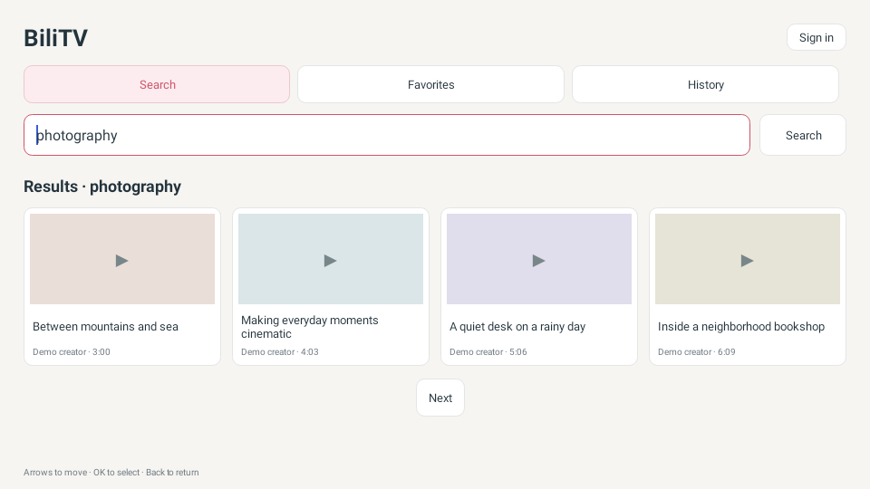
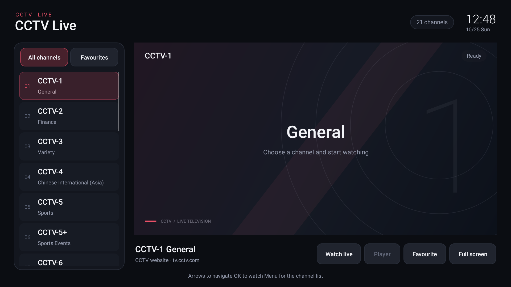
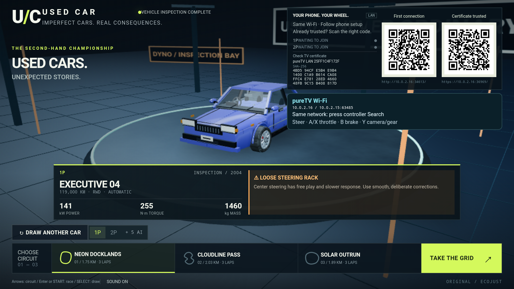
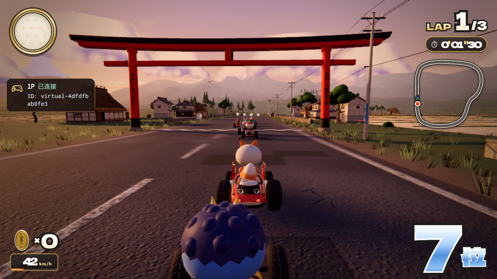
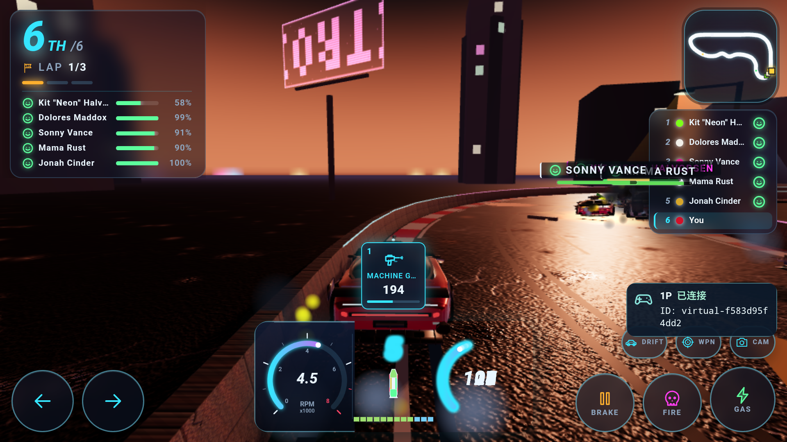
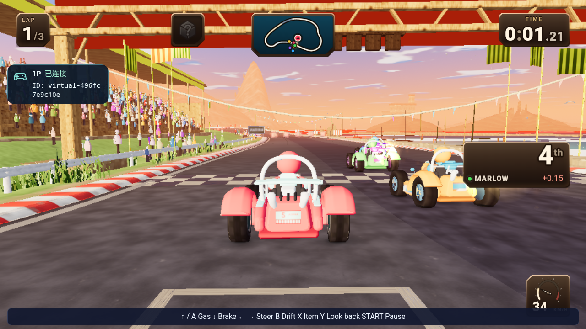
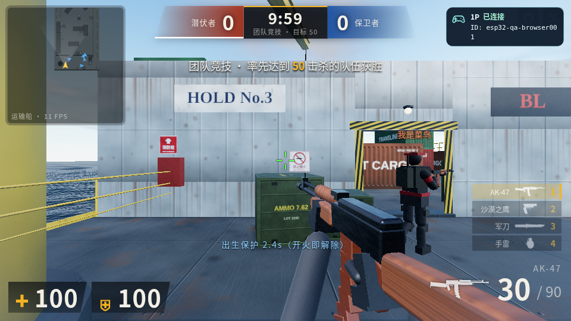
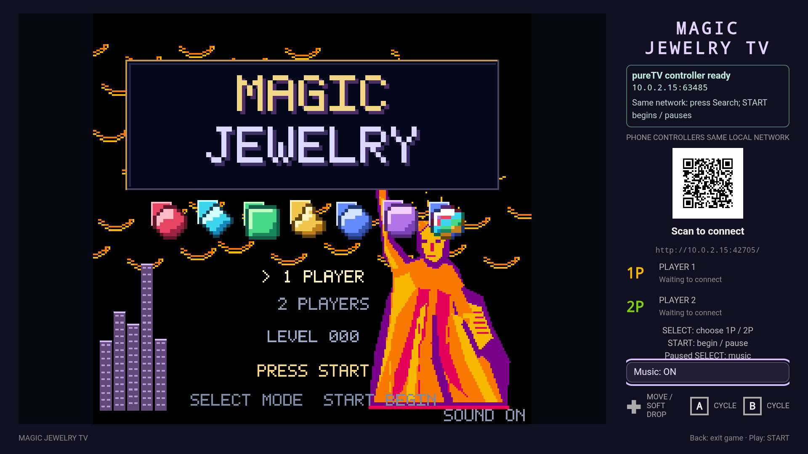

# pureTV app catalog

[简体中文](README.md) · **English** · [User guide](docs/guide/README.en.md) · [Development and MCP](docs/guide/development.en.md)

[Management apps](#management-apps) · [Launchers and TV apps](#launcher-and-tv-app-resources) · [Game catalog](#games) · [Third-party TV apps](fork/README.md) · [Game reference catalog](docs/claude-games/catalog.en.md)

## Management apps

| App | Purpose | Platform | Download |
| --- | --- | --- | --- |
| pureTV Manager | Manage TV apps and launchers from a computer | Windows, macOS, Linux | [0.5.9](https://github.com/ecojust/pureTV/releases/tag/desktop-v0.5.9) |
| putrtv Store | Browse, install and update apps on a TV | Android TV | [0.1.1 APK](resource/apps/putrtv-store/putrtv-store-0.1.1.apk?raw=1) |

## Launcher and TV app resources

[Browse all launchers and TV apps](resource/README.md)

<!-- resource-index:start -->

### Apps - Tools (1)

<table>
  <tr>
    <td align="center" valign="top" width="25%"><a href="resource/apps/putrtv-store/"> putrtv Store</a></td>
    <td width="25%"></td>
    <td width="25%"></td>
    <td width="25%"></td>
  </tr>
</table>

### Launchers (10)

<table>
  <tr>
    <td align="center" valign="top" width="25%"><a href="resource/launcher/sol/"> Sol TV</a></td>
    <td align="center" valign="top" width="25%"><a href="resource/launcher/pixel/"> Pixel TV</a></td>
    <td align="center" valign="top" width="25%"><a href="resource/launcher/moss/"> Moss TV</a></td>
    <td align="center" valign="top" width="25%"><a href="resource/launcher/mono/"> Mono TV</a></td>
  </tr>
  <tr>
    <td align="center" valign="top" width="25%"><a href="resource/launcher/forma/"> Forma TV</a></td>
    <td align="center" valign="top" width="25%"><a href="resource/launcher/drift/"> Drift TV</a></td>
    <td align="center" valign="top" width="25%"><a href="resource/launcher/circuit/"> Circuit TV</a></td>
    <td align="center" valign="top" width="25%"><a href="resource/launcher/aster/"> Aster TV</a></td>
  </tr>
  <tr>
    <td align="center" valign="top" width="25%"><a href="resource/launcher/nova/"> Nova TV</a></td>
    <td align="center" valign="top" width="25%"><a href="resource/launcher/puretv/"> pureTV Launcher</a></td>
    <td width="25%"></td>
    <td width="25%"></td>
  </tr>
</table>

### Apps - Media (6)

<table>
  <tr>
    <td align="center" valign="top" width="25%"><a href="resource/apps/opera/"> Opera TV</a></td>
    <td align="center" valign="top" width="25%"><a href="resource/apps/bilibili/"> BiliTV</a></td>
    <td align="center" valign="top" width="25%"><a href="resource/apps/cctv/"> CCTV Live</a></td>
    <td align="center" valign="top" width="25%"><a href="resource/apps/hifini/"> HIFINi TV</a></td>
  </tr>
  <tr>
    <td align="center" valign="top" width="25%"><a href="resource/apps/webtv/"> WebTV</a></td>
    <td align="center" valign="top" width="25%"><a href="resource/apps/shortvideo/"> ShortVideo TV</a></td>
    <td width="25%"></td>
    <td width="25%"></td>
  </tr>
</table>

<!-- resource-index:end -->

## Game catalog

<!-- game-index:start -->

**36 controller games** · Android TV (36) · macOS (24) · Windows x64 (19)

[Racing and sports (13)](#controller-racing) · [Action, RPGs and exploration (2)](#controller-action) · [Platformers, bullet hell and arcade (7)](#controller-arcade) · [Strategy, tower defense and card games (1)](#controller-strategy) · [Puzzles and brainteasers (12)](#controller-puzzle) · [One-button arcade (1)](#controller-one-button)

### Racing and sports (13)

<table>
  <tr>
    <td align="center" valign="top" width="25%"><a href="resource/apps/neon-rush/"> Neon Rush TV</a> <a href="resource/apps/neon-rush/neon-rush-0.1.3.apk?raw=1">APK</a> · <a href="resource/apps/neon-rush/macos/NeonRush-0.1.4-macos-universal.dmg?raw=1">macOS</a></td>
    <td align="center" valign="top" width="25%"><a href="resource/apps/used-car-racing/"> Used Car Racing TV</a> <a href="resource/apps/used-car-racing/used-car-racing-0.1.5.apk?raw=1">APK</a></td>
    <td align="center" valign="top" width="25%"><a href="resource/apps/coast-kart/"> Coast Kart TV</a> <a href="resource/apps/coast-kart/coast-kart-0.5.4.apk?raw=1">APK</a></td>
    <td align="center" valign="top" width="25%"><a href="joystick-games/backroad-rally/"> Backroad Rally</a> <a href="https://github.com/ecojust/pureTV/releases/download/joystick-backroad-rally-android-v0.1.2/backroad-rally-0.1.2.apk">APK</a> · <a href="https://github.com/ecojust/pureTV/releases/download/joystick-backroad-rally-v0.1.0/BackroadRally-0.1.0-macos-universal.dmg">macOS preview</a> · <a href="https://github.com/ecojust/pureTV/releases/download/joystick-backroad-rally-windows-v0.1.0/BackroadRally-0.1.0-windows-x64-setup.exe">Windows</a></td>
  </tr>
  <tr>
    <td align="center" valign="top" width="25%"><a href="joystick-games/ponpoko-kart/"> Ponpoko Kart</a> <a href="https://raw.githubusercontent.com/ecojust/pureTV/3bf22a01c62439afdc7352e2f7529cc23ea575ad/joystick-games/ponpoko-kart/ponpoko-kart-0.1.5.apk">APK</a> · <a href="https://raw.githubusercontent.com/ecojust/pureTV/515250931fa4203132ab658d81567682184651de/joystick-games/ponpoko-kart/macos/PonpokoKart-0.1.0-macos-universal.dmg">macOS</a> · <a href="https://raw.githubusercontent.com/ecojust/pureTV/515250931fa4203132ab658d81567682184651de/joystick-games/ponpoko-kart/PonpokoKart-0.1.0-windows-x64-setup.exe">Windows</a></td>
    <td align="center" valign="top" width="25%"><a href="joystick-games/night-racer/"> Night Racer</a> <a href="https://raw.githubusercontent.com/ecojust/pureTV/515250931fa4203132ab658d81567682184651de/joystick-games/night-racer/night-racer-0.1.0.apk">APK</a> · <a href="https://raw.githubusercontent.com/ecojust/pureTV/515250931fa4203132ab658d81567682184651de/joystick-games/night-racer/macos/NightRacer-0.1.0-macos-universal.dmg">macOS</a> · <a href="https://raw.githubusercontent.com/ecojust/pureTV/515250931fa4203132ab658d81567682184651de/joystick-games/night-racer/NightRacer-0.1.0-windows-x64-setup.exe">Windows</a></td>
    <td align="center" valign="top" width="25%"><a href="joystick-games/penguintrack/"> Penguintrack</a> <a href="https://raw.githubusercontent.com/ecojust/pureTV/515250931fa4203132ab658d81567682184651de/joystick-games/penguintrack/penguintrack-0.1.0.apk">APK</a> · <a href="https://raw.githubusercontent.com/ecojust/pureTV/515250931fa4203132ab658d81567682184651de/joystick-games/penguintrack/macos/Penguintrack-0.1.0-macos-universal.dmg">macOS</a> · <a href="https://raw.githubusercontent.com/ecojust/pureTV/515250931fa4203132ab658d81567682184651de/joystick-games/penguintrack/Penguintrack-0.1.0-windows-x64-setup.exe">Windows</a></td>
    <td align="center" valign="top" width="25%"><a href="joystick-games/last-track/"> Last Track</a> <a href="https://raw.githubusercontent.com/ecojust/pureTV/515250931fa4203132ab658d81567682184651de/joystick-games/last-track/last-track-0.1.0.apk">APK</a> · <a href="https://raw.githubusercontent.com/ecojust/pureTV/515250931fa4203132ab658d81567682184651de/joystick-games/last-track/macos/LastTrack-0.1.0-macos-universal.dmg">macOS</a> · <a href="https://raw.githubusercontent.com/ecojust/pureTV/515250931fa4203132ab658d81567682184651de/joystick-games/last-track/LastTrack-0.1.0-windows-x64-setup.exe">Windows</a></td>
  </tr>
  <tr>
    <td align="center" valign="top" width="25%"><a href="joystick-games/dirt-crown/"> Dirt Crown</a> <a href="https://raw.githubusercontent.com/ecojust/pureTV/515250931fa4203132ab658d81567682184651de/joystick-games/dirt-crown/dirt-crown-0.1.0.apk">APK</a> · <a href="https://raw.githubusercontent.com/ecojust/pureTV/515250931fa4203132ab658d81567682184651de/joystick-games/dirt-crown/macos/DirtCrown-0.1.0-macos-universal.dmg">macOS</a> · <a href="https://raw.githubusercontent.com/ecojust/pureTV/515250931fa4203132ab658d81567682184651de/joystick-games/dirt-crown/DirtCrown-0.1.0-windows-x64-setup.exe">Windows</a></td>
    <td align="center" valign="top" width="25%"><a href="joystick-games/turbo-kart-rush/"> Turbo Kart Rush</a> <a href="https://raw.githubusercontent.com/ecojust/pureTV/515250931fa4203132ab658d81567682184651de/joystick-games/turbo-kart-rush/turbo-kart-rush-0.1.1.apk">APK</a> · <a href="https://raw.githubusercontent.com/ecojust/pureTV/515250931fa4203132ab658d81567682184651de/joystick-games/turbo-kart-rush/macos/TurboKartRush-0.1.0-macos-universal.dmg">macOS</a> · <a href="https://raw.githubusercontent.com/ecojust/pureTV/515250931fa4203132ab658d81567682184651de/joystick-games/turbo-kart-rush/windows/TurboKartRush-0.1.0-windows-x64-setup.exe">Windows</a></td>
    <td align="center" valign="top" width="25%"><a href="joystick-games/kart-rush/"> Kart Rush</a> <a href="https://raw.githubusercontent.com/ecojust/pureTV/515250931fa4203132ab658d81567682184651de/joystick-games/kart-rush/kart-rush-0.1.0.apk">APK</a> · <a href="https://raw.githubusercontent.com/ecojust/pureTV/515250931fa4203132ab658d81567682184651de/joystick-games/kart-rush/macos/KartRush-0.1.0-macos-universal.dmg">macOS</a> · <a href="https://raw.githubusercontent.com/ecojust/pureTV/515250931fa4203132ab658d81567682184651de/joystick-games/kart-rush/KartRush-0.1.0-windows-x64-setup.exe">Windows</a></td>
    <td align="center" valign="top" width="25%"><a href="joystick-games/kart-royale/"> Kart Royale</a> <a href="https://raw.githubusercontent.com/ecojust/pureTV/36b91f81533f10ff5d37ec091c3701913d4a42e4/joystick-games/kart-royale/kart-royale-0.1.4.apk">APK</a> · <a href="https://raw.githubusercontent.com/ecojust/pureTV/515250931fa4203132ab658d81567682184651de/joystick-games/kart-royale/macos/KartRoyale-0.1.0-macos-universal.dmg">macOS</a> · <a href="https://raw.githubusercontent.com/ecojust/pureTV/515250931fa4203132ab658d81567682184651de/joystick-games/kart-royale/windows/KartRoyale-0.1.1-windows-x64-setup.exe">Windows</a></td>
  </tr>
  <tr>
    <td align="center" valign="top" width="25%"><a href="joystick-games/qq-speed/"> QQ Speed</a> <a href="joystick-games/qq-speed/qq-speed-0.1.0.apk?raw=1">APK</a> · <a href="joystick-games/qq-speed/macos/QQSpeed-0.1.0-macos-universal.dmg?raw=1">macOS</a></td>
    <td width="25%"></td>
    <td width="25%"></td>
    <td width="25%"></td>
  </tr>
</table>

### Action, RPGs and exploration (2)

<table>
  <tr>
    <td align="center" valign="top" width="25%"><a href="resource/apps/alien-shooter/"> Alien Shooter TV</a> <a href="resource/apps/alien-shooter/alien-shooter-0.1.4.apk?raw=1">APK</a></td>
    <td align="center" valign="top" width="25%"><a href="joystick-games/cf-transport-ship/"> CF Transport Ship</a> <a href="joystick-games/cf-transport-ship/cf-transport-ship-0.1.0.apk?raw=1">APK</a> · <a href="joystick-games/cf-transport-ship/macos/CFTransportShip-0.1.0-macos-universal.dmg?raw=1">macOS</a></td>
    <td width="25%"></td>
    <td width="25%"></td>
  </tr>
</table>

### Platformers, bullet hell and arcade (7)

<table>
  <tr>
    <td align="center" valign="top" width="25%"><a href="resource/apps/super-mario/"> Super Mario TV</a> <a href="resource/apps/super-mario/super-mario-0.5.4.apk?raw=1">APK</a></td>
    <td align="center" valign="top" width="25%"><a href="resource/apps/jackal/"> Jackal TV</a> <a href="resource/apps/jackal/jackal-0.5.4.apk?raw=1">APK</a></td>
    <td align="center" valign="top" width="25%"><a href="resource/apps/tank/"> Tank TV</a> <a href="resource/apps/tank/tank-0.5.4.apk?raw=1">APK</a></td>
    <td align="center" valign="top" width="25%"><a href="joystick-games/glup/"> GLUP</a> <a href="joystick-games/glup/glup-0.1.0.apk?raw=1">APK</a> · <a href="joystick-games/glup/Glup-0.1.0-macos-universal.dmg?raw=1">macOS</a></td>
  </tr>
  <tr>
    <td align="center" valign="top" width="25%"><a href="resource/apps/bomb-jack/"> Mighty Bomb Jack TV</a> <a href="resource/apps/bomb-jack/bomb-jack-0.5.4.apk?raw=1">APK</a></td>
    <td align="center" valign="top" width="25%"><a href="resource/apps/adventure-island/"> Adventure Island TV</a> <a href="resource/apps/adventure-island/adventure-island-0.5.4.apk?raw=1">APK</a></td>
    <td align="center" valign="top" width="25%"><a href="resource/apps/conveyor-window/"> Conveyor Window (Chinese UI)</a> <a href="resource/apps/conveyor-window/conveyor-window-0.2.2.apk?raw=1">APK</a></td>
    <td width="25%"></td>
  </tr>
</table>

### Strategy, tower defense and card games (1)

<table>
  <tr>
    <td align="center" valign="top" width="25%"><a href="joystick-games/emberbrood/"> Emberbrood</a> <a href="joystick-games/emberbrood/emberbrood-0.1.0.apk?raw=1">APK</a> · <a href="joystick-games/emberbrood/Emberbrood-0.1.0-macos-universal.dmg?raw=1">macOS</a></td>
    <td width="25%"></td>
    <td width="25%"></td>
    <td width="25%"></td>
  </tr>
</table>

### Puzzles and brainteasers (12)

<table>
  <tr>
    <td align="center" valign="top" width="25%"><a href="resource/apps/tetris/"> Tetris TV</a> <a href="resource/apps/tetris/tetris-0.5.4.apk?raw=1">APK</a></td>
    <td align="center" valign="top" width="25%"><a href="resource/apps/jewel/"> Magic Jewelry TV</a> <a href="resource/apps/jewel/jewel-0.5.4.apk?raw=1">APK</a></td>
    <td align="center" valign="top" width="25%"><a href="joystick-games/alchemists-lattice/"> Alchemist&#x27;s Lattice</a> <a href="https://github.com/ecojust/pureTV/releases/download/joystick-alchemists-lattice-v0.1.1/alchemists-lattice-0.1.1.apk">APK</a> · <a href="https://github.com/ecojust/pureTV/releases/download/joystick-alchemists-lattice-v0.1.1/AlchemistsLattice-0.1.1-macos-universal.dmg">macOS preview</a> · <a href="https://github.com/ecojust/pureTV/releases/download/joystick-alchemists-lattice-v0.1.1/AlchemistsLattice-0.1.1-windows-x64-setup.exe">Windows</a></td>
    <td align="center" valign="top" width="25%"><a href="joystick-games/story-thief/"> The Story Thief of Greymantle</a> <a href="https://github.com/ecojust/pureTV/releases/download/joystick-story-thief-v0.1.1/story-thief-0.1.1.apk">APK</a> · <a href="https://github.com/ecojust/pureTV/releases/download/joystick-story-thief-v0.1.1/StoryThief-0.1.1-macos-universal.dmg">macOS</a> · <a href="https://github.com/ecojust/pureTV/releases/download/joystick-story-thief-v0.1.1/StoryThief-0.1.1-windows-x64-setup.exe">Windows</a></td>
  </tr>
  <tr>
    <td align="center" valign="top" width="25%"><a href="joystick-games/bumble-basket/"> Bumble Basket</a> <a href="https://github.com/ecojust/pureTV/releases/download/joystick-bumble-basket-v0.1.2/bumble-basket-0.1.2.apk">APK</a> · <a href="https://github.com/ecojust/pureTV/releases/download/joystick-bumble-basket-v0.1.2/BumbleBasket-0.1.2-macos-universal.dmg">macOS preview</a> · <a href="https://github.com/ecojust/pureTV/releases/download/joystick-bumble-basket-v0.1.2/BumbleBasket-0.1.2-windows-x64-setup.exe">Windows</a></td>
    <td align="center" valign="top" width="25%"><a href="joystick-games/starsling/"> STARSLING</a> <a href="https://github.com/ecojust/pureTV/releases/download/joystick-starsling-v0.1.1/starsling-0.1.1.apk">APK</a> · <a href="https://github.com/ecojust/pureTV/releases/download/joystick-starsling-v0.1.1/Starsling-0.1.1-macos-universal.dmg">macOS preview</a> · <a href="https://github.com/ecojust/pureTV/releases/download/joystick-starsling-v0.1.1/Starsling-0.1.1-windows-x64-setup.exe">Windows</a></td>
    <td align="center" valign="top" width="25%"><a href="joystick-games/solder-and-rain/"> Solder &amp; Rain</a> <a href="https://github.com/ecojust/pureTV/releases/download/joystick-solder-and-rain-v0.1.0/solder-and-rain-0.1.0.apk">APK</a> · <a href="https://github.com/ecojust/pureTV/releases/download/joystick-solder-and-rain-v0.1.0/SolderAndRain-0.1.0-macos-universal.dmg">macOS preview</a> · <a href="https://github.com/ecojust/pureTV/releases/download/joystick-solder-and-rain-v0.1.0/SolderAndRain-0.1.0-windows-x64-setup.exe">Windows</a></td>
    <td align="center" valign="top" width="25%"><a href="joystick-games/oathstones/"> Oathstones</a> <a href="https://github.com/ecojust/pureTV/releases/download/joystick-oathstones-v0.1.0/oathstones-0.1.0.apk">APK</a> · <a href="https://github.com/ecojust/pureTV/releases/download/joystick-oathstones-v0.1.0/Oathstones-0.1.0-macos-universal.dmg">macOS preview</a> · <a href="https://github.com/ecojust/pureTV/releases/download/joystick-oathstones-v0.1.0/Oathstones-0.1.0-windows-x64-setup.exe">Windows</a></td>
  </tr>
  <tr>
    <td align="center" valign="top" width="25%"><a href="joystick-games/neon-arcana/"> NEON ARCANA</a> <a href="https://github.com/ecojust/pureTV/releases/download/joystick-neon-arcana-v0.1.1/neon-arcana-0.1.1.apk">APK</a> · <a href="https://github.com/ecojust/pureTV/releases/download/joystick-neon-arcana-v0.1.1/NeonArcana-0.1.1-macos-universal.dmg">macOS preview</a> · <a href="https://github.com/ecojust/pureTV/releases/download/joystick-neon-arcana-v0.1.1/NeonArcana-0.1.1-windows-x64-setup.exe">Windows</a></td>
    <td align="center" valign="top" width="25%"><a href="joystick-games/atlas-of-ink/"> Atlas of Ink</a> <a href="https://github.com/ecojust/pureTV/releases/download/joystick-atlas-of-ink-v0.1.1/atlas-of-ink-0.1.1.apk">APK</a> · <a href="https://github.com/ecojust/pureTV/releases/download/joystick-atlas-of-ink-v0.1.1/AtlasOfInk-0.1.1-macos-universal.dmg">macOS</a> · <a href="https://github.com/ecojust/pureTV/releases/download/joystick-atlas-of-ink-v0.1.1/AtlasOfInk-0.1.1-windows-x64-setup.exe">Windows</a></td>
    <td align="center" valign="top" width="25%"><a href="joystick-games/starbase-spooky/"> Starbase Spooky</a> <a href="https://github.com/ecojust/pureTV/releases/download/joystick-starbase-spooky-v0.1.2/starbase-spooky-0.1.2.apk">APK</a> · <a href="https://github.com/ecojust/pureTV/releases/download/joystick-starbase-spooky-v0.1.2/StarbaseSpooky-0.1.2-macos-universal.dmg">macOS</a> · <a href="https://github.com/ecojust/pureTV/releases/download/joystick-starbase-spooky-v0.1.2/StarbaseSpooky-0.1.2-windows-x64-setup.exe">Windows</a></td>
    <td align="center" valign="top" width="25%"><a href="joystick-games/sugarplum-drop/"> Sugarplum Drop</a> <a href="joystick-games/sugarplum-drop/sugarplum-drop-0.1.0.apk?raw=1">APK</a> · <a href="joystick-games/sugarplum-drop/SugarplumDrop-0.1.0-macos-universal.dmg?raw=1">macOS</a> · <a href="joystick-games/sugarplum-drop/SugarplumDrop-0.1.0-windows-x64-setup.exe?raw=1">Windows</a></td>
  </tr>
</table>

### One-button arcade (1)

<table>
  <tr>
    <td align="center" valign="top" width="25%"><a href="resource/apps/tower-overlap/"> Tower Overlap</a> <a href="resource/apps/tower-overlap/tower-overlap-0.2.2.apk?raw=1">APK</a></td>
    <td width="25%"></td>
    <td width="25%"></td>
    <td width="25%"></td>
  </tr>
</table>

<!-- game-index:end -->
