[简体中文](README.md) | **English**

  

pureTV is a desktop system manager for Android TV and Google TV. Connect to your TV over ADB to view system information, install and uninstall apps, enable or disable them, choose a launcher, and customize supported home screens with a visual canvas. Agents can also control the open manager through MCP.

[Download pureTV Manager 0.5.9](https://github.com/ecojust/pureTV/releases/tag/desktop-v0.5.9) · Windows / macOS / Linux · New server for APK Market and manager updates

If you are using 0.5.7 or earlier, manually install 0.5.9 from the release page above first. Older clients do not switch download sources automatically. The new version uses the app directories and `client/` update directory on `apps.b14f.com`.

[Download putrtv Store 0.1.1 for TV](resource/apps/putrtv-store/putrtv-store-0.1.1.apk?raw=1) · Browse, install and check updates on your TV; use an [updated launcher](resource/README.md) to choose where to add an app.

[Browse 43 controller games by genre](#controller-games-by-genre)

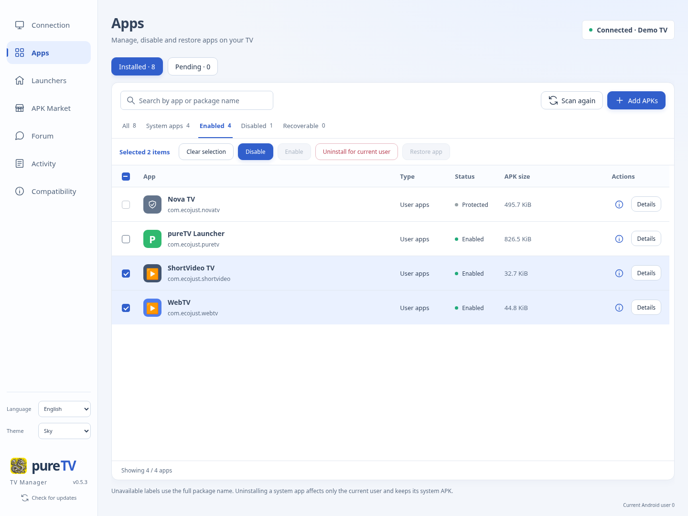

## Connection and app management

1. Connect your computer and TV to networks that can reach each other, then enable ADB or network debugging in the TV's developer options.
2. Enter the TV's IP address or hostname and debugging port on the home page, then authorize the computer on the TV. Port 5555 is common; use the port configured on your TV.
3. If ADB is missing, read and accept the Android SDK license, then click “Download and configure ADB.” The manager tries Google first and uses the Tencent mirror if that fails. You can also select an existing ADB installation.

Once connected, the home page displays the model, Android version, SDK version, security patch level, CPU, memory, `/data` storage capacity, resolution, and uptime. Other pages show the current connection status at the top.

- **App management:** search and filter apps, enable or disable them in batches, uninstall them for the current user, and restore system apps whose APKs are still present.
- **Package information:** click the circled **i** in an app row to look up its purpose, uninstall risk, source and retrieval time. Unknown packages stay unassessed, and protection for core components and the current launcher takes precedence.
- **Manager updates:** check the server's [client/](https://apps.b14f.com/client/) directory at startup or manually, matching the current platform. **Download and install** verifies the package, installs it and restarts the manager. See [client updates](desktop/docs/client-updates.md) for platform behavior and the first upgrade from an older version.
- **Pending installations:** import local APKs, install one from its row, or select several for batch installation. Successful items leave the queue; failed and unprocessed items remain.
- **Launchers:** import and install launcher APKs directly from this page, choose a default home screen, or restore the previous default. The active launcher shows “Adjust layout” when it supports the interface.
- **Market:** browse apps and launchers dynamically from the `launcher/`, `media/` and `game/` directories on [apps.b14f.com](https://apps.b14f.com/launcher/), search and preview them, download them to the pending installation queue, or install them on a connected TV. Versions of the same app or launcher share one card, with a dropdown for the latest five versions and the newest selected by default. Refresh to discover APKs newly uploaded to the server. Downloads also cache a sibling `logo.svg`; adding an app block or changing its app in the layout editor automatically uses the saved icon.
- App and launcher sizes include the main APK and split APKs. Private data, caches, and optimized files are excluded. Unreadable sizes are explicitly shown as unknown.
- Lists scroll within their own tables, with fixed headers and batch actions above them. Core system components and the current default launcher are protected.

Uninstalling a system app affects only the current Android user, preserves its data, and leaves the APK on the system partition. Newly installed user apps with a launchable activity can be added to the launcher layout.

Actions such as connecting, refreshing, managing apps, switching launchers, and applying layouts show a loading state followed by a result dialog. Batch results distinguish successful, failed, and unprocessed items. Automatic background reads do not interrupt you with dialogs.

## Launcher and TV app resources

The public [resource/](resource/) directory contains [launcher/](resource/launcher/) and [apps/](resource/apps/). Launcher and app sources previously stored at the repository root have moved into these directories. Launcher and TV app APKs are available in their software folders and separate `android-v*` releases; the desktop manager keeps its own `desktop-v*` versions and latest-release entry. Each software folder contains at least one actual APK and may also include matching source code, cover images, author details, licenses, and SHA256 checksums. Click a software name to open its folder. Every TV app directory provides a 64×64 `logo.svg` for launcher layouts; see the [resource convention](resource/README-development.md#应用资源与-logosvg-约定) for new apps.

The [0.5.1 game fidelity review](docs/game-fidelity-0.5.1.md) records rule and interaction improvements across the nine games, together with remaining map and content differences. The games retain the shared 0.5.0 certificate and support in-place updates from 0.5.0.

The launchers and first-party TV apps support English. Select English in the TV system settings to use it. User-provided app names, playlists, and media titles keep their original text. Native previews below use English test content; they are not physical TV captures.

Launcher layout customization uses this manager's **layout.json version 5 users/system interface**. Cards for launchers that support the layout protocol automatically display the Home background color and image, including inactive launchers, and update after layout changes are applied. The list has no choose-cover or remove-cover actions; edit the home-screen background in “Adjust layout.” Pending APKs use their embedded Home background when available, falling back to a sibling `thumb.png` or `APK-name.thumb.png` only when no layout background can be read.

This page currently features eight games from the new hundred-game collection alongside the earlier games. Browse every title in the [complete resource catalog](resource/README.md).

<!-- resource-index:start -->

### Launchers (10)

<table>
  <tr>
    <td align="center" valign="top" width="25%"><a href="resource/launcher/sol/"> Sol TV</a></td>
    <td align="center" valign="top" width="25%"><a href="resource/launcher/pixel/"> Pixel TV</a></td>
    <td align="center" valign="top" width="25%"><a href="resource/launcher/moss/"> Moss TV</a></td>
    <td align="center" valign="top" width="25%"><a href="resource/launcher/mono/"> Mono TV</a></td>
  </tr>
  <tr>
    <td align="center" valign="top" width="25%"><a href="resource/launcher/forma/">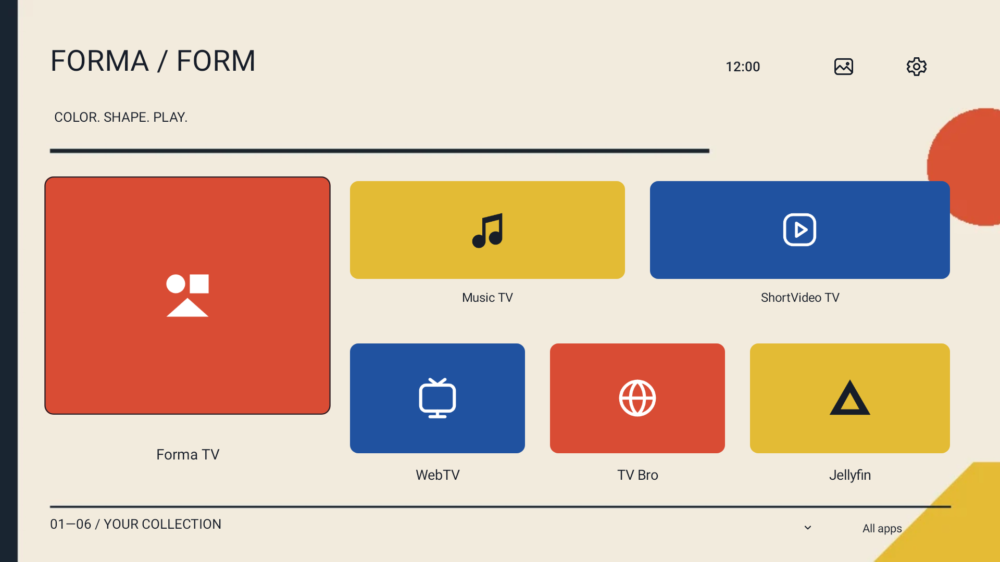 Forma TV</a></td>
    <td align="center" valign="top" width="25%"><a href="resource/launcher/drift/"> Drift TV</a></td>
    <td align="center" valign="top" width="25%"><a href="resource/launcher/circuit/"> Circuit TV</a></td>
    <td align="center" valign="top" width="25%"><a href="resource/launcher/aster/">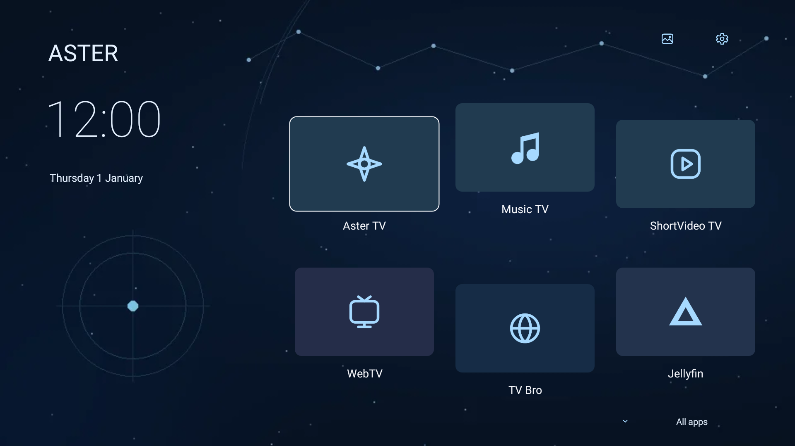 Aster TV</a></td>
  </tr>
  <tr>
    <td align="center" valign="top" width="25%"><a href="resource/launcher/nova/"> Nova TV</a></td>
    <td align="center" valign="top" width="25%"><a href="resource/launcher/puretv/"> pureTV Launcher</a></td>
    <td width="25%"></td>
    <td width="25%"></td>
  </tr>
</table>

### Apps - Media (6)

<table>
  <tr>
    <td align="center" valign="top" width="25%"><a href="resource/apps/opera/"> Opera TV</a></td>
    <td align="center" valign="top" width="25%"><a href="resource/apps/bilibili/"> BiliTV</a></td>
    <td align="center" valign="top" width="25%"><a href="resource/apps/cctv/"> CCTV Live</a></td>
    <td align="center" valign="top" width="25%"><a href="resource/apps/hifini/"> HIFINi TV</a></td>
  </tr>
  <tr>
    <td align="center" valign="top" width="25%"><a href="resource/apps/webtv/"> WebTV</a></td>
    <td align="center" valign="top" width="25%"><a href="resource/apps/shortvideo/">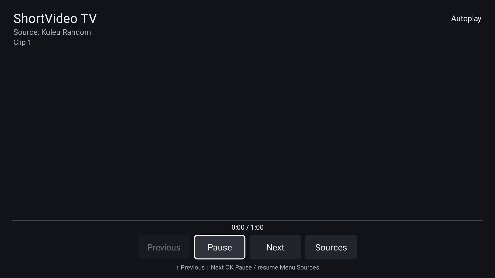 ShortVideo TV</a></td>
    <td width="25%"></td>
    <td width="25%"></td>
  </tr>
</table>

### Apps - Games (20)

<table>
  <tr>
    <td align="center" valign="top" width="25%"><a href="resource/apps/neon-rush/">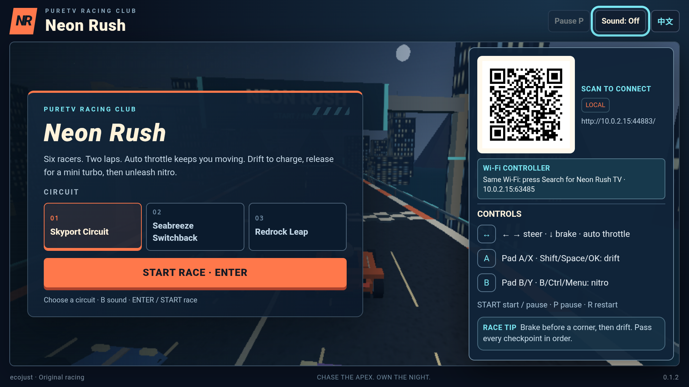 Neon Rush TV</a></td>
    <td align="center" valign="top" width="25%"><a href="resource/apps/twenty-four/">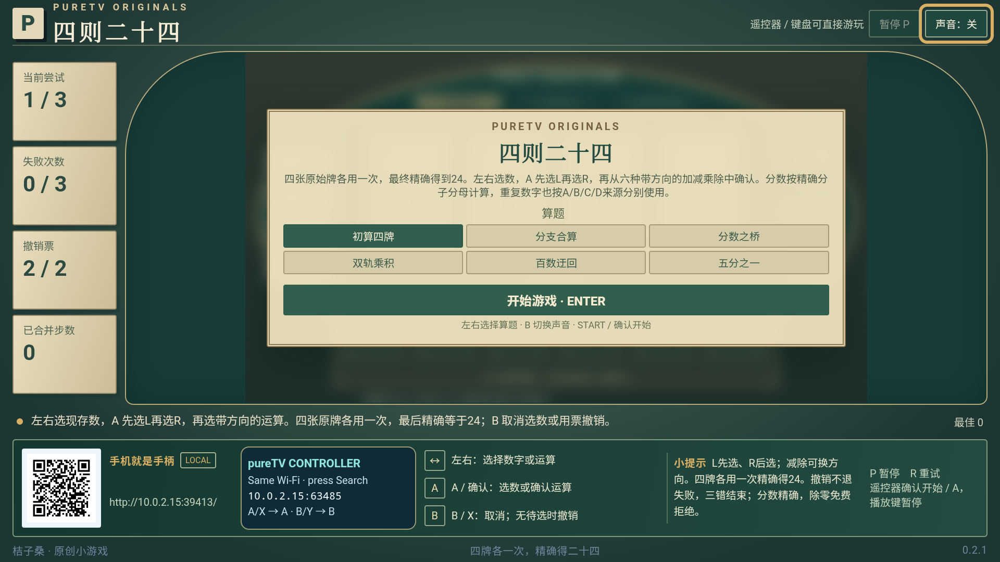 Twenty Four</a></td>
    <td align="center" valign="top" width="25%"><a href="resource/apps/torch-bridge/">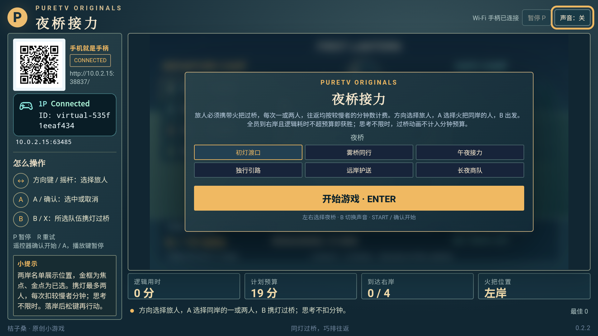 Torch Bridge</a></td>
    <td align="center" valign="top" width="25%"><a href="resource/apps/tower-overlap/">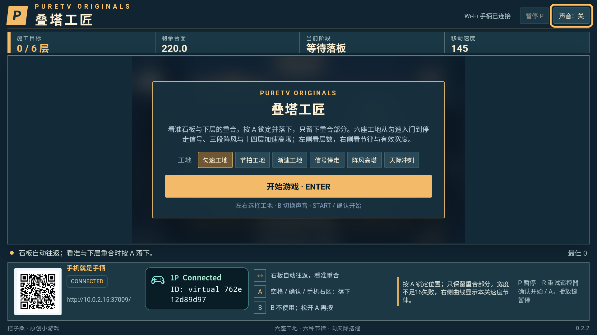 Tower Overlap</a></td>
  </tr>
  <tr>
    <td align="center" valign="top" width="25%"><a href="resource/apps/packing-sculptor/">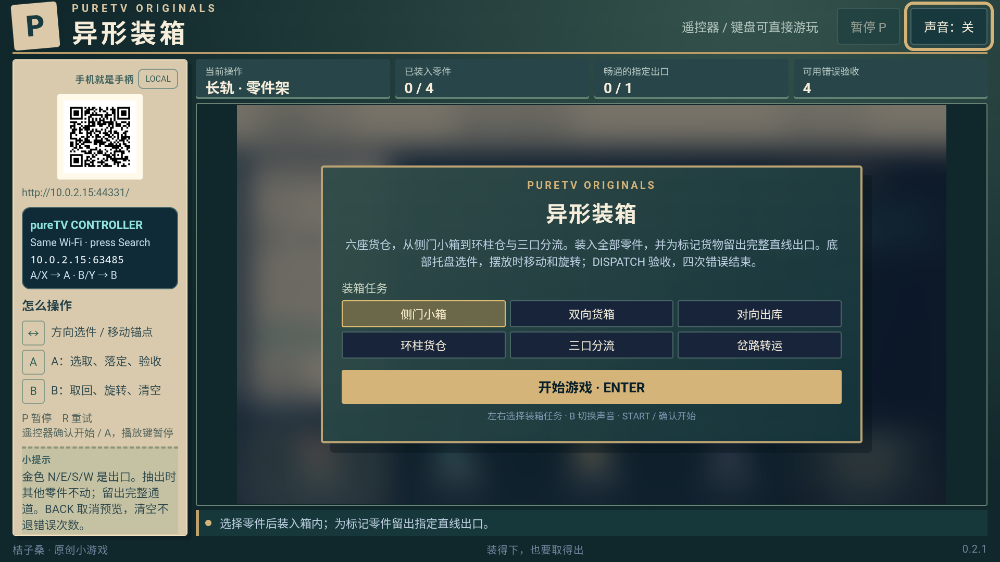 Packing Sculptor</a></td>
    <td align="center" valign="top" width="25%"><a href="resource/apps/conveyor-window/">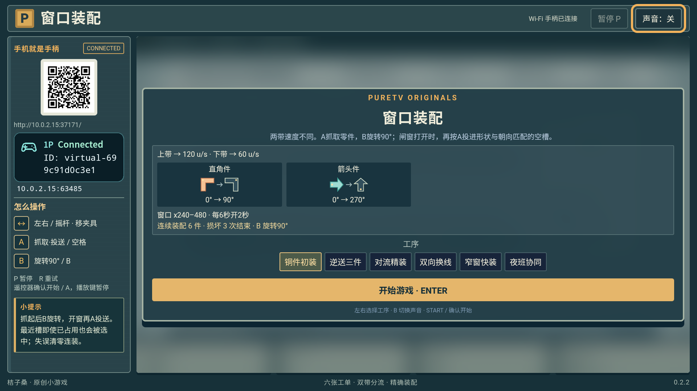 Conveyor Window (Chinese UI)</a></td>
    <td align="center" valign="top" width="25%"><a href="resource/apps/glass-fold/">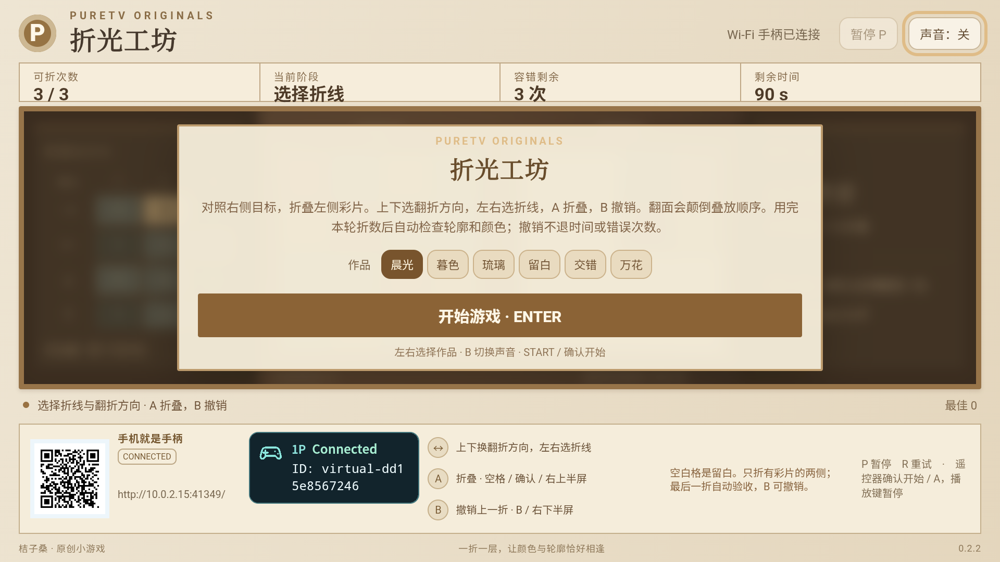 Glass Fold (Chinese UI)</a></td>
    <td align="center" valign="top" width="25%"><a href="resource/apps/tension-span/">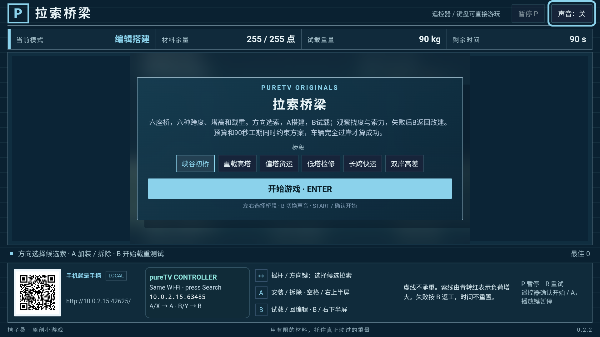 Tension Span (Chinese UI)</a></td>
  </tr>
  <tr>
    <td align="center" valign="top" width="25%"><a href="resource/apps/prism-relay/">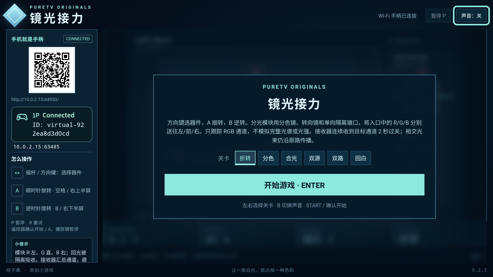 Light Relay (Chinese UI)</a></td>
    <td align="center" valign="top" width="25%"><a href="resource/apps/alien-shooter/">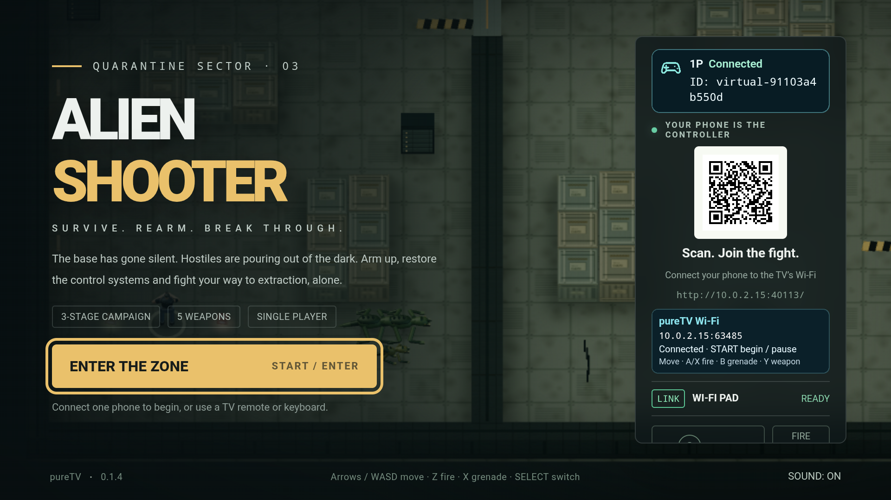 Alien Shooter TV</a></td>
    <td align="center" valign="top" width="25%"><a href="resource/apps/used-car-racing/"> Used Car Racing TV</a></td>
    <td align="center" valign="top" width="25%"><a href="resource/apps/cozy-island/">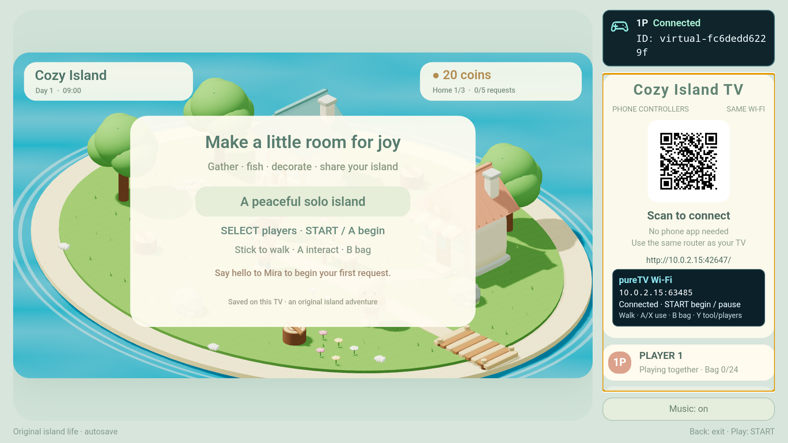 Cozy Island TV</a></td>
  </tr>
  <tr>
    <td align="center" valign="top" width="25%"><a href="resource/apps/coast-kart/">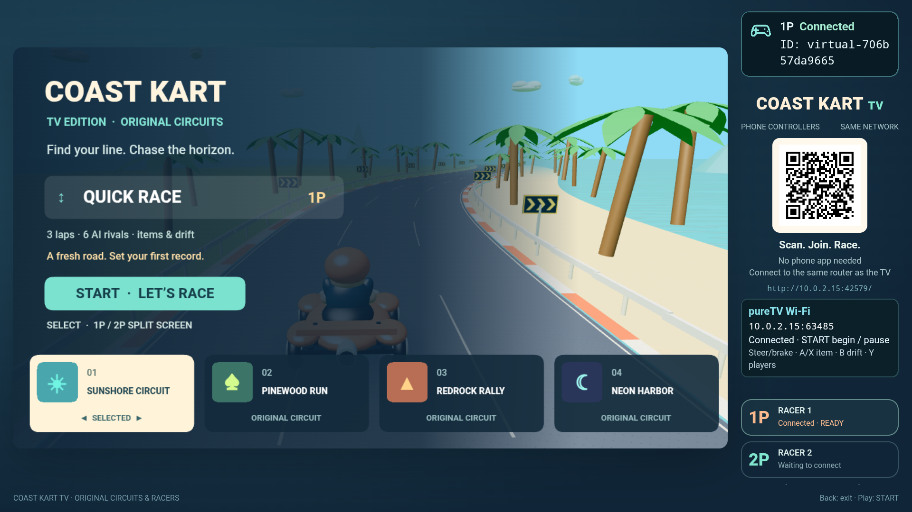 Coast Kart TV</a></td>
    <td align="center" valign="top" width="25%"><a href="resource/apps/super-mario/">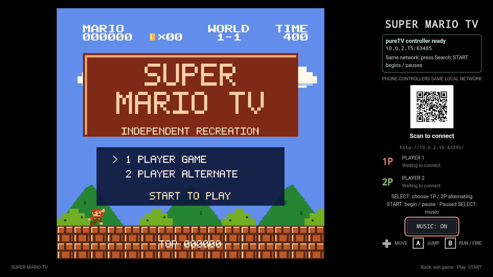 Super Mario TV</a></td>
    <td align="center" valign="top" width="25%"><a href="resource/apps/bomb-jack/">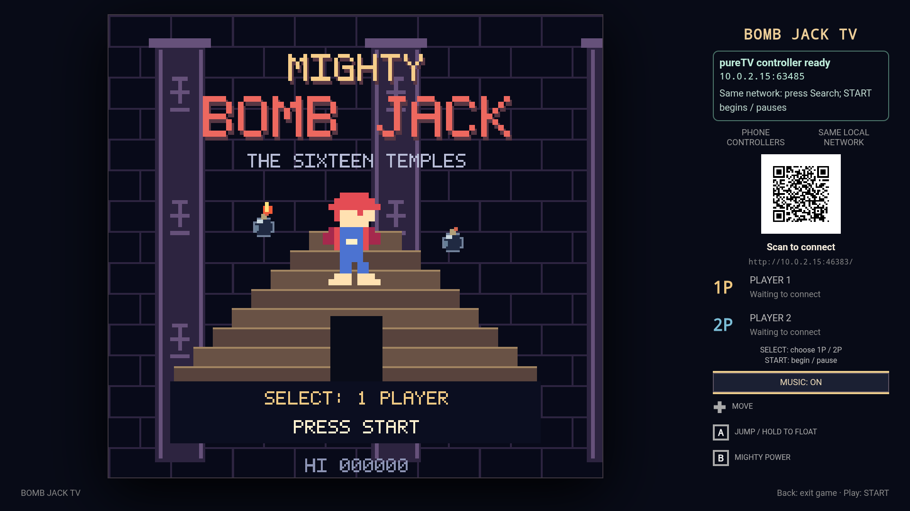 Mighty Bomb Jack TV</a></td>
    <td align="center" valign="top" width="25%"><a href="resource/apps/adventure-island/">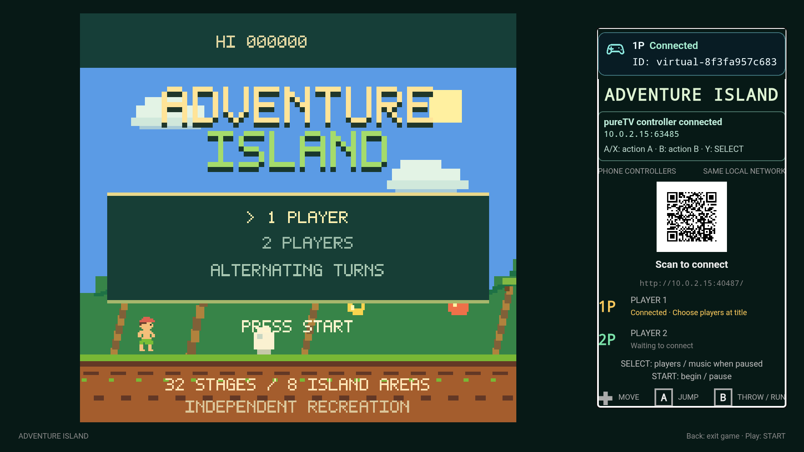 Adventure Island TV</a></td>
  </tr>
  <tr>
    <td align="center" valign="top" width="25%"><a href="resource/apps/tetris/"> Tetris TV</a></td>
    <td align="center" valign="top" width="25%"><a href="resource/apps/jewel/"> Magic Jewelry TV</a></td>
    <td align="center" valign="top" width="25%"><a href="resource/apps/jackal/">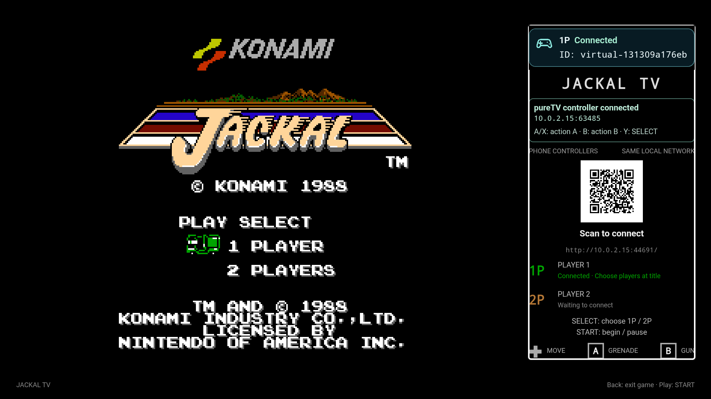 Jackal TV</a></td>
    <td align="center" valign="top" width="25%"><a href="resource/apps/tank/"> Tank TV</a></td>
  </tr>
</table>

### Apps - Tools (1)

<table>
  <tr>
    <td align="center" valign="top" width="25%"><a href="resource/apps/putrtv-store/">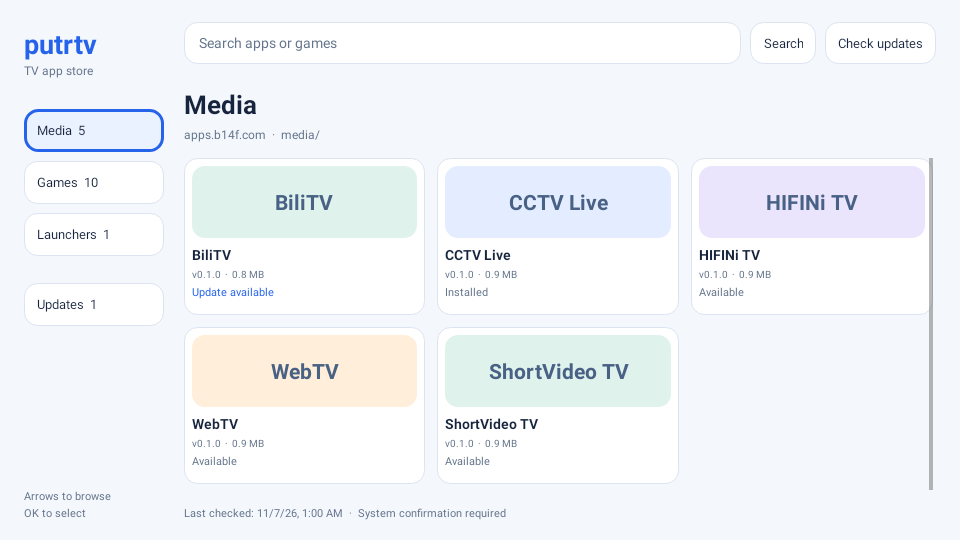 putrtv Store</a></td>
    <td width="25%"></td>
    <td width="25%"></td>
    <td width="25%"></td>
  </tr>
</table>

<!-- resource-index:end -->

The **20 games shown above** have updated APKs with **pureTV Wi-Fi controller** support, requiring Android 8.0 or newer and using TCP port **63485** by default. Install the latest APK from each game directory, connect the TV and controller to the same LAN, press GPIO 23 to discover the game, and use START to begin or pause. A side indicator shows the controller icon, player seat (1P/2P), and complete connection ID, and disappears on disconnect. See the [identity-display update](docs/controller-client-status/README.md) for downloads and verification scope, and the [controller guide](docs/readme-controller-support/README.md) for button mappings and two-player support (in Chinese).

The [fork/ catalog](fork/README.md) contains 14 apps and 23 APKs under 10 MB from TVAPP, plus five explicitly requested apps, Erge Duoduo TV, Baby Fun Learning, Jasmine Music, Taozhi Classroom TV and Qixing Opera: 19 apps and 28 APKs in total, with icons, catalog covers and manifests. The [oversized-app inventory and implementation notes](fork/OVERSIZED.md) retain all 205 oversized files, including five archived APKs and 200 still excluded files.

## Controller games by genre

All **43 games** support the pureTV Wi-Fi controller on Android TV. Downloads are also available for 24 games on macOS and 19 on Windows x64. Select a title or screenshot for controls and gameplay. Select a platform to download its installer.

[Racing and sports (13)](#controller-racing) · [Action, RPGs and exploration (2)](#controller-action) · [Platformers, bullet hell and arcade (7)](#controller-arcade) · [Strategy, tower defense and card games (1)](#controller-strategy) · [Puzzles and brainteasers (18)](#controller-puzzle) · [Management, sandbox and casual games (1)](#controller-casual) · [One-button arcade (1)](#controller-one-button)

Connect the controller and game device to the same local network, open the game and press the controller’s search button (GPIO 23). The macOS links download a DMG and the Windows links download a setup EXE. Portable packages and Intel Mac compatibility are listed in the [racing downloads](joystick-games/README.md#九款赛车游戏下载) and [puzzle downloads](https://github.com/ecojust/pureTV/blob/a837c7dcb09a0ce01f90a17409212af69c4fc4d6/docs/puzzle-nine/README.md#下载安装).

### Racing and sports (13)

<table>
<tr>
<td align="center" valign="top"><a href="joystick-games/backroad-rally/"> Backroad Rally</a> <a href="https://github.com/ecojust/pureTV/releases/download/joystick-backroad-rally-android-v0.1.2/backroad-rally-0.1.2.apk">APK</a> · <a href="https://github.com/ecojust/pureTV/releases/download/joystick-backroad-rally-v0.1.0/BackroadRally-0.1.0-macos-universal.dmg">macOS preview</a> · <a href="https://github.com/ecojust/pureTV/releases/download/joystick-backroad-rally-windows-v0.1.0/BackroadRally-0.1.0-windows-x64-setup.exe">Windows</a></td>
<td align="center" valign="top"><a href="joystick-games/ponpoko-kart/"> Ponpoko Kart</a> <a href="https://raw.githubusercontent.com/ecojust/pureTV/3bf22a01c62439afdc7352e2f7529cc23ea575ad/joystick-games/ponpoko-kart/ponpoko-kart-0.1.5.apk">APK</a> · <a href="https://raw.githubusercontent.com/ecojust/pureTV/515250931fa4203132ab658d81567682184651de/joystick-games/ponpoko-kart/macos/PonpokoKart-0.1.0-macos-universal.dmg">macOS</a> · <a href="https://raw.githubusercontent.com/ecojust/pureTV/515250931fa4203132ab658d81567682184651de/joystick-games/ponpoko-kart/PonpokoKart-0.1.0-windows-x64-setup.exe">Windows</a></td>
<td align="center" valign="top"><a href="joystick-games/night-racer/"> Night Racer</a> <a href="https://raw.githubusercontent.com/ecojust/pureTV/515250931fa4203132ab658d81567682184651de/joystick-games/night-racer/night-racer-0.1.0.apk">APK</a> · <a href="https://raw.githubusercontent.com/ecojust/pureTV/515250931fa4203132ab658d81567682184651de/joystick-games/night-racer/macos/NightRacer-0.1.0-macos-universal.dmg">macOS</a> · <a href="https://raw.githubusercontent.com/ecojust/pureTV/515250931fa4203132ab658d81567682184651de/joystick-games/night-racer/NightRacer-0.1.0-windows-x64-setup.exe">Windows</a></td>
<td align="center" valign="top"><a href="joystick-games/penguintrack/">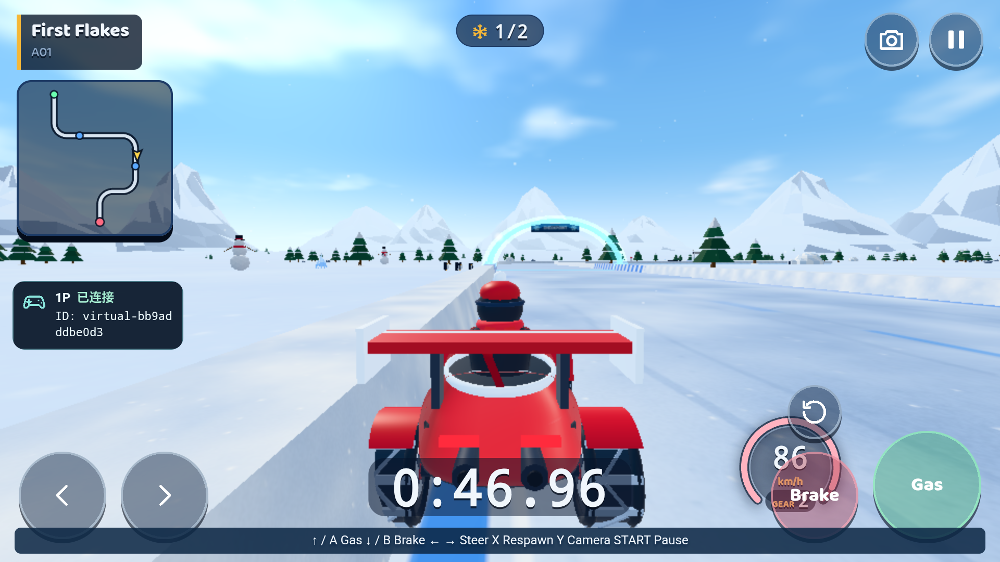 Penguintrack</a> <a href="https://raw.githubusercontent.com/ecojust/pureTV/515250931fa4203132ab658d81567682184651de/joystick-games/penguintrack/penguintrack-0.1.0.apk">APK</a> · <a href="https://raw.githubusercontent.com/ecojust/pureTV/515250931fa4203132ab658d81567682184651de/joystick-games/penguintrack/macos/Penguintrack-0.1.0-macos-universal.dmg">macOS</a> · <a href="https://raw.githubusercontent.com/ecojust/pureTV/515250931fa4203132ab658d81567682184651de/joystick-games/penguintrack/Penguintrack-0.1.0-windows-x64-setup.exe">Windows</a></td>
</tr>
<tr>
<td align="center" valign="top"><a href="joystick-games/last-track/"> Last Track</a> <a href="https://raw.githubusercontent.com/ecojust/pureTV/515250931fa4203132ab658d81567682184651de/joystick-games/last-track/last-track-0.1.0.apk">APK</a> · <a href="https://raw.githubusercontent.com/ecojust/pureTV/515250931fa4203132ab658d81567682184651de/joystick-games/last-track/macos/LastTrack-0.1.0-macos-universal.dmg">macOS</a> · <a href="https://raw.githubusercontent.com/ecojust/pureTV/515250931fa4203132ab658d81567682184651de/joystick-games/last-track/LastTrack-0.1.0-windows-x64-setup.exe">Windows</a></td>
<td align="center" valign="top"><a href="joystick-games/dirt-crown/"> Dirt Crown</a> <a href="https://raw.githubusercontent.com/ecojust/pureTV/515250931fa4203132ab658d81567682184651de/joystick-games/dirt-crown/dirt-crown-0.1.0.apk">APK</a> · <a href="https://raw.githubusercontent.com/ecojust/pureTV/515250931fa4203132ab658d81567682184651de/joystick-games/dirt-crown/macos/DirtCrown-0.1.0-macos-universal.dmg">macOS</a> · <a href="https://raw.githubusercontent.com/ecojust/pureTV/515250931fa4203132ab658d81567682184651de/joystick-games/dirt-crown/DirtCrown-0.1.0-windows-x64-setup.exe">Windows</a></td>
<td align="center" valign="top"><a href="joystick-games/turbo-kart-rush/"> Turbo Kart Rush</a> <a href="https://raw.githubusercontent.com/ecojust/pureTV/515250931fa4203132ab658d81567682184651de/joystick-games/turbo-kart-rush/turbo-kart-rush-0.1.1.apk">APK</a> · <a href="https://raw.githubusercontent.com/ecojust/pureTV/515250931fa4203132ab658d81567682184651de/joystick-games/turbo-kart-rush/macos/TurboKartRush-0.1.0-macos-universal.dmg">macOS</a> · <a href="https://raw.githubusercontent.com/ecojust/pureTV/515250931fa4203132ab658d81567682184651de/joystick-games/turbo-kart-rush/windows/TurboKartRush-0.1.0-windows-x64-setup.exe">Windows</a></td>
<td align="center" valign="top"><a href="joystick-games/kart-rush/"> Kart Rush</a> <a href="https://raw.githubusercontent.com/ecojust/pureTV/515250931fa4203132ab658d81567682184651de/joystick-games/kart-rush/kart-rush-0.1.0.apk">APK</a> · <a href="https://raw.githubusercontent.com/ecojust/pureTV/515250931fa4203132ab658d81567682184651de/joystick-games/kart-rush/macos/KartRush-0.1.0-macos-universal.dmg">macOS</a> · <a href="https://raw.githubusercontent.com/ecojust/pureTV/515250931fa4203132ab658d81567682184651de/joystick-games/kart-rush/KartRush-0.1.0-windows-x64-setup.exe">Windows</a></td>
</tr>
<tr>
<td align="center" valign="top"><a href="joystick-games/kart-royale/"> Kart Royale</a> <a href="https://raw.githubusercontent.com/ecojust/pureTV/36b91f81533f10ff5d37ec091c3701913d4a42e4/joystick-games/kart-royale/kart-royale-0.1.4.apk">APK</a> · <a href="https://raw.githubusercontent.com/ecojust/pureTV/515250931fa4203132ab658d81567682184651de/joystick-games/kart-royale/macos/KartRoyale-0.1.0-macos-universal.dmg">macOS</a> · <a href="https://raw.githubusercontent.com/ecojust/pureTV/515250931fa4203132ab658d81567682184651de/joystick-games/kart-royale/windows/KartRoyale-0.1.1-windows-x64-setup.exe">Windows</a></td>
<td align="center" valign="top"><a href="joystick-games/qq-speed/">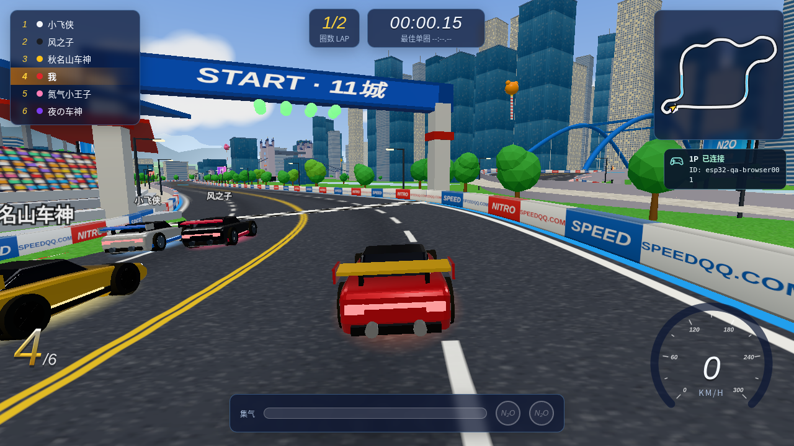 QQ Speed</a> <a href="joystick-games/qq-speed/qq-speed-0.1.0.apk?raw=1">APK</a> · <a href="joystick-games/qq-speed/macos/QQSpeed-0.1.0-macos-universal.dmg?raw=1">macOS</a></td>
<td align="center" valign="top"><a href="resource/apps/neon-rush/">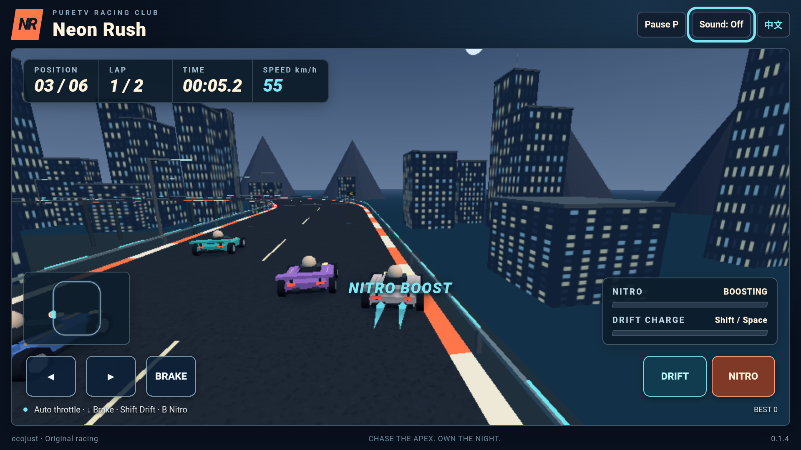 Neon Rush TV</a> <a href="resource/apps/neon-rush/neon-rush-0.1.3.apk?raw=1">APK</a> · <a href="resource/apps/neon-rush/macos/NeonRush-0.1.4-macos-universal.dmg?raw=1">macOS</a></td>
<td align="center" valign="top"><a href="resource/apps/coast-kart/">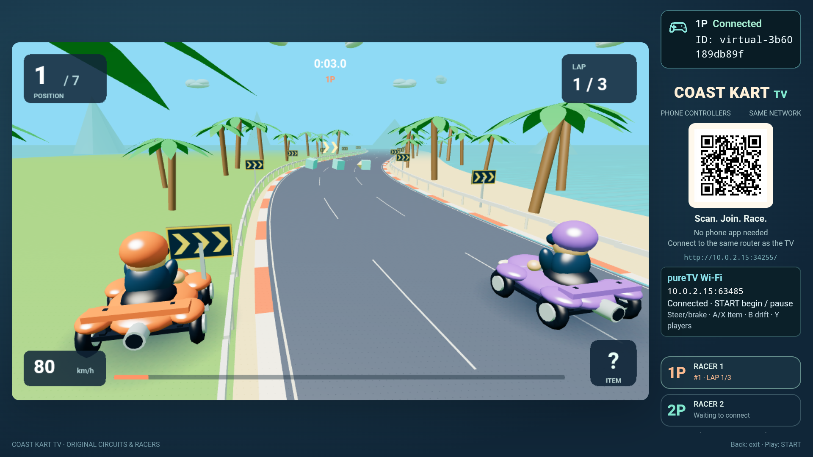 Coast Kart TV</a> <a href="resource/apps/coast-kart/coast-kart-0.5.4.apk?raw=1">APK</a></td>
</tr>
<tr>
<td align="center" valign="top"><a href="resource/apps/used-car-racing/"> Used Car Racing TV</a> <a href="resource/apps/used-car-racing/used-car-racing-0.1.5.apk?raw=1">APK</a></td>
</tr>
</table>

### Action, RPGs and exploration (2)

<table>
<tr>
<td align="center" valign="top"><a href="joystick-games/cf-transport-ship/"> CF Transport Ship</a> <a href="joystick-games/cf-transport-ship/cf-transport-ship-0.1.0.apk?raw=1">APK</a> · <a href="joystick-games/cf-transport-ship/macos/CFTransportShip-0.1.0-macos-universal.dmg?raw=1">macOS</a></td>
<td align="center" valign="top"><a href="resource/apps/alien-shooter/">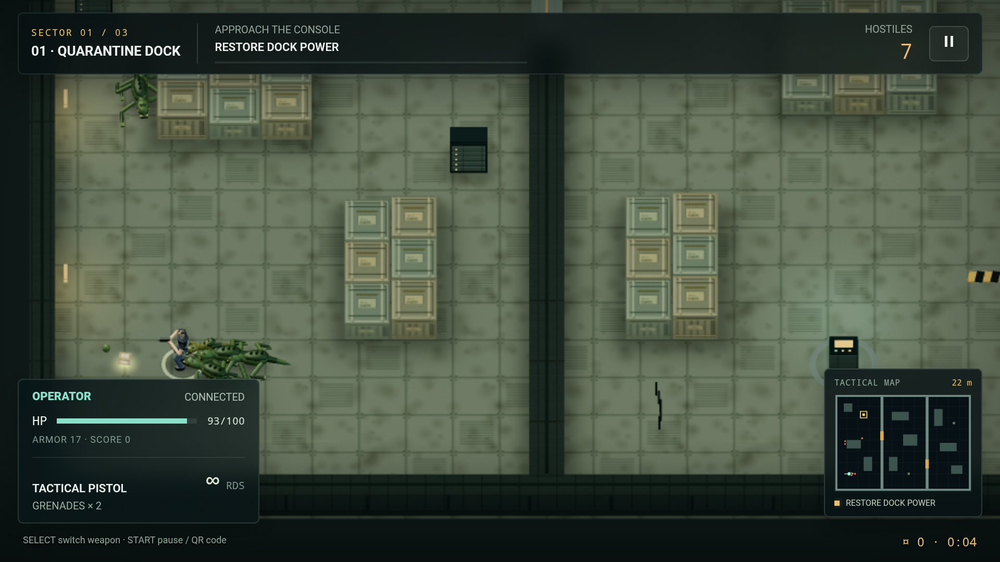 Alien Shooter TV</a> <a href="resource/apps/alien-shooter/alien-shooter-0.1.4.apk?raw=1">APK</a></td>
</tr>
</table>

### Platformers, bullet hell and arcade (7)

<table>
<tr>
<td align="center" valign="top"><a href="joystick-games/glup/"> GLUP</a> <a href="joystick-games/glup/glup-0.1.0.apk?raw=1">APK</a> · <a href="joystick-games/glup/Glup-0.1.0-macos-universal.dmg?raw=1">macOS</a></td>
<td align="center" valign="top"><a href="resource/apps/super-mario/"> Super Mario TV</a> <a href="resource/apps/super-mario/super-mario-0.5.4.apk?raw=1">APK</a></td>
<td align="center" valign="top"><a href="resource/apps/bomb-jack/">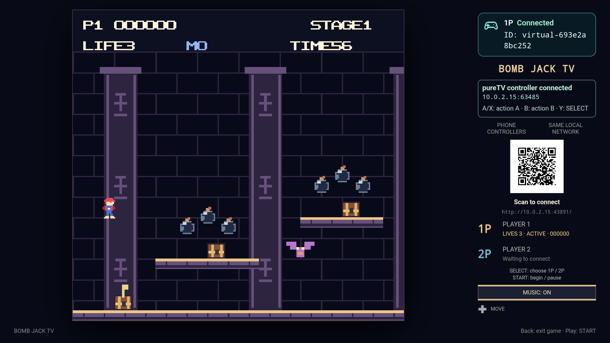 Mighty Bomb Jack TV</a> <a href="resource/apps/bomb-jack/bomb-jack-0.5.4.apk?raw=1">APK</a></td>
<td align="center" valign="top"><a href="resource/apps/adventure-island/">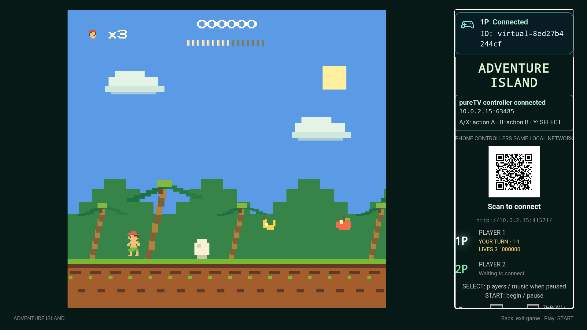 Adventure Island TV</a> <a href="resource/apps/adventure-island/adventure-island-0.5.4.apk?raw=1">APK</a></td>
</tr>
<tr>
<td align="center" valign="top"><a href="resource/apps/jackal/">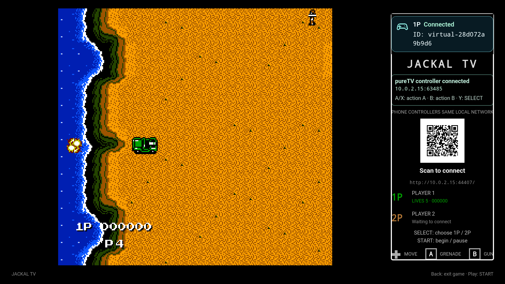 Jackal TV</a> <a href="resource/apps/jackal/jackal-0.5.4.apk?raw=1">APK</a></td>
<td align="center" valign="top"><a href="resource/apps/tank/">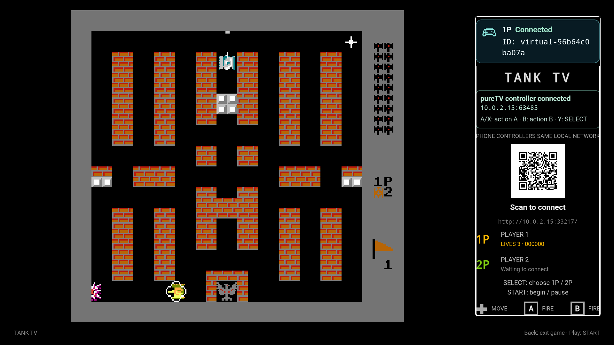 Tank TV</a> <a href="resource/apps/tank/tank-0.5.4.apk?raw=1">APK</a></td>
<td align="center" valign="top"><a href="resource/apps/conveyor-window/"> Conveyor Window (Chinese UI)</a> <a href="resource/apps/conveyor-window/conveyor-window-0.2.2.apk?raw=1">APK</a></td>
</tr>
</table>

### Strategy, tower defense and card games (1)

<table>
<tr>
<td align="center" valign="top"><a href="joystick-games/emberbrood/">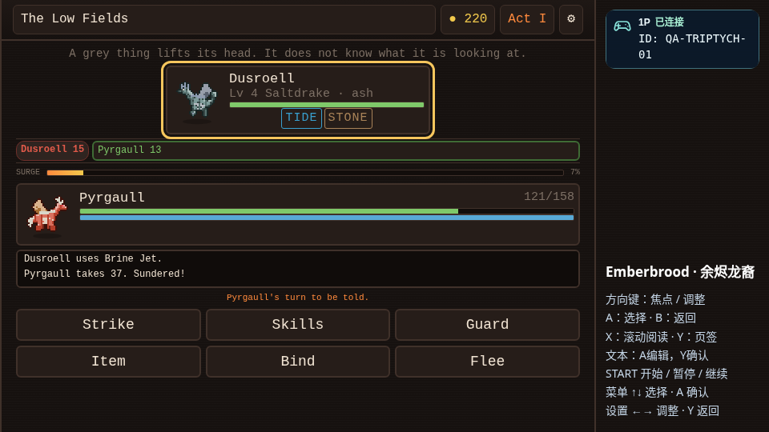 Emberbrood</a> <a href="joystick-games/emberbrood/emberbrood-0.1.0.apk?raw=1">APK</a> · <a href="joystick-games/emberbrood/Emberbrood-0.1.0-macos-universal.dmg?raw=1">macOS</a></td>
</tr>
</table>

### Puzzles and brainteasers (18)

<table>
<tr>
<td align="center" valign="top"><a href="https://github.com/ecojust/pureTV/tree/a837c7dcb09a0ce01f90a17409212af69c4fc4d6/joystick-games/alchemists-lattice">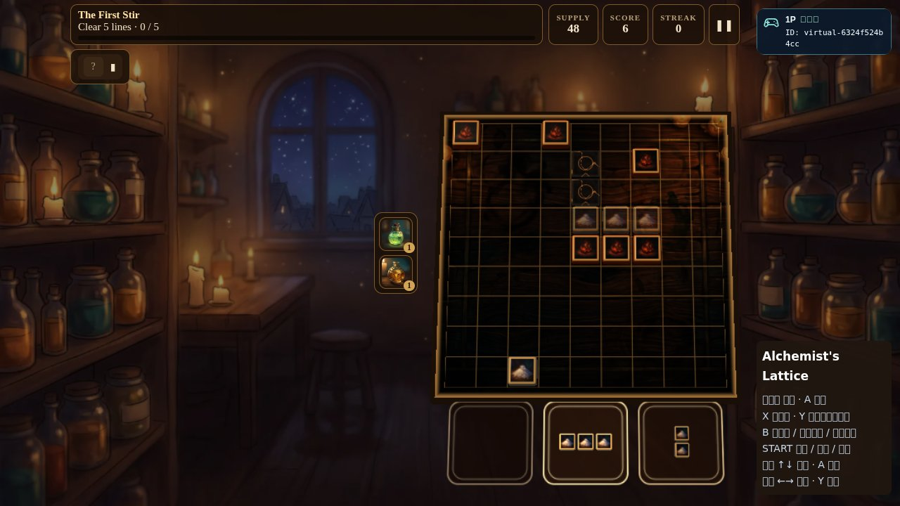 Alchemist&#x27;s Lattice</a> <a href="https://github.com/ecojust/pureTV/releases/download/joystick-alchemists-lattice-v0.1.1/alchemists-lattice-0.1.1.apk">APK</a> · <a href="https://github.com/ecojust/pureTV/releases/download/joystick-alchemists-lattice-v0.1.1/AlchemistsLattice-0.1.1-macos-universal.dmg">macOS preview</a> · <a href="https://github.com/ecojust/pureTV/releases/download/joystick-alchemists-lattice-v0.1.1/AlchemistsLattice-0.1.1-windows-x64-setup.exe">Windows</a></td>
<td align="center" valign="top"><a href="https://github.com/ecojust/pureTV/tree/a837c7dcb09a0ce01f90a17409212af69c4fc4d6/joystick-games/story-thief">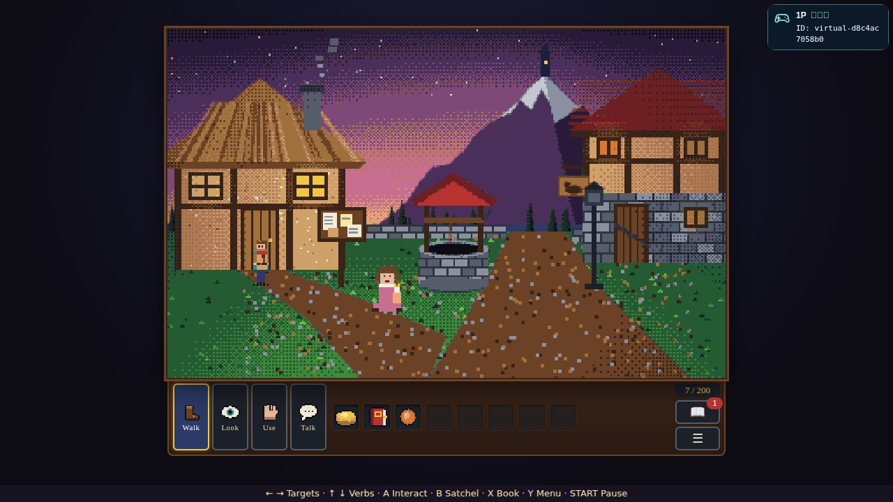 The Story Thief of Greymantle</a> <a href="https://github.com/ecojust/pureTV/releases/download/joystick-story-thief-v0.1.1/story-thief-0.1.1.apk">APK</a> · <a href="https://github.com/ecojust/pureTV/releases/download/joystick-story-thief-v0.1.1/StoryThief-0.1.1-macos-universal.dmg">macOS</a> · <a href="https://github.com/ecojust/pureTV/releases/download/joystick-story-thief-v0.1.1/StoryThief-0.1.1-windows-x64-setup.exe">Windows</a></td>
<td align="center" valign="top"><a href="https://github.com/ecojust/pureTV/tree/a837c7dcb09a0ce01f90a17409212af69c4fc4d6/joystick-games/bumble-basket"> Bumble Basket</a> <a href="https://github.com/ecojust/pureTV/releases/download/joystick-bumble-basket-v0.1.2/bumble-basket-0.1.2.apk">APK</a> · <a href="https://github.com/ecojust/pureTV/releases/download/joystick-bumble-basket-v0.1.2/BumbleBasket-0.1.2-macos-universal.dmg">macOS preview</a> · <a href="https://github.com/ecojust/pureTV/releases/download/joystick-bumble-basket-v0.1.2/BumbleBasket-0.1.2-windows-x64-setup.exe">Windows</a></td>
<td align="center" valign="top"><a href="https://github.com/ecojust/pureTV/tree/a837c7dcb09a0ce01f90a17409212af69c4fc4d6/joystick-games/starsling">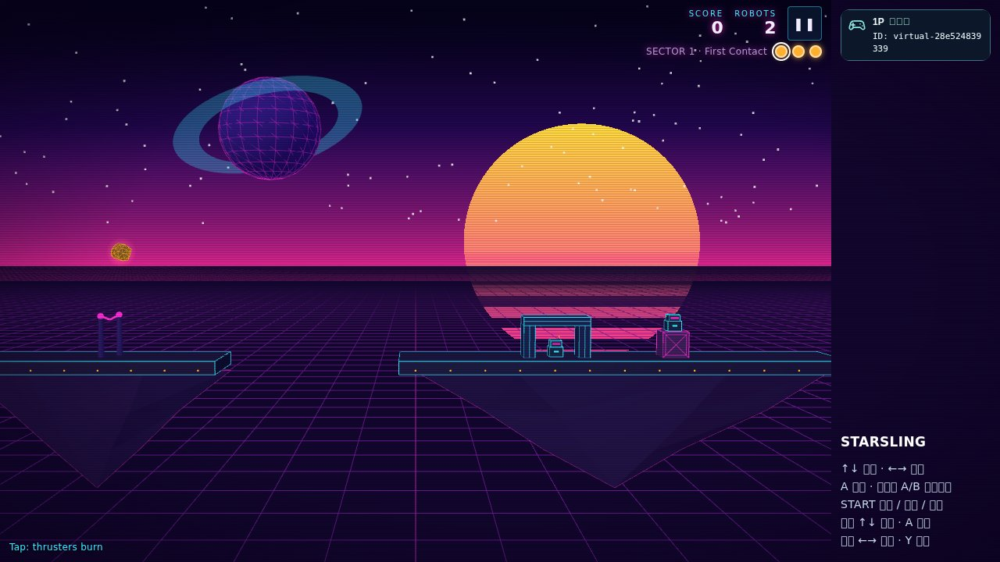 STARSLING</a> <a href="https://github.com/ecojust/pureTV/releases/download/joystick-starsling-v0.1.1/starsling-0.1.1.apk">APK</a> · <a href="https://github.com/ecojust/pureTV/releases/download/joystick-starsling-v0.1.1/Starsling-0.1.1-macos-universal.dmg">macOS preview</a> · <a href="https://github.com/ecojust/pureTV/releases/download/joystick-starsling-v0.1.1/Starsling-0.1.1-windows-x64-setup.exe">Windows</a></td>
</tr>
<tr>
<td align="center" valign="top"><a href="https://github.com/ecojust/pureTV/tree/a837c7dcb09a0ce01f90a17409212af69c4fc4d6/joystick-games/solder-and-rain"> Solder &amp; Rain</a> <a href="https://github.com/ecojust/pureTV/releases/download/joystick-solder-and-rain-v0.1.0/solder-and-rain-0.1.0.apk">APK</a> · <a href="https://github.com/ecojust/pureTV/releases/download/joystick-solder-and-rain-v0.1.0/SolderAndRain-0.1.0-macos-universal.dmg">macOS preview</a> · <a href="https://github.com/ecojust/pureTV/releases/download/joystick-solder-and-rain-v0.1.0/SolderAndRain-0.1.0-windows-x64-setup.exe">Windows</a></td>
<td align="center" valign="top"><a href="https://github.com/ecojust/pureTV/tree/a837c7dcb09a0ce01f90a17409212af69c4fc4d6/joystick-games/oathstones"> Oathstones</a> <a href="https://github.com/ecojust/pureTV/releases/download/joystick-oathstones-v0.1.0/oathstones-0.1.0.apk">APK</a> · <a href="https://github.com/ecojust/pureTV/releases/download/joystick-oathstones-v0.1.0/Oathstones-0.1.0-macos-universal.dmg">macOS preview</a> · <a href="https://github.com/ecojust/pureTV/releases/download/joystick-oathstones-v0.1.0/Oathstones-0.1.0-windows-x64-setup.exe">Windows</a></td>
<td align="center" valign="top"><a href="https://github.com/ecojust/pureTV/tree/a837c7dcb09a0ce01f90a17409212af69c4fc4d6/joystick-games/neon-arcana">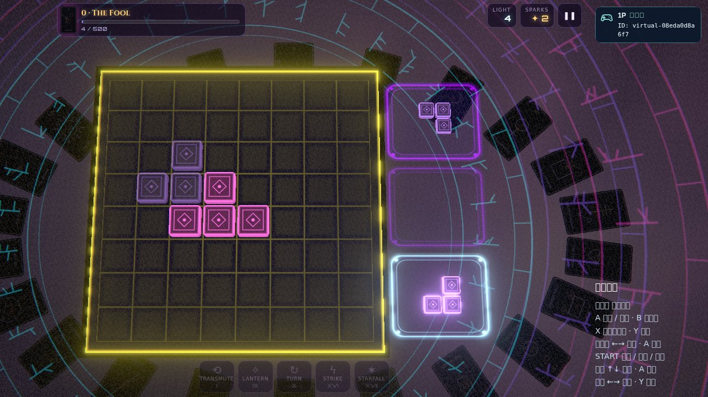 NEON ARCANA</a> <a href="https://github.com/ecojust/pureTV/releases/download/joystick-neon-arcana-v0.1.1/neon-arcana-0.1.1.apk">APK</a> · <a href="https://github.com/ecojust/pureTV/releases/download/joystick-neon-arcana-v0.1.1/NeonArcana-0.1.1-macos-universal.dmg">macOS preview</a> · <a href="https://github.com/ecojust/pureTV/releases/download/joystick-neon-arcana-v0.1.1/NeonArcana-0.1.1-windows-x64-setup.exe">Windows</a></td>
<td align="center" valign="top"><a href="https://github.com/ecojust/pureTV/tree/a837c7dcb09a0ce01f90a17409212af69c4fc4d6/joystick-games/atlas-of-ink">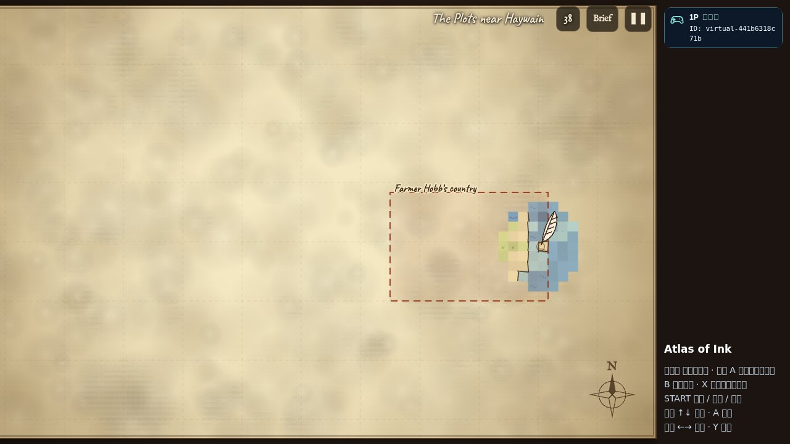 Atlas of Ink</a> <a href="https://github.com/ecojust/pureTV/releases/download/joystick-atlas-of-ink-v0.1.1/atlas-of-ink-0.1.1.apk">APK</a> · <a href="https://github.com/ecojust/pureTV/releases/download/joystick-atlas-of-ink-v0.1.1/AtlasOfInk-0.1.1-macos-universal.dmg">macOS</a> · <a href="https://github.com/ecojust/pureTV/releases/download/joystick-atlas-of-ink-v0.1.1/AtlasOfInk-0.1.1-windows-x64-setup.exe">Windows</a></td>
</tr>
<tr>
<td align="center" valign="top"><a href="https://github.com/ecojust/pureTV/tree/a837c7dcb09a0ce01f90a17409212af69c4fc4d6/joystick-games/starbase-spooky">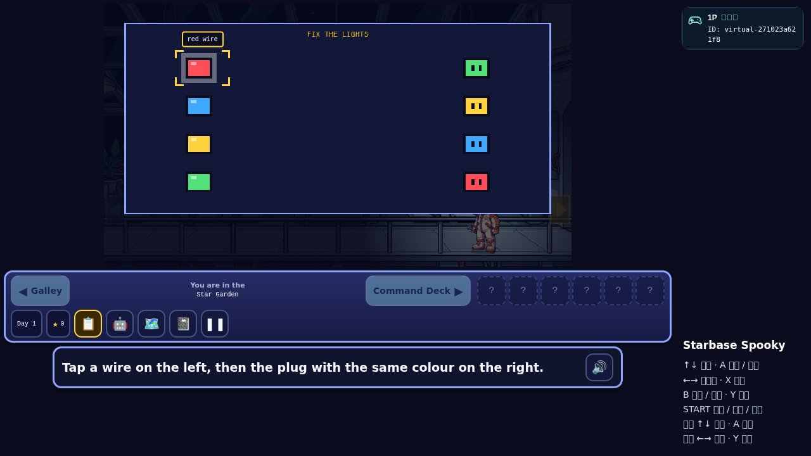 Starbase Spooky</a> <a href="https://github.com/ecojust/pureTV/releases/download/joystick-starbase-spooky-v0.1.2/starbase-spooky-0.1.2.apk">APK</a> · <a href="https://github.com/ecojust/pureTV/releases/download/joystick-starbase-spooky-v0.1.2/StarbaseSpooky-0.1.2-macos-universal.dmg">macOS</a> · <a href="https://github.com/ecojust/pureTV/releases/download/joystick-starbase-spooky-v0.1.2/StarbaseSpooky-0.1.2-windows-x64-setup.exe">Windows</a></td>
<td align="center" valign="top"><a href="joystick-games/sugarplum-drop/"> Sugarplum Drop</a> <a href="joystick-games/sugarplum-drop/sugarplum-drop-0.1.0.apk?raw=1">APK</a> · <a href="joystick-games/sugarplum-drop/SugarplumDrop-0.1.0-macos-universal.dmg?raw=1">macOS</a> · <a href="joystick-games/sugarplum-drop/SugarplumDrop-0.1.0-windows-x64-setup.exe?raw=1">Windows</a></td>
<td align="center" valign="top"><a href="resource/apps/twenty-four/"> Twenty Four</a> <a href="resource/apps/twenty-four/twenty-four-0.2.2.apk?raw=1">APK</a></td>
<td align="center" valign="top"><a href="resource/apps/torch-bridge/"> Torch Bridge</a> <a href="resource/apps/torch-bridge/torch-bridge-0.2.2.apk?raw=1">APK</a></td>
</tr>
<tr>
<td align="center" valign="top"><a href="resource/apps/packing-sculptor/"> Packing Sculptor</a> <a href="resource/apps/packing-sculptor/packing-sculptor-0.2.2.apk?raw=1">APK</a></td>
<td align="center" valign="top"><a href="resource/apps/glass-fold/"> Glass Fold (Chinese UI)</a> <a href="resource/apps/glass-fold/glass-fold-0.2.2.apk?raw=1">APK</a></td>
<td align="center" valign="top"><a href="resource/apps/tension-span/"> Tension Span (Chinese UI)</a> <a href="resource/apps/tension-span/tension-span-0.2.3.apk?raw=1">APK</a></td>
<td align="center" valign="top"><a href="resource/apps/prism-relay/"> Light Relay (Chinese UI)</a> <a href="resource/apps/prism-relay/prism-relay-0.2.3.apk?raw=1">APK</a></td>
</tr>
<tr>
<td align="center" valign="top"><a href="resource/apps/tetris/"> Tetris TV</a> <a href="resource/apps/tetris/tetris-0.5.4.apk?raw=1">APK</a></td>
<td align="center" valign="top"><a href="resource/apps/jewel/"> Magic Jewelry TV</a> <a href="resource/apps/jewel/jewel-0.5.4.apk?raw=1">APK</a></td>
</tr>
</table>

### Management, sandbox and casual games (1)

<table>
<tr>
<td align="center" valign="top"><a href="resource/apps/cozy-island/"> Cozy Island TV</a> <a href="resource/apps/cozy-island/cozy-island-0.5.4.apk?raw=1">APK</a></td>
</tr>
</table>

### One-button arcade (1)

<table>
<tr>
<td align="center" valign="top"><a href="resource/apps/tower-overlap/"> Tower Overlap</a> <a href="resource/apps/tower-overlap/tower-overlap-0.2.2.apk?raw=1">APK</a></td>
</tr>
</table>

<!-- claude-games:start -->
## Claude-assisted game references

The [Chinese README lists 380 references from 236 GitHub repositories](README.md#claude-游戏参考清单), including **79 newly researched entries**. Expand its eight categories for source code, gameplay, demo or build instructions, Claude attribution, and license details.

New highlights include **Voxel Musou, Inkline Town, Fall Line, Hollow Crown, Demolition Derby, Spirit Call, Solder & Rain, and Rainglass**. Entries were screened through original source, author statements or Claude-signed commits affecting game code, and available visual material. This is not a tested quality ranking: HTTP availability does not establish working gameplay or pureTV compatibility. Stars are dated snapshots: 2026-11-19 for this expansion and 2026-11-17 for the preceding 301 entries.

The [nine-racer project](docs/racing-nine/README.md) continues against its previously frozen 31 candidates. The original 93-entry bulk porting task remains paused; expanding this reference list does not add porting commitments or published games. See the [source and review records](docs/claude-games/README.md) and the [delivered controller games](joystick-games/README.md).
<!-- claude-games:end -->

## MCP / Agent

Open “Device connection → MCP · Agent debugging,” copy the configuration into your client, and keep the manager window open. Its 34 tools cover system information, connections, app management, APK installation, launcher switching and layouts, market browsing/downloads/installation, background images, ADB configuration, language and theme settings, cancellation, and logs. The Agent and the interface share the same state.

See the [complete MCP setup and parameter guide](desktop/docs/mcp.md), currently available in Chinese.

## Development documentation

Build and test instructions are in the [resource development README](resource/README-development.md). The detailed development and protocol guides are currently available in Chinese.

### Custom launcher layouts

`layout.json` is the protocol connecting the launcher and the manager's visual editor. The TV and computer use the same layout, allowing the manager to reproduce the home screen and edit app tiles. Home and Apps support independent backgrounds, layouts, and page navigation. User app components are editable; system components are read-only.

Choose “Adjust layout” on the launcher page to add installed user apps, drag tiles, select multiple items, and align or distribute them. Confirm the changes to apply them to the TV. Update both the manager and the corresponding launcher to use a newer layout version.

For field definitions, JSON examples, and comparisons with the rendered screen, see the [layout.json protocol specification](resource/README-development.md#layoutjson-协议规范与画面对照), currently in Chinese.

## License and acknowledgments

pureTV is licensed under [MIT](LICENSE). Some TV launcher code is based on [Gathin23/cleanyourtv](https://github.com/Gathin23/cleanyourtv); the original authors' copyright and license notices are retained in [NOTICE.md](NOTICE.md). See the [OFL license](resource/launcher/puretv/FONT-LICENSE-OFL.txt) for the font. Third-party code, fonts, and other assets used by the apps retain their respective copyright and license notices.
