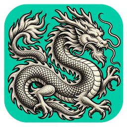
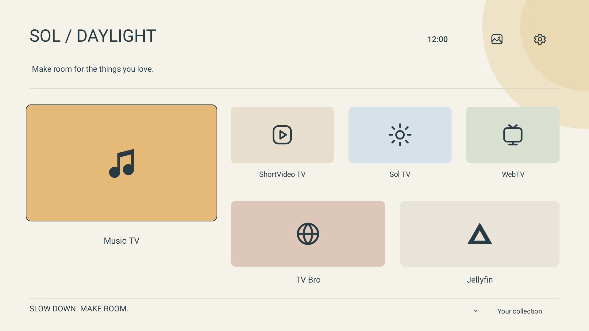
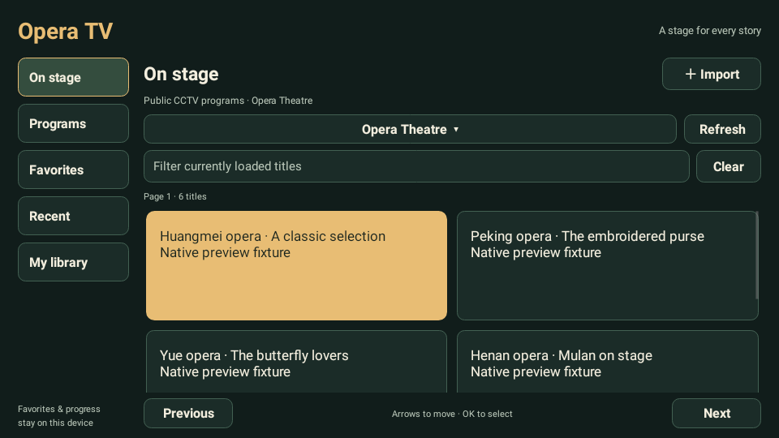
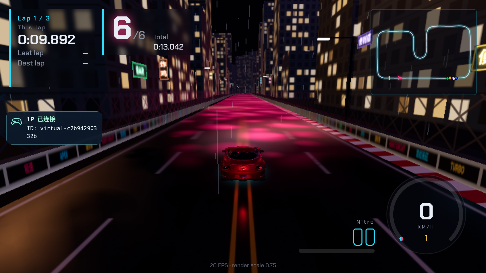
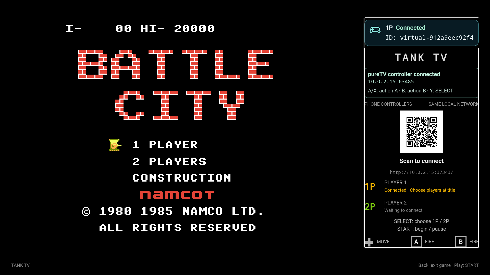

  

[简体中文](README.md) · **English** · [User guide](docs/guide/README.en.md) · [Development and MCP](docs/guide/development.en.md)

[Management apps and TV tools](#management-apps-and-tv-tools) · [Launchers and TV apps](#launcher-and-tv-app-resources) · [Game catalog](#games) · [Third-party TV apps](fork/README.md) · [Game reference catalog](docs/claude-games/catalog.en.md)

## Management apps and TV tools

<!-- management-index:start -->

<table>
  <tr>
    <td align="center" valign="top" width="207"><a href="docs/guide/README.en.md#install-or-upgrade-the-desktop-manager"> pureTV Manager</a> Manage TV apps and launchers from a computer Windows, macOS, Linux <a href="https://github.com/ecojust/pureTV/releases/tag/desktop-v0.5.9">Download 0.5.9</a></td>
    <td align="center" valign="top" width="207"><a href="resource/apps/putrtv-store/"> putrtv Store</a> Browse, install and check TV app updates directly on your television Android TV <a href="resource/apps/putrtv-store/putrtv-store-0.1.1.apk?raw=1">Download 0.1.1 APK</a></td>
    <td align="center" valign="top" width="207"></td>
    <td align="center" valign="top" width="207"></td>
  </tr>
</table>

<!-- management-index:end -->

## Launcher and TV app resources

[Browse all launchers and TV apps](resource/README.md)

<!-- resource-index:start -->

### Launchers (10)

<table>
  <tr>
    <td align="center" valign="top" width="207"><a href="resource/launcher/sol/"> Sol TV</a></td>
    <td align="center" valign="top" width="207"><a href="resource/launcher/pixel/"> Pixel TV</a></td>
    <td align="center" valign="top" width="207"><a href="resource/launcher/moss/"> Moss TV</a></td>
    <td align="center" valign="top" width="207"><a href="resource/launcher/mono/"> Mono TV</a></td>
  </tr>
  <tr>
    <td align="center" valign="top" width="207"><a href="resource/launcher/forma/"> Forma TV</a></td>
    <td align="center" valign="top" width="207"><a href="resource/launcher/drift/"> Drift TV</a></td>
    <td align="center" valign="top" width="207"><a href="resource/launcher/circuit/"> Circuit TV</a></td>
    <td align="center" valign="top" width="207"><a href="resource/launcher/aster/"> Aster TV</a></td>
  </tr>
  <tr>
    <td align="center" valign="top" width="207"><a href="resource/launcher/nova/"> Nova TV</a></td>
    <td align="center" valign="top" width="207"><a href="resource/launcher/puretv/"> pureTV Launcher</a></td>
    <td align="center" valign="top" width="207"></td>
    <td align="center" valign="top" width="207"></td>
  </tr>
</table>

### Apps - Media (6)

<table>
  <tr>
    <td align="center" valign="top" width="207"><a href="resource/apps/opera/"> Opera TV</a></td>
    <td align="center" valign="top" width="207"><a href="resource/apps/bilibili/"> BiliTV</a></td>
    <td align="center" valign="top" width="207"><a href="resource/apps/cctv/"> CCTV Live</a></td>
    <td align="center" valign="top" width="207"><a href="resource/apps/hifini/"> HIFINi TV</a></td>
  </tr>
  <tr>
    <td align="center" valign="top" width="207"><a href="resource/apps/webtv/"> WebTV</a></td>
    <td align="center" valign="top" width="207"><a href="resource/apps/shortvideo/"> ShortVideo TV</a></td>
    <td align="center" valign="top" width="207"></td>
    <td align="center" valign="top" width="207"></td>
  </tr>
</table>

<!-- resource-index:end -->

## Game catalog

[Six new or updated controller games · browser builds and controls](joystick-games/README.md#game-expansion)

<!-- game-index:start -->

**36 controller games** · [Play every game on a computer](docs/guide/README.en.md#play-on-a-computer) · Android TV (36) · Standalone macOS downloads (36) · Standalone Windows x64 downloads (36)

[Racing and sports (13)](#controller-racing) · [Action, RPGs and exploration (5)](#controller-action) · [Platformers, bullet hell and arcade (4)](#controller-arcade) · [Strategy, tower defense and card games (2)](#controller-strategy) · [Puzzles and brainteasers (12)](#controller-puzzle)

### Racing and sports (13)

<table>
  <tr>
    <td align="center" valign="top" width="207"><a href="resource/apps/neon-rush/"> Neon Rush</a>    </td>
    <td align="center" valign="top" width="207"><a href="resource/apps/used-car-racing/"> Used Car Racing</a>    </td>
    <td align="center" valign="top" width="207"><a href="joystick-games/backroad-rally/"> Backroad Rally</a>    </td>
    <td align="center" valign="top" width="207"><a href="joystick-games/ponpoko-kart/"> Ponpoko Kart</a>    </td>
  </tr>
  <tr>
    <td align="center" valign="top" width="207"><a href="joystick-games/night-racer/"> Night Racer</a>    </td>
    <td align="center" valign="top" width="207"><a href="joystick-games/penguintrack/"> Penguintrack</a>    </td>
    <td align="center" valign="top" width="207"><a href="joystick-games/last-track/"> Last Track</a>    </td>
    <td align="center" valign="top" width="207"><a href="joystick-games/dirt-crown/"> Dirt Crown</a>    </td>
  </tr>
  <tr>
    <td align="center" valign="top" width="207"><a href="joystick-games/turbo-kart-rush/"> Turbo Kart Rush</a>    </td>
    <td align="center" valign="top" width="207"><a href="joystick-games/kart-rush/"> Kart Rush</a>    </td>
    <td align="center" valign="top" width="207"><a href="joystick-games/kart-royale/"> Kart Royale</a>    </td>
    <td align="center" valign="top" width="207"><a href="joystick-games/qq-speed/"> QQ Speed</a>    </td>
  </tr>
  <tr>
    <td align="center" valign="top" width="207"><a href="joystick-games/turbo-kart-rally/"> Turbo Kart Rally</a>    </td>
    <td align="center" valign="top" width="207"></td>
    <td align="center" valign="top" width="207"></td>
    <td align="center" valign="top" width="207"></td>
  </tr>
</table>

### Action, RPGs and exploration (5)

<table>
  <tr>
    <td align="center" valign="top" width="207"><a href="resource/apps/alien-shooter/"> Alien Shooter</a>    </td>
    <td align="center" valign="top" width="207"><a href="joystick-games/cf-transport-ship/"> CF Transport Ship</a>    </td>
    <td align="center" valign="top" width="207"><a href="joystick-games/clawd-pop/"> Clawd Pop 3D</a>    </td>
    <td align="center" valign="top" width="207"><a href="joystick-games/saber-magic-tower/"> Saber Magic Tower</a>    </td>
  </tr>
  <tr>
    <td align="center" valign="top" width="207"><a href="joystick-games/operation-ironhold/"> Operation Ironhold</a>    </td>
    <td align="center" valign="top" width="207"></td>
    <td align="center" valign="top" width="207"></td>
    <td align="center" valign="top" width="207"></td>
  </tr>
</table>

### Platformers, bullet hell and arcade (4)

<table>
  <tr>
    <td align="center" valign="top" width="207"><a href="resource/apps/super-mario/"> Super Mario</a>    </td>
    <td align="center" valign="top" width="207"><a href="resource/apps/jackal/"> Jackal</a>    </td>
    <td align="center" valign="top" width="207"><a href="resource/apps/tank/"> Tank</a>    </td>
    <td align="center" valign="top" width="207"><a href="joystick-games/glup/"> GLUP</a>    </td>
  </tr>
</table>

### Strategy, tower defense and card games (2)

<table>
  <tr>
    <td align="center" valign="top" width="207"><a href="joystick-games/emberbrood/"> Emberbrood</a>    </td>
    <td align="center" valign="top" width="207"><a href="joystick-games/lumenrift/"> Lumenrift</a>    </td>
    <td align="center" valign="top" width="207"></td>
    <td align="center" valign="top" width="207"></td>
  </tr>
</table>

### Puzzles and brainteasers (12)

<table>
  <tr>
    <td align="center" valign="top" width="207"><a href="resource/apps/tetris/"> Tetris</a>    </td>
    <td align="center" valign="top" width="207"><a href="resource/apps/jewel/"> Magic Jewelry</a>    </td>
    <td align="center" valign="top" width="207"><a href="joystick-games/alchemists-lattice/"> Alchemist&#x27;s Lattice</a>    </td>
    <td align="center" valign="top" width="207"><a href="joystick-games/story-thief/"> The Story Thief of Greymantle</a>    </td>
  </tr>
  <tr>
    <td align="center" valign="top" width="207"><a href="joystick-games/bumble-basket/"> Bumble Basket</a>    </td>
    <td align="center" valign="top" width="207"><a href="joystick-games/starsling/"> STARSLING</a>    </td>
    <td align="center" valign="top" width="207"><a href="joystick-games/solder-and-rain/"> Solder &amp; Rain</a>    </td>
    <td align="center" valign="top" width="207"><a href="joystick-games/oathstones/"> Oathstones</a>    </td>
  </tr>
  <tr>
    <td align="center" valign="top" width="207"><a href="joystick-games/neon-arcana/"> NEON ARCANA</a>    </td>
    <td align="center" valign="top" width="207"><a href="joystick-games/atlas-of-ink/"> Atlas of Ink</a>    </td>
    <td align="center" valign="top" width="207"><a href="joystick-games/starbase-spooky/"> Starbase Spooky</a>    </td>
    <td align="center" valign="top" width="207"><a href="joystick-games/sugarplum-drop/"> Sugarplum Drop</a>    </td>
  </tr>
</table>

 Android TV ·  macOS ·  Windows x64 ·  Controller supported

<!-- game-index:end -->
