[简体中文](README.md) | **English**

  

pureTV is a desktop system manager for Android TV and Google TV. Connect to your TV over ADB to view system information, install and uninstall apps, enable or disable them, choose a launcher, and customize supported home screens with a visual canvas. Agents can also control the open manager through MCP.

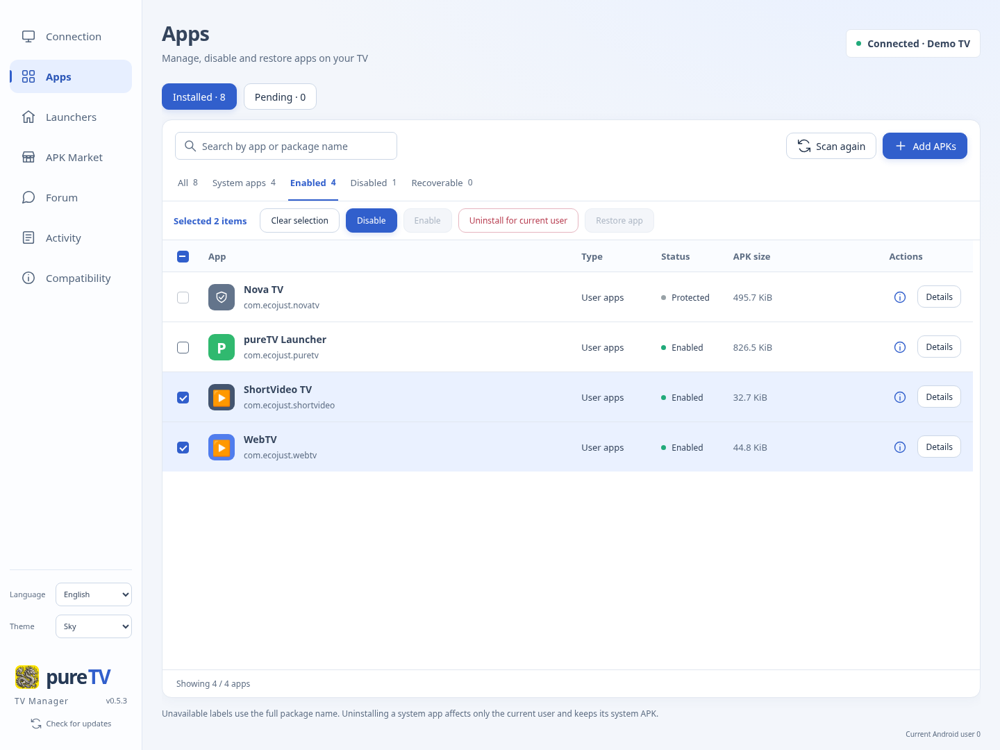

## Connection and app management

1. Connect your computer and TV to networks that can reach each other, then enable ADB or network debugging in the TV's developer options.
2. Enter the TV's IP address or hostname and debugging port on the home page, then authorize the computer on the TV. Port 5555 is common; use the port configured on your TV.
3. If ADB is missing, read and accept the Android SDK license, then click “Download and configure ADB.” The manager tries Google first and uses the Tencent mirror if that fails. You can also select an existing ADB installation.

Once connected, the home page displays the model, Android version, SDK version, security patch level, CPU, memory, `/data` storage capacity, resolution, and uptime. Other pages show the current connection status at the top.

- **App management:** search and filter apps, enable or disable them in batches, uninstall them for the current user, and restore system apps whose APKs are still present.
- **Package information:** click the circled **i** in an app row to look up its purpose, uninstall risk, source and retrieval time. Unknown packages stay unassessed, and protection for core components and the current launcher takes precedence.
- **Manager updates:** check the Gitee store's `client` directory at startup or manually, matching the current platform. **Download and install** verifies the package, installs it and restarts the manager. See [client updates](desktop/docs/client-updates.md) for platform behavior and the first upgrade from an older version.
- **Pending installations:** import local APKs, install one from its row, or select several for batch installation. Successful items leave the queue; failed and unprocessed items remain.
- **Launchers:** import and install launcher APKs directly from this page, choose a default home screen, or restore the previous default. The active launcher shows “Adjust layout” when it supports the interface.
- **Market:** browse apps and launchers dynamically from [pure-tv-store](https://gitee.com/juzisang331/pure-tv-store), search and preview them, download them to the pending installation queue, or install them on a connected TV. Versions of the same app or launcher share one card, with a dropdown for the latest five versions and the newest selected by default. Refresh to discover newly added APKs. Downloads also cache a sibling `logo.svg`; adding an app block or changing its app in the layout editor automatically uses the saved icon.
- App and launcher sizes include the main APK and split APKs. Private data, caches, and optimized files are excluded. Unreadable sizes are explicitly shown as unknown.
- Lists scroll within their own tables, with fixed headers and batch actions above them. Core system components and the current default launcher are protected.

Uninstalling a system app affects only the current Android user, preserves its data, and leaves the APK on the system partition. Newly installed user apps with a launchable activity can be added to the launcher layout.

Actions such as connecting, refreshing, managing apps, switching launchers, and applying layouts show a loading state followed by a result dialog. Batch results distinguish successful, failed, and unprocessed items. Automatic background reads do not interrupt you with dialogs.

## Launcher and TV app resources

[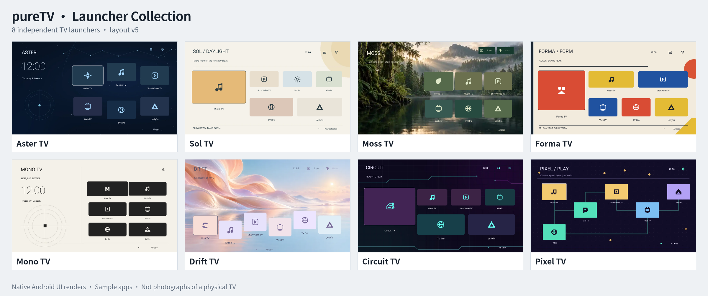](resource/launcher/)

The public [resource/](resource/) directory contains [launcher/](resource/launcher/) and [apps/](resource/apps/). Launcher and app sources previously stored at the repository root have moved into these directories. Launcher and TV app APKs are available in their software folders and separate `android-v*` releases; the desktop manager keeps its own `desktop-v*` versions and latest-release entry. Each software folder contains at least one actual APK and may also include matching source code, cover images, author details, licenses, and SHA256 checksums. Click a software name to open its folder. Every TV app directory provides a 64×64 `logo.svg` for launcher layouts; see the [resource convention](resource/README-development.md#应用资源与-logosvg-约定) for new apps.

The [0.5.1 game fidelity review](docs/game-fidelity-0.5.1.md) records rule and interaction improvements across the nine games, together with remaining map and content differences. The games retain the shared 0.5.0 certificate and support in-place updates from 0.5.0.

The launchers and first-party TV apps support English. Select English in the TV system settings to use it. User-provided app names, playlists, and media titles keep their original text. Native previews below use English test content; they are not physical TV captures.

“Customizable” in the launcher table means support for this manager's **layout.json version 5 users/system interface**. Cards for launchers that support the layout protocol automatically display the Home background color and image, including inactive launchers, and update after layout changes are applied. The list has no choose-cover or remove-cover actions; edit the home-screen background in “Adjust layout.” Pending APKs use their embedded Home background when available, falling back to a sibling `thumb.png` or `APK-name.thumb.png` only when no layout background can be read.

<!-- resource-index:start -->

### Launchers

| Name | Author | Version | APK size | Customizable | Preview |
| --- | --- | --- | --- | --- | --- |
| [Aster TV](resource/launcher/aster/) | ecojust | 0.5.0 | 443.7 KB | Yes | 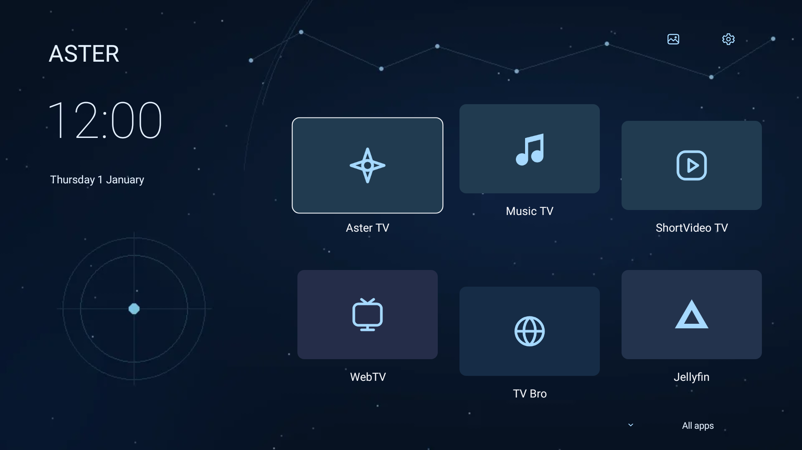 |
| [Circuit TV](resource/launcher/circuit/) | ecojust | 0.5.0 | 435.7 KB | Yes | 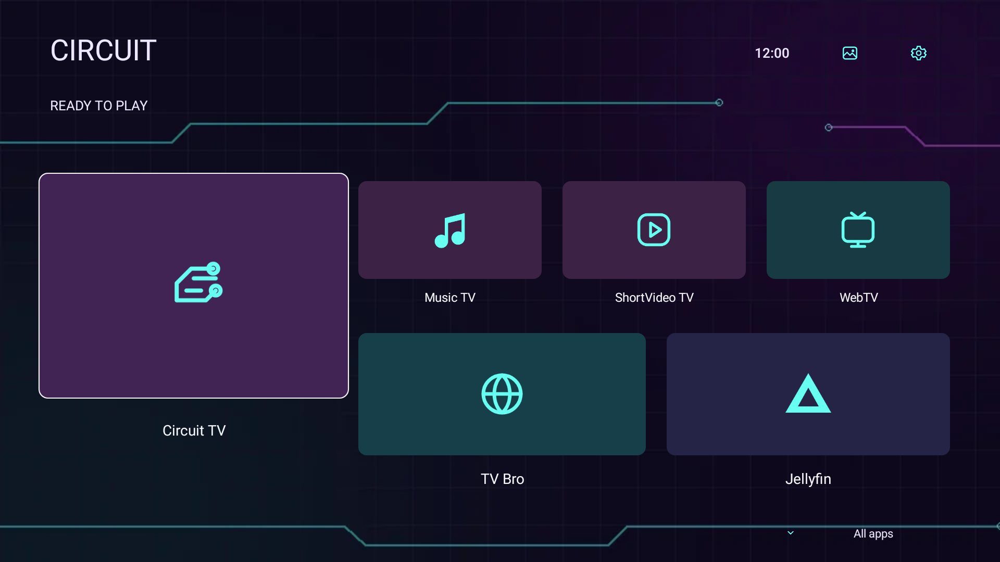 |
| [Drift TV](resource/launcher/drift/) | ecojust | 0.5.0 | 475.7 KB | Yes | 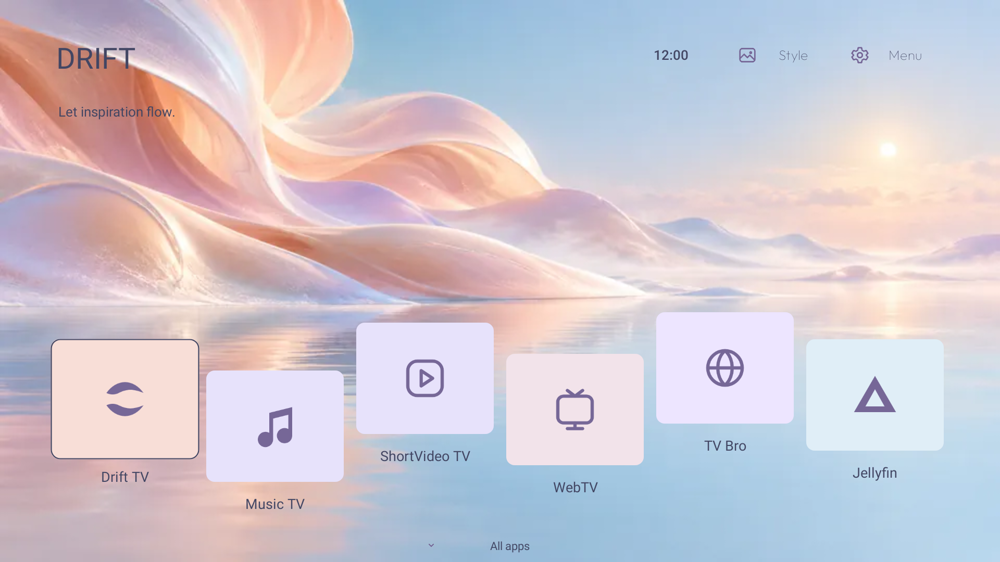 |
| [Forma TV](resource/launcher/forma/) | ecojust | 0.5.0 | 443.7 KB | Yes | 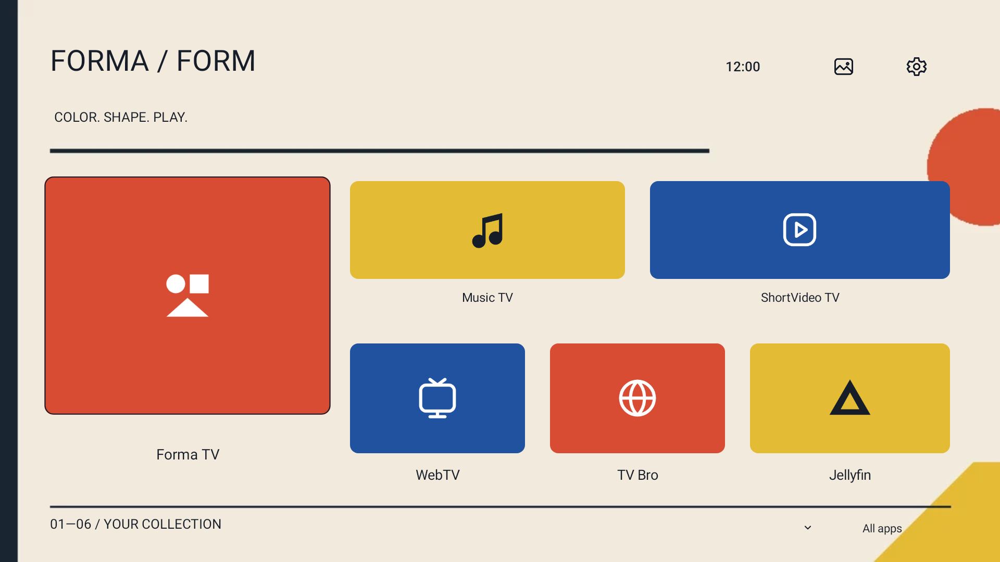 |
| [Mono TV](resource/launcher/mono/) | ecojust | 0.5.0 | 443.7 KB | Yes | 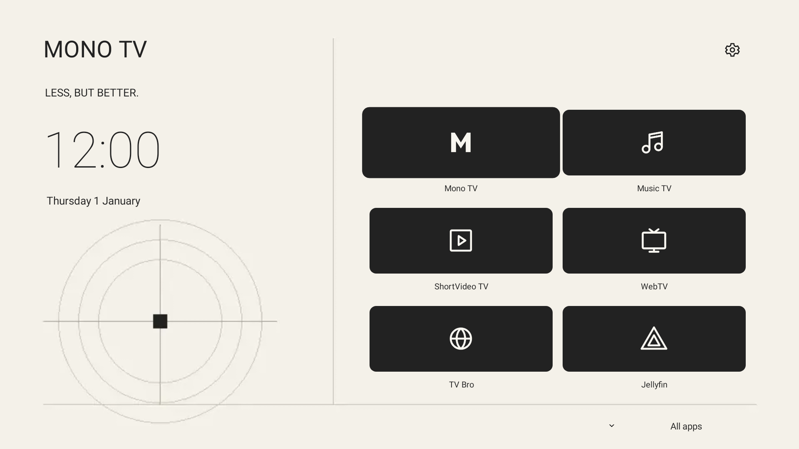 |
| [Moss TV](resource/launcher/moss/) | ecojust | 0.5.0 | 487.7 KB | Yes | 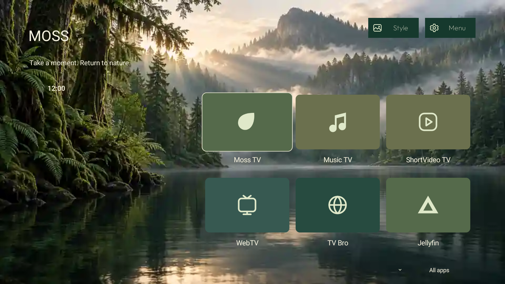 |
| [Nova TV](resource/launcher/nova/) | ecojust | 0.5.0 | 495.7 KB | Yes | 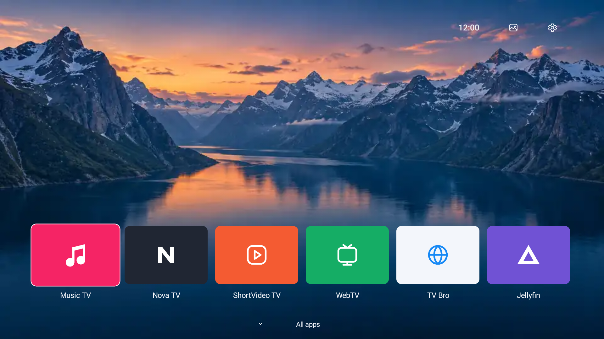 |
| [Pixel TV](resource/launcher/pixel/) | ecojust | 0.5.0 | 443.7 KB | Yes | 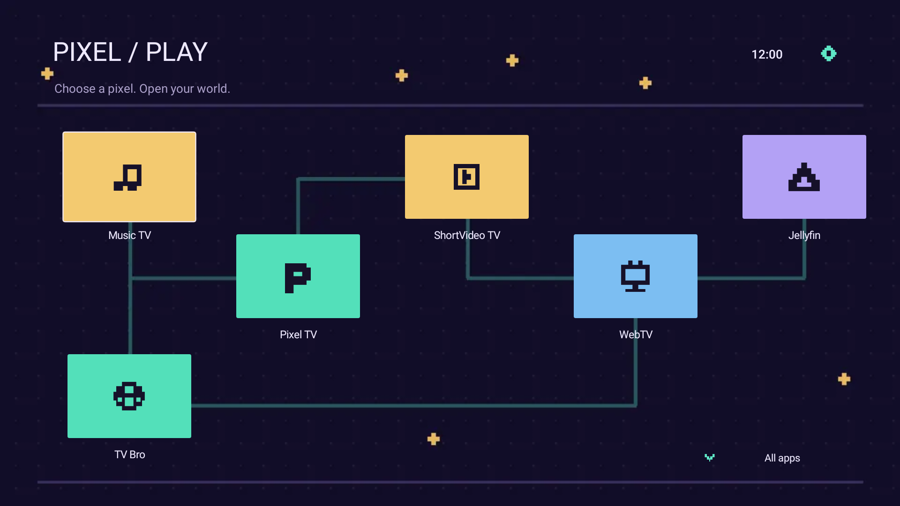 |
| [pureTV Launcher](resource/launcher/puretv/) | ecojust | 0.5.1 | 826.5 KB | Yes | 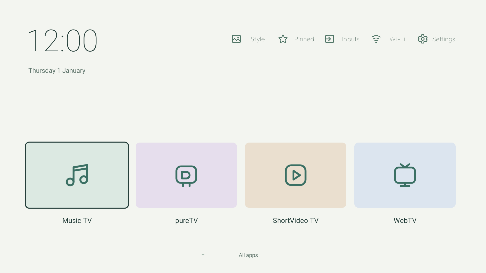 |
| [Sol TV](resource/launcher/sol/) | ecojust | 0.5.0 | 439.7 KB | Yes | 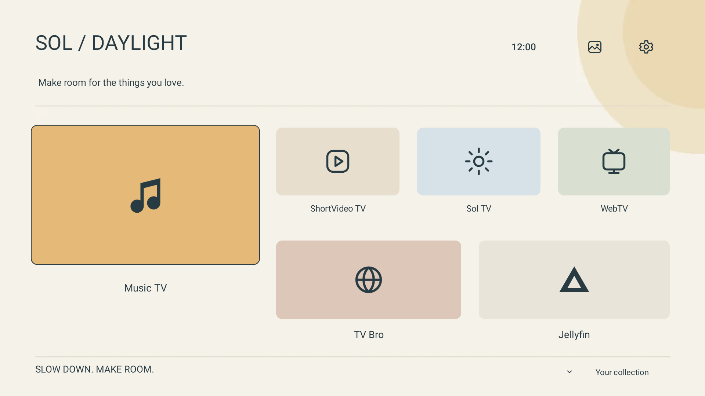 |

### TV apps

| Name | Author | Version | APK size | Purpose | Preview |
| --- | --- | --- | --- | --- | --- |
| [Adjacency Forge (Chinese UI)](resource/apps/adjacency-forge/) | ecojust / Juzisang | 0.1.0 | 289.3 KB | Swap unique metal tiles on seven hexagonal cells. Satisfy every exact local neighbor recipe and route heat from furnace to mold using fixed world-direction outlet priorities, then submit explicitly. Exact-ID undo, three wrong submissions and a 90-second active timer. Chinese TV interface. |  |
| [Adventure Island TV](resource/apps/adventure-island/) | ecojust | 0.5.2 | 89.4 KB | 32-stage island adventure with LAN phone controllers and alternating turns | 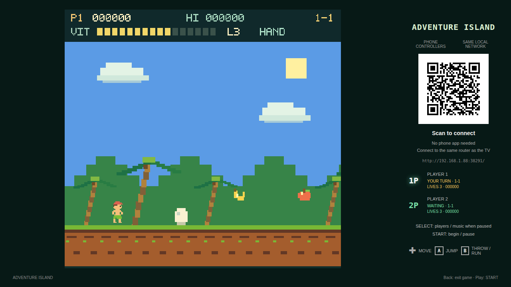 |
| [Airlock Budget (Chinese UI)](resource/apps/airlock-budget/) | ecojust / Juzisang | 0.1.0 | 289.3 KB | Schedule three groups through an airlock. Balance slow oxygen recovery against fast venting and individual deadlines, manage a finite reservoir and shared pump, and seal the leak while preserving the required final reserve. Chinese TV interface. | 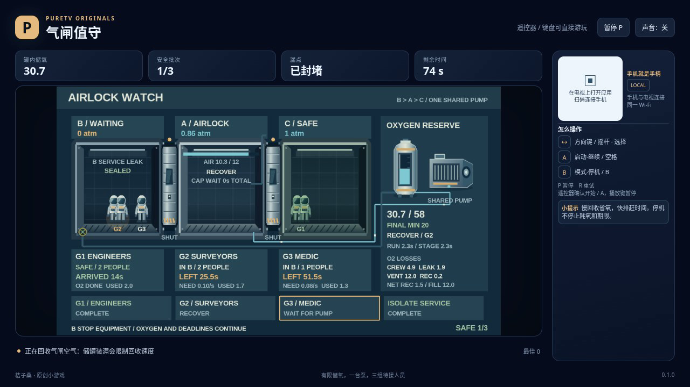 |
| [Alien Shooter TV](resource/apps/alien-shooter/) | ecojust | 0.1.2 | 1.68 MB | Single-player industrial-base alien combat with three campaign stages, five weapons and a LAN phone controller |  |
| [Arrow Harvest (Chinese UI)](resource/apps/arrow-harvest/) | ecojust / Juzisang | 0.1.0 | 289.3 KB | Route seeds along one-way arrows to cover every target field exactly once without entering forbidden ground. Arrows are locked during propagation. Chinese TV interface. |  |
| [Assembly Kitchen (Chinese UI)](resource/apps/assembly-kitchen/) | ecojust / Juzisang | 0.1.0 | 293.3 KB | Coordinate shared cooking, cooling and packing stations. Adjust fan speed, manage food temperature and holding limits, and deliver three orders in the required sequence before closing. Incorrect or expired food is discarded and the order returns for rework. Chinese TV interface. |  |
| [Battery Exchange (Chinese UI)](resource/apps/battery-exchange/) | ecojust / Juzisang | 0.1.0 | 293.3 KB | Exchange six cells with different charge and internal resistance during safe off windows. Select series or parallel wiring for two loads, complete their staged power requests, and manage charge and temperature. Simplified circuit game with a Chinese TV interface. |  |
| [Beat Braid](resource/apps/beat-braid/) | ecojust / Juzisang | 0.1.0 | 293.3 KB | Hold one thread while tapping the other on the beat, alternate roles and maintain continuity across three rhythm charts. Chinese TV interface. | 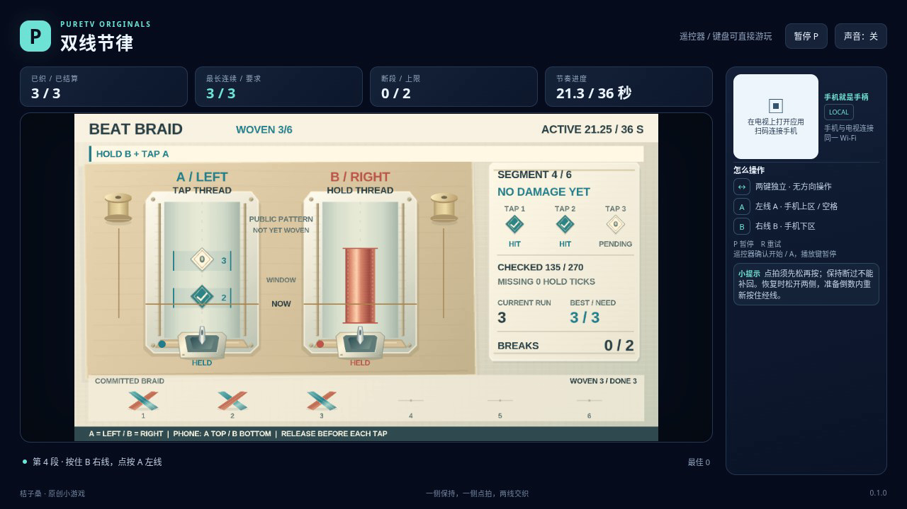 |
| [Mighty Bomb Jack TV](resource/apps/bomb-jack/) | ecojust | 0.5.2 | 85.4 KB | 16-stage pyramid adventure with LAN phone controllers and alternating turns | 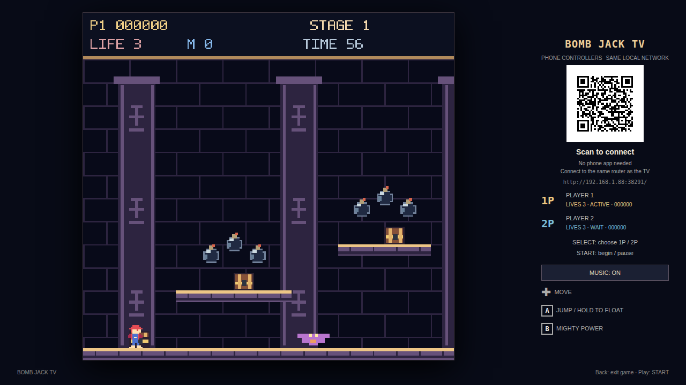 |
| [Cable Unweaver](resource/apps/cable-unweaver/) | ecojust / Juzisang | 0.1.0 | 289.3 KB | Slide terminals along their rails and move linked clamps together to untangle straight cables. Remove illegal crossings and coincident ports across three workbenches; even the last adjustment can complete the wiring. |  |
| [CCTV Live](resource/apps/cctv/) | ecojust | 0.5.0 | 40.9 KB | Official CCTV website player with TV channel navigation | 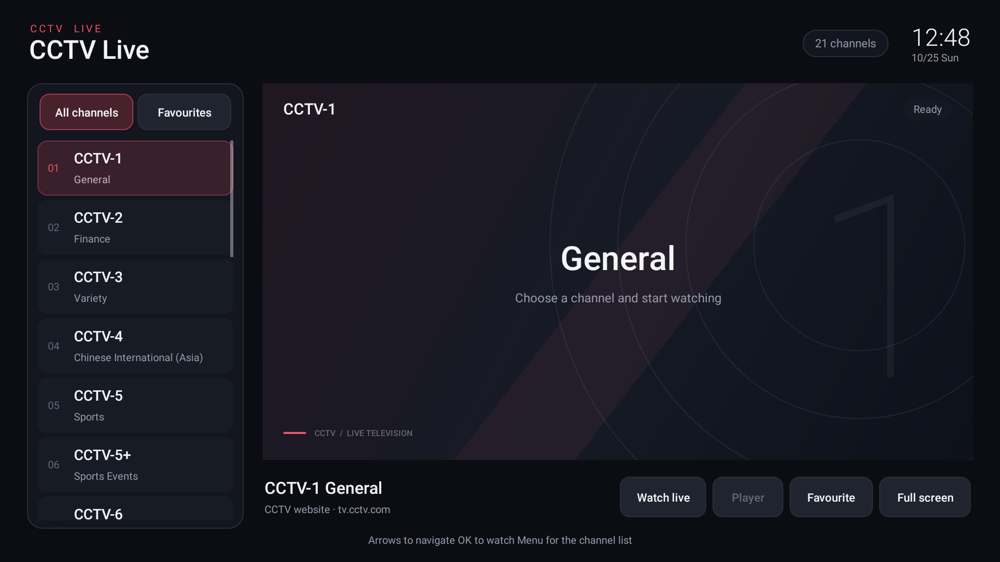 |
| [Clockwork Alignment (Chinese UI)](resource/apps/clockwork-align/) | ecojust / Juzisang | 0.1.0 | 297.3 KB | Engage or brake gear trains within a limited adjustment budget. Keep every pointer aligned throughout the appointment hold across three gear layouts. Chinese TV interface. | 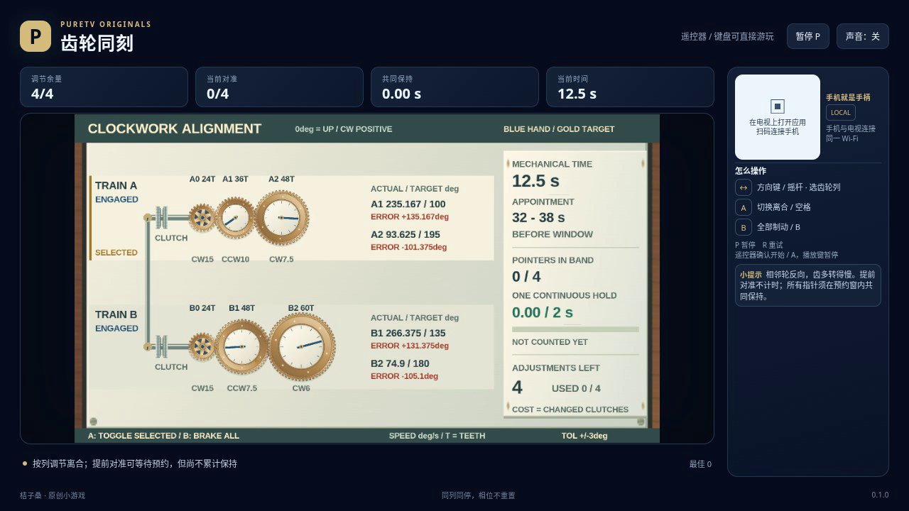 |
| [Coast Kart TV](resource/apps/coast-kart/) | ecojust | 0.5.2 | 257.6 KB | Original kart racing with drifting, items and split-screen LAN phone play | 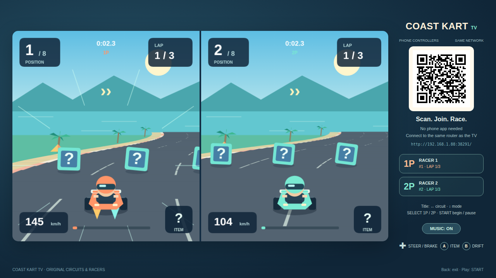 |
| [Color Frontier](resource/apps/color-frontier/) | ecojust / Juzisang | 0.1.0 | 285.3 KB | Flood a connected territory from the top-left corner using a finite dye budget. Four-neighbor expansion, three public maps, and undo that restores the board without refunding moves; phone directional and two action zones. |  |
| [Conveyor Window (Chinese UI)](resource/apps/conveyor-window/) | ecojust / Juzisang | 0.1.0 | 297.3 KB | Move the gripper to collect and rotate keyed parts, then dispatch through the open shutter into matching sockets. Avoid damage and maintain a correct assembly streak across three conveyor scenarios. Chinese TV interface. | 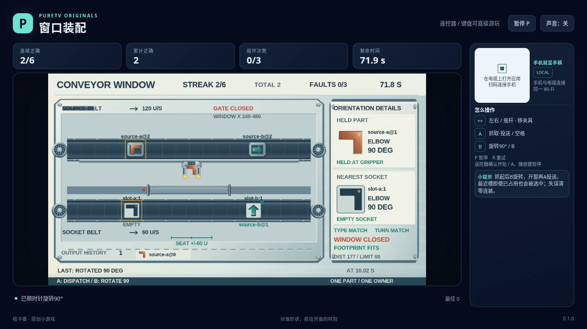 |
| [Cozy Island TV](resource/apps/cozy-island/) | ecojust | 0.5.2 | 269.6 KB | Original island life with gathering, fishing, decorating and LAN phone play | 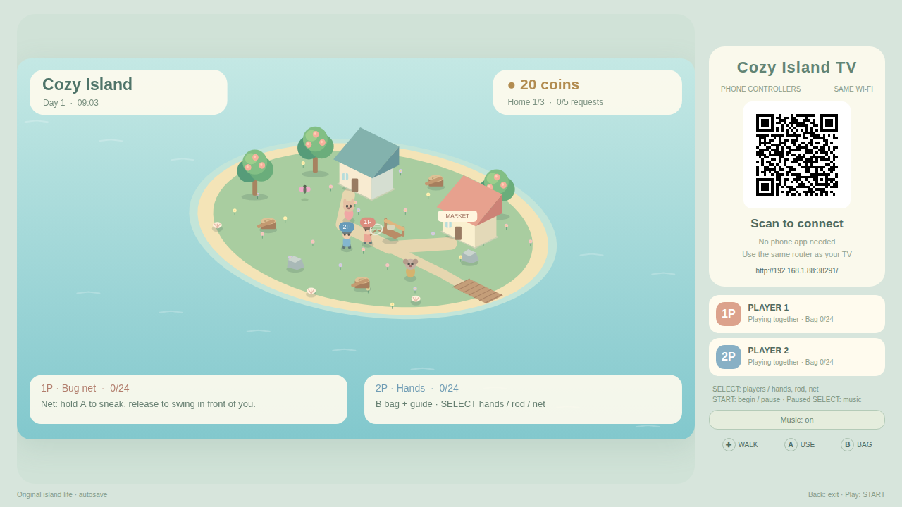 |
| [Echo Cartographer (Chinese UI)](resource/apps/echo-cartographer/) | ecojust / Juzisang | 0.1.0 | 289.3 KB | Map dark corridors with timed sonar, manage battery and patrol noise, collect every beacon and return to the entrance. Chinese TV interface. | 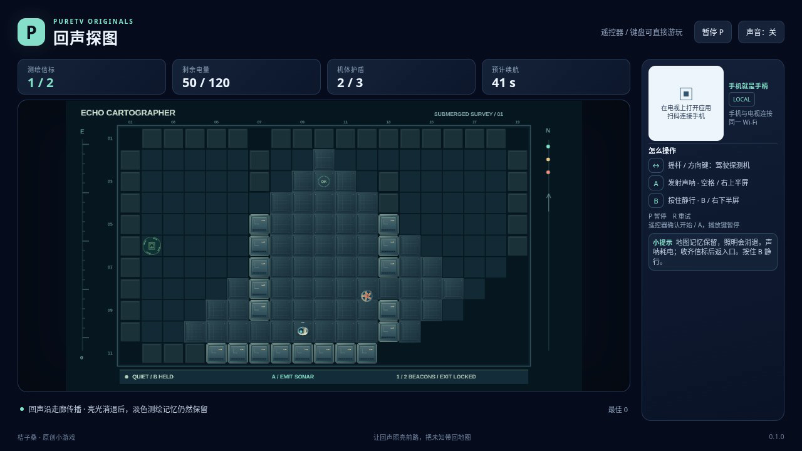 |
| [Firebreak Planner (Chinese UI)](resource/apps/firebreak-planner/) | ecojust / Juzisang | 0.1.0 | 289.3 KB | Plan firebreaks with limited action points. Anticipate changing wind and accumulated heat as fire spreads simultaneously, protect every village and retain at least seventy percent of the original forest. Clearing also counts as forest loss. Chinese TV interface. | 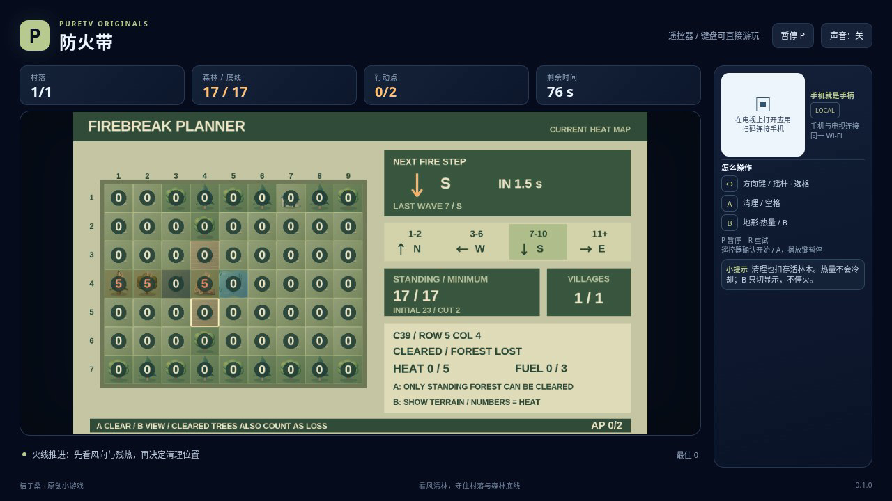 |
| [Frost Brake](resource/apps/frost-brake/) | ecojust / Juzisang | 0.1.0 | 289.3 KB | Push an inertial cargo sled and hold A to lower the ice claw. Extra braking works only on frost bands. Settle the complete sled inside three narrowing delivery zones while avoiding the edges and cargo damage. Three scenarios; Chinese TV interface. | 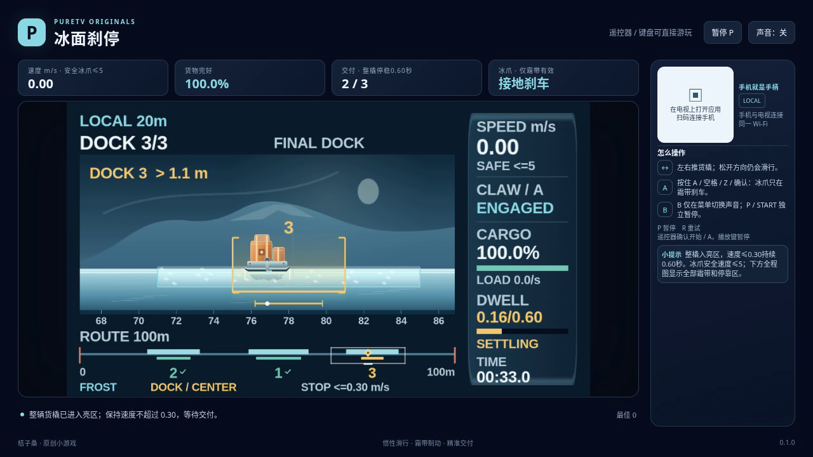 |
| [Glass Fold (Chinese UI)](resource/apps/glass-fold/) | ecojust / Juzisang | 0.1.0 | 289.3 KB | Fold translucent colored tiles to match a visible stained-glass outline and its layered colors. Three puzzles with undo, limited folds and a 90-second active timer. Chinese TV interface. | 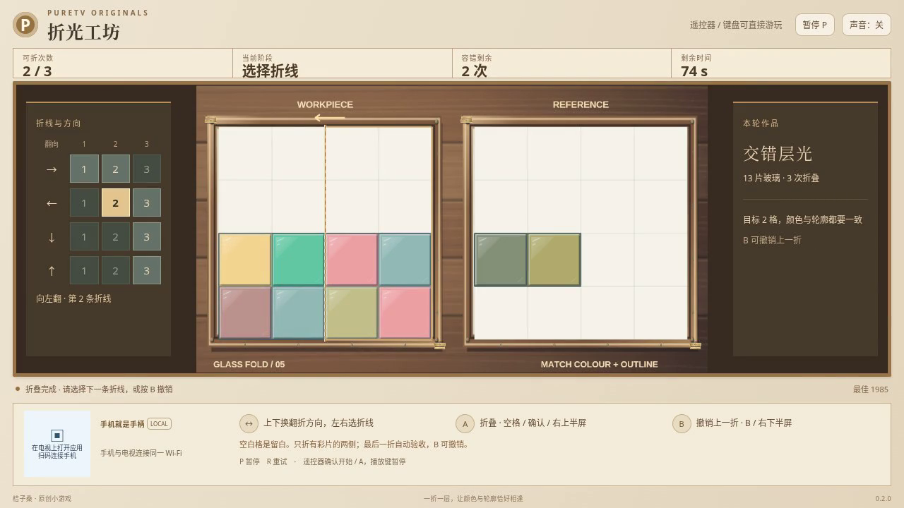 |
| [Gravity Courier (Chinese UI)](resource/apps/gravity-courier/) | ecojust / Juzisang | 0.1.1 | 285.3 KB | Pilot an inertial courier ship, manage fuel and deliver three parcels around gravity sources. Chinese TV interface. | 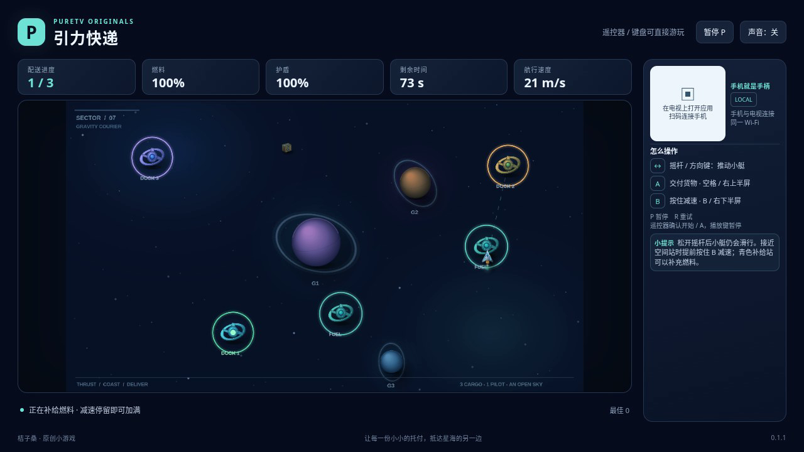 |
| [Greenhouse Dials (Chinese UI)](resource/apps/greenhouse-dials/) | ecojust / Juzisang | 0.1.0 | 289.3 KB | Adjust ventilation, shade and drip irrigation with delayed controls. Manage shared climate and limited water so all three crops reach their own maturity requirements without dying. Chinese TV interface. | 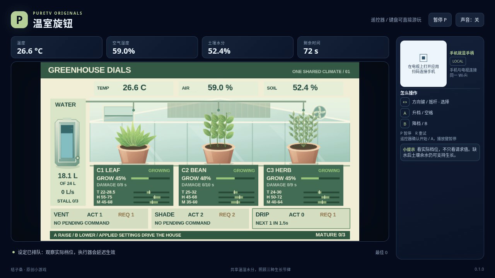 |
| [Harbor Counterweight (Chinese UI)](resource/apps/harbor-counterweight/) | ecojust / Juzisang | 0.1.0 | 293.3 KB | Load and unload six cargo units in a specified order while moving ballast to control vessel roll. Keep required cargo accessible, deliver four units and stabilize the ship with its two export units aboard. Simplified crane and roll game with a Chinese TV interface. |  |
| [Hidden Corridors (Chinese UI)](resource/apps/hidden-corridors/) | ecojust / Juzisang | 0.1.0 | 289.3 KB | Infer a hidden 4x4 wall map from public row counts, exact shortest edge distance and limited one-cell probes. Mark and submit a safe route of the required length. Three fixed puzzles with a 90-second active timer; three wrong submissions after probe exhaustion end a round. Chinese TV interface. |  |
| [HIFINi TV](resource/apps/hifini/) | ecojust | 0.5.0 | 201.1 KB | HiFiNi music search, shuffle playback and rhythm animation | 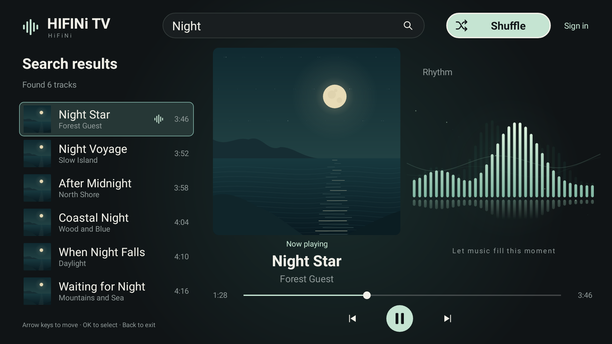 |
| [Island Dominoes (Chinese UI)](resource/apps/island-dominoes/) | ecojust / Juzisang | 0.1.0 | 289.3 KB | Place unique bridge pieces between islands using exact straight-line lengths and matching destination colors. Use every piece to form one connected, noncrossing network; undo restores the same physical piece without refunding time or errors. Three fixed puzzles with a 90-second active timer. Chinese TV interface. | 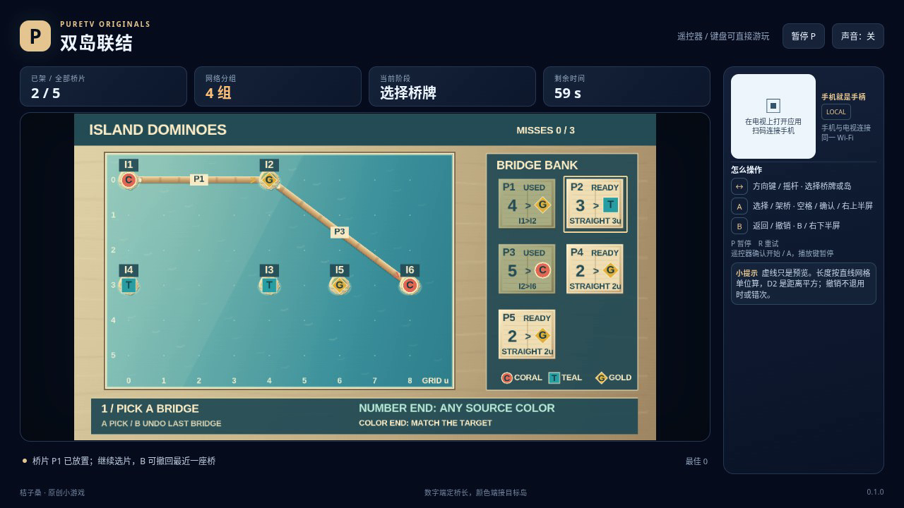 |
| [Jackal TV](resource/apps/jackal/) | ecojust | 0.5.2 | 11.95 MB | Independently rewritten six-stage jeep rescue with two LAN phone controllers | 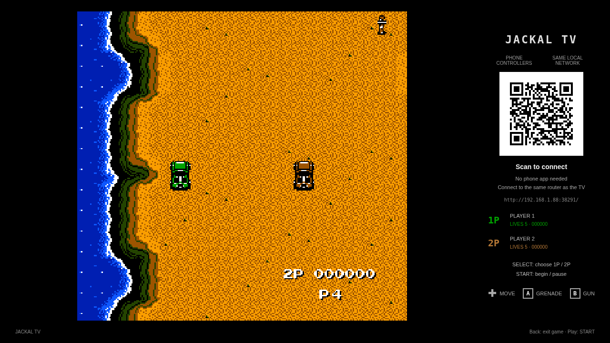 |
| [Magic Jewelry TV](resource/apps/jewel/) | ecojust | 0.5.2 | 81.4 KB | Classic three-gem chain matching with one or two LAN phone controllers | 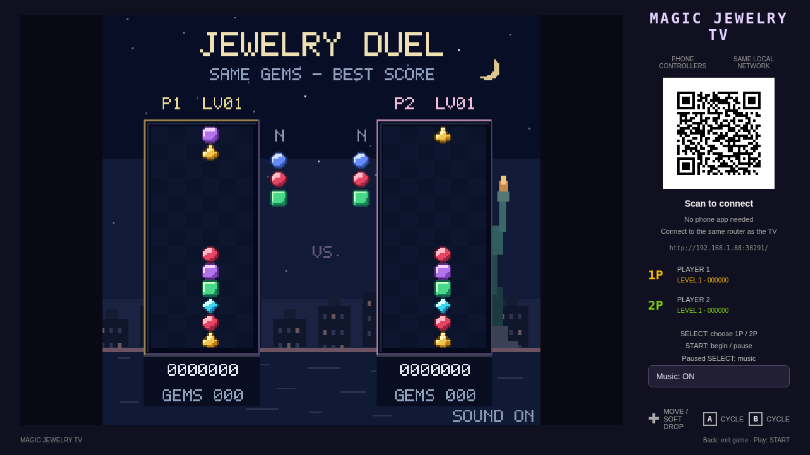 |
| [Kaleido Keys](resource/apps/kaleido-keys/) | ecojust / Juzisang | 0.1.0 | 289.3 KB | Place and rotate limited glyphs in one source wedge, choose a symmetry order, and match the complete mirrored key. Check swapped columns, quarter turns and empty sockets before submitting. Four rejected submissions end the round; there is no deadline. | 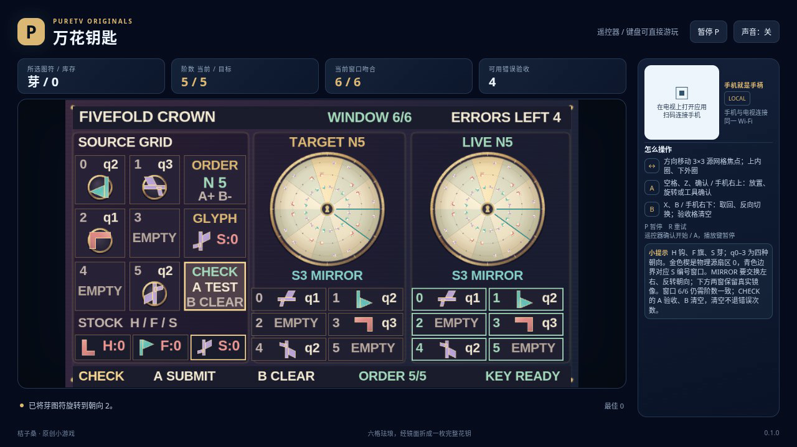 |
| [Lantern Rhythm (Chinese UI)](resource/apps/lantern-rhythm/) | ecojust / Juzisang | 0.1.0 | 289.3 KB | Observe directional short and long lighthouse signals, then reproduce their timing with real button holds to light all three beacons. Limited replay credits and a 90-second active timer. Chinese TV interface. | 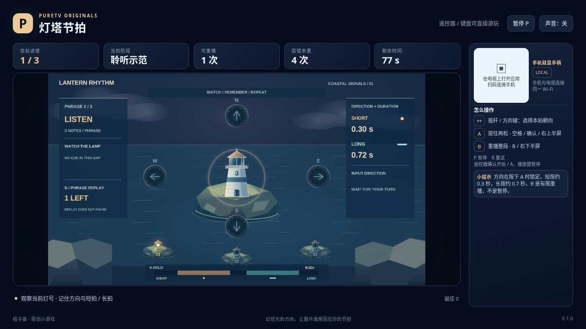 |
| [Lens Distance](resource/apps/lens-distance/) | ecojust / Juzisang | 0.1.0 | 289.3 KB | Original single-player optics puzzle. Move a lens and screen, adjust the iris, and satisfy separate real-image clarity and brightness requirements. Three benches each contain two plates with independent exposure and adjustment budgets. | 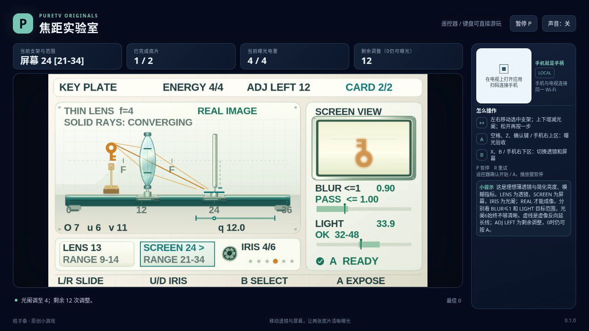 |
| [Loop Orchard (Chinese UI)](resource/apps/loop-orchard/) | ecojust / Juzisang | 0.1.0 | 289.3 KB | Build one connected irrigation loop through required trees, avoid forbidden flower vertices, and satisfy exact region-edge clues; unhinted regions remain unconstrained. Place or remove unique physical pipes, undo the exact edit, then start PUMP explicitly. Three wrong starts or 90 active seconds end a round. Chinese TV interface. |  |
| [Magnetic Warehouse (Chinese UI)](resource/apps/magnetic-warehouse/) | ecojust / Juzisang | 0.1.0 | 289.3 KB | Switch magnetic polarity to attract and repel numbered crates into their matching docks, with simultaneous movement, walls and a limited action budget. Chinese TV interface. | 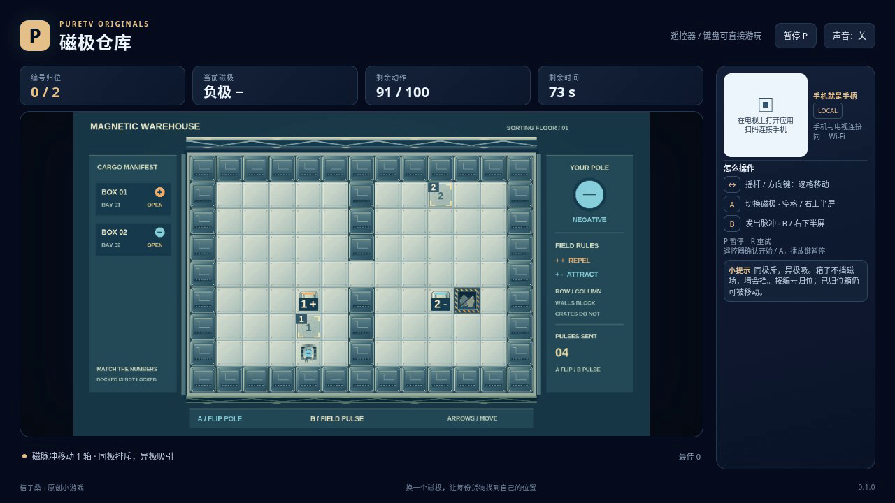 |
| [Measure Pour](resource/apps/measure-pour/) | ecojust / Juzisang | 0.1.0 | 285.3 KB | Pour conserved water between three jugs of different capacities. Every transfer fills the destination or empties the source; meet all three visible target amounts within a finite pour budget across three puzzles. |  |
| [Metronome Gates](resource/apps/metronome-gates/) | ecojust / Juzisang | 0.1.0 | 293.3 KB | Queue directions and waits, pass periodic gates on each beat, collect all markers and reach the exit within the beat budget. Undo removes only the unexecuted tail command. Three maps; Chinese TV interface. |  |
| [Moiré Atelier](resource/apps/moire-atelier/) | ecojust / Juzisang | 0.1.0 | 289.3 KB | Slide and rotate two periodic masks until all five current brightness checks match their targets together. Use visible fiducial guides to complete three optical calibrations within the time and submission limits. |  |
| [Number Dunes (Chinese UI)](resource/apps/number-dunes/) | ecojust / Juzisang | 0.1.0 | 289.3 KB | Compact one selected row or column without merging or crossing fixed pillars. Keep physical stone order within each segment and achieve both a strictly increasing snake readout and the exact target holes. Undo restores stone positions without refunding successful moves or active time. Chinese TV interface. |  |
| [Packing Sculptor](resource/apps/packing-sculptor/) | ecojust / Juzisang | 0.1.0 | 289.3 KB | Original single-player polygon packing puzzle. Place and rotate finite pieces inside three irregular boxes while leaving complete straight extraction paths through marked doors. Four CHECK attempts; phone directional and two action zones. |  |
| [Parallax Skyline](resource/apps/parallax-skyline/) | ecojust / Juzisang | 0.1.0 | 285.3 KB | Slide near and far building plates to match both skylines and visible roof landmarks. A convincing front view can hide a wrong far plate; undo preserves failed submissions. | 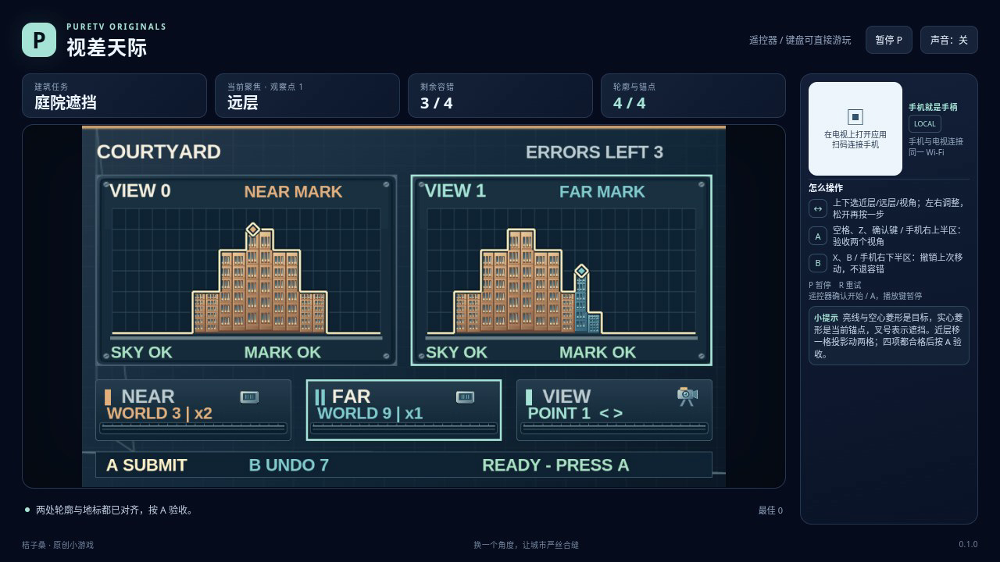 |
| [Parity Garden (Chinese UI)](resource/apps/parity-garden/) | ecojust / Juzisang | 0.1.0 | 285.3 KB | Match a public 4x4 flower pattern using cross and diagonal watering nozzles. Marked flowers must be open with an even direct watering count; repeated sprays never refund water. Three puzzles with finite water and a 90-second active timer. Chinese TV interface. | 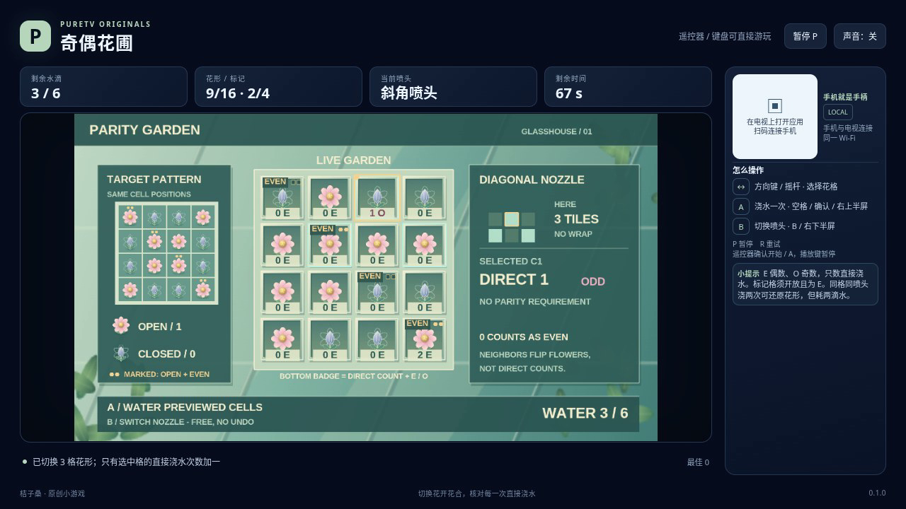 |
| [Path Glyphs (Chinese UI)](resource/apps/path-glyphs/) | ecojust / Juzisang | 0.1.0 | 289.3 KB | Trace a non-repeating route across a public 5x5 board. Entry-side conditions emit direction glyphs; submit the exact ordered target at the exit. Three puzzles with whole-route clear, persistent failure history and a 90-second active timer. Chinese TV interface. | 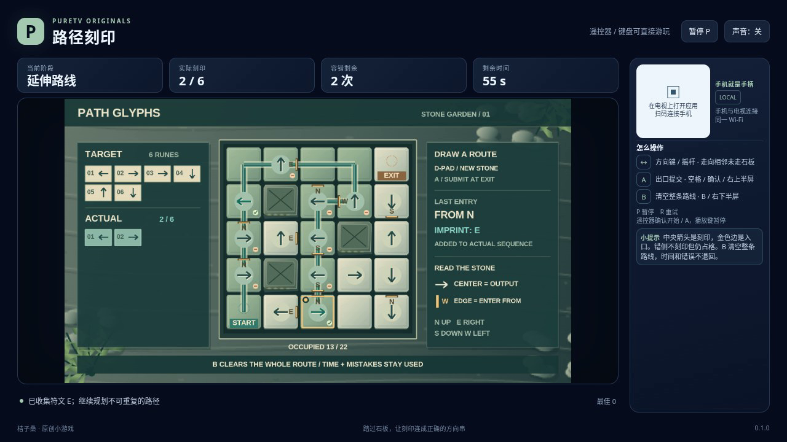 |
| [Pollinator Contract (Chinese UI)](resource/apps/pollinator-contract/) | ecojust / Juzisang | 0.1.0 | 289.3 KB | Guide two bee groups through timed blooms and prerequisite fields, redirect flights and return to the hive to recover stamina across three garden contracts. Chinese TV interface. |  |
| [Pressure Seal](resource/apps/pressure-seal/) | ecojust / Juzisang | 0.1.0 | 289.3 KB | Hold heat and vent controls to seal three packages within their pressure bands. Residual heat keeps changing pressure after release. | 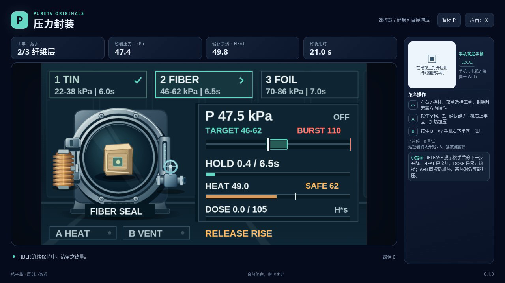 |
| [Prism Relay (Chinese UI)](resource/apps/prism-relay/) | ecojust / Juzisang | 0.1.1 | 285.3 KB | Rotate mirrors and prisms to guide coloured light through three optical puzzles. Chinese TV interface. |  |
| [Pulse Vault (Chinese UI)](resource/apps/pulse-vault/) | ecojust / Juzisang | 0.1.0 | 293.3 KB | Hold to collect a finite pulse supply, select a dose and discharge into sequential locks. Control overflow and heat peaks, open four locks and retain the final energy reserve across three supply scenarios. Chinese TV interface. |  |
| [Reservoir Seasons (Chinese UI)](resource/apps/reservoir-seasons/) | ecojust / Juzisang | 0.1.0 | 289.3 KB | Allocate reservoir water to residents, farms and the ecological river using four-season forecasts. Undo uncommitted plans, protect seasonal minimums and meet each group's annual target. Chinese TV interface. |  |
| [Resonance Bridge (Chinese UI)](resource/apps/resonance-bridge/) | ecojust / Juzisang | 0.1.0 | 289.3 KB | Tune the frequency and phase of three floating bridge slabs. Dispatch pedestrians who cross only after sustained safe contact, while keeping resonance under control. Three crossing scenarios. Chinese TV interface. |  |
| [Reversi Relay](resource/apps/reversi-relay/) | ecojust / Juzisang | 0.1.0 | 285.3 KB | Play three 6x6 Reversi endgames against a deterministic opponent. Bracket and flip discs in eight directions, pass only with no legal move, and finish with the majority of discs. |  |
| [Ring Towers](resource/apps/ring-towers/) | ecojust / Juzisang | 0.1.0 | 285.3 KB | Transfer a tower of rings between three pegs, moving only the top ring and never placing a larger ring on a smaller one. Solve three-, four- and five-ring towers within their move budgets. |  |
| [Rotor Locksmith](resource/apps/rotor-locksmith/) | ecojust / Juzisang | 0.1.0 | 293.3 KB | Turn three geared rings, hold A to move inward and B to retreat. Retrieve the core key and guide its wider head back through the gaps while preserving durability. Three locks; Chinese TV interface. |  |
| [Sandglass Split (Chinese UI)](resource/apps/sandglass-split/) | ecojust / Juzisang | 0.1.0 | 289.3 KB | Toggle the shared hopper and rotate two deflectors to distribute sand between three cups. Packets keep the route chosen on contact; drain the available sand with every cup inside its target tolerance and no spill. Chinese TV interface. |  |
| [Shadow Foundry](resource/apps/shadow-foundry/) | ecojust / Juzisang | 0.1.0 | 285.3 KB | Rotate a compact metal assembly and its side light to cover cyan target samples without touching amber forbidden samples. Direction, height and overlap matter; twelve rotations per blueprint. |  |
| [Shadow Shutter (Chinese UI)](resource/apps/shadow-shutter/) | ecojust / Juzisang | 0.1.0 | 297.3 KB | Move and rotate the aperture to photograph three complete, correctly aligned silhouettes while avoiding an opaque paper strip. Match ordered targets with limited film across three scenes. Chinese TV interface. | 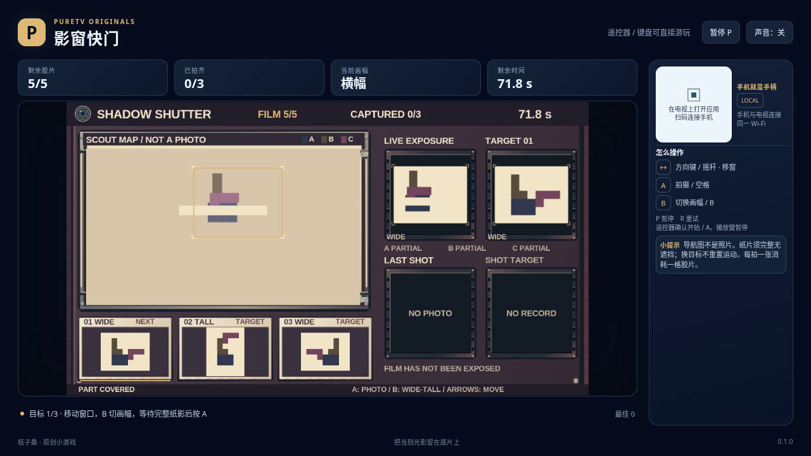 |
| [ShortVideo TV](resource/apps/shortvideo/) | ecojust | 0.5.0 | 32.7 KB | Short video player with remote control support | 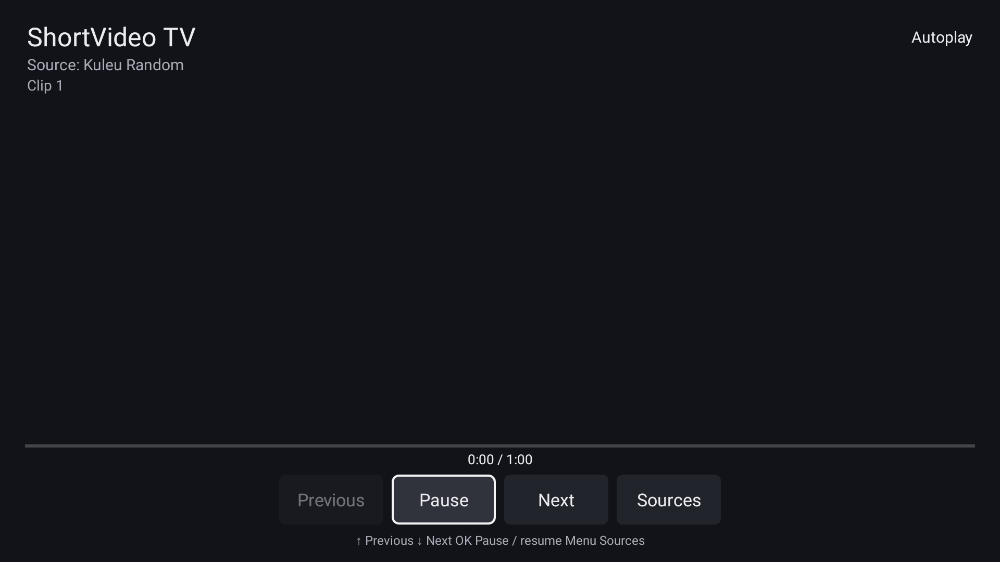 |
| [Sliding Order](resource/apps/sliding-order/) | ecojust / Juzisang | 0.1.0 | 281.3 KB | Move the blank space in a 3x3 board to arrange eight numbered tiles in order. Solve three starting layouts within their slide budgets; undo restores the board without refunding moves. |  |
| [Solar Shift (Chinese UI)](resource/apps/solar-shift/) | ecojust / Juzisang | 0.1.0 | 289.3 KB | Orient a solar panel through changing daylight and shadows, supply devices in priority order, and manage battery energy and temperature to meet each device's quota through the night. Chinese TV interface. |  |
| [Stack Dispatch](resource/apps/stack-dispatch/) | ecojust / Juzisang | 0.1.0 | 285.3 KB | Operate a single-cargo crane and three LIFO storage bays to ship visible manifests in order. Three puzzles with finite capacity, limited handling moves and three wrong-order attempts; phone directional and two action zones. |  |
| [Stone Bay](resource/apps/stone-bay/) | ecojust / Juzisang | 0.1.0 | 285.3 KB | Push stone crates onto every socket in three courtyards. You can push but cannot pull; walking is free, while undo restores positions without refunding the limited push budget. | 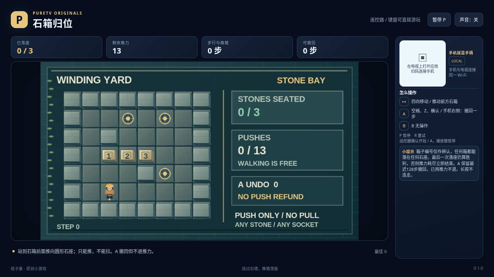 |
| [Super Mario TV](resource/apps/super-mario/) | ecojust | 0.5.2 | 93.4 KB | 32-course platform adventure with LAN phone controllers and alternating turns | 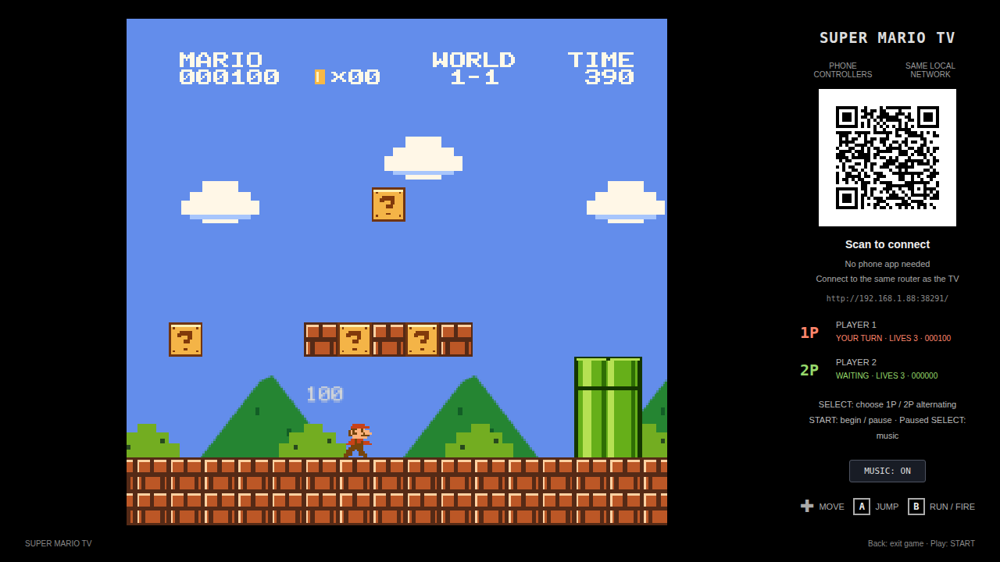 |
| [Switchyard Minute (Chinese UI)](resource/apps/switchyard-minute/) | ecojust / Juzisang | 0.1.1 | 289.3 KB | Route freight trains to matching platforms, operate occupied-track locks and schedule departures from two waiting gates. Chinese TV interface. | 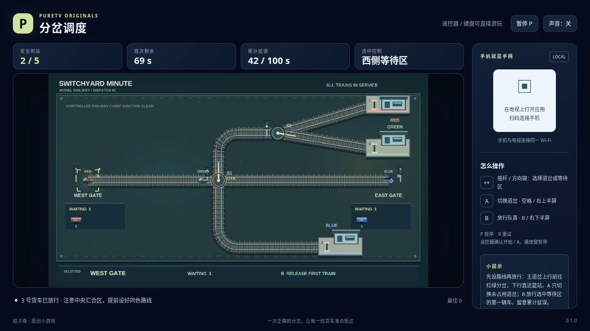 |
| [Tank TV](resource/apps/tank/) | ecojust | 0.5.2 | 258.3 KB | Independently rewritten 35-stage tank defense with two LAN phone controllers | 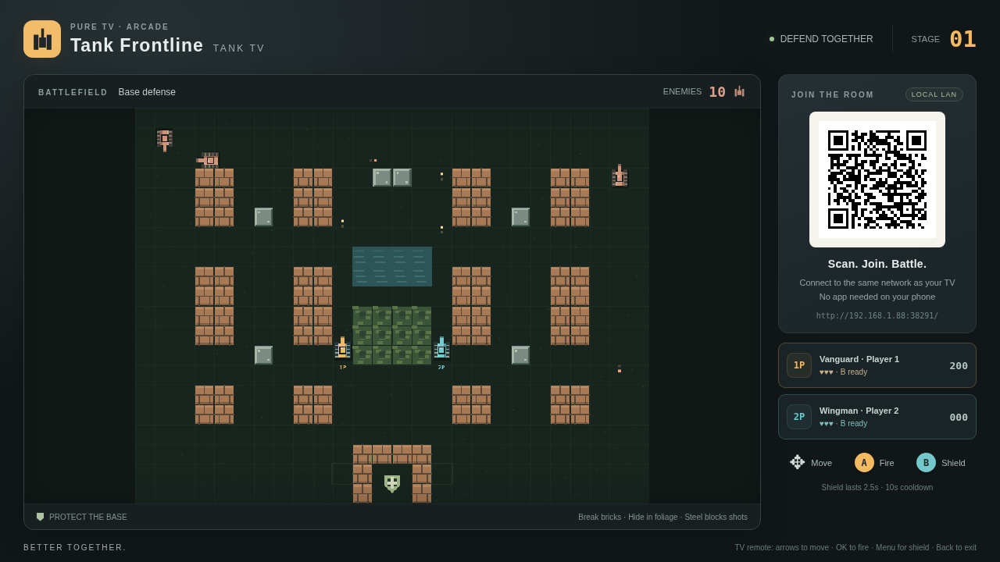 |
| [Tension Span (Chinese UI)](resource/apps/tension-span/) | ecojust / Juzisang | 0.1.0 | 289.3 KB | Build a cable-supported bridge within a material budget, then carry a loaded truck across while managing deck deflection and cable failure. Chinese TV interface. | 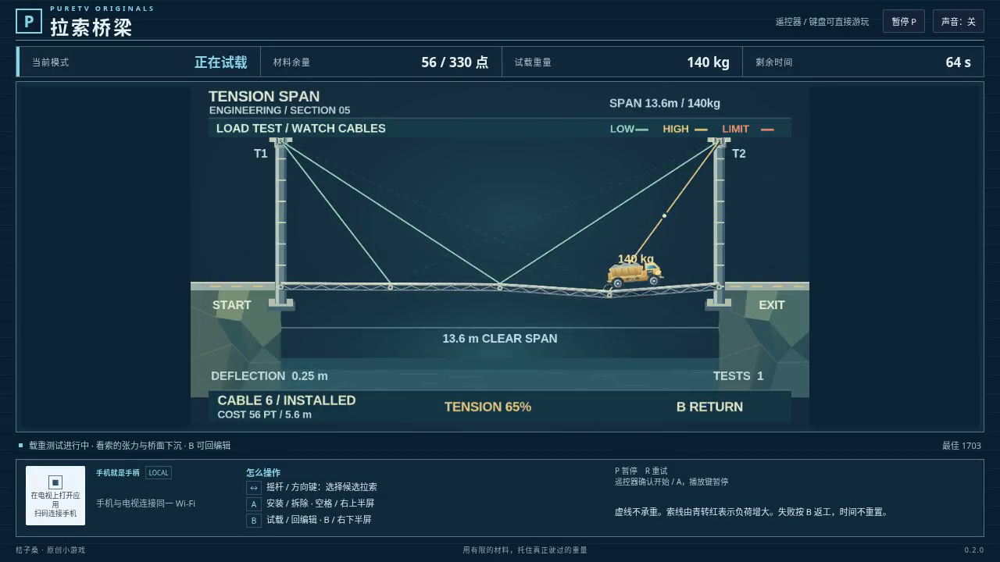 |
| [Tetris TV](resource/apps/tetris/) | ecojust | 0.5.2 | 81.4 KB | Classic falling-block puzzle with one or two LAN phone controllers | 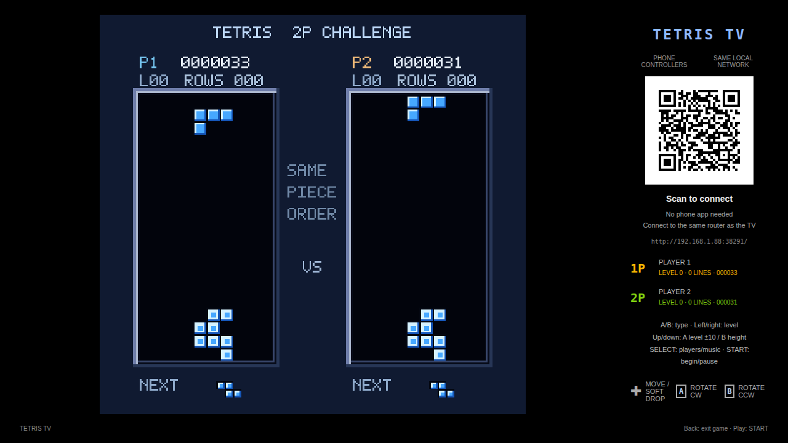 |
| [Thermal Glider (Chinese UI)](resource/apps/thermal-glider/) | ecojust / Juzisang | 0.1.0 | 293.3 KB | Fly an unpowered glider through ordered observation rings using visible thermals, wind, airbrakes and flaps, then satisfy every runway landing limit. Three public courses and a 90-second active timer. Chinese TV interface. | 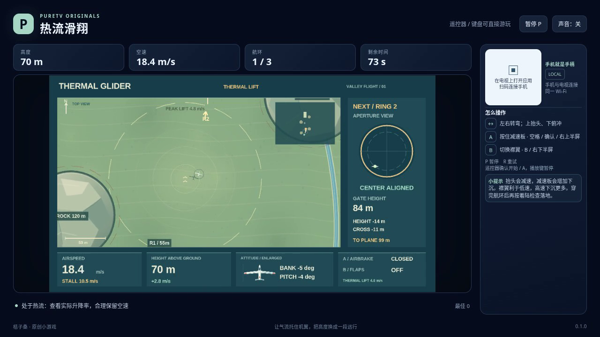 |
| [Tide Lock (Chinese UI)](resource/apps/tide-lock/) | ecojust / Juzisang | 0.1.1 | 289.3 KB | Adjust finite chamber water levels, operate interlocked gates and guide cargo boats uphill through two canal locks. Chinese TV interface. |  |
| [Triangle Pegs](resource/apps/triangle-pegs/) | ecojust / Juzisang | 0.1.0 | 285.3 KB | Jump over adjacent pegs in six directions on a fifteen-hole triangular board until only one remains. Solve three different starting vacancies with three limited undo tokens. | 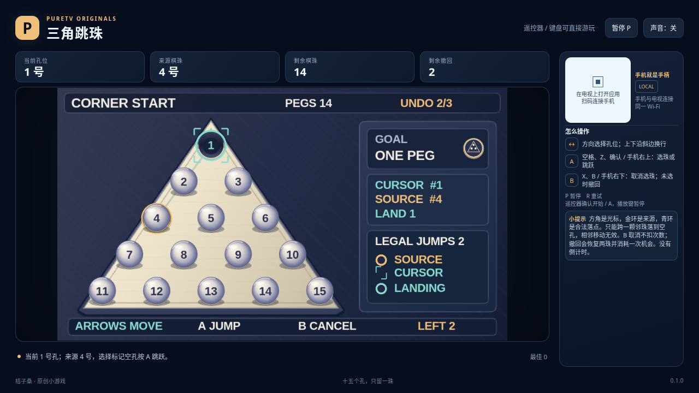 |
| [Triangular Tessera (Chinese UI)](resource/apps/triangular-tessera/) | ecojust / Juzisang | 0.1.0 | 289.3 KB | Rotate and mirror triangular color tiles to match shared edges and exact red, green and blue region counts. Three original puzzles use charged moves and a 90-second limit; scan the TV code for single-player phone control. Chinese TV interface. | 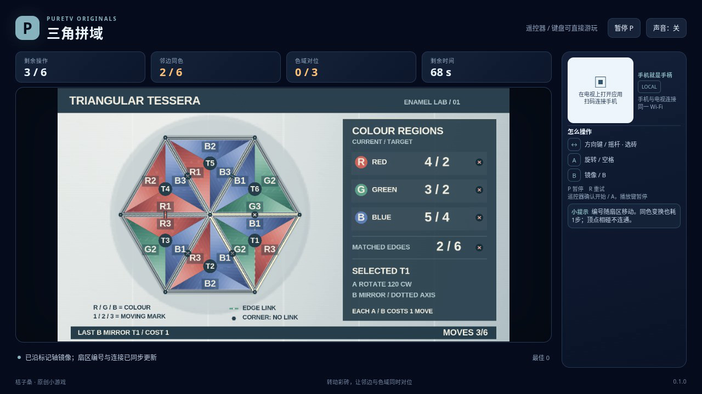 |
| [Used Car Racing TV](resource/apps/used-car-racing/) | ecojust | 0.1.3 | 1.66 MB | 3D racing with randomized used cars, mechanical failures and one or two LAN phone players alongside AI opponents |  |
| [WebTV](resource/apps/webtv/) | ecojust | 0.5.0 | 44.8 KB | Live TV and M3U player |  |
| [Weight Ledger (Chinese UI)](resource/apps/weight-ledger/) | ecojust / Juzisang | 0.1.0 | 285.3 KB | Allocate six uniquely identified weights across three shared pans to balance all integer equations and empty storage. Three public puzzles use limited relocations, explicit lever coefficients, pickup previews and undo that preserves elapsed time. Chinese TV interface. |  |

<!-- resource-index:end -->

TV app APKs and source code developed by ecojust are available in [resource/apps/](resource/apps/).

## MCP / Agent

Open “Device connection → MCP · Agent debugging,” copy the configuration into your client, and keep the manager window open. Its 34 tools cover system information, connections, app management, APK installation, launcher switching and layouts, market browsing/downloads/installation, background images, ADB configuration, language and theme settings, cancellation, and logs. The Agent and the interface share the same state.

See the [complete MCP setup and parameter guide](desktop/docs/mcp.md), currently available in Chinese.

## Development documentation

Build and test instructions are in the [resource development README](resource/README-development.md). The detailed development and protocol guides are currently available in Chinese.

### Custom launcher layouts

`layout.json` is the protocol connecting the launcher and the manager's visual editor. The TV and computer use the same layout, allowing the manager to reproduce the home screen and edit app tiles. Home and Apps support independent backgrounds, layouts, and page navigation. User app components are editable; system components are read-only.

Choose “Adjust layout” on the launcher page to add installed user apps, drag tiles, select multiple items, and align or distribute them. Confirm the changes to apply them to the TV. Update both the manager and the corresponding launcher to use a newer layout version.

For field definitions, JSON examples, and comparisons with the rendered screen, see the [layout.json protocol specification](resource/README-development.md#layoutjson-协议规范与画面对照), currently in Chinese.

## License and acknowledgments

pureTV is licensed under [MIT](LICENSE). Some TV launcher code is based on [Gathin23/cleanyourtv](https://github.com/Gathin23/cleanyourtv); the original authors' copyright and license notices are retained in [NOTICE.md](NOTICE.md). See the [OFL license](resource/launcher/puretv/FONT-LICENSE-OFL.txt) for the font. Third-party code, fonts, and other assets used by the apps retain their respective copyright and license notices.
