

  

[简体中文](README.md) · **English** · [User guide](docs/guide/README.en.md) · [Development and MCP](docs/guide/development.en.md)

[Management apps and TV tools](#management-apps-and-tv-tools) · [Launchers and TV apps](#launcher-and-tv-app-resources) · [Game catalog](#games) · [Third-party TV apps](fork/README.md) · [Game reference catalog](docs/claude-games/catalog.en.md)

## Management apps and TV tools

<!-- management-index:start -->

<table>
  <tr>
    <td align="center" valign="top" width="207"><a href="docs/guide/README.en.md#install-or-upgrade-the-desktop-manager"> pureTV Manager</a> Manage TV apps and launchers from a computer Windows, macOS, Linux <a href="https://github.com/ecojust/pureTV/releases/tag/desktop-v0.6.0">Download 0.6.0</a></td>
    <td align="center" valign="top" width="207"><a href="resource/apps/putrtv-store/"> putrtv Store</a> Browse, install and check TV app updates directly on your television Android TV <a href="resource/apps/putrtv-store/putrtv-store-0.1.3.apk?raw=1">Download 0.1.3 APK</a></td>
    <td align="center" valign="top" width="207"></td>
    <td align="center" valign="top" width="207"></td>
  </tr>
</table>

<!-- management-index:end -->

## Launcher and TV app resources

[Browse all launchers and TV apps](resource/README.md)

<!-- resource-index:start -->

### Launchers (10)

<table>
  <tr>
    <td align="center" valign="top" width="207"><a href="resource/launcher/sol/"> Sol TV</a></td>
    <td align="center" valign="top" width="207"><a href="resource/launcher/pixel/"> Pixel TV</a></td>
    <td align="center" valign="top" width="207"><a href="resource/launcher/moss/">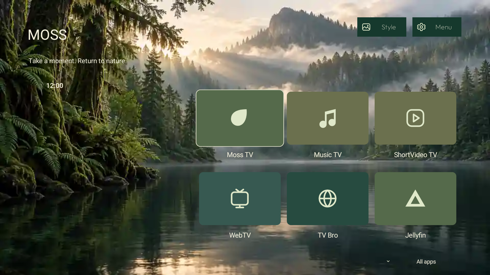 Moss TV</a></td>
    <td align="center" valign="top" width="207"><a href="resource/launcher/mono/"> Mono TV</a></td>
  </tr>
  <tr>
    <td align="center" valign="top" width="207"><a href="resource/launcher/forma/"> Forma TV</a></td>
    <td align="center" valign="top" width="207"><a href="resource/launcher/drift/"> Drift TV</a></td>
    <td align="center" valign="top" width="207"><a href="resource/launcher/circuit/">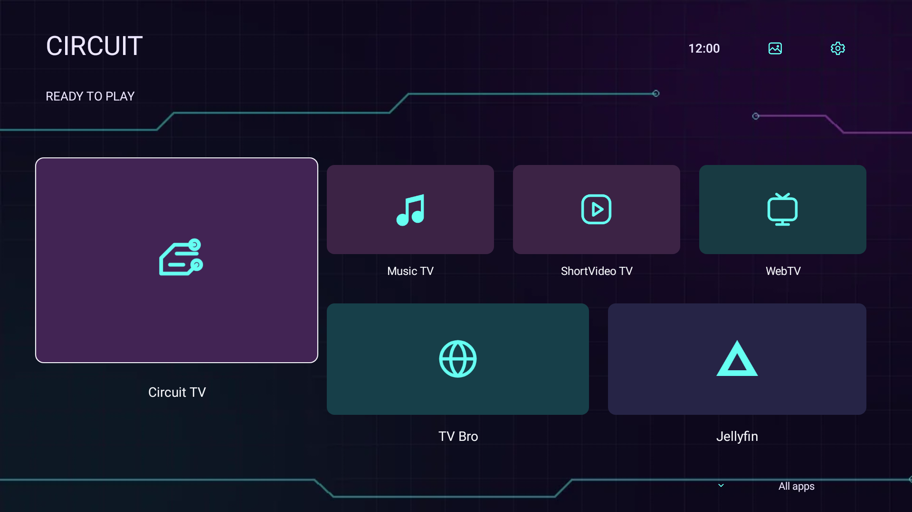 Circuit TV</a></td>
    <td align="center" valign="top" width="207"><a href="resource/launcher/aster/"> Aster TV</a></td>
  </tr>
  <tr>
    <td align="center" valign="top" width="207"><a href="resource/launcher/nova/"> Nova TV</a></td>
    <td align="center" valign="top" width="207"><a href="resource/launcher/puretv/"> pureTV Launcher</a></td>
    <td align="center" valign="top" width="207"></td>
    <td align="center" valign="top" width="207"></td>
  </tr>
</table>

### Apps - Media (6)

<table>
  <tr>
    <td align="center" valign="top" width="207"><a href="resource/apps/opera/"> Opera TV</a></td>
    <td align="center" valign="top" width="207"><a href="resource/apps/bilibili/"> BiliTV</a></td>
    <td align="center" valign="top" width="207"><a href="resource/apps/cctv/"> CCTV Live</a></td>
    <td align="center" valign="top" width="207"><a href="resource/apps/hifini/">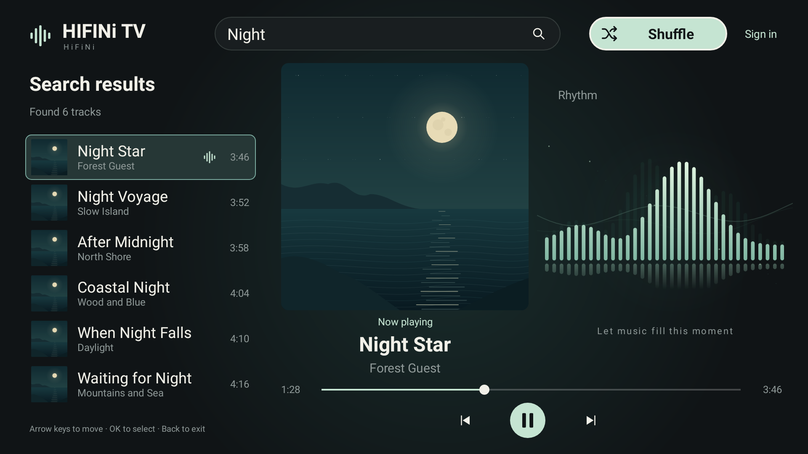 HIFINi TV</a></td>
  </tr>
  <tr>
    <td align="center" valign="top" width="207"><a href="resource/apps/webtv/"> WebTV</a></td>
    <td align="center" valign="top" width="207"><a href="resource/apps/shortvideo/"> ShortVideo TV</a></td>
    <td align="center" valign="top" width="207"></td>
    <td align="center" valign="top" width="207"></td>
  </tr>
</table>

<!-- resource-index:end -->

## Game catalog

[Six new or updated controller games · browser builds and controls](joystick-games/README.md#game-expansion)

Open **Games** in pureTV Manager to play with a keyboard or pureTV Wi-Fi controller. You can also play directly from each game’s browser link. [Browse web games](https://ecojust.github.io/pureTV/)

New installations start in Simplified Chinese.

<!-- game-index:start -->

**48 controller games** · [Play every game on a computer](docs/guide/README.en.md#play-on-a-computer) · Android TV (48) · Standalone macOS downloads (46) · Standalone Windows x64 downloads (46)

[Racing and sports (14)](#controller-racing) · [Action, RPGs and exploration (9)](#controller-action) · [Flight simulation (1)](#controller-flight) · [Platformers, bullet hell and arcade (8)](#controller-arcade) · [Strategy, tower defense and card games (2)](#controller-strategy) · [Puzzles and brainteasers (14)](#controller-puzzle)

### Racing and sports (14)

<table>
  <tr>
    <td align="center" valign="top" width="207"><a href="joystick-games/neon-rush/"> Neon Rush</a> <a href="https://ecojust.github.io/pureTV/games/neon-rush/tv.html">Play in browser</a>    </td>
    <td align="center" valign="top" width="207"><a href="joystick-games/used-car-racing/"> Used Car Racing</a> <a href="https://ecojust.github.io/pureTV/games/used-car-racing/tv.html">Play in browser</a>    </td>
    <td align="center" valign="top" width="207"><a href="joystick-games/backroad-rally/">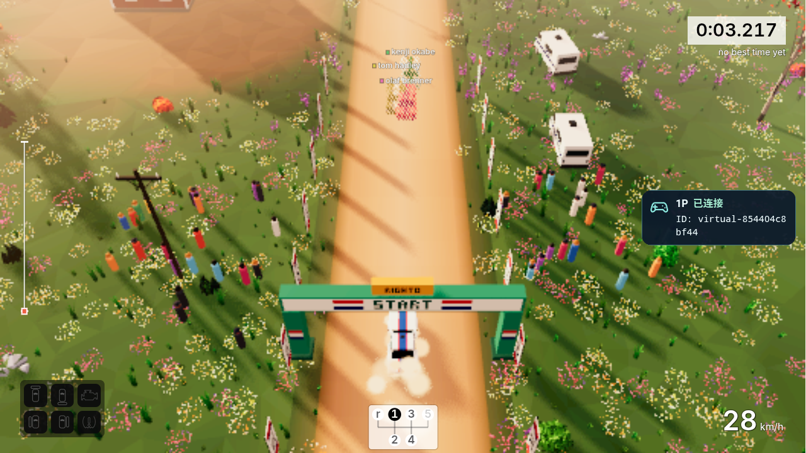 Backroad Rally</a> <a href="https://ecojust.github.io/pureTV/games/backroad-rally/tv.html">Play in browser</a>     </td>
    <td align="center" valign="top" width="207"><a href="joystick-games/ponpoko-kart/"> Ponpoko Kart</a> <a href="https://ecojust.github.io/pureTV/games/ponpoko-kart/tv.html">Play in browser</a>     </td>
  </tr>
  <tr>
    <td align="center" valign="top" width="207"><a href="joystick-games/night-racer/"> Night Racer</a> <a href="https://ecojust.github.io/pureTV/games/night-racer/tv.html">Play in browser</a>     </td>
    <td align="center" valign="top" width="207"><a href="joystick-games/penguintrack/"> Penguintrack</a> <a href="https://ecojust.github.io/pureTV/games/penguintrack/tv.html">Play in browser</a>     </td>
    <td align="center" valign="top" width="207"><a href="joystick-games/last-track/"> Last Track</a> <a href="https://ecojust.github.io/pureTV/games/last-track/tv.html">Play in browser</a>     </td>
    <td align="center" valign="top" width="207"><a href="joystick-games/dirt-crown/">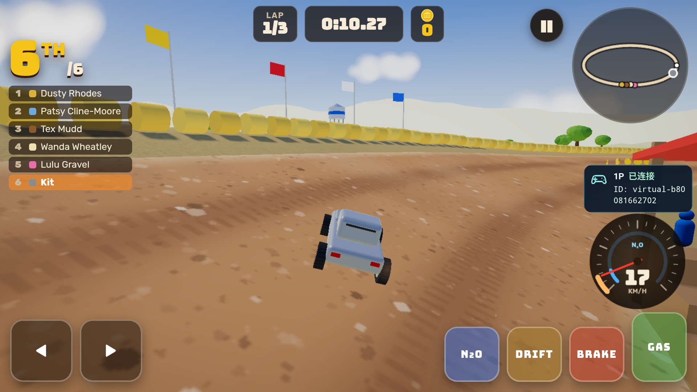 Dirt Crown</a> <a href="https://ecojust.github.io/pureTV/games/dirt-crown/tv.html">Play in browser</a>     </td>
  </tr>
  <tr>
    <td align="center" valign="top" width="207"><a href="joystick-games/turbo-kart-rush/"> Turbo Kart Rush</a> <a href="https://ecojust.github.io/pureTV/games/turbo-kart-rush/tv.html">Play in browser</a>     </td>
    <td align="center" valign="top" width="207"><a href="joystick-games/kart-rush/">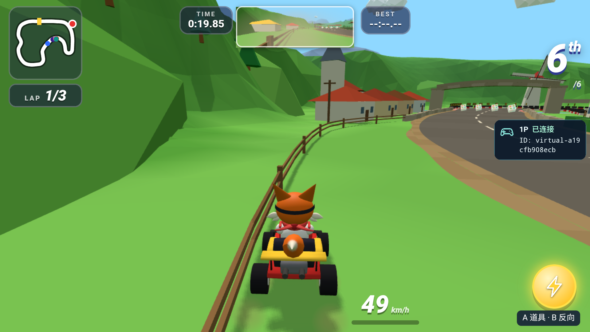 Kart Rush</a> <a href="https://ecojust.github.io/pureTV/games/kart-rush/tv.html">Play in browser</a>     </td>
    <td align="center" valign="top" width="207"><a href="joystick-games/kart-royale/"> Kart Royale</a> <a href="https://ecojust.github.io/pureTV/games/kart-royale/tv.html">Play in browser</a>     </td>
    <td align="center" valign="top" width="207"><a href="joystick-games/qq-speed/"> QQ Speed</a> <a href="https://ecojust.github.io/pureTV/games/qq-speed/tv.html">Play in browser</a>     </td>
  </tr>
  <tr>
    <td align="center" valign="top" width="207"><a href="joystick-games/turbo-kart-rally/"> Turbo Kart Rally</a> <a href="https://ecojust.github.io/pureTV/games/turbo-kart-rally/tv.html">Play in browser</a>     </td>
    <td align="center" valign="top" width="207"><a href="joystick-games/dolmus/"> Dolmuş</a> <a href="https://ecojust.github.io/pureTV/games/dolmus/tv.html">Play in browser</a>     </td>
    <td align="center" valign="top" width="207"></td>
    <td align="center" valign="top" width="207"></td>
  </tr>
</table>

### Action, RPGs and exploration (9)

<table>
  <tr>
    <td align="center" valign="top" width="207"><a href="joystick-games/alien-shooter/"> Alien Shooter</a> <a href="https://ecojust.github.io/pureTV/games/alien-shooter/tv.html">Play in browser</a>    </td>
    <td align="center" valign="top" width="207"><a href="joystick-games/cf-transport-ship/"> CF Transport Ship</a> <a href="https://ecojust.github.io/pureTV/games/cf-transport-ship/tv.html">Play in browser</a>     </td>
    <td align="center" valign="top" width="207"><a href="joystick-games/clawd-pop/">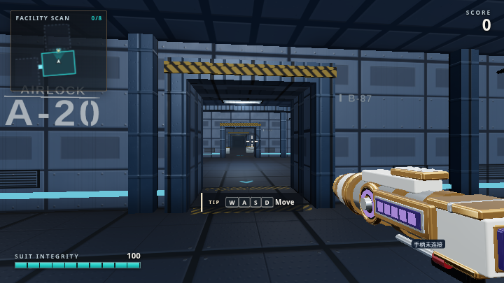 Clawd Pop 3D</a> <a href="https://ecojust.github.io/pureTV/games/clawd-pop/tv.html">Play in browser</a>     </td>
    <td align="center" valign="top" width="207"><a href="joystick-games/saber-magic-tower/"> Saber Magic Tower</a> <a href="https://ecojust.github.io/pureTV/games/saber-magic-tower/tv.html">Play in browser</a>     </td>
  </tr>
  <tr>
    <td align="center" valign="top" width="207"><a href="joystick-games/operation-ironhold/"> Operation Ironhold</a> <a href="https://ecojust.github.io/pureTV/games/operation-ironhold/tv.html">Play in browser</a>     </td>
    <td align="center" valign="top" width="207"><a href="joystick-games/kindle/">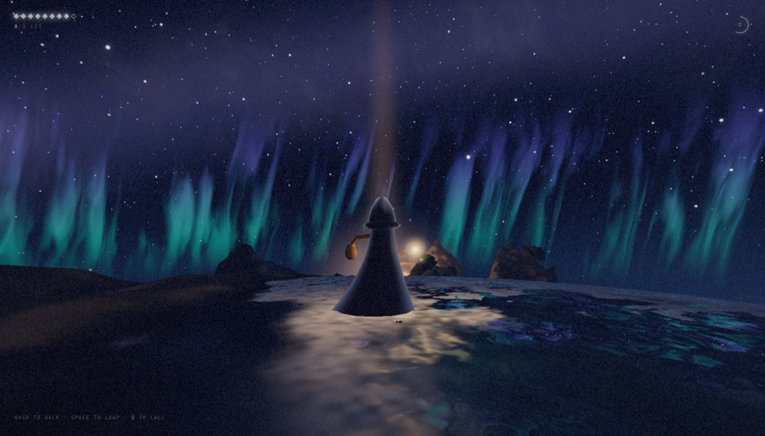 KINDLE</a> <a href="https://ecojust.github.io/pureTV/games/kindle/tv.html">Play in browser</a>     </td>
    <td align="center" valign="top" width="207"><a href="joystick-games/nerd-of-duty/">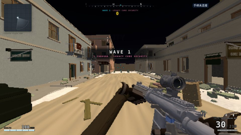 Nerd of Duty</a> <a href="https://ecojust.github.io/pureTV/games/nerd-of-duty/tv.html">Play in browser</a>     </td>
    <td align="center" valign="top" width="207"><a href="joystick-games/gogh-strike/">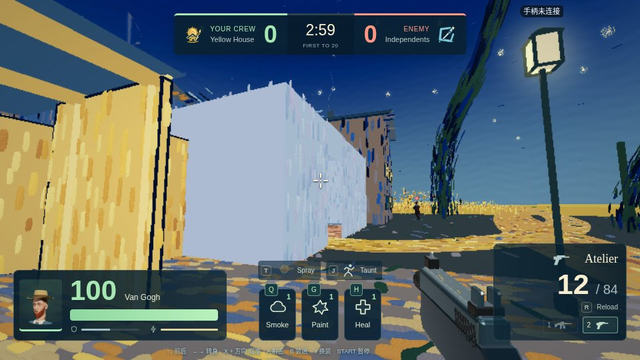 Gogh Strike</a> <a href="https://ecojust.github.io/pureTV/games/gogh-strike/tv.html">Play in browser</a>     </td>
  </tr>
  <tr>
    <td align="center" valign="top" width="207"><a href="joystick-games/claude-of-tanks/">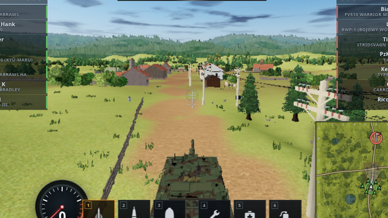 Claude of Tanks</a> <a href="https://ecojust.github.io/pureTV/games/claude-of-tanks/tv.html">Play in browser</a>   </td>
    <td align="center" valign="top" width="207"></td>
    <td align="center" valign="top" width="207"></td>
    <td align="center" valign="top" width="207"></td>
  </tr>
</table>

### Flight simulation (1)

<table>
  <tr>
    <td align="center" valign="top" width="207"><a href="joystick-games/openaero-dfw/">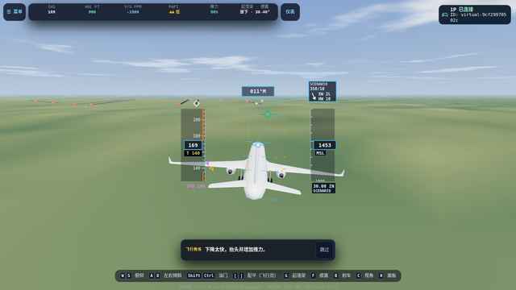 OpenAero DFW</a> <a href="https://ecojust.github.io/pureTV/games/openaero-dfw/tv.html">Play in browser</a>   </td>
    <td align="center" valign="top" width="207"></td>
    <td align="center" valign="top" width="207"></td>
    <td align="center" valign="top" width="207"></td>
  </tr>
</table>

### Platformers, bullet hell and arcade (8)

<table>
  <tr>
    <td align="center" valign="top" width="207"><a href="joystick-games/nova-lancer/"> Nova Lancer</a> <a href="https://ecojust.github.io/pureTV/games/nova-lancer/tv.html">Play in browser</a>     </td>
    <td align="center" valign="top" width="207"><a href="joystick-games/super-mario/"> Super Mario</a> <a href="https://ecojust.github.io/pureTV/games/super-mario/tv.html">Play in browser</a>    </td>
    <td align="center" valign="top" width="207"><a href="joystick-games/jackal/"> Jackal</a> <a href="https://ecojust.github.io/pureTV/games/jackal/tv.html">Play in browser</a>    </td>
    <td align="center" valign="top" width="207"><a href="joystick-games/tank/"> Tank</a> <a href="https://ecojust.github.io/pureTV/games/tank/tv.html">Play in browser</a>    </td>
  </tr>
  <tr>
    <td align="center" valign="top" width="207"><a href="joystick-games/glup/">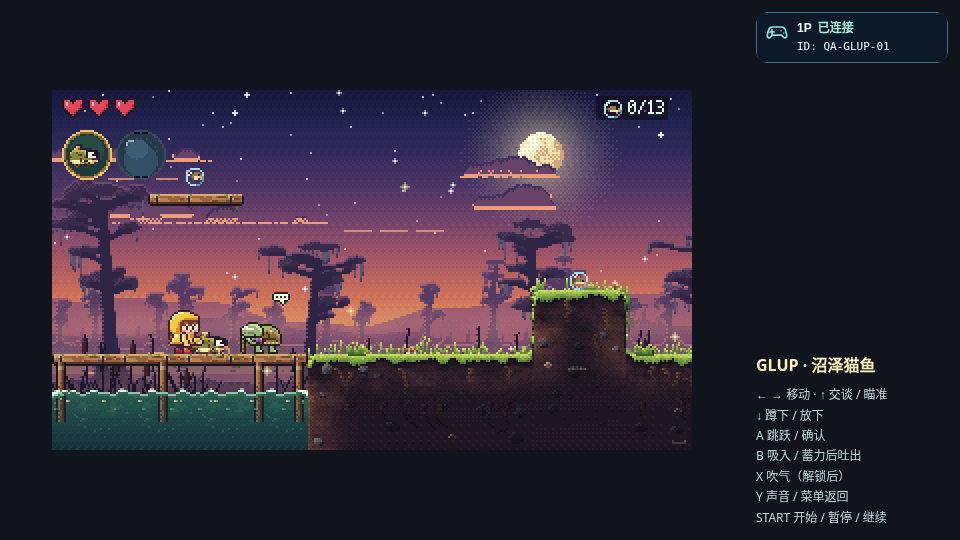 GLUP</a> <a href="https://ecojust.github.io/pureTV/games/glup/tv.html">Play in browser</a>     </td>
    <td align="center" valign="top" width="207"><a href="joystick-games/kaboom-arena/">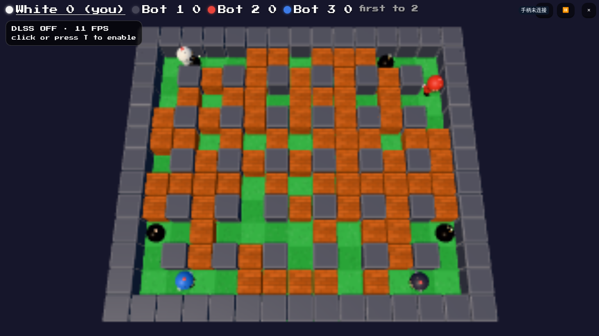 Kaboom Arena</a> <a href="https://ecojust.github.io/pureTV/games/kaboom-arena/tv.html">Play in browser</a>     </td>
    <td align="center" valign="top" width="207"><a href="joystick-games/mechapede/">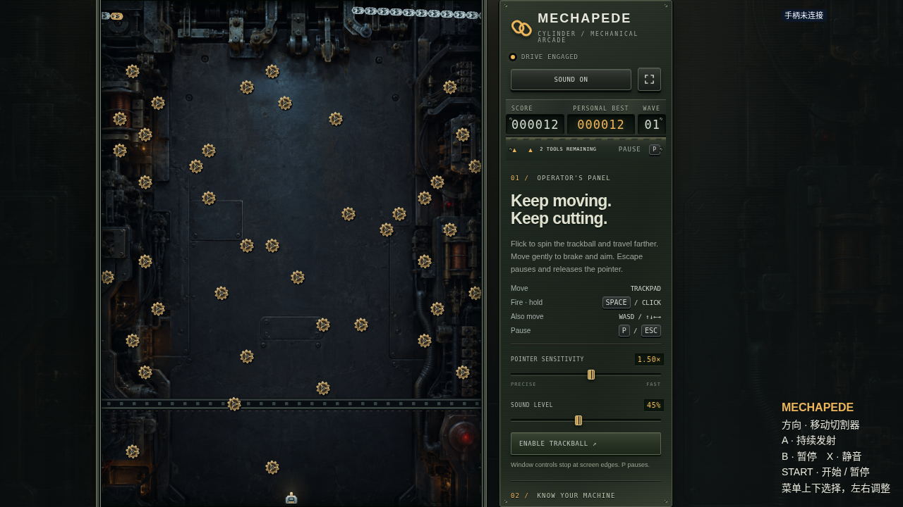 Mechapede</a> <a href="https://ecojust.github.io/pureTV/games/mechapede/tv.html">Play in browser</a>     </td>
    <td align="center" valign="top" width="207"><a href="joystick-games/marti/">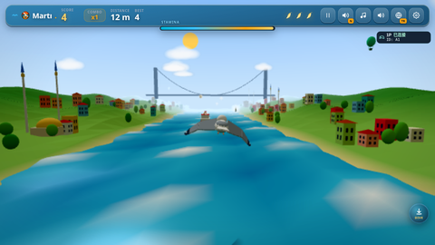 Martı · Seagull Run</a> <a href="https://ecojust.github.io/pureTV/games/marti/tv.html">Play in browser</a>     </td>
  </tr>
</table>

### Strategy, tower defense and card games (2)

<table>
  <tr>
    <td align="center" valign="top" width="207"><a href="joystick-games/emberbrood/"> Emberbrood</a> <a href="https://ecojust.github.io/pureTV/games/emberbrood/tv.html">Play in browser</a>     </td>
    <td align="center" valign="top" width="207"><a href="joystick-games/lumenrift/"> Lumenrift</a> <a href="https://ecojust.github.io/pureTV/games/lumenrift/tv.html">Play in browser</a>     </td>
    <td align="center" valign="top" width="207"></td>
    <td align="center" valign="top" width="207"></td>
  </tr>
</table>

### Puzzles and brainteasers (14)

<table>
  <tr>
    <td align="center" valign="top" width="207"><a href="joystick-games/tetris/">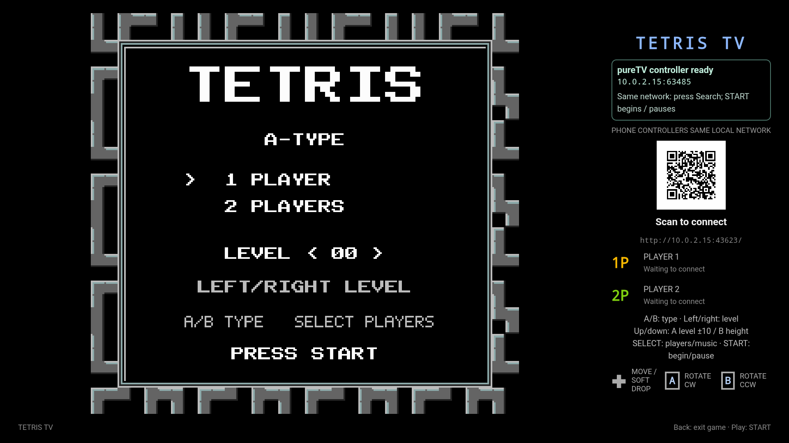 Tetris</a> <a href="https://ecojust.github.io/pureTV/games/tetris/tv.html">Play in browser</a>    </td>
    <td align="center" valign="top" width="207"><a href="joystick-games/jewel/"> Magic Jewelry</a> <a href="https://ecojust.github.io/pureTV/games/jewel/tv.html">Play in browser</a>    </td>
    <td align="center" valign="top" width="207"><a href="joystick-games/alchemists-lattice/"> Alchemist&#x27;s Lattice</a> <a href="https://ecojust.github.io/pureTV/games/alchemists-lattice/tv.html">Play in browser</a>     </td>
    <td align="center" valign="top" width="207"><a href="joystick-games/story-thief/"> The Story Thief of Greymantle</a> <a href="https://ecojust.github.io/pureTV/games/story-thief/tv.html">Play in browser</a>     </td>
  </tr>
  <tr>
    <td align="center" valign="top" width="207"><a href="joystick-games/bumble-basket/">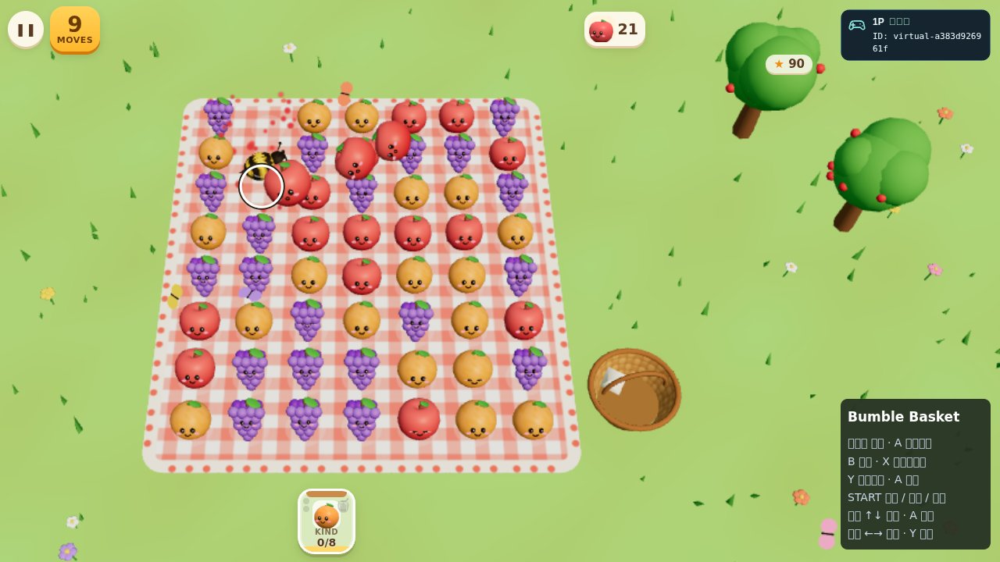 Bumble Basket</a> <a href="https://ecojust.github.io/pureTV/games/bumble-basket/tv.html">Play in browser</a>     </td>
    <td align="center" valign="top" width="207"><a href="joystick-games/starsling/"> STARSLING</a> <a href="https://ecojust.github.io/pureTV/games/starsling/tv.html">Play in browser</a>     </td>
    <td align="center" valign="top" width="207"><a href="joystick-games/solder-and-rain/"> Solder &amp; Rain</a> <a href="https://ecojust.github.io/pureTV/games/solder-and-rain/tv.html">Play in browser</a>     </td>
    <td align="center" valign="top" width="207"><a href="joystick-games/oathstones/">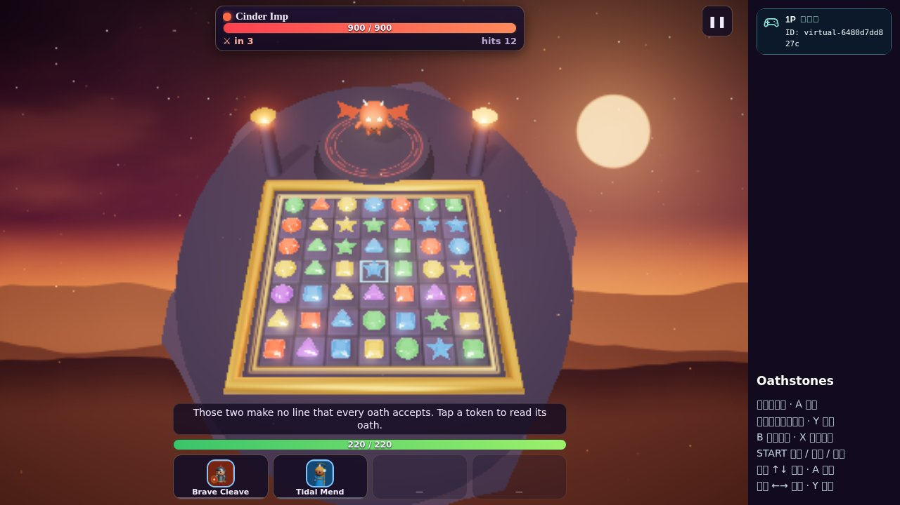 Oathstones</a> <a href="https://ecojust.github.io/pureTV/games/oathstones/tv.html">Play in browser</a>     </td>
  </tr>
  <tr>
    <td align="center" valign="top" width="207"><a href="joystick-games/neon-arcana/"> NEON ARCANA</a> <a href="https://ecojust.github.io/pureTV/games/neon-arcana/tv.html">Play in browser</a>     </td>
    <td align="center" valign="top" width="207"><a href="joystick-games/atlas-of-ink/"> Atlas of Ink</a> <a href="https://ecojust.github.io/pureTV/games/atlas-of-ink/tv.html">Play in browser</a>     </td>
    <td align="center" valign="top" width="207"><a href="joystick-games/starbase-spooky/"> Starbase Spooky</a> <a href="https://ecojust.github.io/pureTV/games/starbase-spooky/tv.html">Play in browser</a>     </td>
    <td align="center" valign="top" width="207"><a href="joystick-games/sugarplum-drop/">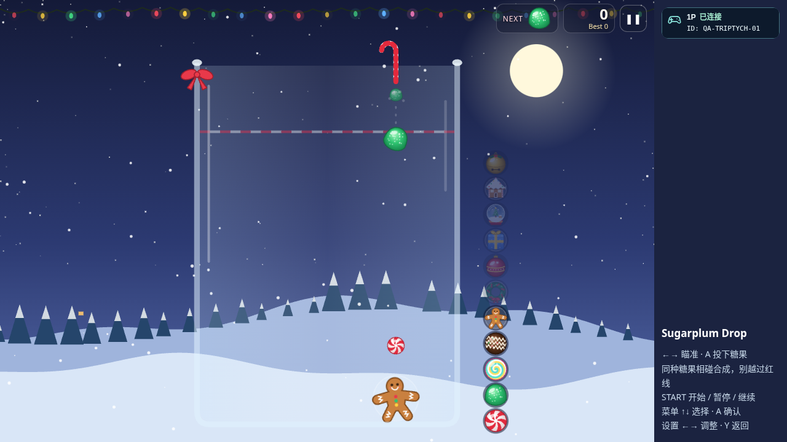 Sugarplum Drop</a> <a href="https://ecojust.github.io/pureTV/games/sugarplum-drop/tv.html">Play in browser</a>     </td>
  </tr>
  <tr>
    <td align="center" valign="top" width="207"><a href="joystick-games/silent-meridian/">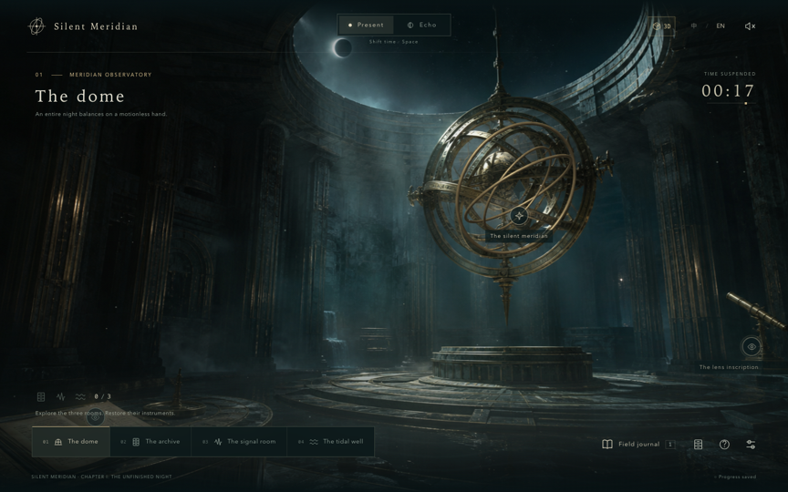 Silent Meridian</a> <a href="https://ecojust.github.io/pureTV/games/silent-meridian/tv.html">Play in browser</a>     </td>
    <td align="center" valign="top" width="207"><a href="joystick-games/bloom-hop/">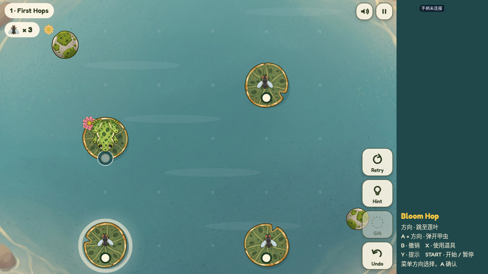 Bloom Hop</a> <a href="https://ecojust.github.io/pureTV/games/bloom-hop/tv.html">Play in browser</a>     </td>
    <td align="center" valign="top" width="207"></td>
    <td align="center" valign="top" width="207"></td>
  </tr>
</table>

 Android TV ·  macOS ·  Windows x64 ·  Controller supported ·  Original repository

<!-- game-index:end -->

KINDLE requires WebGL 2. Its macOS 0.1.0 package passed native Apple Silicon and Rosetta testing. The game did not finish initializing on the Intel Mac test runner. The signed Android TV 0.1.1 build has only partial emulator verification.
