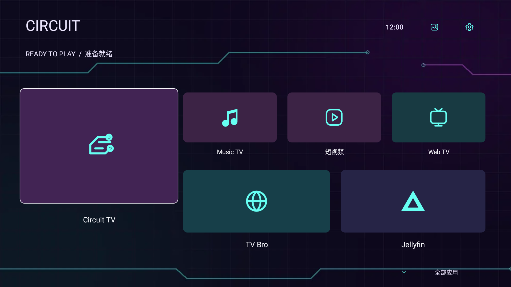
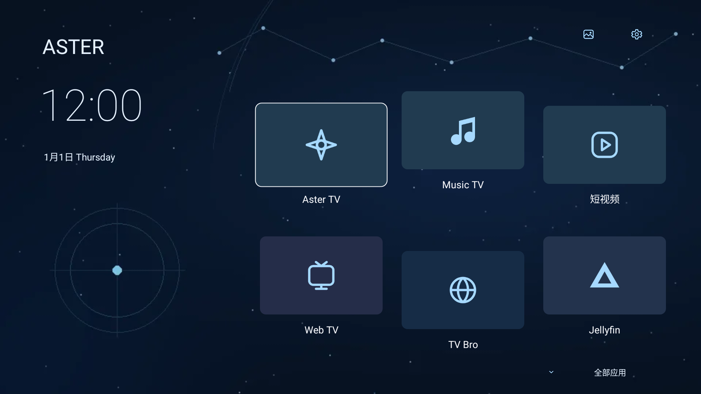
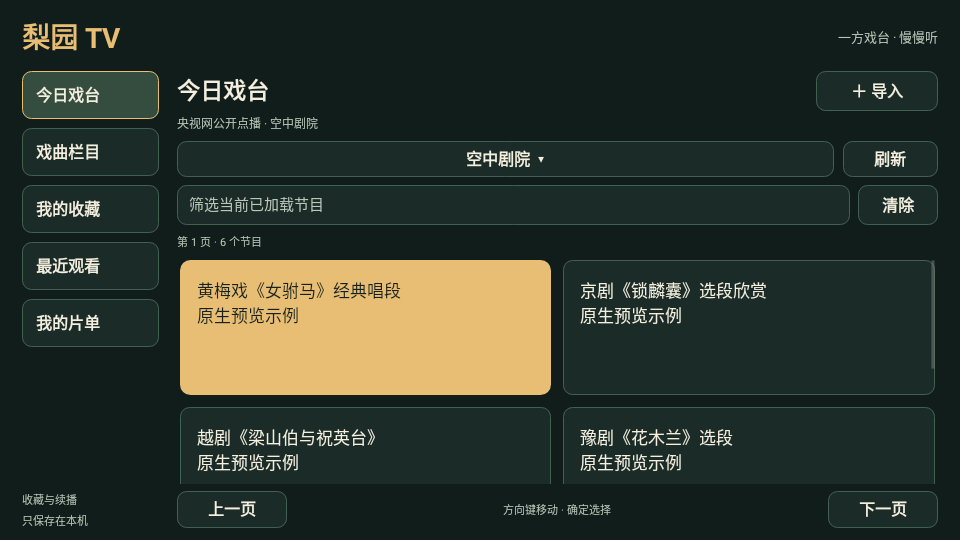
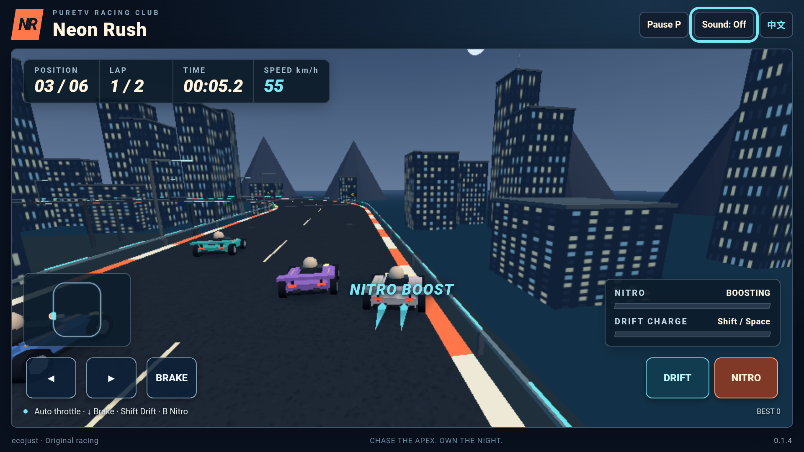
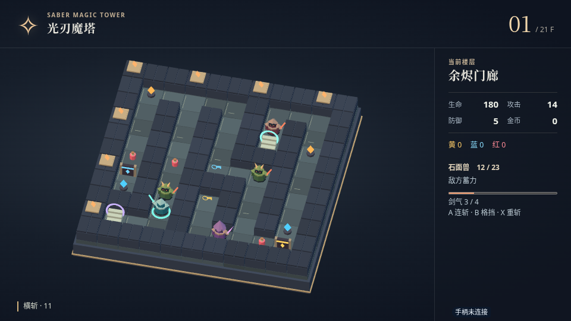
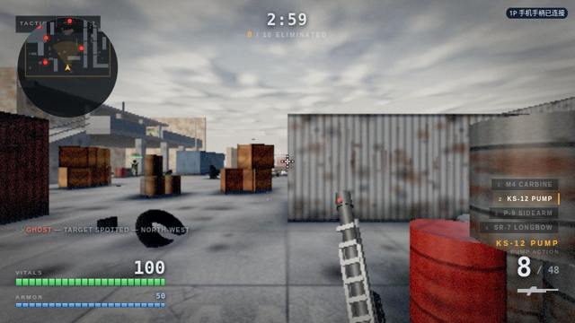
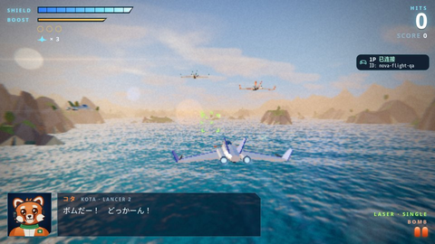
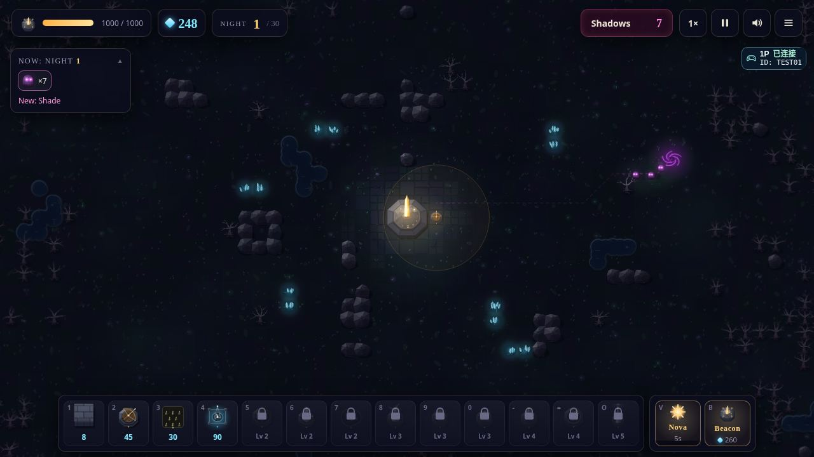
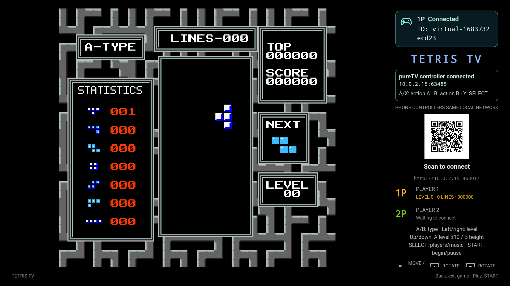
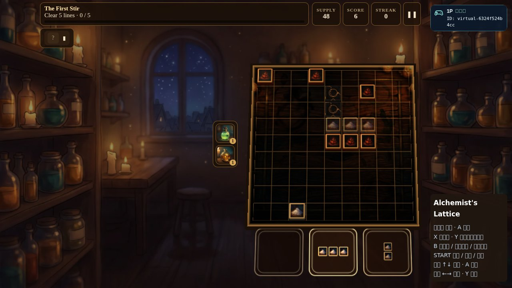

  

**简体中文** · [English](README.en.md) · [使用说明](docs/guide/README.md) · [开发与 MCP 文档](docs/guide/development.md)

[管理工具与应用工具](#管理工具与应用工具) · [启动器与电视应用](#启动器与电视应用资源) · [游戏专栏](#games) · [第三方电视应用](fork/README.md) · [游戏参考清单](docs/claude-games/catalog.md)

## 管理工具与应用工具

<!-- management-index:start -->

<table>
  <tr>
    <td align="center" valign="top" width="207"><a href="docs/guide/README.md#安装与升级电脑管理器"> pureTV Manager</a> 在电脑上管理电视应用和启动器 Windows、macOS、Linux <a href="https://github.com/ecojust/pureTV/releases/tag/desktop-v0.5.9">下载 0.5.9</a></td>
    <td align="center" valign="top" width="207"><a href="resource/apps/putrtv-store/"> putrtv商城</a> 直接在电视上浏览、安装应用和检查更新 Android TV <a href="resource/apps/putrtv-store/putrtv-store-0.1.2.apk?raw=1">下载 0.1.2 APK</a></td>
    <td align="center" valign="top" width="207"></td>
    <td align="center" valign="top" width="207"></td>
  </tr>
</table>

<!-- management-index:end -->

## 启动器与电视应用资源

[查看全部启动器和电视应用](resource/README.md)

<!-- resource-index:start -->

### 启动器（10）

<table>
  <tr>
    <td align="center" valign="top" width="207"><a href="resource/launcher/sol/"> Sol TV</a></td>
    <td align="center" valign="top" width="207"><a href="resource/launcher/pixel/"> Pixel TV 像素</a></td>
    <td align="center" valign="top" width="207"><a href="resource/launcher/moss/"> Moss TV</a></td>
    <td align="center" valign="top" width="207"><a href="resource/launcher/mono/"> Mono TV 墨白</a></td>
  </tr>
  <tr>
    <td align="center" valign="top" width="207"><a href="resource/launcher/forma/"> Forma TV</a></td>
    <td align="center" valign="top" width="207"><a href="resource/launcher/drift/"> Drift TV</a></td>
    <td align="center" valign="top" width="207"><a href="resource/launcher/circuit/"> Circuit TV · 回路</a></td>
    <td align="center" valign="top" width="207"><a href="resource/launcher/aster/"> Aster TV · 星轨</a></td>
  </tr>
  <tr>
    <td align="center" valign="top" width="207"><a href="resource/launcher/nova/"> Nova TV</a></td>
    <td align="center" valign="top" width="207"><a href="resource/launcher/puretv/"> pureTV Launcher</a></td>
    <td align="center" valign="top" width="207"></td>
    <td align="center" valign="top" width="207"></td>
  </tr>
</table>

### 应用-影音（6）

<table>
  <tr>
    <td align="center" valign="top" width="207"><a href="resource/apps/opera/"> 梨园 TV</a></td>
    <td align="center" valign="top" width="207"><a href="resource/apps/bilibili/"> BiliTV</a></td>
    <td align="center" valign="top" width="207"><a href="resource/apps/cctv/"> CCTV Live</a></td>
    <td align="center" valign="top" width="207"><a href="resource/apps/hifini/"> HIFINi TV</a></td>
  </tr>
  <tr>
    <td align="center" valign="top" width="207"><a href="resource/apps/webtv/"> WebTV</a></td>
    <td align="center" valign="top" width="207"><a href="resource/apps/shortvideo/"> ShortVideo TV</a></td>
    <td align="center" valign="top" width="207"></td>
    <td align="center" valign="top" width="207"></td>
  </tr>
</table>

<!-- resource-index:end -->

## 游戏专栏

[新增与更新的六款手柄游戏 · 浏览器试玩及操作说明](joystick-games/README.md#game-expansion)

<!-- game-index:start -->

**39 款手柄游戏** · [全部支持电脑键盘和无线手柄](docs/guide/README.md#在电脑上玩) · Android TV 39 款 · macOS 独立安装包 39 款 · Windows x64 独立安装包 39 款

[竞速与体育（13）](#controller-racing) · [动作、角色扮演与探索（6）](#controller-action) · [平台、弹幕与街机（5）](#controller-arcade) · [策略、塔防与卡牌（2）](#controller-strategy) · [解谜与益智（13）](#controller-puzzle)

### 竞速与体育（13）

<table>
  <tr>
    <td align="center" valign="top" width="207"><a href="joystick-games/neon-rush/"> 霓虹飞车</a>    </td>
    <td align="center" valign="top" width="207"><a href="joystick-games/used-car-racing/"> 极品二手车</a>    </td>
    <td align="center" valign="top" width="207"><a href="joystick-games/backroad-rally/"> Backroad Rally</a>     </td>
    <td align="center" valign="top" width="207"><a href="joystick-games/ponpoko-kart/"> Ponpoko Kart</a>     </td>
  </tr>
  <tr>
    <td align="center" valign="top" width="207"><a href="joystick-games/night-racer/"> Night Racer</a>     </td>
    <td align="center" valign="top" width="207"><a href="joystick-games/penguintrack/"> Penguintrack</a>     </td>
    <td align="center" valign="top" width="207"><a href="joystick-games/last-track/"> Last Track</a>     </td>
    <td align="center" valign="top" width="207"><a href="joystick-games/dirt-crown/"> Dirt Crown</a>     </td>
  </tr>
  <tr>
    <td align="center" valign="top" width="207"><a href="joystick-games/turbo-kart-rush/"> Turbo Kart Rush</a>     </td>
    <td align="center" valign="top" width="207"><a href="joystick-games/kart-rush/"> Kart Rush</a>     </td>
    <td align="center" valign="top" width="207"><a href="joystick-games/kart-royale/"> Kart Royale</a>     </td>
    <td align="center" valign="top" width="207"><a href="joystick-games/qq-speed/"> QQ 飞车</a>     </td>
  </tr>
  <tr>
    <td align="center" valign="top" width="207"><a href="joystick-games/turbo-kart-rally/"> 涡轮卡丁拉力赛</a>     </td>
    <td align="center" valign="top" width="207"></td>
    <td align="center" valign="top" width="207"></td>
    <td align="center" valign="top" width="207"></td>
  </tr>
</table>

### 动作、角色扮演与探索（6）

<table>
  <tr>
    <td align="center" valign="top" width="207"><a href="joystick-games/alien-shooter/"> 孤胆枪手</a>    </td>
    <td align="center" valign="top" width="207"><a href="joystick-games/cf-transport-ship/"> 运输船 CF</a>     </td>
    <td align="center" valign="top" width="207"><a href="joystick-games/clawd-pop/"> 爆裂实验室</a>     </td>
    <td align="center" valign="top" width="207"><a href="joystick-games/saber-magic-tower/"> 光刃魔塔</a>     </td>
  </tr>
  <tr>
    <td align="center" valign="top" width="207"><a href="joystick-games/operation-ironhold/"> 铁垒行动</a>     </td>
    <td align="center" valign="top" width="207"><a href="joystick-games/kindle/"> 星球点灯人</a>     </td>
    <td align="center" valign="top" width="207"></td>
    <td align="center" valign="top" width="207"></td>
  </tr>
</table>

### 平台、弹幕与街机（5）

<table>
  <tr>
    <td align="center" valign="top" width="207"><a href="joystick-games/nova-lancer/"> Nova Lancer · 新星枪骑兵</a>     </td>
    <td align="center" valign="top" width="207"><a href="joystick-games/super-mario/"> Super Mario</a>    </td>
    <td align="center" valign="top" width="207"><a href="joystick-games/jackal/"> Jackal</a>    </td>
    <td align="center" valign="top" width="207"><a href="joystick-games/tank/"> Tank</a>    </td>
  </tr>
  <tr>
    <td align="center" valign="top" width="207"><a href="joystick-games/glup/"> GLUP · 沼泽猫鱼</a>     </td>
    <td align="center" valign="top" width="207"></td>
    <td align="center" valign="top" width="207"></td>
    <td align="center" valign="top" width="207"></td>
  </tr>
</table>

### 策略、塔防与卡牌（2）

<table>
  <tr>
    <td align="center" valign="top" width="207"><a href="joystick-games/emberbrood/"> Emberbrood · 余烬龙裔</a>     </td>
    <td align="center" valign="top" width="207"><a href="joystick-games/lumenrift/"> 光隙守望</a>     </td>
    <td align="center" valign="top" width="207"></td>
    <td align="center" valign="top" width="207"></td>
  </tr>
</table>

### 解谜与益智（13）

<table>
  <tr>
    <td align="center" valign="top" width="207"><a href="joystick-games/tetris/"> Tetris</a>    </td>
    <td align="center" valign="top" width="207"><a href="joystick-games/jewel/"> Magic Jewelry</a>    </td>
    <td align="center" valign="top" width="207"><a href="joystick-games/alchemists-lattice/"> 炼金方阵</a>     </td>
    <td align="center" valign="top" width="207"><a href="joystick-games/story-thief/"> 灰斗篷山的故事大盗</a>     </td>
  </tr>
  <tr>
    <td align="center" valign="top" width="207"><a href="joystick-games/bumble-basket/"> 蜜蜂果篮</a>     </td>
    <td align="center" valign="top" width="207"><a href="joystick-games/starsling/"> 星际弹弓</a>     </td>
    <td align="center" valign="top" width="207"><a href="joystick-games/solder-and-rain/"> 雨夜维修铺</a>     </td>
    <td align="center" valign="top" width="207"><a href="joystick-games/oathstones/"> 誓约宝石</a>     </td>
  </tr>
  <tr>
    <td align="center" valign="top" width="207"><a href="joystick-games/neon-arcana/"> 霓虹秘仪</a>     </td>
    <td align="center" valign="top" width="207"><a href="joystick-games/atlas-of-ink/"> 墨绘地图集</a>     </td>
    <td align="center" valign="top" width="207"><a href="joystick-games/starbase-spooky/"> 幽灵空间站</a>     </td>
    <td align="center" valign="top" width="207"><a href="joystick-games/sugarplum-drop/"> Sugarplum Drop</a>     </td>
  </tr>
  <tr>
    <td align="center" valign="top" width="207"><a href="joystick-games/silent-meridian/"> 静默子午线</a>     </td>
    <td align="center" valign="top" width="207"></td>
    <td align="center" valign="top" width="207"></td>
    <td align="center" valign="top" width="207"></td>
  </tr>
</table>

 Android TV ·  macOS ·  Windows x64 ·  支持手柄 ·  原作仓库

<!-- game-index:end -->

KINDLE 需要 WebGL 2。macOS 安装包已通过 Apple Silicon 原生和 Rosetta 验证，Intel Mac 测试机未能完成初始化。 KINDLE 的 Android TV 0.1.1 已签名，模拟器未通过完整的原生手柄验证。
