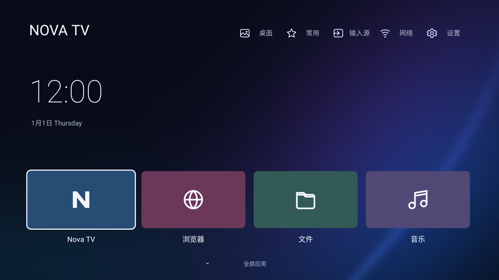
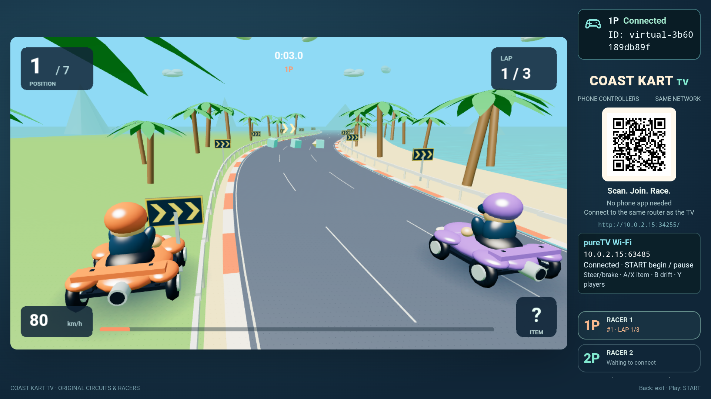
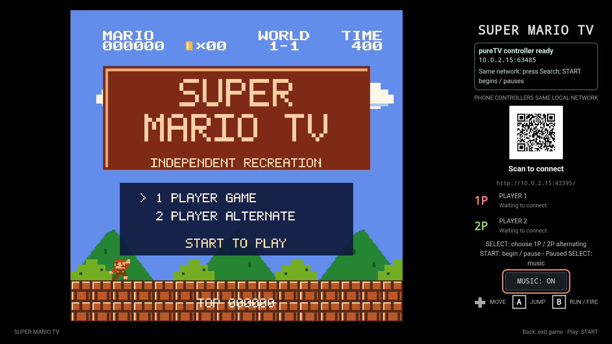
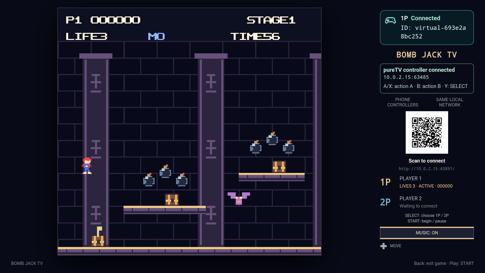

**简体中文** | [English](README.en.md)

  

pureTV 是电脑端的 Android TV / Google TV 系统管理器。通过 ADB 连接电视，查看系统信息，安装、卸载、启停应用，选择启动器，并用可视化画布自定义支持的桌面。也可通过 MCP 让 Agent 控制已打开的管理器。

[下载 pureTV Manager 0.5.9](https://github.com/ecojust/pureTV/releases/tag/desktop-v0.5.9) · Windows / macOS / Linux · APK 市场与客户端更新使用新服务器

从 0.5.7 及更早版本升级，请先从上方发布页手动安装 0.5.9。旧客户端不会自动切换下载源；新版本使用 `apps.b14f.com` 的应用目录与 `client/` 更新目录。

[下载电视端 putrtv商城 0.1.1](resource/apps/putrtv-store/putrtv-store-0.1.1.apk?raw=1) · 在电视上浏览、安装和检查应用更新；配合[新版启动器](resource/README.md)可选择位置添加到桌面。

## 连接与应用管理

1. 电脑和电视接入可互通的网络，在电视开发者选项中开启 ADB／网络调试。
2. 首页输入电视 IP／主机名与调试端口，在电视上允许电脑连接。常见端口为 5555，以电视实际设置为准。
3. 缺少 ADB 时，阅读并同意 Android SDK 许可后点击「下载并配置 ADB」；优先 Google，失败时使用腾讯镜像。也可选择已有 ADB。

连接后首页显示型号、Android／SDK／安全补丁、CPU、内存、`/data` 磁盘容量、分辨率及运行时间。其他页面顶部保留当前连接状态。

- **应用管理**：搜索和分类，批量启用／停用、为当前用户卸载、恢复仍保有安装包的系统应用。
- **包名说明**：点击应用行中的圆圈 **i**，查询包的用途、卸载风险、资料来源与获取时间；未知包明确提示，当前默认桌面与核心组件的保护优先。
- **客户端更新**：启动后或手动检查新服务器的 [client/](https://apps.b14f.com/client/) 目录，按系统匹配新版本；点击「下载并安装」后校验安装包并自动安装、重启。首次从旧版升级及各平台说明见[客户端更新](desktop/docs/client-updates.md)。
- **待安装应用**：导入本地 APK，可在行尾安装单个，也可勾选批量安装；成功项移出队列，失败与未执行项保留。
- **启动器**：导入启动器 APK 后在该页面直接安装，选择／恢复默认桌面；支持接口的当前启动器显示「调整布局」。
- **市场**：动态浏览 [apps.b14f.com](https://apps.b14f.com/launcher/) 的 `launcher/`、`media/` 和 `game/` 目录中的应用与启动器，搜索、预览并下载到待安装列表，或连接电视后直接安装；同一应用或启动器的多个版本合并展示，可从下拉框选择最近 5 个版本，默认最新版；服务器新增 APK 后刷新即可发现。下载时一并保存同目录的 `logo.svg`，布局编辑器新增应用块或切换应用时自动使用该图标。
- 应用与启动器均显示主 APK 与分包的合计大小，不含私有数据、缓存与优化文件，无法读取时明确显示未知。
- 列表内部滚动，表头和顶部批量操作固定；核心系统组件与当前默认启动器受保护。

系统应用卸载只针对当前 Android 用户，保留数据，不删除系统分区 APK。新安装且具备启动入口的用户应用可加入启动器排布。

主动执行连接、刷新、应用管理、启动器切换或布局应用等操作时，管理器显示等待状态，完成后弹窗反馈结果。批量任务区分成功、失败和未执行项；后台自动读取不会反复弹窗。

## 启动器与电视应用资源

公共目录为 [resource/](resource/)，分为 [launcher/](resource/launcher/) 与 [apps/](resource/apps/)，原根目录的启动器和应用源码已整体移入。启动器和电视应用 APK 放在各自软件目录，也可通过独立的 `android-v*` Release 下载；电脑管理器保留单独的 `desktop-v*` 版本与最新发布入口。每个软件文件夹至少包含一个实际 APK，可同时提供对应版本源码、封面、作者、许可证及 SHA256。点击软件名称进入对应文件夹。每个电视应用目录还提供 64×64 的 `logo.svg`，供启动器布局使用；后续应用遵循[资源约定](resource/README-development.md#应用资源与-logosvg-约定)。

九款游戏的 0.5.1 规则与交互改进见[还原度复核](docs/game-fidelity-0.5.1.md)。沿用 0.5.0 统一证书，可覆盖更新 0.5.0；文档同时列出仍未精确还原的地图与内容。

启动器布局自定义使用本管理器的 **layout.json 版本 5 users/system 接口**。支持布局协议的启动器卡片自动显示 Home 背景颜色和图片，包括未激活的启动器；修改并应用布局后同步更新。列表不提供选择或移除封面的操作，桌面背景统一在「调整布局」中修改。待安装 APK 优先预览内置布局的 Home 背景，仅在无法读取布局背景时使用同目录的 `thumb.png`／`APK名.thumb.png`。

新增百款游戏暂选八款在本页展示，原有游戏仍保留；全部资源见 [完整资源目录](resource/README.md)。

<!-- resource-index:start -->

### 启动器（10）

<table>
  <tr>
    <td align="center" valign="top" width="25%"><a href="resource/launcher/sol/"> Sol TV</a></td>
    <td align="center" valign="top" width="25%"><a href="resource/launcher/pixel/"> Pixel TV 像素</a></td>
    <td align="center" valign="top" width="25%"><a href="resource/launcher/moss/"> Moss TV</a></td>
    <td align="center" valign="top" width="25%"><a href="resource/launcher/mono/"> Mono TV 墨白</a></td>
  </tr>
  <tr>
    <td align="center" valign="top" width="25%"><a href="resource/launcher/forma/"> Forma TV</a></td>
    <td align="center" valign="top" width="25%"><a href="resource/launcher/drift/"> Drift TV</a></td>
    <td align="center" valign="top" width="25%"><a href="resource/launcher/circuit/"> Circuit TV · 回路</a></td>
    <td align="center" valign="top" width="25%"><a href="resource/launcher/aster/"> Aster TV · 星轨</a></td>
  </tr>
  <tr>
    <td align="center" valign="top" width="25%"><a href="resource/launcher/nova/"> Nova TV</a></td>
    <td align="center" valign="top" width="25%"><a href="resource/launcher/puretv/"> pureTV Launcher</a></td>
    <td width="25%"></td>
    <td width="25%"></td>
  </tr>
</table>

### 应用-影音（6）

<table>
  <tr>
    <td align="center" valign="top" width="25%"><a href="resource/apps/opera/"> 梨园 TV</a></td>
    <td align="center" valign="top" width="25%"><a href="resource/apps/bilibili/"> BiliTV</a></td>
    <td align="center" valign="top" width="25%"><a href="resource/apps/cctv/"> CCTV Live</a></td>
    <td align="center" valign="top" width="25%"><a href="resource/apps/hifini/"> HIFINi TV</a></td>
  </tr>
  <tr>
    <td align="center" valign="top" width="25%"><a href="resource/apps/webtv/"> WebTV</a></td>
    <td align="center" valign="top" width="25%"><a href="resource/apps/shortvideo/"> ShortVideo TV</a></td>
    <td width="25%"></td>
    <td width="25%"></td>
  </tr>
</table>

### 应用-游戏（20）

<table>
  <tr>
    <td align="center" valign="top" width="25%"><a href="resource/apps/neon-rush/"> 霓虹飞车</a></td>
    <td align="center" valign="top" width="25%"><a href="resource/apps/twenty-four/"> 四则二十四</a></td>
    <td align="center" valign="top" width="25%"><a href="resource/apps/torch-bridge/"> 夜桥接力</a></td>
    <td align="center" valign="top" width="25%"><a href="resource/apps/tower-overlap/"> 叠塔工匠</a></td>
  </tr>
  <tr>
    <td align="center" valign="top" width="25%"><a href="resource/apps/packing-sculptor/"> 异形装箱</a></td>
    <td align="center" valign="top" width="25%"><a href="resource/apps/conveyor-window/"> 窗口装配</a></td>
    <td align="center" valign="top" width="25%"><a href="resource/apps/glass-fold/"> 折光工坊</a></td>
    <td align="center" valign="top" width="25%"><a href="resource/apps/tension-span/"> 拉索桥梁</a></td>
  </tr>
  <tr>
    <td align="center" valign="top" width="25%"><a href="resource/apps/prism-relay/"> 镜光接力</a></td>
    <td align="center" valign="top" width="25%"><a href="resource/apps/alien-shooter/"> 孤胆枪手 TV</a></td>
    <td align="center" valign="top" width="25%"><a href="resource/apps/used-car-racing/"> 极品二手车</a></td>
    <td align="center" valign="top" width="25%"><a href="resource/apps/cozy-island/"> Cozy Island TV</a></td>
  </tr>
  <tr>
    <td align="center" valign="top" width="25%"><a href="resource/apps/coast-kart/"> Coast Kart TV</a></td>
    <td align="center" valign="top" width="25%"><a href="resource/apps/super-mario/"> Super Mario TV</a></td>
    <td align="center" valign="top" width="25%"><a href="resource/apps/bomb-jack/"> Mighty Bomb Jack TV</a></td>
    <td align="center" valign="top" width="25%"><a href="resource/apps/adventure-island/"> Adventure Island TV</a></td>
  </tr>
  <tr>
    <td align="center" valign="top" width="25%"><a href="resource/apps/tetris/"> Tetris TV</a></td>
    <td align="center" valign="top" width="25%"><a href="resource/apps/jewel/"> Magic Jewelry TV</a></td>
    <td align="center" valign="top" width="25%"><a href="resource/apps/jackal/"> Jackal TV</a></td>
    <td align="center" valign="top" width="25%"><a href="resource/apps/tank/"> Tank TV</a></td>
  </tr>
</table>

### 应用-工具（1）

<table>
  <tr>
    <td align="center" valign="top" width="25%"><a href="resource/apps/putrtv-store/"> putrtv商城</a></td>
    <td width="25%"></td>
    <td width="25%"></td>
    <td width="25%"></td>
  </tr>
</table>

<!-- resource-index:end -->

上面展示的 **20 款游戏**均提供支持 **pureTV Wi-Fi 手柄**的新版 APK，需要 Android 8.0 及以上，默认 TCP 端口 **63485**。下载各游戏目录中的最新安装包，电视与手柄连接同一局域网，按 GPIO 23 搜索，START 开始／暂停。连接后，侧边显示手柄图标、1P／2P 席位和完整连接 ID，断线后自动隐藏。新版下载与验证范围见[连接标识更新](docs/controller-client-status/README.md)，按键及双人支持见[手柄接入说明](docs/readme-controller-support/README.md)。

第三方应用见 [fork/ 分类目录](fork/README.md)：收录 TVAPP 中小于 10 MB 的 14 款应用、23 个 APK，另按指定加入儿歌多多TV、宝宝趣学、茉莉音乐、淘知学堂TV和七星戏曲，共 19 款应用、28 个 APK，提供图标、介绍封面与 manifest。[超限文件与复刻参考](fork/OVERSIZED.md)保留全部 205 个超限文件，其中 5 份已收录，其余 200 份未收录。

## 手柄游戏专用目录（2）

[joystick-games/](joystick-games/) 集中放置 Android TV 与 macOS 手柄游戏。首批为基于 riba2534 演示项目适配的[运输船 CF](joystick-games/cf-transport-ship/)和[QQ 飞车](joystick-games/qq-speed/)，保留各自地图与玩法，接入 pureTV 九键、开始／暂停及完整客户端 ID 显示。安装包和验证状态见[目录说明](joystick-games/README.md)。两款需要 WebGL2；现有应用资源继续保留原下载地址。

<table>
<tr>
<td width="25%" align="center"><a href="joystick-games/cf-transport-ship/"> 运输船 CF</a></td>
<td width="25%" align="center"><a href="joystick-games/qq-speed/"> QQ 飞车</a></td>
<td width="25%"></td>
<td width="25%"></td>
</tr>
</table>

## MCP / Agent

在「设备连接 → MCP · Agent 调试」复制配置到客户端，保持管理器窗口打开。34 个工具覆盖系统信息、连接、应用管理、APK 安装、启动器切换与布局、市场目录／下载／安装、背景图、ADB 配置、语言与主题、取消及记录；Agent 与界面共享状态。

[完整 MCP 接入与参数](desktop/docs/mcp.md)。

## 开发文档

构建与测试说明见 [resource 开发 README](resource/README-development.md)。

### 自定义启动器布局

`layout.json` 是连接启动器与管理器显示的协议文件：电视和电脑使用同一份布局，管理器可以重现桌面并调整应用块。Home 和 Apps 支持独立背景、布局与切页设置；用户应用可编辑，系统组件仅供查看。

在启动器页面选择「调整布局」，可添加已安装用户应用、拖动、框选、对齐或平铺排布，确认后应用到电视。使用新版布局需同时更新管理器与配套启动器。

完整字段说明、JSON 示例与画面对照见 [layout.json 协议规范](resource/README-development.md#layoutjson-协议规范与画面对照)。

## 游戏客户端开发兼容手柄的要求

电视上的游戏 App 是 **TCP 服务端**，ESP32 手柄主动连接。使用 [Game Kit 原生宿主](resource/game-kit/README.md#puretv-wi-fi-实体手柄) 的游戏可以复用宿主的监听、服务发布和输入转发。独立游戏需要实现下面的接口。

### 发布服务与自动查找

**所有游戏的 Socket（TCP）服务统一使用 `63485` 作为默认端口，新开发或更新游戏时遵守此约定。** 已发布旧版本以游戏界面及 mDNS 广播的实际端口为准。

1. 在设备的局域网接口监听 TCP，默认端口为 `63485`。仅在启动时端口被其他程序占用的情况下选择备用端口，并始终广播实际监听端口；一次运行期间保持该端口，不能因为手柄连接、窗口失焦或系统授权弹窗重新分配。监听成功后，通过 mDNS/DNS-SD 发布 `_puretv._tcp`。
2. Android TV 使用 `NsdManager.registerService`。在 `NsdServiceInfo` 中设置 `serviceType = "_puretv._tcp"`、可辨认的 `serviceName`、实际监听的 `port`，并用 `setAttribute("version", "1")` 声明协议版本。服务退出时用同一个监听器撤销注册。启用宿主发布时，请由宿主统一注册。发布流程见 [Android NSD 文档](https://developer.android.com/develop/connectivity/wifi/use-nsd)。
3. 手柄和电视加入同一个可互通的局域网后，按 **GPIO 23** 搜索键，手柄查询一次 `_puretv._tcp`。GPIO 23 接常开按键到 GND，只触发本机发现。**GPIO 27 是 START 游戏键**，会发送按键消息。
4. 当前固件仅在发现 **恰好一个**服务且取得有效 IPv4 和端口时自动采用该目标。零个、多个或地址无效时，保留当前目标。发现时不按实例名或 TXT 版本筛选，因此同一局域网里同时发布多个游戏服务会让自动查找无法选定目标。
5. 手柄配网时可留空游戏主机，加入 Wi-Fi 后等待按键搜索。发现结果只在本次开机有效。断线时手柄重连当前目标，重启后恢复已保存的配置。也可在配网页填写电视的局域网地址和端口直连。

### TCP 输入协议

使用 UTF-8 JSON Lines，每条消息以换行符 `\n` 结束。TCP 是字节流，游戏端应缓存到换行后再解析，并为每条有效消息回复同序号的 ACK，例如 `{"type":"ack","seq":12}` 加换行。

| 按键 | 上 | 下 | 左 | 右 | START | A | B | X | Y |
| --- | --- | --- | --- | --- | --- | --- | --- | --- | --- |
| `key` | `UP` | `DOWN` | `LEFT` | `RIGHT` | `START` | `A` | `B` | `X` | `Y` |

连接建立后，手柄先发 `hello` 和九条 `button/sync`，在线时约每 5 秒发一条 `ping`。`hello` 和 `ping` 携带 `type`、`seq`、`controller_id`。游戏端按 `controller_id` 分别维护手柄状态。实体手柄用芯片出厂 MAC 生成该 ID，`seq` 随消息递增，手柄重启后重新计数。

~~~json
{"type":"button","seq":12,"controller_id":"esp32-001122334455","key":"A","pressed":true,"action":"down","duration_ms":0}
~~~

| `action` | `pressed` | 游戏端处理 |
| --- | --- | --- |
| `down` | `true` | 开始按住，处理即时按下 |
| `tap` | `false` | 短按松开，结束按住 |
| `long_press` | `true` | 按住约 500 ms 时发送一次，可用于触发长按功能 |
| `long_release` | `false` | 长按松开，结束按住 |
| `sync` | 当前状态 | 恢复状态，不触发单次操作 |

`duration_ms` 表示已按住的毫秒数，`down` 和 `sync` 为 0。连接断开时清除该连接的按键状态，重连后以新一轮 `sync` 为准。

### 联调验收

先用 [虚拟手柄和参考服务](puretv-joystick/README.md) 直连验证九键、长按、ACK 和断线重连，再用实体 ESP32 验证 GPIO 23 在零个、一个和多个服务时的查找行为。

## 许可与致谢

pureTV 使用 [MIT](LICENSE) 许可。部分电视端启动器代码参考 [Gathin23/cleanyourtv](https://github.com/Gathin23/cleanyourtv)，原作者版权与许可保留于 [NOTICE.md](NOTICE.md)。字体见 [OFL 许可](resource/launcher/puretv/FONT-LICENSE-OFL.txt)。应用使用的第三方代码、字体和其他素材保留各自的版权及许可声明。
