**简体中文** | [English](README.en.md)

  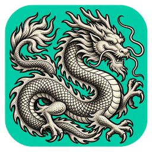

pureTV 是电脑端的 Android TV / Google TV 系统管理器。通过 ADB 连接电视，查看系统信息，安装、卸载、启停应用，选择启动器，并用可视化画布自定义支持的桌面。也可通过 MCP 让 Agent 控制已打开的管理器。

[下载 pureTV Manager 0.5.9](https://github.com/ecojust/pureTV/releases/tag/desktop-v0.5.9) · Windows / macOS / Linux · APK 市场与客户端更新使用新服务器

从 0.5.7 及更早版本升级，请先从上方发布页手动安装 0.5.9。旧客户端不会自动切换下载源；新版本使用 `apps.b14f.com` 的应用目录与 `client/` 更新目录。

[下载电视端 putrtv商城 0.1.1](resource/apps/putrtv-store/putrtv-store-0.1.1.apk?raw=1) · 在电视上浏览、安装和检查应用更新；配合[新版启动器](resource/README.md)可选择位置添加到桌面。

## 连接与应用管理

1. 电脑和电视接入可互通的网络，在电视开发者选项中开启 ADB／网络调试。
2. 首页输入电视 IP／主机名与调试端口，在电视上允许电脑连接。常见端口为 5555，以电视实际设置为准。
3. 缺少 ADB 时，阅读并同意 Android SDK 许可后点击「下载并配置 ADB」；优先 Google，失败时使用腾讯镜像。也可选择已有 ADB。

连接后首页显示型号、Android／SDK／安全补丁、CPU、内存、`/data` 磁盘容量、分辨率及运行时间。其他页面顶部保留当前连接状态。

- **应用管理**：搜索和分类，批量启用／停用、为当前用户卸载、恢复仍保有安装包的系统应用。
- **包名说明**：点击应用行中的圆圈 **i**，查询包的用途、卸载风险、资料来源与获取时间；未知包明确提示，当前默认桌面与核心组件的保护优先。
- **客户端更新**：启动后或手动检查新服务器的 [client/](https://apps.b14f.com/client/) 目录，按系统匹配新版本；点击「下载并安装」后校验安装包并自动安装、重启。首次从旧版升级及各平台说明见[客户端更新](desktop/docs/client-updates.md)。
- **待安装应用**：导入本地 APK，可在行尾安装单个，也可勾选批量安装；成功项移出队列，失败与未执行项保留。
- **启动器**：导入启动器 APK 后在该页面直接安装，选择／恢复默认桌面；支持接口的当前启动器显示「调整布局」。
- **市场**：动态浏览 [apps.b14f.com](https://apps.b14f.com/launcher/) 的 `launcher/`、`media/` 和 `game/` 目录中的应用与启动器，搜索、预览并下载到待安装列表，或连接电视后直接安装；同一应用或启动器的多个版本合并展示，可从下拉框选择最近 5 个版本，默认最新版；服务器新增 APK 后刷新即可发现。下载时一并保存同目录的 `logo.svg`，布局编辑器新增应用块或切换应用时自动使用该图标。
- 应用与启动器均显示主 APK 与分包的合计大小，不含私有数据、缓存与优化文件，无法读取时明确显示未知。
- 列表内部滚动，表头和顶部批量操作固定；核心系统组件与当前默认启动器受保护。

系统应用卸载只针对当前 Android 用户，保留数据，不删除系统分区 APK。新安装且具备启动入口的用户应用可加入启动器排布。

主动执行连接、刷新、应用管理、启动器切换或布局应用等操作时，管理器显示等待状态，完成后弹窗反馈结果。批量任务区分成功、失败和未执行项；后台自动读取不会反复弹窗。

## 启动器与电视应用资源

公共目录为 [resource/](resource/)，分为 [launcher/](resource/launcher/) 与 [apps/](resource/apps/)，原根目录的启动器和应用源码已整体移入。启动器和电视应用 APK 放在各自软件目录，也可通过独立的 `android-v*` Release 下载；电脑管理器保留单独的 `desktop-v*` 版本与最新发布入口。每个软件文件夹至少包含一个实际 APK，可同时提供对应版本源码、封面、作者、许可证及 SHA256。点击软件名称进入对应文件夹。每个电视应用目录还提供 64×64 的 `logo.svg`，供启动器布局使用；后续应用遵循[资源约定](resource/README-development.md#应用资源与-logosvg-约定)。

九款游戏的 0.5.1 规则与交互改进见[还原度复核](docs/game-fidelity-0.5.1.md)。沿用 0.5.0 统一证书，可覆盖更新 0.5.0；文档同时列出仍未精确还原的地图与内容。

启动器布局自定义使用本管理器的 **layout.json 版本 5 users/system 接口**。支持布局协议的启动器卡片自动显示 Home 背景颜色和图片，包括未激活的启动器；修改并应用布局后同步更新。列表不提供选择或移除封面的操作，桌面背景统一在「调整布局」中修改。待安装 APK 优先预览内置布局的 Home 背景，仅在无法读取布局背景时使用同目录的 `thumb.png`／`APK名.thumb.png`。

新增百款游戏暂选八款在本页展示，原有游戏仍保留；全部资源见 [完整资源目录](resource/README.md)。

<!-- resource-index:start -->

### 启动器（10）

<table>
  <tr>
    <td align="center" valign="top" width="25%"><a href="resource/launcher/sol/">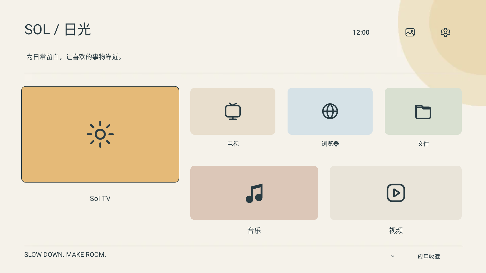 Sol TV</a></td>
    <td align="center" valign="top" width="25%"><a href="resource/launcher/pixel/">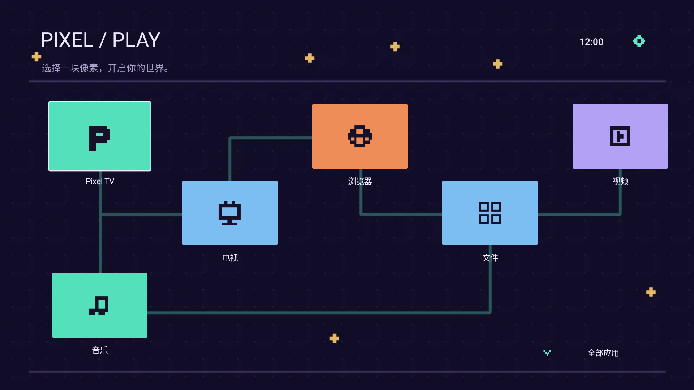 Pixel TV 像素</a></td>
    <td align="center" valign="top" width="25%"><a href="resource/launcher/moss/"> Moss TV</a></td>
    <td align="center" valign="top" width="25%"><a href="resource/launcher/mono/">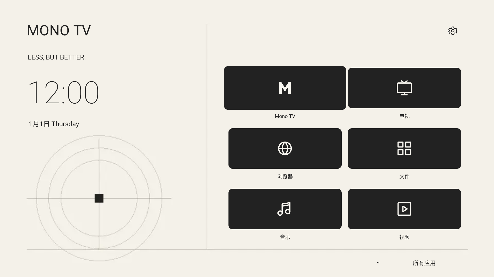 Mono TV 墨白</a></td>
  </tr>
  <tr>
    <td align="center" valign="top" width="25%"><a href="resource/launcher/forma/"> Forma TV</a></td>
    <td align="center" valign="top" width="25%"><a href="resource/launcher/drift/">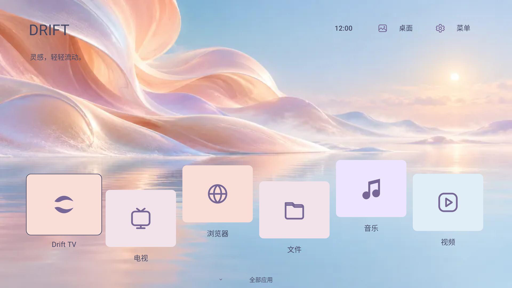 Drift TV</a></td>
    <td align="center" valign="top" width="25%"><a href="resource/launcher/circuit/"> Circuit TV · 回路</a></td>
    <td align="center" valign="top" width="25%"><a href="resource/launcher/aster/"> Aster TV · 星轨</a></td>
  </tr>
  <tr>
    <td align="center" valign="top" width="25%"><a href="resource/launcher/nova/"> Nova TV</a></td>
    <td align="center" valign="top" width="25%"><a href="resource/launcher/puretv/">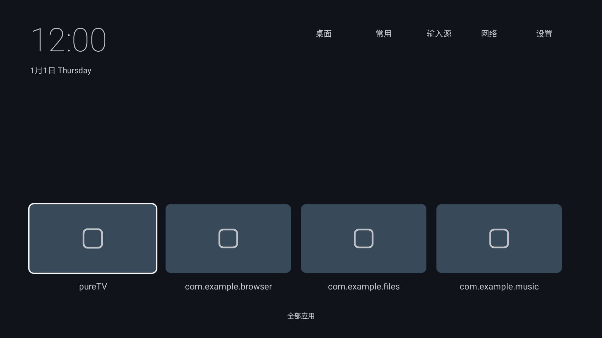 pureTV Launcher</a></td>
    <td width="25%"></td>
    <td width="25%"></td>
  </tr>
</table>

### 应用-影音（6）

<table>
  <tr>
    <td align="center" valign="top" width="25%"><a href="resource/apps/opera/"> 梨园 TV</a></td>
    <td align="center" valign="top" width="25%"><a href="resource/apps/bilibili/"> BiliTV</a></td>
    <td align="center" valign="top" width="25%"><a href="resource/apps/cctv/">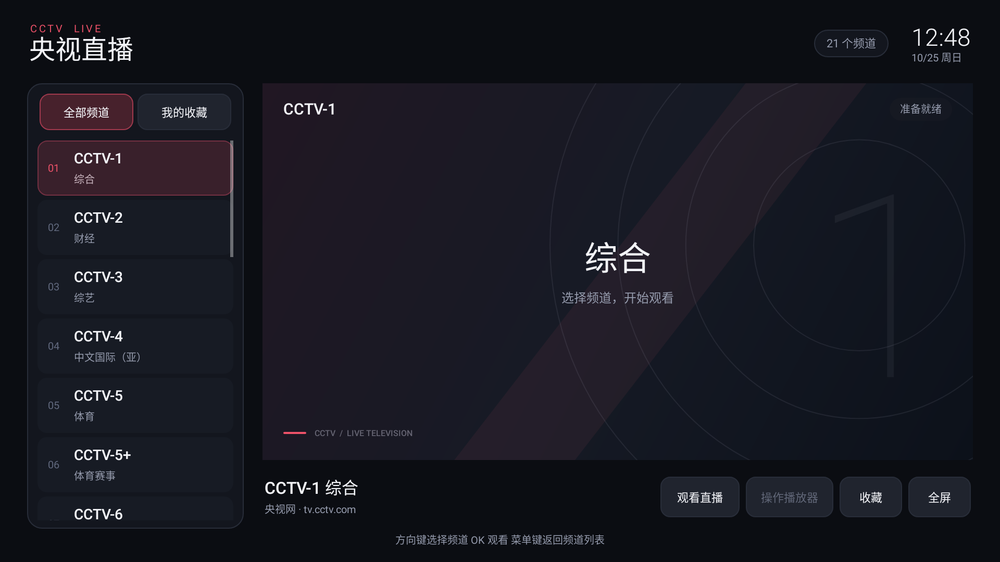 CCTV Live</a></td>
    <td align="center" valign="top" width="25%"><a href="resource/apps/hifini/"> HIFINi TV</a></td>
  </tr>
  <tr>
    <td align="center" valign="top" width="25%"><a href="resource/apps/webtv/">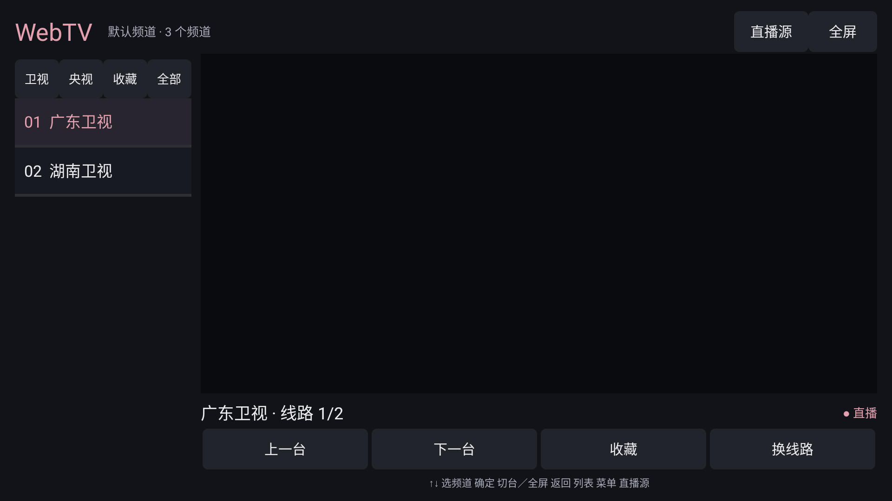 WebTV</a></td>
    <td align="center" valign="top" width="25%"><a href="resource/apps/shortvideo/"> ShortVideo TV</a></td>
    <td width="25%"></td>
    <td width="25%"></td>
  </tr>
</table>

### 应用-游戏（20）

<table>
  <tr>
    <td align="center" valign="top" width="25%"><a href="resource/apps/neon-rush/"> 霓虹飞车</a></td>
    <td align="center" valign="top" width="25%"><a href="resource/apps/twenty-four/"> 四则二十四</a></td>
    <td align="center" valign="top" width="25%"><a href="resource/apps/torch-bridge/">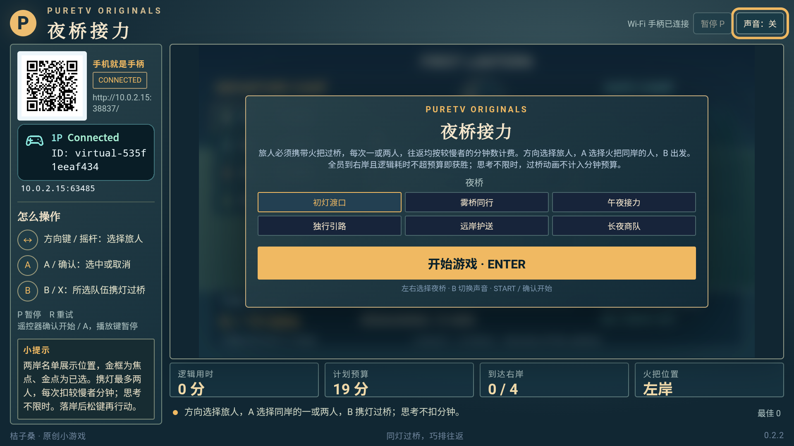 夜桥接力</a></td>
    <td align="center" valign="top" width="25%"><a href="resource/apps/tower-overlap/">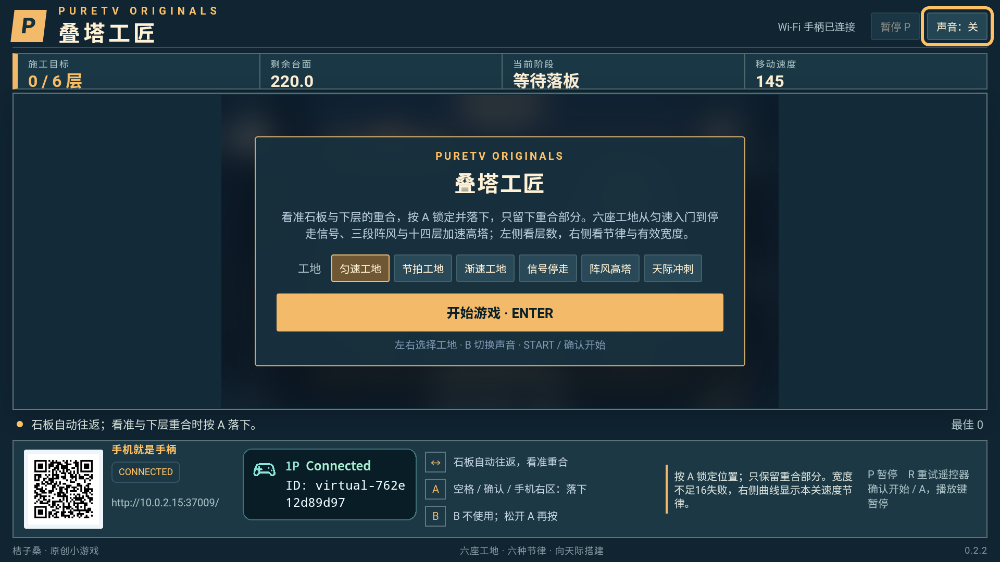 叠塔工匠</a></td>
  </tr>
  <tr>
    <td align="center" valign="top" width="25%"><a href="resource/apps/packing-sculptor/">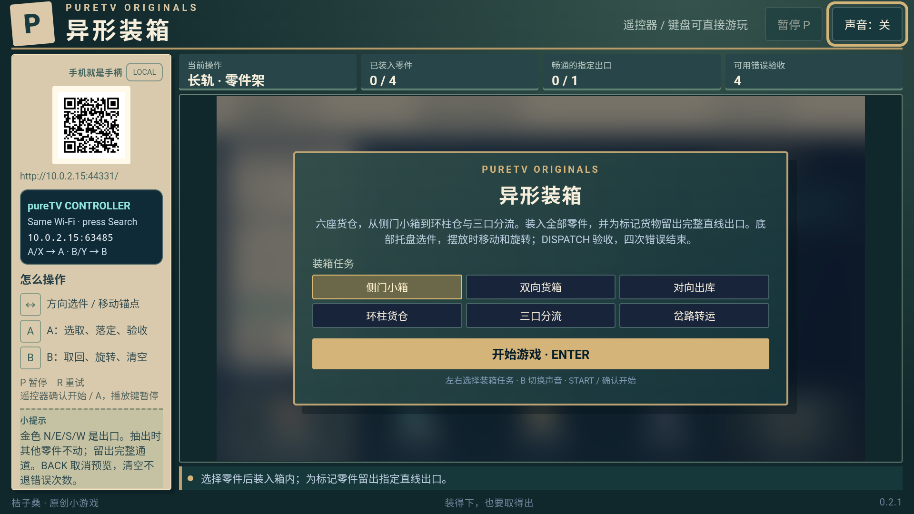 异形装箱</a></td>
    <td align="center" valign="top" width="25%"><a href="resource/apps/conveyor-window/">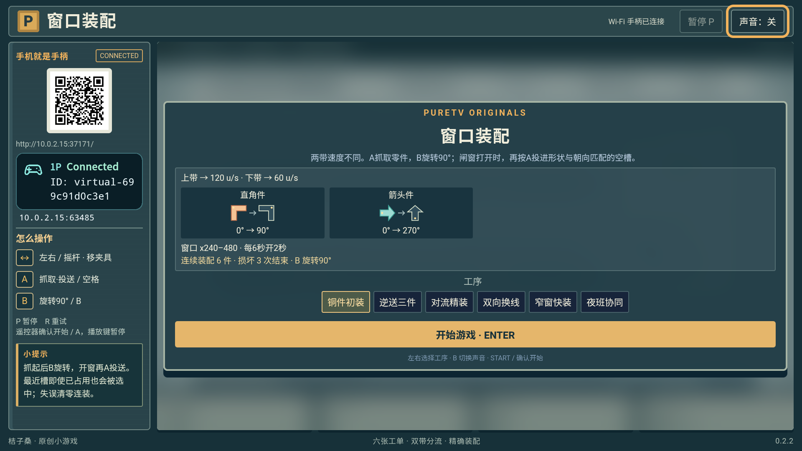 窗口装配</a></td>
    <td align="center" valign="top" width="25%"><a href="resource/apps/glass-fold/">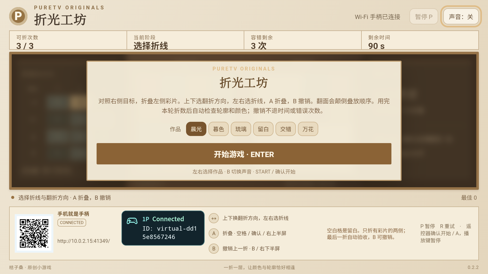 折光工坊</a></td>
    <td align="center" valign="top" width="25%"><a href="resource/apps/tension-span/"> 拉索桥梁</a></td>
  </tr>
  <tr>
    <td align="center" valign="top" width="25%"><a href="resource/apps/prism-relay/">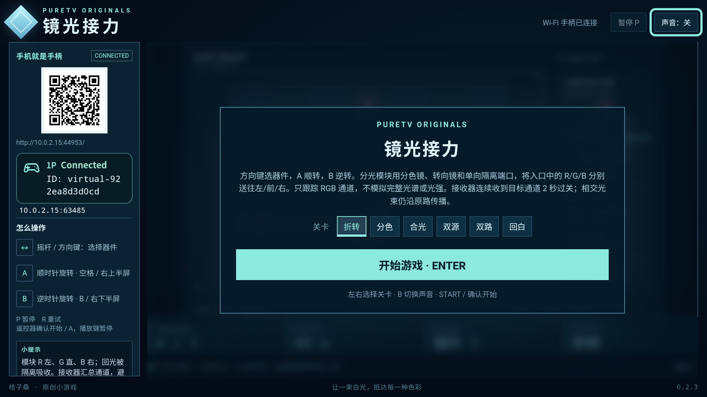 镜光接力</a></td>
    <td align="center" valign="top" width="25%"><a href="resource/apps/alien-shooter/">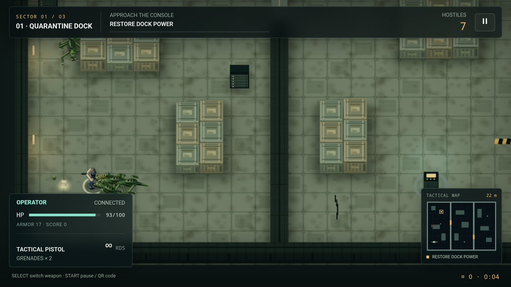 孤胆枪手 TV</a></td>
    <td align="center" valign="top" width="25%"><a href="resource/apps/used-car-racing/">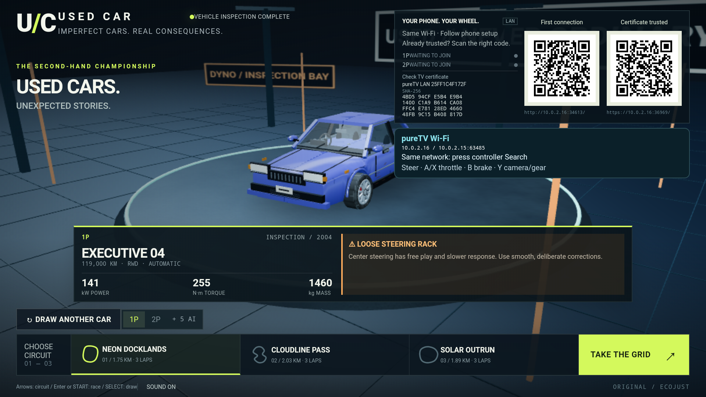 极品二手车</a></td>
    <td align="center" valign="top" width="25%"><a href="resource/apps/cozy-island/">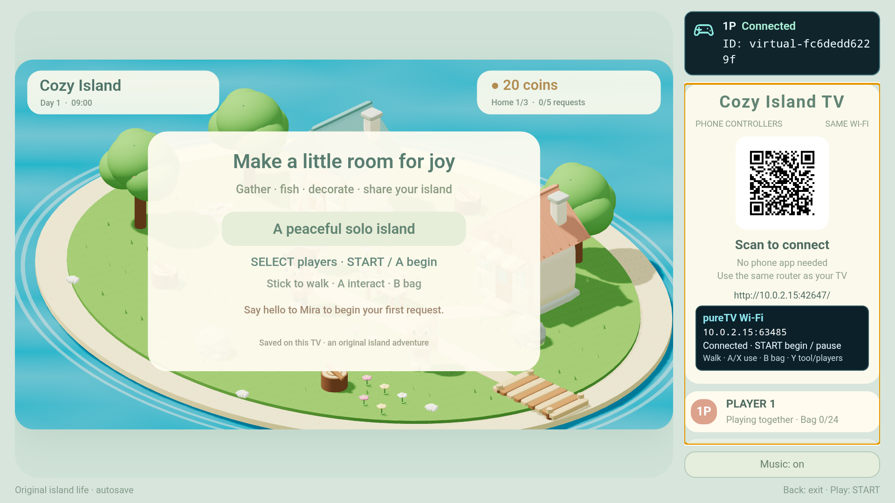 Cozy Island TV</a></td>
  </tr>
  <tr>
    <td align="center" valign="top" width="25%"><a href="resource/apps/coast-kart/"> Coast Kart TV</a></td>
    <td align="center" valign="top" width="25%"><a href="resource/apps/super-mario/"> Super Mario TV</a></td>
    <td align="center" valign="top" width="25%"><a href="resource/apps/bomb-jack/"> Mighty Bomb Jack TV</a></td>
    <td align="center" valign="top" width="25%"><a href="resource/apps/adventure-island/"> Adventure Island TV</a></td>
  </tr>
  <tr>
    <td align="center" valign="top" width="25%"><a href="resource/apps/tetris/">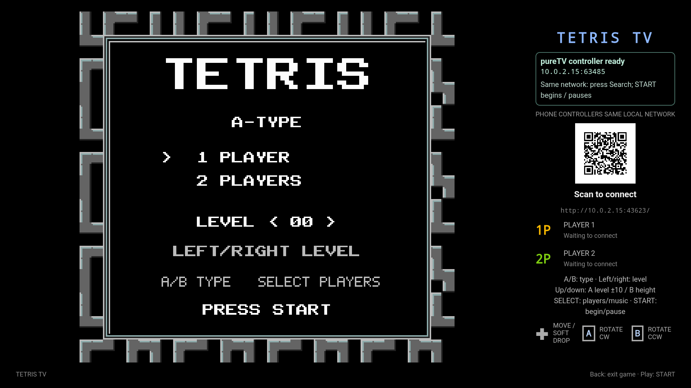 Tetris TV</a></td>
    <td align="center" valign="top" width="25%"><a href="resource/apps/jewel/">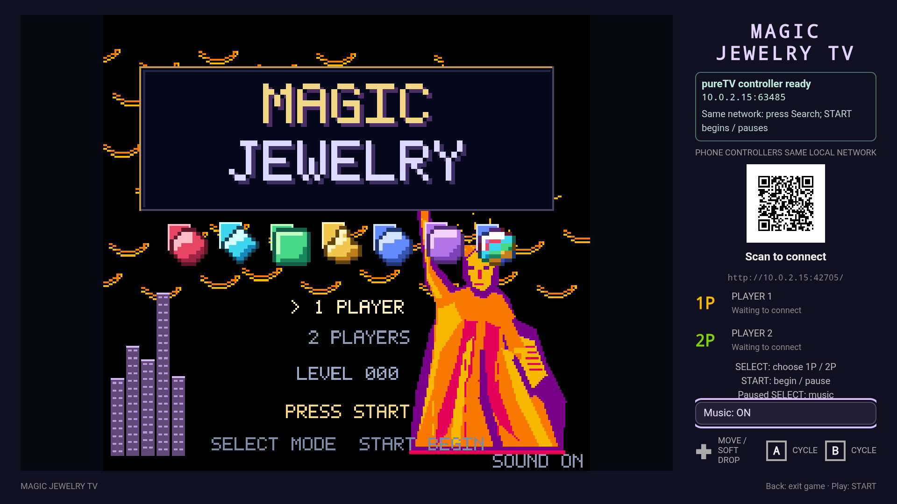 Magic Jewelry TV</a></td>
    <td align="center" valign="top" width="25%"><a href="resource/apps/jackal/">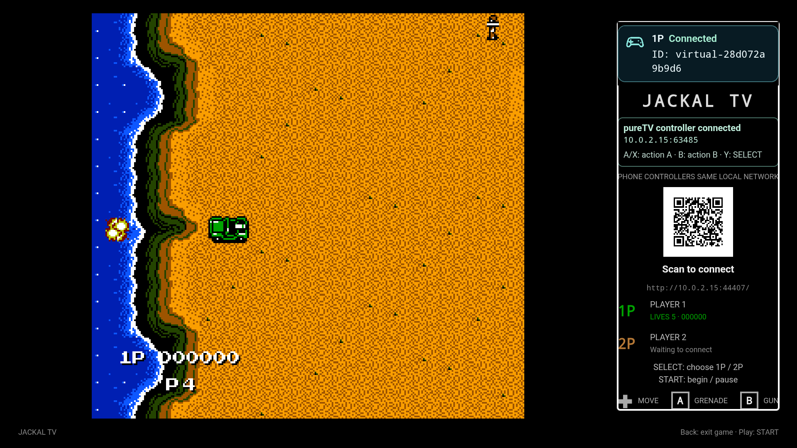 Jackal TV</a></td>
    <td align="center" valign="top" width="25%"><a href="resource/apps/tank/">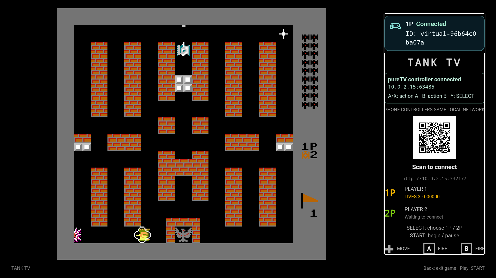 Tank TV</a></td>
  </tr>
</table>

### 应用-工具（1）

<table>
  <tr>
    <td align="center" valign="top" width="25%"><a href="resource/apps/putrtv-store/">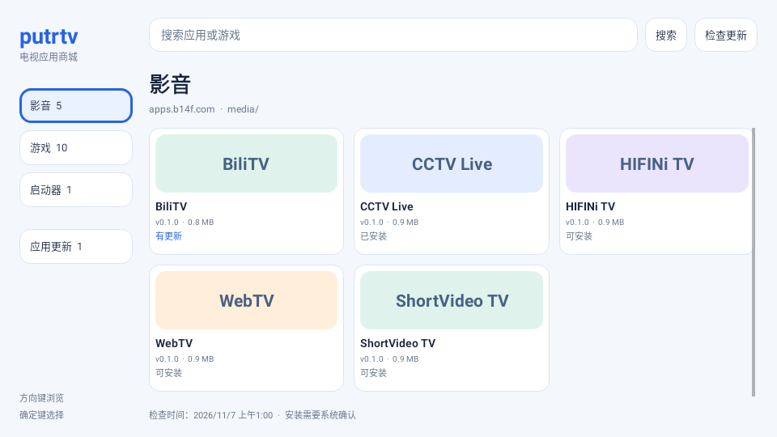 putrtv商城</a></td>
    <td width="25%"></td>
    <td width="25%"></td>
    <td width="25%"></td>
  </tr>
</table>

<!-- resource-index:end -->

上面展示的 **20 款游戏**均提供支持 **pureTV Wi-Fi 手柄**的新版 APK，需要 Android 8.0 及以上，默认 TCP 端口 **63485**。下载各游戏目录中的最新安装包，电视与手柄连接同一局域网，按 GPIO 23 搜索，START 开始／暂停。连接后，侧边显示手柄图标、1P／2P 席位和完整连接 ID，断线后自动隐藏。新版下载与验证范围见[连接标识更新](docs/controller-client-status/README.md)，按键及双人支持见[手柄接入说明](docs/readme-controller-support/README.md)。

第三方应用见 [fork/ 分类目录](fork/README.md)：收录 TVAPP 中小于 10 MB 的 14 款应用、23 个 APK，另按指定加入儿歌多多TV、宝宝趣学、茉莉音乐、淘知学堂TV和七星戏曲，共 19 款应用、28 个 APK，提供图标、介绍封面与 manifest。[超限文件与复刻参考](fork/OVERSIZED.md)保留全部 205 个超限文件，其中 5 份已收录，其余 200 份未收录。

## 手柄游戏专用目录（2）

[joystick-games/](joystick-games/) 集中放置 Android TV 与 macOS 手柄游戏。首批为基于 riba2534 演示项目适配的[运输船 CF](joystick-games/cf-transport-ship/)和[QQ 飞车](joystick-games/qq-speed/)，保留各自地图与玩法，接入 pureTV 九键、开始／暂停及完整客户端 ID 显示。安装包和验证状态见[目录说明](joystick-games/README.md)。两款需要 WebGL2；现有应用资源继续保留原下载地址。

<table>
<tr>
<td width="25%" align="center"><a href="joystick-games/cf-transport-ship/">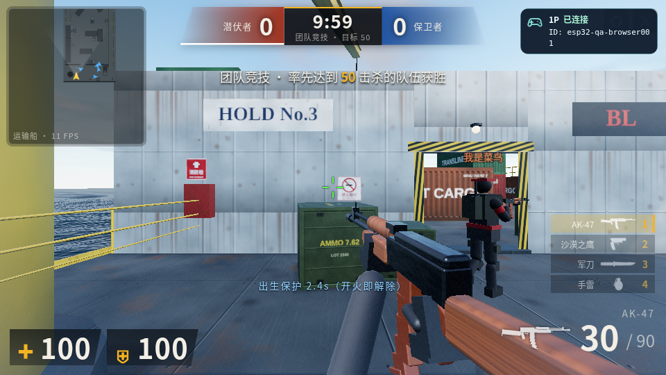 运输船 CF</a></td>
<td width="25%" align="center"><a href="joystick-games/qq-speed/">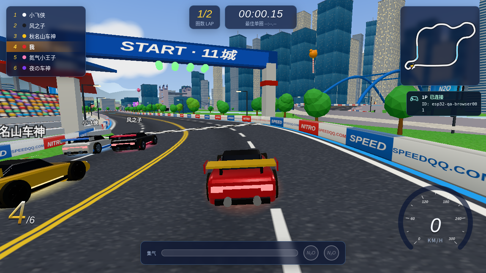 QQ 飞车</a></td>
<td width="25%"></td>
<td width="25%"></td>
</tr>
</table>

<!-- claude-games:start -->

## Claude 游戏参考清单（93 项 / 61 个仓库）

截至 **2026-11-17**，从 GitHub 按玩法完整度、实际源码、可运行入口和项目维护情况筛选。每项均核对了作者的 Claude 制作说明，或确实涉及游戏源码的 Claude 署名提交；这说明 Claude 参与开发，不表示全部代码和素材均由 Claude 独立完成。

点击分类可展开完整清单。以下是后续选型参考，尚未适配 pureTV，也未逐款完整试玩；演示只做了 HTTP 可达性检查。已适配的运输船 CF、QQ 飞车不重复计数。**⭐ 是所在仓库的当日星标数**，合集中的多个游戏共享同一数值。完整来源、运行依赖、手柄改造难点与排除记录见[核查说明](docs/claude-games/README.md)。

可以先看 **Kart Royale、Turbo Kart Rally、Nova Lancer、GLUP、Sugarplum Drop、Quiverspire、Peri Golf、CELADON**。它们分别适合研究竞速、飞行射击、平台动作、物理合成、房间探索、体育和模拟经营；具体运行条件见下表。

<strong>竞速与体育（12）</strong>

| 游戏与源码 | 玩法与看点 | 运行方式 / 入口 | Claude 依据 / 许可 |
| --- | --- | --- | --- |
| [鹈鹕骑自行车](https://github.com/riba2534/claude-opus-5-5-demo/tree/54adc1fb64155f9dd7c1c90ecae7b8185ac540b8/pelican-bike) · ⭐ 1437 | 沿海岸公路加速变道抓鱼，跳跃、展翅抬前轮并解锁成就；无操作时自动追鱼。 | 网页 / esbuild · [演示](https://claude-opus-5-5.riba2534.cn/) | [Claude 依据](https://github.com/riba2534/claude-opus-5-5-demo/blob/54adc1fb64155f9dd7c1c90ecae7b8185ac540b8/README.md) · 未明确 |
| [Kart Royale](https://github.com/ryancampbell/kart-royale/tree/036c0efb025f5ecf8fc31c405e9d818c61e03e21) · ⭐ 69 | 八位车手赛道竞速，漂移积蓄加速、发射道具、争夺圈数与名次。 | 网页 / Vite · [演示](https://racing.ryancampbell.com) | [Claude 依据](https://github.com/ryancampbell/kart-royale/blob/036c0efb025f5ecf8fc31c405e9d818c61e03e21/README.md) · [MIT](https://github.com/ryancampbell/kart-royale/blob/036c0efb025f5ecf8fc31c405e9d818c61e03e21/LICENSE) |
| [Turbo Kart Rally](https://github.com/bridge-mind/turbo-kart-rally/tree/c52aca3f10c7995884c316810cac6514daa40e9c) · ⭐ 51 | 与七名AI在Palm Cove Circuit竞速，漂移释放三级mini-turbo，拾取并使用八类道具。 | 网页 · CDN 依赖 · [演示](https://bridge-mind.github.io/turbo-kart-rally/) | [Claude 依据](https://github.com/bridge-mind/turbo-kart-rally/blob/c52aca3f10c7995884c316810cac6514daa40e9c/README.md) · [MIT](https://github.com/bridge-mind/turbo-kart-rally/blob/c52aca3f10c7995884c316810cac6514daa40e9c/LICENSE) |
| [Frostline Kart](https://github.com/sorrycc/fable-arcade/tree/6ab9de3122600e9c9dbe5daf3e77f7fe9361e335/games/mario-kart-snow) · ⭐ 12 | 雪地赛道8辆车跑3圈，拾取道具互相攻击并争夺名次。 | 网页 · CDN 依赖 · [演示](https://sorrycc.github.io/fable-arcade/games/mario-kart-snow/) | [Claude 依据](https://github.com/sorrycc/fable-arcade/blob/6ab9de3122600e9c9dbe5daf3e77f7fe9361e335/games/mario-kart-snow/README.md) · 未明确 |
| [Robo Tennis](https://github.com/sorrycc/fable-arcade/tree/6ab9de3122600e9c9dbe5daf3e77f7fe9361e335/games/robot-tennis) · ⭐ 12 | 移动机器人追球，方向决定击球落点，冲刺、发球，与CPU争局/盘。 | 网页 · CDN 依赖 · [演示](https://sorrycc.github.io/fable-arcade/games/robot-tennis/) | [Claude 依据](https://github.com/sorrycc/fable-arcade/blob/6ab9de3122600e9c9dbe5daf3e77f7fe9361e335/games/robot-tennis/README.md) · 未明确 |
| [Dirt Crown](https://github.com/triptych/web-games-andrew/tree/a7051c34fe2e7550fd206e6272f758df171855b0/game-069) · ⭐ 4 | 驾驶破旧赛车赢比赛赚钱，升级可见车体/引擎/轮胎，漂移蓄氮，挑战多杯赛与冠军。 | 网页 · CDN 依赖 · [演示](https://triptych.github.io/web-games-andrew/game-069/) | [Claude 依据](https://github.com/triptych/web-games-andrew/commit/7172d5872abe94bc398c47b3c95fa1d130d00d85) · [MIT](https://github.com/triptych/web-games-andrew/blob/a7051c34fe2e7550fd206e6272f758df171855b0/LICENSE) |
| [backroad rally](https://github.com/jason-c-dev/backroad-rally/tree/e5542f96b9a9a2912fdaa160396054e81f022f23) · ⭐ 2 | 跨四个时代五辆车、六段赛道，在天气变化中跑计时赛和生涯，对抗模拟车手与ghost。 | WebGL2 / WebGPU · [演示](https://jason-c-dev.github.io/backroad-rally/) | [Claude 依据](https://github.com/jason-c-dev/backroad-rally/blob/e5542f96b9a9a2912fdaa160396054e81f022f23/README.md) · [MIT](https://github.com/jason-c-dev/backroad-rally/blob/e5542f96b9a9a2912fdaa160396054e81f022f23/LICENSE) |
| [Slide Rush](https://github.com/KJLKurt/waterslide-game-opus-5.5/tree/03bc5993750ba870f12de3c6086e15877b62de09) · ⭐ 2 | 与十二名对手滑下大型水滑梯，转向、跳跃、走捷径，避免飞出赛道，冲入终点泳池。 | 网页 / Vite · [演示](https://kjlkurt.github.io/waterslide-game-opus-5.5/) | [Claude 依据](https://github.com/KJLKurt/waterslide-game-opus-5.5/blob/03bc5993750ba870f12de3c6086e15877b62de09/README.md) · 未明确 |
| [FORE LIGHT-YEARS](https://github.com/tdeeh8/fore/blob/0e34ee8e4bcf378d96a22a3809f4e5548193a098/index.html) · ⭐ 0 | 将体素高尔夫球越过郊区、海洋和太空打到月球，积累货币买升级/燃料，目标45000码。 | 网页 · CDN 依赖 · [演示](https://tdeeh8.github.io/fore/) | [Claude 依据](https://github.com/tdeeh8/fore/blob/0e34ee8e4bcf378d96a22a3809f4e5548193a098/README.md#L7) · 未明确 |
| [Kart Rush](https://github.com/stevkazt/kart-rush/tree/4b0cf276d84e76171feb765d87b5e8a6159cc421) · ⭐ 0 | 七站Grand Prix与单场竞速，选择车手/车体，漂移、道具、跳台及捷径。 | 网页 · CDN 依赖 · [演示](https://stevkazt.github.io/kart-rush/) | [Claude 依据](https://github.com/stevkazt/kart-rush/commit/7f01b88c3289918bd91a07101390647b1073fdc5) · 未明确 |
| [Kırkpınar／土耳其摔跤](https://github.com/Furkiozknn/kirkpinar/blob/b655e93c5d04b199638bc3a9bf5228f1de0dcc8c/index.html) · ⭐ 0 | 抓握、推拉、蹲身绊腿、背摔或举起行走三步取胜；五重量级26回合职业阶梯、快速赛与同键盘2P。 | 网页 · CDN 依赖 · [演示](https://furkiozknn.github.io/kirkpinar/) | [Claude 依据](https://github.com/Furkiozknn/kirkpinar/blob/b655e93c5d04b199638bc3a9bf5228f1de0dcc8c/README.md#L135) · [MIT](https://github.com/Furkiozknn/kirkpinar/blob/b655e93c5d04b199638bc3a9bf5228f1de0dcc8c/LICENSE) |
| [Peri Golf](https://github.com/Furkiozknn/peri-golf/blob/875de69749f3b74a9b0d928fe88b98392c2c055e/index.html) · ⭐ 0 | 卡帕多奇亚12洞par40球场，坡度/沙地/墙弹/动态陶轮、石门、驴；每洞三挑战星、幽灵最佳路线。 | 网页 · CDN 依赖 · [演示](https://furkiozknn.github.io/peri-golf/) | [Claude 依据](https://github.com/Furkiozknn/peri-golf/blob/875de69749f3b74a9b0d928fe88b98392c2c055e/README.md#L165) · [MIT](https://github.com/Furkiozknn/peri-golf/blob/875de69749f3b74a9b0d928fe88b98392c2c055e/LICENSE) |

<strong>3D 动作、探索与模拟（15）</strong>

| 游戏与源码 | 玩法与看点 | 运行方式 / 入口 | Claude 依据 / 许可 |
| --- | --- | --- | --- |
| [Tidewater](https://github.com/dgreenheck/tidewater/tree/4811ba48d795197de5621985f404e765c0b7c0ef) · ⭐ 1471 | 步行、游泳或驾船找钓点，控制收线张力捕获鱼类，出售渔获、升级装备。 | 浏览器 · **仅 WebGPU** · [演示](https://dgreenheck.github.io/tidewater/) | [Claude 依据](https://github.com/dgreenheck/tidewater/commit/4811ba48d795197de5621985f404e765c0b7c0ef) · [MIT](https://github.com/dgreenheck/tidewater/blob/4811ba48d795197de5621985f404e765c0b7c0ef/LICENSE) |
| [The Long Silence](https://github.com/achimala/TheLongSilence/tree/69b3296b4b6ecb3ca75ed6193e4b785c4c791c0f) · ⭐ 521 | 驾驶调查船扫描天体、降落行星、探索遗迹，调谐七个共振器解锁终点。 | WebGL2 · 需构建 · 从源码运行 | [Claude 依据](https://github.com/achimala/TheLongSilence/commit/19e138a7d6ba488f0a6f4431be8820c15a64af3d) · [MIT](https://github.com/achimala/TheLongSilence/blob/69b3296b4b6ecb3ca75ed6193e4b785c4c791c0f/LICENSE) |
| [Three.js Quake](https://github.com/mrdoob/three-quake/tree/6d6177b11f81f390d8e527dd5dd738d981eb13fa) · ⭐ 341 | 浏览器游玩Quake第一章，探索关卡、射击怪物；完整关卡需自备原版数据。 | 浏览器 · 完整版需自备游戏数据 · [演示](https://mrdoob.github.io/three-quake/) | [Claude 依据](https://github.com/mrdoob/three-quake/blob/6d6177b11f81f390d8e527dd5dd738d981eb13fa/README.md) · [GPL-2.0](https://github.com/mrdoob/three-quake/blob/6d6177b11f81f390d8e527dd5dd738d981eb13fa/LICENSE) |
| [GalaxyQuest](https://github.com/bigmak94/GalaxyQuest/tree/86a31eed9545795cfd561db52ddfb2ad3ad1325e) · ⭐ 134 | 将Super Mario Galaxy移植到Meta Quest，支持立体桌景与巨幕视角、运动控制与重力行星跳跃。 | **Meta Quest VR · 需原版数据** · [发行下载](https://github.com/bigmak94/GalaxyQuest/releases/latest) | [Claude 依据](https://github.com/bigmak94/GalaxyQuest/blob/86a31eed9545795cfd561db52ddfb2ad3ad1325e/README.md) · [移植层 Unlicense；原作数据另计](https://github.com/bigmak94/GalaxyQuest/blob/86a31eed9545795cfd561db52ddfb2ad3ad1325e/LICENSE) |
| [长风 · Long Wind](https://github.com/jbang2004/long-wind/tree/ac2e7e38e15b7f17bd7920eed82638c64bbe4713) · ⭐ 123 | 在山门与竹林章节中拔剑战斗，连击、蓄力、弹反、闪避、剑气及锁定敌人。 | 网页 / Vite · [演示](https://jbang2004.github.io/long-wind/) | [Claude 依据](https://github.com/jbang2004/long-wind/blob/ac2e7e38e15b7f17bd7920eed82638c64bbe4713/README.md) · [代码 MIT；模型/动作另见说明](https://github.com/jbang2004/long-wind/blob/ac2e7e38e15b7f17bd7920eed82638c64bbe4713/LICENSE) |
| [Tidewright](https://github.com/winchxyz/tidewright/tree/ebf06be3303c2ee9588c394230971e5e475b3f1c) · ⭐ 77 | 铲沙、夯实、修建沙堡，在九轮涨潮中尽量保住作品；另有自由建造模式。 | WebGL2 · 需浮点渲染扩展 · [演示](https://winchxyz.github.io/tidewright/) | [Claude 依据](https://github.com/winchxyz/tidewright/blob/ebf06be3303c2ee9588c394230971e5e475b3f1c/README.md) · [MIT](https://github.com/winchxyz/tidewright/blob/ebf06be3303c2ee9588c394230971e5e475b3f1c/LICENSE) |
| [毛线星球 · Yarn Planet](https://github.com/makerjackie/yarn-planet/tree/5c8acce8df04fc7788d48a98343e38c05a458a16) · ⭐ 25 | 背着线轴在小星球行走，给灯塔、水车等接线；有限线长要求选路径，九条线完成首章。 | WebGL · 联机需 Cloudflare 服务 · [演示](https://yarn.ynot.games/) | [Claude 依据](https://github.com/makerjackie/yarn-planet/blob/5c8acce8df04fc7788d48a98343e38c05a458a16/README.md) · [MIT](https://github.com/makerjackie/yarn-planet/blob/5c8acce8df04fc7788d48a98343e38c05a458a16/LICENSE) |
| [Fable Theft Auto 5.1](https://github.com/sorrycc/fable-arcade/tree/6ab9de3122600e9c9dbe5daf3e77f7fe9361e335/games/voxel-gta-city) · ⭐ 12 | 城市中步行射击、进入车辆驾驶，完成市中心任务并躲避随通缉星增多的警察。 | 网页 · CDN 依赖 · [演示](https://sorrycc.github.io/fable-arcade/games/voxel-gta-city/) | [Claude 依据](https://github.com/sorrycc/fable-arcade/blob/6ab9de3122600e9c9dbe5daf3e77f7fe9361e335/games/voxel-gta-city/README.md) · 未明确 |
| [Nova Lancer](https://github.com/tanuu5/nova-lancer/tree/63b63953299994baa05ac27c15c6b836fff0179b) · ⭐ 12 | 驾驶战机沿关卡推进，射击、锁定蓄力弹、炸弹与加速，战斗包含大型Boss。 | 网页 / esbuild · [演示](https://tanuu5.github.io/nova-lancer/) | [Claude 依据](https://github.com/tanuu5/nova-lancer/blob/63b63953299994baa05ac27c15c6b836fff0179b/README.md) · [MIT](https://github.com/tanuu5/nova-lancer/blob/63b63953299994baa05ac27c15c6b836fff0179b/LICENSE) |
| [Crystal Rooms](https://github.com/vreshch/kids-games/tree/ca0c247fbd3308550529239d66740d67ad6519ca/src/components/crystal-rooms) · ⭐ 5 | 穿越水晶洞穴，找字母钥匙并依序拼单词，逐关进入更多房间。 | 网页 / Next.js · [演示](https://games.vreshch.com/crystal-rooms) | [Claude 依据](https://github.com/vreshch/kids-games/blob/ca0c247fbd3308550529239d66740d67ad6519ca/README.md) · [MIT](https://github.com/vreshch/kids-games/blob/ca0c247fbd3308550529239d66740d67ad6519ca/LICENSE) |
| [Mortal Clash](https://github.com/PromptEngineer48/claude-opus-5.5-games/tree/07b8b5e0d54a0938b03db5d855577acf8e3bcad9/mortal-clash) · ⭐ 5 | 选角色与难度，对战CPU，拳脚、格挡、特殊技、上勾拳与扫腿连招打多回合。 | 网页 · CDN 依赖 · [演示](https://promptengineer48.github.io/claude-opus-5.5-games/mortal-clash/) | [Claude 依据](https://github.com/PromptEngineer48/claude-opus-5.5-games/blob/07b8b5e0d54a0938b03db5d855577acf8e3bcad9/README.md) · 未明确 |
| [Rooftop Sniper: Last Light](https://github.com/PromptEngineer48/claude-opus-5.5-games/tree/07b8b5e0d54a0938b03db5d855577acf8e3bcad9/rooftop-sniper) · ⭐ 5 | 夕阳屋顶上辨认武装目标与平民，调倍率/屏息，修正风与弹道，在3分钟内击中5名目标。 | 网页 / Vite · [演示](https://promptengineer48.github.io/claude-opus-5.5-games/rooftop-sniper/offline/index.html) | [Claude 依据](https://github.com/PromptEngineer48/claude-opus-5.5-games/blob/07b8b5e0d54a0938b03db5d855577acf8e3bcad9/README.md) · 未明确 |
| [Fishslop](https://github.com/vasu-devs/FishSlop_Opus5.5/tree/55de15091c789585a5d4ece952f841e6006af138) · ⭐ 4 | 驾驶小潜艇喂鱼收金币、购买新鱼种和装备，声呐揭示隐形鱼，积累珊瑚礁价值解锁高级生态。 | 网页 / WebGL2 · [演示](https://vasu-devs.github.io/FishSlop_Opus5.5/) | [Claude 依据](https://github.com/vasu-devs/FishSlop_Opus5.5/commit/55de15091c789585a5d4ece952f841e6006af138) · 未明确 |
| [HEXAPOD RISING](https://github.com/triptych/web-games-andrew/tree/a7051c34fe2e7550fd206e6272f758df171855b0/game-120) · ⭐ 4 | 驾驶六足机甲穿越6处战场、救殖民者并打5个多阶段Boss，战后买可见升级。 | 网页 · CDN 依赖 · [演示](https://triptych.github.io/web-games-andrew/game-120/) | [Claude 依据](https://github.com/triptych/web-games-andrew/commit/57ba72ec9acbced2be978bd62f7da13e41d013c0) · [MIT](https://github.com/triptych/web-games-andrew/blob/a7051c34fe2e7550fd206e6272f758df171855b0/LICENSE) |
| [AMAR.IO](https://github.com/onehundredapps/amar.io/tree/a074716cc36f395a2aec1955a9c84784b6d621eb) · ⭐ 1 | 在三维空间控制细胞吞食成长、分裂追击、喷射质量并重新合并，与机器人或P2P玩家竞争。 | WebGL · 联机需信令/P2P · [演示](https://onehundredapps.github.io/amar.io/) | [Claude 依据](https://github.com/onehundredapps/amar.io/blob/a074716cc36f395a2aec1955a9c84784b6d621eb/README.md) · 未明确 |

<strong>平台、弹幕与街机（20）</strong>

| 游戏与源码 | 玩法与看点 | 运行方式 / 入口 | Claude 依据 / 许可 |
| --- | --- | --- | --- |
| [Quasar Saz](https://github.com/cleak/quasar-saz/blob/e56e93ea8c72cbe2ff9f1e754eb68f6829e6ae43/game/GameManager.cs#L145) · ⭐ 30 | 操纵外星音乐家Zara发射声波、冲刺、蓄超级攻击，武器进化并完成六波和终局Boss。 | Godot / C# 桌面 · [发行下载](https://github.com/cleak/quasar-saz/releases/tag/v1.1) | [Claude 依据](https://github.com/cleak/quasar-saz/blob/e56e93ea8c72cbe2ff9f1e754eb68f6829e6ae43/README.md#L59) · [MIT](https://github.com/cleak/quasar-saz/blob/e56e93ea8c72cbe2ff9f1e754eb68f6829e6ae43/LICENSE) |
| [Pocket Bomber](https://github.com/chongdashu/love2d-pocket-bomber-game/blob/1cf66e2fdbbb7f5e81d51703b2155c834ca77b8b/src/explosion.lua#L11) · ⭐ 18 | 在13×9网格中放炸弹炸开方块，躲爆炸，处理三种敌人并完成五关。 | LÖVE2D 桌面 · 从源码运行 | [Claude 依据](https://github.com/chongdashu/love2d-pocket-bomber-game/blob/1cf66e2fdbbb7f5e81d51703b2155c834ca77b8b/README.md#L5) · README 称 MIT，未见许可文件 |
| [Crossy Farm](https://github.com/sorrycc/fable-arcade/tree/6ab9de3122600e9c9dbe5daf3e77f7fe9361e335/games/crossy-farm-car) · ⭐ 12 | 驾驶小车按网格过农场交通与河流，避开动物、踩浮木，捡金币买车辆。 | 网页 · CDN 依赖 · [演示](https://sorrycc.github.io/fable-arcade/games/crossy-farm-car/) | [Claude 依据](https://github.com/sorrycc/fable-arcade/blob/6ab9de3122600e9c9dbe5daf3e77f7fe9361e335/games/crossy-farm-car/README.md) · 未明确 |
| [Hollowmere](https://github.com/sorrycc/fable-arcade/tree/6ab9de3122600e9c9dbe5daf3e77f7fe9361e335/games/terraria-sandbox) · ⭐ 12 | 挖掘地块、造工作台和装备，探索森林/沙漠，在夜间召唤并击败飞眼Boss。 | 网页 · [演示](https://sorrycc.github.io/fable-arcade/games/terraria-sandbox/) | [Claude 依据](https://github.com/sorrycc/fable-arcade/blob/6ab9de3122600e9c9dbe5daf3e77f7fe9361e335/games/terraria-sandbox/README.md) · 未明确 |
| [Rail Rush](https://github.com/sorrycc/fable-arcade/tree/6ab9de3122600e9c9dbe5daf3e77f7fe9361e335/games/subway-runner) · ⭐ 12 | 左右换道，跳上列车、翻滚过横梁，捡金币/喷气包/超级鞋/悬浮板冲高分。 | 网页 · CDN 依赖 · [演示](https://sorrycc.github.io/fable-arcade/games/subway-runner/) | [Claude 依据](https://github.com/sorrycc/fable-arcade/blob/6ab9de3122600e9c9dbe5daf3e77f7fe9361e335/games/subway-runner/README.md) · 未明确 |
| [World 1-1](https://github.com/sorrycc/fable-arcade/tree/6ab9de3122600e9c9dbe5daf3e77f7fe9361e335/games/mario-1-1) · ⭐ 12 | 横向奔跑、变高低跳、踩敌人、收集金币和能力道具，到旗杆终点。 | 网页 · [演示](https://sorrycc.github.io/fable-arcade/games/mario-1-1/) | [Claude 依据](https://github.com/sorrycc/fable-arcade/blob/6ab9de3122600e9c9dbe5daf3e77f7fe9361e335/games/mario-1-1/README.md) · 未明确 |
| [Jazz Jackrabbit · Opus Edition](https://github.com/JuliusBrussee/jazz-jackrabbit-remastered/blob/65fcc519980b3b3bd2f30e312e7336f0f50d5238/index.html#L329) · ⭐ 8 | 五个世界中奔跑、悬浮、踩碎地面，用四种枪打敌人并挑战两场Boss。 | 网页 · [演示](https://juliusbrussee.github.io/jazz-jackrabbit-remastered/) | [Claude 依据](https://github.com/JuliusBrussee/jazz-jackrabbit-remastered/blob/65fcc519980b3b3bd2f30e312e7336f0f50d5238/README.md#L5) · 未明确 |
| [Neon Siege](https://github.com/PromptEngineer48/claude-opus-5.5-games/tree/07b8b5e0d54a0938b03db5d855577acf8e3bcad9/neon-siege) · ⭐ 5 | 在霓虹竞技场射击机器人大军，冲刺穿敌、举盾反弹子弹，换5种武器，每5波迎战Boss。 | 网页 · CDN 依赖 · [演示](https://promptengineer48.github.io/claude-opus-5.5-games/neon-siege/) | [Claude 依据](https://github.com/PromptEngineer48/claude-opus-5.5-games/blob/07b8b5e0d54a0938b03db5d855577acf8e3bcad9/README.md) · 未明确 |
| [Sprout Quest](https://github.com/aibengineering/sprout-quest/blob/fc5ab9bf0a770fbffc7619932253fb85c30f7270/src/battle/battle.ts#L27) · ⭐ 5 | 从村庄外出战斗、升级，砍树采矿制作装备，推进区域并挑战守卫与龙。 | 网页 / Bun · [演示](https://aibengineering.github.io/sprout-quest/) | [Claude 依据](https://github.com/aibengineering/sprout-quest/blob/fc5ab9bf0a770fbffc7619932253fb85c30f7270/README.md#L3) · 未明确 |
| [Wiggle Snakes](https://github.com/vreshch/kids-games/tree/ca0c247fbd3308550529239d66740d67ad6519ca/src/components/wiggle-snakes) · ⭐ 5 | 吃光点长大、吞小蛇，蓄能后开Super短时吞所有蛇；有boost加速和电脑对手。 | 网页 / Next.js · [演示](https://games.vreshch.com/wiggle-snakes) | [Claude 依据](https://github.com/vreshch/kids-games/blob/ca0c247fbd3308550529239d66740d67ad6519ca/README.md) · [MIT](https://github.com/vreshch/kids-games/blob/ca0c247fbd3308550529239d66740d67ad6519ca/LICENSE) |
| [BUBBLE NEBULA](https://github.com/triptych/web-games-andrew/tree/a7051c34fe2e7550fd206e6272f758df171855b0/game-082) · ⭐ 4 | 星龙吹泡困住敌人，再踩破连锁拿分；跨屏环绕、收集字母，通24个区域并打Boss。 | 网页 · CDN 依赖 · [演示](https://triptych.github.io/web-games-andrew/game-082/) | [Claude 依据](https://github.com/triptych/web-games-andrew/commit/ff2a14b8ad849ae5f55879b57e139408a0017ca6) · [MIT](https://github.com/triptych/web-games-andrew/blob/a7051c34fe2e7550fd206e6272f758df171855b0/LICENSE) |
| [PHOSPHOR PATROL](https://github.com/triptych/web-games-andrew/tree/a7051c34fe2e7550fd206e6272f758df171855b0/game-070) · ⭐ 4 | 在环绕星球飞行，击落掳走殖民者的敌人、接住下落人员再送地面，用炸弹/跃迁解围。 | 网页 · CDN 依赖 · [演示](https://triptych.github.io/web-games-andrew/game-070/) | [Claude 依据](https://github.com/triptych/web-games-andrew/commit/245df892c464d04c02909d8cec13b96c553d1a93) · [MIT](https://github.com/triptych/web-games-andrew/blob/a7051c34fe2e7550fd206e6272f758df171855b0/LICENSE) |
| [Popgun Pip](https://github.com/triptych/web-games-andrew/tree/a7051c34fe2e7550fd206e6272f758df171855b0/game-042) · ⭐ 4 | 跨5岛25个程序关卡跳跃射击，赢回弹簧靴、冰冻枪、壁跳和火箭等能力并返回探索。 | 网页 · [演示](https://triptych.github.io/web-games-andrew/game-042/) | [Claude 依据](https://github.com/triptych/web-games-andrew/commit/8d95339291a7c7f00e8a427f1248ab6d2c0c3302) · [MIT](https://github.com/triptych/web-games-andrew/blob/a7051c34fe2e7550fd206e6272f758df171855b0/LICENSE) |
| [Quiverspire](https://github.com/triptych/web-games-andrew/tree/a7051c34fe2e7550fd206e6272f758df171855b0/game-046) · ⭐ 4 | 停下自动射击，移动时闪避；过房间选叠加能力，打多阶段Boss并获得永久天赋。 | 网页 · CDN 依赖 · [演示](https://triptych.github.io/web-games-andrew/game-046/) | [Claude 依据](https://github.com/triptych/web-games-andrew/commit/c50a4910c5f9f46bcba636b60394d6351f9868c8) · [MIT](https://github.com/triptych/web-games-andrew/blob/a7051c34fe2e7550fd206e6272f758df171855b0/LICENSE) |
| [STARBLAZER '86](https://github.com/triptych/web-games-andrew/tree/a7051c34fe2e7550fd206e6272f758df171855b0/game-109) · ⭐ 4 | 驾驶战机打编队与Boss，升级五级火力、炸弹与护盾；穿插禁射奖励关和后续更难循环。 | 网页 · [演示](https://triptych.github.io/web-games-andrew/game-109/) | [Claude 依据](https://github.com/triptych/web-games-andrew/commit/f1d1454dbf041cb7d5723a76fe4520fbd9ae17d7) · [MIT](https://github.com/triptych/web-games-andrew/blob/a7051c34fe2e7550fd206e6272f758df171855b0/LICENSE) |
| [WYRMZONE](https://github.com/triptych/web-games-andrew/tree/a7051c34fe2e7550fd206e6272f758df171855b0/game-083) · ⭐ 4 | 无翼龙先在地面前进战斗，击破Dragonbane后升空，飞越堡垒与峡谷回家。 | 网页 · CDN 依赖 · [演示](https://triptych.github.io/web-games-andrew/game-083/) | [Claude 依据](https://github.com/triptych/web-games-andrew/commit/a7f189b2522791db6d50d63a113306438aba252b) · [MIT](https://github.com/triptych/web-games-andrew/blob/a7051c34fe2e7550fd206e6272f758df171855b0/LICENSE) |
| [GLUP — Nila y el pez gato](https://github.com/gavilanbe/glup/blob/db4bc2cf502b9b53bd06fe65491215ea2324ef82/game.js#L1) · ⭐ 0 | Nila携猫鱼Bigotes穿过九个沼泽地点，吸入敌人/物件再吐成弹药，学能力、回访救幼鱼并打苍鹭Boss。 | 网页 · [演示](https://gavilanbe.github.io/glup/) | [Claude 依据](https://github.com/gavilanbe/glup/blob/db4bc2cf502b9b53bd06fe65491215ea2324ef82/README.md#L124) · [MIT](https://github.com/gavilanbe/glup/blob/db4bc2cf502b9b53bd06fe65491215ea2324ef82/LICENSE) |
| [Mystic Onslaught](https://github.com/KAOSN00B/MysticOnslaught/blob/bf63659da929f07ec28e920f14097031726ae512/Mystic%20Onslaught/MysticOnslaughtBeta/TestGame/CombatDirector.cpp#L43) · ⭐ 0 | 选择职业、闯房间打敌群与Boss、收遗物和升级能力，返回村庄进行长线成长。 | C++ / raylib · 桌面/Web · [项目页](https://kaosn00b.itch.io/mystic-onslaught) | [Claude 依据](https://github.com/KAOSN00B/MysticOnslaught/commit/d3801a323960d03a4a5b3d00377994648c271105) · 未明确 |
| [Novaki: Strike Twice](https://github.com/novaki-ai/strike-twice/blob/fc97c4d5de409eebf0c36e2417fcf8eb2b04248f/src/game/game.ts#L51) · ⭐ 0 | 扮演橡皮管动画风格火柴人，躲避敌潮、升级武器/遗物，战胜三场Boss直至胜利。 | 网页 / Vite · 从源码运行 | [Claude 依据](https://github.com/novaki-ai/strike-twice/blob/fc97c4d5de409eebf0c36e2417fcf8eb2b04248f/README.md#L5) · [代码 MIT / 素材 CC BY 4.0](https://github.com/novaki-ai/strike-twice/blob/fc97c4d5de409eebf0c36e2417fcf8eb2b04248f/LICENSE) |
| [Overclocked](https://github.com/danjaekim/overclocked/blob/93d47ea512c278d64d117f9d4a150b54563c6ef0/src/game/run.js#L30) · ⭐ 0 | 把触发规则、武器和修饰卡排成程序链，角色自动开火；靠走位生存十分钟并改造构筑。 | 网页 · [演示](https://danjaekim.github.io/overclocked/) | [Claude 依据](https://github.com/danjaekim/overclocked/commit/93d47ea512c278d64d117f9d4a150b54563c6ef0) · 未明确 |

<strong>策略、塔防与卡牌（11）</strong>

| 游戏与源码 | 玩法与看点 | 运行方式 / 入口 | Claude 依据 / 许可 |
| --- | --- | --- | --- |
| [SHOVE](https://github.com/robss2020/claude-fable-5-having-fun/blob/00511f846dd57b4c224728c85eace8e377e5b5ec/shove.py#L109) · ⭐ 5 | 敌人预告相对自身的攻击方向；移动和推拉敌人，使其攻击空地、同伴或掉入水中，并保护建筑。 | **Python CLI · 无图形界面** · 从源码运行 | [Claude 依据](https://github.com/robss2020/claude-fable-5-having-fun/blob/00511f846dd57b4c224728c85eace8e377e5b5ec/README.md#L9) · 未明确 |
| [Emberbrood](https://github.com/triptych/web-games-andrew/tree/a7051c34fe2e7550fd206e6272f758df171855b0/game-038) · ⭐ 4 | 驯服、培育与繁殖基因龙，组3龙小队打回合战斗，完成五幕故事。 | 网页 · [演示](https://triptych.github.io/web-games-andrew/game-038/) | [Claude 依据](https://github.com/triptych/web-games-andrew/commit/1077ea0d2489156b40f460909d644d44582cf653) · [MIT](https://github.com/triptych/web-games-andrew/blob/a7051c34fe2e7550fd206e6272f758df171855b0/LICENSE) |
| [OSRS Tower Defense](https://github.com/hamilton-junior/osrs-tower-defense/blob/aae04a74b14df039087195dfb906bdfb4f3d7297/lib/game/core/sim/combat.ts#L374) · ⭐ 3 | 随机道路上摆塔升级/融合，应对每十波Boss、区域分支和130波目标；可选卡牌遗物模式。 | 网页 · [演示](https://hamilton-junior.github.io/osrs-tower-defense/) | [Claude 依据](https://github.com/hamilton-junior/osrs-tower-defense/commit/aae04a74b14df039087195dfb906bdfb4f3d7297) · 未明确 |
| [Ascmearc（原Warlock）](https://github.com/jannef/ascmearc/blob/f0a99ccdaf61adf914b030d85bff59ea1baeac1b/crates/ascmearc-core/src/combat.rs#L542) · ⭐ 1 | 自定义种族职业，在昼夜季节世界探索城镇和地牢，回合战斗、制作、施法，永久死亡。 | Rust 桌面 / WebGPU 网页 · [演示](https://ascmearc.com/) | [Claude 依据](https://github.com/jannef/ascmearc/commit/37c0b5bb290adff4822b742b7c2b1cdb897723cb) · [GPL-3.0-only](https://github.com/jannef/ascmearc/blob/f0a99ccdaf61adf914b030d85bff59ea1baeac1b/LICENSE) |
| [CARD GAME（LÖVE2D）](https://github.com/Corttezz/card-game-love2d/blob/998dbffef8dc3fdd19fb41f21344b2999f7a37d1/src/core/Game.lua#L167) · ⭐ 0 | 以攻击、防御与被动Joker组成卡组，消耗法力打敌人并推进连续关卡/Boss。 | LÖVE2D 桌面 · 从源码运行 | [Claude 依据](https://github.com/Corttezz/card-game-love2d/commit/7aba2cf4fd429193de5ae329c99b4e904126b47c) · 未明确 |
| [Dungeon of Opus](https://github.com/joozio/dungeon-of-opus/blob/4db3bb30059489c82a2d454c3c4120a7ceb66616/src/App.tsx#L258) · ⭐ 0 | 在程序地牢中回合移动战斗、拾取装备与食物，探索迷雾、深入楼层并击败最终Boss。 | 网页 / Vite · [演示](https://wiz.jock.pl/experiments/dungeon-of-opus) | [Claude 依据](https://github.com/joozio/dungeon-of-opus/blob/4db3bb30059489c82a2d454c3c4120a7ceb66616/README.md#L3) · [MIT](https://github.com/joozio/dungeon-of-opus/blob/4db3bb30059489c82a2d454c3c4120a7ceb66616/LICENSE) |
| [MAINSPRING](https://github.com/Kelevera/mainspring/blob/ec1a45254fc8b892ac151135c01ca932105fe249/src/engine.js#L97) · ⭐ 0 | 在六角棋盘连接齿轮满足能量合同；相邻齿轮反转，奇数环会卡死整列，采购齿轮/护符形成组合。 | 网页 · **演示限 3 合同** · [演示](https://kelevera.github.io/mainspring/) | [Claude 依据](https://github.com/Kelevera/mainspring/blob/ec1a45254fc8b892ac151135c01ca932105fe249/README.md#L54) · [PolyForm **非商用**](https://github.com/Kelevera/mainspring/blob/ec1a45254fc8b892ac151135c01ca932105fe249/LICENSE.md) |
| [Plants vs. Zombies（fan remake）](https://github.com/dannishen60/plants-vs-zombies/blob/386be0c054e394206237445b0f0e69f4381e6fc6/index.html#L562) · ⭐ 0 | 种植物收集阳光，守住白天/夜晚/泳池/迷雾/屋顶关卡，附生存、解谜、商店和花园。 | 网页 · [演示](https://dannishen60.github.io/plants-vs-zombies/) | [Claude 依据](https://github.com/dannishen60/plants-vs-zombies/commit/386be0c054e394206237445b0f0e69f4381e6fc6) · 未明确 |
| [Rogue Dawn（原Emblem Rogue）](https://github.com/virtu333/rogue-emblem/blob/89d0324697f53bfe85456618de87bfc448d25035/src/engine/Combat.js#L194) · ⭐ 0 | 在四幕分支路线中招募和培养队员，进行网格回合战斗，经过商店/事件并挑战不同难度。 | 网页 · 云存档可选 · [演示](https://emblem-rogue.netlify.app/) | [Claude 依据](https://github.com/virtu333/rogue-emblem/commit/d90705c46e2cf707f0b5779a99ee01d702e0423b) · 未明确 |
| [The Nine Lives of Ash](https://github.com/phirogue/SparkyGames/blob/3b370c0e21522c2fc496295e25e650443a070aac/game/core/combat_state.gd#L372) · ⭐ 0 | 猫使魔Ash以九条命调查女巫被害；给技能充能、出牌、防守或撤退，连续完成序章遭遇。 | Godot / GDScript · 从源码运行 | [Claude 依据](https://github.com/phirogue/SparkyGames/commit/2080b0212e19eba45d3fb20abca30dbe7b9f0cf1) · 未明确 |
| [Toy Box Siege](https://github.com/Jaxsbr/toy-box-siege/blob/d47f24190e01d461879b1a1a0c9e1a03fbfe24b9/src/systems/Combat.ts#L39) · ⭐ 0 | 在卧室网格部署玩具防御者，以水炮、闪粉炸弹、蜂蜜熊等阻挡敌人，逐步解锁到第十关Boss。 | 网页 / Vite · 从源码运行 | [Claude 依据](https://github.com/Jaxsbr/toy-box-siege/commit/dbe337ca4392b330f74fa1d0a9b05636e84c4c1d) · 未明确 |

<strong>解谜与益智（7）</strong>

| 游戏与源码 | 玩法与看点 | 运行方式 / 入口 | Claude 依据 / 许可 |
| --- | --- | --- | --- |
| [Munch Maze](https://github.com/vreshch/kids-games/tree/ca0c247fbd3308550529239d66740d67ad6519ca/src/components/munch-maze) · ⭐ 5 | 掷骰得到移动步数，在迷宫吃浆果/星星，回合结束让敌方云朵移动，吃完通关。 | 网页 / Next.js · [演示](https://games.vreshch.com/munch-maze) | [Claude 依据](https://github.com/vreshch/kids-games/blob/ca0c247fbd3308550529239d66740d67ad6519ca/README.md) · [MIT](https://github.com/vreshch/kids-games/blob/ca0c247fbd3308550529239d66740d67ad6519ca/LICENSE) |
| [CUE VICE](https://github.com/triptych/web-games-andrew/tree/a7051c34fe2e7550fd206e6272f758df171855b0/game-077) · ⭐ 4 | 拉球发射警察小队，利用反弹撞晕守卫、藏尸和角色能力过关；只有物体滚动时间才前进。 | 网页 · CDN 依赖 · [演示](https://triptych.github.io/web-games-andrew/game-077/) | [Claude 依据](https://github.com/triptych/web-games-andrew/commit/19f61e70a1ab3e4859be4e99a95647027d426d5c) · [MIT](https://github.com/triptych/web-games-andrew/blob/a7051c34fe2e7550fd206e6272f758df171855b0/LICENSE) |
| [Sugarplum Drop](https://github.com/triptych/web-games-andrew/tree/a7051c34fe2e7550fd206e6272f758df171855b0/game-078) · ⭐ 4 | 在糖果罐上方移动投放点，相同糖果接触合成高一级，连锁加分并避免溢出警戒线。 | 网页 · [演示](https://triptych.github.io/web-games-andrew/game-078/) | [Claude 依据](https://github.com/triptych/web-games-andrew/commit/39d6b3fe646739988d14e1dbda4e7cc9b2f364ef) · [MIT](https://github.com/triptych/web-games-andrew/blob/a7051c34fe2e7550fd206e6272f758df171855b0/LICENSE) |
| [Brothers](https://github.com/david-a-wheeler/brothers/blob/168296a0b0b829a8f7defef7d4f5f2d590026dac/src/Brothers.js#L415) · ⭐ 0 | 拖动一个被弹性绳连住的兄弟，将两人弹向终点，在有限次数内利用墙和传送门。 | 网页 · CDN 依赖 · [演示](https://brothers.dwheeler.com/) | [Claude 依据](https://github.com/david-a-wheeler/brothers/commit/2a545f4a75b06edcbcd8873d3f5dfbfbcc5188dd) · [MIT](https://github.com/david-a-wheeler/brothers/blob/168296a0b0b829a8f7defef7d4f5f2d590026dac/LICENSE.md) |
| [Chain of Command](https://github.com/shainyoreng/chain-of-command/blob/7d4439b6886b33dce7e08c10df5d7b5aec04a5d2/web/js/engine.js#L21) · ⭐ 0 | 组合总部发送协议与前线解码协议，在故障中继中可靠传令，逐步解锁重复码、奇偶校验、Hamming等机制。 | 网页 · [演示](https://shainyoreng.github.io/chain-of-command/) | [Claude 依据](https://github.com/shainyoreng/chain-of-command/commit/e670e2b08fb4834716b4910ec14e53180d22488d) · 未明确 |
| [Moe, Joe & Mr Mews](https://github.com/lambsubstitute/three-cats/blob/a94e5cfcb1f4d6b741e2ac15e68d494445902e1e/index.html#L497) · ⭐ 0 | 切换三只不同能力的猫，叠猫、推箱、穿窄道，在八个房间中收鱼并让全部猫离开。 | 网页 · [演示](https://lambsubstitute.github.io/three-cats/) | [Claude 依据](https://github.com/lambsubstitute/three-cats/commit/16c6cea81411afd30af851ff65728bdbe4a2b3ed) · 未明确 |
| [protocol play: puzzle](https://github.com/jjgarcianorway/protocol-play/blob/784c7091886241ff10c69af2ded5c5576ccc3564/src/simulation.rs#L308) · ⭐ 0 | 摆放转向、箭头、传送、染色和门开关，将多个不同颜色机器人送到相应目标。 | Rust / Bevy 桌面 · [发行下载](https://github.com/jjgarcianorway/protocol-play/releases/latest) | [Claude 依据](https://github.com/jjgarcianorway/protocol-play/blob/784c7091886241ff10c69af2ded5c5576ccc3564/README.md#L86) · [GPL-3.0-or-later](https://github.com/jjgarcianorway/protocol-play/blob/784c7091886241ff10c69af2ded5c5576ccc3564/LICENSE) |

<strong>经营、沙盒与休闲（12）</strong>

| 游戏与源码 | 玩法与看点 | 运行方式 / 入口 | Claude 依据 / 许可 |
| --- | --- | --- | --- |
| [Pharaoh](https://github.com/unclebob/Pharaoh/blob/ecd04272e4a70c19cf600091bdf73a71acd6baa5/src/pharaoh/simulation.clj#L170) · ⭐ 28 | 按月买卖农产品与牲畜、借贷、调配劳力和种植，平衡健康/市场并建金字塔。 | Clojure / Java 桌面 · 从源码运行 | [Claude 依据](https://github.com/unclebob/Pharaoh/blob/ecd04272e4a70c19cf600091bdf73a71acd6baa5/README.md#L632) · 未明确 |
| [CELADON — The Long Ash／陶艺订单工坊](https://github.com/winchxyz/celadon/blob/be0342639a28dd92a3ac3169206bede2e18a5116/src/game/game.js) · ⭐ 22 | 24个具名角色剧情订单及后续无限订单；拉坯、干燥、修底、三层上釉、烧窑，用形状/工艺/表面/烧成/订单五项百分评分结算货币和声望，购买四种泥料、解锁12釉方/工具。另有独立自由工坊，不影响战役存档。 | WebGL2 · 陶艺模拟 · [演示](https://winchxyz.github.io/celadon/) | [Claude 依据](https://github.com/winchxyz/celadon/blob/be0342639a28dd92a3ac3169206bede2e18a5116/README.md#L485) · [MIT](https://github.com/winchxyz/celadon/blob/be0342639a28dd92a3ac3169206bede2e18a5116/LICENSE) |
| [Doom & Doilies](https://github.com/triptych/web-games-andrew/tree/a7051c34fe2e7550fd206e6272f758df171855b0/game-110) · ⭐ 4 | 邪恶领主一边烘焙缝纫装饰城堡，一边维持恐怖值、雇仆从、升级并应对访客/英雄。 | 网页 · CDN 依赖 · [演示](https://triptych.github.io/web-games-andrew/game-110/) | [Claude 依据](https://github.com/triptych/web-games-andrew/commit/86520c11e85c6c2bc6f77d550c401a8b6ed53e74) · [MIT](https://github.com/triptych/web-games-andrew/blob/a7051c34fe2e7550fd206e6272f758df171855b0/LICENSE) |
| [Terrabrowser](https://github.com/Wimmboo2/Terrabrowser/blob/471220ee4e09495235ab038243296cd8f79da6bb/src/main.js) · ⭐ 1 | 种子1600×600世界挖矿、制造、建造NPC住宅、装备升级；14常规敌人与6多阶段Boss，昼夜/天气/血月与存档。 | 网页 · [演示](https://terrabrowser.vercel.app) | [Claude 依据](https://github.com/Wimmboo2/Terrabrowser/commit/53eb19ba3401ac79d6c44455789ee998b9930c06) · 未明确 |
| [Clawd Collection／放置调试收集](https://github.com/tanuu5/clawd-collection/blob/32cf7ef7d75c3a66355cd56d9c3a809187028a48/src/game/gacha.js) · ⭐ 0 | 最多5角色自动清除BUG赚钱，模拟代币召唤17角色，合并升阶与升级；离线最多8小时按60%收益。 | 网页 / WebGL2 · [演示](https://tanuu5.github.io/clawd-collection/) | [Claude 依据](https://github.com/tanuu5/clawd-collection/blob/32cf7ef7d75c3a66355cd56d9c3a809187028a48/README.md#L66) · [MIT（Clawd 角色除外）](https://github.com/tanuu5/clawd-collection/blob/32cf7ef7d75c3a66355cd56d9c3a809187028a48/LICENSE) |
| [Coin Lagoon／海滩推币](https://github.com/tanuu5/coin-lagoon/blob/d01855fcbac44369bfc8e55f4f5f70e8b7c19a09/src/game/machine/Physics.js) · ⭐ 0 | 左右瞄准投币，推台把币及Clawd布偶推出前缘；套圈触发老虎机/Fever，收集10种奖品。 | 网页 · [演示](https://tanuu5.github.io/coin-lagoon/) | [Claude 依据](https://github.com/tanuu5/coin-lagoon/blob/d01855fcbac44369bfc8e55f4f5f70e8b7c19a09/README.md#L72) · [MIT（Clawd 角色除外）](https://github.com/tanuu5/coin-lagoon/blob/d01855fcbac44369bfc8e55f4f5f70e8b7c19a09/LICENSE) |
| [Dystopia Meshi／反乌托邦食堂](https://github.com/tanuu5/dystopia-meshi/blob/d0e1f5136a80ee8d731ffe82734e0cfc92b519d2/src/Game.ts) · ⭐ 0 | 解读居民含糊点餐，用12种材料、10种形状、冷热、配料、器皿六步合成食物；应对过敏和偏好。 | 网页 / WebGL2 · [演示](https://tanuu5.github.io/dystopia-meshi/) | [Claude 依据](https://github.com/tanuu5/dystopia-meshi/blob/d0e1f5136a80ee8d731ffe82734e0cfc92b519d2/README.md#L14) · [MIT](https://github.com/tanuu5/dystopia-meshi/blob/d0e1f5136a80ee8d731ffe82734e0cfc92b519d2/LICENSE) |
| [Fossil Hori-Hori／化石挖掘](https://github.com/tanuu5/fossil-horihori/blob/337120a4d683a8ce7de080167a78c60797744c54/src/game/Slab.js) · ⭐ 0 | 扫描后用锤、凿、刷去掉土层；控制蓄力避免损伤，露出60%可提取，在电池耗完前权衡完整度和评分。 | 网页 / WebGL2 · [演示](https://tanuu5.github.io/fossil-horihori/) | [Claude 依据](https://github.com/tanuu5/fossil-horihori/blob/337120a4d683a8ce7de080167a78c60797744c54/README.md#L77) · [MIT](https://github.com/tanuu5/fossil-horihori/blob/337120a4d683a8ce7de080167a78c60797744c54/LICENSE) |
| [HAKOBI Algorithm／物流工厂](https://github.com/tanuu5/hakobi-algorithm/blob/ed6bafcac040db582f188245d92c63a18c7d5fb0/src/game/sim/World.js) · ⭐ 0 | 布置传送带、分流器、机械臂、架子、机器人和无人机港，把A–D快件送对目的地并完成每日配额。 | 网页 / WebGL2 · [演示](https://tanuu5.github.io/hakobi-algorithm/) | [Claude 依据](https://github.com/tanuu5/hakobi-algorithm/blob/ed6bafcac040db582f188245d92c63a18c7d5fb0/README.md#L94) · [MIT](https://github.com/tanuu5/hakobi-algorithm/blob/ed6bafcac040db582f188245d92c63a18c7d5fb0/LICENSE) |
| [Ice Mori-Mori／冰淇淋堆叠](https://github.com/tanuu5/ice-morimori/blob/075a8ff2fa08bd4019489ef92081ec633d0d2fe5/src/game/Counter.js) · ⭐ 0 | 按顾客要求长按挖冰球、对准落下并堆叠，再加浇头/装饰；考虑塔摇晃与融化，用营业收入升级小车。 | 网页 / WebGL2 · [演示](https://tanuu5.github.io/ice-morimori/) | [Claude 依据](https://github.com/tanuu5/ice-morimori/blob/075a8ff2fa08bd4019489ef92081ec633d0d2fe5/README.md#L70) · [MIT](https://github.com/tanuu5/ice-morimori/blob/075a8ff2fa08bd4019489ef92081ec633d0d2fe5/LICENSE) |
| [Signal Dilemma／交通信号两难](https://github.com/tanuu5/signal-dilemma/blob/eb26f229e760804980bf93119c3022b5dff46a8c/src/game/Game.js) · ⭐ 0 | 切换路口南北/东西/行人绿灯，优先救护车、公交和过街人群；五天由1路口升至9路口，维护满意度并做伦理选择。 | 网页 / WebGL2 · [演示](https://tanuu5.github.io/signal-dilemma/) | [Claude 依据](https://github.com/tanuu5/signal-dilemma/blob/eb26f229e760804980bf93119c3022b5dff46a8c/README.md#L83) · [MIT](https://github.com/tanuu5/signal-dilemma/blob/eb26f229e760804980bf93119c3022b5dff46a8c/LICENSE) |
| [Water Game／水中套圈](https://github.com/tanuu5/water-game/blob/f65f77c5fde76dd2571ed44236d9876f33a46d80/js/main.js) · ⭐ 0 | 左右泵驱动水流让环套杆、球进篮；自由/计时两模式、16件物品、多形状和黏度可调。 | 网页 · CDN 依赖 · [演示](https://tanuu5.github.io/water-game/) | [Claude 依据](https://github.com/tanuu5/water-game/blob/f65f77c5fde76dd2571ed44236d9876f33a46d80/README.md#L72) · [MIT](https://github.com/tanuu5/water-game/blob/f65f77c5fde76dd2571ed44236d9876f33a46d80/LICENSE) |

<strong>音乐与节奏（4）</strong>

| 游戏与源码 | 玩法与看点 | 运行方式 / 入口 | Claude 依据 / 许可 |
| --- | --- | --- | --- |
| [Ink Arcade（Ink Rail + Ink Dash）](https://github.com/tanuu5/ink-arcade/blob/184e8979745582dad2ffb0c0f2199eba8237d876/ink-rail.html) · ⭐ 2 | Ink Rail自动沿轨道前进，按BGM十六分音符自动射击，打靶连击、避开友好目标并击败终局Boss；Ink Dash为90秒团队涂色对抗。 | 网页 · CDN 依赖 · [演示](https://tanuu5.github.io/ink-arcade/) | [Claude 依据](https://github.com/tanuu5/ink-arcade/blob/184e8979745582dad2ffb0c0f2199eba8237d876/README.md#L48) · [MIT](https://github.com/tanuu5/ink-arcade/blob/184e8979745582dad2ffb0c0f2199eba8237d876/LICENSE) |
| [Clawd 7/8](https://github.com/tanuu5/clawd-7-8/blob/f709831538152e5405a8a1fe06ce4c7b97a95402/index.html) · ⭐ 1 | 三难度四轨按键节奏，7/8→10/8→13/8变拍子；四级判定、百万分、S–D等级和本地最佳分。 | 网页 · CDN 依赖 · [演示](https://tanuu5.github.io/clawd-7-8/) | [Claude 依据](https://github.com/tanuu5/clawd-7-8/blob/f709831538152e5405a8a1fe06ce4c7b97a95402/README.md#L40) · [MIT（Clawd 角色除外）](https://github.com/tanuu5/clawd-7-8/blob/f709831538152e5405a8a1fe06ce4c7b97a95402/LICENSE) |
| [Bunbetsu Beat／节奏垃圾分类](https://github.com/tanuu5/bunbetsu-beat/blob/34b714f4fa57d30f649782e51a5515ae5b789d19/js/core/judge.js) · ⭐ 0 | 按四方向将垃圾投到对应箱，活体小鸡/猫需放行；四阶段逐步添加规则，失误损失环保槽。 | 网页 · CDN 依赖 · [演示](https://tanuu5.github.io/bunbetsu-beat/) | [Claude 依据](https://github.com/tanuu5/bunbetsu-beat/blob/34b714f4fa57d30f649782e51a5515ae5b789d19/README.md#L15) · [MIT](https://github.com/tanuu5/bunbetsu-beat/blob/34b714f4fa57d30f649782e51a5515ae5b789d19/LICENSE) |
| [Mehter／奥斯曼军乐节奏](https://github.com/Furkiozknn/mehter/blob/511431e7c8114956c10e4ab7c70ae31073c0fa0f/index.html) · ⭐ 0 | 四轨对应davul/kös/zurna/zil，六首96–176 BPM曲×三难度；长音持续按住，精神槽失误归零失败。 | 网页 · CDN 依赖 · [演示](https://furkiozknn.github.io/mehter/) | [Claude 依据](https://github.com/Furkiozknn/mehter/blob/511431e7c8114956c10e4ab7c70ae31073c0fa0f/README.md#L160) · [MIT](https://github.com/Furkiozknn/mehter/blob/511431e7c8114956c10e4ab7c70ae31073c0fa0f/LICENSE) |

<strong>单键街机（12）</strong>

| 游戏与源码 | 玩法与看点 | 运行方式 / 入口 | Claude 依据 / 许可 |
| --- | --- | --- | --- |
| [Blaze Thrust](https://github.com/abagames/claude-one-button-game-creation/blob/d81f02a0928b35d9c979e9918aa9dc3c2770821b/docs/blaze-thrust/main.js) · ⭐ 54 | 按住火焰上升，借横向气流收集氧气，避免火焰耗尽。 | 网页 · CDN 依赖 · [演示](https://abagames.github.io/claude-one-button-game-creation/?blaze-thrust) | [Claude 依据](https://github.com/abagames/claude-one-button-game-creation/commit/e6fccdf1a16d81c64c3802303e5fadea0e015f89) · [MIT](https://github.com/abagames/claude-one-button-game-creation/blob/d81f02a0928b35d9c979e9918aa9dc3c2770821b/LICENSE.txt) |
| [Echo Bridge](https://github.com/abagames/claude-one-button-game-creation/blob/d81f02a0928b35d9c979e9918aa9dc3c2770821b/docs/echo-bridge/main.js) · ⭐ 54 | 抓准旋转方向搭桥跳岛，平衡建桥材料与回收收益。 | 网页 · CDN 依赖 · [演示](https://abagames.github.io/claude-one-button-game-creation/?echo-bridge) | [Claude 依据](https://github.com/abagames/claude-one-button-game-creation/commit/fbf00f6ceb6e857703bce0d3569193adcb54595c) · [MIT](https://github.com/abagames/claude-one-button-game-creation/blob/d81f02a0928b35d9c979e9918aa9dc3c2770821b/LICENSE.txt) |
| [Jet Stream](https://github.com/abagames/claude-one-button-game-creation/blob/d81f02a0928b35d9c979e9918aa9dc3c2770821b/docs/jet-stream/main.js) · ⭐ 54 | 切换三条方向相反的气流航道，穿过风障并保持位置。 | 网页 · CDN 依赖 · [演示](https://abagames.github.io/claude-one-button-game-creation/?jet-stream) | [Claude 依据](https://github.com/abagames/claude-one-button-game-creation/commit/3d50e1aae53b28b6e93e835d8b7341e9f1584d1a) · [MIT](https://github.com/abagames/claude-one-button-game-creation/blob/d81f02a0928b35d9c979e9918aa9dc3c2770821b/LICENSE.txt) |
| [Kite Master](https://github.com/abagames/claude-one-button-game-creation/blob/d81f02a0928b35d9c979e9918aa9dc3c2770821b/docs/kite-master/main.js) · ⭐ 54 | 收放风筝线应对风向与重力，捕捉云朵并防止触地。 | 网页 · CDN 依赖 · [演示](https://abagames.github.io/claude-one-button-game-creation/?kite-master) | [Claude 依据](https://github.com/abagames/claude-one-button-game-creation/commit/f4098b693b1923aa92e49d2d10b3d83794e85453) · [MIT](https://github.com/abagames/claude-one-button-game-creation/blob/d81f02a0928b35d9c979e9918aa9dc3c2770821b/LICENSE.txt) |
| [Marble Bounce](https://github.com/abagames/claude-one-button-game-creation/blob/d81f02a0928b35d9c979e9918aa9dc3c2770821b/docs/marble-bounce/main.js) · ⭐ 54 | 点击给弹珠向上冲量，在目标爆炸前撞中目标销。 | 网页 · CDN 依赖 · [演示](https://abagames.github.io/claude-one-button-game-creation/?marble-bounce) | [Claude 依据](https://github.com/abagames/claude-one-button-game-creation/commit/ba23ae98fe46cc54479db90e5baa41f79a9a13be) · [MIT](https://github.com/abagames/claude-one-button-game-creation/blob/d81f02a0928b35d9c979e9918aa9dc3c2770821b/LICENSE.txt) |
| [Microbial Focus](https://github.com/abagames/claude-one-button-game-creation/blob/d81f02a0928b35d9c979e9918aa9dc3c2770821b/docs/microbial-focus/main.js) · ⭐ 54 | 调整显微镜焦深，让不同深度的微生物离场，控制危险增长。 | 网页 · CDN 依赖 · [演示](https://abagames.github.io/claude-one-button-game-creation/?microbial-focus) | [Claude 依据](https://github.com/abagames/claude-one-button-game-creation/commit/6fe380ca09526227633ecba74aa482cb70896202) · [MIT](https://github.com/abagames/claude-one-button-game-creation/blob/d81f02a0928b35d9c979e9918aa9dc3c2770821b/LICENSE.txt) |
| [Pod Migration](https://github.com/abagames/claude-one-button-game-creation/blob/d81f02a0928b35d9c979e9918aa9dc3c2770821b/docs/pod-migration/main.js) · ⭐ 54 | 控制领头鲸转向，带领鲸群穿过浮冰，维持队伍与连击。 | 网页 · CDN 依赖 · [演示](https://abagames.github.io/claude-one-button-game-creation/?pod-migration) | [Claude 依据](https://github.com/abagames/claude-one-button-game-creation/commit/a6af8dac49228a83558ecaf3d490ec28349fea6c) · [MIT](https://github.com/abagames/claude-one-button-game-creation/blob/d81f02a0928b35d9c979e9918aa9dc3c2770821b/LICENSE.txt) |
| [Pulse Stream](https://github.com/abagames/claude-one-button-game-creation/blob/d81f02a0928b35d9c979e9918aa9dc3c2770821b/docs/pulse-stream/main.js) · ⭐ 54 | 抓准脉冲时机推回漂流物，防止五条航道中失守三条。 | 网页 · CDN 依赖 · [演示](https://abagames.github.io/claude-one-button-game-creation/?pulse-stream) | [Claude 依据](https://github.com/abagames/claude-one-button-game-creation/commit/6cc77c270e5072db757ec5f5bc332116b162917e) · [MIT](https://github.com/abagames/claude-one-button-game-creation/blob/d81f02a0928b35d9c979e9918aa9dc3c2770821b/LICENSE.txt) |
| [Rocket Trail](https://github.com/abagames/claude-one-button-game-creation/blob/d81f02a0928b35d9c979e9918aa9dc3c2770821b/docs/rocket-trail/main.js) · ⭐ 54 | 推进火箭并用尾焰摧毁陨石，追求连续击破倍率。 | 网页 · CDN 依赖 · [演示](https://abagames.github.io/claude-one-button-game-creation/?rocket-trail) | [Claude 依据](https://github.com/abagames/claude-one-button-game-creation/commit/f672b66fbb2d6055e410f6886f2780194d820fd6) · [MIT](https://github.com/abagames/claude-one-button-game-creation/blob/d81f02a0928b35d9c979e9918aa9dc3c2770821b/LICENSE.txt) |
| [Switchboard](https://github.com/abagames/claude-one-button-game-creation/blob/d81f02a0928b35d9c979e9918aa9dc3c2770821b/docs/switchboard/main.js) · ⭐ 54 | 在旋转光标经过插口时按住接线，按请求正确连接电话。 | 网页 · CDN 依赖 · [演示](https://abagames.github.io/claude-one-button-game-creation/?switchboard) | [Claude 依据](https://github.com/abagames/claude-one-button-game-creation/commit/6b245a7ad34a9ebb7a5c64d6fe5abc4a738bf70f) · [MIT](https://github.com/abagames/claude-one-button-game-creation/blob/d81f02a0928b35d9c979e9918aa9dc3c2770821b/LICENSE.txt) |
| [Tectonic Tether](https://github.com/abagames/claude-one-button-game-creation/blob/d81f02a0928b35d9c979e9918aa9dc3c2770821b/docs/tectonic-tether/main.js) · ⭐ 54 | 收放绳索蓄力摆荡，撞碎陨石并收集晶石补充能量。 | 网页 · CDN 依赖 · [演示](https://abagames.github.io/claude-one-button-game-creation/?tectonic-tether) | [Claude 依据](https://github.com/abagames/claude-one-button-game-creation/commit/d4427f0023716cced22f7c54eb68639f694a3c35) · [MIT](https://github.com/abagames/claude-one-button-game-creation/blob/d81f02a0928b35d9c979e9918aa9dc3c2770821b/LICENSE.txt) |
| [Flappy Skies](https://github.com/sorrycc/fable-arcade/tree/6ab9de3122600e9c9dbe5daf3e77f7fe9361e335/games/flappy-bird) · ⭐ 12 | 点按、Space或上键振翅穿越管道，争取高分与奖牌。 | 网页 · [演示](https://sorrycc.github.io/fable-arcade/games/flappy-bird/) | [Claude 依据](https://github.com/sorrycc/fable-arcade/blob/6ab9de3122600e9c9dbe5daf3e77f7fe9361e335/games/flappy-bird/README.md) · 未明确 |

继续发现候选可参考 [Awesome AI-Built Games](https://github.com/lappemic/awesome-ai-built-games)、[Frontier Games](https://github.com/theolundqvist/frontier-games) 和 [Opus 5.5 Games](https://github.com/gamingnews5/awesome-opus-5.5-games)。这些聚合目录可能混有其他模型、重复项目或未核实作品，不计入上述数量。
<!-- claude-games:end -->

## MCP / Agent

在「设备连接 → MCP · Agent 调试」复制配置到客户端，保持管理器窗口打开。34 个工具覆盖系统信息、连接、应用管理、APK 安装、启动器切换与布局、市场目录／下载／安装、背景图、ADB 配置、语言与主题、取消及记录；Agent 与界面共享状态。

[完整 MCP 接入与参数](desktop/docs/mcp.md)。

## 开发文档

构建与测试说明见 [resource 开发 README](resource/README-development.md)。

### 自定义启动器布局

`layout.json` 是连接启动器与管理器显示的协议文件：电视和电脑使用同一份布局，管理器可以重现桌面并调整应用块。Home 和 Apps 支持独立背景、布局与切页设置；用户应用可编辑，系统组件仅供查看。

在启动器页面选择「调整布局」，可添加已安装用户应用、拖动、框选、对齐或平铺排布，确认后应用到电视。使用新版布局需同时更新管理器与配套启动器。

完整字段说明、JSON 示例与画面对照见 [layout.json 协议规范](resource/README-development.md#layoutjson-协议规范与画面对照)。

## 游戏客户端开发兼容手柄的要求

电视上的游戏 App 是 **TCP 服务端**，ESP32 手柄主动连接。使用 [Game Kit 原生宿主](resource/game-kit/README.md#puretv-wi-fi-实体手柄) 的游戏可以复用宿主的监听、服务发布和输入转发。独立游戏需要实现下面的接口。

### 发布服务与自动查找

**所有游戏的 Socket（TCP）服务统一使用 `63485` 作为默认端口，新开发或更新游戏时遵守此约定。** 已发布旧版本以游戏界面及 mDNS 广播的实际端口为准。

1. 在设备的局域网接口监听 TCP，默认端口为 `63485`。仅在启动时端口被其他程序占用的情况下选择备用端口，并始终广播实际监听端口；一次运行期间保持该端口，不能因为手柄连接、窗口失焦或系统授权弹窗重新分配。监听成功后，通过 mDNS/DNS-SD 发布 `_puretv._tcp`。
2. Android TV 使用 `NsdManager.registerService`。在 `NsdServiceInfo` 中设置 `serviceType = "_puretv._tcp"`、可辨认的 `serviceName`、实际监听的 `port`，并用 `setAttribute("version", "1")` 声明协议版本。服务退出时用同一个监听器撤销注册。启用宿主发布时，请由宿主统一注册。发布流程见 [Android NSD 文档](https://developer.android.com/develop/connectivity/wifi/use-nsd)。
3. 手柄和电视加入同一个可互通的局域网后，按 **GPIO 23** 搜索键，手柄查询一次 `_puretv._tcp`。GPIO 23 接常开按键到 GND，只触发本机发现。**GPIO 27 是 START 游戏键**，会发送按键消息。
4. 当前固件仅在发现 **恰好一个**服务且取得有效 IPv4 和端口时自动采用该目标。零个、多个或地址无效时，保留当前目标。发现时不按实例名或 TXT 版本筛选，因此同一局域网里同时发布多个游戏服务会让自动查找无法选定目标。
5. 手柄配网时可留空游戏主机，加入 Wi-Fi 后等待按键搜索。发现结果只在本次开机有效。断线时手柄重连当前目标，重启后恢复已保存的配置。也可在配网页填写电视的局域网地址和端口直连。

### TCP 输入协议

使用 UTF-8 JSON Lines，每条消息以换行符 `\n` 结束。TCP 是字节流，游戏端应缓存到换行后再解析，并为每条有效消息回复同序号的 ACK，例如 `{"type":"ack","seq":12}` 加换行。

| 按键 | 上 | 下 | 左 | 右 | START | A | B | X | Y |
| --- | --- | --- | --- | --- | --- | --- | --- | --- | --- |
| `key` | `UP` | `DOWN` | `LEFT` | `RIGHT` | `START` | `A` | `B` | `X` | `Y` |

连接建立后，手柄先发 `hello` 和九条 `button/sync`，在线时约每 5 秒发一条 `ping`。`hello` 和 `ping` 携带 `type`、`seq`、`controller_id`。游戏端按 `controller_id` 分别维护手柄状态。实体手柄用芯片出厂 MAC 生成该 ID，`seq` 随消息递增，手柄重启后重新计数。

~~~json
{"type":"button","seq":12,"controller_id":"esp32-001122334455","key":"A","pressed":true,"action":"down","duration_ms":0}
~~~

| `action` | `pressed` | 游戏端处理 |
| --- | --- | --- |
| `down` | `true` | 开始按住，处理即时按下 |
| `tap` | `false` | 短按松开，结束按住 |
| `long_press` | `true` | 按住约 500 ms 时发送一次，可用于触发长按功能 |
| `long_release` | `false` | 长按松开，结束按住 |
| `sync` | 当前状态 | 恢复状态，不触发单次操作 |

`duration_ms` 表示已按住的毫秒数，`down` 和 `sync` 为 0。连接断开时清除该连接的按键状态，重连后以新一轮 `sync` 为准。

### 联调验收

先用 [虚拟手柄和参考服务](puretv-joystick/README.md) 直连验证九键、长按、ACK 和断线重连，再用实体 ESP32 验证 GPIO 23 在零个、一个和多个服务时的查找行为。

## 许可与致谢

pureTV 使用 [MIT](LICENSE) 许可。部分电视端启动器代码参考 [Gathin23/cleanyourtv](https://github.com/Gathin23/cleanyourtv)，原作者版权与许可保留于 [NOTICE.md](NOTICE.md)。字体见 [OFL 许可](resource/launcher/puretv/FONT-LICENSE-OFL.txt)。应用使用的第三方代码、字体和其他素材保留各自的版权及许可声明。
