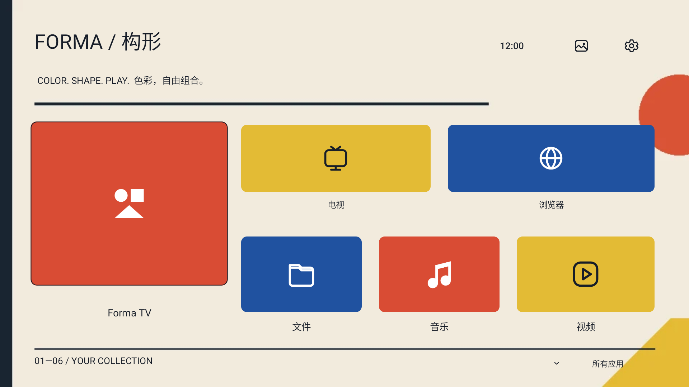
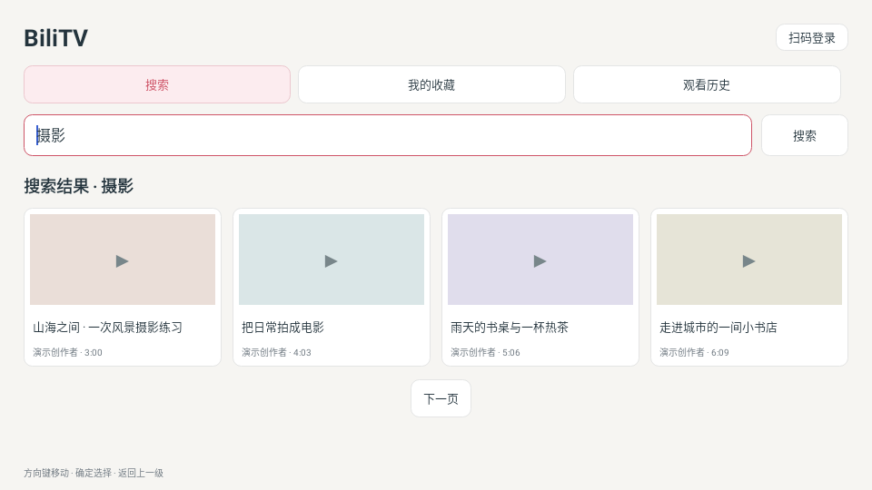
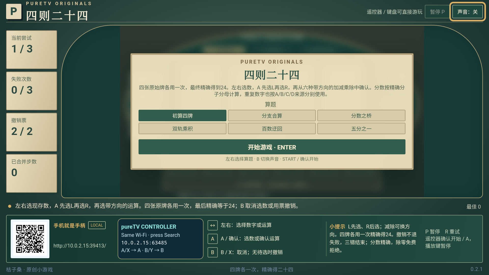
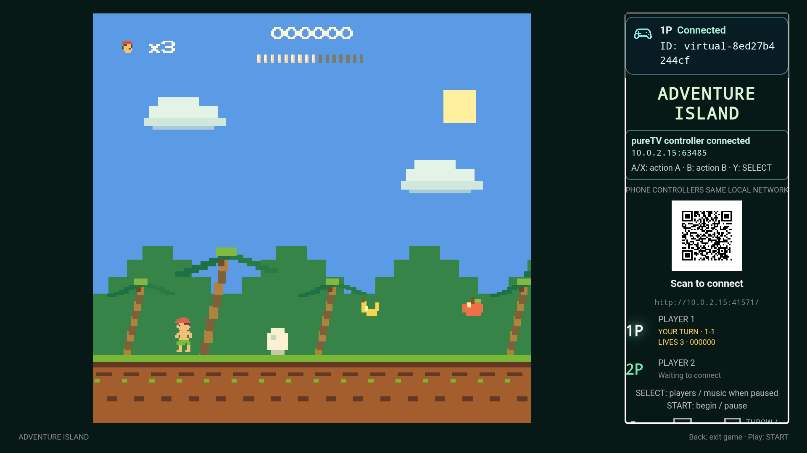

**简体中文** | [English](README.en.md)

  

pureTV 是电脑端的 Android TV / Google TV 系统管理器。通过 ADB 连接电视，查看系统信息，安装、卸载、启停应用，选择启动器，并用可视化画布自定义支持的桌面。也可通过 MCP 让 Agent 控制已打开的管理器。

[下载 pureTV Manager 0.5.9](https://github.com/ecojust/pureTV/releases/tag/desktop-v0.5.9) · Windows / macOS / Linux · APK 市场与客户端更新使用新服务器

从 0.5.7 及更早版本升级，请先从上方发布页手动安装 0.5.9。旧客户端不会自动切换下载源；新版本使用 `apps.b14f.com` 的应用目录与 `client/` 更新目录。

[下载电视端 putrtv商城 0.1.1](resource/apps/putrtv-store/putrtv-store-0.1.1.apk?raw=1) · 在电视上浏览、安装和检查应用更新；配合[新版启动器](resource/README.md)可选择位置添加到桌面。

## 连接与应用管理

1. 电脑和电视接入可互通的网络，在电视开发者选项中开启 ADB／网络调试。
2. 首页输入电视 IP／主机名与调试端口，在电视上允许电脑连接。常见端口为 5555，以电视实际设置为准。
3. 缺少 ADB 时，阅读并同意 Android SDK 许可后点击「下载并配置 ADB」；优先 Google，失败时使用腾讯镜像。也可选择已有 ADB。

连接后首页显示型号、Android／SDK／安全补丁、CPU、内存、`/data` 磁盘容量、分辨率及运行时间。其他页面顶部保留当前连接状态。

- **应用管理**：搜索和分类，批量启用／停用、为当前用户卸载、恢复仍保有安装包的系统应用。
- **包名说明**：点击应用行中的圆圈 **i**，查询包的用途、卸载风险、资料来源与获取时间；未知包明确提示，当前默认桌面与核心组件的保护优先。
- **客户端更新**：启动后或手动检查新服务器的 [client/](https://apps.b14f.com/client/) 目录，按系统匹配新版本；点击「下载并安装」后校验安装包并自动安装、重启。首次从旧版升级及各平台说明见[客户端更新](desktop/docs/client-updates.md)。
- **待安装应用**：导入本地 APK，可在行尾安装单个，也可勾选批量安装；成功项移出队列，失败与未执行项保留。
- **启动器**：导入启动器 APK 后在该页面直接安装，选择／恢复默认桌面；支持接口的当前启动器显示「调整布局」。
- **市场**：动态浏览 [apps.b14f.com](https://apps.b14f.com/launcher/) 的 `launcher/`、`media/` 和 `game/` 目录中的应用与启动器，搜索、预览并下载到待安装列表，或连接电视后直接安装；同一应用或启动器的多个版本合并展示，可从下拉框选择最近 5 个版本，默认最新版；服务器新增 APK 后刷新即可发现。下载时一并保存同目录的 `logo.svg`，布局编辑器新增应用块或切换应用时自动使用该图标。
- 应用与启动器均显示主 APK 与分包的合计大小，不含私有数据、缓存与优化文件，无法读取时明确显示未知。
- 列表内部滚动，表头和顶部批量操作固定；核心系统组件与当前默认启动器受保护。

系统应用卸载只针对当前 Android 用户，保留数据，不删除系统分区 APK。新安装且具备启动入口的用户应用可加入启动器排布。

主动执行连接、刷新、应用管理、启动器切换或布局应用等操作时，管理器显示等待状态，完成后弹窗反馈结果。批量任务区分成功、失败和未执行项；后台自动读取不会反复弹窗。

## 启动器与电视应用资源

公共目录为 [resource/](resource/)，分为 [launcher/](resource/launcher/) 与 [apps/](resource/apps/)，原根目录的启动器和应用源码已整体移入。启动器和电视应用 APK 放在各自软件目录，也可通过独立的 `android-v*` Release 下载；电脑管理器保留单独的 `desktop-v*` 版本与最新发布入口。每个软件文件夹至少包含一个实际 APK，可同时提供对应版本源码、封面、作者、许可证及 SHA256。点击软件名称进入对应文件夹。每个电视应用目录还提供 64×64 的 `logo.svg`，供启动器布局使用；后续应用遵循[资源约定](resource/README-development.md#应用资源与-logosvg-约定)。

九款游戏的 0.5.1 规则与交互改进见[还原度复核](docs/game-fidelity-0.5.1.md)。沿用 0.5.0 统一证书，可覆盖更新 0.5.0；文档同时列出仍未精确还原的地图与内容。

启动器布局自定义使用本管理器的 **layout.json 版本 5 users/system 接口**。支持布局协议的启动器卡片自动显示 Home 背景颜色和图片，包括未激活的启动器；修改并应用布局后同步更新。列表不提供选择或移除封面的操作，桌面背景统一在「调整布局」中修改。待安装 APK 优先预览内置布局的 Home 背景，仅在无法读取布局背景时使用同目录的 `thumb.png`／`APK名.thumb.png`。

新增百款游戏暂选八款在本页展示，原有游戏仍保留；全部资源见 [完整资源目录](resource/README.md)。

<!-- resource-index:start -->

### 启动器（10）

<table>
  <tr>
    <td align="center" valign="top" width="25%"><a href="resource/launcher/sol/"> Sol TV</a></td>
    <td align="center" valign="top" width="25%"><a href="resource/launcher/pixel/"> Pixel TV 像素</a></td>
    <td align="center" valign="top" width="25%"><a href="resource/launcher/moss/"> Moss TV</a></td>
    <td align="center" valign="top" width="25%"><a href="resource/launcher/mono/"> Mono TV 墨白</a></td>
  </tr>
  <tr>
    <td align="center" valign="top" width="25%"><a href="resource/launcher/forma/"> Forma TV</a></td>
    <td align="center" valign="top" width="25%"><a href="resource/launcher/drift/"> Drift TV</a></td>
    <td align="center" valign="top" width="25%"><a href="resource/launcher/circuit/"> Circuit TV · 回路</a></td>
    <td align="center" valign="top" width="25%"><a href="resource/launcher/aster/"> Aster TV · 星轨</a></td>
  </tr>
  <tr>
    <td align="center" valign="top" width="25%"><a href="resource/launcher/nova/"> Nova TV</a></td>
    <td align="center" valign="top" width="25%"><a href="resource/launcher/puretv/"> pureTV Launcher</a></td>
    <td width="25%"></td>
    <td width="25%"></td>
  </tr>
</table>

### 应用-影音（6）

<table>
  <tr>
    <td align="center" valign="top" width="25%"><a href="resource/apps/opera/"> 梨园 TV</a></td>
    <td align="center" valign="top" width="25%"><a href="resource/apps/bilibili/"> BiliTV</a></td>
    <td align="center" valign="top" width="25%"><a href="resource/apps/cctv/"> CCTV Live</a></td>
    <td align="center" valign="top" width="25%"><a href="resource/apps/hifini/"> HIFINi TV</a></td>
  </tr>
  <tr>
    <td align="center" valign="top" width="25%"><a href="resource/apps/webtv/"> WebTV</a></td>
    <td align="center" valign="top" width="25%"><a href="resource/apps/shortvideo/"> ShortVideo TV</a></td>
    <td width="25%"></td>
    <td width="25%"></td>
  </tr>
</table>

### 应用-游戏（20）

<table>
  <tr>
    <td align="center" valign="top" width="25%"><a href="resource/apps/neon-rush/"> 霓虹飞车</a></td>
    <td align="center" valign="top" width="25%"><a href="resource/apps/twenty-four/"> 四则二十四</a></td>
    <td align="center" valign="top" width="25%"><a href="resource/apps/torch-bridge/"> 夜桥接力</a></td>
    <td align="center" valign="top" width="25%"><a href="resource/apps/tower-overlap/"> 叠塔工匠</a></td>
  </tr>
  <tr>
    <td align="center" valign="top" width="25%"><a href="resource/apps/packing-sculptor/"> 异形装箱</a></td>
    <td align="center" valign="top" width="25%"><a href="resource/apps/conveyor-window/"> 窗口装配</a></td>
    <td align="center" valign="top" width="25%"><a href="resource/apps/glass-fold/"> 折光工坊</a></td>
    <td align="center" valign="top" width="25%"><a href="resource/apps/tension-span/"> 拉索桥梁</a></td>
  </tr>
  <tr>
    <td align="center" valign="top" width="25%"><a href="resource/apps/prism-relay/"> 镜光接力</a></td>
    <td align="center" valign="top" width="25%"><a href="resource/apps/alien-shooter/"> 孤胆枪手 TV</a></td>
    <td align="center" valign="top" width="25%"><a href="resource/apps/used-car-racing/"> 极品二手车</a></td>
    <td align="center" valign="top" width="25%"><a href="resource/apps/cozy-island/"> Cozy Island TV</a></td>
  </tr>
  <tr>
    <td align="center" valign="top" width="25%"><a href="resource/apps/coast-kart/"> Coast Kart TV</a></td>
    <td align="center" valign="top" width="25%"><a href="resource/apps/super-mario/"> Super Mario TV</a></td>
    <td align="center" valign="top" width="25%"><a href="resource/apps/bomb-jack/"> Mighty Bomb Jack TV</a></td>
    <td align="center" valign="top" width="25%"><a href="resource/apps/adventure-island/"> Adventure Island TV</a></td>
  </tr>
  <tr>
    <td align="center" valign="top" width="25%"><a href="resource/apps/tetris/"> Tetris TV</a></td>
    <td align="center" valign="top" width="25%"><a href="resource/apps/jewel/"> Magic Jewelry TV</a></td>
    <td align="center" valign="top" width="25%"><a href="resource/apps/jackal/"> Jackal TV</a></td>
    <td align="center" valign="top" width="25%"><a href="resource/apps/tank/"> Tank TV</a></td>
  </tr>
</table>

### 应用-工具（1）

<table>
  <tr>
    <td align="center" valign="top" width="25%"><a href="resource/apps/putrtv-store/"> putrtv商城</a></td>
    <td width="25%"></td>
    <td width="25%"></td>
    <td width="25%"></td>
  </tr>
</table>

<!-- resource-index:end -->

上面展示的 **20 款游戏**均提供支持 **pureTV Wi-Fi 手柄**的新版 APK，需要 Android 8.0 及以上，默认 TCP 端口 **63485**。下载各游戏目录中的最新安装包，电视与手柄连接同一局域网，按 GPIO 23 搜索，START 开始／暂停。连接后，侧边显示手柄图标、1P／2P 席位和完整连接 ID，断线后自动隐藏。新版下载与验证范围见[连接标识更新](docs/controller-client-status/README.md)，按键及双人支持见[手柄接入说明](docs/readme-controller-support/README.md)。

第三方应用见 [fork/ 分类目录](fork/README.md)：收录 TVAPP 中小于 10 MB 的 14 款应用、23 个 APK，另按指定加入儿歌多多TV、宝宝趣学、茉莉音乐、淘知学堂TV和七星戏曲，共 19 款应用、28 个 APK，提供图标、介绍封面与 manifest。[超限文件与复刻参考](fork/OVERSIZED.md)保留全部 205 个超限文件，其中 5 份已收录，其余 200 份未收录。

## 手柄游戏专用目录（5）

[joystick-games/](joystick-games/) 提供以下 5 款游戏的 Android TV APK 与 macOS 通用安装包，均支持 pureTV 九键、开始／暂停及完整客户端 ID 显示。保留各自的玩法和画面，来源、操作与验证范围见[目录说明](joystick-games/README.md)。Android 要求 8.0+；运输船 CF 与 QQ 飞车还需要 WebGL2，新增三款使用 Canvas 2D 或 DOM。

<table>
<tr>
<td width="25%" align="center"><a href="joystick-games/cf-transport-ship/"> 运输船 CF</a></td>
<td width="25%" align="center"><a href="joystick-games/qq-speed/"> QQ 飞车</a></td>
<td width="25%" align="center"><a href="joystick-games/sugarplum-drop/"> Sugarplum Drop</a></td>
<td width="25%" align="center"><a href="joystick-games/emberbrood/"> Emberbrood</a></td>
</tr>
<tr>
<td width="25%" align="center"><a href="joystick-games/glup/"> GLUP · 沼泽猫鱼</a></td>
<td width="25%"></td>
<td width="25%"></td>
<td width="25%"></td>
</tr>
</table>

<!-- claude-games:start -->

## Claude 游戏参考清单（380 项 / 236 个仓库）

本轮继续搜索 GitHub，新增 **79 项**，按玩法分为以下 8 类。新增条目排在各分类前面；点击展开可查看源码、玩法、运行入口、Claude 依据和许可。

优先看看 **Voxel Musou（体素无双）、Inkline Town、Fall Line、Hollow Crown、Demolition Derby、Spirit Call、Solder & Rain、Rainglass**：分别是三国无双、城市经营、开放雪山滑雪、像素 RPG、碰撞赛车、元素小队动作、电子维修和雨窗休闲。

按玩法完整度、实际源码、可运行入口和画面资料初筛，核对作者制作说明或确实修改游戏源码的 Claude 署名提交。Claude 参与不表示全部代码、美术和音乐均由它独立生成。**尚未逐款完整试玩；HTTP 可达不等于游戏运行通过。⭐ 是各条目检查时的仓库星标，新增项检查于 2026-11-19，原301项保留2026-11-17快照。**

镜像、迁址、重命名和同一游戏的多个版本不重复计数；合集中的独立玩法可分列，相近模式按一项合并。许可证和运行条件分别标明，清单包含网页、原生引擎与特殊宿主项目，不代表均能直接安装到电视。核查与筛选记录见[来源说明](docs/claude-games/README.md)。

已对比扩充前登记的 **31 个赛车候选**并选出9款，九款均有 Android TV、macOS 通用版和 Windows x64 手柄客户端可下载，其中 3 款 Android TV 游戏提供测试版。见[九款逐平台下载](joystick-games/README.md#九款赛车游戏下载)和[评分与画面对比](docs/racing-nine/README.md)。原93项已完成[逐项评估](docs/claude-games/tv-assessment.md)，其余批量适配按用户要求暂停；新增参考不会自动加入适配任务。已交付安装包见[手柄游戏目录](joystick-games/README.md)，参考条目数不等于已发布游戏数。

<strong>竞速与体育（46）</strong>

| 游戏与源码 | 玩法与看点 | 运行方式 / 入口 | Claude 依据 / 许可 |
| --- | --- | --- | --- |
| [Fall Line](https://github.com/Nipale-ai/opus-5-5-overnight-builds/blob/8d35d834bc3d62cb772ae9f75b95b89c9600ab82/fall-line/index.html) · ⭐ 7 | 在开放雪山自由选择落点，滑单板或双板完成腾空、翻转、抓板与磨杆；挑战8个计时、技巧和自由滑行赛事并保存奖牌纪录。 | 网页 / WebGL2 · [演示](https://nipale-ai.github.io/opus-5-5-overnight-builds/fall-line/) | [Claude 依据](https://github.com/Nipale-ai/opus-5-5-overnight-builds/blob/8d35d834bc3d62cb772ae9f75b95b89c9600ab82/README.md) · 未明确 |
| [Demolition Derby](https://github.com/drcollect/demolition-derby/blob/f559fc60a7f2ee3a21a4faf77e998ae31ad67c43/game/src/game/race.ts) · ⭐ 9 | 黄昏八字交叉赛道与灯光碗形竞技场，车辆会凹陷、掉轮、漏烟，AI 会寻找侧后方撞击。 | 网页 / Vite · [演示](https://drcollect.github.io/demolition-derby/) | [Claude 依据](https://github.com/drcollect/demolition-derby/blob/f559fc60a7f2ee3a21a4faf77e998ae31ad67c43/README.md#L153) · [MIT（汽车资产除外）](https://github.com/drcollect/demolition-derby/blob/f559fc60a7f2ee3a21a4faf77e998ae31ad67c43/LICENSE) |
| [Dolmuş](https://github.com/Furkiozknn/dolmus/blob/5a5d5eda3b1c7ee30c0bc9362a74b933a3072506/index.html) · ⭐ 0 | 驾驶伊斯坦布尔风格小巴接送乘客，遵守红灯、传递车费；包含八个班次与无尽模式。 | 网页 / 静态 · [演示](https://furkiozknn.github.io/dolmus/) | [Claude 依据](https://github.com/Furkiozknn/dolmus/blob/5a5d5eda3b1c7ee30c0bc9362a74b933a3072506/README.md#L196) · [MIT](https://github.com/Furkiozknn/dolmus/blob/5a5d5eda3b1c7ee30c0bc9362a74b933a3072506/LICENSE) |
| [Gale Kart](https://github.com/fants/Gale-kart/blob/522597902bc61f2cefcf4b5cccab569d72dbe8d5/src/sim/kart_sim.gd) · ⭐ 1 | Godot 卡丁车，八条主题赛道，竞速、道具、计时幽灵与两组杯赛，支持回放和中英文。 | Godot / 桌面源码 · 从源码运行 | [Claude 依据](https://github.com/fants/Gale-kart/blob/522597902bc61f2cefcf4b5cccab569d72dbe8d5/README.md#L15) · [MIT](https://github.com/fants/Gale-kart/blob/522597902bc61f2cefcf4b5cccab569d72dbe8d5/LICENSE) |
| [Rally Pixel](https://github.com/jv4v2nw88z-hue/VibePixleRalley/blob/89db6596e7d2843b7afd8623737898de8e97c63e/src/main.js) · ⭐ 1 | 在砂石、柏油和雪地三个长赛段计时，听路书、升级车辆与轮胎，再解锁下一条赛段。 | 网页源码 / Vite · 从源码运行 | [Claude 依据](https://github.com/jv4v2nw88z-hue/VibePixleRalley/blob/89db6596e7d2843b7afd8623737898de8e97c63e/README.md#L7) · 未发现根许可 |
| [Apex 26](https://github.com/brycejmurrin/f1-game/blob/87b5f8b9bb09aafabff4c1f43a6306a0b4b0cc63/js/physics/player-forces.js) · ⭐ 0 | 非官方方程式赛车，包含赛季、轮胎策略、电能加速和主动空气动力学，结合现代及历史赛道。 | 网页 / 静态 · [演示](https://brycejmurrin.github.io/f1-game/) | [Claude 依据](https://github.com/brycejmurrin/f1-game/commit/f5d2b6974ac643ea440a32cd4301321f6623edb4) · [保留所有权利](https://github.com/brycejmurrin/f1-game/blob/87b5f8b9bb09aafabff4c1f43a6306a0b4b0cc63/LICENSE) |
| [Concrete Jungle (OpusSkate)](https://github.com/OminousIndustries/OpusSkate/blob/fe2125deb1561b24c722713c4376b0db963b26d4/skate.cpp) · ⭐ 49 | 在纽约街区风格场景中滑行、跳跃、翻板、抓板与磨杆，把组合技串成两分钟计分赛。 | 桌面 / C++ 源码 · 从源码运行 | [Claude 依据](https://github.com/OminousIndustries/OpusSkate/blob/fe2125deb1561b24c722713c4376b0db963b26d4/README.md#L2) · 未发现根许可 |
| [Gridiron GM](https://github.com/VaultSparkStudios/gridiron-gm/blob/104eb263bed7b5d075ff3ff7959aacc66b3d9fd9/src/App.jsx) · ⭐ 1 | 组建球队、选秀、交易、安排阵容与出场比例，跨赛季管理预算和球员成长。 | 网页 · [在线演示](https://vaultsparkstudios.com/gridiron-gm) | [Claude 依据](https://github.com/VaultSparkStudios/gridiron-gm/commit/6aa5b13b0e5333504fc272e300acd1dae3a2ff37) · [未声明](https://github.com/VaultSparkStudios/gridiron-gm/tree/104eb263bed7b5d075ff3ff7959aacc66b3d9fd9) |
| [Fable Flight](https://github.com/Arnie016/flight-simulator-fable5/blob/b8b3b85029b37d8b0da4f9e09d754f1fb5b6ae41/index.html) · ⭐ 7 | 选择训练场景，完成起降、航线、紧急故障和交付任务，以可量化的飞行结果获得经验与复盘。 | 网页 / 可选语音需 API · [演示](https://arnie016.github.io/flight-simulator-fable5/) | [Claude 依据](https://github.com/Arnie016/flight-simulator-fable5/blob/b8b3b85029b37d8b0da4f9e09d754f1fb5b6ae41/README.md) · 未明确 |
| [Turbo Kart Rush](https://github.com/bridge-mind/turbo-kart-rush/blob/6c0456c7642447eae29e0832e7e542fec07ec07d/src/game/Game.ts) · ⭐ 47 | 八名车手在四条赛道与七名AI竞速，漂移蓄小加速，利用十类道具争夺三圈排名与大奖赛。 | 网页 / Three.js · [演示](https://bridge-mind.github.io/turbo-kart-rush/) | [Claude 依据](https://github.com/bridge-mind/turbo-kart-rush/blob/6c0456c7642447eae29e0832e7e542fec07ec07d/README.md) · [MIT](https://github.com/bridge-mind/turbo-kart-rush/blob/6c0456c7642447eae29e0832e7e542fec07ec07d/LICENSE) |
| [F1 Racing Game](https://github.com/hirosichen/ai-f1-racing-game/blob/f07c7036075132528377108491d2fff19ee70d5e/main.js) · ⭐ 0 | 20辆赛车发车竞速，控制油门刹车、DRS/ERS，在程序赛道争夺圈速和名次，可切座舱镜头。 | 网页 / WebGL2 / CDN · [演示](https://vibe-f1-racing.pages.dev) | [Claude 依据](https://github.com/hirosichen/ai-f1-racing-game/blob/f07c7036075132528377108491d2fff19ee70d5e/README.md) · [MIT](https://github.com/hirosichen/ai-f1-racing-game/blob/f07c7036075132528377108491d2fff19ee70d5e/LICENSE) |
| [Sky Rings](https://github.com/hirosichen/ai-sky-rings-game/blob/0bdfbcf489c227a9ae92458a9a12783ca20be201/main.js) · ⭐ 0 | 与七架螺旋桨飞机在热带群岛绕圈，按顺序穿越41个光环补充加速，漏环或坠机加罚时。 | 网页 / WebGL2 / CDN · [演示](https://vibe-sky-rings.pages.dev) | [Claude 依据](https://github.com/hirosichen/ai-sky-rings-game/blob/0bdfbcf489c227a9ae92458a9a12783ca20be201/README.md) · [MIT](https://github.com/hirosichen/ai-sky-rings-game/blob/0bdfbcf489c227a9ae92458a9a12783ca20be201/LICENSE) |
| [Ponpoko Kart](https://github.com/tanuu5/ponpoko-kart/blob/88edb72d25c2f957431cc4d12547d3138d1bca48/src/core/Game.js) · ⭐ 2 | 八辆卡丁车跑稻田、千本鸟居和夏祭三赛道，漂移蓄三级加速、使用道具并撑和伞跨河滑翔。 | 网页 / Three.js · [演示](https://tanuu5.github.io/ponpoko-kart/) | [Claude 依据](https://github.com/tanuu5/ponpoko-kart/blob/88edb72d25c2f957431cc4d12547d3138d1bca48/README.md) · [MIT](https://github.com/tanuu5/ponpoko-kart/blob/88edb72d25c2f957431cc4d12547d3138d1bca48/LICENSE) |
| [Elden Kart](https://github.com/Manoz/elden-kart/blob/0b9c39844e19abc677ad6adcfc4a7500ecd8a852/src/core/Game.js) · ⭐ 1 | 八名车手在四赛道跑大奖赛，拾取十类道具、漂移并争夺最终名次。 | 网页 / Vite · [演示](https://elden-kart.vercel.app/) | [Claude 依据](https://github.com/Manoz/elden-kart/blob/0b9c39844e19abc677ad6adcfc4a7500ecd8a852/README.md) · [MIT](https://github.com/Manoz/elden-kart/blob/0b9c39844e19abc677ad6adcfc4a7500ecd8a852/LICENSE) |
| [Night Racer](https://github.com/zhuqipaopao-maker/night-racer-public/blob/3a432cd3bf059dbaaa00d700f0f83e0e5313d40b/src/main.js) · ⭐ 1 | 在雨夜街区、山道、长桥、元宵城、海底与冰原等地图比赛，挑战AI/幽灵计时，赚钱改装车辆。 | 网页 / 联机后端未公开 · [演示](https://night-racer.pages.dev) | [Claude 依据](https://github.com/zhuqipaopao-maker/night-racer-public/commit/5c5fd2f55cf98f8a63c3a6961a9f071cfb7e6ad8) · [MIT](https://github.com/zhuqipaopao-maker/night-racer-public/blob/3a432cd3bf059dbaaa00d700f0f83e0e5313d40b/LICENSE) |
| [CarRace](https://github.com/alexander-uspenskiy/CarRace/blob/8cc3f2b7dee27e13b848fc48afd73acb6ab58e19/src/game/game.js) · ⭐ 0 | 从十队选择赛车，在三赛道与19辆AI争夺5—10分钟比赛成绩，利用收益升级并进入名人堂。 | 网页 / Three.js · [演示](https://alexander-uspenskiy.github.io/CarRace/) | [Claude 依据](https://github.com/alexander-uspenskiy/CarRace/commit/8cc3f2b7dee27e13b848fc48afd73acb6ab58e19) · [MIT](https://github.com/alexander-uspenskiy/CarRace/blob/8cc3f2b7dee27e13b848fc48afd73acb6ab58e19/LICENSE) |
| [Last Track](https://github.com/alexander-uspenskiy/LastTrack/blob/7fdf7cfb6affb84748e11980f837255b12130bb7/src/game/game.js) · ⭐ 0 | 选程序生成赛车与多种对手竞速，以机枪、火箭、地雷和撞角攻击，赚取奖金升级装甲、动力、轮胎和装备。 | 网页 / Three.js · [演示](https://alexander-uspenskiy.github.io/lastrack/) | [Claude 依据](https://github.com/alexander-uspenskiy/LastTrack/commit/d04659d297029f39fb3a3d79a69f107062e5b479) · [MIT](https://github.com/alexander-uspenskiy/LastTrack/blob/7fdf7cfb6affb84748e11980f837255b12130bb7/LICENSE) |
| [Neon Racer](https://github.com/machuiwen/neon-racer/blob/ea16989410c883baedd7062c359a0d54c826d3d6/js/main.js) · ⭐ 0 | 与三辆电脑车在霓虹赛道竞速，收钻石与漂移充能，使用加速争取最好圈速。 | 网页 / CDN · [演示](https://machuiwen.github.io/neon-racer/) | [Claude 依据](https://github.com/machuiwen/neon-racer/commit/48ac2ae8a99dfc88229865ca6f7acc098b06f8bf) · 未明确 |
| [KART RACER](https://github.com/hungungworld/kart-racer/blob/45f9c4979bb7c7d38c25df7cae3f328f10dcd42f/index.html) · ⭐ 0 | 驾驶卡丁车漂移蓄氮气、拾取并使用道具，选择速度或道具赛；可与AI或最多六名P2P玩家比赛。 | 网页 / 多人需公共信令 · [演示](https://kart-racer-one.vercel.app) | [Claude 依据](https://github.com/hungungworld/kart-racer/commit/f3cf96a8ffd713c79fb8db689a13341c9e584ba9) · 未明确 |
| [Jazda! Polish Streets](https://github.com/magwima/Jazda/blob/6f3a0091364ec892b359d379a982333f80e75d80/index.html) · ⭐ 0 | 在华沙等波兰城市换道滑行，跳跃、manual、翻板和抓板做连招；可切真实3D、2.5D或像素表现。 | 网页 / 可选3D需 CDN · [演示](https://magwima.github.io/Jazda/) | [Claude 依据](https://github.com/magwima/Jazda/commit/ed64dacf68e3b4b2fb1a0e6dc7ceb81406a3ef22) · 未明确 |
| [Mini 4WD Racer 四驅車大賽](https://github.com/gagatim/Mini-4WD-Racer/blob/a82e939ca20a0825cdc8ef76acb6f8173ddf19e1/index.html) · ⭐ 0 | 按住油门加速、松开刹车，控制弯道负荷避免飞出赛道；与三名AI跑三赛道，赚奖金改马达/轮胎/滚轮。 | 网页 / 静态HTTP · [演示](https://gagatim.github.io/Mini-4WD-Racer/) | [Claude 依据](https://github.com/gagatim/Mini-4WD-Racer/commit/c24d593308fb2f4df691ff429ecc9b8f8bd9f4e4) · 未明确 |
| [Kartipelago](https://github.com/blakebates22/kartipelago/blob/286aa36cbf0436c168f10bc28e957c1a9536a143/src/race/race.ts) · ⭐ 0 | 四名恐龙车手在Dinosaur Valley四赛道或六个原型赛道挑战七名AI/单人计时，漂移、道具和记录结算。 | 网页 / 构建后运行 · [演示](https://blakebates22.github.io/kartipelago/) | [Claude 依据](https://github.com/blakebates22/kartipelago/commit/c1818ade1450f94615219d255801695155001c96) · [MIT](https://github.com/blakebates22/kartipelago/blob/286aa36cbf0436c168f10bc28e957c1a9536a143/LICENSE) |
| [Redline Riot](https://github.com/Dhaiwat10/redline-riot/blob/958c12aa867dc4c715b81ab8301a0c4d34a489c7/apps/client/src/game.ts) · ⭐ 0 | 十二名骑手穿越8公里点到点公路，躲双向车流、挥拳踢击争名次，可玩单人或在线比赛。 | 网页 / 多人需 Node 服务器 · [演示](https://redline-riot.fly.dev) | [Claude 依据](https://github.com/Dhaiwat10/redline-riot/commit/ad2595bb77c4b4e031412e81584d35fe80bc044a) · [MIT](https://github.com/Dhaiwat10/redline-riot/blob/958c12aa867dc4c715b81ab8301a0c4d34a489c7/LICENSE) |
| [Neuro Rivals](https://github.com/Chloudde/neuro-rivals/blob/f5129dd9534c4dfe7af1f4a7e4418e290658a245/src/game/Race.ts) · ⭐ 0 | 观看遗传算法训练神经网络车手，再亲自与其竞速；漂移、氮气、碰撞、幽灵圈和实时差值构成比赛。 | 网页 / Vite · [演示](https://chloudde.github.io/neuro-rivals/) | [Claude 依据](https://github.com/Chloudde/neuro-rivals/commit/35266ec531569157b47052a777eca7e3b588ddcc) · [MIT](https://github.com/Chloudde/neuro-rivals/blob/f5129dd9534c4dfe7af1f4a7e4418e290658a245/LICENSE) |
| [Poly GT](https://github.com/hakanalverson-cyber/polytourismo/blob/1ad6148bd97ecf303c180401fbd00d63b0fbe715/src/layers/race2.js) · ⭐ 0 | 在柏油、夜城和碎石拉力赛道进行计时、穿车流、生涯或本地分屏，管理轮胎/燃料并升级购车。 | 网页 / Three.js · [演示](https://polytourismo.vercel.app) | [Claude 依据](https://github.com/hakanalverson-cyber/polytourismo/commit/e4462f9c3be331fe71defa6f34a559873a40967f) · 未明确 |
| [RoadRush LAN](https://github.com/Auchit-Sawai/roadrush-lan/blob/4462133db0409a38fca8fa8b7ef7efd694b17ffe/src/game/Game.js) · ⭐ 0 | 边骑摩托闪避车流与警察，左右挥拳打落对手并加速冲线，支持三难度与局域网2—8人。 | 网页 / LAN需 Node 服务器 · [演示](https://auchit-sawai.github.io/roadrush-lan/) | [Claude 依据](https://github.com/Auchit-Sawai/roadrush-lan/commit/385ff309687ae135b70c11494138011fe3415c72) · 未明确 |
| [Suburban Turismo](https://github.com/mtd-public/suburban-turismo/blob/7469b708ed332c727f4c86e29b20eba2b420cc62/js/race.js) · ⭐ 0 | 在回转街区、商场和公园与邻居跑三圈、挑战幽灵计时，或驾驶武装车在郊区混战。 | 网页 / Three.js · [演示](https://mtd-public.github.io/suburban-turismo/) | [Claude 依据](https://github.com/mtd-public/suburban-turismo/commit/e4037679ef338b8739a87e532259f6e27dbc0930) · 未明确 |
| [Penguintrack](https://github.com/SilverNinja71/Penguin-Track/blob/0369367ff5aa76902bdf0736e4644efbbd3f1d82/js/game/race.js) · ⭐ 0 | 企鹅驾驶雪橇赛车穿过冰道、环道、跳台和加速垫，与自己的幽灵争百分秒纪录。 | 网页 / 在线需 PeerJS · [演示](https://silverninja71.github.io/Penguin-Track/) | [Claude 依据](https://github.com/SilverNinja71/Penguin-Track/commit/de9e659d48494c00cd450471b4f1c1c8299c025e) · [MIT](https://github.com/SilverNinja71/Penguin-Track/blob/0369367ff5aa76902bdf0736e4644efbbd3f1d82/LICENSE) |
| [Turbo Rush (ATEAMROCKX)](https://github.com/ATEAMROCKX/turbo-rush/blob/c622197a3bedaba27ca94b9362672dbbc98b31fa/index.html) · ⭐ 0 | 驾驶赛车追赶对手、完成挑战、在车库装饰车辆，也可两人分屏竞速。 | 网页 / 静态HTTP · [演示](https://ateamrockx.github.io/turbo-rush/) | [Claude 依据](https://github.com/ATEAMROCKX/turbo-rush/commit/725edb01dbd69cf24d4112871053715f6c71ea60) · 未明确 |
| [Sudden Death Strikers](https://github.com/pawanp3/renderwolf-fable5-chart-toppers/blob/b82032668c5bd1bcf68ceadbb2d011f06419d4b6/games/ea-fc-mobile/index.html) · ⭐ 1 | 控制射门方向与门将扑救，进行点球决胜。 | 静态 HTML5/JS · [演示](https://pawanp3.github.io/renderwolf-fable5-chart-toppers/games/ea-fc-mobile/) | [Claude 依据](https://github.com/pawanp3/renderwolf-fable5-chart-toppers/commit/5d3d35db1f98961e332beca37b2e5a693b4bed9c) · 未明确 |
| [Rally Navigator](https://github.com/swan4er/opus-100-projects/blob/6c98846c00d667b8958c4c777025025a57fda0e9/038-rally-navigator/game.js) · ⭐ 12 | 驾驶森林拉力赛车，AI副驾驶根据实际遥测与路书给予语音反馈。 | 浏览器 + OpenRouter BYOK · [演示](https://swan4er.github.io/opus-100-projects/038-rally-navigator/) | [Claude 依据](https://github.com/swan4er/opus-100-projects/commit/2ac3ebb878c122b5f6cadfff117d86b1bebbd833) · 未明确 |
| [Long Road](https://github.com/swan4er/opus-100-projects/blob/6c98846c00d667b8958c4c777025025a57fda0e9/071-long-road/index.html) · ⭐ 12 | 驾驶伪3D赛车穿越四季，在岔路选择路线并控制油门刹车和转向。 | 浏览器本地规则 · [演示](https://swan4er.github.io/opus-100-projects/071-long-road/) | [Claude 依据](https://github.com/swan4er/opus-100-projects/commit/2ac3ebb878c122b5f6cadfff117d86b1bebbd833) · 未明确 |
| [Gravity Golf](https://github.com/swan4er/opus-100-projects/blob/6c98846c00d667b8958c4c777025025a57fda0e9/096-gravity-golf/game.js) · ⭐ 12 | 拖拽发射探针，借行星引力绕开天体并进入目标洞；按尝试次数获得1至3星。 | 浏览器本地规则 · [演示](https://swan4er.github.io/opus-100-projects/096-gravity-golf/) | [Claude 依据](https://github.com/swan4er/opus-100-projects/commit/2ac3ebb878c122b5f6cadfff117d86b1bebbd833) · 未明确 |
| [Basket Flick](https://github.com/kokellara12-maker/apps-k4m9q2/blob/529f831cd05d475e9e2288e29dc8191cbfc9d3e4/basket.html) · ⭐ 0 | 划动投篮，在60秒内对付移动篮圈并取得连续命中。 | 3D浏览器/指针 · [演示](https://kokellara12-maker.github.io/apps-k4m9q2/basket.html) | [Claude 依据](https://github.com/kokellara12-maker/apps-k4m9q2/commit/04a4e9b8625f686ce3b9dbe125402a90a474d6c6) · 未明确 |
| [鹈鹕骑自行车](https://github.com/riba2534/claude-opus-5-5-demo/tree/54adc1fb64155f9dd7c1c90ecae7b8185ac540b8/pelican-bike) · ⭐ 1437 | 沿海岸公路加速变道抓鱼，跳跃、展翅抬前轮并解锁成就；无操作时自动追鱼。 | 网页 / esbuild · [演示](https://claude-opus-5-5.riba2534.cn/) | [Claude 依据](https://github.com/riba2534/claude-opus-5-5-demo/blob/54adc1fb64155f9dd7c1c90ecae7b8185ac540b8/README.md) · 未明确 |
| [Kart Royale](https://github.com/ryancampbell/kart-royale/tree/036c0efb025f5ecf8fc31c405e9d818c61e03e21) · ⭐ 69 | 八位车手赛道竞速，漂移积蓄加速、发射道具、争夺圈数与名次。 | 网页 / Vite · [演示](https://racing.ryancampbell.com) | [Claude 依据](https://github.com/ryancampbell/kart-royale/blob/036c0efb025f5ecf8fc31c405e9d818c61e03e21/README.md) · [MIT](https://github.com/ryancampbell/kart-royale/blob/036c0efb025f5ecf8fc31c405e9d818c61e03e21/LICENSE) |
| [Turbo Kart Rally](https://github.com/bridge-mind/turbo-kart-rally/tree/c52aca3f10c7995884c316810cac6514daa40e9c) · ⭐ 51 | 与七名AI在Palm Cove Circuit竞速，漂移释放三级mini-turbo，拾取并使用八类道具。 | 网页 · CDN 依赖 · [演示](https://bridge-mind.github.io/turbo-kart-rally/) | [Claude 依据](https://github.com/bridge-mind/turbo-kart-rally/blob/c52aca3f10c7995884c316810cac6514daa40e9c/README.md) · [MIT](https://github.com/bridge-mind/turbo-kart-rally/blob/c52aca3f10c7995884c316810cac6514daa40e9c/LICENSE) |
| [Frostline Kart](https://github.com/sorrycc/fable-arcade/tree/6ab9de3122600e9c9dbe5daf3e77f7fe9361e335/games/mario-kart-snow) · ⭐ 12 | 雪地赛道8辆车跑3圈，拾取道具互相攻击并争夺名次。 | 网页 · CDN 依赖 · [演示](https://sorrycc.github.io/fable-arcade/games/mario-kart-snow/) | [Claude 依据](https://github.com/sorrycc/fable-arcade/blob/6ab9de3122600e9c9dbe5daf3e77f7fe9361e335/games/mario-kart-snow/README.md) · 未明确 |
| [Robo Tennis](https://github.com/sorrycc/fable-arcade/tree/6ab9de3122600e9c9dbe5daf3e77f7fe9361e335/games/robot-tennis) · ⭐ 12 | 移动机器人追球，方向决定击球落点，冲刺、发球，与CPU争局/盘。 | 网页 · CDN 依赖 · [演示](https://sorrycc.github.io/fable-arcade/games/robot-tennis/) | [Claude 依据](https://github.com/sorrycc/fable-arcade/blob/6ab9de3122600e9c9dbe5daf3e77f7fe9361e335/games/robot-tennis/README.md) · 未明确 |
| [Dirt Crown](https://github.com/triptych/web-games-andrew/tree/a7051c34fe2e7550fd206e6272f758df171855b0/game-069) · ⭐ 4 | 驾驶破旧赛车赢比赛赚钱，升级可见车体/引擎/轮胎，漂移蓄氮，挑战多杯赛与冠军。 | 网页 · CDN 依赖 · [演示](https://triptych.github.io/web-games-andrew/game-069/) | [Claude 依据](https://github.com/triptych/web-games-andrew/commit/7172d5872abe94bc398c47b3c95fa1d130d00d85) · [MIT](https://github.com/triptych/web-games-andrew/blob/a7051c34fe2e7550fd206e6272f758df171855b0/LICENSE) |
| [backroad rally](https://github.com/jason-c-dev/backroad-rally/tree/e5542f96b9a9a2912fdaa160396054e81f022f23) · ⭐ 2 | 跨四个时代五辆车、六段赛道，在天气变化中跑计时赛和生涯，对抗模拟车手与ghost。 | WebGL2 / WebGPU · [演示](https://jason-c-dev.github.io/backroad-rally/) | [Claude 依据](https://github.com/jason-c-dev/backroad-rally/blob/e5542f96b9a9a2912fdaa160396054e81f022f23/README.md) · [MIT](https://github.com/jason-c-dev/backroad-rally/blob/e5542f96b9a9a2912fdaa160396054e81f022f23/LICENSE) |
| [Slide Rush](https://github.com/KJLKurt/waterslide-game-opus-5.5/tree/03bc5993750ba870f12de3c6086e15877b62de09) · ⭐ 2 | 与十二名对手滑下大型水滑梯，转向、跳跃、走捷径，避免飞出赛道，冲入终点泳池。 | 网页 / Vite · [演示](https://kjlkurt.github.io/waterslide-game-opus-5.5/) | [Claude 依据](https://github.com/KJLKurt/waterslide-game-opus-5.5/blob/03bc5993750ba870f12de3c6086e15877b62de09/README.md) · 未明确 |
| [FORE LIGHT-YEARS](https://github.com/tdeeh8/fore/blob/0e34ee8e4bcf378d96a22a3809f4e5548193a098/index.html) · ⭐ 0 | 将体素高尔夫球越过郊区、海洋和太空打到月球，积累货币买升级/燃料，目标45000码。 | 网页 · CDN 依赖 · [演示](https://tdeeh8.github.io/fore/) | [Claude 依据](https://github.com/tdeeh8/fore/blob/0e34ee8e4bcf378d96a22a3809f4e5548193a098/README.md#L7) · 未明确 |
| [Kart Rush](https://github.com/stevkazt/kart-rush/tree/4b0cf276d84e76171feb765d87b5e8a6159cc421) · ⭐ 0 | 七站Grand Prix与单场竞速，选择车手/车体，漂移、道具、跳台及捷径。 | 网页 · CDN 依赖 · [演示](https://stevkazt.github.io/kart-rush/) | [Claude 依据](https://github.com/stevkazt/kart-rush/commit/7f01b88c3289918bd91a07101390647b1073fdc5) · 未明确 |
| [Kırkpınar／土耳其摔跤](https://github.com/Furkiozknn/kirkpinar/blob/b655e93c5d04b199638bc3a9bf5228f1de0dcc8c/index.html) · ⭐ 0 | 抓握、推拉、蹲身绊腿、背摔或举起行走三步取胜；五重量级26回合职业阶梯、快速赛与同键盘2P。 | 网页 · CDN 依赖 · [演示](https://furkiozknn.github.io/kirkpinar/) | [Claude 依据](https://github.com/Furkiozknn/kirkpinar/blob/b655e93c5d04b199638bc3a9bf5228f1de0dcc8c/README.md#L135) · [MIT](https://github.com/Furkiozknn/kirkpinar/blob/b655e93c5d04b199638bc3a9bf5228f1de0dcc8c/LICENSE) |
| [Peri Golf](https://github.com/Furkiozknn/peri-golf/blob/875de69749f3b74a9b0d928fe88b98392c2c055e/index.html) · ⭐ 0 | 卡帕多奇亚12洞par40球场，坡度/沙地/墙弹/动态陶轮、石门、驴；每洞三挑战星、幽灵最佳路线。 | 网页 · CDN 依赖 · [演示](https://furkiozknn.github.io/peri-golf/) | [Claude 依据](https://github.com/Furkiozknn/peri-golf/blob/875de69749f3b74a9b0d928fe88b98392c2c055e/README.md#L165) · [MIT](https://github.com/Furkiozknn/peri-golf/blob/875de69749f3b74a9b0d928fe88b98392c2c055e/LICENSE) |

<strong>动作、角色扮演与探索（56）</strong>

| 游戏与源码 | 玩法与看点 | 运行方式 / 入口 | Claude 依据 / 许可 |
| --- | --- | --- | --- |
| [Voxel Musou／体素无双](https://github.com/mike007jd/voxel-musou/blob/aba5fb8f43b713e88e8ac3a3105e48f01941dc7f/src/combat/combat.js) · ⭐ 179 | 选择不同三国武将，使用普攻连段、蓄力、闪避与无双，完成虎牢关、长坂坡、赤壁和定军山剧情，并挑战计时击破与守桥试炼。 | 网页 / WebGL2 · [演示](https://voxel-musou.vercel.app) | [Claude 依据](https://github.com/mike007jd/voxel-musou/commit/ec17840099f9b2abd367c900a1c3fff271644ec1) · [MIT](https://github.com/mike007jd/voxel-musou/blob/aba5fb8f43b713e88e8ac3a3105e48f01941dc7f/LICENSE) |
| [Palmera Bay](https://github.com/vcahlik/palmera-bay/blob/8d17361835784cae757b8b68dd8007487b62be15/src/main.js) · ⭐ 0 | 驾驶敞篷车探索热带海滨城市，漂移、氮气加速、切换视角与车色，伴随程序生成的引擎声和合成器电台；没有对手或比赛目标。 | 网页 / 自由驾驶 · [演示](https://cahlik.net/palmera-bay/) | [Claude 依据](https://github.com/vcahlik/palmera-bay/blob/8d17361835784cae757b8b68dd8007487b62be15/README.md) · 未明确 |
| [TaterTots Flight Sim](https://github.com/JaredTate/tatertotsflightsim/blob/61ad8f7a611c5ea870e5604e4e37a97956fbbb57/src/physics/engine.ts) · ⭐ 10 | 驾驶Cessna 172RG、F-16C、A-10C和747，在山地海岸起飞、巡航、失速恢复与着陆；战机另有武器和地面目标系统。 | 源码构建 / WebGL2 · 从源码运行 | [Claude 依据](https://github.com/JaredTate/tatertotsflightsim/commit/fa96f43f0cddfab7ab6279bd52586606a54cf7a1) · [MIT](https://github.com/JaredTate/tatertotsflightsim/blob/61ad8f7a611c5ea870e5604e4e37a97956fbbb57/LICENSE) |
| [Spirit Call](https://github.com/SandroMaglione/spirit-call/blob/cce5dcc61545918eeeea0a77354e155d4899e162/src/content/characters.ts) · ⭐ 10 | 组建最多三名元素精灵的小队，在短局战斗中连招、闪避、换人和释放技能，通过主线及专属试炼解锁新精灵并强化装备。 | 网页 / 小队动作 · [演示](https://spirit-call.typeonce.games) | [Claude 依据](https://github.com/SandroMaglione/spirit-call/commit/ca52eafa0c4dfabba24248a47bb947483e96847e) · 未明确 |
| [Tank Game](https://github.com/mitsuhiko/tankgame/blob/ad5dbc595a04ba43622738ea4d596e2d25804be9/src/game/pz_tank.c) · ⭐ 25 | 操纵坦克在障碍地图中射击、使用道具和跳台，浏览器与本机客户端共用对战规则。 | 网页 / C17 · [演示](https://mitsuhiko.github.io/tankgame/) | [Claude 依据](https://github.com/mitsuhiko/tankgame/blob/ad5dbc595a04ba43622738ea4d596e2d25804be9/README.md#L7) · [Apache-2.0](https://github.com/mitsuhiko/tankgame/blob/ad5dbc595a04ba43622738ea4d596e2d25804be9/LICENSE) |
| [Dead Signal: Exclusion Zone](https://github.com/bridge-mind/claude-opus-5.5-zombies-game/blob/9805c3ef6297e8f518fdfb75f58a7af599334013/src/mission/Extraction.ts) · ⭐ 5 | 在封锁工业区完成守点、精英追猎，再守住撤离区登上直升机；搜刮、护甲和补给支撑一局。 | 网页源码 / Vite · 从源码运行 | [Claude 依据](https://github.com/bridge-mind/claude-opus-5.5-zombies-game/blob/9805c3ef6297e8f518fdfb75f58a7af599334013/README.md#L3) · [MIT](https://github.com/bridge-mind/claude-opus-5.5-zombies-game/blob/9805c3ef6297e8f518fdfb75f58a7af599334013/LICENSE) |
| [The Tithe](https://github.com/miguelsolorio/the-tithe/blob/da42501c6188fd897567b82d28695eb8d947c03c/src/entities/enemyManager.js) · ⭐ 2 | 沿不可能的屋内空间下潜，探索淹水地下区域，击败怪物、救出妹妹并在水淹前逃离。 | 网页 / Vite · [演示](https://miguelsolorio.github.io/the-tithe/) | [Claude 依据](https://github.com/miguelsolorio/the-tithe/commit/409137a00e51e2045b1cedf51fb59f4b70cc81fa) · 未发现根许可 |
| [Nightfall](https://github.com/miguelsolorio/nightfall/blob/e7d9c5825aabaa5597a2b9b3907b573e1bcbe745/public/src/game.js) · ⭐ 1 | 在雾夜森林寻找五块狐火石，使用手电和体力避开怪物，收齐后逃离。 | 网页 / 静态 · [演示](https://miguelsolorio.github.io/nightfall/) | [Claude 依据](https://github.com/miguelsolorio/nightfall/commit/93976a14bcbf7958900090b8b9f330198ecccd91) · 未发现根许可 |
| [DRAGONSLEEP](https://github.com/GrimGriz/dragonsleep-8bit/blob/f201c2eaaf92186e7b194b95a76be9aa81a28013/index.html) · ⭐ 1 | 四位英雄组成队伍，在城镇与走廊地带探索、雇佣伙伴、施法战斗；首部故事有明确结局。 | 网页 / 静态 · [演示](https://grimgriz.github.io/dragonsleep-8bit/) | [Claude 依据](https://github.com/GrimGriz/dragonsleep-8bit/blob/f201c2eaaf92186e7b194b95a76be9aa81a28013/README.md#L62) · [CC BY-NC-SA 4.0](https://github.com/GrimGriz/dragonsleep-8bit/blob/f201c2eaaf92186e7b194b95a76be9aa81a28013/LICENSE.md) |
| [John Pork: The Final Call](https://github.com/8tsmith11/john-pork-the-final-call/blob/8df7ed59a8dd2fc7e4c4931ae4de6a7488e511ad/src/main.js) · ⭐ 0 | 三名学生卷入未来城市事件，探索宿舍、地铁广场和隧道，第一幕可从开场走到首领与结尾。 | 网页 / 静态 · [演示](https://8tsmith11.github.io/john-pork-the-final-call/) | [Claude 依据](https://github.com/8tsmith11/john-pork-the-final-call/blob/8df7ed59a8dd2fc7e4c4931ae4de6a7488e511ad/README.md#L8) · [MIT](https://github.com/8tsmith11/john-pork-the-final-call/blob/8df7ed59a8dd2fc7e4c4931ae4de6a7488e511ad/LICENSE) |
| [通信途絶](https://github.com/shinhama1971/Job_application_work_horror/blob/0d616b27a98fb67953f3971f520b73f9171dea4a/Job_application_work_horror/DrainValve.cpp) · ⭐ 0 | 探索黑暗设施，排水、恢复供电并辨认循环走廊的异常，手电揭示隐藏痕迹。 | Windows / C++ 源码 · 从源码运行 | [Claude 依据](https://github.com/shinhama1971/Job_application_work_horror/blob/0d616b27a98fb67953f3971f520b73f9171dea4a/README.md#L379) · 未发现根许可 |
| [LeadRush 2](https://github.com/Tokey/Lead-Rush-2/blob/5e648b64fbe54bb60ba65a833862bbf34b7ae3c2/Assets/LR2/Runtime/Game/MatchManager.cs) · ⭐ 0 | 四张战斗地图、多个比赛模式、全身武器动作、战术机器人和追踪无人机组成单机战场。 | Unity / Windows 源码 · 从源码运行 | [Claude 依据](https://github.com/Tokey/Lead-Rush-2/blob/5e648b64fbe54bb60ba65a833862bbf34b7ae3c2/README.md#L9) · 未发现根许可 |
| [Tim Arnett Town](https://github.com/dawmo1/tim-arnett-town/blob/5f7a8c3179997b807ba796dcc3277d2071230d11/src/police.js) · ⭐ 0 | 在热带岛屿步行、驾驶、做特技并躲避警察，启用 Firebase 后支持房间联机。 | 网页 / 静态 · [演示](https://dawmo1.github.io/tim-arnett-town/) | [Claude 依据](https://github.com/dawmo1/tim-arnett-town/commit/5f7a8c3179997b807ba796dcc3277d2071230d11) · 未发现根许可 |
| [Jane’s IAF Reborn / Modern IAF](https://github.com/assapir/iaf-reborn/blob/4c3f7b4e38c1a596bbbf93d67f7d33b0ff5b57e5/shared/aircraft/player_aircraft.gd) · ⭐ 8 | Godot 与 Rust 的飞行模拟工程：重现老版 IAF，并另含现代战机、座舱和训练任务。 | Godot / 桌面源码 · 从源码运行 | [Claude 依据](https://github.com/assapir/iaf-reborn/commit/4c849d4dbde340aa5f8ae3fe10016ff0ee5f7d5d) · [GPL-3.0](https://github.com/assapir/iaf-reborn/blob/4c3f7b4e38c1a596bbbf93d67f7d33b0ff5b57e5/LICENSE) |
| [Tales of Dorlune](https://github.com/jurgenploeger/tales-of-dorlune/blob/9fbcab5a3d6ab4bfef4001993cc2eac418d13454/TalesOfDorlune/Battle/BattleEngine.swift) · ⭐ 1 | iPhone 像素 RPG，城镇与野外地图连通，回合战斗、职业、任务、宠物捕获和伙伴系统。 | iOS / Swift 源码 · 从源码运行 | [Claude 依据](https://github.com/jurgenploeger/tales-of-dorlune/commit/9fbcab5a3d6ab4bfef4001993cc2eac418d13454) · 未发现根许可 |
| [Hollow Crown](https://github.com/rehan-remade/hollow-crown/blob/741d0554efc7d627017d2bed219de0c2ba349445/unity/Assets/Scripts/Game.cs) · ⭐ 20 | 五职业、四地图、任务与升级，最后挑战三阶段蘑菇王；技能特效由代码绘制后烘焙成精灵。 | Unity / WebGL · [在线演示](https://rehan-remade.github.io/hollow-crown/) | [Claude 依据](https://github.com/rehan-remade/hollow-crown/blob/741d0554efc7d627017d2bed219de0c2ba349445/README.md) · [MIT](https://github.com/rehan-remade/hollow-crown/blob/741d0554efc7d627017d2bed219de0c2ba349445/LICENSE) |
| [Mashup RPG](https://github.com/ggdover/mashuprpg/blob/3fe40ae1aa74c6116ef4701b38f5a7f11ce4a734/scripts/entities/player/player.gd) · ⭐ 2 | 三职业、随机词缀装备、技能与大型天赋树，森林、沙漠和哥特城镇三章以及程序地牢。 | 原生 / Godot · 从源码运行 | [Claude 依据](https://github.com/ggdover/mashuprpg/commit/3fe40ae1aa74c6116ef4701b38f5a7f11ce4a734) · [未声明](https://github.com/ggdover/mashuprpg/tree/3fe40ae1aa74c6116ef4701b38f5a7f11ce4a734) |
| [Cyber City Tactics](https://github.com/CptNope/Cyber-City-Tactics/blob/9ce33210cdb31d4ec2eb6899e0f64f3fa42015b7/src/js/game/runners.js) · ⭐ 0 | 一至四人横向清版，职业技能、街区探索与竞技场；霓虹城市支持本地和在线合作。 | 网页 · [在线演示](https://cptnope.github.io/Cyber-City-Tactics/) | [Claude 依据](https://github.com/CptNope/Cyber-City-Tactics/commit/c7bd35f9e1fa00e973dacb7f5988e64a1f8a626a) · [未声明](https://github.com/CptNope/Cyber-City-Tactics/tree/9ce33210cdb31d4ec2eb6899e0f64f3fa42015b7) |
| [Realms of Tyra](https://github.com/manueljcmatos/wasteland-rogue/blob/5a66f89fb67ca77c649e07dc05c586bce2e7f951/js/game.js) · ⭐ 0 | 五职业探索七种生物群系、收集资源并提升基地，清理据点唤醒领主；世界定时轮换。 | 网页 · 从源码运行 | [Claude 依据](https://github.com/manueljcmatos/wasteland-rogue/commit/5a66f89fb67ca77c649e07dc05c586bce2e7f951) · [未声明](https://github.com/manueljcmatos/wasteland-rogue/tree/5a66f89fb67ca77c649e07dc05c586bce2e7f951) |
| [Summoner: Hellbound Grimoire](https://github.com/00-MJ-Built-with-AI/26.10-Summoner-Hellbound/blob/04b4e3b0d3de554965f47b67673d7c24ce643c84/js/game.js) · ⭐ 0 | 召唤生物组成战斗队伍，通过多章节、融合、强化与肉鸽挑战成长；支持本地双人。 | 网页 · [在线演示](https://00-mj-built-with-ai.github.io/26.10-Summoner-Hellbound/) | [Claude 依据](https://github.com/00-MJ-Built-with-AI/26.10-Summoner-Hellbound/commit/22a5ac1072e1c28ae1eb94d08b5b0ed6dc36dc79) · [未声明](https://github.com/00-MJ-Built-with-AI/26.10-Summoner-Hellbound/tree/04b4e3b0d3de554965f47b67673d7c24ce643c84) |
| [EMBERLEAF](https://github.com/triptych/web-games-andrew/blob/a7051c34fe2e7550fd206e6272f758df171855b0/game-080/js/sim/game.js) · ⭐ 4 | 带着伙伴寻找散落的魔法书，获得过水等新能力打开区域，收集书籍归还图书馆，并用回合制安抚逃出的角色。 | 网页 / Canvas 2D · [演示](https://triptych.github.io/web-games-andrew/game-080/) | [Claude 依据](https://github.com/triptych/web-games-andrew/commit/69a8a831ba755256aad2bf447ef83fd08685b60c) · [MIT](https://github.com/triptych/web-games-andrew/blob/a7051c34fe2e7550fd206e6272f758df171855b0/LICENSE) |
| [CUSTOMS — Escape Raid](https://github.com/INONONO66/tarkov-customs/blob/bdc761924f90bbc1eff54cf2dd5b748290505223/index.html) · ⭐ 1 | 在藏身处买卖和改装武器，进入Customs工业区搜刮，与巡逻/包抄AI交战，在限时内撤离以保住装备。 | 网页 / 静态HTTP · [演示](https://inonono66.github.io/tarkov-customs/) | [Claude 依据](https://github.com/INONONO66/tarkov-customs/blob/bdc761924f90bbc1eff54cf2dd5b748290505223/README.md) · 未明确 |
| [BLOCKS](https://github.com/Nipale-ai/blocks-openworld/blob/40d1675be8ac18847b78940b63c84316a91d8d0f/spiel/index.html) · ⭐ 3 | 在六片城区步行、驾驶四类车辆、切武器射击并躲警察，通缉五星时可召唤大型机甲。 | 网页 / 静态HTTP · [演示](https://nipale-ai.github.io/blocks-openworld/spiel/) | [Claude 依据](https://github.com/Nipale-ai/blocks-openworld/blob/40d1675be8ac18847b78940b63c84316a91d8d0f/README.md) · 未明确 |
| [THORNMERE: The Founding Song](https://github.com/dgahagan/THORNMERE/blob/ae2db21070ffdb2e6903eb164900c9197d60d712/src/core/combat.js) · ⭐ 1 | 组队探索Thornmere城镇和三座地牢，回合战斗、施法与收集装备，找回三段Founding Song对抗Maldrec。 | 网页 / 构建后运行 · [演示](https://dgahagan.github.io/THORNMERE/) | [Claude 依据](https://github.com/dgahagan/THORNMERE/blob/ae2db21070ffdb2e6903eb164900c9197d60d712/README.md) · 未明确 |
| [Iridium Reach](https://github.com/jason-c-dev/iridium-reach-demo/blob/ae07db6afc38762c60784a492c331cff314584fc/src/flight.js) · ⭐ 2 | 穿越程序星系，与袭击者、拦截机和重型炮艇作战；管理炮管热量、护盾与不可恢复船体，战后跃迁到更难星系。 | 网页 / 静态HTTP · [演示](https://jason-c-dev.github.io/iridium-reach-demo/) | [Claude 依据](https://github.com/jason-c-dev/iridium-reach-demo/blob/ae07db6afc38762c60784a492c331cff314584fc/README.md) · [MIT](https://github.com/jason-c-dev/iridium-reach-demo/blob/ae07db6afc38762c60784a492c331cff314584fc/LICENSE) |
| [Korovany](https://github.com/yunit00/game-corovans/blob/8f2ccffb40edf75e87511c624de91b85cf8ef658/src/core/Game.ts) · ⭐ 2 | 扮演森林精灵保卫村落、伏击商队、接居民任务、狩猎与划船，提升能力后挑战山堡反派。 | 网页 / Three.js · [演示](https://yunit00.github.io/game-corovans/) | [Claude 依据](https://github.com/yunit00/game-corovans/commit/aebaed88ba276d5677edd82b77b644c98f35c596) · [MIT](https://github.com/yunit00/game-corovans/blob/8f2ccffb40edf75e87511c624de91b85cf8ef658/LICENSE) |
| [Pixel Tactical Shooter](https://github.com/Vadaski/pixel-tactical-shooter/blob/f7a7f2fac1f02aa457dc81d7114c16492723a838/src/game/simulation.ts) · ⭐ 0 | 在Training Yard与Crossfire Depot对抗会掩体探头的机器人，使用手枪、步枪或霰弹枪赢下战斗回合并累计生涯数据。 | 网页 / Vite · [演示](https://vadaski.github.io/pixel-tactical-shooter/) | [Claude 依据](https://github.com/Vadaski/pixel-tactical-shooter/commit/f7a7f2fac1f02aa457dc81d7114c16492723a838) · 未明确 |
| [Zombie Horde Survivors](https://github.com/agustindiazcano/zombie-horde-survivors/blob/70d5f0f23fd56a887ab3f4fd40c4105ec05637d4/src/sim/game.ts) · ⭐ 1 | 指挥士兵和无人机抵御僵尸、骷髅、外星人和巨虫，可直接控制单兵或切俯视RTS下指令。 | 网页 / Vite · [演示](https://agustindiazcano.github.io/zombie-horde-survivors/) | [Claude 依据](https://github.com/agustindiazcano/zombie-horde-survivors/commit/4b8bcc6af678856cb42aa24e650b16f7ccfbc7dc) · [保留所有权利](https://github.com/agustindiazcano/zombie-horde-survivors/blob/70d5f0f23fd56a887ab3f4fd40c4105ec05637d4/LICENSE) |
| [Sleep Deceives](https://github.com/ramenoruth-dev/sleep-deceives/blob/edaed72a3b233fee7cda760e237c2648d8cb6aab/src/main.js) · ⭐ 0 | 在追猎者巡逻的环境中潜行、藏身、投石分散注意力，与同伴合作逃脱；支持单人和1—4人合作。 | 网页 / 合作需服务器 · [演示](https://ramenoruth-dev.github.io/sleep-deceives/) | [Claude 依据](https://github.com/ramenoruth-dev/sleep-deceives/commit/3305c32a7a464e2d8725cdc266bf3403306b3aa0) · 未明确 |
| [THE LAST EXIT](https://github.com/noamk15/the-last-exit/blob/e7cfeea8c6fb09d8d30e21ccccb49d981cec8257/js/main.js) · ⭐ 0 | 探索黑暗程序迷宫，找到三把发光钥匙，解锁出口逃脱。 | 网页 / 静态HTTP · [演示](https://noamk15.github.io/the-last-exit/) | [Claude 依据](https://github.com/noamk15/the-last-exit/commit/e7cfeea8c6fb09d8d30e21ccccb49d981cec8257) · 未明确 |
| [Space Orbital Program](https://github.com/viandwi24/space-orbital-program/blob/b12321d5da6bc1d5a083dc0cc6a4acbc7588b83d/apps/web/src/lib/flight-loop.ts) · ⭐ 0 | 在三维机库组装舱体、燃料与发动机，发射进入轨道、规划机动前往月球，保存飞行并使用脚本/模组。 | 网页 / 构建后运行 · [演示](https://viandwi24.github.io/space-orbital-program/) | [Claude 依据](https://github.com/viandwi24/space-orbital-program/commit/76db71bee17813b28c10a039e074a3c7db608634) · [Apache-2.0](https://github.com/viandwi24/space-orbital-program/blob/b12321d5da6bc1d5a083dc0cc6a4acbc7588b83d/LICENSE) |
| [Ragdoll Shooters](https://github.com/dashryerson-design/ragdoll-shooters/blob/d54b05a84bd5fda1abdf7860181a8826f65af4ac/index.html) · ⭐ 2 | 操作有肌肉/关节和分肢体受伤的角色，在多张地图与AI进行自由混战、团队、据点、决斗和Gun Game。 | 网页 / 在线需 MQTT 服务 · [演示](https://dashryerson-design.github.io/ragdoll-shooters/) | [Claude 依据](https://github.com/dashryerson-design/ragdoll-shooters/commit/f8d939491cb121362f7e61ac5104d8a65cb206f7) · 未明确 |
| [Haunted Hallways](https://github.com/JOSHIONCLAUDE/haunted-hallways/blob/a8e3f05a66a3633cfa12d7fdef6a0adfde155fd0/src/p9-main.js) · ⭐ 0 | 在旧房子找钥匙和工具，避开听觉敏锐的Hettie与较慢的Orville，可从大门、汽车或船逃脱。 | 网页 / 静态HTTP · [演示](https://joshionclaude.github.io/haunted-hallways/) | [Claude 依据](https://github.com/JOSHIONCLAUDE/haunted-hallways/commit/0b0af6967664d657d8949c54104ae4a012c40ae5) · 未明确 |
| [Chains of Hera](https://github.com/BMKoscak/Chains-of-Hera/blob/a0d10c056a3353e3f54059625d8ef05eac1a74e6/index_7_1.html) · ⭐ 0 | 扮演Heracles在六章节寻找解救Zeus的方法，穿过迷宫、陷阱和敌人，利用战利品与检查点前进。 | 网页 / Three.js · [演示](https://thebenn.me/Chains-of-Hera/) | [Claude 依据](https://github.com/BMKoscak/Chains-of-Hera/commit/4a47ee918d7cb78ea1caaef2a54a20b3fecbc9cd) · 未明确 |
| [Naebun's Last Set（原Freddie's Last Set）](https://github.com/Naebun/mobilegame/blob/ef072f326f3bc57504faa37dadea8a1ee486fcdd/src/world.js) · ⭐ 0 | DJ Naebun在爱丁堡地下俱乐部用扬声器武器清除敌对机器人，打通两关区域、击败Bouncer和Tour Guide逃出生天。 | 网页 / Three.js · [演示](https://naebun.github.io/mobilegame/) | [Claude 依据](https://github.com/Naebun/mobilegame/commit/ef072f326f3bc57504faa37dadea8a1ee486fcdd) · 未明确 |
| [The Legend of Valence](https://github.com/zlisto/legend-of-valence/blob/e4b9fda497fe2c939e0b0c285700ea6a510693da/src/scenes/Village.jsx) · ⭐ 0 | 碳骑士Kai通过攻击、锁定、翻滚和轨道形状变化探索氢村与Orbital Caverns，在有机化学机关中寻找Bond Shards。 | 网页 / Three.js · [演示](https://zlisto.github.io/legend-of-valence/) | [Claude 依据](https://github.com/zlisto/legend-of-valence/commit/42d74ca5c2cbaf1bfe725961d0bfc488748083a5) · 代码未明确；教材CC BY-NC-SA 4.0 |
| [Ascent Flight](https://github.com/calebschalesky-ops/ascent/blob/2d36141ccc5d672ca5e9fc8c9c470b486a1bf13a/src/components/combat.ts) · ⭐ 0 | 选择太阳系七个族群建立飞行员和舰艇配置，从试航成长到激光/导弹/登舰和舰队战，管理锁定、护盾与阵营进程。 | 网页 / Vite · [演示](https://calebschalesky-ops.github.io/ascent/) | [Claude 依据](https://github.com/calebschalesky-ops/ascent/commit/506c6a853a2bc806b692188e432f6d27d1239f7a) · [MIT](https://github.com/calebschalesky-ops/ascent/blob/2d36141ccc5d672ca5e9fc8c9c470b486a1bf13a/LICENSE) |
| [Veggie Blammers 1942](https://github.com/CreamsicIe/veggieblammers2/blob/6b579890a8e1bf31624feee069571114756b552e/index.html) · ⭐ 0 | 戴头盔的蔬菜用果汁武器战斗，可玩单人逐波、6v6果汁箱拆弹或8人混战，击败巨型敌人。 | 网页 / 多人需信令与中继 · [演示](https://creamsicie.github.io/veggieblammers2/) | [Claude 依据](https://github.com/CreamsicIe/veggieblammers2/commit/397c1b100a834f3b7e58f226090dc2942cd6d7d4) · 未明确 |
| [Mecha Forge](https://github.com/michaelenew/kids-games/blob/42af5bd646d5a75f33300a2be89ed254c4b4c00d/src/scenes/Invasion.ts) · ⭐ 0 | 通过小学数学任务制作装甲与装备，驾驶机器人进入关卡和巡逻入侵战，赚取废料升级与保护基地。 | 网页 / Three.js · [演示](https://michaelenew.github.io/kids-games/) | [Claude 依据](https://github.com/michaelenew/kids-games/commit/8e0056bb06917b4ed002739d84ee26addb641621) · 未明确 |
| [The Precinct Officer](https://github.com/swan4er/opus-100-projects/blob/6c98846c00d667b8958c4c777025025a57fda0e9/027-uchastkovy-rpg/engine.js) · ⭐ 12 | 作为新到任警察调查奇幻村庄案件，自由对话与d20检定推进线索和指控。 | 浏览器 + OpenRouter BYOK · [演示](https://swan4er.github.io/opus-100-projects/027-uchastkovy-rpg/) | [Claude 依据](https://github.com/swan4er/opus-100-projects/commit/2ac3ebb878c122b5f6cadfff117d86b1bebbd833) · 未明确 |
| [Night Museum](https://github.com/swan4er/opus-100-projects/blob/6c98846c00d667b8958c4c777025025a57fda0e9/037-night-museum/app.js) · ⭐ 12 | 用手电与紫外线探索夜间博物馆，找出隐藏画作并将七幅画归还原框。 | 浏览器本地规则 · [演示](https://swan4er.github.io/opus-100-projects/037-night-museum/) | [Claude 依据](https://github.com/swan4er/opus-100-projects/commit/2ac3ebb878c122b5f6cadfff117d86b1bebbd833) · 未明确 |
| [Tidewater](https://github.com/dgreenheck/tidewater/tree/4811ba48d795197de5621985f404e765c0b7c0ef) · ⭐ 1471 | 步行、游泳或驾船找钓点，控制收线张力捕获鱼类，出售渔获、升级装备。 | 浏览器 · **仅 WebGPU** · [演示](https://dgreenheck.github.io/tidewater/) | [Claude 依据](https://github.com/dgreenheck/tidewater/commit/4811ba48d795197de5621985f404e765c0b7c0ef) · [MIT](https://github.com/dgreenheck/tidewater/blob/4811ba48d795197de5621985f404e765c0b7c0ef/LICENSE) |
| [The Long Silence](https://github.com/achimala/TheLongSilence/tree/69b3296b4b6ecb3ca75ed6193e4b785c4c791c0f) · ⭐ 521 | 驾驶调查船扫描天体、降落行星、探索遗迹，调谐七个共振器解锁终点。 | WebGL2 · 需构建 · 从源码运行 | [Claude 依据](https://github.com/achimala/TheLongSilence/commit/19e138a7d6ba488f0a6f4431be8820c15a64af3d) · [MIT](https://github.com/achimala/TheLongSilence/blob/69b3296b4b6ecb3ca75ed6193e4b785c4c791c0f/LICENSE) |
| [Three.js Quake](https://github.com/mrdoob/three-quake/tree/6d6177b11f81f390d8e527dd5dd738d981eb13fa) · ⭐ 341 | 浏览器游玩Quake第一章，探索关卡、射击怪物；完整关卡需自备原版数据。 | 浏览器 · 完整版需自备游戏数据 · [演示](https://mrdoob.github.io/three-quake/) | [Claude 依据](https://github.com/mrdoob/three-quake/blob/6d6177b11f81f390d8e527dd5dd738d981eb13fa/README.md) · [GPL-2.0](https://github.com/mrdoob/three-quake/blob/6d6177b11f81f390d8e527dd5dd738d981eb13fa/LICENSE) |
| [GalaxyQuest](https://github.com/bigmak94/GalaxyQuest/tree/86a31eed9545795cfd561db52ddfb2ad3ad1325e) · ⭐ 134 | 将Super Mario Galaxy移植到Meta Quest，支持立体桌景与巨幕视角、运动控制与重力行星跳跃。 | **Meta Quest VR · 需原版数据** · [发行下载](https://github.com/bigmak94/GalaxyQuest/releases/latest) | [Claude 依据](https://github.com/bigmak94/GalaxyQuest/blob/86a31eed9545795cfd561db52ddfb2ad3ad1325e/README.md) · [移植层 Unlicense；原作数据另计](https://github.com/bigmak94/GalaxyQuest/blob/86a31eed9545795cfd561db52ddfb2ad3ad1325e/LICENSE) |
| [长风 · Long Wind](https://github.com/jbang2004/long-wind/tree/ac2e7e38e15b7f17bd7920eed82638c64bbe4713) · ⭐ 123 | 在山门与竹林章节中拔剑战斗，连击、蓄力、弹反、闪避、剑气及锁定敌人。 | 网页 / Vite · [演示](https://jbang2004.github.io/long-wind/) | [Claude 依据](https://github.com/jbang2004/long-wind/blob/ac2e7e38e15b7f17bd7920eed82638c64bbe4713/README.md) · [代码 MIT；模型/动作另见说明](https://github.com/jbang2004/long-wind/blob/ac2e7e38e15b7f17bd7920eed82638c64bbe4713/LICENSE) |
| [Tidewright](https://github.com/winchxyz/tidewright/tree/ebf06be3303c2ee9588c394230971e5e475b3f1c) · ⭐ 77 | 铲沙、夯实、修建沙堡，在九轮涨潮中尽量保住作品；另有自由建造模式。 | WebGL2 · 需浮点渲染扩展 · [演示](https://winchxyz.github.io/tidewright/) | [Claude 依据](https://github.com/winchxyz/tidewright/blob/ebf06be3303c2ee9588c394230971e5e475b3f1c/README.md) · [MIT](https://github.com/winchxyz/tidewright/blob/ebf06be3303c2ee9588c394230971e5e475b3f1c/LICENSE) |
| [毛线星球 · Yarn Planet](https://github.com/makerjackie/yarn-planet/tree/5c8acce8df04fc7788d48a98343e38c05a458a16) · ⭐ 25 | 背着线轴在小星球行走，给灯塔、水车等接线；有限线长要求选路径，九条线完成首章。 | WebGL · 联机需 Cloudflare 服务 · [演示](https://yarn.ynot.games/) | [Claude 依据](https://github.com/makerjackie/yarn-planet/blob/5c8acce8df04fc7788d48a98343e38c05a458a16/README.md) · [MIT](https://github.com/makerjackie/yarn-planet/blob/5c8acce8df04fc7788d48a98343e38c05a458a16/LICENSE) |
| [Fable Theft Auto 5.1](https://github.com/sorrycc/fable-arcade/tree/6ab9de3122600e9c9dbe5daf3e77f7fe9361e335/games/voxel-gta-city) · ⭐ 12 | 城市中步行射击、进入车辆驾驶，完成市中心任务并躲避随通缉星增多的警察。 | 网页 · CDN 依赖 · [演示](https://sorrycc.github.io/fable-arcade/games/voxel-gta-city/) | [Claude 依据](https://github.com/sorrycc/fable-arcade/blob/6ab9de3122600e9c9dbe5daf3e77f7fe9361e335/games/voxel-gta-city/README.md) · 未明确 |
| [Nova Lancer](https://github.com/tanuu5/nova-lancer/tree/63b63953299994baa05ac27c15c6b836fff0179b) · ⭐ 12 | 驾驶战机沿关卡推进，射击、锁定蓄力弹、炸弹与加速，战斗包含大型Boss。 | 网页 / esbuild · [演示](https://tanuu5.github.io/nova-lancer/) | [Claude 依据](https://github.com/tanuu5/nova-lancer/blob/63b63953299994baa05ac27c15c6b836fff0179b/README.md) · [MIT](https://github.com/tanuu5/nova-lancer/blob/63b63953299994baa05ac27c15c6b836fff0179b/LICENSE) |
| [Crystal Rooms](https://github.com/vreshch/kids-games/tree/ca0c247fbd3308550529239d66740d67ad6519ca/src/components/crystal-rooms) · ⭐ 5 | 穿越水晶洞穴，找字母钥匙并依序拼单词，逐关进入更多房间。 | 网页 / Next.js · [演示](https://games.vreshch.com/crystal-rooms) | [Claude 依据](https://github.com/vreshch/kids-games/blob/ca0c247fbd3308550529239d66740d67ad6519ca/README.md) · [MIT](https://github.com/vreshch/kids-games/blob/ca0c247fbd3308550529239d66740d67ad6519ca/LICENSE) |
| [Mortal Clash](https://github.com/PromptEngineer48/claude-opus-5.5-games/tree/07b8b5e0d54a0938b03db5d855577acf8e3bcad9/mortal-clash) · ⭐ 5 | 选角色与难度，对战CPU，拳脚、格挡、特殊技、上勾拳与扫腿连招打多回合。 | 网页 · CDN 依赖 · [演示](https://promptengineer48.github.io/claude-opus-5.5-games/mortal-clash/) | [Claude 依据](https://github.com/PromptEngineer48/claude-opus-5.5-games/blob/07b8b5e0d54a0938b03db5d855577acf8e3bcad9/README.md) · 未明确 |
| [Rooftop Sniper: Last Light](https://github.com/PromptEngineer48/claude-opus-5.5-games/tree/07b8b5e0d54a0938b03db5d855577acf8e3bcad9/rooftop-sniper) · ⭐ 5 | 夕阳屋顶上辨认武装目标与平民，调倍率/屏息，修正风与弹道，在3分钟内击中5名目标。 | 网页 / Vite · [演示](https://promptengineer48.github.io/claude-opus-5.5-games/rooftop-sniper/offline/index.html) | [Claude 依据](https://github.com/PromptEngineer48/claude-opus-5.5-games/blob/07b8b5e0d54a0938b03db5d855577acf8e3bcad9/README.md) · 未明确 |
| [Fishslop](https://github.com/vasu-devs/FishSlop_Opus5.5/tree/55de15091c789585a5d4ece952f841e6006af138) · ⭐ 4 | 驾驶小潜艇喂鱼收金币、购买新鱼种和装备，声呐揭示隐形鱼，积累珊瑚礁价值解锁高级生态。 | 网页 / WebGL2 · [演示](https://vasu-devs.github.io/FishSlop_Opus5.5/) | [Claude 依据](https://github.com/vasu-devs/FishSlop_Opus5.5/commit/55de15091c789585a5d4ece952f841e6006af138) · 未明确 |
| [HEXAPOD RISING](https://github.com/triptych/web-games-andrew/tree/a7051c34fe2e7550fd206e6272f758df171855b0/game-120) · ⭐ 4 | 驾驶六足机甲穿越6处战场、救殖民者并打5个多阶段Boss，战后买可见升级。 | 网页 · CDN 依赖 · [演示](https://triptych.github.io/web-games-andrew/game-120/) | [Claude 依据](https://github.com/triptych/web-games-andrew/commit/57ba72ec9acbced2be978bd62f7da13e41d013c0) · [MIT](https://github.com/triptych/web-games-andrew/blob/a7051c34fe2e7550fd206e6272f758df171855b0/LICENSE) |
| [AMAR.IO](https://github.com/onehundredapps/amar.io/tree/a074716cc36f395a2aec1955a9c84784b6d621eb) · ⭐ 1 | 在三维空间控制细胞吞食成长、分裂追击、喷射质量并重新合并，与机器人或P2P玩家竞争。 | WebGL · 联机需信令/P2P · [演示](https://onehundredapps.github.io/amar.io/) | [Claude 依据](https://github.com/onehundredapps/amar.io/blob/a074716cc36f395a2aec1955a9c84784b6d621eb/README.md) · 未明确 |

<strong>平台、弹幕与街机（58）</strong>

| 游戏与源码 | 玩法与看点 | 运行方式 / 入口 | Claude 依据 / 许可 |
| --- | --- | --- | --- |
| [Bug Killer](https://github.com/giovannilondero/bug-killer/blob/625cea1fe9dcdeab36023ebdd8a1bf7df9d201c4/src/sim/systems/combat.ts) · ⭐ 0 | 把待办工单当作敌人射击，完成客户临时任务并逐轮推进8个Sprint；Boss将合并冲突、竞态和栈溢出化成不同战斗规则，支持多人合作。 | 网页 / 联机需服务 · [演示](https://bug-killer.giovannilondero.dev/) | [Claude 依据](https://github.com/giovannilondero/bug-killer/commit/02eb1b725c8bca1c95a71a6f31e4189ef2e97c25) · [MIT](https://github.com/giovannilondero/bug-killer/blob/625cea1fe9dcdeab36023ebdd8a1bf7df9d201c4/LICENSE) |
| [Ombres](https://github.com/briossant/ombres/blob/403840d83740eee4e264e7a1cc04390b8d346787/src/sim/match.ts) · ⭐ 3 | 巨鸟飞过沙漠，用随落日拉长的影子涂色占地；俯冲改变影子强度，也能撞击对手。 | 网页 / R3F · [演示](https://ombres.deploy.breizhware.com) | [Claude 依据](https://github.com/briossant/ombres/blob/403840d83740eee4e264e7a1cc04390b8d346787/README.md#L12) · [PolyForm Noncommercial 1.0.0](https://github.com/briossant/ombres/blob/403840d83740eee4e264e7a1cc04390b8d346787/LICENSE.md) |
| [Dora & Enzo’s Arcade](https://github.com/merimenjason/dora-enzo-arcade/blob/1b0548657cd987358aea57787f34e72114d8106d/lib/jade-heat.ts) · ⭐ 0 | 龙猫主题游戏合集，包含格斗、潜行、卡丁车、足球、经营与肉鸽；按一个合集收录避免重复堆数。 | 网页 / Next.js · [演示](https://chinchillas.jason.engineering) | [Claude 依据](https://github.com/merimenjason/dora-enzo-arcade/commit/1b0548657cd987358aea57787f34e72114d8106d) · [MIT](https://github.com/merimenjason/dora-enzo-arcade/blob/1b0548657cd987358aea57787f34e72114d8106d/LICENSE) |
| [Ember Vigil](https://github.com/tommykalmer/EmberVigil/blob/f8638943a431a6ef802fa16957d71c0eff678bbc/index.html) · ⭐ 0 | 携带灯笼熬过七分钟冬夜，自动武器、升级选择和定时 Boss；十夜难度与永久成长。 | 网页 · [在线演示](https://tommykalmer.github.io/EmberVigil/) | [Claude 依据](https://github.com/tommykalmer/EmberVigil/commit/f8638943a431a6ef802fa16957d71c0eff678bbc) · [未声明](https://github.com/tommykalmer/EmberVigil/tree/f8638943a431a6ef802fa16957d71c0eff678bbc) |
| [Wild Haggis Survivors](https://github.com/Giftedx/wild-haggis-survivors/blob/a0c2c3581ea77c1495a41640761ff75f5e953f86/src/scenes/GameScene.ts) · ⭐ 1 | 扮演腿长不一、移动方向偏转的野生haggis，在苏格兰荒原躲敌群、组合武器与进化路线；种子关卡支持确定性回放。 | 网页 / Vite · [演示](https://ha.ggis.xyz/wild/) | [Claude 依据](https://github.com/Giftedx/wild-haggis-survivors/commit/013f3a20e35f68d222247b8bff9e2934dcdee346) · [MIT](https://github.com/Giftedx/wild-haggis-survivors/blob/a0c2c3581ea77c1495a41640761ff75f5e953f86/LICENSE) |
| [Aradama Survivors](https://github.com/eidas/aradama-survivors-proto/blob/84fbf0ef71b52e0e7f105eef503349e615e083b3/src/scenes/GameScene.ts) · ⭐ 0 | 御刀斩击持续涌出的荒魂，收集经验三选一强化，用冲刺、格挡反击和蓄力对抗中期百足与最终大型集合体。 | 网页 / Vite · [演示](https://eidas.github.io/aradama-survivors-proto/) | [Claude 依据](https://github.com/eidas/aradama-survivors-proto/commit/cacec0ff3bdc3254fec729a2de00f0b624b5a1c9) · 未明确 |
| [Starfall Scavenger](https://github.com/Hanazar-Games/claude-opus5-aigc-webgame-project/blob/5f4ab5ce9ebcea49943a1a8ec1a1d6c8ee5c6f6c/src/game.js) · ⭐ 1 | 四幕战役躲避敌潮、收星尘三选一升级，停留在漂流残骸内拆取特殊模块，并在七分钟击败Devourer。 | 网页 / 静态HTTP · [演示](https://hanazar-games.github.io/claude-opus5-aigc-webgame-project/) | [Claude 依据](https://github.com/Hanazar-Games/claude-opus5-aigc-webgame-project/commit/5f4ab5ce9ebcea49943a1a8ec1a1d6c8ee5c6f6c) · [MIT](https://github.com/Hanazar-Games/claude-opus5-aigc-webgame-project/blob/5f4ab5ce9ebcea49943a1a8ec1a1d6c8ee5c6f6c/LICENSE) |
| [Embervale](https://github.com/NicholasAryelFerreira/embervale/blob/4f6f53f4f847118ba58e478e5edb0ba930d048ec/js/game.js) · ⭐ 1 | 狐狸剑士Rua寻找长老、闯入Hollow Ruins，使用道具解开地牢路径并夺回被Gloom Knight盗走的王冠。 | 网页 / 静态HTTP · [演示](https://nicholasaryelferreira.github.io/embervale/) | [Claude 依据](https://github.com/NicholasAryelFerreira/embervale/blob/4f6f53f4f847118ba58e478e5edb0ba930d048ec/README.md) · [MIT](https://github.com/NicholasAryelFerreira/embervale/blob/4f6f53f4f847118ba58e478e5edb0ba930d048ec/LICENSE) |
| [Beyond Boring: The Game](https://github.com/kolatts/beyond-boring-the-game/blob/9857166d70b890971bb31ccd2e50bdee5af7aa52/src/game/game.ts) · ⭐ 0 | 机器人在八关流程迷宫中踩敌、冲刺和发射光束，救出三种被囚禁的开发工具并挑战Steering Committee。 | 网页 / Vite · [演示](https://kolatts.github.io/beyond-boring-the-game/) | [Claude 依据](https://github.com/kolatts/beyond-boring-the-game/blob/9857166d70b890971bb31ccd2e50bdee5af7aa52/README.md) · 未明确 |
| [Zombie Shooter](https://github.com/poralmi233-spec/zombie-shooter/blob/abac67d58ab6526ecf45c7be9b0a232e945ba339/game.js) · ⭐ 0 | 走位瞄准僵尸、换弹和冲刺，在敌潮中拾取补给并追求高分。 | 网页 / 静态HTTP · [演示](https://poralmi233-spec.github.io/zombie-shooter/) | [Claude 依据](https://github.com/poralmi233-spec/zombie-shooter/commit/abac67d58ab6526ecf45c7be9b0a232e945ba339) · 未明确 |
| [SELF PLAY](https://github.com/4waiz/self-play/blob/149e872166e3c4dd4f9f9ecad5eb7d56c4c9d440/src/main.js) · ⭐ 0 | 前25秒记录玩家移动射击习惯，在浏览器训练小神经网络生成Echo对手；每轮新增模仿者，玩家必须改变习惯取胜。 | 网页 / Three.js · [演示](https://4waiz.github.io/self-play/) | [Claude 依据](https://github.com/4waiz/self-play/commit/bca0e6442664508f061d9c775a895abe1171eb53) · 未明确 |
| [Drone Invaders](https://github.com/charlitoss/dron-invaders/blob/0a4eead84351fc1d45f21b7a06d83f56f28bcdcf/index.html) · ⭐ 0 | 在体育场上方击落编队和俯冲无人机，接住连射、散射、慢速、护盾与额外生命胶囊，冲击高分。 | 网页 / 可选联网榜单 · [演示](https://dron-invaders.vercel.app) | [Claude 依据](https://github.com/charlitoss/dron-invaders/commit/e462eb42417202d179d07143554022d844949b41) · 未明确 |
| [Hill Station Hideout](https://github.com/maryamaarif/hill-sttaion-hideout/blob/73b7df8f37249dc5953a7ee1352959a3831739e9/src/scenes/GameScene.js) · ⭐ 0 | 在山间旅馆四季躲开便衣警察的视线，过河跳跃、藏身灌木，应对夏季热量、冬季寒冷等规则，积累生命与房间金币。 | 网页 / 静态HTTP · [演示](https://maryamaarif.github.io/hill-sttaion-hideout/) | [Claude 依据](https://github.com/maryamaarif/hill-sttaion-hideout/commit/839cb52e9b781965d7ba8dd82ed2647215af75b8) · 未明确 |
| [Neon Hive Survivors 霓虹虫巢幸存者](https://github.com/machuiwen/swarm-survivor/blob/e4a8e1a58963fc65d670bd14d027232fd37930c8/js/game.js) · ⭐ 0 | 走位躲虫潮，收经验三选一升级，组合八类武器与十二类物品，生存十五分钟并击败Void Lord。 | 网页 / 构建后运行 · [演示](https://machuiwen.github.io/swarm-survivor/) | [Claude 依据](https://github.com/machuiwen/swarm-survivor/commit/9f22b8d68c7ae66c830d59c00bf130e82849515c) · 未明确 |
| [Turtle Ninja Quest — ретро-игра в браузере](https://github.com/ol0710/playnin/blob/036948d8420b9a326782cb61f699c88556ac58af/js/game.js) · ⭐ 0 | 忍者神龟式角色跳跃踩敌、挥剑、举盾和投掷手里剑，穿越四世界四十关并用金币强化。 | 网页 / 静态HTTP · [演示](https://ol0710.github.io/playnin/) | [Claude 依据](https://github.com/ol0710/playnin/commit/36a71d76eaa2303d5304a1db692243f2d1690e08) · [MIT](https://github.com/ol0710/playnin/blob/036948d8420b9a326782cb61f699c88556ac58af/LICENSE) |
| [PHOENIX ∞](https://github.com/qn5530/phoenix-infinity/blob/6281cb7151554383d9937f828d4324df8c566297/game.js) · ⭐ 0 | 从96×64单色计算器射击逐步进化到彩色、霓虹和高密度弹幕，购武器、擦弹、激光、Hyper并挑战阶段Boss。 | 网页 / 构建后运行 · [演示](https://qn5530.github.io/phoenix-infinity/) | [Claude 依据](https://github.com/qn5530/phoenix-infinity/commit/74da5d99749e6671128a2fc165938c2b1fc85e89) · [MIT](https://github.com/qn5530/phoenix-infinity/blob/6281cb7151554383d9937f828d4324df8c566297/LICENSE) |
| [Heli Attack](https://github.com/jamalxcode/heli-attack/blob/cbb06387a3da11ef656b53b08e0e92f5bde1d52d/game.js) · ⭐ 0 | 飞过山地、洞穴、陨石、城市、隧道和堡垒六阶段，射击/投弹、破坏油罐补燃料，击败炮艇带走数据核心后逃离。 | 网页 / 静态HTTP · [演示](https://heliattack.sala.company) | [Claude 依据](https://github.com/jamalxcode/heli-attack/commit/5516daa74de688e8e6ae8ceec7f22cec14613be4) · 未明确 |
| [Invaders](https://github.com/cocodedk/invaders/blob/2d5e9eda79c86018c6eb6e62d0f6c1dee0b97482/src/core/world.js) · ⭐ 0 | 自由移动迎击编队、收八类能力并在各世界挑战Boss；当前README记19世界95关，包含僚机、连锁烟花等独立阶段机制。 | 网页 / 构建后运行 · [演示](https://invaders.cocode.dk) | [Claude 依据](https://github.com/cocodedk/invaders/commit/fe04d65d9406191175eca7a9c2e38f87d5f9ec66) · [Apache-2.0](https://github.com/cocodedk/invaders/blob/2d5e9eda79c86018c6eb6e62d0f6c1dee0b97482/LICENSE) |
| [Hoard Hopper](https://github.com/zeveck/hoardhopper/blob/24a6b2333bfb1357b963f0f17ffe59fb3573733e/game/game.js) · ⭐ 0 | 小龙跨越熔岩、落石和移动平台，穿过四种洞穴收集金币宝石，每关回家把战利品堆进持久化宝藏。 | 网页 / 静态HTTP · [演示](https://hoardhopper.synapticnoise.com) | [Claude 依据](https://github.com/zeveck/hoardhopper/commit/86c9a7be9ef42cf67312b264160d52e598566c98) · [MIT](https://github.com/zeveck/hoardhopper/blob/24a6b2333bfb1357b963f0f17ffe59fb3573733e/LICENSE) |
| [Lantern Run](https://github.com/krishnavijaykumar/lantern-run/blob/6c442c1faca300b6f2776f8345f51f459681fed4/index.html) · ⭐ 0 | 灯笼机器人Pip穿过三世界，收集火花、顶开箱子获得能力，点亮每个世界尽头的大灯笼。 | 网页 / 静态HTTP · [演示](https://krishnavijaykumar.github.io/lantern-run/) | [Claude 依据](https://github.com/krishnavijaykumar/lantern-run/commit/6c442c1faca300b6f2776f8345f51f459681fed4) · [MIT](https://github.com/krishnavijaykumar/lantern-run/blob/6c442c1faca300b6f2776f8345f51f459681fed4/LICENSE) |
| [ZAKOV](https://github.com/underscoreloG/zakov/blob/0b955919aaa755de4e9f9aaba0dd4891e8e6fbed/index.html) · ⭐ 0 | 从地堡进入森林、营地和工业区搜刮，对抗会听声和协同的敌人，处理饥饿、流血和辐射，活着撤离保住装备。 | 网页 / 静态HTTP · [演示](https://underscorelog.github.io/zakov/) | [Claude 依据](https://github.com/underscoreloG/zakov/commit/0b955919aaa755de4e9f9aaba0dd4891e8e6fbed) · 未明确 |
| [Eighth Segment](https://github.com/ting39/eighth-segment/blob/3fe0cc255a20c3032fec4c80396276df3edf8cd4/src/main.js) · ⭐ 0 | 扮演七段显示器的小数点，在30房间利用数字、字母和单词亮起部分作为平台，寻找散落小点与多种结局。 | 网页 / 构建后运行 · 从源码运行 | [Claude 依据](https://github.com/ting39/eighth-segment/commit/4a98bddb0ef7d48a7d8c6f89bec3aa36d05261b8) · 未明确 |
| [Hold the Bridge](https://github.com/bevlee/hold-the-bridge/blob/5d03d0bf7fcbef8329ee9455d29bb7ff2d6b3fa6/index.html) · ⭐ 0 | 横向引导自动射击小队，打闸门提升人数、破桶换武器，躲轮胎并打Boss；含无尽桥面和三路线三Boss目标模式。 | 网页 / 静态HTTP · [演示](https://bevlee.github.io/hold-the-bridge/) | [Claude 依据](https://github.com/bevlee/hold-the-bridge/commit/ed220a23995ea84b57915b16c6cff763ae0f1ba0) · 未明确 |
| [white-room-horde](https://github.com/gkaragoz/white-room-horde/blob/49b61df523f6d00a327044ec287438ef709f181d/packages/bot/src/combat.ts) · ⭐ 0 | 单人或最多11人逐层清怪，清完楼层升到新竞技场，每五层遇Boss，选择职业和卡牌构筑。 | 网页 / 多人需 Cloudflare relay · [演示](https://gkaragoz.github.io/white-room-horde/) | [Claude 依据](https://github.com/gkaragoz/white-room-horde/commit/077ad44d12fde4fe8212b3834dc9ce2d2d978d39) · [MIT](https://github.com/gkaragoz/white-room-horde/blob/49b61df523f6d00a327044ec287438ef709f181d/LICENSE) |
| [Pirate Battle](https://github.com/andrebrandao-dev/game-developer-challenge/blob/7f01adaaa2b2cc6bddf73d3ddf12bc5527016e0f/src/game/core/simulation.ts) · ⭐ 0 | 在岛屿间驾驶海盗船，击沉敌舰，在限时结束前争取最高得分并查看比赛历史。 | 网页 / Vite · [演示](https://game-developer-challenge-smoky.vercel.app) | [Claude 依据](https://github.com/andrebrandao-dev/game-developer-challenge/commit/74d5ce7f2b5ee2c3847a2a65a6d3da0ccf169f41) · 未明确 |
| [Agent Dungeon](https://github.com/jrmoyler/agent-dungeon-/blob/89cc8dd4ae2e505f4945fa6f82fcb4f0a9989017/index.html) · ⭐ 0 | 28种AI主题角色穿过八片封闭区域，与军团、守护者和十个Boss作战，使用七动作套件打破Override。 | 网页 / Three.js · [演示](https://agent-dungeon-omega.vercel.app) | [Claude 依据](https://github.com/jrmoyler/agent-dungeon-/commit/bd31ba473b7a14d8f036ccbc1708f6c66037b860) · 未明确 |
| [Helpdesk Survivors](https://github.com/sturrupmichael-web/HelpDeskSurvivor/blob/707e412959452715f72a14c2374ebfca703e623c/src/game/game.js) · ⭐ 0 | 扮演IT技术员抵挡不断涌来的终端用户，工具自动攻击，升级/进化装备，撑过二十分钟班次并解决Executive工单。 | 网页 / 构建后运行 · [演示](https://sturrupmichael-web.github.io/HelpDeskSurvivor/) | [Claude 依据](https://github.com/sturrupmichael-web/HelpDeskSurvivor/commit/55b06ed0d5fe51ec5ba167cde1d2bd746c70c2bb) · 未明确 |
| [Patch Notes](https://github.com/eslamgenio/AndroidGame/blob/f4ed371529fb294f310ec3ad5da09cca37683d33/src/core/sim/step.ts) · ⭐ 0 | 作为QA工程师观察失灵跳跃、反重力或无碰撞玻璃桥，用规则检查器提交补丁改变关卡；也可绕过问题获得带已知缺陷结算。 | 网页 / Vite · [演示](https://eslamgenio.github.io/AndroidGame/) | [Claude 依据](https://github.com/eslamgenio/AndroidGame/commit/5a7b13542e82237946a08c9a60695b7e8e9f9eb7) · 未明确 |
| [Nebula Rush](https://github.com/Shivom-Sood/nebula-rush/blob/5a96a0036d23e2197bc53ec104cf30e0ce9a20d9/index.html) · ⭐ 0 | 躲避并打碎陨石、无人机与每五级Boss，拾取能力；加速同时加快自身和世界并提高生存积分。 | 网页 / 静态HTTP · [演示](https://shivom-sood.github.io/nebula-rush/) | [Claude 依据](https://github.com/Shivom-Sood/nebula-rush/commit/508d9ef88094570bdada180a2a40435f30485dd7) · 未明确 |
| [Carnival Cannon Crush](https://github.com/pawanp3/renderwolf-fable5-chart-toppers/blob/b82032668c5bd1bcf68ceadbb2d011f06419d4b6/games/smash-fest/index.html) · ⭐ 1 | 瞄准发射炮弹，用有限弹药击倒物理堆叠目标。 | 静态 HTML5/JS · [演示](https://pawanp3.github.io/renderwolf-fable5-chart-toppers/games/smash-fest/) | [Claude 依据](https://github.com/pawanp3/renderwolf-fable5-chart-toppers/commit/5d3d35db1f98961e332beca37b2e5a693b4bed9c) · 未明确 |
| [Circle Down](https://github.com/pawanp3/renderwolf-fable5-chart-toppers/blob/b82032668c5bd1bcf68ceadbb2d011f06419d4b6/games/fortnite/index.html) · ⭐ 1 | 在逐渐缩小的安全圈中移动躲避或战斗求生。 | 静态 HTML5/JS · [演示](https://pawanp3.github.io/renderwolf-fable5-chart-toppers/games/fortnite/) | [Claude 依据](https://github.com/pawanp3/renderwolf-fable5-chart-toppers/commit/5d3d35db1f98961e332beca37b2e5a693b4bed9c) · 未明确 |
| [Blocky Obby Dash](https://github.com/pawanp3/renderwolf-fable5-chart-toppers/blob/b82032668c5bd1bcf68ceadbb2d011f06419d4b6/games/roblox/index.html) · ⭐ 1 | 控制角色跑跳通过障碍与平台，抵达关卡终点。 | 静态 HTML5/JS · [演示](https://pawanp3.github.io/renderwolf-fable5-chart-toppers/games/roblox/) | [Claude 依据](https://github.com/pawanp3/renderwolf-fable5-chart-toppers/commit/5d3d35db1f98961e332beca37b2e5a693b4bed9c) · 未明确 |
| [Gabriel 绘画游戏合集（8种玩法）](https://github.com/gberry747-lab/gabriels-animation-studio/blob/fff00487d0ebe92fccdab2e4e723296cd12de14c/index.html) · ⭐ 0 | 绘制角色后在同一入口选择8种玩法：平台收星到旗帜、自动跑酷计分、接15颗星、振翅穿隙、射破15个气泡、躲陨石30秒、云上弹跳收10星、定时踢入8球。 | HTML/Canvas 绘画合集 · [演示](https://gberry747-lab.github.io/gabriels-animation-studio/) | [Claude 依据](https://github.com/gberry747-lab/gabriels-animation-studio/commit/f3e68b8fc0165f1cbace50f6204a83192a5ceb79) · 未明确 |
| [Claude Playground Space Invaders](https://github.com/vi-o-al-ai/claude_playground/blob/0792031f647801c7391209e3838503ced964017c/games/web/space-invaders/src/engine.js) · ⭐ 1 | 左右移动炮台射击敌群，闪避弹幕并守住底线。 | Vanilla JS/Vite · [演示](https://vi-o-al-ai.github.io/claude_playground/games/space-invaders/) | [Claude 依据](https://github.com/vi-o-al-ai/claude_playground/commit/b240aa12f03808c451b61156a7c2fff7a32f7c2d) · 未明确 |
| [Twilight](https://github.com/swan4er/opus-100-projects/blob/6c98846c00d667b8958c4c777025025a57fda0e9/051-twilight-platformer/index.html) · ⭐ 12 | 引导点灯人穿过日落、森林和黑夜的平台，借助跳跃缓冲与点灯动作到灯塔。 | 浏览器本地规则 · [演示](https://swan4er.github.io/opus-100-projects/051-twilight-platformer/) | [Claude 依据](https://github.com/swan4er/opus-100-projects/commit/2ac3ebb878c122b5f6cadfff117d86b1bebbd833) · 未明确 |
| [Deeper](https://github.com/swan4er/opus-100-projects/blob/6c98846c00d667b8958c4c777025025a57fda0e9/060-deeper-roguelike/index.html) · ⭐ 12 | 探索十层程序化地牢，利用回合移动、攻击、道具与光照对抗怪物。 | 浏览器本地规则 · [演示](https://swan4er.github.io/opus-100-projects/060-deeper-roguelike/) | [Claude 依据](https://github.com/swan4er/opus-100-projects/commit/2ac3ebb878c122b5f6cadfff117d86b1bebbd833) · 未明确 |
| [Pengu Ice](https://github.com/kokellara12-maker/apps-k4m9q2/blob/529f831cd05d475e9e2288e29dc8191cbfc9d3e4/pengu.html) · ⭐ 0 | 推动冰块碾灭敌焰清关；三颗钻石排成连续直线可额外得5000分并眩晕敌人。 | Three.js 3D / Canvas HUD · [演示](https://kokellara12-maker.github.io/apps-k4m9q2/pengu.html) | [Claude 依据](https://github.com/kokellara12-maker/apps-k4m9q2/commit/acc14cb4d3cdb6ea9ee81e29ef7aa82c37a70263) · 未明确 |
| [Ninja Slice](https://github.com/kokellara12-maker/apps-k4m9q2/blob/529f831cd05d475e9e2288e29dc8191cbfc9d3e4/ninja.html) · ⭐ 0 | 以连续划线切开飞起水果，避开炸弹并累积连击与狂热奖励。 | Canvas 2D/指针 · [演示](https://kokellara12-maker.github.io/apps-k4m9q2/ninja.html) | [Claude 依据](https://github.com/kokellara12-maker/apps-k4m9q2/commit/c617c31b24ef355b5371819e9218989e66da9356) · 未明确 |
| [Quasar Saz](https://github.com/cleak/quasar-saz/blob/e56e93ea8c72cbe2ff9f1e754eb68f6829e6ae43/game/GameManager.cs#L145) · ⭐ 30 | 操纵外星音乐家Zara发射声波、冲刺、蓄超级攻击，武器进化并完成六波和终局Boss。 | Godot / C# 桌面 · [发行下载](https://github.com/cleak/quasar-saz/releases/tag/v1.1) | [Claude 依据](https://github.com/cleak/quasar-saz/blob/e56e93ea8c72cbe2ff9f1e754eb68f6829e6ae43/README.md#L59) · [MIT](https://github.com/cleak/quasar-saz/blob/e56e93ea8c72cbe2ff9f1e754eb68f6829e6ae43/LICENSE) |
| [Pocket Bomber](https://github.com/chongdashu/love2d-pocket-bomber-game/blob/1cf66e2fdbbb7f5e81d51703b2155c834ca77b8b/src/explosion.lua#L11) · ⭐ 18 | 在13×9网格中放炸弹炸开方块，躲爆炸，处理三种敌人并完成五关。 | LÖVE2D 桌面 · 从源码运行 | [Claude 依据](https://github.com/chongdashu/love2d-pocket-bomber-game/blob/1cf66e2fdbbb7f5e81d51703b2155c834ca77b8b/README.md#L5) · README 称 MIT，未见许可文件 |
| [Crossy Farm](https://github.com/sorrycc/fable-arcade/tree/6ab9de3122600e9c9dbe5daf3e77f7fe9361e335/games/crossy-farm-car) · ⭐ 12 | 驾驶小车按网格过农场交通与河流，避开动物、踩浮木，捡金币买车辆。 | 网页 · CDN 依赖 · [演示](https://sorrycc.github.io/fable-arcade/games/crossy-farm-car/) | [Claude 依据](https://github.com/sorrycc/fable-arcade/blob/6ab9de3122600e9c9dbe5daf3e77f7fe9361e335/games/crossy-farm-car/README.md) · 未明确 |
| [Hollowmere](https://github.com/sorrycc/fable-arcade/tree/6ab9de3122600e9c9dbe5daf3e77f7fe9361e335/games/terraria-sandbox) · ⭐ 12 | 挖掘地块、造工作台和装备，探索森林/沙漠，在夜间召唤并击败飞眼Boss。 | 网页 · [演示](https://sorrycc.github.io/fable-arcade/games/terraria-sandbox/) | [Claude 依据](https://github.com/sorrycc/fable-arcade/blob/6ab9de3122600e9c9dbe5daf3e77f7fe9361e335/games/terraria-sandbox/README.md) · 未明确 |
| [Rail Rush](https://github.com/sorrycc/fable-arcade/tree/6ab9de3122600e9c9dbe5daf3e77f7fe9361e335/games/subway-runner) · ⭐ 12 | 左右换道，跳上列车、翻滚过横梁，捡金币/喷气包/超级鞋/悬浮板冲高分。 | 网页 · CDN 依赖 · [演示](https://sorrycc.github.io/fable-arcade/games/subway-runner/) | [Claude 依据](https://github.com/sorrycc/fable-arcade/blob/6ab9de3122600e9c9dbe5daf3e77f7fe9361e335/games/subway-runner/README.md) · 未明确 |
| [World 1-1](https://github.com/sorrycc/fable-arcade/tree/6ab9de3122600e9c9dbe5daf3e77f7fe9361e335/games/mario-1-1) · ⭐ 12 | 横向奔跑、变高低跳、踩敌人、收集金币和能力道具，到旗杆终点。 | 网页 · [演示](https://sorrycc.github.io/fable-arcade/games/mario-1-1/) | [Claude 依据](https://github.com/sorrycc/fable-arcade/blob/6ab9de3122600e9c9dbe5daf3e77f7fe9361e335/games/mario-1-1/README.md) · 未明确 |
| [Jazz Jackrabbit · Opus Edition](https://github.com/JuliusBrussee/jazz-jackrabbit-remastered/blob/65fcc519980b3b3bd2f30e312e7336f0f50d5238/index.html#L329) · ⭐ 8 | 五个世界中奔跑、悬浮、踩碎地面，用四种枪打敌人并挑战两场Boss。 | 网页 · [演示](https://juliusbrussee.github.io/jazz-jackrabbit-remastered/) | [Claude 依据](https://github.com/JuliusBrussee/jazz-jackrabbit-remastered/blob/65fcc519980b3b3bd2f30e312e7336f0f50d5238/README.md#L5) · 未明确 |
| [Neon Siege](https://github.com/PromptEngineer48/claude-opus-5.5-games/tree/07b8b5e0d54a0938b03db5d855577acf8e3bcad9/neon-siege) · ⭐ 5 | 在霓虹竞技场射击机器人大军，冲刺穿敌、举盾反弹子弹，换5种武器，每5波迎战Boss。 | 网页 · CDN 依赖 · [演示](https://promptengineer48.github.io/claude-opus-5.5-games/neon-siege/) | [Claude 依据](https://github.com/PromptEngineer48/claude-opus-5.5-games/blob/07b8b5e0d54a0938b03db5d855577acf8e3bcad9/README.md) · 未明确 |
| [Sprout Quest](https://github.com/aibengineering/sprout-quest/blob/fc5ab9bf0a770fbffc7619932253fb85c30f7270/src/battle/battle.ts#L27) · ⭐ 5 | 从村庄外出战斗、升级，砍树采矿制作装备，推进区域并挑战守卫与龙。 | 网页 / Bun · [演示](https://aibengineering.github.io/sprout-quest/) | [Claude 依据](https://github.com/aibengineering/sprout-quest/blob/fc5ab9bf0a770fbffc7619932253fb85c30f7270/README.md#L3) · 未明确 |
| [Wiggle Snakes](https://github.com/vreshch/kids-games/tree/ca0c247fbd3308550529239d66740d67ad6519ca/src/components/wiggle-snakes) · ⭐ 5 | 吃光点长大、吞小蛇，蓄能后开Super短时吞所有蛇；有boost加速和电脑对手。 | 网页 / Next.js · [演示](https://games.vreshch.com/wiggle-snakes) | [Claude 依据](https://github.com/vreshch/kids-games/blob/ca0c247fbd3308550529239d66740d67ad6519ca/README.md) · [MIT](https://github.com/vreshch/kids-games/blob/ca0c247fbd3308550529239d66740d67ad6519ca/LICENSE) |
| [BUBBLE NEBULA](https://github.com/triptych/web-games-andrew/tree/a7051c34fe2e7550fd206e6272f758df171855b0/game-082) · ⭐ 4 | 星龙吹泡困住敌人，再踩破连锁拿分；跨屏环绕、收集字母，通24个区域并打Boss。 | 网页 · CDN 依赖 · [演示](https://triptych.github.io/web-games-andrew/game-082/) | [Claude 依据](https://github.com/triptych/web-games-andrew/commit/ff2a14b8ad849ae5f55879b57e139408a0017ca6) · [MIT](https://github.com/triptych/web-games-andrew/blob/a7051c34fe2e7550fd206e6272f758df171855b0/LICENSE) |
| [PHOSPHOR PATROL](https://github.com/triptych/web-games-andrew/tree/a7051c34fe2e7550fd206e6272f758df171855b0/game-070) · ⭐ 4 | 在环绕星球飞行，击落掳走殖民者的敌人、接住下落人员再送地面，用炸弹/跃迁解围。 | 网页 · CDN 依赖 · [演示](https://triptych.github.io/web-games-andrew/game-070/) | [Claude 依据](https://github.com/triptych/web-games-andrew/commit/245df892c464d04c02909d8cec13b96c553d1a93) · [MIT](https://github.com/triptych/web-games-andrew/blob/a7051c34fe2e7550fd206e6272f758df171855b0/LICENSE) |
| [Popgun Pip](https://github.com/triptych/web-games-andrew/tree/a7051c34fe2e7550fd206e6272f758df171855b0/game-042) · ⭐ 4 | 跨5岛25个程序关卡跳跃射击，赢回弹簧靴、冰冻枪、壁跳和火箭等能力并返回探索。 | 网页 · [演示](https://triptych.github.io/web-games-andrew/game-042/) | [Claude 依据](https://github.com/triptych/web-games-andrew/commit/8d95339291a7c7f00e8a427f1248ab6d2c0c3302) · [MIT](https://github.com/triptych/web-games-andrew/blob/a7051c34fe2e7550fd206e6272f758df171855b0/LICENSE) |
| [Quiverspire](https://github.com/triptych/web-games-andrew/tree/a7051c34fe2e7550fd206e6272f758df171855b0/game-046) · ⭐ 4 | 停下自动射击，移动时闪避；过房间选叠加能力，打多阶段Boss并获得永久天赋。 | 网页 · CDN 依赖 · [演示](https://triptych.github.io/web-games-andrew/game-046/) | [Claude 依据](https://github.com/triptych/web-games-andrew/commit/c50a4910c5f9f46bcba636b60394d6351f9868c8) · [MIT](https://github.com/triptych/web-games-andrew/blob/a7051c34fe2e7550fd206e6272f758df171855b0/LICENSE) |
| [STARBLAZER '86](https://github.com/triptych/web-games-andrew/tree/a7051c34fe2e7550fd206e6272f758df171855b0/game-109) · ⭐ 4 | 驾驶战机打编队与Boss，升级五级火力、炸弹与护盾；穿插禁射奖励关和后续更难循环。 | 网页 · [演示](https://triptych.github.io/web-games-andrew/game-109/) | [Claude 依据](https://github.com/triptych/web-games-andrew/commit/f1d1454dbf041cb7d5723a76fe4520fbd9ae17d7) · [MIT](https://github.com/triptych/web-games-andrew/blob/a7051c34fe2e7550fd206e6272f758df171855b0/LICENSE) |
| [WYRMZONE](https://github.com/triptych/web-games-andrew/tree/a7051c34fe2e7550fd206e6272f758df171855b0/game-083) · ⭐ 4 | 无翼龙先在地面前进战斗，击破Dragonbane后升空，飞越堡垒与峡谷回家。 | 网页 · CDN 依赖 · [演示](https://triptych.github.io/web-games-andrew/game-083/) | [Claude 依据](https://github.com/triptych/web-games-andrew/commit/a7f189b2522791db6d50d63a113306438aba252b) · [MIT](https://github.com/triptych/web-games-andrew/blob/a7051c34fe2e7550fd206e6272f758df171855b0/LICENSE) |
| [GLUP — Nila y el pez gato](https://github.com/gavilanbe/glup/blob/db4bc2cf502b9b53bd06fe65491215ea2324ef82/game.js#L1) · ⭐ 0 | Nila携猫鱼Bigotes穿过九个沼泽地点，吸入敌人/物件再吐成弹药，学能力、回访救幼鱼并打苍鹭Boss。 | 网页 · [演示](https://gavilanbe.github.io/glup/) | [Claude 依据](https://github.com/gavilanbe/glup/blob/db4bc2cf502b9b53bd06fe65491215ea2324ef82/README.md#L124) · [MIT](https://github.com/gavilanbe/glup/blob/db4bc2cf502b9b53bd06fe65491215ea2324ef82/LICENSE) |
| [Mystic Onslaught](https://github.com/KAOSN00B/MysticOnslaught/blob/bf63659da929f07ec28e920f14097031726ae512/Mystic%20Onslaught/MysticOnslaughtBeta/TestGame/CombatDirector.cpp#L43) · ⭐ 0 | 选择职业、闯房间打敌群与Boss、收遗物和升级能力，返回村庄进行长线成长。 | C++ / raylib · 桌面/Web · [项目页](https://kaosn00b.itch.io/mystic-onslaught) | [Claude 依据](https://github.com/KAOSN00B/MysticOnslaught/commit/d3801a323960d03a4a5b3d00377994648c271105) · 未明确 |
| [Novaki: Strike Twice](https://github.com/novaki-ai/strike-twice/blob/fc97c4d5de409eebf0c36e2417fcf8eb2b04248f/src/game/game.ts#L51) · ⭐ 0 | 扮演橡皮管动画风格火柴人，躲避敌潮、升级武器/遗物，战胜三场Boss直至胜利。 | 网页 / Vite · 从源码运行 | [Claude 依据](https://github.com/novaki-ai/strike-twice/blob/fc97c4d5de409eebf0c36e2417fcf8eb2b04248f/README.md#L5) · [代码 MIT / 素材 CC BY 4.0](https://github.com/novaki-ai/strike-twice/blob/fc97c4d5de409eebf0c36e2417fcf8eb2b04248f/LICENSE) |
| [Overclocked](https://github.com/danjaekim/overclocked/blob/93d47ea512c278d64d117f9d4a150b54563c6ef0/src/game/run.js#L30) · ⭐ 0 | 把触发规则、武器和修饰卡排成程序链，角色自动开火；靠走位生存十分钟并改造构筑。 | 网页 · [演示](https://danjaekim.github.io/overclocked/) | [Claude 依据](https://github.com/danjaekim/overclocked/commit/93d47ea512c278d64d117f9d4a150b54563c6ef0) · 未明确 |

<strong>策略、塔防与卡牌（81）</strong>

| 游戏与源码 | 玩法与看点 | 运行方式 / 入口 | Claude 依据 / 许可 |
| --- | --- | --- | --- |
| [Spinlings](https://github.com/416rehman/spinlings/blob/1074f311ffce663b05fd0efa4ae4f63ced1fdf28/plugin/hooks/core/battle.ts) · ⭐ 6 | 收集具有不同基因与特性的像素生物，组成三人队自动战斗，在特殊攻击时按键争取Perfect；可融合、进化并与其他玩家交易对决。 | Claude Code 插件 · [项目网站](https://spinlings.dev) | [Claude 依据](https://github.com/416rehman/spinlings/commit/c8c139cf3ced133f0fdcaa8e7f3eda322cc20163) · [MIT](https://github.com/416rehman/spinlings/blob/1074f311ffce663b05fd0efa4ae4f63ced1fdf28/LICENSE) |
| [Winter Realms: Tower Wars](https://github.com/pompidou-all-stars/winter-realms/blob/09a31937cb121e86879dc1d69c501e8090ffcda9/sim.js) · ⭐ 2 | 放置防御塔形成可通行的迷宫，部署怪物向对方进攻，在收入与防守之间取舍。 | 网页 / 静态 · [演示](https://pompidou-all-stars.github.io/winter-realms/) | [Claude 依据](https://github.com/pompidou-all-stars/winter-realms/commit/fd1dfacdb9cc1ef35b8774053eadb29200ebd512) · 未发现根许可 |
| [Roaring Lions](https://github.com/ilan-pinto/roaring-lions/blob/599d38012cc299021ef26b319409e965fef66750/packages/sim/src/sim.ts) · ⭐ 0 | 在虚构战区指挥部队，利用视野、装甲、掩体和压制推进战役；任务结算包含平民保护表现。 | 网页 / WebGL2 · [演示](https://roaring-lions.pint12.workers.dev) | [Claude 依据](https://github.com/ilan-pinto/roaring-lions/commit/7d90d9f84681c534be77756f6264801e629bdcb8) · [PolyForm Noncommercial 1.0.0](https://github.com/ilan-pinto/roaring-lions/blob/599d38012cc299021ef26b319409e965fef66750/LICENSE) |
| [LANDLORD: LONDON 2026](https://github.com/teddyjames1995/Claudopoly/blob/3bf843ae313e827eb5eb81f2b17ea3bff4cbcdd3/src/engine.js) · ⭐ 2 | 按伦敦真实成交资料构建地产棋盘，以扣除债息的租金收益胜出；现金买入和融资各有代价。 | 网页 · [在线演示](https://claudopoly.vercel.app) | [Claude 依据](https://github.com/teddyjames1995/Claudopoly/commit/946e85b4afcc1b11b8f77c6d75b603f08d3f103d) · [未声明](https://github.com/teddyjames1995/Claudopoly/tree/3bf843ae313e827eb5eb81f2b17ea3bff4cbcdd3) |
| [Stonefront](https://github.com/vparzanese88-maker/Kingdom-Rising/blob/5dfd868b4e205b5cd31b2fc515742161ba191ba1/stonefront/index.html) · ⭐ 0 | 采矿、训练五类士兵、下令防守或冲锋，也能直接控制士兵；十场战役与生存波次。 | 网页 · 从源码运行 | [Claude 依据](https://github.com/vparzanese88-maker/Kingdom-Rising/commit/5dfd868b4e205b5cd31b2fc515742161ba191ba1) · [未声明](https://github.com/vparzanese88-maker/Kingdom-Rising/tree/5dfd868b4e205b5cd31b2fc515742161ba191ba1) |
| [Eurocrat](https://github.com/valleverde-dev/city/blob/10ebceb4639a4e92b27d706422ef7af7fa5ddccd/web-prototype/src/core/newgame.js) · ⭐ 0 | 用有限经费与期限建造欧盟示范地区，处理许可证、邻里关系、事件卡与城市组合。 | 网页 · [在线演示](https://valleverde-dev.github.io/city/) | [Claude 依据](https://github.com/valleverde-dev/city/commit/c9441e032958fa7c4b941d4c019c8e911ab0f8ce) · [未声明](https://github.com/valleverde-dev/city/tree/10ebceb4639a4e92b27d706422ef7af7fa5ddccd) |
| [Noordheim](https://github.com/thijssmudde/noordheim-oss/blob/06886ce1955934f1ae066852c0e2557ac2e3fc42/components/game/tactical-command.tsx) · ⭐ 0 | 最多八位指挥官采矿、供电、发展三级科技树，在峡湾攻打 AI 基地；四个阵营各有特色单位。 | 网页 / 需服务端 · [在线演示](https://noordheim.com) | [Claude 依据](https://github.com/thijssmudde/noordheim-oss/commit/06886ce1955934f1ae066852c0e2557ac2e3fc42) · [代码 MIT / 素材 CC BY-NC 4.0](https://github.com/thijssmudde/noordheim-oss/blob/06886ce1955934f1ae066852c0e2557ac2e3fc42/LICENSE) |
| [OpenSamguk](https://github.com/opensamguk/opensamguk/blob/10e193764d07eb8db82d6a18a30f375188f7610f/packages/rules/src/season.ts) · ⭐ 0 | 预约将领指令，经营势力、外交和军队，在持续运行的三国世界争取统一；有赛季与战报。 | 网页 / 需服务端 · 从源码运行 | [Claude 依据](https://github.com/opensamguk/opensamguk/commit/1cbe3d398c95f62e07ab2d75892e43cb5c1dc417) · [MIT](https://github.com/opensamguk/opensamguk/blob/10e193764d07eb8db82d6a18a30f375188f7610f/LICENSE) |
| [General Orders: Sengoku Jidai](https://github.com/Toribash67/sengoku_jidai/blob/764573bcc3410f1dac91e7bcb79375a40d16a5bc/packages/engine/src/actions.ts) · ⭐ 0 | 两人使用陆军、海军和行动卡争夺陆海六角地图；支持同屏轮流、邀请联机与 AI。 | 网页 / 需服务端 · 从源码运行 | [Claude 依据](https://github.com/Toribash67/sengoku_jidai/commit/764573bcc3410f1dac91e7bcb79375a40d16a5bc) · [未声明](https://github.com/Toribash67/sengoku_jidai/tree/764573bcc3410f1dac91e7bcb79375a40d16a5bc) |
| [SOLITAIRE FROM OUTER SPACE](https://github.com/triptych/web-games-andrew/blob/a7051c34fe2e7550fd206e6272f758df171855b0/game-116/js/sim/game.js) · ⭐ 4 | 用相邻点数接龙拆解外星人的牌阵，通过连击充能和小工具作战；在分支路线选择奖励、商店和休息，构筑牌组。 | 网页 / Canvas 2D · [演示](https://triptych.github.io/web-games-andrew/game-116/) | [Claude 依据](https://github.com/triptych/web-games-andrew/commit/af684501d529032567628135973a61d3e72708d0) · [MIT](https://github.com/triptych/web-games-andrew/blob/a7051c34fe2e7550fd206e6272f758df171855b0/LICENSE) |
| [CLEAN SLATE](https://github.com/triptych/web-games-andrew/blob/a7051c34fe2e7550fd206e6272f758df171855b0/game-139/js/sim/game.js) · ⭐ 4 | 退休刺客以接龙帮助旅客面对过去，选择结成伙伴或告别；白天经营旅店和调整牌组，连续夜晚与首领影响结局。 | 网页 / three.js · [演示](https://triptych.github.io/web-games-andrew/game-139/) | [Claude 依据](https://github.com/triptych/web-games-andrew/commit/d67b2c1bfc32304b555568031a1a5c1c78ce6b4f) · [MIT](https://github.com/triptych/web-games-andrew/blob/a7051c34fe2e7550fd206e6272f758df171855b0/LICENSE) |
| [Heroes Clone](https://github.com/TamirNator/heroes-clone/blob/9ccd10f90c7049b17bc391febaaece16d1838d3a/src/data/world.ts) · ⭐ 0 | 探索随机地图、收集资源、管理单位堆栈和城镇，进入独立战斗场景交战并获得经验。 | 网页 · [项目源码](https://github.com/TamirNator/heroes-clone) | [Claude 依据](https://github.com/TamirNator/heroes-clone/commit/80c61856f4532ea70eeb44651abca2fc923f35d7) · [MIT](https://github.com/TamirNator/heroes-clone/blob/9ccd10f90c7049b17bc391febaaece16d1838d3a/LICENSE) |
| [Hex Danmaku／六角弹幕](https://github.com/macjoocan/hex-danmaku/blob/38baca4ddb5a2de6db7cc80903ad523c05ae4e4e/engine.jsx) · ⭐ 0 | 在六角棋盘上每步推进弹幕，躲避预告攻击，使用炸弹、冻结与撤销，挑战关卡或无尽成长模式。 | 网页 / CDN · [项目源码](https://github.com/macjoocan/hex-danmaku) | [Claude 依据](https://github.com/macjoocan/hex-danmaku/commit/38baca4ddb5a2de6db7cc80903ad523c05ae4e4e) · 未明确 |
| [Constellations](https://github.com/IntelligentRebel/constellations/blob/905599ef81ea096d8d2a91787facc3e7458da0e2/src/engine/battle.ts) · ⭐ 0 | 探索星系、设计舰船、殖民生产、研究科技及外交交战，并按回合结算经济、移动和战斗。 | 网页 · [演示](https://intelligentrebel.github.io/constellations/) | [Claude 依据](https://github.com/IntelligentRebel/constellations/blob/905599ef81ea096d8d2a91787facc3e7458da0e2/README.md) · 未明确 |
| [Blight Siege](https://github.com/Palm-Health-Tech/tamers-gambit-play/blob/306f94643869db81ffdc9bc0cf36cfc0deb06957/index.html) · ⭐ 0 | 构筑生物牌组，把卡牌部署为道路边的防御塔，选择路线、补充牌组并挑战三个章节。 | 网页 · [演示](https://palm-health-tech.github.io/tamers-gambit-play/) | [Claude 依据](https://github.com/Palm-Health-Tech/tamers-gambit-play/commit/8c066927f3cf4d495fb0029f57789893b2f586b7) · 未明确 |
| [Push Poker](https://github.com/danielbank/push-poker/blob/ec9a2c70c57332b787abd54b2b42d89cb2dd2796/lib/game.js) · ⭐ 0 | 2—4人轮流推动牌行牌列、取出或放入底牌，重排自己的扑克牌组合并选择敲桌进入最后一轮。 | 网页 / 多人需 Node 服务器 · [项目源码](https://github.com/danielbank/push-poker) | [Claude 依据](https://github.com/danielbank/push-poker/commit/f749dceb8c80828d6c3fa74c579174602c922965) · [MIT](https://github.com/danielbank/push-poker/blob/ec9a2c70c57332b787abd54b2b42d89cb2dd2796/LICENSE) |
| [GunBros](https://github.com/skelzer/gunbros-public/blob/49cb4a876688361c37dcc9e1613efc1b12f15dd2/packages/shared/src/rules/turn.ts) · ⭐ 0 | 2—8人轮流调整角度和蓄力，利用风向、地形、道具与不同载具弹种击败对手。 | 网页 / Node实时服务器 · [演示](https://play.gunbros.luquematte.com/) | [Claude 依据](https://github.com/skelzer/gunbros-public/blob/49cb4a876688361c37dcc9e1613efc1b12f15dd2/README.md) · 未明确 |
| [Arrakis Wars](https://github.com/accipiter117/Spice-Raiders/blob/4a26d3dc25414c7a515d330364718411bcfffdee/js/engine/actions.js) · ⭐ 0 | 在20个区域上与两支电脑势力争夺香料、村庄和政治优势，建造采集车、调兵交战并经营资源。 | 网页 · [项目源码](https://github.com/accipiter117/Spice-Raiders) | [Claude 依据](https://github.com/accipiter117/Spice-Raiders/commit/6a5a10cf408a22e827498f89a096a1c73f64cb0e) · 未明确 |
| [Ruinaccord（原 Ashen Crown）](https://github.com/xzlstc415/ashen-crown/blob/51bf878a440650c1ca54262bd0f320bc2444884b/src/game.html) · ⭐ 0 | 选择六种职业，挑战八场冒险，构筑25张牌组与电脑对战，或通过房间码与朋友对局。 | 网页 / 联机需 PeerJS · [演示](https://ruinaccord.hermes-eris.com) | [Claude 依据](https://github.com/xzlstc415/ashen-crown/commit/08b999ac3bab41a94a8dd3394e9bb72d839624d7) · 未明确 |
| [Adaptive Mazing Tower Defense（原型）](https://github.com/MagicMiikka/TowerDefense/blob/934dfc7356422e71f96b37217c97f73cf011b5df/Packages/com.tdgame.core/Runtime/Sim/SiteSim.cs) · ⭐ 0 | 在紧凑网格上筑墙和布塔改变敌人路线，抵抗会针对玩家布局调整特性的敌群。 | 原生客户端 · [项目源码](https://github.com/MagicMiikka/TowerDefense) | [Claude 依据](https://github.com/MagicMiikka/TowerDefense/commit/934dfc7356422e71f96b37217c97f73cf011b5df) · 未明确 |
| [THE SPIRE](https://github.com/wai-lau/spire/blob/4c8edceb87c29f2a27fa360d1362c905c91b5552/web/aspira-game.js) · ⭐ 0 | 用最多三座、七种防御塔守住中央核心，沿不同升级路线成长并挑战120波敌人和周期首领。 | 网页 · 从源码运行 | [Claude 依据](https://github.com/wai-lau/spire/commit/f2fb82f8dd2cf149040fbc7d6147a8f26329f774) · 未明确 |
| [ABSTRACTS](https://github.com/Alex-Caian/abstracts/blob/e0ddb8ba242763140dce577d7413c599366b7fa4/public/js/engine.js) · ⭐ 1 | 扮演恐惧、正义或知识等概念，把随从放在不同几何节点，利用位置增益和连边仪式击破敌方核心。 | 网页 · [演示](https://alex-caian.github.io/abstracts/) | [Claude 依据](https://github.com/Alex-Caian/abstracts/blob/e0ddb8ba242763140dce577d7413c599366b7fa4/README.md) · 未明确 |
| [Trading Card Game Fable5（原型）](https://github.com/jbrwilkinson/Trading-Card-Game-Fable5/blob/3c74acc775865de5a0f65970b0027a455391911e/packages/engine/src/reducer/dispatch.ts) · ⭐ 0 | 通过牌库、资源、出牌与战斗阶段进行奇幻卡牌对局，支持电脑对手、存档与JSON卡片定义。 | 网页 · [项目源码](https://github.com/jbrwilkinson/Trading-Card-Game-Fable5) | [Claude 依据](https://github.com/jbrwilkinson/Trading-Card-Game-Fable5/blob/3c74acc775865de5a0f65970b0027a455391911e/README.md) · 未明确 |
| [Tower of Time](https://github.com/maciej-trebacz/tower-of-time-game/blob/a2497fb8aaf497c25a9caa306ed7ac7129d2400b/src/scenes/Level.ts) · ⭐ 381 | 建造基础、狙击、减速和范围塔迎击敌群，消耗时间能力回溯局势并重新制定防线。 | 网页 · [演示](https://m4v3k.itch.io/tower-of-time) | [Claude 依据](https://github.com/maciej-trebacz/tower-of-time-game/blob/a2497fb8aaf497c25a9caa306ed7ac7129d2400b/README.md) · [MIT](https://github.com/maciej-trebacz/tower-of-time-game/blob/a2497fb8aaf497c25a9caa306ed7ac7129d2400b/LICENSE) |
| [LATTICE](https://github.com/Malkefjes/newgame/blob/b2d3d17d909e59a02fef93be63a8658db356eb2a/src/sim/game.ts) · ⭐ 0 | 把塔当作阻路节点再用光束连接，规划敌群通路并令敌人穿过交叉火力。 | 网页 · [项目源码](https://github.com/Malkefjes/newgame) | [Claude 依据](https://github.com/Malkefjes/newgame/commit/5fbe8ec20f3907083a747effa3348d23e4de5ae9) · 未明确 |
| [Lantern Hollow](https://github.com/hazlema/lantern-hollow/blob/0fc96c77407d1754cfbbc29d0fa5813d27f59988/src/game.ts) · ⭐ 0 | 在小屋前布置橡果炮塔、南瓜投石机等防御，守住20夜并用余烬研究新能力。 | 网页 · [项目源码](https://github.com/hazlema/lantern-hollow) | [Claude 依据](https://github.com/hazlema/lantern-hollow/commit/296a2c57481504643e6ee741375c37083593661d) · 未明确 |
| [Throughput](https://github.com/Ryan-J-Smith/throughput/blob/e4cd2bf34d81f7775281ef55102c82a03525d0fb/src/engine/run/run.ts) · ⭐ 0 | 把设计、制造和出货牌装入生产线，追逐市场趋势达成季度销售目标，再在商店升级生产线。 | 网页 · [演示](https://ryan-j-smith.github.io/throughput/) | [Claude 依据](https://github.com/Ryan-J-Smith/throughput/commit/73b5d196cb7ca19973e85e1eaea48e328b781988) · [MIT](https://github.com/Ryan-J-Smith/throughput/blob/e4cd2bf34d81f7775281ef55102c82a03525d0fb/LICENSE) |
| [Coinkeep](https://github.com/pablitofernandez/coinkeep/blob/a8a89cde01486fd8e7f06e319684c2d468ab88b4/src/game/sim.ts) · ⭐ 3 | 操控盗贼保卫城堡，自动攻击僵尸并搬运金币，在建造地块停留付费升级塔、武器和支援单位。 | 网页 · [演示](https://pablitofernandez.github.io/coinkeep/) | [Claude 依据](https://github.com/pablitofernandez/coinkeep/blob/a8a89cde01486fd8e7f06e319684c2d468ab88b4/README.md) · [MIT](https://github.com/pablitofernandez/coinkeep/blob/a8a89cde01486fd8e7f06e319684c2d468ab88b4/LICENSE) |
| [Vakttornet](https://github.com/chunkydotdev/vakttornet/blob/bfaa337644c16db7d24ae60d30466a7931216a7b/packages/sim/src/sim.ts) · ⭐ 1 | 守住路线迎击波次，每次尝试累积trollsilver购买永久升级并解锁新地图。 | 网页 · [演示](https://chunkydotdev.github.io/vakttornet/) | [Claude 依据](https://github.com/chunkydotdev/vakttornet/blob/bfaa337644c16db7d24ae60d30466a7931216a7b/README.md) · [MIT](https://github.com/chunkydotdev/vakttornet/blob/bfaa337644c16db7d24ae60d30466a7931216a7b/LICENSE) |
| [Tower Defense（Claude Code Agent Team）](https://github.com/kodkod88/tower-defense/blob/e91893a618ec5a63afddef2c0561214cddf4d721/src/core/runner.ts) · ⭐ 0 | 在网格上布置防御塔，抵挡预设敌群波次，避免敌人漏过防线耗尽生命。 | 网页 · [项目源码](https://github.com/kodkod88/tower-defense) | [Claude 依据](https://github.com/kodkod88/tower-defense/blob/e91893a618ec5a63afddef2c0561214cddf4d721/README.md) · 未明确 |
| [Stillplay：FreeCell](https://github.com/btahir/stillplay/blob/5b2051477345b165f611253dc61f3a6d9ca75002/cores/freecell.c) · ⭐ 2 | 利用四个临时空当和八列牌，把所有牌按花色从A移入基础牌堆；支持编号牌局、提示、撤销和回放。 | 网页 · [演示](https://stillplay.shiptiffin.app/freecell) | [Claude 依据](https://github.com/btahir/stillplay/commit/43be54b22708f57c7154361556021fce0547d5c5) · [MIT](https://github.com/btahir/stillplay/blob/5b2051477345b165f611253dc61f3a6d9ca75002/LICENSE) |
| [Stillplay：Solitaire](https://github.com/btahir/stillplay/blob/5b2051477345b165f611253dc61f3a6d9ca75002/cores/solitaire.c) · ⭐ 2 | 在七列牌之间整理交替颜色的降序序列，逐步翻开暗牌并完成四组基础牌堆；支持翻一张或三张。 | 网页 · [演示](https://stillplay.shiptiffin.app/solitaire) | [Claude 依据](https://github.com/btahir/stillplay/commit/2196eb6339e35c005ebdc802a725bf81bf333741) · [MIT](https://github.com/btahir/stillplay/blob/5b2051477345b165f611253dc61f3a6d9ca75002/LICENSE) |
| [Stillplay：Spider Solitaire](https://github.com/btahir/stillplay/blob/5b2051477345b165f611253dc61f3a6d9ca75002/cores/spider.c) · ⭐ 2 | 用两副牌在十列之间整理同花色K到A的完整序列；提供单花、双花与四花模式以及每日牌局。 | 网页 · [演示](https://stillplay.shiptiffin.app/spider) | [Claude 依据](https://github.com/btahir/stillplay/commit/f94e4627f8997cfe71acf5d8fd4ba48a75ba37de) · [MIT](https://github.com/btahir/stillplay/blob/5b2051477345b165f611253dc61f3a6d9ca75002/LICENSE) |
| [Stillplay：Hearts](https://github.com/btahir/stillplay/blob/5b2051477345b165f611253dc61f3a6d9ca75002/cores/hearts.c) · ⭐ 2 | 与三名电脑对手打红心大战，尽量避免红心与黑桃Q，也可争取一次收齐罚分牌反转计分。 | 网页 · [演示](https://stillplay.shiptiffin.app/hearts) | [Claude 依据](https://github.com/btahir/stillplay/commit/5858f0af448b91756e69c34df6822f5e746911bc) · [MIT](https://github.com/btahir/stillplay/blob/5b2051477345b165f611253dc61f3a6d9ca75002/LICENSE) |
| [Starlight Peaks](https://github.com/pawanp3/renderwolf-fable5-chart-toppers/blob/b82032668c5bd1bcf68ceadbb2d011f06419d4b6/games/disney-solitaire/index.html) · ⭐ 1 | 按相邻点数接牌清除三峰布局，利用牌堆继续连锁。 | 静态 HTML5/JS · [演示](https://pawanp3.github.io/renderwolf-fable5-chart-toppers/games/disney-solitaire/) | [Claude 依据](https://github.com/pawanp3/renderwolf-fable5-chart-toppers/commit/5d3d35db1f98961e332beca37b2e5a693b4bed9c) · 未明确 |
| [Perfect Season Draft](https://github.com/pawanp3/renderwolf-fable5-chart-toppers/blob/b82032668c5bd1bcf68ceadbb2d011f06419d4b6/games/draft-legends/index.html) · ⭐ 1 | 从给定球员中选择和配置阵容，权衡位置与阵容实力。 | 静态 HTML5/JS · [演示](https://pawanp3.github.io/renderwolf-fable5-chart-toppers/games/draft-legends/) | [Claude 依据](https://github.com/pawanp3/renderwolf-fable5-chart-toppers/commit/5d3d35db1f98961e332beca37b2e5a693b4bed9c) · 未明确 |
| [Bluff Circle](https://github.com/pawanp3/renderwolf-fable5-chart-toppers/blob/b82032668c5bd1bcf68ceadbb2d011f06419d4b6/games/imposter-party/index.html) · ⭐ 1 | 玩家围绕隐藏身份和词语线索作判断，进行社交推理投票。 | 静态 HTML5/JS · [演示](https://pawanp3.github.io/renderwolf-fable5-chart-toppers/games/imposter-party/) | [Claude 依据](https://github.com/pawanp3/renderwolf-fable5-chart-toppers/commit/5d3d35db1f98961e332beca37b2e5a693b4bed9c) · 未明确 |
| [Last Keep](https://github.com/pawanp3/renderwolf-fable5-chart-toppers/blob/b82032668c5bd1bcf68ceadbb2d011f06419d4b6/games/kingshot/index.html) · ⭐ 1 | 在三条道路之间移动骑士，自动近战拦截来敌；波间选升级，守住堡垒生命并挺过10波。 | 静态 HTML5/JS · [演示](https://pawanp3.github.io/renderwolf-fable5-chart-toppers/games/kingshot/) | [Claude 依据](https://github.com/pawanp3/renderwolf-fable5-chart-toppers/commit/5d3d35db1f98961e332beca37b2e5a693b4bed9c) · 未明确 |
| [Firing Line](https://github.com/pawanp3/renderwolf-fable5-chart-toppers/blob/b82032668c5bd1bcf68ceadbb2d011f06419d4b6/fusion_games/firing-line/index.html) · ⭐ 1 | 将三峰接龙相邻点数规则与推进战线相结合，清理桌面牌并度过多波牌局。 | 静态 HTML5/JS · [演示](https://pawanp3.github.io/renderwolf-fable5-chart-toppers/fusion_games/firing-line/) | [Claude 依据](https://github.com/pawanp3/renderwolf-fable5-chart-toppers/commit/e56329c5812456e5cf42c422b342160ec186d47f) · 未明确 |
| [Connect Four family](https://github.com/patricker/treant/blob/68aff75c3204e0b362625e4fb72a01f72cd13fad/treant-wasm/src/connectfour.rs) · ⭐ 5 | 轮流向列中落子，连接目标长度直线获胜；同一条合并底部抽子和环形棋盘变体。 | Rust/WASM + React/SVG · [演示](https://mcts.dev/arcade/) | [Claude 依据](https://github.com/patricker/treant/commit/ada213d0f085a3b401a267be9cf5c3de2ebcfa80) · [MIT](https://github.com/patricker/treant/blob/68aff75c3204e0b362625e4fb72a01f72cd13fad/LICENSE) |
| [Tic-Tac-Toe / Gomoku connection family](https://github.com/patricker/treant/blob/68aff75c3204e0b362625e4fb72a01f72cd13fad/treant-wasm/src/tictactoe.rs) · ⭐ 5 | 在无重力方格盘轮流落子，按配置争取三连或五连；附列每轮双落子的Connect Six及夹吃变体Pinch-Five，共计一条连线棋家族。 | Rust/WASM + React/SVG · [演示](https://mcts.dev/arcade/) | [Claude 依据](https://github.com/patricker/treant/commit/ada213d0f085a3b401a267be9cf5c3de2ebcfa80) · [MIT](https://github.com/patricker/treant/blob/68aff75c3204e0b362625e4fb72a01f72cd13fad/LICENSE) |
| [Nim](https://github.com/patricker/treant/blob/68aff75c3204e0b362625e4fb72a01f72cd13fad/treant-wasm/src/nim.rs) · ⭐ 5 | 每回合从一堆中取走若干筹码，围绕末子输赢规则进行博弈。 | Rust/WASM + React/SVG · [演示](https://mcts.dev/arcade/) | [Claude 依据](https://github.com/patricker/treant/commit/ada213d0f085a3b401a267be9cf5c3de2ebcfa80) · [MIT](https://github.com/patricker/treant/blob/68aff75c3204e0b362625e4fb72a01f72cd13fad/LICENSE) |
| [Mancala family](https://github.com/patricker/treant/blob/68aff75c3204e0b362625e4fb72a01f72cd13fad/treant-wasm/src/mancala.rs) · ⭐ 5 | 沿棋坑播撒种子、捕获并计分；把同属播种棋的Oware列为家族变体。 | Rust/WASM + React/SVG · [演示](https://mcts.dev/arcade/) | [Claude 依据](https://github.com/patricker/treant/commit/0ed6e8568addef4937edffc7ab8d971a401822c0) · [MIT](https://github.com/patricker/treant/blob/68aff75c3204e0b362625e4fb72a01f72cd13fad/LICENSE) |
| [Reversi family](https://github.com/patricker/treant/blob/68aff75c3204e0b362625e4fb72a01f72cd13fad/treant-wasm/src/reversi.rs) · ⭐ 5 | 落子夹住对方棋子后翻面，终局比较双方棋数；普通模式多子胜，Anti-Reversi少子胜。 | Rust/WASM + React/SVG · [演示](https://mcts.dev/arcade/) | [Claude 依据](https://github.com/patricker/treant/commit/262eaa35c219fe41cc0a83fcff5aaadb687fe639) · [MIT](https://github.com/patricker/treant/blob/68aff75c3204e0b362625e4fb72a01f72cd13fad/LICENSE) |
| [Hex connection family](https://github.com/patricker/treant/blob/68aff75c3204e0b362625e4fb72a01f72cd13fad/treant-wasm/src/hex.rs) · ⭐ 5 | 落子建立贯通路径；Hex连接一对相对边，附列Y的三边连通与Gale的正交连线变体。 | Rust/WASM + React/SVG · [演示](https://mcts.dev/arcade/) | [Claude 依据](https://github.com/patricker/treant/commit/c85ae8a823b28243903be2bf42daebd740acbede) · [MIT](https://github.com/patricker/treant/blob/68aff75c3204e0b362625e4fb72a01f72cd13fad/LICENSE) |
| [Clobber](https://github.com/patricker/treant/blob/68aff75c3204e0b362625e4fb72a01f72cd13fad/treant-wasm/src/clobber.rs) · ⭐ 5 | 将己方棋子移到相邻敌子格进行捕获，不能再行动的一方失败。 | Rust/WASM + React/SVG · [演示](https://mcts.dev/arcade/) | [Claude 依据](https://github.com/patricker/treant/commit/ce48894135db3d1f4ba69230cd21f6a1958806d4) · [MIT](https://github.com/patricker/treant/blob/68aff75c3204e0b362625e4fb72a01f72cd13fad/LICENSE) |
| [Trails family](https://github.com/patricker/treant/blob/68aff75c3204e0b362625e4fb72a01f72cd13fad/treant-wasm/src/trails.rs) · ⭐ 5 | Trails/Joust走过格子即封锁，Joust采用马步；Strand另选一格移除，Slimetrail双方共用棋子并争夺目标角，合列为路径封锁家族。 | Rust/WASM + React/SVG · [演示](https://mcts.dev/arcade/) | [Claude 依据](https://github.com/patricker/treant/commit/749013b0b61ccce3e5f5ee02e82526b9c1c9988a) · [MIT](https://github.com/patricker/treant/blob/68aff75c3204e0b362625e4fb72a01f72cd13fad/LICENSE) |
| [Capture Go / NoGo](https://github.com/patricker/treant/blob/68aff75c3204e0b362625e4fb72a01f72cd13fad/treant-wasm/src/capturego.rs) · ⭐ 5 | 围棋式落子和气判断；首吃子与禁止自杀/吃子等规则分别作为变体。 | Rust/WASM + React/SVG · [演示](https://mcts.dev/arcade/) | [Claude 依据](https://github.com/patricker/treant/commit/c51553dd4217a031d5d8043a37762290ab6828f3) · [MIT](https://github.com/patricker/treant/blob/68aff75c3204e0b362625e4fb72a01f72cd13fad/LICENSE) |
| [Kōnane](https://github.com/patricker/treant/blob/68aff75c3204e0b362625e4fb72a01f72cd13fad/treant-wasm/src/konane.rs) · ⭐ 5 | 本实现每回合正交跳过一枚相邻敌子到空格并吃子，不能跳的一方失败。 | Rust/WASM + React/SVG · [演示](https://mcts.dev/arcade/) | [Claude 依据](https://github.com/patricker/treant/commit/207c0fde8da3aa650cbda4d455f492b207ee3950) · [MIT](https://github.com/patricker/treant/blob/68aff75c3204e0b362625e4fb72a01f72cd13fad/LICENSE) |
| [Nine Men’s Morris family](https://github.com/patricker/treant/blob/68aff75c3204e0b362625e4fb72a01f72cd13fad/treant-wasm/src/ninemorris.rs) · ⭐ 5 | 落子或滑动组成三子连线后移除敌子；对手少于三子或无路可走即获胜，附列可交替放置和滑动的Lasker模式。 | Rust/WASM + React/SVG · [演示](https://mcts.dev/arcade/) | [Claude 依据](https://github.com/patricker/treant/commit/b9de7f966854c4b52b87e3ec340b5510e280c1a4) · [MIT](https://github.com/patricker/treant/blob/68aff75c3204e0b362625e4fb72a01f72cd13fad/LICENSE) |
| [Amazons](https://github.com/patricker/treant/blob/68aff75c3204e0b362625e4fb72a01f72cd13fad/treant-wasm/src/amazons.rs) · ⭐ 5 | 皇后式移动后射箭封格，逐步分割活动区域并困住对手。 | Rust/WASM + React/SVG · [演示](https://mcts.dev/arcade/) | [Claude 依据](https://github.com/patricker/treant/commit/fd9a03b33ad8b1945cfab363455f4c3b09982086) · [MIT](https://github.com/patricker/treant/blob/68aff75c3204e0b362625e4fb72a01f72cd13fad/LICENSE) |
| [Predator and prey family](https://github.com/patricker/treant/blob/68aff75c3204e0b362625e4fb72a01f72cd13fad/treant-wasm/src/foxhounds.rs) · ⭐ 5 | 少量捕食者与多枚围堵棋子进行非对称围堵或逃脱博弈。 | Rust/WASM + React/SVG · [演示](https://mcts.dev/arcade/) | [Claude 依据](https://github.com/patricker/treant/commit/f3062e832c1146c55b7eb1a74c31f385f53c438f) · [MIT](https://github.com/patricker/treant/blob/68aff75c3204e0b362625e4fb72a01f72cd13fad/LICENSE) |
| [Surakarta](https://github.com/patricker/treant/blob/68aff75c3204e0b362625e4fb72a01f72cd13fad/treant-wasm/src/surakarta.rs) · ⭐ 5 | 沿棋盘边缘回环路径绕行吃子，在普通移动和特殊捕获之间选择。 | Rust/WASM + React/SVG · [演示](https://mcts.dev/arcade/) | [Claude 依据](https://github.com/patricker/treant/commit/a15ae1d1429858efeb323c22f2acca19c58a2538) · [MIT](https://github.com/patricker/treant/blob/68aff75c3204e0b362625e4fb72a01f72cd13fad/LICENSE) |
| [Dots & Boxes](https://github.com/patricker/treant/blob/68aff75c3204e0b362625e4fb72a01f72cd13fad/treant-wasm/src/dotsboxes.rs) · ⭐ 5 | 轮流连接两点，封闭小方格者占领并额外行动，比较最终地盘。 | Rust/WASM + React/SVG · [演示](https://mcts.dev/arcade/) | [Claude 依据](https://github.com/patricker/treant/commit/fd4bb3ac01d6e999f5a8f96df0d45aeca410c837) · [MIT](https://github.com/patricker/treant/blob/68aff75c3204e0b362625e4fb72a01f72cd13fad/LICENSE) |
| [Chomp](https://github.com/patricker/treant/blob/68aff75c3204e0b362625e4fb72a01f72cd13fad/treant-wasm/src/chomp.rs) · ⭐ 5 | 从矩形棋盘咬掉选中格及其右下区域，避免最终吃到毒格。 | Rust/WASM + React/SVG · [演示](https://mcts.dev/arcade/) | [Claude 依据](https://github.com/patricker/treant/commit/e1c8e4e47c2b8d3fecfea80e7e83c4f49a7b0a13) · [MIT](https://github.com/patricker/treant/blob/68aff75c3204e0b362625e4fb72a01f72cd13fad/LICENSE) |
| [Wythoff’s Queen](https://github.com/patricker/treant/blob/68aff75c3204e0b362625e4fb72a01f72cd13fad/treant-wasm/src/wythoff.rs) · ⭐ 5 | 将皇后向左、向上或对角等距移动，对应两堆取子博弈；争取抵达目标角落。 | Rust/WASM + React/SVG · [演示](https://mcts.dev/arcade/) | [Claude 依据](https://github.com/patricker/treant/commit/a1ab39cdb8223d7674f5ea1513fc5e26742a0cdd) · [MIT](https://github.com/patricker/treant/blob/68aff75c3204e0b362625e4fb72a01f72cd13fad/LICENSE) |
| [Graph coloring family](https://github.com/patricker/treant/blob/68aff75c3204e0b362625e4fb72a01f72cd13fad/treant-wasm/src/col.rs) · ⭐ 5 | 轮流给空格染成己色，无法落子者失败；Col禁止邻接己色，Snort禁止邻接敌色。 | Rust/WASM + React/SVG · [演示](https://mcts.dev/arcade/) | [Claude 依据](https://github.com/patricker/treant/commit/d524fca4c3f0b24e60663130c258f330b4687f69) · [MIT](https://github.com/patricker/treant/blob/68aff75c3204e0b362625e4fb72a01f72cd13fad/LICENSE) |
| [Sim](https://github.com/patricker/treant/blob/68aff75c3204e0b362625e4fb72a01f72cd13fad/treant-wasm/src/sim.rs) · ⭐ 5 | 在完全图的边上轮流着色，避免形成己方颜色三角形。 | Rust/WASM + React/SVG · [演示](https://mcts.dev/arcade/) | [Claude 依据](https://github.com/patricker/treant/commit/c21896ed027dd6e848e4b8a4f149eda32d3f50d3) · [MIT](https://github.com/patricker/treant/blob/68aff75c3204e0b362625e4fb72a01f72cd13fad/LICENSE) |
| [Domineering family](https://github.com/patricker/treant/blob/68aff75c3204e0b362625e4fb72a01f72cd13fad/treant-wasm/src/domineering.rs) · ⭐ 5 | 双方分别放横向或纵向双格骨牌，无法放置者失败；Cram变体允许双方使用两种方向。 | Rust/WASM + React/SVG · [演示](https://mcts.dev/arcade/) | [Claude 依据](https://github.com/patricker/treant/commit/d51e99b9f4e0e4c55679da6135c1721111f83728) · [MIT](https://github.com/patricker/treant/blob/68aff75c3204e0b362625e4fb72a01f72cd13fad/LICENSE) |
| [Pig dice family](https://github.com/patricker/treant/blob/68aff75c3204e0b362625e4fb72a01f72cd13fad/treant-wasm/src/pig.rs) · ⭐ 5 | 选择继续掷骰或收下本轮分数，权衡爆点风险与目标总分。 | Rust/WASM + React/SVG · [演示](https://mcts.dev/arcade/) | [Claude 依据](https://github.com/patricker/treant/commit/9be23da5a0d304cfa0760c1441d47b9f6aec1413) · [MIT](https://github.com/patricker/treant/blob/68aff75c3204e0b362625e4fb72a01f72cd13fad/LICENSE) |
| [Bulls & Cows](https://github.com/patricker/treant/blob/68aff75c3204e0b362625e4fb72a01f72cd13fad/treant-wasm/src/bullscows.rs) · ⭐ 5 | 猜测隐藏数字组合，利用数字正确与位置正确的反馈缩小范围。 | Rust/WASM + React/SVG · [演示](https://mcts.dev/arcade/) | [Claude 依据](https://github.com/patricker/treant/commit/9d123769219060eeb116e19a0feffa8fa498ecc1) · [MIT](https://github.com/patricker/treant/blob/68aff75c3204e0b362625e4fb72a01f72cd13fad/LICENSE) |
| [Salvo](https://github.com/patricker/treant/blob/68aff75c3204e0b362625e4fb72a01f72cd13fad/treant-wasm/src/salvo.rs) · ⭐ 5 | 部署隐藏舰队并向未知网格开火，根据命中反馈歼灭敌舰。 | Rust/WASM + React/SVG · [演示](https://mcts.dev/arcade/) | [Claude 依据](https://github.com/patricker/treant/commit/db0fb4df1e26f769b891d069eda896d99315dad6) · [MIT](https://github.com/patricker/treant/blob/68aff75c3204e0b362625e4fb72a01f72cd13fad/LICENSE) |
| [Vanguard](https://github.com/patricker/treant/blob/68aff75c3204e0b362625e4fb72a01f72cd13fad/treant-wasm/src/vanguard.rs) · ⭐ 5 | 部署隐藏等级棋子，通过移动、战斗与特殊兵种克制夺取对方军旗。 | Rust/WASM + React/SVG · [演示](https://mcts.dev/arcade/) | [Claude 依据](https://github.com/patricker/treant/commit/e6224fcba7e8e878e7ff4585e12dd90b3d45f4d8) · [MIT](https://github.com/patricker/treant/blob/68aff75c3204e0b362625e4fb72a01f72cd13fad/LICENSE) |
| [2048](https://github.com/patricker/treant/blob/68aff75c3204e0b362625e4fb72a01f72cd13fad/treant-wasm/src/game2048.rs) · ⭐ 5 | 滑动全盘合并同值数字，争取更高数值并避免棋盘无合法移动。 | Rust/WASM + React/SVG · [演示](https://mcts.dev/arcade/) | [Claude 依据](https://github.com/patricker/treant/commit/ada213d0f085a3b401a267be9cf5c3de2ebcfa80) · [MIT](https://github.com/patricker/treant/blob/68aff75c3204e0b362625e4fb72a01f72cd13fad/LICENSE) |
| [World Threes](https://github.com/patricker/treant/blob/68aff75c3204e0b362625e4fb72a01f72cd13fad/treant-wasm/src/worldthrees.rs) · ⭐ 5 | 八种传统三子棋共用一套引擎，依棋盘配置进行落子、滑动或跳跃，以三连或封锁获胜；全套合为一条。 | Rust/WASM + React/SVG · [演示](https://mcts.dev/arcade/) | [Claude 依据](https://github.com/patricker/treant/commit/e25130856f08dfaa3666404f2b35a23aa5c19cfd) · [MIT](https://github.com/patricker/treant/blob/68aff75c3204e0b362625e4fb72a01f72cd13fad/LICENSE) |
| [Draughts family](https://github.com/patricker/treant/blob/68aff75c3204e0b362625e4fb72a01f72cd13fad/treant-wasm/src/draughts.rs) · ⭐ 5 | 斜向移动、跳吃与升王的跳棋家族，八地区/反向胜负变体合为一条。 | Rust/WASM + React/SVG · [演示](https://mcts.dev/arcade/) | [Claude 依据](https://github.com/patricker/treant/commit/abad725bf143a22ea57a93de58c018baa5c0c81f) · [MIT](https://github.com/patricker/treant/blob/68aff75c3204e0b362625e4fb72a01f72cd13fad/LICENSE) |
| [Claude Playground Solitaire](https://github.com/vi-o-al-ai/claude_playground/blob/0792031f647801c7391209e3838503ced964017c/games/web/solitaire/src/engine.js) · ⭐ 1 | 移牌整理纸牌堆，按花色与顺序构造完成区。 | Vanilla JS/Vite · [演示](https://vi-o-al-ai.github.io/claude_playground/games/solitaire/) | [Claude 依据](https://github.com/vi-o-al-ai/claude_playground/commit/b240aa12f03808c451b61156a7c2fff7a32f7c2d) · 未明确 |
| [Claude Playground Splendor](https://github.com/vi-o-al-ai/claude_playground/blob/0792031f647801c7391209e3838503ced964017c/games/web/splendor/src/engine.js) · ⭐ 1 | 收取宝石、购买发展牌并利用折扣累积声望，模拟桌游规则。 | Vanilla JS/Vite · [演示](https://vi-o-al-ai.github.io/claude_playground/games/splendor/) | [Claude 依据](https://github.com/vi-o-al-ai/claude_playground/commit/b240aa12f03808c451b61156a7c2fff7a32f7c2d) · 未明确 |
| [Chess: Machine Thoughts / Character mode](https://github.com/swan4er/opus-100-projects/blob/6c98846c00d667b8958c4c777025025a57fda0e9/002-chess-mind/index.html) · ⭐ 12 | 展示Alpha-Beta搜索候选与主变化线，与本地引擎下国际象棋；同仓Character模式加入需联网和自备key的AI角色，两模式合为一条。 | 浏览器棋类 / 可选AI角色 · [演示](https://swan4er.github.io/opus-100-projects/002-chess-mind/) | [Claude 依据](https://github.com/swan4er/opus-100-projects/commit/2ac3ebb878c122b5f6cadfff117d86b1bebbd833) · 未明确 |
| [Mafia](https://github.com/swan4er/opus-100-projects/blob/6c98846c00d667b8958c4c777025025a57fda0e9/064-ai-mafia/game.js) · ⭐ 12 | 与七个具有隐藏身份的AI邻居讨论、投票和夜间行动，找出黑手党。 | 浏览器 + OpenRouter BYOK · [演示](https://swan4er.github.io/opus-100-projects/064-ai-mafia/) | [Claude 依据](https://github.com/swan4er/opus-100-projects/commit/2ac3ebb878c122b5f6cadfff117d86b1bebbd833) · 未明确 |
| [SHOVE](https://github.com/robss2020/claude-fable-5-having-fun/blob/00511f846dd57b4c224728c85eace8e377e5b5ec/shove.py#L109) · ⭐ 5 | 敌人预告相对自身的攻击方向；移动和推拉敌人，使其攻击空地、同伴或掉入水中，并保护建筑。 | **Python CLI · 无图形界面** · 从源码运行 | [Claude 依据](https://github.com/robss2020/claude-fable-5-having-fun/blob/00511f846dd57b4c224728c85eace8e377e5b5ec/README.md#L9) · 未明确 |
| [Emberbrood](https://github.com/triptych/web-games-andrew/tree/a7051c34fe2e7550fd206e6272f758df171855b0/game-038) · ⭐ 4 | 驯服、培育与繁殖基因龙，组3龙小队打回合战斗，完成五幕故事。 | 网页 · [演示](https://triptych.github.io/web-games-andrew/game-038/) | [Claude 依据](https://github.com/triptych/web-games-andrew/commit/1077ea0d2489156b40f460909d644d44582cf653) · [MIT](https://github.com/triptych/web-games-andrew/blob/a7051c34fe2e7550fd206e6272f758df171855b0/LICENSE) |
| [OSRS Tower Defense](https://github.com/hamilton-junior/osrs-tower-defense/blob/aae04a74b14df039087195dfb906bdfb4f3d7297/lib/game/core/sim/combat.ts#L374) · ⭐ 3 | 随机道路上摆塔升级/融合，应对每十波Boss、区域分支和130波目标；可选卡牌遗物模式。 | 网页 · [演示](https://hamilton-junior.github.io/osrs-tower-defense/) | [Claude 依据](https://github.com/hamilton-junior/osrs-tower-defense/commit/aae04a74b14df039087195dfb906bdfb4f3d7297) · 未明确 |
| [Ascmearc（原Warlock）](https://github.com/jannef/ascmearc/blob/f0a99ccdaf61adf914b030d85bff59ea1baeac1b/crates/ascmearc-core/src/combat.rs#L542) · ⭐ 1 | 自定义种族职业，在昼夜季节世界探索城镇和地牢，回合战斗、制作、施法，永久死亡。 | Rust 桌面 / WebGPU 网页 · [演示](https://ascmearc.com/) | [Claude 依据](https://github.com/jannef/ascmearc/commit/37c0b5bb290adff4822b742b7c2b1cdb897723cb) · [GPL-3.0-only](https://github.com/jannef/ascmearc/blob/f0a99ccdaf61adf914b030d85bff59ea1baeac1b/LICENSE) |
| [CARD GAME（LÖVE2D）](https://github.com/Corttezz/card-game-love2d/blob/998dbffef8dc3fdd19fb41f21344b2999f7a37d1/src/core/Game.lua#L167) · ⭐ 0 | 以攻击、防御与被动Joker组成卡组，消耗法力打敌人并推进连续关卡/Boss。 | LÖVE2D 桌面 · 从源码运行 | [Claude 依据](https://github.com/Corttezz/card-game-love2d/commit/7aba2cf4fd429193de5ae329c99b4e904126b47c) · 未明确 |
| [Dungeon of Opus](https://github.com/joozio/dungeon-of-opus/blob/4db3bb30059489c82a2d454c3c4120a7ceb66616/src/App.tsx#L258) · ⭐ 0 | 在程序地牢中回合移动战斗、拾取装备与食物，探索迷雾、深入楼层并击败最终Boss。 | 网页 / Vite · [演示](https://wiz.jock.pl/experiments/dungeon-of-opus) | [Claude 依据](https://github.com/joozio/dungeon-of-opus/blob/4db3bb30059489c82a2d454c3c4120a7ceb66616/README.md#L3) · [MIT](https://github.com/joozio/dungeon-of-opus/blob/4db3bb30059489c82a2d454c3c4120a7ceb66616/LICENSE) |
| [MAINSPRING](https://github.com/Kelevera/mainspring/blob/ec1a45254fc8b892ac151135c01ca932105fe249/src/engine.js#L97) · ⭐ 0 | 在六角棋盘连接齿轮满足能量合同；相邻齿轮反转，奇数环会卡死整列，采购齿轮/护符形成组合。 | 网页 · **演示限 3 合同** · [演示](https://kelevera.github.io/mainspring/) | [Claude 依据](https://github.com/Kelevera/mainspring/blob/ec1a45254fc8b892ac151135c01ca932105fe249/README.md#L54) · [PolyForm **非商用**](https://github.com/Kelevera/mainspring/blob/ec1a45254fc8b892ac151135c01ca932105fe249/LICENSE.md) |
| [Plants vs. Zombies（fan remake）](https://github.com/dannishen60/plants-vs-zombies/blob/386be0c054e394206237445b0f0e69f4381e6fc6/index.html#L562) · ⭐ 0 | 种植物收集阳光，守住白天/夜晚/泳池/迷雾/屋顶关卡，附生存、解谜、商店和花园。 | 网页 · [演示](https://dannishen60.github.io/plants-vs-zombies/) | [Claude 依据](https://github.com/dannishen60/plants-vs-zombies/commit/386be0c054e394206237445b0f0e69f4381e6fc6) · 未明确 |
| [Rogue Dawn（原Emblem Rogue）](https://github.com/virtu333/rogue-emblem/blob/89d0324697f53bfe85456618de87bfc448d25035/src/engine/Combat.js#L194) · ⭐ 0 | 在四幕分支路线中招募和培养队员，进行网格回合战斗，经过商店/事件并挑战不同难度。 | 网页 · 云存档可选 · [演示](https://emblem-rogue.netlify.app/) | [Claude 依据](https://github.com/virtu333/rogue-emblem/commit/d90705c46e2cf707f0b5779a99ee01d702e0423b) · 未明确 |
| [The Nine Lives of Ash](https://github.com/phirogue/SparkyGames/blob/3b370c0e21522c2fc496295e25e650443a070aac/game/core/combat_state.gd#L372) · ⭐ 0 | 猫使魔Ash以九条命调查女巫被害；给技能充能、出牌、防守或撤退，连续完成序章遭遇。 | Godot / GDScript · 从源码运行 | [Claude 依据](https://github.com/phirogue/SparkyGames/commit/2080b0212e19eba45d3fb20abca30dbe7b9f0cf1) · 未明确 |
| [Toy Box Siege](https://github.com/Jaxsbr/toy-box-siege/blob/d47f24190e01d461879b1a1a0c9e1a03fbfe24b9/src/systems/Combat.ts#L39) · ⭐ 0 | 在卧室网格部署玩具防御者，以水炮、闪粉炸弹、蜂蜜熊等阻挡敌人，逐步解锁到第十关Boss。 | 网页 / Vite · 从源码运行 | [Claude 依据](https://github.com/Jaxsbr/toy-box-siege/commit/dbe337ca4392b330f74fa1d0a9b05636e84c4c1d) · 未明确 |

<strong>解谜与益智（65）</strong>

| 游戏与源码 | 玩法与看点 | 运行方式 / 入口 | Claude 依据 / 许可 |
| --- | --- | --- | --- |
| [Kids Learning Game](https://github.com/jza103/kids-learning-game/blob/42ab7337d15d9b6e768e396149534ae20e14a539/src/srs.js) · ⭐ 0 | 家长录入单词，小朋友通过间隔复习和答题战斗练习，积累角色能力与收集进度。 | 网页 / PWA · [演示](https://jza103.github.io/kids-learning-game/) | [Claude 依据](https://github.com/jza103/kids-learning-game/commit/42ab7337d15d9b6e768e396149534ae20e14a539) · 未发现根许可 |
| [Alchemist's Lattice](https://github.com/triptych/web-games-andrew/blob/a7051c34fe2e7550fd206e6272f758df171855b0/game-027/js/sim/game.js) · ⭐ 4 | 在炼金格盘摆放多格形状，消行开采埋藏材料，再进入配药与战斗节点；用材料解锁坩埚、形状和技能。 | 网页 / three.js · [演示](https://triptych.github.io/web-games-andrew/game-027/) | [Claude 依据](https://github.com/triptych/web-games-andrew/commit/3e78cdfd6255ec5caf98dae6609a3482cb0e4aea) · [MIT](https://github.com/triptych/web-games-andrew/blob/a7051c34fe2e7550fd206e6272f758df171855b0/LICENSE) |
| [The Story Thief of Greymantle](https://github.com/triptych/web-games-andrew/blob/a7051c34fe2e7550fd206e6272f758df171855b0/game-044/js/main.js) · ⭐ 4 | 在 Greymantle 童话场景探索、交谈、拾取并组合物品，通过谜语和人物条件推进剧情；失败后可退回之前的页面。 | 网页 / Vanilla JS (Canvas 2D + DOM), no dependencies · [演示](https://triptych.github.io/web-games-andrew/game-044/) | [Claude 依据](https://github.com/triptych/web-games-andrew/commit/68b78d176ce5ef2040f25642a59520946a05a8c6) · [MIT](https://github.com/triptych/web-games-andrew/blob/a7051c34fe2e7550fd206e6272f758df171855b0/LICENSE) |
| [Bumble Basket](https://github.com/triptych/web-games-andrew/blob/a7051c34fe2e7550fd206e6272f758df171855b0/game-058/js/sim/game.js) · ⭐ 4 | 沿相邻水果画路线，相邻两颗可按种类、颜色、大小等属性接续；收集目标水果、填满能力罐，并处理霜冻与落叶。 | 网页 / three.js · [演示](https://triptych.github.io/web-games-andrew/game-058/) | [Claude 依据](https://github.com/triptych/web-games-andrew/commit/a41d9f1323a300b07f4d9607c46e01ea0ea42c04) · [MIT](https://github.com/triptych/web-games-andrew/blob/a7051c34fe2e7550fd206e6272f758df171855b0/LICENSE) |
| [ROMANCER](https://github.com/triptych/web-games-andrew/blob/a7051c34fe2e7550fd206e6272f758df171855b0/game-084/js/main.js) · ⭐ 4 | 修复 VESTA-8 中损坏的玩具游戏，从像素、控制到关卡和脚本逐步恢复功能；之后可在 Studio 创作并导出自己的游戏。 | 网页 / three.js · [演示](https://triptych.github.io/web-games-andrew/game-084/) | [Claude 依据](https://github.com/triptych/web-games-andrew/commit/05da3a58b5a1ca46e93f862a5ce64234ab578019) · [MIT](https://github.com/triptych/web-games-andrew/blob/a7051c34fe2e7550fd206e6272f758df171855b0/LICENSE) |
| [STARSLING](https://github.com/triptych/web-games-andrew/blob/a7051c34fe2e7550fd206e6272f758df171855b0/game-102/js/sim/game.js) · ⭐ 4 | 瞄准并发射不同陨石，利用黑洞引力和陨石技能击倒太空设施上的机器人，以剩余弹药和破坏效果争取星级。 | 网页 / three.js · [演示](https://triptych.github.io/web-games-andrew/game-102/) | [Claude 依据](https://github.com/triptych/web-games-andrew/commit/44296883ba564788e9a6dd599ac53f747a1786e8) · [MIT](https://github.com/triptych/web-games-andrew/blob/a7051c34fe2e7550fd206e6272f758df171855b0/LICENSE) |
| [Solder & Rain](https://github.com/triptych/web-games-andrew/blob/a7051c34fe2e7550fd206e6272f758df171855b0/game-105/js/sim/game.js) · ⭐ 4 | 在雨夜维修台拆开电子器械，检查故障、旋松螺丝、处理焊点和电线、替换零件，再通电测试交付。 | 网页 / three.js · [演示](https://triptych.github.io/web-games-andrew/game-105/) | [Claude 依据](https://github.com/triptych/web-games-andrew/commit/e665853255365df668a3e8a7c801d60b4a0512cb) · [MIT](https://github.com/triptych/web-games-andrew/blob/a7051c34fe2e7550fd206e6272f758df171855b0/LICENSE) |
| [Oathstones](https://github.com/triptych/web-games-andrew/blob/a7051c34fe2e7550fd206e6272f758df171855b0/game-108/js/sim/game.js) · ⭐ 4 | 交换棋盘符石时，每枚符石遵循自己的誓约；招募英雄并组成队伍，借英雄技能改变消除过程，挑战不同关卡。 | 网页 / three.js · [演示](https://triptych.github.io/web-games-andrew/game-108/) | [Claude 依据](https://github.com/triptych/web-games-andrew/commit/4fd09e42fe0ecef9eb217c4fd4cbfaf92a045344) · [MIT](https://github.com/triptych/web-games-andrew/blob/a7051c34fe2e7550fd206e6272f758df171855b0/LICENSE) |
| [NEON ARCANA](https://github.com/triptych/web-games-andrew/blob/a7051c34fe2e7550fd206e6272f758df171855b0/game-111/js/sim/game.js) · ⭐ 4 | 在发光格盘放置形状并清行，点亮 22 张大阿尔卡那；处理符印、腐化格和越来越难的兆象，解锁多种干预能力。 | 网页 / three.js · [演示](https://triptych.github.io/web-games-andrew/game-111/) | [Claude 依据](https://github.com/triptych/web-games-andrew/commit/2931b4474deedf5997996609d500070b3958df95) · [MIT](https://github.com/triptych/web-games-andrew/blob/a7051c34fe2e7550fd206e6272f758df171855b0/LICENSE) |
| [ARCANA WAGON](https://github.com/triptych/web-games-andrew/blob/a7051c34fe2e7550fd206e6272f758df171855b0/game-121/js/sim/game.js) · ⭐ 4 | 经营占卜马车，观察水晶球的符号和颜色，为客人排列牌阵；逐渐学习词典、收集线索并推进七天故事。 | 网页 / three.js · [演示](https://triptych.github.io/web-games-andrew/game-121/) | [Claude 依据](https://github.com/triptych/web-games-andrew/commit/0adc05dadcf44a1f5c805e0efb714afa62042db9) · [MIT](https://github.com/triptych/web-games-andrew/blob/a7051c34fe2e7550fd206e6272f758df171855b0/LICENSE) |
| [Atlas of Ink](https://github.com/triptych/web-games-andrew/blob/a7051c34fe2e7550fd206e6272f758df171855b0/game-123/js/sim/game.js) · ⭐ 4 | 引导羽毛笔在空白地图蓄力施法，揭示地形；急促施法会产生错误，交付后客户按地图行走、航行或耕作。 | 网页 / Canvas 2D · [演示](https://triptych.github.io/web-games-andrew/game-123/) | [Claude 依据](https://github.com/triptych/web-games-andrew/commit/626a9662db42098b9230ad7251d5e51e2e206747) · [MIT](https://github.com/triptych/web-games-andrew/blob/a7051c34fe2e7550fd206e6272f758df171855b0/LICENSE) |
| [Starbase Spooky](https://github.com/triptych/web-games-andrew/blob/a7051c34fe2e7550fd206e6272f758df171855b0/game-130/js/sim/game.js) · ⭐ 4 | 在太空站接待访客、回答天文问题、寻找线索，完成接线、数字电池等维修谜题，调查温和的幽灵事件。 | 网页 / Canvas 2D · [演示](https://triptych.github.io/web-games-andrew/game-130/) | [Claude 依据](https://github.com/triptych/web-games-andrew/commit/54c7aab91a5e6cdab5ad1a51fe3d4445beecf257) · [MIT](https://github.com/triptych/web-games-andrew/blob/a7051c34fe2e7550fd206e6272f758df171855b0/LICENSE) |
| [Claude Chess](https://github.com/mglass222/claude-chess-web/blob/1d211f6d0cc1f3ef051e7014e6d1acf910555965/src/game/GameController.js) · ⭐ 0 | 对战Stockfish八档电脑，配置棋钟，检查合法着法，并在赛后回放和分析整盘棋。 | 网页 · [演示](https://mglass222.github.io/claude-chess-web/) | [Claude 依据](https://github.com/mglass222/claude-chess-web/commit/f60a0014cc73efd173260447840d7d106c7a8986) · 未明确 |
| [Loop Clear](https://github.com/jcooksh/loop-clear/blob/eb77f4d51cc7d1881518fdf4e9a3f2c037ce4a88/logic.js) · ⭐ 0 | 选择和旋转管线拼块放入棋盘，把相连管口拼成闭环后消除，直到再无可放位置。 | 网页 · [演示](https://jcooksh.github.io/loop-clear/) | [Claude 依据](https://github.com/jcooksh/loop-clear/commit/eb77f4d51cc7d1881518fdf4e9a3f2c037ce4a88) · 未明确 |
| [Escapement](https://github.com/blake8086/escapement/blob/5738ea1f53c8dcb567fb8ea5dc01c86f5e1b2d59/src/sim.js) · ⭐ 0 | 在单张网格内布置传感器、线路、转向器与闸门，让移动方块按时组成目标产物。 | 网页 · [演示](https://blake8086.github.io/escapement/) | [Claude 依据](https://github.com/blake8086/escapement/commit/4951397a846f7c46ceae1a0a4abef317794a5da6) · 未明确 |
| [Diagon Puzzle](https://github.com/eisiishai/diagonpuzzle/blob/346acf224910fb9123a65d2763128a17d141c6cc/src/game/LevelSession.ts) · ⭐ 0 | 向网格射入光弹，镜面反射后会翻转，利用多次射击重排状态并命中目标；包含45关及隐藏目标。 | 网页 · [演示](https://eisiishai.github.io/diagonpuzzle/) | [Claude 依据](https://github.com/eisiishai/diagonpuzzle/commit/4e8979b177da291257e39a2df24819857fa45bbc) · [MIT](https://github.com/eisiishai/diagonpuzzle/blob/346acf224910fb9123a65d2763128a17d141c6cc/LICENSE) |
| [Pawnbroker](https://github.com/LK1248/Pawnbroker/blob/b0714a4f0ed79772d298877832d75d0533cce848/engine.js) · ⭐ 0 | 除国王外所有棋子从兵起步，通过回合和吃子赚取点数，再付费升级棋子并将死对方。 | 网页 · [项目源码](https://github.com/LK1248/Pawnbroker) | [Claude 依据](https://github.com/LK1248/Pawnbroker/commit/b0714a4f0ed79772d298877832d75d0533cce848) · 未明确 |
| [Immortal Snail Chess](https://github.com/sirsigmund79/snail-chess/blob/451410c7f6704ab6ccbc7ae282cb3f464c4e03bf/src/engine/snailEngine.ts) · ⭐ 0 | 标准象棋棋盘另有两只不死蜗牛，每三个完整回合向敌王移动一格并碾碎所到棋子。 | 网页 / WASM / 可选在线房间 · [演示](https://chess.stbinf.com) | [Claude 依据](https://github.com/sirsigmund79/snail-chess/commit/a417790a228f6069a3291991e29c7c0021f87070) · 未明确 |
| [Gate Fixer](https://github.com/maevlyn/gate-fixer/blob/8c1b5ed87f00a4c4f270841d8bf34c5134de6ccd/gates3d.js) · ⭐ 0 | 补齐电路中缺失的逻辑门，运行全部输入组合，使输出符合目标真值表；八关逐步引入半加器等电路。 | 网页 / CDN · [项目源码](https://github.com/maevlyn/gate-fixer) | [Claude 依据](https://github.com/maevlyn/gate-fixer/commit/8c1b5ed87f00a4c4f270841d8bf34c5134de6ccd) · 未明确 |
| [Tilekeeper](https://github.com/etothesmith/tilekeeper/blob/5b4544ed20ec8013de17228b69d3ca680a449f47/dev/core.js) · ⭐ 0 | 在浮空平台标记地砖捕获滚来的方块，连锁清除绿色方块，同时避开不能捕获的黑色方块。 | 网页 · [演示](https://etothesmith.github.io/tilekeeper/) | [Claude 依据](https://github.com/etothesmith/tilekeeper/blob/5b4544ed20ec8013de17228b69d3ca680a449f47/README.md) · 未明确 |
| [Between Words](https://github.com/Kugez/between-words/blob/9ded03c10c2754775c71210062773e4a12feee66/src/main.js) · ⭐ 0 | 观察村民行为推测陌生文字含义，填写笔记并逐页确认，再为河流两岸的人群翻译信息。 | 网页 · [演示](https://kugez.github.io/between-words/) | [Claude 依据](https://github.com/Kugez/between-words/commit/d6aa28d2693dff203a3b347cb28178518af20fc2) · 未明确 |
| [Packet Loss](https://github.com/radelong/packet-loss/blob/db85605be59a53f06f3a879f2b4c67923754eed2/index.html) · ⭐ 0 | 扮演公司的唯一网络工程师，处理布线、地址冲突、子网划分、VLAN、DHCP、DNS和路由等16张工单。 | 网页 · [项目源码](https://github.com/radelong/packet-loss) | [Claude 依据](https://github.com/radelong/packet-loss/commit/db85605be59a53f06f3a879f2b4c67923754eed2) · 未明确 |
| [Stillplay：Minesweeper](https://github.com/btahir/stillplay/blob/5b2051477345b165f611253dc61f3a6d9ca75002/cores/minesweeper.c) · ⭐ 2 | 根据周围地雷数推断安全方格，插旗标记危险位置；提供三档棋盘、每日棋盘和回放。 | 网页 · [演示](https://stillplay.shiptiffin.app/minesweeper) | [Claude 依据](https://github.com/btahir/stillplay/commit/43be54b22708f57c7154361556021fce0547d5c5) · [MIT](https://github.com/btahir/stillplay/blob/5b2051477345b165f611253dc61f3a6d9ca75002/LICENSE) |
| [Purrfect Logic](https://github.com/pawanp3/renderwolf-fable5-chart-toppers/blob/b82032668c5bd1bcf68ceadbb2d011f06419d4b6/games/meowdoku/index.html) · ⭐ 1 | 在6×6棋盘放猫：每行、列、色区一只，猫不能八邻接；冲突放置扣心，放齐无冲突过关。 | 静态 HTML5/JS · [演示](https://pawanp3.github.io/renderwolf-fable5-chart-toppers/games/meowdoku/) | [Claude 依据](https://github.com/pawanp3/renderwolf-fable5-chart-toppers/commit/5d3d35db1f98961e332beca37b2e5a693b4bed9c) · 未明确 |
| [Combo Grid](https://github.com/pawanp3/renderwolf-fable5-chart-toppers/blob/b82032668c5bd1bcf68ceadbb2d011f06419d4b6/games/block-blast/index.html) · ⭐ 1 | 把给定方块形状放入网格，填满行列消除并续得新块。 | 静态 HTML5/JS · [演示](https://pawanp3.github.io/renderwolf-fable5-chart-toppers/games/block-blast/) | [Claude 依据](https://github.com/pawanp3/renderwolf-fable5-chart-toppers/commit/5d3d35db1f98961e332beca37b2e5a693b4bed9c) · 未明确 |
| [Slide & Exit](https://github.com/pawanp3/renderwolf-fable5-chart-toppers/blob/b82032668c5bd1bcf68ceadbb2d011f06419d4b6/games/block-out/index.html) · ⭐ 1 | 滑动不同颜色积木，按通道和出口限制疏通棋盘。 | 静态 HTML5/JS · [演示](https://pawanp3.github.io/renderwolf-fable5-chart-toppers/games/block-out/) | [Claude 依据](https://github.com/pawanp3/renderwolf-fable5-chart-toppers/commit/5d3d35db1f98961e332beca37b2e5a693b4bed9c) · 未明确 |
| [Vector Vacate](https://github.com/pawanp3/renderwolf-fable5-chart-toppers/blob/b82032668c5bd1bcf68ceadbb2d011f06419d4b6/games/arrows-puzzle-escape/index.html) · ⭐ 1 | 按箭头方向移出线段，规划顺序避免相互阻塞。 | 静态 HTML5/JS · [演示](https://pawanp3.github.io/renderwolf-fable5-chart-toppers/games/arrows-puzzle-escape/) | [Claude 依据](https://github.com/pawanp3/renderwolf-fable5-chart-toppers/commit/5d3d35db1f98961e332beca37b2e5a693b4bed9c) · 未明确 |
| [Drift Away Arrows](https://github.com/pawanp3/renderwolf-fable5-chart-toppers/blob/b82032668c5bd1bcf68ceadbb2d011f06419d4b6/games/amaze-go/index.html) · ⭐ 1 | 点击箭头让其沿自身方向滑出棋盘；受阻扣心，按长度与连击计分，清空全部箭头过关。 | 静态 HTML5/JS · [演示](https://pawanp3.github.io/renderwolf-fable5-chart-toppers/games/amaze-go/) | [Claude 依据](https://github.com/pawanp3/renderwolf-fable5-chart-toppers/commit/5d3d35db1f98961e332beca37b2e5a693b4bed9c) · 未明确 |
| [Combo Challenge](https://github.com/mundeok/math-arcade-paradise/blob/9aaf1c8575e28c9e3259dae22ceaa03f0c0d2f88/src/games/g01_combo.js) · ⭐ 1 | 在倒计时内从四个答案选择算式正解，连续答对累积连击。 | HTML/Canvas · 从源码运行 | [Claude 依据](https://github.com/mundeok/math-arcade-paradise/commit/72174907f90eed0795f56368eeac6a6cea69d4ee) · 未明确 |
| [Falling Catch](https://github.com/mundeok/math-arcade-paradise/blob/9aaf1c8575e28c9e3259dae22ceaa03f0c0d2f88/src/games/g02_catch.js) · ⭐ 1 | 从落下的数字中点击正确答案，避开错误数字。 | HTML/Canvas · 从源码运行 | [Claude 依据](https://github.com/mundeok/math-arcade-paradise/commit/72174907f90eed0795f56368eeac6a6cea69d4ee) · 未明确 |
| [Math Racing](https://github.com/mundeok/math-arcade-paradise/blob/9aaf1c8575e28c9e3259dae22ceaa03f0c0d2f88/src/games/g03_race.js) · ⭐ 1 | 驾驶三车道小车穿过正确答案的闸门；速度与连击提高。 | HTML/Canvas · 从源码运行 | [Claude 依据](https://github.com/mundeok/math-arcade-paradise/commit/b5d57f3e8ac22479a7eef60fcf5c5c74172e8b75) · 未明确 |
| [Timing Puzzle](https://github.com/mundeok/math-arcade-paradise/blob/9aaf1c8575e28c9e3259dae22ceaa03f0c0d2f88/src/games/g04_timing.js) · ⭐ 1 | 在旋转指针经过正确答案时按键，兼顾心算与时机。 | HTML/Canvas · 从源码运行 | [Claude 依据](https://github.com/mundeok/math-arcade-paradise/commit/003e3c564ea7aa5e289da35365f3ecb84dd1afd1) · 未明确 |
| [Number Match](https://github.com/mundeok/math-arcade-paradise/blob/9aaf1c8575e28c9e3259dae22ceaa03f0c0d2f88/src/games/g05_match.js) · ⭐ 1 | 将问题卡与对应答案卡两两配对，完成整组算式。 | HTML/Canvas · 从源码运行 | [Claude 依据](https://github.com/mundeok/math-arcade-paradise/commit/56c7a667e1d170ed35e00e6db8ea2c7e38965c68) · 未明确 |
| [Stack Builder](https://github.com/mundeok/math-arcade-paradise/blob/9aaf1c8575e28c9e3259dae22ceaa03f0c0d2f88/src/games/g06_stack.js) · ⭐ 1 | 移动推车接住正确数字方块并堆高，错误块干扰推进。 | HTML/Canvas · 从源码运行 | [Claude 依据](https://github.com/mundeok/math-arcade-paradise/commit/fcb5ab674e78620105decfd3558947da72c09b46) · 未明确 |
| [Math Shooter](https://github.com/mundeok/math-arcade-paradise/blob/9aaf1c8575e28c9e3259dae22ceaa03f0c0d2f88/src/games/g07_shoot.js) · ⭐ 1 | 在下降的数字机器人中瞄准并射击正确答案。 | HTML/Canvas · 从源码运行 | [Claude 依据](https://github.com/mundeok/math-arcade-paradise/commit/56c7a667e1d170ed35e00e6db8ea2c7e38965c68) · 未明确 |
| [Multiplication Chain](https://github.com/mundeok/math-arcade-paradise/blob/9aaf1c8575e28c9e3259dae22ceaa03f0c0d2f88/src/games/g08_chain.js) · ⭐ 1 | 找出指定乘法表的倍数；按顺序连点获得更高连锁奖金。 | HTML/Canvas · 从源码运行 | [Claude 依据](https://github.com/mundeok/math-arcade-paradise/commit/003e3c564ea7aa5e289da35365f3ecb84dd1afd1) · 未明确 |
| [Balloon Pop Equations](https://github.com/mundeok/math-arcade-paradise/blob/9aaf1c8575e28c9e3259dae22ceaa03f0c0d2f88/src/games/g09_balloon.js) · ⭐ 1 | 识别数字与乘除算式的等值关系，戳破所有匹配气球。 | HTML/Canvas · 从源码运行 | [Claude 依据](https://github.com/mundeok/math-arcade-paradise/commit/fcb5ab674e78620105decfd3558947da72c09b46) · 未明确 |
| [Remainder Treasure Hunt](https://github.com/mundeok/math-arcade-paradise/blob/9aaf1c8575e28c9e3259dae22ceaa03f0c0d2f88/src/games/g10_treasure.js) · ⭐ 1 | 把宝石均匀分给海盗，预测和选择除法余数。 | HTML/Canvas · 从源码运行 | [Claude 依据](https://github.com/mundeok/math-arcade-paradise/commit/b5d57f3e8ac22479a7eef60fcf5c5c74172e8b75) · 未明确 |
| [Multiplication Farm](https://github.com/mundeok/math-arcade-paradise/blob/9aaf1c8575e28c9e3259dae22ceaa03f0c0d2f88/src/games/g11_farm.js) · ⭐ 1 | 在方格田地中画出长方形阵列，用面积构造乘除算式并收获。 | HTML/Canvas · 从源码运行 | [Claude 依据](https://github.com/mundeok/math-arcade-paradise/commit/adc9abced2a5a6862bee0ff5b29abdd7480fb0f8) · 未明确 |
| [Crosshatch](https://github.com/rickymetz/wordgirl/blob/24e56d735ba30e4b9366ae8aaa46ef74eb88570e/src/games/crosshatch/engine/scoring.ts) · ⭐ 0 | 在交叉填字框中补全单词，允许多组合法答案，探索当天所有可用词。 | React/TypeScript PWA · 从源码运行 | [Claude 依据](https://github.com/rickymetz/wordgirl/commit/da03a2f3f07cff9fb6745624819e0ffffe2df47a) · [PolyForm Noncommercial 1.0.0（非商业限制）](https://github.com/rickymetz/wordgirl/blob/24e56d735ba30e4b9366ae8aaa46ef74eb88570e/LICENSE.md) |
| [Doublet](https://github.com/rickymetz/wordgirl/blob/24e56d735ba30e4b9366ae8aaa46ef74eb88570e/src/games/doublet/engine/scoring.ts) · ⭐ 0 | 旋转放置双字母多米诺，使棋盘各行列都拼成合法单词。 | React/TypeScript PWA · 从源码运行 | [Claude 依据](https://github.com/rickymetz/wordgirl/commit/301d4c227648c9a79b99a632ea720bc74110ccce) · [PolyForm Noncommercial 1.0.0（非商业限制）](https://github.com/rickymetz/wordgirl/blob/24e56d735ba30e4b9366ae8aaa46ef74eb88570e/LICENSE.md) |
| [Serpentine](https://github.com/rickymetz/wordgirl/blob/24e56d735ba30e4b9366ae8aaa46ef74eb88570e/src/games/serpentine/engine/validation.ts) · ⭐ 0 | 在字母棋盘上追踪不交叉连续路径，覆盖全部格子解出隐藏诗句。 | React/TypeScript PWA · 从源码运行 | [Claude 依据](https://github.com/rickymetz/wordgirl/commit/ac9a11faac57dee14bd27bfda171ef8ba52a9b5b) · [PolyForm Noncommercial 1.0.0（非商业限制）](https://github.com/rickymetz/wordgirl/blob/24e56d735ba30e4b9366ae8aaa46ef74eb88570e/LICENSE.md) |
| [Sixfold](https://github.com/rickymetz/wordgirl/blob/24e56d735ba30e4b9366ae8aaa46ef74eb88570e/src/games/sixfold/engine/solver.ts) · ⭐ 0 | 完成6×6字母数独，同时用谜面推断隐藏的两条同字母异序单词。 | React/TypeScript PWA · 从源码运行 | [Claude 依据](https://github.com/rickymetz/wordgirl/commit/5c6021a29762e9284395ba54805480dd1c941059) · [PolyForm Noncommercial 1.0.0（非商业限制）](https://github.com/rickymetz/wordgirl/blob/24e56d735ba30e4b9366ae8aaa46ef74eb88570e/LICENSE.md) |
| [Alfred Cracks the Code](https://github.com/MikkelAJ92/rolige-laerespil/blob/7dfd8aa337393b40156a2df27c4b6157705933c1/src/domain/code.ts) · ⭐ 0 | 根据猜测反馈排除数字，破解隐藏密码，提供四级难度和拖放数字槽。 | React/TypeScript · 从源码运行 | [Claude 依据](https://github.com/MikkelAJ92/rolige-laerespil/commit/38702beecf2e40158fe22da307fc329bf3711417) · 未明确 |
| [Claude Playground Sudoku](https://github.com/vi-o-al-ai/claude_playground/blob/0792031f647801c7391209e3838503ced964017c/games/web/sudoku/src/engine.js) · ⭐ 1 | 根据九行九列九宫约束填数字，校验冲突与完成状态。 | Vanilla JS/Vite · [演示](https://vi-o-al-ai.github.io/claude_playground/games/sudoku/) | [Claude 依据](https://github.com/vi-o-al-ai/claude_playground/commit/b240aa12f03808c451b61156a7c2fff7a32f7c2d) · 未明确 |
| [Claude Playground Tic-Tac-Toe](https://github.com/vi-o-al-ai/claude_playground/blob/0792031f647801c7391209e3838503ced964017c/games/web/tic-tac-toe/src/engine.js) · ⭐ 1 | 在九宫格轮流落子，三连获胜或满盘平局。 | Vanilla JS/Vite · [演示](https://vi-o-al-ai.github.io/claude_playground/games/tic-tac-toe/) | [Claude 依据](https://github.com/vi-o-al-ai/claude_playground/commit/b240aa12f03808c451b61156a7c2fff7a32f7c2d) · 未明确 |
| [TsunDoku](https://github.com/NaoyaNakagawa0124/auto-dev-projects/blob/79d913a1bf132252b6e670ea57ef598e89bf3e4b/tsundoku/src/game.c) · ⭐ 0 | 预先选择书架形状，再移动旋转下落书本填满整行，在三轮中争取高分。 | C/Raylib 原生 · 从源码运行 | [Claude 依据](https://github.com/NaoyaNakagawa0124/auto-dev-projects/commit/23458a1d369f842c3cd0155682dceb10b6ead16e) · 未明确 |
| [RonriRoom](https://github.com/NaoyaNakagawa0124/auto-dev-projects/blob/79d913a1bf132252b6e670ea57ef598e89bf3e4b/ronriroom/src/puzzles.c) · ⭐ 0 | 探索五间办公室，分别解答图案、开关、数列、路径和密码谜题逃脱。 | C/Raylib 原生 · 从源码运行 | [Claude 依据](https://github.com/NaoyaNakagawa0124/auto-dev-projects/commit/544c092607342057e5a0f3bbf0fb96e99a86f894) · 未明确 |
| [Prism](https://github.com/swan4er/opus-100-projects/blob/6c98846c00d667b8958c4c777025025a57fda0e9/021-prism-puzzle/game.js) · ⭐ 12 | 拖放旋转镜子、棱镜和滤镜，引导网格光束照亮目标，含24关。 | 浏览器本地规则 · [演示](https://swan4er.github.io/opus-100-projects/021-prism-puzzle/) | [Claude 依据](https://github.com/swan4er/opus-100-projects/commit/2ac3ebb878c122b5f6cadfff117d86b1bebbd833) · 未明确 |
| [Interrogation](https://github.com/swan4er/opus-100-projects/blob/6c98846c00d667b8958c4c777025025a57fda0e9/054-interrogation/app.js) · ⭐ 12 | 在审讯室用文字提问和现场证据识破保持隐藏真相的AI嫌疑人。 | 浏览器 + OpenRouter BYOK · [演示](https://swan4er.github.io/opus-100-projects/054-interrogation/) | [Claude 依据](https://github.com/swan4er/opus-100-projects/commit/2ac3ebb878c122b5f6cadfff117d86b1bebbd833) · 未明确 |
| [Minesweeper Without Guessing](https://github.com/swan4er/opus-100-projects/blob/6c98846c00d667b8958c4c777025025a57fda0e9/089-logic-minesweeper/index.html) · ⭐ 12 | 开格与插旗排雷，场地经过约束求解器验证，提示解释可推导的安全格。 | 浏览器本地规则 · [演示](https://swan4er.github.io/opus-100-projects/089-logic-minesweeper/) | [Claude 依据](https://github.com/swan4er/opus-100-projects/commit/2ac3ebb878c122b5f6cadfff117d86b1bebbd833) · 未明确 |
| [Deduction](https://github.com/swan4er/opus-100-projects/blob/6c98846c00d667b8958c4c777025025a57fda0e9/093-deduction/app.js) · ⭐ 12 | 解决唯一解的爱因斯坦式逻辑格谜题，逐步排除关系并查看推理提示。 | 浏览器本地规则 · [演示](https://swan4er.github.io/opus-100-projects/093-deduction/) | [Claude 依据](https://github.com/swan4er/opus-100-projects/commit/2ac3ebb878c122b5f6cadfff117d86b1bebbd833) · 未明确 |
| [Alchemy Automaton](https://github.com/swan4er/opus-100-projects/blob/6c98846c00d667b8958c4c777025025a57fda0e9/109-alchemy-automaton/app.js) · ⭐ 12 | 布置规则与装置，把输入材料逐步转化为目标炼金产物。 | 浏览器本地规则 · [演示](https://swan4er.github.io/opus-100-projects/109-alchemy-automaton/) | [Claude 依据](https://github.com/swan4er/opus-100-projects/commit/2ac3ebb878c122b5f6cadfff117d86b1bebbd833) · 未明确 |
| [Polygram](https://github.com/rickymetz/wordgirl/blob/24e56d735ba30e4b9366ae8aaa46ef74eb88570e/src/games/polygram/state/reducer.ts) · ⭐ 0 | 用提供的字母组成指定长度单词；找全本关词组后增加字母并升级多边形。 | React/TypeScript PWA · [演示](https://wordgirl.net/) | [Claude 依据](https://github.com/rickymetz/wordgirl/commit/c085ffc2ff634cdcd70f6aae00c222845d634588) · [PolyForm Noncommercial 1.0.0（非商业限制）](https://github.com/rickymetz/wordgirl/blob/24e56d735ba30e4b9366ae8aaa46ef74eb88570e/LICENSE.md) |
| [Pierglass](https://github.com/rickymetz/wordgirl/blob/24e56d735ba30e4b9366ae8aaa46ef74eb88570e/src/games/pierglass/state/reducer.ts) · ⭐ 0 | 排列字母令镜像两侧都成词，使用全部字母并争取最少行数。 | React/TypeScript PWA · [演示](https://wordgirl.net/) | [Claude 依据](https://github.com/rickymetz/wordgirl/commit/00ec9f4821ee984d10923aa2d63d08f640aeb8fc) · [PolyForm Noncommercial 1.0.0（非商业限制）](https://github.com/rickymetz/wordgirl/blob/24e56d735ba30e4b9366ae8aaa46ef74eb88570e/LICENSE.md) |
| [Slide Ice](https://github.com/kokellara12-maker/apps-k4m9q2/blob/529f831cd05d475e9e2288e29dc8191cbfc9d3e4/slideice.html) · ⭐ 0 | 在计时限制下让企鹅沿冰面滑行，规划停靠位置抵达冰屋。 | Canvas 2D · [演示](https://kokellara12-maker.github.io/apps-k4m9q2/slideice.html) | [Claude 依据](https://github.com/kokellara12-maker/apps-k4m9q2/commit/c617c31b24ef355b5371819e9218989e66da9356) · 未明确 |
| [Merge Planets](https://github.com/kokellara12-maker/apps-k4m9q2/blob/529f831cd05d475e9e2288e29dc8191cbfc9d3e4/planets.html) · ⭐ 0 | 投放行星，让相同大小的星体碰撞合并并逐步造出太阳。 | Canvas 2D/物理 · [演示](https://kokellara12-maker.github.io/apps-k4m9q2/planets.html) | [Claude 依据](https://github.com/kokellara12-maker/apps-k4m9q2/commit/39e7b11e9267c58ccd781fc7bc24a0ebc5c8b851) · 未明确 |
| [Koke Block Blast](https://github.com/kokellara12-maker/apps-k4m9q2/blob/529f831cd05d475e9e2288e29dc8191cbfc9d3e4/blockblast.html) · ⭐ 0 | 把给定方块拖入8×8格，填满行列消除并争取连续消除高分。 | Canvas 2D/拖放 · [演示](https://kokellara12-maker.github.io/apps-k4m9q2/blockblast.html) | [Claude 依据](https://github.com/kokellara12-maker/apps-k4m9q2/commit/847183a0e5506e6d3126aba8f732c1106dda07c4) · 未明确 |
| [Munch Maze](https://github.com/vreshch/kids-games/tree/ca0c247fbd3308550529239d66740d67ad6519ca/src/components/munch-maze) · ⭐ 5 | 掷骰得到移动步数，在迷宫吃浆果/星星，回合结束让敌方云朵移动，吃完通关。 | 网页 / Next.js · [演示](https://games.vreshch.com/munch-maze) | [Claude 依据](https://github.com/vreshch/kids-games/blob/ca0c247fbd3308550529239d66740d67ad6519ca/README.md) · [MIT](https://github.com/vreshch/kids-games/blob/ca0c247fbd3308550529239d66740d67ad6519ca/LICENSE) |
| [CUE VICE](https://github.com/triptych/web-games-andrew/tree/a7051c34fe2e7550fd206e6272f758df171855b0/game-077) · ⭐ 4 | 拉球发射警察小队，利用反弹撞晕守卫、藏尸和角色能力过关；只有物体滚动时间才前进。 | 网页 · CDN 依赖 · [演示](https://triptych.github.io/web-games-andrew/game-077/) | [Claude 依据](https://github.com/triptych/web-games-andrew/commit/19f61e70a1ab3e4859be4e99a95647027d426d5c) · [MIT](https://github.com/triptych/web-games-andrew/blob/a7051c34fe2e7550fd206e6272f758df171855b0/LICENSE) |
| [Sugarplum Drop](https://github.com/triptych/web-games-andrew/tree/a7051c34fe2e7550fd206e6272f758df171855b0/game-078) · ⭐ 4 | 在糖果罐上方移动投放点，相同糖果接触合成高一级，连锁加分并避免溢出警戒线。 | 网页 · [演示](https://triptych.github.io/web-games-andrew/game-078/) | [Claude 依据](https://github.com/triptych/web-games-andrew/commit/39d6b3fe646739988d14e1dbda4e7cc9b2f364ef) · [MIT](https://github.com/triptych/web-games-andrew/blob/a7051c34fe2e7550fd206e6272f758df171855b0/LICENSE) |
| [Brothers](https://github.com/david-a-wheeler/brothers/blob/168296a0b0b829a8f7defef7d4f5f2d590026dac/src/Brothers.js#L415) · ⭐ 0 | 拖动一个被弹性绳连住的兄弟，将两人弹向终点，在有限次数内利用墙和传送门。 | 网页 · CDN 依赖 · [演示](https://brothers.dwheeler.com/) | [Claude 依据](https://github.com/david-a-wheeler/brothers/commit/2a545f4a75b06edcbcd8873d3f5dfbfbcc5188dd) · [MIT](https://github.com/david-a-wheeler/brothers/blob/168296a0b0b829a8f7defef7d4f5f2d590026dac/LICENSE.md) |
| [Chain of Command](https://github.com/shainyoreng/chain-of-command/blob/7d4439b6886b33dce7e08c10df5d7b5aec04a5d2/web/js/engine.js#L21) · ⭐ 0 | 组合总部发送协议与前线解码协议，在故障中继中可靠传令，逐步解锁重复码、奇偶校验、Hamming等机制。 | 网页 · [演示](https://shainyoreng.github.io/chain-of-command/) | [Claude 依据](https://github.com/shainyoreng/chain-of-command/commit/e670e2b08fb4834716b4910ec14e53180d22488d) · 未明确 |
| [Moe, Joe & Mr Mews](https://github.com/lambsubstitute/three-cats/blob/a94e5cfcb1f4d6b741e2ac15e68d494445902e1e/index.html#L497) · ⭐ 0 | 切换三只不同能力的猫，叠猫、推箱、穿窄道，在八个房间中收鱼并让全部猫离开。 | 网页 · [演示](https://lambsubstitute.github.io/three-cats/) | [Claude 依据](https://github.com/lambsubstitute/three-cats/commit/16c6cea81411afd30af851ff65728bdbe4a2b3ed) · 未明确 |
| [protocol play: puzzle](https://github.com/jjgarcianorway/protocol-play/blob/784c7091886241ff10c69af2ded5c5576ccc3564/src/simulation.rs#L308) · ⭐ 0 | 摆放转向、箭头、传送、染色和门开关，将多个不同颜色机器人送到相应目标。 | Rust / Bevy 桌面 · [发行下载](https://github.com/jjgarcianorway/protocol-play/releases/latest) | [Claude 依据](https://github.com/jjgarcianorway/protocol-play/blob/784c7091886241ff10c69af2ded5c5576ccc3564/README.md#L86) · [GPL-3.0-or-later](https://github.com/jjgarcianorway/protocol-play/blob/784c7091886241ff10c69af2ded5c5576ccc3564/LICENSE) |

<strong>经营、沙盒与休闲（51）</strong>

| 游戏与源码 | 玩法与看点 | 运行方式 / 入口 | Claude 依据 / 许可 |
| --- | --- | --- | --- |
| [Inkline Town](https://github.com/SandroMaglione/inkline-town/blob/aa7dbe06d274235b63481e62e165ca5442c43f1f/src/game/content/town.ts) · ⭐ 219 | 在45、60或90分钟任期内铺路、安置居民并建立食物衣物生产链，调节税收贸易，应对寒冬、火灾、疾病和王室订单，争取城镇升级。 | 网页 / 城市经营 · [演示](https://inkline.typeonce.games) | [Claude 依据](https://github.com/SandroMaglione/inkline-town/commit/3605ec2abf365dca0af44c109d94aa114a126846) · [Apache-2.0](https://github.com/SandroMaglione/inkline-town/blob/aa7dbe06d274235b63481e62e165ca5442c43f1f/LICENSE) |
| [Boarding Pass](https://github.com/MacVibeCodes10111/Boarding-Pass/blob/68ba29caf40a8e6c0401f5d0ba163c7439b70e8e/src/game/economics.ts) · ⭐ 2 | 从枢纽机场起步，租购飞机、安排航班和座位票价，在 2D/3D 世界地图观察航线与运营。 | 网页 / 桌面 · [演示](https://play.boardingpass.my) | [Claude 依据](https://github.com/MacVibeCodes10111/Boarding-Pass/blob/68ba29caf40a8e6c0401f5d0ba163c7439b70e8e/README.md#L320) · [MIT](https://github.com/MacVibeCodes10111/Boarding-Pass/blob/68ba29caf40a8e6c0401f5d0ba163c7439b70e8e/LICENSE) |
| [City Fun Time](https://github.com/arkulinskis/cityfuntime/blob/8ea0692586ff113e779ced477b29ffb3dc0aa929/theme/assets/cft-camp.js) · ⭐ 0 | 用 OpenStreetMap 生成现实街区，在邻里中接任务、经营生意、买房并发展家庭。 | 网页 / Anvil · [演示](https://city-fun-time.anvil.app) | [Claude 依据](https://github.com/arkulinskis/cityfuntime/commit/8ea0692586ff113e779ced477b29ffb3dc0aa929) · 未发现根许可 |
| [Homestead](https://github.com/jordannakamoto/homesteadsimgame/blob/a16cc79663f7fa84ba804701694a69de8a3d67d2/src/build.js) · ⭐ 0 | 在自然世界搭建墙、屋顶、塔楼和家具；当前重点为和平建造，完整 Stardew 式生活仍在发展。 | 网页源码 / Three.js · 从源码运行 | [Claude 依据](https://github.com/jordannakamoto/homesteadsimgame/commit/9f2b37442dd9f302b13aa74f169607be0ca9e460) · 未发现根许可 |
| [Oficial Electrotécnico: Vía Simoun](https://github.com/roctcs24-dot/oficial-electrotecnico-simoun/blob/244137ce4d53afc0c2a5003c3f6a25ec5723351e/game/mesa_taller.gd) · ⭐ 0 | 通过课程、考试、值班与工作台学习渔船电气系统，从学徒逐步晋升；支持离线 Android 和 Windows。 | Godot / 教育模拟 · 从源码运行 | [Claude 依据](https://github.com/roctcs24-dot/oficial-electrotecnico-simoun/commit/244137ce4d53afc0c2a5003c3f6a25ec5723351e) · 未发现根许可 |
| [NPC Village](https://github.com/LJAguil/Npc-Village/blob/3dbbe7348c5abf69c2a1846d3f3cc3d7352f74e3/scripts/game.gd) · ⭐ 1 | 帮助有日程的村民，钓鱼、种植、烹饪、寻宝、养狗并修建镇公所和博物馆。 | 原生 / Godot · 从源码运行 | [Claude 依据](https://github.com/LJAguil/Npc-Village/commit/aa7d567f4c574d29a8b5c77b7f022c0b6dd72e53) · [未声明](https://github.com/LJAguil/Npc-Village/tree/3dbbe7348c5abf69c2a1846d3f3cc3d7352f74e3) |
| [断眠実験 DANMIN JIKKEN](https://github.com/alejandruxxug/danmin-jikken/blob/e101d9cffe7a3ffc2ff17b34b7c28eefa7d1d419/game/game.go) · ⭐ 3 | 白天处理医院接待、床位与患者，夜晚进入独立视觉小说；两种玩法共享叙事场景。 | 原生 / Go · 从源码运行 | [Claude 依据](https://github.com/alejandruxxug/danmin-jikken/blob/e101d9cffe7a3ffc2ff17b34b7c28eefa7d1d419/README.md) · [代码 MIT / 素材 CC BY-NC 4.0](https://github.com/alejandruxxug/danmin-jikken/blob/e101d9cffe7a3ffc2ff17b34b7c28eefa7d1d419/LICENSE) |
| [Opus 5 Minecraft One Shot](https://github.com/bridge-mind/opus-5-minecraft-one-shot/blob/fafc5081faec3304bd1a45b7692627dbe7a7e2f6/minecraft.html) · ⭐ 5 | 程序世界、地下洞穴、采矿、合成、农作与生物战斗；支持增量存档与资源包导入。 | 网页 · 从源码运行 | [Claude 依据](https://github.com/bridge-mind/opus-5-minecraft-one-shot/commit/18c7bf741a0ea1e18922a0d6f8c1627ebf8daf81) · [MIT](https://github.com/bridge-mind/opus-5-minecraft-one-shot/blob/fafc5081faec3304bd1a45b7692627dbe7a7e2f6/LICENSE) |
| [Bee Garden](https://github.com/arnicas/bee-garden-game/blob/540a7b70f407d5876df331826ba0e4466ae1aeac/src/world.ts) · ⭐ 1 | 以蜜蜂视角在水彩草地采集花蜜、授粉、躲雨并返巢，连续五个夏季改变草地与蜂巢命运。 | 网页 · [在线演示](https://arnicas.github.io/bee-garden-game/) | [Claude 依据](https://github.com/arnicas/bee-garden-game/blob/540a7b70f407d5876df331826ba0e4466ae1aeac/README.md) · [MIT](https://github.com/arnicas/bee-garden-game/blob/540a7b70f407d5876df331826ba0e4466ae1aeac/LICENSE) |
| [Couch Colony](https://github.com/phal-nx/couch-colony/blob/1a11b1eabb46118c4ca258d28ad9b065b075150e/app/mechanics.js) · ⭐ 0 | 像素昆虫在电视画面边缘活动，采集、挖巢、升级与转生；隐藏时暂停，手机也可控制。 | webOS / 需 root · 从源码运行 | [Claude 依据](https://github.com/phal-nx/couch-colony/commit/113bca6f476b4a866540b7ba53fc85d59faf0f9e) · [GPL-3.0](https://github.com/phal-nx/couch-colony/blob/1a11b1eabb46118c4ca258d28ad9b065b075150e/LICENSE) |
| [Market Krallığı / Corner Shop Empire](https://github.com/hiinanoz/MarketGame/blob/872f045521b629e13666709836452721b0acc7ee/src/game.js) · ⭐ 0 | 订货、卸货、搬箱、补货、收银，再雇佣员工和扩张店面；带日夜与供货危机。 | 网页 · 从源码运行 | [Claude 依据](https://github.com/hiinanoz/MarketGame/commit/872f045521b629e13666709836452721b0acc7ee) · [未声明](https://github.com/hiinanoz/MarketGame/tree/872f045521b629e13666709836452721b0acc7ee) |
| [Tiny Acres](https://github.com/Galileo88/FarmingHorror/blob/28ef05695fb51825e9f02089b2cbdb50bce6cc14/src/game.js) · ⭐ 0 | 在程序生成的连续世界采集、耕种和建家园，向地下挖掘洞穴并抵御夜间生物。 | 网页 · 从源码运行 | [Claude 依据](https://github.com/Galileo88/FarmingHorror/commit/074af43e264e2b5371eea50545cc51c774622383) · [未声明](https://github.com/Galileo88/FarmingHorror/tree/28ef05695fb51825e9f02089b2cbdb50bce6cc14) |
| [Frostvale](https://github.com/LoungeLizrd/Frostvale/blob/04918866962d6c7592eeb540eb58560d7af38e9d/www/index.html) · ⭐ 0 | 开扫雪车清理山城道路赚取升级，交朋友、钓冰鱼、参与节庆并修复滑雪场。 | 网页 · [在线演示](https://loungelizrd.github.io/Frostvale/) | [Claude 依据](https://github.com/LoungeLizrd/Frostvale/commit/52b1572dd447ace13523554c5e4920f32ffd09d3) · [保留所有权利](https://github.com/LoungeLizrd/Frostvale/blob/04918866962d6c7592eeb540eb58560d7af38e9d/LICENSE) |
| [Simit Fırını](https://github.com/Furkiozknn/simit-firini/blob/c75d8db8673b9a2832313783e0a0433fd153f7e5/index.html) · ⭐ 0 | 管理揉面、整形、糖蜜、芝麻和烘焙五工位，把售卖员派到不同街区，定价备货并完成二十日目标。 | 网页 · [在线演示](https://furkiozknn.github.io/simit-firini/) | [Claude 依据](https://github.com/Furkiozknn/simit-firini/commit/c75d8db8673b9a2832313783e0a0433fd153f7e5) · [MIT](https://github.com/Furkiozknn/simit-firini/blob/c75d8db8673b9a2832313783e0a0433fd153f7e5/LICENSE) |
| [Cocktail Shack](https://github.com/josephsammorris-dotcom/cocktail-shack/blob/87d9fa6821c8e285ddd60a2f3ba0301cd3a8ea12/src/engine.js) · ⭐ 0 | 电视展示 3D 海滩，各玩家用手机决定库存、人员和价格；默认十二个周六竞争共享客流。 | 网页 / 需服务端 · 从源码运行 | [Claude 依据](https://github.com/josephsammorris-dotcom/cocktail-shack/commit/87d9fa6821c8e285ddd60a2f3ba0301cd3a8ea12) · [未声明](https://github.com/josephsammorris-dotcom/cocktail-shack/tree/87d9fa6821c8e285ddd60a2f3ba0301cd3a8ea12) |
| [Paws & Pastures](https://github.com/barnst1865/ThomasGame/blob/7afa24e041c0a2bad207e05ac4ebbc45d94dab32/src/scenes/FarmScene.js) · ⭐ 0 | 扮演农场狗，牧羊、收蛋、寻找失物和捡球，夜间赶走野兽；一天随工作完成推进。 | 网页 · 从源码运行 | [Claude 依据](https://github.com/barnst1865/ThomasGame/commit/7afa24e041c0a2bad207e05ac4ebbc45d94dab32) · [未声明](https://github.com/barnst1865/ThomasGame/tree/7afa24e041c0a2bad207e05ac4ebbc45d94dab32) |
| [Tootle Isles](https://github.com/triptych/web-games-andrew/blob/a7051c34fe2e7550fd206e6272f758df171855b0/game-067/js/main.js) · ⭐ 4 | 在玩具岛铺轨、建站、放置列车与房屋，让居民乘车；可改变地形、搭建支线并保存岛屿。 | 网页 / three.js · [演示](https://triptych.github.io/web-games-andrew/game-067/) | [Claude 依据](https://github.com/triptych/web-games-andrew/commit/024a366081e7fc3a44bba7ea05929a35770d0cec) · [MIT](https://github.com/triptych/web-games-andrew/blob/a7051c34fe2e7550fd206e6272f758df171855b0/LICENSE) |
| [The Kids Table](https://github.com/triptych/web-games-andrew/blob/a7051c34fe2e7550fd206e6272f758df171855b0/game-118/js/sim/game.js) · ⭐ 4 | 合并南瓜、火鸡和手工作品，满足访客订单赚取资源，扩大儿童餐桌，并完成五道晚餐章节目标。 | 网页 / three.js · [演示](https://triptych.github.io/web-games-andrew/game-118/) | [Claude 依据](https://github.com/triptych/web-games-andrew/commit/7855c424a3c33bc0893c1703d33babd59f1976eb) · [MIT](https://github.com/triptych/web-games-andrew/blob/a7051c34fe2e7550fd206e6272f758df171855b0/LICENSE) |
| [Rainglass](https://github.com/triptych/web-games-andrew/blob/a7051c34fe2e7550fd206e6272f758df171855b0/game-122/js/sim/game.js) · ⭐ 4 | 在夜行列车窗上引导雨滴擦去雾气，吸收小水珠补充水量，发现窗外藏品并收集沿途车站明信片。 | 网页 / Canvas 2D · [演示](https://triptych.github.io/web-games-andrew/game-122/) | [Claude 依据](https://github.com/triptych/web-games-andrew/commit/4c343a21cd2d038a14f21855e323e3ab70b2870f) · [MIT](https://github.com/triptych/web-games-andrew/blob/a7051c34fe2e7550fd206e6272f758df171855b0/LICENSE) |
| [Lanternhall](https://github.com/triptych/web-games-andrew/blob/a7051c34fe2e7550fd206e6272f758df171855b0/game-133/js/sim/game.js) · ⭐ 4 | 在公会柜台阅读申请、判断等级并派遣合适队伍，管理设施和关系，在每日评估中推进故事；夹有五种桌边小游戏。 | 网页 / DOM · [演示](https://triptych.github.io/web-games-andrew/game-133/) | [Claude 依据](https://github.com/triptych/web-games-andrew/commit/8f98f4a611f0fc30b9d38aa08a77f9878245a3cb) · [MIT](https://github.com/triptych/web-games-andrew/blob/a7051c34fe2e7550fd206e6272f758df171855b0/LICENSE) |
| [Pinch & Place](https://github.com/triptych/web-games-andrew/blob/a7051c34fe2e7550fd206e6272f758df171855b0/game-136/js/sim/game.js) · ⭐ 4 | 制作黏土家具并布置小房间，满足住客对位置、风格与舒适度的要求，解锁房间并拍照分享布景。 | 网页 / three.js · [演示](https://triptych.github.io/web-games-andrew/game-136/) | [Claude 依据](https://github.com/triptych/web-games-andrew/commit/c257dd99bea8da782bc70771ddf1e9f56cb82e20) · [MIT](https://github.com/triptych/web-games-andrew/blob/a7051c34fe2e7550fd206e6272f758df171855b0/LICENSE) |
| [Lanternhollow](https://github.com/triptych/web-games-andrew/blob/a7051c34fe2e7550fd206e6272f758df171855b0/game-138/js/sim/game.js) · ⭐ 4 | 调整参数生成多层温馨地牢，绘制固定格与装饰，再提灯进入第一人称视角找宝藏和伙伴；可分享生成参数。 | 网页 / three.js · [演示](https://triptych.github.io/web-games-andrew/game-138/) | [Claude 依据](https://github.com/triptych/web-games-andrew/commit/6fde13e5fa0d4edc53c185cc0d9690271c100f9d) · [MIT](https://github.com/triptych/web-games-andrew/blob/a7051c34fe2e7550fd206e6272f758df171855b0/LICENSE) |
| [Just Five More Minutes](https://github.com/Giftedx/just-five-more-minutes/blob/32d1eeacf551c0d2e8f9536732cc03c44eb7ed45/src/game.ts) · ⭐ 0 | 在五个放学夜晚一边玩房间电脑里的迷你MMO，一边完成家务、应对母亲检查，平衡游戏收益、责任和谎言，周五结算不同结局。 | 网页 / Vite · [演示](https://ha.ggis.xyz/just-five-more-minutes/) | [Claude 依据](https://github.com/Giftedx/just-five-more-minutes/commit/b5b82f5c56297f9631e8f42d5c6be9b74de6967a) · [MIT](https://github.com/Giftedx/just-five-more-minutes/blob/32d1eeacf551c0d2e8f9536732cc03c44eb7ed45/LICENSE) |
| [Storm Shift](https://github.com/Utuub/storm-shift/blob/644fcb2fac63e661a6ea002df81ea25b629dd29f/src/main.js) · ⭐ 0 | 龙卷风打乱杂货店后搬运商品、投掷/传递并归位赚取积分与升级；可单人或2—6人Crew Shift合作。 | 网页 / CDN / 多人需服务器 · [演示](https://utuub.github.io/storm-shift/) | [Claude 依据](https://github.com/Utuub/storm-shift/commit/93391f11f132b0b54faadea02b4e7e99907eef29) · 未明确 |
| [Phatake Bazaar](https://github.com/HassanYosuf/diwali-patakha-bazaar/blob/c72f87270a77493ea1a803f9a2d03f14ab3959e8/index.html) · ⭐ 0 | 在十六摊位的排灯节集市议价购物、套圈得奖、吃小食并放烟花，使用可补充的虚拟卢比进行休闲活动。 | 网页 / CDN / 多人需 Supabase · [演示](https://diwali-patakha-bazaar.vercel.app) | [Claude 依据](https://github.com/HassanYosuf/diwali-patakha-bazaar/commit/59d907b157284ec84594caca907e065a67d197f0) · 未明确 |
| [Api Rimba](https://github.com/ahsanilhamy/api-rimba/blob/7b5b30f5c8a97c3e1df4f6c6cbb9ea272a20f99a/index.html) · ⭐ 0 | 从飞机投下水弹在风向变化的林火前建立隔离带，以保住森林和房屋面积计分。 | 网页 / 静态HTTP · [演示](https://ahsanilhamy.github.io/api-rimba/) | [Claude 依据](https://github.com/ahsanilhamy/api-rimba/commit/3679c87e63f304d07422c01866393c9a0d709b26) · 未明确 |
| [Lastlight／最后暖光](https://github.com/ben-gy/lastlight/blob/bf7b724ed4250c93ec31b87c549e0c615d0fd1c3/src/game.ts) · ⭐ 0 | 在不断缩小的供暖圈内安置房屋、采集站和工坊，分配工人、派出侦察队并熬过寒夜。 | 网页 · [演示](https://lastlight.benrichardson.dev) | [Claude 依据](https://github.com/ben-gy/lastlight/commit/b41bb5533b2cdd3900788a8a80481f78a94fb44f) · [AGPL-3.0](https://github.com/ben-gy/lastlight/blob/bf7b724ed4250c93ec31b87c549e0c615d0fd1c3/LICENSE) |
| [BuildYourTown](https://github.com/Rapsody09/buildyourtown/blob/d12a19973a331e392ac8db80cedb9ec0e18c1444/src/game/sim.ts) · ⭐ 8 | 规划道路铁路和住宅商业工业分区，供应水电，管理交通、公共服务、预算与灾害。 | 网页 · [演示](https://buildyourtown.com) | [Claude 依据](https://github.com/Rapsody09/buildyourtown/blob/d12a19973a331e392ac8db80cedb9ec0e18c1444/README.md) · 未明确 |
| [Chipgrove](https://github.com/Bencepapa/chipgrove/blob/c9e381cd11e2ea7d66870d9727bc88d4ba7c3cb6/prototype/index.html) · ⭐ 0 | 开采比特、音符与像素，把四格形状工厂拼接成生产线，为复古电脑机器完成订单。 | 网页 · [项目源码](https://github.com/Bencepapa/chipgrove) | [Claude 依据](https://github.com/Bencepapa/chipgrove/commit/c9e381cd11e2ea7d66870d9727bc88d4ba7c3cb6) · 未明确 |
| [Bee Factory](https://github.com/FlorianDaunay/bee-factory/blob/52e3552b1c643e3a2f60fbfc7cb3cb13e52a58fd/src/core/battle/engine.ts) · ⭐ 0 | 经营蜂巢生产蜂蜜，收集世界各地蜜蜂并组成最多六人的队伍挑战剧情关卡。 | 网页 · [项目源码](https://github.com/FlorianDaunay/bee-factory) | [Claude 依据](https://github.com/FlorianDaunay/bee-factory/commit/9e9707bea246a0d61c17a4710d3932f7160dcf8e) · 未明确 |
| [Door Duty Contractors](https://github.com/KyleLookingAround/door-duty-game/blob/2c03fb2b51d68e289777ba7fd4c7fc640f0d96f9/src/engine/world.js) · ⭐ 0 | 为店铺设计旋转门、推拉门或闸机，模拟40秒高峰人流满足合同，再用维护收入研究扩张。 | 网页 · [演示](https://kylelookingaround.github.io/door-duty-game/) | [Claude 依据](https://github.com/KyleLookingAround/door-duty-game/commit/91c224934923d1bab1bf50c3d5a70ff662ba0423) · 未明确 |
| [Regolith](https://github.com/mnorrsken/fringeworlds/blob/d308671614d6a688d20dcaa7ef62153c79f3405c/sim/sim.gd) · ⭐ 0 | 建立殖民中心，通过勘探逐步确认地下矿藏，协调电力、生产、人口生命维持和天气影响。 | 原生客户端 · [项目源码](https://github.com/mnorrsken/fringeworlds) | [Claude 依据](https://github.com/mnorrsken/fringeworlds/commit/429d51ccef4faf41245886ac90dcb1faf1242ee7) · 未明确 |
| [Scrapyard Holdout](https://github.com/ben-griffiths/scrapyard-holdout/blob/df141b06a1fd37ba1a31dcd7953b32cfb9b68624/index.html) · ⭐ 0 | 指挥队员砍伐、拾荒、建造和烹饪，用传送带、机器及电网自动化基地，抵抗越来越强的夜间尸群。 | 网页 · [项目源码](https://github.com/ben-griffiths/scrapyard-holdout) | [Claude 依据](https://github.com/ben-griffiths/scrapyard-holdout/commit/5d0e832a49783220877d951ebad22fd2ee3ed9e9) · 未明确 |
| [Star Gulp](https://github.com/pawanp3/renderwolf-fable5-chart-toppers/blob/b82032668c5bd1bcf68ceadbb2d011f06419d4b6/games/hole-stars/index.html) · ⭐ 1 | 移动吞噬洞收集更小物体并长大，清扫场景争取得分。 | 静态 HTML5/JS · [演示](https://pawanp3.github.io/renderwolf-fable5-chart-toppers/games/hole-stars/) | [Claude 依据](https://github.com/pawanp3/renderwolf-fable5-chart-toppers/commit/5d3d35db1f98961e332beca37b2e5a693b4bed9c) · 未明确 |
| [Seaside Scoop](https://github.com/pawanp3/renderwolf-fable5-chart-toppers/blob/b82032668c5bd1bcf68ceadbb2d011f06419d4b6/games/gossip-harbor/index.html) · ⭐ 1 | 合并相同物件逐级生产订单材料，完成目标推进修复。 | 静态 HTML5/JS · [演示](https://pawanp3.github.io/renderwolf-fable5-chart-toppers/games/gossip-harbor/) | [Claude 依据](https://github.com/pawanp3/renderwolf-fable5-chart-toppers/commit/5d3d35db1f98961e332beca37b2e5a693b4bed9c) · 未明确 |
| [Tenaoshi](https://github.com/NaoyaNakagawa0124/auto-dev-projects/blob/79d913a1bf132252b6e670ea57ef598e89bf3e4b/tenaoshi/main.c) · ⭐ 0 | 探索邻里接修缮任务，为围栏、墙面和花园选择合适工具，提升街区幸福度。 | C/Raylib 原生 · 从源码运行 | [Claude 依据](https://github.com/NaoyaNakagawa0124/auto-dev-projects/commit/cdda4207959660c3db687c13869548e46123b742) · 未明确 |
| [Khrushchev Apartment Renovation](https://github.com/swan4er/opus-100-projects/blob/6c98846c00d667b8958c4c777025025a57fda0e9/004-khrushchev-renovation/game.js) · ⭐ 12 | 选择工具修缮1974年公寓，由AI住户依据实际场景缺陷检验维修并结算工资。 | 浏览器 + OpenRouter BYOK · [演示](https://swan4er.github.io/opus-100-projects/004-khrushchev-renovation/) | [Claude 依据](https://github.com/swan4er/opus-100-projects/commit/2ac3ebb878c122b5f6cadfff117d86b1bebbd833) · 未明确 |
| [Barista Shift](https://github.com/swan4er/opus-100-projects/blob/6c98846c00d667b8958c4c777025025a57fda0e9/103-barista-shift/game.js) · ⭐ 12 | 在咖啡店接待具有性格的AI客人，根据订单制作饮品并结算班次。 | 浏览器 + OpenRouter BYOK · [演示](https://swan4er.github.io/opus-100-projects/103-barista-shift/) | [Claude 依据](https://github.com/swan4er/opus-100-projects/commit/2ac3ebb878c122b5f6cadfff117d86b1bebbd833) · 未明确 |
| [Koke Grow a Garden](https://github.com/kokellara12-maker/apps-k4m9q2/blob/529f831cd05d475e9e2288e29dc8191cbfc9d3e4/growgarden.html) · ⭐ 0 | 在小岛上种植、浇水和收获，通过天气事件、变异和宠物推进农园。 | 3D浏览器 · [演示](https://kokellara12-maker.github.io/apps-k4m9q2/growgarden.html) | [Claude 依据](https://github.com/kokellara12-maker/apps-k4m9q2/commit/9a9c9a359add2f5527fe312bb89694e9386deed9) · 未明确 |
| [Pharaoh](https://github.com/unclebob/Pharaoh/blob/ecd04272e4a70c19cf600091bdf73a71acd6baa5/src/pharaoh/simulation.clj#L170) · ⭐ 28 | 按月买卖农产品与牲畜、借贷、调配劳力和种植，平衡健康/市场并建金字塔。 | Clojure / Java 桌面 · 从源码运行 | [Claude 依据](https://github.com/unclebob/Pharaoh/blob/ecd04272e4a70c19cf600091bdf73a71acd6baa5/README.md#L632) · 未明确 |
| [CELADON — The Long Ash／陶艺订单工坊](https://github.com/winchxyz/celadon/blob/be0342639a28dd92a3ac3169206bede2e18a5116/src/game/game.js) · ⭐ 22 | 24个具名角色剧情订单及后续无限订单；拉坯、干燥、修底、三层上釉、烧窑，用形状/工艺/表面/烧成/订单五项百分评分结算货币和声望，购买四种泥料、解锁12釉方/工具。另有独立自由工坊，不影响战役存档。 | WebGL2 · 陶艺模拟 · [演示](https://winchxyz.github.io/celadon/) | [Claude 依据](https://github.com/winchxyz/celadon/blob/be0342639a28dd92a3ac3169206bede2e18a5116/README.md#L485) · [MIT](https://github.com/winchxyz/celadon/blob/be0342639a28dd92a3ac3169206bede2e18a5116/LICENSE) |
| [Doom & Doilies](https://github.com/triptych/web-games-andrew/tree/a7051c34fe2e7550fd206e6272f758df171855b0/game-110) · ⭐ 4 | 邪恶领主一边烘焙缝纫装饰城堡，一边维持恐怖值、雇仆从、升级并应对访客/英雄。 | 网页 · CDN 依赖 · [演示](https://triptych.github.io/web-games-andrew/game-110/) | [Claude 依据](https://github.com/triptych/web-games-andrew/commit/86520c11e85c6c2bc6f77d550c401a8b6ed53e74) · [MIT](https://github.com/triptych/web-games-andrew/blob/a7051c34fe2e7550fd206e6272f758df171855b0/LICENSE) |
| [Terrabrowser](https://github.com/Wimmboo2/Terrabrowser/blob/471220ee4e09495235ab038243296cd8f79da6bb/src/main.js) · ⭐ 1 | 种子1600×600世界挖矿、制造、建造NPC住宅、装备升级；14常规敌人与6多阶段Boss，昼夜/天气/血月与存档。 | 网页 · [演示](https://terrabrowser.vercel.app) | [Claude 依据](https://github.com/Wimmboo2/Terrabrowser/commit/53eb19ba3401ac79d6c44455789ee998b9930c06) · 未明确 |
| [Clawd Collection／放置调试收集](https://github.com/tanuu5/clawd-collection/blob/32cf7ef7d75c3a66355cd56d9c3a809187028a48/src/game/gacha.js) · ⭐ 0 | 最多5角色自动清除BUG赚钱，模拟代币召唤17角色，合并升阶与升级；离线最多8小时按60%收益。 | 网页 / WebGL2 · [演示](https://tanuu5.github.io/clawd-collection/) | [Claude 依据](https://github.com/tanuu5/clawd-collection/blob/32cf7ef7d75c3a66355cd56d9c3a809187028a48/README.md#L66) · [MIT（Clawd 角色除外）](https://github.com/tanuu5/clawd-collection/blob/32cf7ef7d75c3a66355cd56d9c3a809187028a48/LICENSE) |
| [Coin Lagoon／海滩推币](https://github.com/tanuu5/coin-lagoon/blob/d01855fcbac44369bfc8e55f4f5f70e8b7c19a09/src/game/machine/Physics.js) · ⭐ 0 | 左右瞄准投币，推台把币及Clawd布偶推出前缘；套圈触发老虎机/Fever，收集10种奖品。 | 网页 · [演示](https://tanuu5.github.io/coin-lagoon/) | [Claude 依据](https://github.com/tanuu5/coin-lagoon/blob/d01855fcbac44369bfc8e55f4f5f70e8b7c19a09/README.md#L72) · [MIT（Clawd 角色除外）](https://github.com/tanuu5/coin-lagoon/blob/d01855fcbac44369bfc8e55f4f5f70e8b7c19a09/LICENSE) |
| [Dystopia Meshi／反乌托邦食堂](https://github.com/tanuu5/dystopia-meshi/blob/d0e1f5136a80ee8d731ffe82734e0cfc92b519d2/src/Game.ts) · ⭐ 0 | 解读居民含糊点餐，用12种材料、10种形状、冷热、配料、器皿六步合成食物；应对过敏和偏好。 | 网页 / WebGL2 · [演示](https://tanuu5.github.io/dystopia-meshi/) | [Claude 依据](https://github.com/tanuu5/dystopia-meshi/blob/d0e1f5136a80ee8d731ffe82734e0cfc92b519d2/README.md#L14) · [MIT](https://github.com/tanuu5/dystopia-meshi/blob/d0e1f5136a80ee8d731ffe82734e0cfc92b519d2/LICENSE) |
| [Fossil Hori-Hori／化石挖掘](https://github.com/tanuu5/fossil-horihori/blob/337120a4d683a8ce7de080167a78c60797744c54/src/game/Slab.js) · ⭐ 0 | 扫描后用锤、凿、刷去掉土层；控制蓄力避免损伤，露出60%可提取，在电池耗完前权衡完整度和评分。 | 网页 / WebGL2 · [演示](https://tanuu5.github.io/fossil-horihori/) | [Claude 依据](https://github.com/tanuu5/fossil-horihori/blob/337120a4d683a8ce7de080167a78c60797744c54/README.md#L77) · [MIT](https://github.com/tanuu5/fossil-horihori/blob/337120a4d683a8ce7de080167a78c60797744c54/LICENSE) |
| [HAKOBI Algorithm／物流工厂](https://github.com/tanuu5/hakobi-algorithm/blob/ed6bafcac040db582f188245d92c63a18c7d5fb0/src/game/sim/World.js) · ⭐ 0 | 布置传送带、分流器、机械臂、架子、机器人和无人机港，把A–D快件送对目的地并完成每日配额。 | 网页 / WebGL2 · [演示](https://tanuu5.github.io/hakobi-algorithm/) | [Claude 依据](https://github.com/tanuu5/hakobi-algorithm/blob/ed6bafcac040db582f188245d92c63a18c7d5fb0/README.md#L94) · [MIT](https://github.com/tanuu5/hakobi-algorithm/blob/ed6bafcac040db582f188245d92c63a18c7d5fb0/LICENSE) |
| [Ice Mori-Mori／冰淇淋堆叠](https://github.com/tanuu5/ice-morimori/blob/075a8ff2fa08bd4019489ef92081ec633d0d2fe5/src/game/Counter.js) · ⭐ 0 | 按顾客要求长按挖冰球、对准落下并堆叠，再加浇头/装饰；考虑塔摇晃与融化，用营业收入升级小车。 | 网页 / WebGL2 · [演示](https://tanuu5.github.io/ice-morimori/) | [Claude 依据](https://github.com/tanuu5/ice-morimori/blob/075a8ff2fa08bd4019489ef92081ec633d0d2fe5/README.md#L70) · [MIT](https://github.com/tanuu5/ice-morimori/blob/075a8ff2fa08bd4019489ef92081ec633d0d2fe5/LICENSE) |
| [Signal Dilemma／交通信号两难](https://github.com/tanuu5/signal-dilemma/blob/eb26f229e760804980bf93119c3022b5dff46a8c/src/game/Game.js) · ⭐ 0 | 切换路口南北/东西/行人绿灯，优先救护车、公交和过街人群；五天由1路口升至9路口，维护满意度并做伦理选择。 | 网页 / WebGL2 · [演示](https://tanuu5.github.io/signal-dilemma/) | [Claude 依据](https://github.com/tanuu5/signal-dilemma/blob/eb26f229e760804980bf93119c3022b5dff46a8c/README.md#L83) · [MIT](https://github.com/tanuu5/signal-dilemma/blob/eb26f229e760804980bf93119c3022b5dff46a8c/LICENSE) |
| [Water Game／水中套圈](https://github.com/tanuu5/water-game/blob/f65f77c5fde76dd2571ed44236d9876f33a46d80/js/main.js) · ⭐ 0 | 左右泵驱动水流让环套杆、球进篮；自由/计时两模式、16件物品、多形状和黏度可调。 | 网页 · CDN 依赖 · [演示](https://tanuu5.github.io/water-game/) | [Claude 依据](https://github.com/tanuu5/water-game/blob/f65f77c5fde76dd2571ed44236d9876f33a46d80/README.md#L72) · [MIT](https://github.com/tanuu5/water-game/blob/f65f77c5fde76dd2571ed44236d9876f33a46d80/LICENSE) |

<strong>音乐与节奏（7）</strong>

| 游戏与源码 | 玩法与看点 | 运行方式 / 入口 | Claude 依据 / 许可 |
| --- | --- | --- | --- |
| [Crystal Crescendo](https://github.com/triptych/web-games-andrew/blob/a7051c34fe2e7550fd206e6272f758df171855b0/game-113/js/sim/game.js) · ⭐ 4 | 探索地图并带领四位公主组成乐队，在节奏战斗的演奏与防守乐句之间切换，积累 Crescendo 发动大招。 | 网页 / three.js · [演示](https://triptych.github.io/web-games-andrew/game-113/) | [Claude 依据](https://github.com/triptych/web-games-andrew/commit/c58077f1586c0fcc41b36b0e832a9c0b348d0a39) · [MIT](https://github.com/triptych/web-games-andrew/blob/a7051c34fe2e7550fd206e6272f758df171855b0/LICENSE) |
| [Ringbeat](https://github.com/GIider/ringbeat/blob/f0a53aa171cbaf6a4ace563aa6dd310a3d0723be/src/game.js) · ⭐ 1 | 根据手机RTTTL铃声自动生成音符谱，按时点击、长按和连打，以判定窗口累计连击和精度。 | WebAudio 离线节奏 · [演示](https://giider.github.io/ringbeat/) | [Claude 依据](https://github.com/GIider/ringbeat/commit/efa22589f23ad8fc4a0fb80000739940d35a239a) · [MIT](https://github.com/GIider/ringbeat/blob/f0a53aa171cbaf6a4ace563aa6dd310a3d0723be/LICENSE) |
| [Music Memory](https://github.com/thomaswiener/music-memory/blob/8bd93953979a8d025d971ede46ea3fe536153600/src/lib/game.js) · ⭐ 0 | 翻牌播放Spotify音乐片段，匹配相同歌曲；配对成功可继续，失败换人，按配对数量比较成绩。 | Vue3 + Spotify/OAuth · 从源码运行 | [Claude 依据](https://github.com/thomaswiener/music-memory/commit/e2b0bed983334330c3b90f6bd244f1a2f4e57e97) · 未明确 |
| [Ink Arcade（Ink Rail + Ink Dash）](https://github.com/tanuu5/ink-arcade/blob/184e8979745582dad2ffb0c0f2199eba8237d876/ink-rail.html) · ⭐ 2 | Ink Rail自动沿轨道前进，按BGM十六分音符自动射击，打靶连击、避开友好目标并击败终局Boss；Ink Dash为90秒团队涂色对抗。 | 网页 · CDN 依赖 · [演示](https://tanuu5.github.io/ink-arcade/) | [Claude 依据](https://github.com/tanuu5/ink-arcade/blob/184e8979745582dad2ffb0c0f2199eba8237d876/README.md#L48) · [MIT](https://github.com/tanuu5/ink-arcade/blob/184e8979745582dad2ffb0c0f2199eba8237d876/LICENSE) |
| [Clawd 7/8](https://github.com/tanuu5/clawd-7-8/blob/f709831538152e5405a8a1fe06ce4c7b97a95402/index.html) · ⭐ 1 | 三难度四轨按键节奏，7/8→10/8→13/8变拍子；四级判定、百万分、S–D等级和本地最佳分。 | 网页 · CDN 依赖 · [演示](https://tanuu5.github.io/clawd-7-8/) | [Claude 依据](https://github.com/tanuu5/clawd-7-8/blob/f709831538152e5405a8a1fe06ce4c7b97a95402/README.md#L40) · [MIT（Clawd 角色除外）](https://github.com/tanuu5/clawd-7-8/blob/f709831538152e5405a8a1fe06ce4c7b97a95402/LICENSE) |
| [Bunbetsu Beat／节奏垃圾分类](https://github.com/tanuu5/bunbetsu-beat/blob/34b714f4fa57d30f649782e51a5515ae5b789d19/js/core/judge.js) · ⭐ 0 | 按四方向将垃圾投到对应箱，活体小鸡/猫需放行；四阶段逐步添加规则，失误损失环保槽。 | 网页 · CDN 依赖 · [演示](https://tanuu5.github.io/bunbetsu-beat/) | [Claude 依据](https://github.com/tanuu5/bunbetsu-beat/blob/34b714f4fa57d30f649782e51a5515ae5b789d19/README.md#L15) · [MIT](https://github.com/tanuu5/bunbetsu-beat/blob/34b714f4fa57d30f649782e51a5515ae5b789d19/LICENSE) |
| [Mehter／奥斯曼军乐节奏](https://github.com/Furkiozknn/mehter/blob/511431e7c8114956c10e4ab7c70ae31073c0fa0f/index.html) · ⭐ 0 | 四轨对应davul/kös/zurna/zil，六首96–176 BPM曲×三难度；长音持续按住，精神槽失误归零失败。 | 网页 · CDN 依赖 · [演示](https://furkiozknn.github.io/mehter/) | [Claude 依据](https://github.com/Furkiozknn/mehter/blob/511431e7c8114956c10e4ab7c70ae31073c0fa0f/README.md#L160) · [MIT](https://github.com/Furkiozknn/mehter/blob/511431e7c8114956c10e4ab7c70ae31073c0fa0f/LICENSE) |

<strong>单键街机（16）</strong>

| 游戏与源码 | 玩法与看点 | 运行方式 / 入口 | Claude 依据 / 许可 |
| --- | --- | --- | --- |
| [Namioto](https://github.com/NaoyaNakagawa0124/auto-dev-projects/blob/79d913a1bf132252b6e670ea57ef598e89bf3e4b/namioto/main.c) · ⭐ 0 | 单键按住吸气、松开呼气，以稳定节奏平息海浪和风暴并提高平静分数。 | C/Raylib 单键放松 · 从源码运行 | [Claude 依据](https://github.com/NaoyaNakagawa0124/auto-dev-projects/commit/616474a48ff3c55736790519d5be1c4fe9cee982) · 未明确 |
| [Color Rush](https://github.com/kokellara12-maker/apps-k4m9q2/blob/529f831cd05d475e9e2288e29dc8191cbfc9d3e4/colorrush.html) · ⭐ 0 | 控制彩球跳跃，仅穿过与自身颜色匹配的旋转障碍。 | Canvas 2D · [演示](https://kokellara12-maker.github.io/apps-k4m9q2/colorrush.html) | [Claude 依据](https://github.com/kokellara12-maker/apps-k4m9q2/commit/c617c31b24ef355b5371819e9218989e66da9356) · 未明确 |
| [Gravity Flip](https://github.com/kokellara12-maker/apps-k4m9q2/blob/529f831cd05d475e9e2288e29dc8191cbfc9d3e4/gravityflip.html) · ⭐ 0 | 在霓虹隧道自动奔跑，切换重力贴近顶底表面避开尖刺和缺口。 | 3D浏览器 · [演示](https://kokellara12-maker.github.io/apps-k4m9q2/gravityflip.html) | [Claude 依据](https://github.com/kokellara12-maker/apps-k4m9q2/commit/04a4e9b8625f686ce3b9dbe125402a90a474d6c6) · 未明确 |
| [Orbit](https://github.com/kokellara12-maker/apps-k4m9q2/blob/529f831cd05d475e9e2288e29dc8191cbfc9d3e4/orbit.html) · ⭐ 0 | 绕行星运行，在合适角度释放飞行器并抓住下一行星轨道。 | 3D浏览器 · [演示](https://kokellara12-maker.github.io/apps-k4m9q2/orbit.html) | [Claude 依据](https://github.com/kokellara12-maker/apps-k4m9q2/commit/04a4e9b8625f686ce3b9dbe125402a90a474d6c6) · 未明确 |
| [Blaze Thrust](https://github.com/abagames/claude-one-button-game-creation/blob/d81f02a0928b35d9c979e9918aa9dc3c2770821b/docs/blaze-thrust/main.js) · ⭐ 54 | 按住火焰上升，借横向气流收集氧气，避免火焰耗尽。 | 网页 · CDN 依赖 · [演示](https://abagames.github.io/claude-one-button-game-creation/?blaze-thrust) | [Claude 依据](https://github.com/abagames/claude-one-button-game-creation/commit/e6fccdf1a16d81c64c3802303e5fadea0e015f89) · [MIT](https://github.com/abagames/claude-one-button-game-creation/blob/d81f02a0928b35d9c979e9918aa9dc3c2770821b/LICENSE.txt) |
| [Echo Bridge](https://github.com/abagames/claude-one-button-game-creation/blob/d81f02a0928b35d9c979e9918aa9dc3c2770821b/docs/echo-bridge/main.js) · ⭐ 54 | 抓准旋转方向搭桥跳岛，平衡建桥材料与回收收益。 | 网页 · CDN 依赖 · [演示](https://abagames.github.io/claude-one-button-game-creation/?echo-bridge) | [Claude 依据](https://github.com/abagames/claude-one-button-game-creation/commit/fbf00f6ceb6e857703bce0d3569193adcb54595c) · [MIT](https://github.com/abagames/claude-one-button-game-creation/blob/d81f02a0928b35d9c979e9918aa9dc3c2770821b/LICENSE.txt) |
| [Jet Stream](https://github.com/abagames/claude-one-button-game-creation/blob/d81f02a0928b35d9c979e9918aa9dc3c2770821b/docs/jet-stream/main.js) · ⭐ 54 | 切换三条方向相反的气流航道，穿过风障并保持位置。 | 网页 · CDN 依赖 · [演示](https://abagames.github.io/claude-one-button-game-creation/?jet-stream) | [Claude 依据](https://github.com/abagames/claude-one-button-game-creation/commit/3d50e1aae53b28b6e93e835d8b7341e9f1584d1a) · [MIT](https://github.com/abagames/claude-one-button-game-creation/blob/d81f02a0928b35d9c979e9918aa9dc3c2770821b/LICENSE.txt) |
| [Kite Master](https://github.com/abagames/claude-one-button-game-creation/blob/d81f02a0928b35d9c979e9918aa9dc3c2770821b/docs/kite-master/main.js) · ⭐ 54 | 收放风筝线应对风向与重力，捕捉云朵并防止触地。 | 网页 · CDN 依赖 · [演示](https://abagames.github.io/claude-one-button-game-creation/?kite-master) | [Claude 依据](https://github.com/abagames/claude-one-button-game-creation/commit/f4098b693b1923aa92e49d2d10b3d83794e85453) · [MIT](https://github.com/abagames/claude-one-button-game-creation/blob/d81f02a0928b35d9c979e9918aa9dc3c2770821b/LICENSE.txt) |
| [Marble Bounce](https://github.com/abagames/claude-one-button-game-creation/blob/d81f02a0928b35d9c979e9918aa9dc3c2770821b/docs/marble-bounce/main.js) · ⭐ 54 | 点击给弹珠向上冲量，在目标爆炸前撞中目标销。 | 网页 · CDN 依赖 · [演示](https://abagames.github.io/claude-one-button-game-creation/?marble-bounce) | [Claude 依据](https://github.com/abagames/claude-one-button-game-creation/commit/ba23ae98fe46cc54479db90e5baa41f79a9a13be) · [MIT](https://github.com/abagames/claude-one-button-game-creation/blob/d81f02a0928b35d9c979e9918aa9dc3c2770821b/LICENSE.txt) |
| [Microbial Focus](https://github.com/abagames/claude-one-button-game-creation/blob/d81f02a0928b35d9c979e9918aa9dc3c2770821b/docs/microbial-focus/main.js) · ⭐ 54 | 调整显微镜焦深，让不同深度的微生物离场，控制危险增长。 | 网页 · CDN 依赖 · [演示](https://abagames.github.io/claude-one-button-game-creation/?microbial-focus) | [Claude 依据](https://github.com/abagames/claude-one-button-game-creation/commit/6fe380ca09526227633ecba74aa482cb70896202) · [MIT](https://github.com/abagames/claude-one-button-game-creation/blob/d81f02a0928b35d9c979e9918aa9dc3c2770821b/LICENSE.txt) |
| [Pod Migration](https://github.com/abagames/claude-one-button-game-creation/blob/d81f02a0928b35d9c979e9918aa9dc3c2770821b/docs/pod-migration/main.js) · ⭐ 54 | 控制领头鲸转向，带领鲸群穿过浮冰，维持队伍与连击。 | 网页 · CDN 依赖 · [演示](https://abagames.github.io/claude-one-button-game-creation/?pod-migration) | [Claude 依据](https://github.com/abagames/claude-one-button-game-creation/commit/a6af8dac49228a83558ecaf3d490ec28349fea6c) · [MIT](https://github.com/abagames/claude-one-button-game-creation/blob/d81f02a0928b35d9c979e9918aa9dc3c2770821b/LICENSE.txt) |
| [Pulse Stream](https://github.com/abagames/claude-one-button-game-creation/blob/d81f02a0928b35d9c979e9918aa9dc3c2770821b/docs/pulse-stream/main.js) · ⭐ 54 | 抓准脉冲时机推回漂流物，防止五条航道中失守三条。 | 网页 · CDN 依赖 · [演示](https://abagames.github.io/claude-one-button-game-creation/?pulse-stream) | [Claude 依据](https://github.com/abagames/claude-one-button-game-creation/commit/6cc77c270e5072db757ec5f5bc332116b162917e) · [MIT](https://github.com/abagames/claude-one-button-game-creation/blob/d81f02a0928b35d9c979e9918aa9dc3c2770821b/LICENSE.txt) |
| [Rocket Trail](https://github.com/abagames/claude-one-button-game-creation/blob/d81f02a0928b35d9c979e9918aa9dc3c2770821b/docs/rocket-trail/main.js) · ⭐ 54 | 推进火箭并用尾焰摧毁陨石，追求连续击破倍率。 | 网页 · CDN 依赖 · [演示](https://abagames.github.io/claude-one-button-game-creation/?rocket-trail) | [Claude 依据](https://github.com/abagames/claude-one-button-game-creation/commit/f672b66fbb2d6055e410f6886f2780194d820fd6) · [MIT](https://github.com/abagames/claude-one-button-game-creation/blob/d81f02a0928b35d9c979e9918aa9dc3c2770821b/LICENSE.txt) |
| [Switchboard](https://github.com/abagames/claude-one-button-game-creation/blob/d81f02a0928b35d9c979e9918aa9dc3c2770821b/docs/switchboard/main.js) · ⭐ 54 | 在旋转光标经过插口时按住接线，按请求正确连接电话。 | 网页 · CDN 依赖 · [演示](https://abagames.github.io/claude-one-button-game-creation/?switchboard) | [Claude 依据](https://github.com/abagames/claude-one-button-game-creation/commit/6b245a7ad34a9ebb7a5c64d6fe5abc4a738bf70f) · [MIT](https://github.com/abagames/claude-one-button-game-creation/blob/d81f02a0928b35d9c979e9918aa9dc3c2770821b/LICENSE.txt) |
| [Tectonic Tether](https://github.com/abagames/claude-one-button-game-creation/blob/d81f02a0928b35d9c979e9918aa9dc3c2770821b/docs/tectonic-tether/main.js) · ⭐ 54 | 收放绳索蓄力摆荡，撞碎陨石并收集晶石补充能量。 | 网页 · CDN 依赖 · [演示](https://abagames.github.io/claude-one-button-game-creation/?tectonic-tether) | [Claude 依据](https://github.com/abagames/claude-one-button-game-creation/commit/d4427f0023716cced22f7c54eb68639f694a3c35) · [MIT](https://github.com/abagames/claude-one-button-game-creation/blob/d81f02a0928b35d9c979e9918aa9dc3c2770821b/LICENSE.txt) |
| [Flappy Skies](https://github.com/sorrycc/fable-arcade/tree/6ab9de3122600e9c9dbe5daf3e77f7fe9361e335/games/flappy-bird) · ⭐ 12 | 点按、Space或上键振翅穿越管道，争取高分与奖牌。 | 网页 · [演示](https://sorrycc.github.io/fable-arcade/games/flappy-bird/) | [Claude 依据](https://github.com/sorrycc/fable-arcade/blob/6ab9de3122600e9c9dbe5daf3e77f7fe9361e335/games/flappy-bird/README.md) · 未明确 |

继续发现候选可参考 [Awesome AI-Built Games](https://github.com/lappemic/awesome-ai-built-games)、[Frontier Games](https://github.com/theolundqvist/frontier-games) 和 [Opus 5.5 Games](https://github.com/gamingnews5/awesome-opus-5.5-games)。这些聚合目录可能混有其他模型、重复项目或未核实作品，不计入上述数量。
<!-- claude-games:end -->

## MCP / Agent

在「设备连接 → MCP · Agent 调试」复制配置到客户端，保持管理器窗口打开。34 个工具覆盖系统信息、连接、应用管理、APK 安装、启动器切换与布局、市场目录／下载／安装、背景图、ADB 配置、语言与主题、取消及记录；Agent 与界面共享状态。

[完整 MCP 接入与参数](desktop/docs/mcp.md)。

## 开发文档

构建与测试说明见 [resource 开发 README](resource/README-development.md)。

### 自定义启动器布局

`layout.json` 是连接启动器与管理器显示的协议文件：电视和电脑使用同一份布局，管理器可以重现桌面并调整应用块。Home 和 Apps 支持独立背景、布局与切页设置；用户应用可编辑，系统组件仅供查看。

在启动器页面选择「调整布局」，可添加已安装用户应用、拖动、框选、对齐或平铺排布，确认后应用到电视。使用新版布局需同时更新管理器与配套启动器。

完整字段说明、JSON 示例与画面对照见 [layout.json 协议规范](resource/README-development.md#layoutjson-协议规范与画面对照)。

## 游戏客户端开发兼容手柄的要求

电视上的游戏 App 是 **TCP 服务端**，ESP32 手柄主动连接。使用 [Game Kit 原生宿主](resource/game-kit/README.md#puretv-wi-fi-实体手柄) 的游戏可以复用宿主的监听、服务发布和输入转发。独立游戏需要实现下面的接口。

### 发布服务与自动查找

**所有游戏的 Socket（TCP）服务统一使用 `63485` 作为默认端口，新开发或更新游戏时遵守此约定。** 已发布旧版本以游戏界面及 mDNS 广播的实际端口为准。

1. 在设备的局域网接口监听 TCP，默认端口为 `63485`。仅在启动时端口被其他程序占用的情况下选择备用端口，并始终广播实际监听端口；一次运行期间保持该端口，不能因为手柄连接、窗口失焦或系统授权弹窗重新分配。监听成功后，通过 mDNS/DNS-SD 发布 `_puretv._tcp`。
2. Android TV 使用 `NsdManager.registerService`。在 `NsdServiceInfo` 中设置 `serviceType = "_puretv._tcp"`、可辨认的 `serviceName`、实际监听的 `port`，并用 `setAttribute("version", "1")` 声明协议版本。服务退出时用同一个监听器撤销注册。启用宿主发布时，请由宿主统一注册。发布流程见 [Android NSD 文档](https://developer.android.com/develop/connectivity/wifi/use-nsd)。
3. 手柄和电视加入同一个可互通的局域网后，按 **GPIO 23** 搜索键，手柄查询一次 `_puretv._tcp`。GPIO 23 接常开按键到 GND，只触发本机发现。**GPIO 27 是 START 游戏键**，会发送按键消息。
4. 当前固件仅在发现 **恰好一个**服务且取得有效 IPv4 和端口时自动采用该目标。零个、多个或地址无效时，保留当前目标。发现时不按实例名或 TXT 版本筛选，因此同一局域网里同时发布多个游戏服务会让自动查找无法选定目标。
5. 手柄配网时可留空游戏主机，加入 Wi-Fi 后等待按键搜索。发现结果只在本次开机有效。断线时手柄重连当前目标，重启后恢复已保存的配置。也可在配网页填写电视的局域网地址和端口直连。

### TCP 输入协议

使用 UTF-8 JSON Lines，每条消息以换行符 `\n` 结束。TCP 是字节流，游戏端应缓存到换行后再解析，并为每条有效消息回复同序号的 ACK，例如 `{"type":"ack","seq":12}` 加换行。

| 按键 | 上 | 下 | 左 | 右 | START | A | B | X | Y |
| --- | --- | --- | --- | --- | --- | --- | --- | --- | --- |
| `key` | `UP` | `DOWN` | `LEFT` | `RIGHT` | `START` | `A` | `B` | `X` | `Y` |

连接建立后，手柄先发 `hello` 和九条 `button/sync`，在线时约每 5 秒发一条 `ping`。`hello` 和 `ping` 携带 `type`、`seq`、`controller_id`。游戏端按 `controller_id` 分别维护手柄状态。实体手柄用芯片出厂 MAC 生成该 ID，`seq` 随消息递增，手柄重启后重新计数。

~~~json
{"type":"button","seq":12,"controller_id":"esp32-001122334455","key":"A","pressed":true,"action":"down","duration_ms":0}
~~~

| `action` | `pressed` | 游戏端处理 |
| --- | --- | --- |
| `down` | `true` | 开始按住，处理即时按下 |
| `tap` | `false` | 短按松开，结束按住 |
| `long_press` | `true` | 按住约 500 ms 时发送一次，可用于触发长按功能 |
| `long_release` | `false` | 长按松开，结束按住 |
| `sync` | 当前状态 | 恢复状态，不触发单次操作 |

`duration_ms` 表示已按住的毫秒数，`down` 和 `sync` 为 0。连接断开时清除该连接的按键状态，重连后以新一轮 `sync` 为准。

### 联调验收

先用 [虚拟手柄和参考服务](puretv-joystick/README.md) 直连验证九键、长按、ACK 和断线重连，再用实体 ESP32 验证 GPIO 23 在零个、一个和多个服务时的查找行为。

## 许可与致谢

pureTV 使用 [MIT](LICENSE) 许可。部分电视端启动器代码参考 [Gathin23/cleanyourtv](https://github.com/Gathin23/cleanyourtv)，原作者版权与许可保留于 [NOTICE.md](NOTICE.md)。字体见 [OFL 许可](resource/launcher/puretv/FONT-LICENSE-OFL.txt)。应用使用的第三方代码、字体和其他素材保留各自的版权及许可声明。
