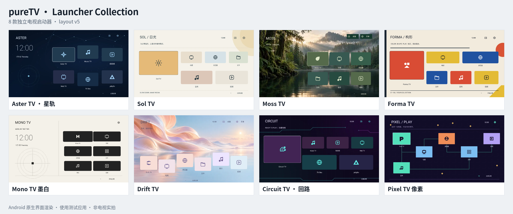

**简体中文** | [English](README.en.md)

<div align="center">
  
</div>

pureTV 是电脑端的 Android TV / Google TV 系统管理器。通过 ADB 连接电视，查看系统信息，安装、卸载、启停应用，选择启动器，并用可视化画布自定义支持的桌面。也可通过 MCP 让 Agent 控制已打开的管理器。

[](https://github.com/ecojust/pureTV/releases/latest)
[](desktop/README.md)
[](resource/launcher/)
[](resource/apps/)
[](desktop/docs/mcp.md)
[](resource/README-development.md#layoutjson-协议规范与画面对照)
[](#连接与应用管理)
[](LICENSE)


## 连接与应用管理

1. 电脑和电视接入可互通的网络，在电视开发者选项中开启 ADB／网络调试。
2. 首页输入电视 IP／主机名与调试端口，在电视上允许电脑连接。常见端口为 5555，以电视实际设置为准。
3. 缺少 ADB 时，阅读并同意 Android SDK 许可后点击「下载并配置 ADB」；优先 Google，失败时使用腾讯镜像。也可选择已有 ADB。

连接后首页显示型号、Android／SDK／安全补丁、CPU、内存、`/data` 磁盘容量、分辨率及运行时间。其他页面顶部保留当前连接状态。

- **应用管理**：搜索和分类，批量启用／停用、为当前用户卸载、恢复仍保有安装包的系统应用。
- **待安装应用**：导入本地 APK，可在行尾安装单个，也可勾选批量安装；成功项移出队列，失败与未执行项保留。
- **启动器**：导入启动器 APK 后在该页面直接安装，选择／恢复默认桌面；支持接口的当前启动器显示「调整布局」。
- **市场**：动态浏览 [pure-tv-store](https://gitee.com/juzisang331/pure-tv-store) 的应用与启动器，搜索、预览并下载到待安装列表，或连接电视后直接安装；仓库新增 APK 后刷新即可发现。
- 应用与启动器均显示主 APK 与分包的合计大小，不含私有数据、缓存与优化文件，无法读取时明确显示未知。
- 列表内部滚动，表头和顶部批量操作固定；核心系统组件与当前默认启动器受保护。

系统应用卸载只针对当前 Android 用户，保留数据，不删除系统分区 APK。新安装且具备启动入口的用户应用可加入启动器排布。

主动执行连接、刷新、应用管理、启动器切换或布局应用等操作时，管理器显示等待状态，完成后弹窗反馈结果。批量任务区分成功、失败和未执行项；后台自动读取不会反复弹窗。

## 启动器与电视应用资源

[](resource/launcher/)

公共目录为 [resource/](resource/)，分为 [launcher/](resource/launcher/) 与 [apps/](resource/apps/)，原根目录的启动器和应用源码已整体移入。以后 Release 只发布电脑管理器；启动器和电视应用 APK 直接放在各自软件目录。每个软件文件夹至少包含一个实际 APK，可同时提供对应版本源码、封面、作者、许可证及 SHA256。点击软件名称进入对应文件夹。

启动器表格的“支持自定义”指支持本管理器的 **layout.json 版本 5 users/system 接口**。支持布局协议的启动器卡片自动显示 Home 背景颜色和图片，包括未激活的启动器；修改并应用布局后同步更新。列表不提供选择或移除封面的操作，桌面背景统一在「调整布局」中修改。待安装 APK 优先预览内置布局的 Home 背景，仅在无法读取布局背景时使用同目录的 `thumb.png`／`APK名.thumb.png`。

```text
resource/
├── launcher/
│   ├── puretv/        # 各目录均含独立 APK、源码、layout 示例和封面
│   ├── nova/          # tvOS 风格
│   ├── aster/         # 星空
│   ├── sol/           # 北欧日光
│   ├── moss/          # 森林晨雾
│   ├── forma/         # 包豪斯
│   ├── mono/          # 黑白编辑
│   ├── drift/         # 粉彩梦境
│   ├── circuit/       # 霓虹电路
│   └── pixel/         # 复古像素
└── apps/
    ├── music/         # Music TV 源码与 APK
    ├── shortvideo/    # ShortVideo TV 源码与 APK
    ├── webtv/         # WebTV 源码与 APK
    ├── tvbro/         # TV Bro APK 与对应源码
    └── jellyfin-tv/   # Jellyfin TV APK 与对应源码
```

<!-- resource-index:start -->

### 启动器

| 名称 | 作者 | 版本 | APK 大小 | 支持自定义 | 封面截图 |
| --- | --- | --- | --- | --- | --- |
| [Aster TV · 星轨](resource/launcher/aster/) | ecojust / 桔子桑 | 0.1.1 | 443.7 KB | 是 |  |
| [Circuit TV · 回路](resource/launcher/circuit/) | ecojust / 桔子桑 | 0.1.1 | 435.7 KB | 是 |  |
| [Drift TV](resource/launcher/drift/) | ecojust / 桔子桑 | 0.1.1 | 475.7 KB | 是 |  |
| [Forma TV](resource/launcher/forma/) | ecojust / 桔子桑 | 0.1.1 | 443.7 KB | 是 |  |
| [Mono TV 墨白](resource/launcher/mono/) | ecojust / 桔子桑 | 0.1.1 | 443.7 KB | 是 |  |
| [Moss TV](resource/launcher/moss/) | ecojust / 桔子桑 | 0.1.1 | 487.7 KB | 是 |  |
| [Nova TV](resource/launcher/nova/) | ecojust / 桔子桑 | 0.1.2 | 495.7 KB | 是 |  |
| [Pixel TV 像素](resource/launcher/pixel/) | ecojust / 桔子桑 | 0.1.1 | 443.7 KB | 是 |  |
| [pureTV Launcher](resource/launcher/puretv/) | ecojust / 桔子桑 | 0.3.7 | 740.1 KB | 是 |  |
| [Sol TV](resource/launcher/sol/) | ecojust / 桔子桑 | 0.1.1 | 439.7 KB | 是 |  |

### 电视应用

| 名称 | 作者 | 版本 | APK 大小 | 用途 | 封面截图 |
| --- | --- | --- | --- | --- | --- |
| [HIFINi TV](resource/apps/hifini/) | ecojust / 桔子桑 | 0.1.3 | 193.1 KB | 基于 HiFiNi 的电视音乐播放器 |  |
| [Jellyfin for Android TV](resource/apps/jellyfin-tv/) | Jellyfin contributors | 0.19.10 | 20.93 MB | Jellyfin 媒体服务器的 Android TV 客户端 |  |
| [Music TV](resource/apps/music/) | ecojust / 桔子桑 | 0.1.3 | 48.8 KB | 原生电视音乐播放器 |  |
| [ShortVideo TV](resource/apps/shortvideo/) | ecojust / 桔子桑 | 0.1.1 | 32.7 KB | 遥控器短视频播放器 |  |
| [TV Bro](resource/apps/tvbro/) | Fedir Tsapana (truefedex) | 2.1.6 | 6.48 MB | 适配遥控器的电视浏览器，使用系统 WebView |  |
| [WebTV](resource/apps/webtv/) | ecojust / 桔子桑 | 0.1.1 | 44.8 KB | 电视直播与 M3U 播放器 |  |

<!-- resource-index:end -->

所有电视应用的 APK 与源码见 [resource/apps/](resource/apps/)。第三方资源保留各自作者、原始签名和许可证，不纳入 pureTV 的 MIT 授权范围。

## MCP / Agent

在「设备连接 → MCP · Agent 调试」复制配置到客户端，保持管理器窗口打开。34 个工具覆盖系统信息、连接、应用管理、APK 安装、启动器切换与布局、市场目录／下载／安装、背景图、ADB 配置、语言与主题、取消及记录；Agent 与界面共享状态。

[完整 MCP 接入与参数](desktop/docs/mcp.md)。

## 开发文档

构建与测试说明见 [resource 开发 README](resource/README-development.md)。

<a id="layoutjson-规范与画面对照"></a>

<a id="layoutjson-协议规范与画面对照"></a>

### 自定义启动器布局

`layout.json` 是连接启动器与管理器显示的协议文件：电视和电脑使用同一份布局，管理器可以重现桌面并调整应用块。Home 和 Apps 支持独立背景、布局与切页设置；用户应用可编辑，系统组件仅供查看。

在启动器页面选择「调整布局」，可添加已安装用户应用、拖动、框选、对齐或平铺排布，确认后应用到电视。使用新版布局需同时更新管理器与配套启动器。

完整字段说明、JSON 示例与画面对照见 [layout.json 协议规范](resource/README-development.md#layoutjson-协议规范与画面对照)。

## 许可与致谢

pureTV 使用 [MIT](LICENSE) 许可。部分电视端启动器代码参考 [Gathin23/cleanyourtv](https://github.com/Gathin23/cleanyourtv)，原作者版权与许可保留于 [NOTICE.md](NOTICE.md)。字体见 [OFL 许可](resource/launcher/puretv/FONT-LICENSE-OFL.txt)。第三方 APK、截图与源码使用各资源文件夹内的许可证。
