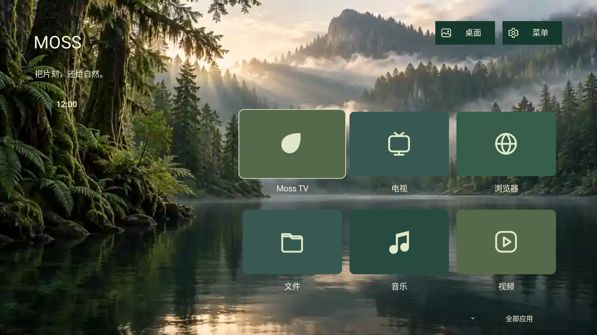
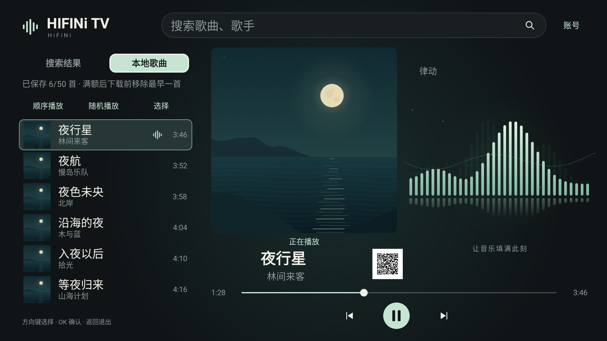
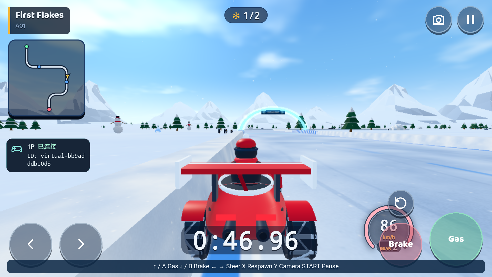
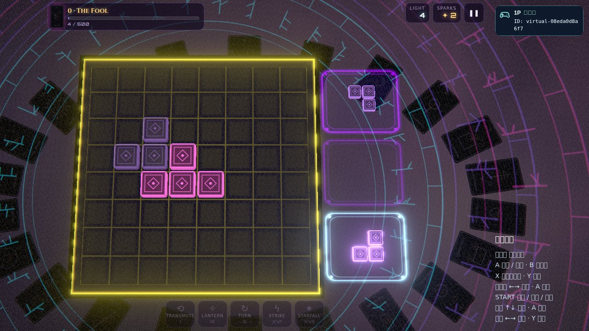

# pureTV 应用目录

**简体中文** · [English](README.en.md) · [使用说明](docs/guide/README.md) · [开发与 MCP 文档](docs/guide/development.md)

[管理工具](#管理工具) · [启动器与电视应用](#启动器与电视应用资源) · [手柄游戏](#手柄游戏专用目录) · [第三方电视应用](fork/README.md) · [游戏参考清单](docs/claude-games/catalog.md)

## 管理工具

| 应用 | 用途 | 平台 | 下载 |
| --- | --- | --- | --- |
| pureTV Manager | 在电脑上管理电视应用和启动器 | Windows、macOS、Linux | [0.5.9](https://github.com/ecojust/pureTV/releases/tag/desktop-v0.5.9) |
| putrtv商城 | 在电视上浏览、安装和更新应用 | Android TV | [0.1.1 APK](resource/apps/putrtv-store/putrtv-store-0.1.1.apk?raw=1) |

## 启动器与电视应用资源

[查看全部启动器和电视应用](resource/README.md)

<!-- resource-index:start -->

### 启动器（10）

<table>
  <tr>
    <td align="center" valign="top" width="25%"><a href="resource/launcher/sol/"> Sol TV</a></td>
    <td align="center" valign="top" width="25%"><a href="resource/launcher/pixel/"> Pixel TV 像素</a></td>
    <td align="center" valign="top" width="25%"><a href="resource/launcher/moss/"> Moss TV</a></td>
    <td align="center" valign="top" width="25%"><a href="resource/launcher/mono/"> Mono TV 墨白</a></td>
  </tr>
  <tr>
    <td align="center" valign="top" width="25%"><a href="resource/launcher/forma/"> Forma TV</a></td>
    <td align="center" valign="top" width="25%"><a href="resource/launcher/drift/"> Drift TV</a></td>
    <td align="center" valign="top" width="25%"><a href="resource/launcher/circuit/"> Circuit TV · 回路</a></td>
    <td align="center" valign="top" width="25%"><a href="resource/launcher/aster/"> Aster TV · 星轨</a></td>
  </tr>
  <tr>
    <td align="center" valign="top" width="25%"><a href="resource/launcher/nova/"> Nova TV</a></td>
    <td align="center" valign="top" width="25%"><a href="resource/launcher/puretv/"> pureTV Launcher</a></td>
    <td width="25%"></td>
    <td width="25%"></td>
  </tr>
</table>

### 应用-影音（6）

<table>
  <tr>
    <td align="center" valign="top" width="25%"><a href="resource/apps/opera/"> 梨园 TV</a></td>
    <td align="center" valign="top" width="25%"><a href="resource/apps/bilibili/"> BiliTV</a></td>
    <td align="center" valign="top" width="25%"><a href="resource/apps/cctv/"> CCTV Live</a></td>
    <td align="center" valign="top" width="25%"><a href="resource/apps/hifini/"> HIFINi TV</a></td>
  </tr>
  <tr>
    <td align="center" valign="top" width="25%"><a href="resource/apps/webtv/"> WebTV</a></td>
    <td align="center" valign="top" width="25%"><a href="resource/apps/shortvideo/"> ShortVideo TV</a></td>
    <td width="25%"></td>
    <td width="25%"></td>
  </tr>
</table>

### 应用-游戏（20）

<table>
  <tr>
    <td align="center" valign="top" width="25%"><a href="resource/apps/neon-rush/"> 霓虹飞车</a></td>
    <td align="center" valign="top" width="25%"><a href="resource/apps/twenty-four/"> 四则二十四</a></td>
    <td align="center" valign="top" width="25%"><a href="resource/apps/torch-bridge/"> 夜桥接力</a></td>
    <td align="center" valign="top" width="25%"><a href="resource/apps/tower-overlap/"> 叠塔工匠</a></td>
  </tr>
  <tr>
    <td align="center" valign="top" width="25%"><a href="resource/apps/packing-sculptor/"> 异形装箱</a></td>
    <td align="center" valign="top" width="25%"><a href="resource/apps/conveyor-window/"> 窗口装配</a></td>
    <td align="center" valign="top" width="25%"><a href="resource/apps/glass-fold/"> 折光工坊</a></td>
    <td align="center" valign="top" width="25%"><a href="resource/apps/tension-span/"> 拉索桥梁</a></td>
  </tr>
  <tr>
    <td align="center" valign="top" width="25%"><a href="resource/apps/prism-relay/"> 镜光接力</a></td>
    <td align="center" valign="top" width="25%"><a href="resource/apps/alien-shooter/"> 孤胆枪手 TV</a></td>
    <td align="center" valign="top" width="25%"><a href="resource/apps/used-car-racing/"> 极品二手车</a></td>
    <td align="center" valign="top" width="25%"><a href="resource/apps/cozy-island/"> Cozy Island TV</a></td>
  </tr>
  <tr>
    <td align="center" valign="top" width="25%"><a href="resource/apps/coast-kart/"> Coast Kart TV</a></td>
    <td align="center" valign="top" width="25%"><a href="resource/apps/super-mario/"> Super Mario TV</a></td>
    <td align="center" valign="top" width="25%"><a href="resource/apps/bomb-jack/"> Mighty Bomb Jack TV</a></td>
    <td align="center" valign="top" width="25%"><a href="resource/apps/adventure-island/"> Adventure Island TV</a></td>
  </tr>
  <tr>
    <td align="center" valign="top" width="25%"><a href="resource/apps/tetris/"> Tetris TV</a></td>
    <td align="center" valign="top" width="25%"><a href="resource/apps/jewel/"> Magic Jewelry TV</a></td>
    <td align="center" valign="top" width="25%"><a href="resource/apps/jackal/"> Jackal TV</a></td>
    <td align="center" valign="top" width="25%"><a href="resource/apps/tank/"> Tank TV</a></td>
  </tr>
</table>

### 应用-工具（1）

<table>
  <tr>
    <td align="center" valign="top" width="25%"><a href="resource/apps/putrtv-store/"> putrtv商城</a></td>
    <td width="25%"></td>
    <td width="25%"></td>
    <td width="25%"></td>
  </tr>
</table>

<!-- resource-index:end -->

## 手柄游戏专用目录

**43 款手柄游戏** · Android TV 43 款 · macOS 24 款 · Windows x64 19 款

[竞速与体育（13）](#controller-racing) · [动作、角色扮演与探索（2）](#controller-action) · [平台、弹幕与街机（7）](#controller-arcade) · [策略、塔防与卡牌（1）](#controller-strategy) · [解谜与益智（18）](#controller-puzzle) · [经营、沙盒与休闲（1）](#controller-casual) · [单键街机（1）](#controller-one-button)

### 竞速与体育（13）

<table>
<tr>
<td align="center" valign="top"><a href="joystick-games/backroad-rally/"> Backroad Rally</a> <a href="https://github.com/ecojust/pureTV/releases/download/joystick-backroad-rally-android-v0.1.2/backroad-rally-0.1.2.apk">APK</a> · <a href="https://github.com/ecojust/pureTV/releases/download/joystick-backroad-rally-v0.1.0/BackroadRally-0.1.0-macos-universal.dmg">macOS 预览</a> · <a href="https://github.com/ecojust/pureTV/releases/download/joystick-backroad-rally-windows-v0.1.0/BackroadRally-0.1.0-windows-x64-setup.exe">Windows</a></td>
<td align="center" valign="top"><a href="joystick-games/ponpoko-kart/"> Ponpoko Kart</a> <a href="https://raw.githubusercontent.com/ecojust/pureTV/3bf22a01c62439afdc7352e2f7529cc23ea575ad/joystick-games/ponpoko-kart/ponpoko-kart-0.1.5.apk">APK</a> · <a href="https://raw.githubusercontent.com/ecojust/pureTV/515250931fa4203132ab658d81567682184651de/joystick-games/ponpoko-kart/macos/PonpokoKart-0.1.0-macos-universal.dmg">macOS</a> · <a href="https://raw.githubusercontent.com/ecojust/pureTV/515250931fa4203132ab658d81567682184651de/joystick-games/ponpoko-kart/PonpokoKart-0.1.0-windows-x64-setup.exe">Windows</a></td>
<td align="center" valign="top"><a href="joystick-games/night-racer/"> Night Racer</a> <a href="https://raw.githubusercontent.com/ecojust/pureTV/515250931fa4203132ab658d81567682184651de/joystick-games/night-racer/night-racer-0.1.0.apk">APK</a> · <a href="https://raw.githubusercontent.com/ecojust/pureTV/515250931fa4203132ab658d81567682184651de/joystick-games/night-racer/macos/NightRacer-0.1.0-macos-universal.dmg">macOS</a> · <a href="https://raw.githubusercontent.com/ecojust/pureTV/515250931fa4203132ab658d81567682184651de/joystick-games/night-racer/NightRacer-0.1.0-windows-x64-setup.exe">Windows</a></td>
<td align="center" valign="top"><a href="joystick-games/penguintrack/"> Penguintrack</a> <a href="https://raw.githubusercontent.com/ecojust/pureTV/515250931fa4203132ab658d81567682184651de/joystick-games/penguintrack/penguintrack-0.1.0.apk">APK</a> · <a href="https://raw.githubusercontent.com/ecojust/pureTV/515250931fa4203132ab658d81567682184651de/joystick-games/penguintrack/macos/Penguintrack-0.1.0-macos-universal.dmg">macOS</a> · <a href="https://raw.githubusercontent.com/ecojust/pureTV/515250931fa4203132ab658d81567682184651de/joystick-games/penguintrack/Penguintrack-0.1.0-windows-x64-setup.exe">Windows</a></td>
</tr>
<tr>
<td align="center" valign="top"><a href="joystick-games/last-track/"> Last Track</a> <a href="https://raw.githubusercontent.com/ecojust/pureTV/515250931fa4203132ab658d81567682184651de/joystick-games/last-track/last-track-0.1.0.apk">APK</a> · <a href="https://raw.githubusercontent.com/ecojust/pureTV/515250931fa4203132ab658d81567682184651de/joystick-games/last-track/macos/LastTrack-0.1.0-macos-universal.dmg">macOS</a> · <a href="https://raw.githubusercontent.com/ecojust/pureTV/515250931fa4203132ab658d81567682184651de/joystick-games/last-track/LastTrack-0.1.0-windows-x64-setup.exe">Windows</a></td>
<td align="center" valign="top"><a href="joystick-games/dirt-crown/"> Dirt Crown</a> <a href="https://raw.githubusercontent.com/ecojust/pureTV/515250931fa4203132ab658d81567682184651de/joystick-games/dirt-crown/dirt-crown-0.1.0.apk">APK</a> · <a href="https://raw.githubusercontent.com/ecojust/pureTV/515250931fa4203132ab658d81567682184651de/joystick-games/dirt-crown/macos/DirtCrown-0.1.0-macos-universal.dmg">macOS</a> · <a href="https://raw.githubusercontent.com/ecojust/pureTV/515250931fa4203132ab658d81567682184651de/joystick-games/dirt-crown/DirtCrown-0.1.0-windows-x64-setup.exe">Windows</a></td>
<td align="center" valign="top"><a href="joystick-games/turbo-kart-rush/"> Turbo Kart Rush</a> <a href="https://raw.githubusercontent.com/ecojust/pureTV/515250931fa4203132ab658d81567682184651de/joystick-games/turbo-kart-rush/turbo-kart-rush-0.1.1.apk">APK</a> · <a href="https://raw.githubusercontent.com/ecojust/pureTV/515250931fa4203132ab658d81567682184651de/joystick-games/turbo-kart-rush/macos/TurboKartRush-0.1.0-macos-universal.dmg">macOS</a> · <a href="https://raw.githubusercontent.com/ecojust/pureTV/515250931fa4203132ab658d81567682184651de/joystick-games/turbo-kart-rush/windows/TurboKartRush-0.1.0-windows-x64-setup.exe">Windows</a></td>
<td align="center" valign="top"><a href="joystick-games/kart-rush/"> Kart Rush</a> <a href="https://raw.githubusercontent.com/ecojust/pureTV/515250931fa4203132ab658d81567682184651de/joystick-games/kart-rush/kart-rush-0.1.0.apk">APK</a> · <a href="https://raw.githubusercontent.com/ecojust/pureTV/515250931fa4203132ab658d81567682184651de/joystick-games/kart-rush/macos/KartRush-0.1.0-macos-universal.dmg">macOS</a> · <a href="https://raw.githubusercontent.com/ecojust/pureTV/515250931fa4203132ab658d81567682184651de/joystick-games/kart-rush/KartRush-0.1.0-windows-x64-setup.exe">Windows</a></td>
</tr>
<tr>
<td align="center" valign="top"><a href="joystick-games/kart-royale/"> Kart Royale</a> <a href="https://raw.githubusercontent.com/ecojust/pureTV/36b91f81533f10ff5d37ec091c3701913d4a42e4/joystick-games/kart-royale/kart-royale-0.1.4.apk">APK</a> · <a href="https://raw.githubusercontent.com/ecojust/pureTV/515250931fa4203132ab658d81567682184651de/joystick-games/kart-royale/macos/KartRoyale-0.1.0-macos-universal.dmg">macOS</a> · <a href="https://raw.githubusercontent.com/ecojust/pureTV/515250931fa4203132ab658d81567682184651de/joystick-games/kart-royale/windows/KartRoyale-0.1.1-windows-x64-setup.exe">Windows</a></td>
<td align="center" valign="top"><a href="joystick-games/qq-speed/"> QQ 飞车</a> <a href="joystick-games/qq-speed/qq-speed-0.1.0.apk?raw=1">APK</a> · <a href="joystick-games/qq-speed/macos/QQSpeed-0.1.0-macos-universal.dmg?raw=1">macOS</a></td>
<td align="center" valign="top"><a href="resource/apps/neon-rush/"> 霓虹飞车</a> <a href="resource/apps/neon-rush/neon-rush-0.1.3.apk?raw=1">APK</a> · <a href="resource/apps/neon-rush/macos/NeonRush-0.1.4-macos-universal.dmg?raw=1">macOS</a></td>
<td align="center" valign="top"><a href="resource/apps/coast-kart/"> Coast Kart TV</a> <a href="resource/apps/coast-kart/coast-kart-0.5.4.apk?raw=1">APK</a></td>
</tr>
<tr>
<td align="center" valign="top"><a href="resource/apps/used-car-racing/"> 极品二手车</a> <a href="resource/apps/used-car-racing/used-car-racing-0.1.5.apk?raw=1">APK</a></td>
</tr>
</table>

### 动作、角色扮演与探索（2）

<table>
<tr>
<td align="center" valign="top"><a href="joystick-games/cf-transport-ship/"> 运输船 CF</a> <a href="joystick-games/cf-transport-ship/cf-transport-ship-0.1.0.apk?raw=1">APK</a> · <a href="joystick-games/cf-transport-ship/macos/CFTransportShip-0.1.0-macos-universal.dmg?raw=1">macOS</a></td>
<td align="center" valign="top"><a href="resource/apps/alien-shooter/"> 孤胆枪手 TV</a> <a href="resource/apps/alien-shooter/alien-shooter-0.1.4.apk?raw=1">APK</a></td>
</tr>
</table>

### 平台、弹幕与街机（7）

<table>
<tr>
<td align="center" valign="top"><a href="joystick-games/glup/"> GLUP · 沼泽猫鱼</a> <a href="joystick-games/glup/glup-0.1.0.apk?raw=1">APK</a> · <a href="joystick-games/glup/Glup-0.1.0-macos-universal.dmg?raw=1">macOS</a></td>
<td align="center" valign="top"><a href="resource/apps/super-mario/"> Super Mario TV</a> <a href="resource/apps/super-mario/super-mario-0.5.4.apk?raw=1">APK</a></td>
<td align="center" valign="top"><a href="resource/apps/bomb-jack/"> Mighty Bomb Jack TV</a> <a href="resource/apps/bomb-jack/bomb-jack-0.5.4.apk?raw=1">APK</a></td>
<td align="center" valign="top"><a href="resource/apps/adventure-island/"> Adventure Island TV</a> <a href="resource/apps/adventure-island/adventure-island-0.5.4.apk?raw=1">APK</a></td>
</tr>
<tr>
<td align="center" valign="top"><a href="resource/apps/jackal/"> Jackal TV</a> <a href="resource/apps/jackal/jackal-0.5.4.apk?raw=1">APK</a></td>
<td align="center" valign="top"><a href="resource/apps/tank/"> Tank TV</a> <a href="resource/apps/tank/tank-0.5.4.apk?raw=1">APK</a></td>
<td align="center" valign="top"><a href="resource/apps/conveyor-window/"> 窗口装配</a> <a href="resource/apps/conveyor-window/conveyor-window-0.2.2.apk?raw=1">APK</a></td>
</tr>
</table>

### 策略、塔防与卡牌（1）

<table>
<tr>
<td align="center" valign="top"><a href="joystick-games/emberbrood/"> Emberbrood · 余烬龙裔</a> <a href="joystick-games/emberbrood/emberbrood-0.1.0.apk?raw=1">APK</a> · <a href="joystick-games/emberbrood/Emberbrood-0.1.0-macos-universal.dmg?raw=1">macOS</a></td>
</tr>
</table>

### 解谜与益智（18）

<table>
<tr>
<td align="center" valign="top"><a href="https://github.com/ecojust/pureTV/tree/a837c7dcb09a0ce01f90a17409212af69c4fc4d6/joystick-games/alchemists-lattice"> 炼金方阵</a> <a href="https://github.com/ecojust/pureTV/releases/download/joystick-alchemists-lattice-v0.1.1/alchemists-lattice-0.1.1.apk">APK</a> · <a href="https://github.com/ecojust/pureTV/releases/download/joystick-alchemists-lattice-v0.1.1/AlchemistsLattice-0.1.1-macos-universal.dmg">macOS 预览</a> · <a href="https://github.com/ecojust/pureTV/releases/download/joystick-alchemists-lattice-v0.1.1/AlchemistsLattice-0.1.1-windows-x64-setup.exe">Windows</a></td>
<td align="center" valign="top"><a href="https://github.com/ecojust/pureTV/tree/a837c7dcb09a0ce01f90a17409212af69c4fc4d6/joystick-games/story-thief"> 灰斗篷山的故事大盗</a> <a href="https://github.com/ecojust/pureTV/releases/download/joystick-story-thief-v0.1.1/story-thief-0.1.1.apk">APK</a> · <a href="https://github.com/ecojust/pureTV/releases/download/joystick-story-thief-v0.1.1/StoryThief-0.1.1-macos-universal.dmg">macOS</a> · <a href="https://github.com/ecojust/pureTV/releases/download/joystick-story-thief-v0.1.1/StoryThief-0.1.1-windows-x64-setup.exe">Windows</a></td>
<td align="center" valign="top"><a href="https://github.com/ecojust/pureTV/tree/a837c7dcb09a0ce01f90a17409212af69c4fc4d6/joystick-games/bumble-basket"> 蜜蜂果篮</a> <a href="https://github.com/ecojust/pureTV/releases/download/joystick-bumble-basket-v0.1.2/bumble-basket-0.1.2.apk">APK</a> · <a href="https://github.com/ecojust/pureTV/releases/download/joystick-bumble-basket-v0.1.2/BumbleBasket-0.1.2-macos-universal.dmg">macOS 预览</a> · <a href="https://github.com/ecojust/pureTV/releases/download/joystick-bumble-basket-v0.1.2/BumbleBasket-0.1.2-windows-x64-setup.exe">Windows</a></td>
<td align="center" valign="top"><a href="https://github.com/ecojust/pureTV/tree/a837c7dcb09a0ce01f90a17409212af69c4fc4d6/joystick-games/starsling"> 星际弹弓</a> <a href="https://github.com/ecojust/pureTV/releases/download/joystick-starsling-v0.1.1/starsling-0.1.1.apk">APK</a> · <a href="https://github.com/ecojust/pureTV/releases/download/joystick-starsling-v0.1.1/Starsling-0.1.1-macos-universal.dmg">macOS 预览</a> · <a href="https://github.com/ecojust/pureTV/releases/download/joystick-starsling-v0.1.1/Starsling-0.1.1-windows-x64-setup.exe">Windows</a></td>
</tr>
<tr>
<td align="center" valign="top"><a href="https://github.com/ecojust/pureTV/tree/a837c7dcb09a0ce01f90a17409212af69c4fc4d6/joystick-games/solder-and-rain"> 雨夜维修铺</a> <a href="https://github.com/ecojust/pureTV/releases/download/joystick-solder-and-rain-v0.1.0/solder-and-rain-0.1.0.apk">APK</a> · <a href="https://github.com/ecojust/pureTV/releases/download/joystick-solder-and-rain-v0.1.0/SolderAndRain-0.1.0-macos-universal.dmg">macOS 预览</a> · <a href="https://github.com/ecojust/pureTV/releases/download/joystick-solder-and-rain-v0.1.0/SolderAndRain-0.1.0-windows-x64-setup.exe">Windows</a></td>
<td align="center" valign="top"><a href="https://github.com/ecojust/pureTV/tree/a837c7dcb09a0ce01f90a17409212af69c4fc4d6/joystick-games/oathstones"> 誓约宝石</a> <a href="https://github.com/ecojust/pureTV/releases/download/joystick-oathstones-v0.1.0/oathstones-0.1.0.apk">APK</a> · <a href="https://github.com/ecojust/pureTV/releases/download/joystick-oathstones-v0.1.0/Oathstones-0.1.0-macos-universal.dmg">macOS 预览</a> · <a href="https://github.com/ecojust/pureTV/releases/download/joystick-oathstones-v0.1.0/Oathstones-0.1.0-windows-x64-setup.exe">Windows</a></td>
<td align="center" valign="top"><a href="https://github.com/ecojust/pureTV/tree/a837c7dcb09a0ce01f90a17409212af69c4fc4d6/joystick-games/neon-arcana"> 霓虹秘仪</a> <a href="https://github.com/ecojust/pureTV/releases/download/joystick-neon-arcana-v0.1.1/neon-arcana-0.1.1.apk">APK</a> · <a href="https://github.com/ecojust/pureTV/releases/download/joystick-neon-arcana-v0.1.1/NeonArcana-0.1.1-macos-universal.dmg">macOS 预览</a> · <a href="https://github.com/ecojust/pureTV/releases/download/joystick-neon-arcana-v0.1.1/NeonArcana-0.1.1-windows-x64-setup.exe">Windows</a></td>
<td align="center" valign="top"><a href="https://github.com/ecojust/pureTV/tree/a837c7dcb09a0ce01f90a17409212af69c4fc4d6/joystick-games/atlas-of-ink"> 墨绘地图集</a> <a href="https://github.com/ecojust/pureTV/releases/download/joystick-atlas-of-ink-v0.1.1/atlas-of-ink-0.1.1.apk">APK</a> · <a href="https://github.com/ecojust/pureTV/releases/download/joystick-atlas-of-ink-v0.1.1/AtlasOfInk-0.1.1-macos-universal.dmg">macOS</a> · <a href="https://github.com/ecojust/pureTV/releases/download/joystick-atlas-of-ink-v0.1.1/AtlasOfInk-0.1.1-windows-x64-setup.exe">Windows</a></td>
</tr>
<tr>
<td align="center" valign="top"><a href="https://github.com/ecojust/pureTV/tree/a837c7dcb09a0ce01f90a17409212af69c4fc4d6/joystick-games/starbase-spooky"> 幽灵空间站</a> <a href="https://github.com/ecojust/pureTV/releases/download/joystick-starbase-spooky-v0.1.2/starbase-spooky-0.1.2.apk">APK</a> · <a href="https://github.com/ecojust/pureTV/releases/download/joystick-starbase-spooky-v0.1.2/StarbaseSpooky-0.1.2-macos-universal.dmg">macOS</a> · <a href="https://github.com/ecojust/pureTV/releases/download/joystick-starbase-spooky-v0.1.2/StarbaseSpooky-0.1.2-windows-x64-setup.exe">Windows</a></td>
<td align="center" valign="top"><a href="joystick-games/sugarplum-drop/"> Sugarplum Drop</a> <a href="joystick-games/sugarplum-drop/sugarplum-drop-0.1.0.apk?raw=1">APK</a> · <a href="joystick-games/sugarplum-drop/SugarplumDrop-0.1.0-macos-universal.dmg?raw=1">macOS</a> · <a href="joystick-games/sugarplum-drop/SugarplumDrop-0.1.0-windows-x64-setup.exe?raw=1">Windows</a></td>
<td align="center" valign="top"><a href="resource/apps/twenty-four/"> 四则二十四</a> <a href="resource/apps/twenty-four/twenty-four-0.2.2.apk?raw=1">APK</a></td>
<td align="center" valign="top"><a href="resource/apps/torch-bridge/"> 夜桥接力</a> <a href="resource/apps/torch-bridge/torch-bridge-0.2.2.apk?raw=1">APK</a></td>
</tr>
<tr>
<td align="center" valign="top"><a href="resource/apps/packing-sculptor/"> 异形装箱</a> <a href="resource/apps/packing-sculptor/packing-sculptor-0.2.2.apk?raw=1">APK</a></td>
<td align="center" valign="top"><a href="resource/apps/glass-fold/"> 折光工坊</a> <a href="resource/apps/glass-fold/glass-fold-0.2.2.apk?raw=1">APK</a></td>
<td align="center" valign="top"><a href="resource/apps/tension-span/"> 拉索桥梁</a> <a href="resource/apps/tension-span/tension-span-0.2.3.apk?raw=1">APK</a></td>
<td align="center" valign="top"><a href="resource/apps/prism-relay/"> 镜光接力</a> <a href="resource/apps/prism-relay/prism-relay-0.2.3.apk?raw=1">APK</a></td>
</tr>
<tr>
<td align="center" valign="top"><a href="resource/apps/tetris/"> Tetris TV</a> <a href="resource/apps/tetris/tetris-0.5.4.apk?raw=1">APK</a></td>
<td align="center" valign="top"><a href="resource/apps/jewel/"> Magic Jewelry TV</a> <a href="resource/apps/jewel/jewel-0.5.4.apk?raw=1">APK</a></td>
</tr>
</table>

### 经营、沙盒与休闲（1）

<table>
<tr>
<td align="center" valign="top"><a href="resource/apps/cozy-island/"> Cozy Island TV</a> <a href="resource/apps/cozy-island/cozy-island-0.5.4.apk?raw=1">APK</a></td>
</tr>
</table>

### 单键街机（1）

<table>
<tr>
<td align="center" valign="top"><a href="resource/apps/tower-overlap/"> 叠塔工匠</a> <a href="resource/apps/tower-overlap/tower-overlap-0.2.2.apk?raw=1">APK</a></td>
</tr>
</table>
