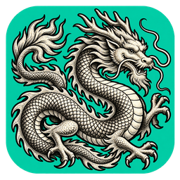

<div align="center">
  
  <h1>pureTV</h1>
  <p>管理你的电视系统、应用与桌面。</p>
</div>

pureTV 是电脑端的 Android TV / Google TV 系统管理器。通过 ADB 连接电视，查看系统信息，安装、卸载、启停应用，选择启动器，并用可视化画布自定义支持的桌面。也可通过 MCP 让 Agent 控制已打开的管理器。


## 下载

[下载 pureTV Manager 0.3.6](https://github.com/ecojust/pureTV/releases/tag/desktop-v0.3.6)

| 系统 | 安装包 |
| --- | --- |
| Windows x64 | 安装版 EXE / 便携 EXE |
| macOS Apple Silicon | ARM64 DMG，macOS 11+ |
| macOS Apple Intel | x86_64 DMG，macOS 11+ |
| Linux x64 | DEB |

首页显示当前电脑的局域网 IPv4、网卡与子网前缀，支持刷新与多网卡。电视 IP／主机名和端口会在点击连接后自动记住，失败时也保留，下次打开自动填入。连接失败排查见[连接指南](desktop/README.md#连接失败排查)。

管理器安装在**电脑**上。电视开启 ADB／网络调试并接受授权后，即可使用应用管理，不需要安装电视端常驻服务。自定义桌面需另行安装[配套 pureTV Launcher 0.3.6](resource/launcher/puretv/)。电视端 APK 直接在资源目录下载，包大小与 SHA256 见各目录；管理器校验值见发布附件；macOS 首次打开说明见[安装指南](desktop/README.md#macos-安装与首次打开)。

## 连接与应用管理

1. 电脑和电视接入可互通的网络，在电视开发者选项中开启 ADB／网络调试。
2. 首页输入电视 IP／主机名与调试端口，在电视上允许电脑连接。常见端口为 5555，以电视实际设置为准。
3. 缺少 ADB 时，阅读并同意 Android SDK 许可后点击「下载并配置 ADB」；优先 Google，失败时使用腾讯镜像。也可选择已有 ADB。

连接后首页显示型号、Android／SDK／安全补丁、CPU、内存、`/data` 磁盘容量、分辨率及运行时间。其他页面顶部保留当前连接状态。

- **应用管理**：搜索和分类，批量启用／停用、为当前用户卸载、恢复仍保有安装包的系统应用。
- **待安装应用**：导入本地 APK，可在行尾安装单个，也可勾选批量安装；成功项移出队列，失败与未执行项保留。
- **启动器**：导入启动器 APK 后在该页面直接安装，选择／恢复默认桌面；支持接口的当前启动器显示「调整布局」。
- 应用与启动器均显示主 APK 与分包的合计大小，不含私有数据、缓存与优化文件，无法读取时明确显示未知。
- 列表内部滚动，表头和顶部批量操作固定；核心系统组件与当前默认启动器受保护。

系统应用卸载只针对当前 Android 用户，保留数据，不删除系统分区 APK。新安装且具备启动入口的用户应用可加入启动器排布。

## 语言、主题与 Logo

左下角可切换 **简体中文 / 繁體中文 / English**，以及 **青绿 / 深蓝 / 石墨** 三种主题。偏好保存后重启仍生效；应用名称、包名及文件路径保持原样。新 Logo 将 P、电视屏幕与应用卡片融为一个图形。

| English · 深蓝 | 繁體中文 · 石墨 |
| --- | --- |
|  |  |

## 启动器与电视应用资源

公共目录为 [resource/](resource/)，分为 [launcher/](resource/launcher/) 与 [apps/](resource/apps/)，原根目录的启动器和应用源码已整体移入。以后 Release 只发布电脑管理器；启动器和电视应用 APK 直接放在各自软件目录。每个软件文件夹至少包含一个实际 APK，可同时提供对应版本源码、封面、作者、许可证及 SHA256。点击软件名称进入对应文件夹。

启动器表格的“支持自定义”指支持本管理器的 **layout.json 版本 5 users/system 接口**。启动器卡片默认使用 Home 背景图，提供 `thumb.png`／`APK名.thumb.png` 或手动选择封面时优先使用封面。

```text
resource/
├── launcher/
│   └── puretv/        # pureTV 启动器源码、APK、layout 示例和封面
└── apps/
    ├── music/         # Music TV 源码与 APK
    ├── shortvideo/    # ShortVideo TV 源码与 APK
    ├── webtv/         # WebTV 源码与 APK
    ├── tvbro/         # TV Bro APK 与对应源码
    └── jellyfin-tv/   # Jellyfin TV APK 与对应源码
```

<!-- resource-index:start -->

### 启动器

| 名称 | 作者 | 版本 | APK 大小 | 支持自定义 | 封面截图 |
| --- | --- | --- | --- | --- | --- |
| [pureTV Launcher](resource/launcher/puretv/) | ecojust / 桔子桑 | 0.3.6 | 740.1 KiB（757,842 B） | 是 |  |

### 电视应用

| 名称 | 作者 | 版本 | APK 大小 | 用途 | 封面截图 |
| --- | --- | --- | --- | --- | --- |
| [Jellyfin for Android TV](resource/apps/jellyfin-tv/) | Jellyfin contributors | 0.19.10 | 20.93 MiB（21,950,619 B） | Jellyfin 媒体服务器的 Android TV 客户端 |  |
| [Music TV](resource/apps/music/) | ecojust / 桔子桑 | 0.1.2 | 40.8 KiB（41,771 B） | 原生电视音乐播放器 |  |
| [ShortVideo TV](resource/apps/shortvideo/) | ecojust / 桔子桑 | 0.1.0 | 28.7 KiB（29,427 B） | 遥控器短视频播放器 |  |
| [TV Bro](resource/apps/tvbro/) | Fedir Tsapana (truefedex) | 2.1.6 | 6.48 MiB（6,790,605 B） | 适配遥控器的电视浏览器，使用系统 WebView |  |
| [WebTV](resource/apps/webtv/) | ecojust / 桔子桑 | 0.1.0 | 36.8 KiB（37,731 B） | 电视直播与 M3U 播放器 |  |

<!-- resource-index:end -->

所有电视应用的 APK 与源码见 [resource/apps/](resource/apps/)。第三方资源保留各自作者、原始签名和许可证，不纳入 pureTV 的 MIT 授权范围。

<a id="layoutjson-规范与画面对照"></a>

<a id="layoutjson-协议规范与画面对照"></a>

## 自定义启动器布局

`layout.json` 是连接启动器与管理器显示的协议文件：电视和电脑使用同一份布局，管理器可以重现桌面并调整应用块。Home 和 Apps 支持独立背景、布局与切页设置；用户应用可编辑，系统组件仅供查看。

在启动器页面选择「调整布局」，可添加已安装用户应用、拖动、框选、对齐或平铺排布，确认后应用到电视。使用新版布局需同时更新管理器与配套启动器。

完整字段说明、JSON 示例与画面对照见 [layout.json 协议规范](resource/README-development.md#layoutjson-协议规范与画面对照)。

## MCP / Agent

在「设备连接 → MCP · Agent 调试」复制配置到客户端，保持管理器窗口打开。31 个工具覆盖系统信息、连接、应用管理、APK 安装、启动器切换与布局、背景图、ADB 配置、语言与主题、取消及记录；Agent 与界面共享状态。

[完整 MCP 接入与参数](desktop/docs/mcp.md)。

## 电视端包名与升级

当前包名为 **`com.ecojust.puretv`**，沿用 pureTV 0.2.0 的发布证书，可覆盖升级。更早的 `com.ecojust.cleanyourtv` 是另一个应用，需要独立安装并重新选择默认桌面，不能继承其私有设置。建议先保留原桌面，确认新版运行正常后再处理旧应用。

## 开发文档

构建、测试以及 layout.json 协议的逐字段规范和文件／画面对照，见 [resource 开发 README](resource/README-development.md)。

## 许可与致谢

pureTV 使用 [MIT](LICENSE) 许可。部分电视端启动器代码参考 [Gathin23/cleanyourtv](https://github.com/Gathin23/cleanyourtv)，原作者版权与许可保留于 [NOTICE.md](NOTICE.md)。字体见 [OFL 许可](resource/launcher/puretv/FONT-LICENSE-OFL.txt)。第三方 APK、截图与源码使用各资源文件夹内的许可证。
