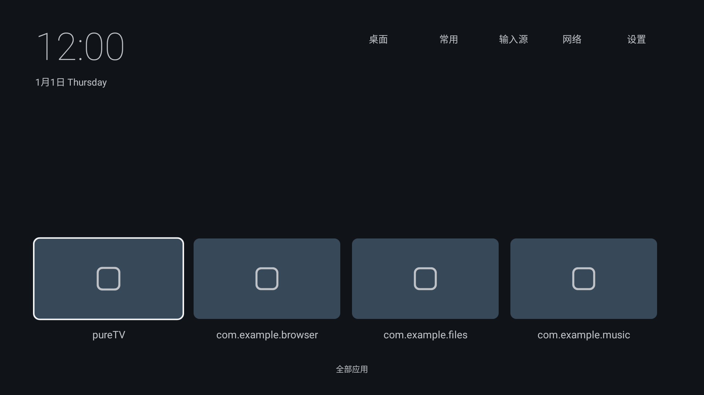
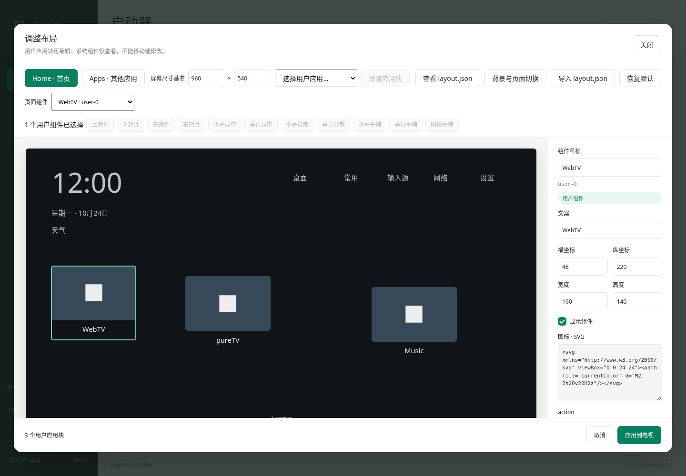
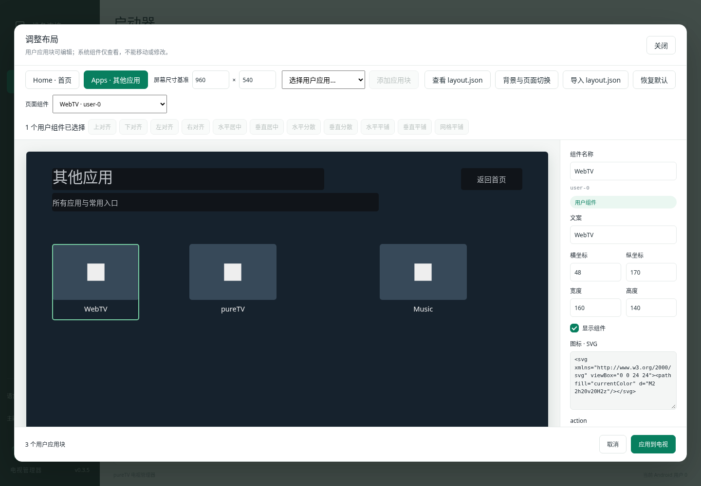
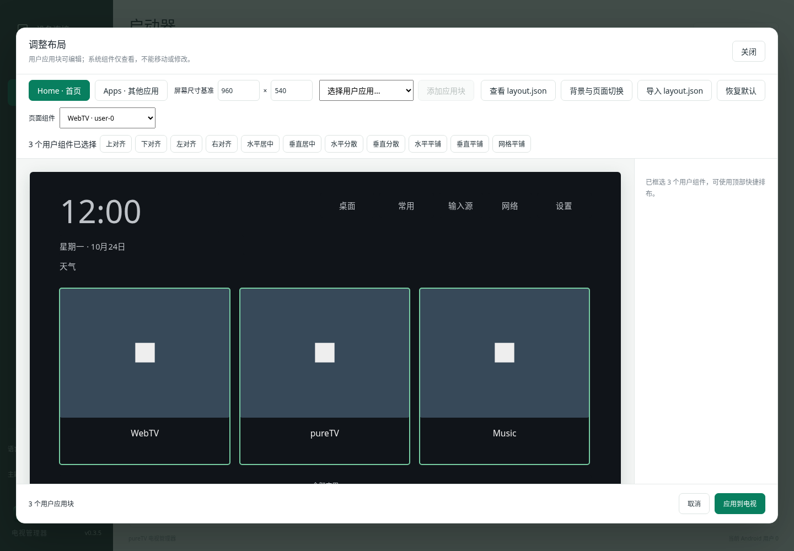

<div align="center">
  
  <h1>pureTV</h1>
  <p>管理你的电视系统、应用与桌面。</p>
</div>

pureTV 是电脑端的 Android TV / Google TV 系统管理器。通过 ADB 连接电视，查看系统信息，安装、卸载、启停应用，选择启动器，并用可视化画布自定义支持的桌面。也可通过 MCP 让 Agent 控制已打开的管理器。


## 下载

[下载 pureTV Manager 0.3.5](https://github.com/ecojust/pureTV/releases/tag/desktop-v0.3.5)

| 系统 | 安装包 |
| --- | --- |
| Windows x64 | 安装版 EXE / 便携 EXE |
| macOS Apple Silicon | ARM64 DMG，macOS 11+ |
| macOS Apple Intel | x86_64 DMG，macOS 11+ |
| Linux x64 | DEB |

首页显示当前电脑的局域网 IPv4、网卡与子网前缀，支持刷新与多网卡。电视 IP／主机名和端口会在点击连接后自动记住，失败时也保留，下次打开自动填入。连接失败排查见[连接指南](desktop/README.md#连接失败排查)。

管理器安装在**电脑**上。电视开启 ADB／网络调试并接受授权后，即可使用应用管理，不需要安装电视端常驻服务。自定义桌面需另行安装[配套 pureTV Launcher 0.3.5](resource/launcher/)。电视端 APK 直接在资源目录下载，包大小与 SHA256 见各目录；管理器校验值见发布附件；macOS 首次打开说明见[安装指南](desktop/README.md#macos-安装与首次打开)。

## 连接与应用管理

1. 电脑和电视接入可互通的网络，在电视开发者选项中开启 ADB／网络调试。
2. 首页输入电视 IP／主机名与调试端口，在电视上允许电脑连接。常见端口为 5555，以电视实际设置为准。
3. 缺少 ADB 时，阅读并同意 Android SDK 许可后点击「下载并配置 ADB」；优先 Google，失败时使用腾讯镜像。也可选择已有 ADB。

连接后首页显示型号、Android／SDK／安全补丁、CPU、内存、`/data` 磁盘容量、分辨率及运行时间。其他页面顶部保留当前连接状态。

- **应用管理**：搜索和分类，批量启用／停用、为当前用户卸载、恢复仍保有安装包的系统应用。
- **待安装应用**：导入本地 APK，可在行尾安装单个，也可勾选批量安装；成功项移出队列，失败与未执行项保留。
- **启动器**：导入启动器 APK 后在该页面直接安装，选择／恢复默认桌面；支持接口的当前启动器显示「调整布局」。
- 应用与启动器均显示主 APK 与分包的合计大小，不含私有数据、缓存与优化文件，无法读取时明确显示未知。
- 列表内部滚动，表头和顶部批量操作固定；核心系统组件与当前默认启动器受保护。

系统应用卸载只针对当前 Android 用户，保留数据，不删除系统分区 APK。新安装且具备启动入口的用户应用可加入启动器排布。

## 语言、主题与 Logo

左下角可切换 **简体中文 / 繁體中文 / English**，以及 **青绿 / 深蓝 / 石墨** 三种主题。偏好保存后重启仍生效；应用名称、包名及文件路径保持原样。新 Logo 将 P、电视屏幕与应用卡片融为一个图形。

| English · 深蓝 | 繁體中文 · 石墨 |
| --- | --- |
|  |  |

## 启动器与电视应用资源

公共目录为 [resource/](resource/)，分为 [launcher/](resource/launcher/) 与 [apps/](resource/apps/)，原根目录的启动器和应用源码已整体移入。以后 Release 只发布电脑管理器；启动器和电视应用 APK 直接放在各自软件目录。每个软件文件夹至少包含一个实际 APK，可同时提供对应版本源码、封面、作者、许可证及 SHA256。点击软件名称进入对应文件夹。

启动器表格的“支持自定义”指支持本管理器的 **layout.json 版本 4 users/system 接口**。卡片背景仅在提供 `thumb.png`／`APK名.thumb.png` 等图片，或手动选择图片后显示。

```text
resource/
├── launcher/          # 启动器源码、pureTV-0.3.5.apk、layout 示例和封面
└── apps/
    ├── music/         # Music TV 源码与 APK
    ├── shortvideo/    # ShortVideo TV 源码与 APK
    ├── webtv/         # WebTV 源码与 APK
    ├── tvbro/         # TV Bro APK 与对应源码
    └── jellyfin-tv/   # Jellyfin TV APK 与对应源码
```

<!-- resource-index:start -->

### 启动器

| 名称 | 作者 | 版本 | APK 大小 | 支持自定义 | 封面截图 |
| --- | --- | --- | --- | --- | --- |
| [pureTV Launcher](resource/launcher/) | ecojust / 桔子桑 | 0.3.4 | 676.0 KiB（692,231 B） | 是 |  |

### 电视应用

| 名称 | 作者 | 版本 | APK 大小 | 用途 | 封面截图 |
| --- | --- | --- | --- | --- | --- |
| [Jellyfin for Android TV](resource/apps/jellyfin-tv/) | Jellyfin contributors | 0.19.10 | 20.93 MiB（21,950,619 B） | Jellyfin 媒体服务器的 Android TV 客户端 |  |
| [Music TV](resource/apps/music/) | ecojust / 桔子桑 | 0.1.1 | 36.8 KiB（37,675 B） | 原生电视音乐播放器 |  |
| [ShortVideo TV](resource/apps/shortvideo/) | ecojust / 桔子桑 | 0.1.0 | 28.7 KiB（29,427 B） | 遥控器短视频播放器 |  |
| [TV Bro](resource/apps/tvbro/) | Fedir Tsapana (truefedex) | 2.1.6 | 6.48 MiB（6,790,605 B） | 适配遥控器的电视浏览器，使用系统 WebView |  |
| [WebTV](resource/apps/webtv/) | ecojust / 桔子桑 | 0.1.0 | 36.8 KiB（37,731 B） | 电视直播与 M3U 播放器 |  |


<!-- resource-index:end -->

所有电视应用的 APK 与源码见 [resource/apps/](resource/apps/)。第三方资源保留各自作者、原始签名和许可证，不纳入 pureTV 的 MIT 授权范围。

## layout.json 规范与画面对照

`layout.json` 是连接电视启动器与电脑管理器显示的**协议文件**，不是管理器私有的草稿格式。启动器负责提供系统组件、可启动应用及当前配置，管理器按同一坐标和字段绘制画布；用户确认后，将修改后的协议写回启动器并读回核对。电视端与管理器共同验证字段，不能只改一端的 JSON 格式。

pureTV Manager 与 Launcher **0.3.5 使用 layout.json v4**。布局由电视和管理器共同读取：顶层 `screen` 定义坐标基准，`home` 和 `apps` 各自包含 `users`、`system`、`background`、`navigation`。不要把屏幕物理分辨率与设计坐标混为一谈；例如基准为 1920×1080，x=960 表示设计画面的水平中点。不同电视分辨率等比缩放，比例不同则留边。

- **users**：可编辑的应用块，`action` 直接使用当前用户已安装、启用且可启动的非系统 APK 包名。可修改位置、尺寸、名称、文案、显示状态、SVG 图标、颜色与背景色。
- **system**：启动器提供的时钟、日期、天气、桌面设置、收藏、输入源、网络、设置、页面入口等系统组件。可以选择和查看，不能拖动、框选排布或修改属性；导入、MCP 和电视接口同样保护这些组件。调整屏幕基准时仅按比例转换其坐标，不改变布局位置。
- **background**：该页独立的背景颜色与可选图片，与组件属性分开。Home 与 Apps 可以使用不同图片。图片存储在 JSON 中，不引用电脑路径；hover 不改变图片的覆盖与居中方式。
- **navigation**：方向键到达当前用户块最上／最下边缘时的切页规则。默认 Home `down: "apps"`，Apps `up: "home"`，恢复首页按下进入应用页的行为；省略某个方向则不切页。

完整示例：[layout.example.json](resource/launcher/layout.example.json)。示例应用来自资源目录，需要先在电视安装对应 APK。`system` 必须使用当前启动器返回的完整内容，不要自行增删或修改。以下为用户块和页面属性的结构片段：

```json
{
  "version": 4,
  "screen": {"width":960,"height":540},
  "home": {
    "background": {"color":"#101419"},
    "navigation": {"down":"apps"},
    "users": [{
      "id":"app-webtv",
      "name":"WebTV",
      "text":"电视直播",
      "frame":{"x":48,"y":220,"width":200,"height":150},
      "action":"com.ecojust.webtv",
      "visible":true,
      "icon":"<svg xmlns=\"http://www.w3.org/2000/svg\" viewBox=\"0 0 24 24\"><path fill=\"currentColor\" d=\"M2 2h20v20H2z\"/></svg>",
      "color":"#EEEEEE",
      "backgroundColor":"#374959"
    }],
    "system": []
  },
  "apps": {
    "background":{"color":"#16222D"},
    "navigation":{"up":"home"},
    "users":[],
    "system":[]
  }
}
```

上例省略了只读 system 内容以便阅读，不能直接替代完整配置；请使用完整示例或 MCP 返回的配置。

| 字段 | 规则 |
| --- | --- |
| `version` | 必需整数，当前为 4，用来识别协议版本；不接受未知版本 |
| `screen` | 必需对象，包含 width 和 height，不是组件，也没有 action |
| `home` / `apps` | 必需页面对象，分别代表主页与其他应用页；每页必须包含下面四个字段 |
| `users` | 用户组件数组，可增删、移动和改属性；同一页 action 包名不能重复 |
| `system` | 启动器提供的系统组件数组，顺序及每个字段均只读；变更屏幕基准时坐标按各轴比例换算 |
| `background` | 必需页面外观对象；color 必需、image 可选，作用于整页背景，不是可交互的组件 |
| `navigation` | 必需对象，可为空；up/down 分别定义到达用户块上／下边缘时的页面切换，值为 home/apps |
| `screen.width` / `screen.height` | 320–7680 的整数；所有 frame 坐标和尺寸均以此为基准。界面修改基准会按各轴比例换算已有块；直接编辑 JSON 时则按文件中的具体数值显示 |
| `users` / `system` | 每页内 id 不重复；首页最多 24 个用户块，应用页最多 100 个；system 为启动器提供的只读列表 |
| `id` | 组件标识，1–100 字符，字母、数字、短横线或下划线；右侧显示，应用块创建后保持稳定 |
| `name` / `text` | 组件名称／画面文案，各最多 100 字；时钟、天气、网络等系统内容按电视实时状态或语言显示 |
| `frame` | 必需 `{x,y,width,height}`；整数，x/y≥0，宽高≥1，边界不能超出 screen |
| `action` | 必需的 `com.xxx.xxx` 形式标识。用户块为真实 APK 包名；系统组件没有独立 APK 时使用启动器定义的组件标识，由 id 和 action 一起表示固定功能 |
| `visible` | 必需布尔值。用户块可显隐；系统值只读。编辑器中隐藏块淡显以便恢复，电视上不显示 |
| `icon` | 直接存储 SVG 文本，最多 8 KiB，不再使用 music/apps 等枚举名。支持 svg/g/path/rect/circle/ellipse/line/polyline/polygon 与常用静态绘制属性；不支持脚本、事件、外部资源、image、style、DTD。`currentColor` 使用组件 color |
| `color` / `backgroundColor` | 组件前景／背景颜色，必需 #RRGGBB；没有层级属性，也没有每行列数 |
| `background.color` / `background.image` | 页面背景色，以及可选 PNG/JPEG/WebP data URI。单张图片最多 33,000 字符、解码尺寸≤1920×1080；导入时自动缩放压缩，WebKit 不支持 WebP 编码时使用 JPEG |
| `navigation` | 可选方向 up/down 的目标 home/apps；上下键在用户块边缘生效，Home 下键和 Apps 上键默认切到另一页 |

`frame.x`、`frame.y` 分别是组件外框左上角到屏幕基准左边、上边的距离；`frame.width`、`frame.height` 是整个组件外框的宽和高（应用块包含图标卡面与下方文案）。它们都是设计坐标单位，不是当前管理器窗口的 CSS 像素，也不是固定电视 dp。改变管理器窗口大小不改变 JSON。

`name` 用于编辑器识别组件；`text` 是画面文案，二者可以不同。`color` 用于文案与 SVG 的 currentColor，SVG 内显式 fill/stroke 保持原值。空 SVG 表示没有自定义静态图形；时钟、天气等系统组件的实时内容和内部图形仍由相应功能生成。`visible=false` 不删除数据，之后可从组件列表重新选择用户块并恢复显示。组件不包含层级字段，固定系统组件由启动器管理，用户块按列表顺序绘制。

`background.image` 是完整 `data:image/png;base64,...`、`data:image/jpeg;base64,...` 或 `data:image/webp;base64,...` 字符串；省略表示只绘制 color。图片按 cover 居中覆盖，不重复平铺。图片只保存在其所在页面，不会自动覆盖另一页。启动器列表卡片默认使用 Home 背景图，已有手动封面优先；从 APK 导入时也可读取 assets/layout.json 中的默认 Home 背景。

读取：管理器仅对已适配并验证的布局接口绘制可编辑画布；写入：检查 action 是否仍可启动、SVG 是否有效、frame 是否越界、system 是否发生修改。任一失败都不覆盖上一份有效布局。MCP 与 GUI 走同一读写路径；读取未激活启动器的 Home 背景不需要先激活它。

文件为 UTF-8，整体最多 **90 KiB**。旧版 v3 已保存的用户应用块及背景可迁移；原系统组件回到新版启动器提供的位置。管理器仍能连接旧 APK 的 v2/v3 接口；要使用新协议，需同时升级电视启动器。**不读取旧版 apps.json。**

| 配置与画面 | 管理器示例 |
| --- | --- |
| 完整示例的 Home：上方固定系统组件，下方可框选的用户应用块 |  |
| 完整示例的 Apps：独立背景与用户应用布局 |  |
| 框选用户块后，上对齐、左右分散、水平／垂直／网格平铺 |  |

添加应用、屏幕基准、背景设置和「查看 layout.json」均在顶部；JSON 查看器只显示文本，不写入电视。右侧按组件名称/id、坐标尺寸、显隐、SVG、action、颜色顺序显示。Ctrl/Command 点击可切换多选，Shift 点击追加；空白处拖动框选，只选择用户块。系统组件固定，批量操作不会改写它们。所有修改都是本地草稿，确认「应用到电视」后才保存并读回核对。

示例图为管理器测试数据，时钟天气为示意；资源目录封面由对应 APK 的 Android 页面渲染测试生成。完整使用说明见[布局文档](desktop/docs/launcher-layout.md)。

## MCP / Agent

在「设备连接 → MCP · Agent 调试」复制配置到客户端，保持管理器窗口打开。31 个工具覆盖系统信息、连接、应用管理、APK 安装、启动器切换与布局、背景图、ADB 配置、语言与主题、取消及记录；Agent 与界面共享状态。

[完整 MCP 接入与参数](desktop/docs/mcp.md)。

## 电视端包名与升级

当前包名为 **`com.ecojust.puretv`**，沿用 pureTV 0.2.0 的发布证书，可覆盖升级。更早的 `com.ecojust.cleanyourtv` 是另一个应用，需要独立安装并重新选择默认桌面，不能继承其私有设置。建议先保留原桌面，确认新版运行正常后再处理旧应用。

## 开发与验证

电脑端：[构建与运行](desktop/README.md)。电视端使用 JDK 17／21、Android SDK Platform 35、Build Tools 34.0.0：

```bash
cd launcher
./gradlew assembleDebug assembleRelease lintDebug testDebugUnitTest
```

资源校验：`python tools/resource_catalog.py --build-tools <Build Tools 34.0.0 路径>`。资源索引：`python tools/update-resource-index.py`。

项目使用核心、界面、四平台构建、原生管理器 MCP 联调与 Android 布局测试验证。尚未进行电视实机测试。

## 许可与致谢

pureTV 使用 [MIT](LICENSE) 许可。部分电视端启动器代码参考 [Gathin23/cleanyourtv](https://github.com/Gathin23/cleanyourtv)，原作者版权与许可保留于 [NOTICE.md](NOTICE.md)。字体见 [OFL 许可](resource/launcher/FONT-LICENSE-OFL.txt)。第三方 APK、截图与源码使用各资源文件夹内的许可证。
