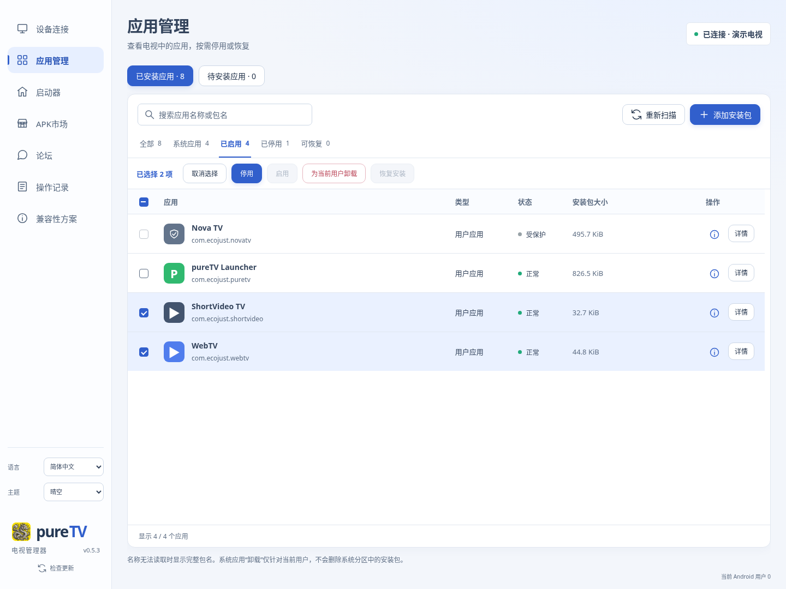
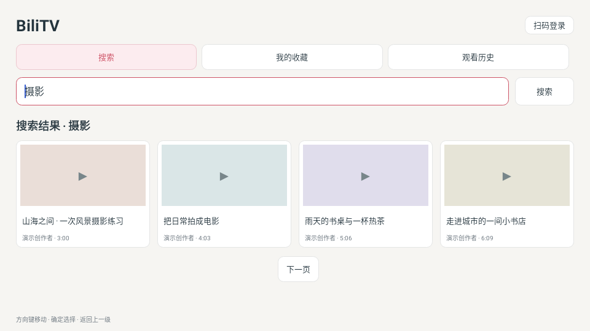
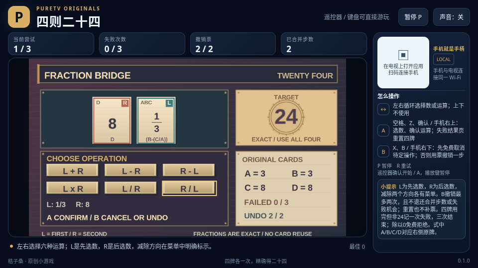
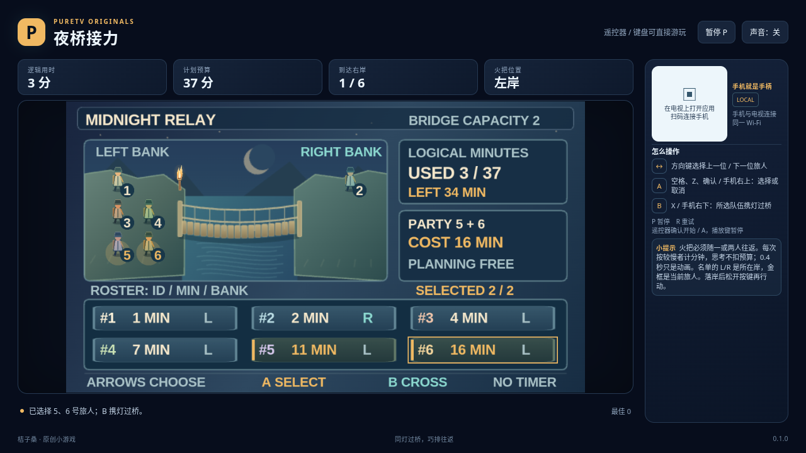
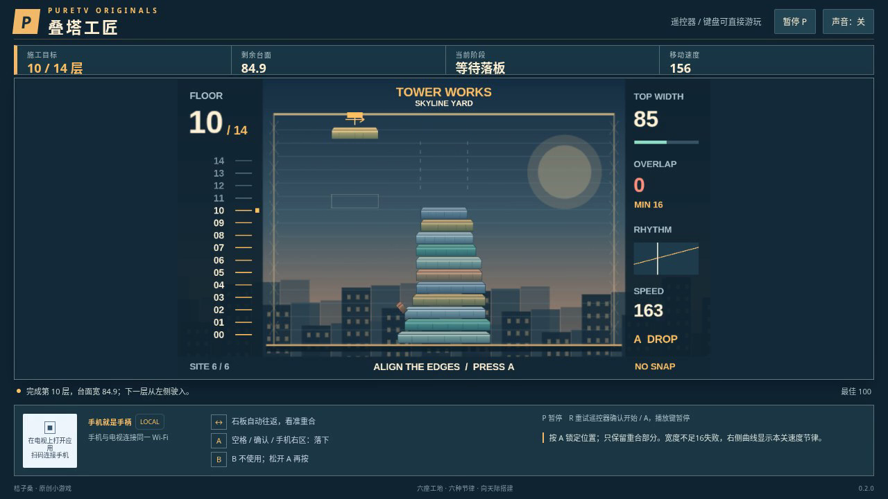
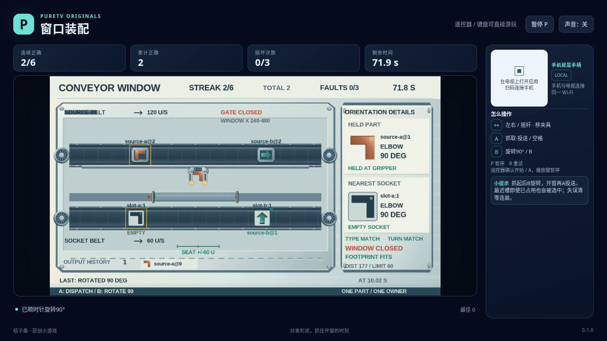
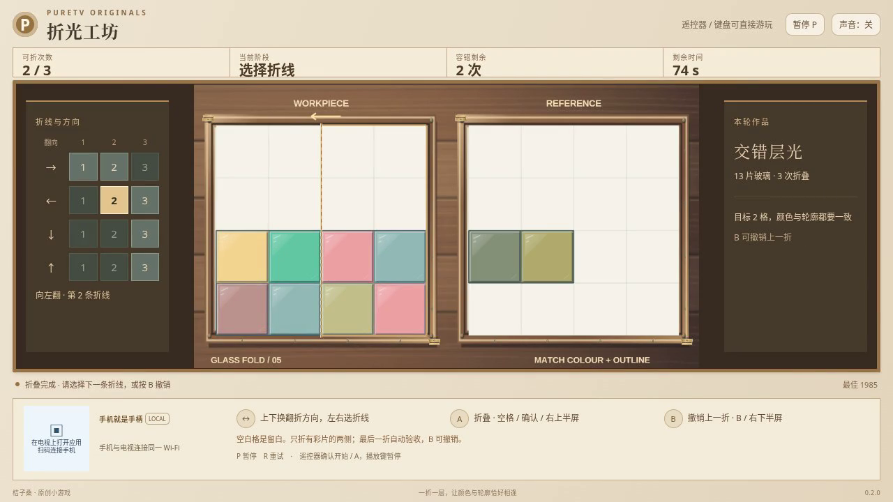
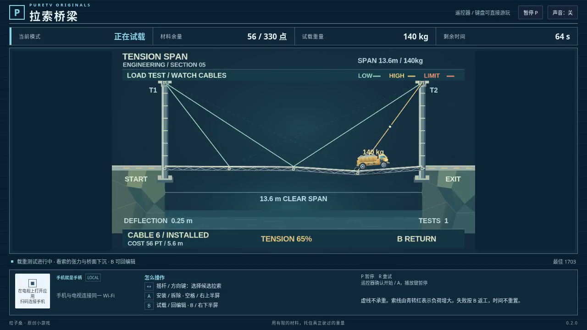
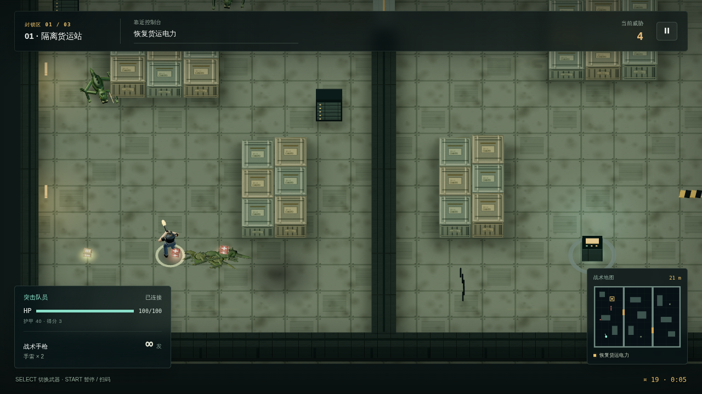
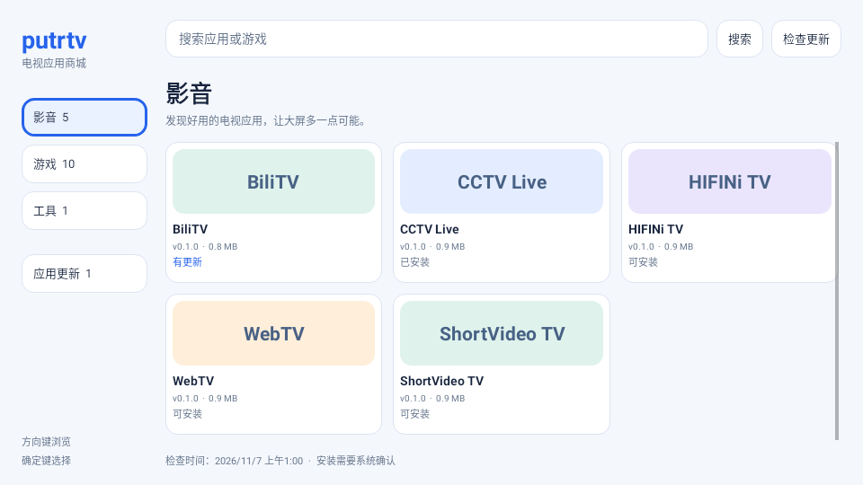

**简体中文** | [English](README.en.md)

  

pureTV 是电脑端的 Android TV / Google TV 系统管理器。通过 ADB 连接电视，查看系统信息，安装、卸载、启停应用，选择启动器，并用可视化画布自定义支持的桌面。也可通过 MCP 让 Agent 控制已打开的管理器。

[下载 pureTV Manager 0.5.4](https://github.com/ecojust/pureTV/releases/tag/desktop-v0.5.4) · Windows / macOS / Linux · 新主题与兼容性方案页面

[下载电视端 putrtv商城 0.1.1](resource/apps/putrtv-store/putrtv-store-0.1.1.apk?raw=1) · 在电视上浏览、安装和检查应用更新；配合[新版启动器](resource/README.md)可选择位置添加到桌面。

## 连接与应用管理

1. 电脑和电视接入可互通的网络，在电视开发者选项中开启 ADB／网络调试。
2. 首页输入电视 IP／主机名与调试端口，在电视上允许电脑连接。常见端口为 5555，以电视实际设置为准。
3. 缺少 ADB 时，阅读并同意 Android SDK 许可后点击「下载并配置 ADB」；优先 Google，失败时使用腾讯镜像。也可选择已有 ADB。

连接后首页显示型号、Android／SDK／安全补丁、CPU、内存、`/data` 磁盘容量、分辨率及运行时间。其他页面顶部保留当前连接状态。

- **应用管理**：搜索和分类，批量启用／停用、为当前用户卸载、恢复仍保有安装包的系统应用。
- **包名说明**：点击应用行中的圆圈 **i**，查询包的用途、卸载风险、资料来源与获取时间；未知包明确提示，当前默认桌面与核心组件的保护优先。
- **客户端更新**：启动后或手动检查 Gitee 商店 `client` 目录，按系统匹配新版本；点击「下载并安装」后校验安装包并自动安装、重启。首次从旧版升级及各平台说明见[客户端更新](desktop/docs/client-updates.md)。
- **待安装应用**：导入本地 APK，可在行尾安装单个，也可勾选批量安装；成功项移出队列，失败与未执行项保留。
- **启动器**：导入启动器 APK 后在该页面直接安装，选择／恢复默认桌面；支持接口的当前启动器显示「调整布局」。
- **市场**：动态浏览 [pure-tv-store](https://gitee.com/juzisang331/pure-tv-store) 的应用与启动器，搜索、预览并下载到待安装列表，或连接电视后直接安装；同一应用或启动器的多个版本合并展示，可从下拉框选择最近 5 个版本，默认最新版；仓库新增 APK 后刷新即可发现。下载时一并保存同目录的 `logo.svg`，布局编辑器新增应用块或切换应用时自动使用该图标。
- 应用与启动器均显示主 APK 与分包的合计大小，不含私有数据、缓存与优化文件，无法读取时明确显示未知。
- 列表内部滚动，表头和顶部批量操作固定；核心系统组件与当前默认启动器受保护。

系统应用卸载只针对当前 Android 用户，保留数据，不删除系统分区 APK。新安装且具备启动入口的用户应用可加入启动器排布。

主动执行连接、刷新、应用管理、启动器切换或布局应用等操作时，管理器显示等待状态，完成后弹窗反馈结果。批量任务区分成功、失败和未执行项；后台自动读取不会反复弹窗。

## 启动器与电视应用资源

公共目录为 [resource/](resource/)，分为 [launcher/](resource/launcher/) 与 [apps/](resource/apps/)，原根目录的启动器和应用源码已整体移入。启动器和电视应用 APK 放在各自软件目录，也可通过独立的 `android-v*` Release 下载；电脑管理器保留单独的 `desktop-v*` 版本与最新发布入口。每个软件文件夹至少包含一个实际 APK，可同时提供对应版本源码、封面、作者、许可证及 SHA256。点击软件名称进入对应文件夹。每个电视应用目录还提供 64×64 的 `logo.svg`，供启动器布局使用；后续应用遵循[资源约定](resource/README-development.md#应用资源与-logosvg-约定)。

九款游戏的 0.5.1 规则与交互改进见[还原度复核](docs/game-fidelity-0.5.1.md)。沿用 0.5.0 统一证书，可覆盖更新 0.5.0；文档同时列出仍未精确还原的地图与内容。

启动器布局自定义使用本管理器的 **layout.json 版本 5 users/system 接口**。支持布局协议的启动器卡片自动显示 Home 背景颜色和图片，包括未激活的启动器；修改并应用布局后同步更新。列表不提供选择或移除封面的操作，桌面背景统一在「调整布局」中修改。待安装 APK 优先预览内置布局的 Home 背景，仅在无法读取布局背景时使用同目录的 `thumb.png`／`APK名.thumb.png`。

新增百款游戏暂选八款在本页展示，原有游戏仍保留；全部资源见 [完整资源目录](resource/README.md)。

<!-- resource-index:start -->

### 启动器（10）

<table>
  <tr>
    <td align="center" valign="top" width="25%"><a href="resource/launcher/sol/"> Sol TV</a></td>
    <td align="center" valign="top" width="25%"><a href="resource/launcher/pixel/"> Pixel TV 像素</a></td>
    <td align="center" valign="top" width="25%"><a href="resource/launcher/moss/"> Moss TV</a></td>
    <td align="center" valign="top" width="25%"><a href="resource/launcher/mono/"> Mono TV 墨白</a></td>
  </tr>
  <tr>
    <td align="center" valign="top" width="25%"><a href="resource/launcher/forma/"> Forma TV</a></td>
    <td align="center" valign="top" width="25%"><a href="resource/launcher/drift/"> Drift TV</a></td>
    <td align="center" valign="top" width="25%"><a href="resource/launcher/circuit/"> Circuit TV · 回路</a></td>
    <td align="center" valign="top" width="25%"><a href="resource/launcher/aster/"> Aster TV · 星轨</a></td>
  </tr>
  <tr>
    <td align="center" valign="top" width="25%"><a href="resource/launcher/nova/"> Nova TV</a></td>
    <td align="center" valign="top" width="25%"><a href="resource/launcher/puretv/"> pureTV Launcher</a></td>
    <td width="25%"></td>
    <td width="25%"></td>
  </tr>
</table>

### 应用-影音（5）

<table>
  <tr>
    <td align="center" valign="top" width="25%"><a href="resource/apps/bilibili/"> BiliTV</a></td>
    <td align="center" valign="top" width="25%"><a href="resource/apps/cctv/"> CCTV Live</a></td>
    <td align="center" valign="top" width="25%"><a href="resource/apps/hifini/"> HIFINi TV</a></td>
    <td align="center" valign="top" width="25%"><a href="resource/apps/webtv/"> WebTV</a></td>
  </tr>
  <tr>
    <td align="center" valign="top" width="25%"><a href="resource/apps/shortvideo/"> ShortVideo TV</a></td>
    <td width="25%"></td>
    <td width="25%"></td>
    <td width="25%"></td>
  </tr>
</table>

### 应用-游戏（19）

<table>
  <tr>
    <td align="center" valign="top" width="25%"><a href="resource/apps/twenty-four/"> 四则二十四</a></td>
    <td align="center" valign="top" width="25%"><a href="resource/apps/torch-bridge/"> 夜桥接力</a></td>
    <td align="center" valign="top" width="25%"><a href="resource/apps/tower-overlap/"> 叠塔工匠</a></td>
    <td align="center" valign="top" width="25%"><a href="resource/apps/packing-sculptor/"> 异形装箱</a></td>
  </tr>
  <tr>
    <td align="center" valign="top" width="25%"><a href="resource/apps/conveyor-window/"> 窗口装配</a></td>
    <td align="center" valign="top" width="25%"><a href="resource/apps/glass-fold/"> 折光工坊</a></td>
    <td align="center" valign="top" width="25%"><a href="resource/apps/tension-span/"> 拉索桥梁</a></td>
    <td align="center" valign="top" width="25%"><a href="resource/apps/prism-relay/"> 镜光接力</a></td>
  </tr>
  <tr>
    <td align="center" valign="top" width="25%"><a href="resource/apps/alien-shooter/"> 孤胆枪手 TV</a></td>
    <td align="center" valign="top" width="25%"><a href="resource/apps/used-car-racing/"> 极品二手车</a></td>
    <td align="center" valign="top" width="25%"><a href="resource/apps/cozy-island/"> Cozy Island TV</a></td>
    <td align="center" valign="top" width="25%"><a href="resource/apps/coast-kart/"> Coast Kart TV</a></td>
  </tr>
  <tr>
    <td align="center" valign="top" width="25%"><a href="resource/apps/super-mario/"> Super Mario TV</a></td>
    <td align="center" valign="top" width="25%"><a href="resource/apps/bomb-jack/"> Mighty Bomb Jack TV</a></td>
    <td align="center" valign="top" width="25%"><a href="resource/apps/adventure-island/"> Adventure Island TV</a></td>
    <td align="center" valign="top" width="25%"><a href="resource/apps/tetris/"> Tetris TV</a></td>
  </tr>
  <tr>
    <td align="center" valign="top" width="25%"><a href="resource/apps/jewel/"> Magic Jewelry TV</a></td>
    <td align="center" valign="top" width="25%"><a href="resource/apps/jackal/"> Jackal TV</a></td>
    <td align="center" valign="top" width="25%"><a href="resource/apps/tank/"> Tank TV</a></td>
    <td width="25%"></td>
  </tr>
</table>

### 应用-工具（1）

<table>
  <tr>
    <td align="center" valign="top" width="25%"><a href="resource/apps/putrtv-store/"> putrtv商城</a></td>
    <td width="25%"></td>
    <td width="25%"></td>
    <td width="25%"></td>
  </tr>
</table>

<!-- resource-index:end -->

## MCP / Agent

在「设备连接 → MCP · Agent 调试」复制配置到客户端，保持管理器窗口打开。34 个工具覆盖系统信息、连接、应用管理、APK 安装、启动器切换与布局、市场目录／下载／安装、背景图、ADB 配置、语言与主题、取消及记录；Agent 与界面共享状态。

[完整 MCP 接入与参数](desktop/docs/mcp.md)。

## 开发文档

构建与测试说明见 [resource 开发 README](resource/README-development.md)。

### 自定义启动器布局

`layout.json` 是连接启动器与管理器显示的协议文件：电视和电脑使用同一份布局，管理器可以重现桌面并调整应用块。Home 和 Apps 支持独立背景、布局与切页设置；用户应用可编辑，系统组件仅供查看。

在启动器页面选择「调整布局」，可添加已安装用户应用、拖动、框选、对齐或平铺排布，确认后应用到电视。使用新版布局需同时更新管理器与配套启动器。

完整字段说明、JSON 示例与画面对照见 [layout.json 协议规范](resource/README-development.md#layoutjson-协议规范与画面对照)。

## 许可与致谢

pureTV 使用 [MIT](LICENSE) 许可。部分电视端启动器代码参考 [Gathin23/cleanyourtv](https://github.com/Gathin23/cleanyourtv)，原作者版权与许可保留于 [NOTICE.md](NOTICE.md)。字体见 [OFL 许可](resource/launcher/puretv/FONT-LICENSE-OFL.txt)。应用使用的第三方代码、字体和其他素材保留各自的版权及许可声明。
