**简体中文** | [English](README.en.md)

  

pureTV 是电脑端的 Android TV / Google TV 系统管理器。通过 ADB 连接电视，查看系统信息，安装、卸载、启停应用，选择启动器，并用可视化画布自定义支持的桌面。也可通过 MCP 让 Agent 控制已打开的管理器。

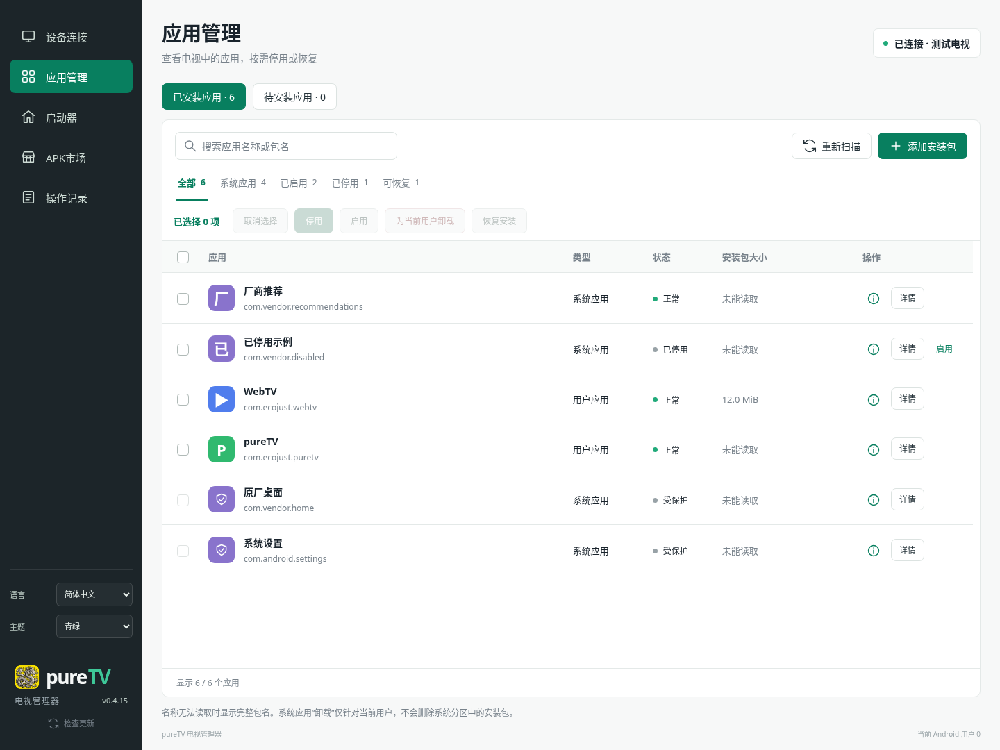

## 连接与应用管理

1. 电脑和电视接入可互通的网络，在电视开发者选项中开启 ADB／网络调试。
2. 首页输入电视 IP／主机名与调试端口，在电视上允许电脑连接。常见端口为 5555，以电视实际设置为准。
3. 缺少 ADB 时，阅读并同意 Android SDK 许可后点击「下载并配置 ADB」；优先 Google，失败时使用腾讯镜像。也可选择已有 ADB。

连接后首页显示型号、Android／SDK／安全补丁、CPU、内存、`/data` 磁盘容量、分辨率及运行时间。其他页面顶部保留当前连接状态。

- **应用管理**：搜索和分类，批量启用／停用、为当前用户卸载、恢复仍保有安装包的系统应用。
- **包名说明**：点击应用行中的圆圈 **i**，查询包的用途、卸载风险、资料来源与获取时间；未知包明确提示，当前默认桌面与核心组件的保护优先。
- **客户端更新**：启动后或手动检查 Gitee 商店 `client` 目录，按系统匹配新版本；点击「下载并安装」后校验安装包并自动安装、重启。首次从旧版升级及各平台说明见[客户端更新](desktop/docs/client-updates.md)。
- **待安装应用**：导入本地 APK，可在行尾安装单个，也可勾选批量安装；成功项移出队列，失败与未执行项保留。
- **启动器**：导入启动器 APK 后在该页面直接安装，选择／恢复默认桌面；支持接口的当前启动器显示「调整布局」。
- **市场**：动态浏览 [pure-tv-store](https://gitee.com/juzisang331/pure-tv-store) 的应用与启动器，搜索、预览并下载到待安装列表，或连接电视后直接安装；同一应用或启动器的多个版本合并展示，可从下拉框选择最近 5 个版本，默认最新版；仓库新增 APK 后刷新即可发现。下载时一并保存同目录的 `logo.svg`，布局编辑器新增应用块或切换应用时自动使用该图标。
- 应用与启动器均显示主 APK 与分包的合计大小，不含私有数据、缓存与优化文件，无法读取时明确显示未知。
- 列表内部滚动，表头和顶部批量操作固定；核心系统组件与当前默认启动器受保护。

系统应用卸载只针对当前 Android 用户，保留数据，不删除系统分区 APK。新安装且具备启动入口的用户应用可加入启动器排布。

主动执行连接、刷新、应用管理、启动器切换或布局应用等操作时，管理器显示等待状态，完成后弹窗反馈结果。批量任务区分成功、失败和未执行项；后台自动读取不会反复弹窗。

## 启动器与电视应用资源

[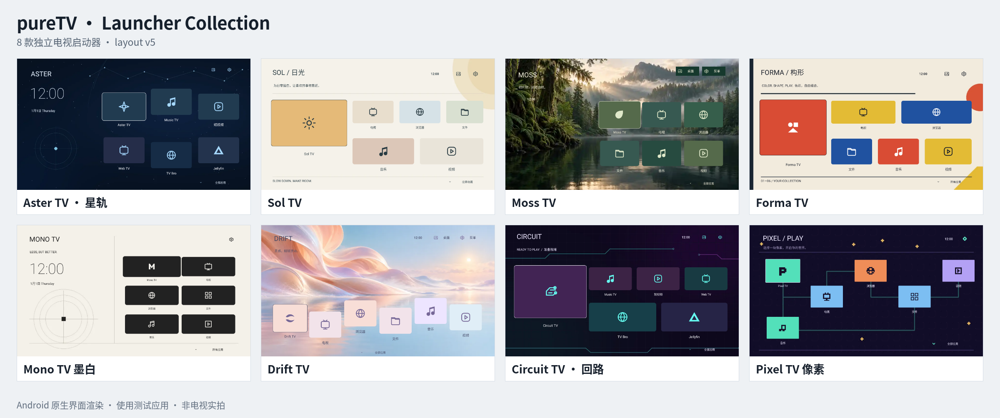](resource/launcher/)

公共目录为 [resource/](resource/)，分为 [launcher/](resource/launcher/) 与 [apps/](resource/apps/)，原根目录的启动器和应用源码已整体移入。启动器和电视应用 APK 放在各自软件目录，也可通过独立的 `android-v*` Release 下载；电脑管理器保留单独的 `desktop-v*` 版本与最新发布入口。每个软件文件夹至少包含一个实际 APK，可同时提供对应版本源码、封面、作者、许可证及 SHA256。点击软件名称进入对应文件夹。每个电视应用目录还提供 64×64 的 `logo.svg`，供启动器布局使用；后续应用遵循[资源约定](resource/README-development.md#应用资源与-logosvg-约定)。

九款游戏的 0.5.1 规则与交互改进见[还原度复核](docs/game-fidelity-0.5.1.md)。沿用 0.5.0 统一证书，可覆盖更新 0.5.0；文档同时列出仍未精确还原的地图与内容。

启动器表格的“支持自定义”指支持本管理器的 **layout.json 版本 5 users/system 接口**。支持布局协议的启动器卡片自动显示 Home 背景颜色和图片，包括未激活的启动器；修改并应用布局后同步更新。列表不提供选择或移除封面的操作，桌面背景统一在「调整布局」中修改。待安装 APK 优先预览内置布局的 Home 背景，仅在无法读取布局背景时使用同目录的 `thumb.png`／`APK名.thumb.png`。

<!-- resource-index:start -->

### 启动器

| 名称 | 作者 | 版本 | APK 大小 | 支持自定义 | 封面截图 |
| --- | --- | --- | --- | --- | --- |
| [Aster TV · 星轨](resource/launcher/aster/) | ecojust / 桔子桑 | 0.5.0 | 443.7 KB | 是 | 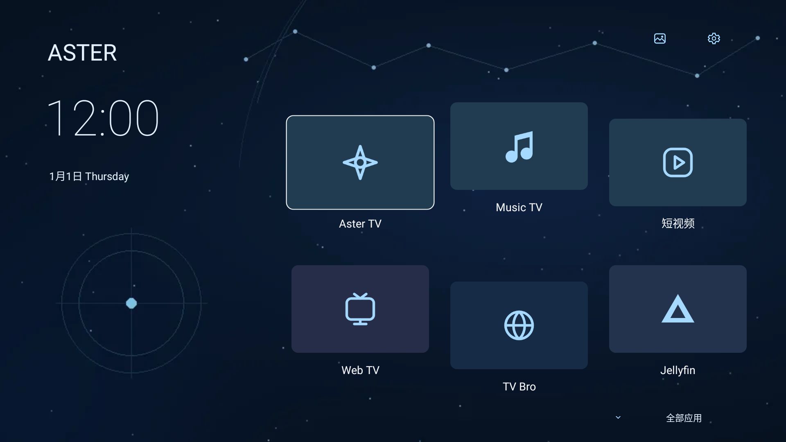 |
| [Circuit TV · 回路](resource/launcher/circuit/) | ecojust / 桔子桑 | 0.5.0 | 435.7 KB | 是 | 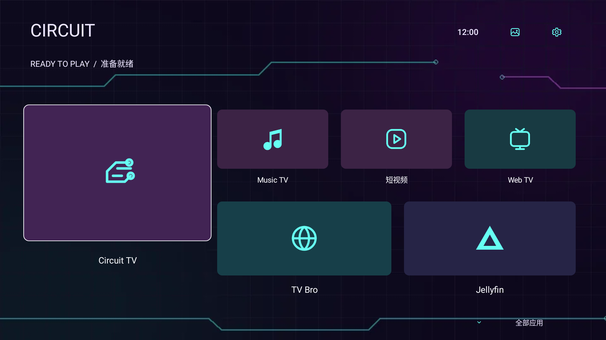 |
| [Drift TV](resource/launcher/drift/) | ecojust / 桔子桑 | 0.5.0 | 475.7 KB | 是 | 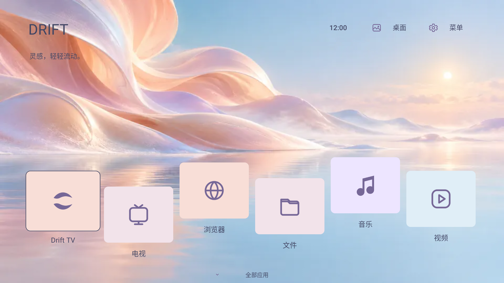 |
| [Forma TV](resource/launcher/forma/) | ecojust / 桔子桑 | 0.5.0 | 443.7 KB | 是 | 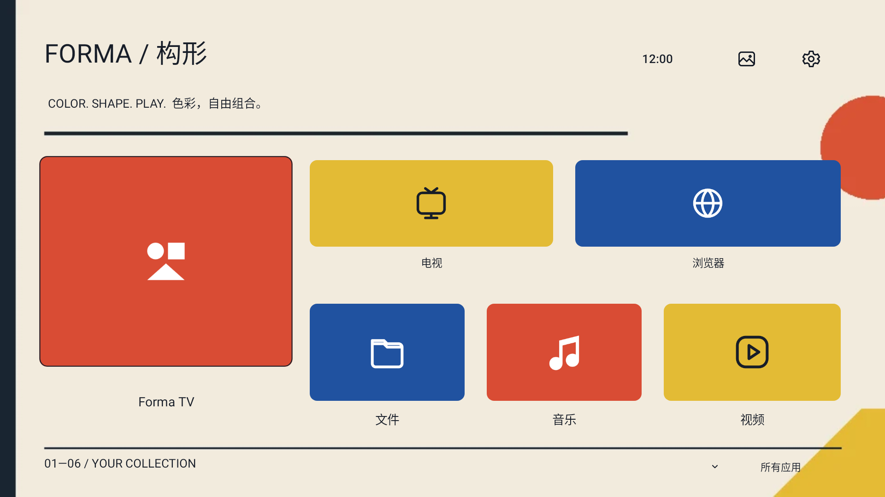 |
| [Mono TV 墨白](resource/launcher/mono/) | ecojust / 桔子桑 | 0.5.0 | 443.7 KB | 是 | 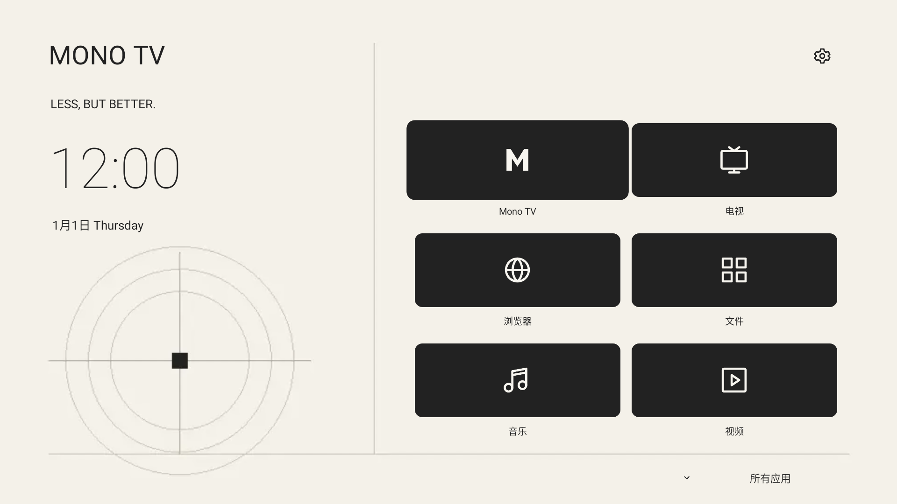 |
| [Moss TV](resource/launcher/moss/) | ecojust / 桔子桑 | 0.5.0 | 487.7 KB | 是 | 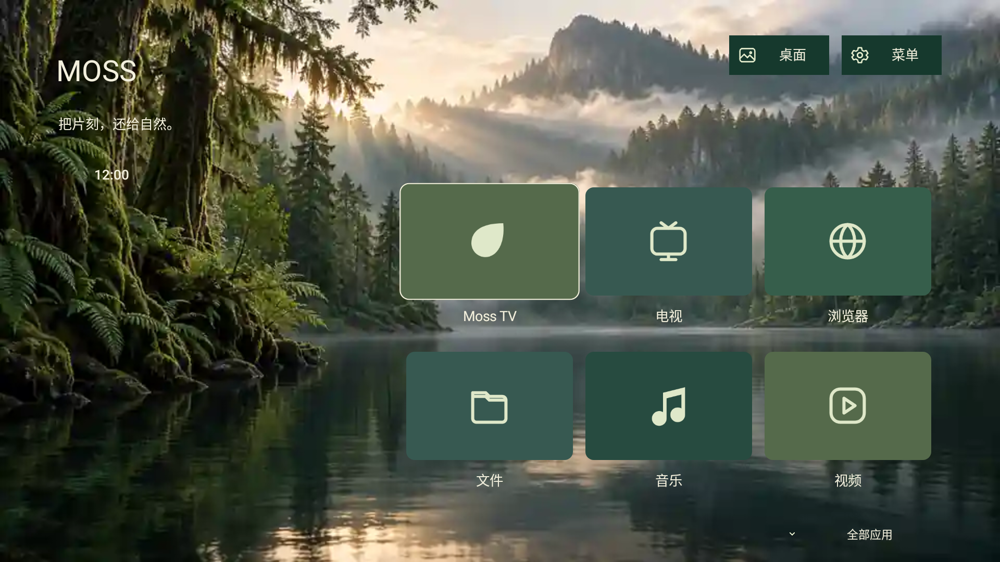 |
| [Nova TV](resource/launcher/nova/) | ecojust / 桔子桑 | 0.5.0 | 495.7 KB | 是 | 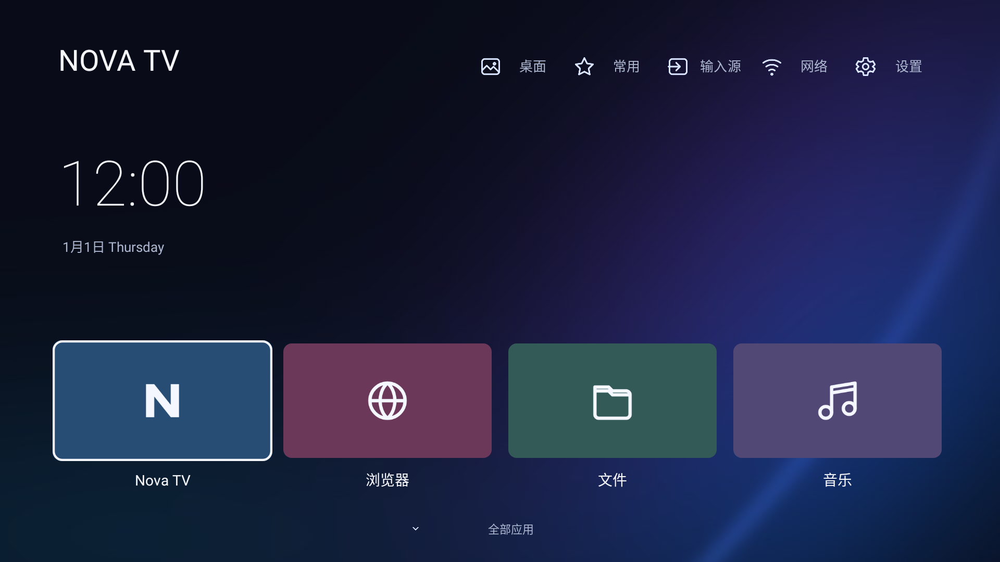 |
| [Pixel TV 像素](resource/launcher/pixel/) | ecojust / 桔子桑 | 0.5.0 | 443.7 KB | 是 | 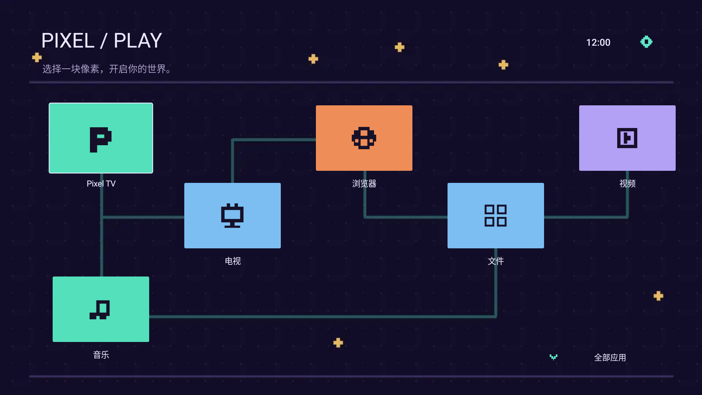 |
| [pureTV Launcher](resource/launcher/puretv/) | ecojust / 桔子桑 | 0.5.1 | 826.5 KB | 是 | 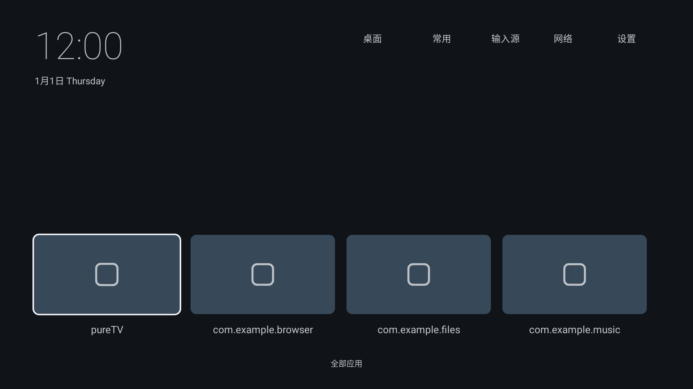 |
| [Sol TV](resource/launcher/sol/) | ecojust / 桔子桑 | 0.5.0 | 439.7 KB | 是 | 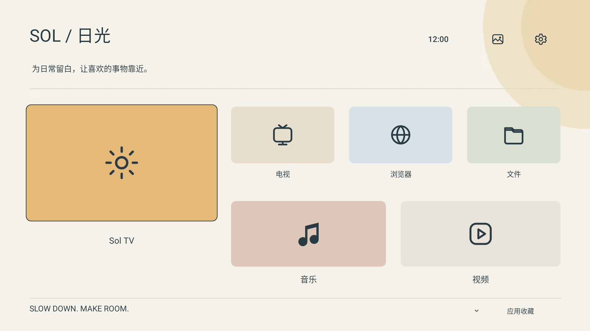 |

### 电视应用

| 名称 | 作者 | 版本 | APK 大小 | 用途 | 封面截图 |
| --- | --- | --- | --- | --- | --- |
| [邻接铸造](resource/apps/adjacency-forge/) | ecojust / 桔子桑 | 0.1.0 | 289.3 KB | 交换七格金属块，满足各自精确邻接配方并按固定方向优先级将热流导向铸模，再主动提交；三张固定布局、精确编号撤销与90秒有效时间，手机扫码单人操作 | 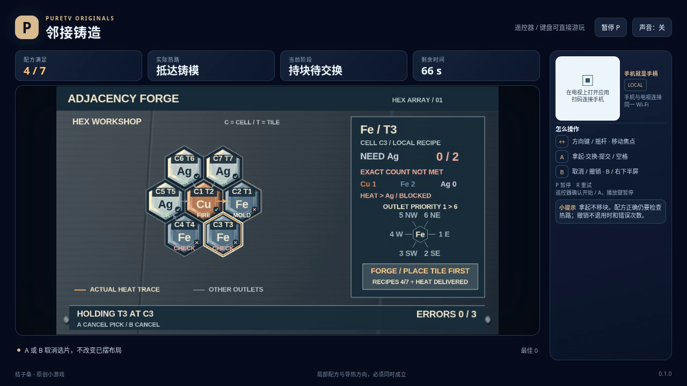 |
| [Adventure Island TV](resource/apps/adventure-island/) | ecojust / 桔子桑 | 0.5.2 | 89.4 KB | 8 区域 32 关横版冒险，支持手机扫码单人或双人轮流 | 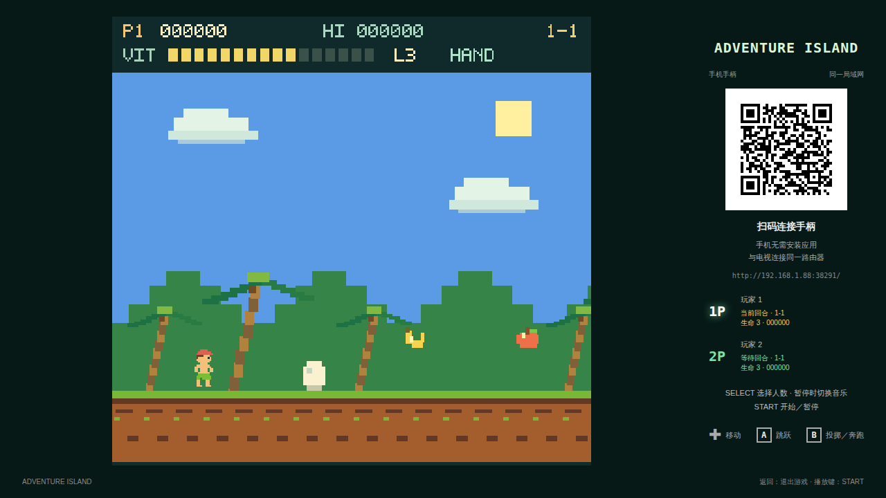 |
| [气闸值守](resource/apps/airlock-budget/) | ecojust / 桔子桑 | 0.1.0 | 289.3 KB | 在待援舱、气闸与安全舱之间安排三组人员，权衡慢回收保氧和快排赶期限；管理有限储罐与共享泵，及时封堵漏点并满足最终储氧底线。 |  |
| [孤胆枪手 TV](resource/apps/alien-shooter/) | ecojust / 桔子桑 | 0.1.2 | 1.68 MB | 工业基地异形群潮单人射击，三关战役、五种武器与手机扫码操作 |  |
| [箭田收获](resource/apps/arrow-harvest/) | ecojust / 桔子桑 | 0.1.0 | 289.3 KB | 设置单向箭头并播种，让种子覆盖所有目标田块且不重复、不进入禁地；传播期间箭头不可修改。 | 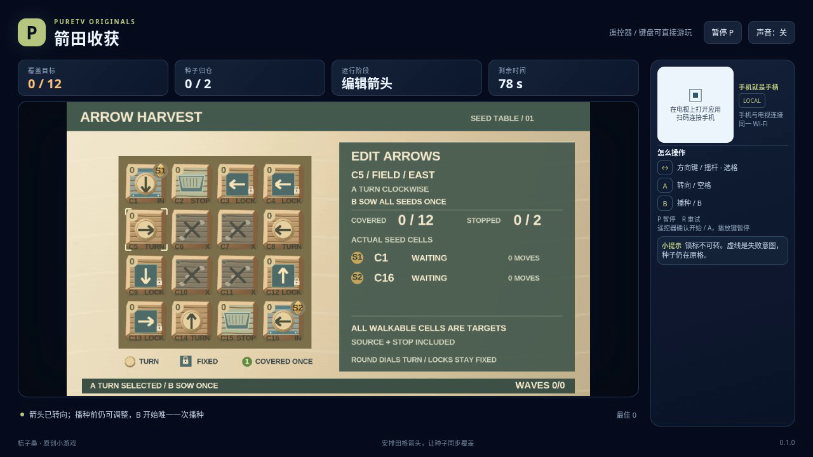 |
| [装配厨房](resource/apps/assembly-kitchen/) | ecojust / 桔子桑 | 0.1.0 | 293.3 KB | 安排煮、冷却与装盒三个共享工位并行工作，切换风速掌握温度，在保温时限与关门前按指定顺序交付三份订单；错温、错序或过期的食物会退回重做并累计失误。 | 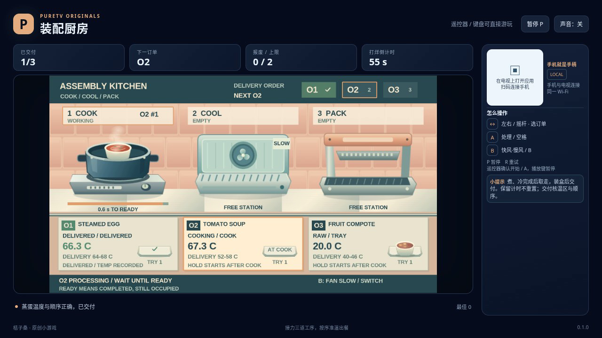 |
| [电芯交换](resource/apps/battery-exchange/) | ecojust / 桔子桑 | 0.1.0 | 293.3 KB | 在断电窗口中交换六枚不同电量与内阻的电芯，为两组负载切换串联或并联；按阶段完成供电任务，同时保留电量余裕并避免电芯或负载过热。 | 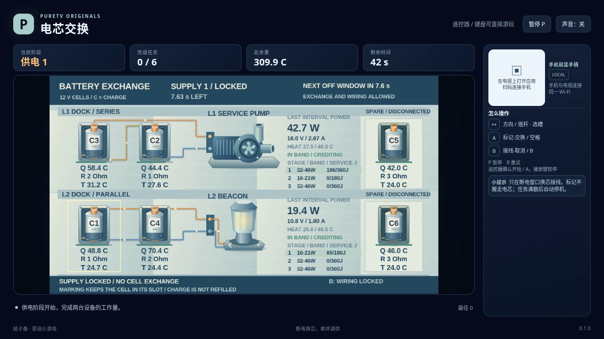 |
| [双线节律](resource/apps/beat-braid/) | ecojust / 桔子桑 | 0.1.0 | 293.3 KB | 一线持续按住，另一线按节拍点按，交替编织并保持连续；完成三个节奏关卡。 |  |
| [Mighty Bomb Jack TV](resource/apps/bomb-jack/) | ecojust / 桔子桑 | 0.5.2 | 85.4 KB | 16 关金字塔跳跃冒险，支持手机扫码单人或双人轮流 | 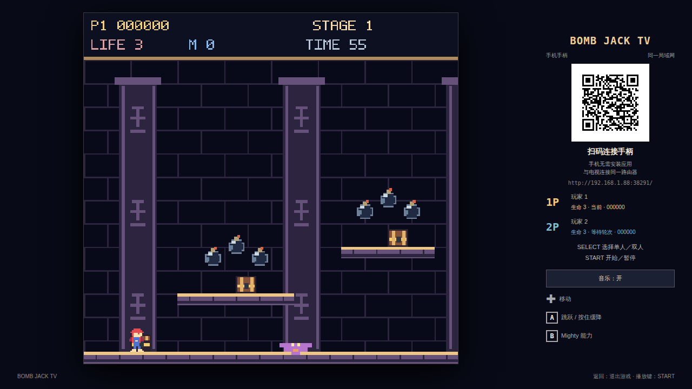 |
| [弹板清砖](resource/apps/brick-paddle/) | ecojust / 桔子桑 | 0.1.0 | 285.3 KB | 左右移动挡板接球，用落点控制反弹方向，守住三条生命并清除三组不同耐久的砖块。 |  |
| [解线工](resource/apps/cable-unweaver/) | ecojust / 桔子桑 | 0.1.0 | 289.3 KB | 沿轨道移动接线端子，保持金属线夹整组联动，消除直线电缆的非法交叉与端子重合；三种工作台，最后一次调整也能完成接线。 | 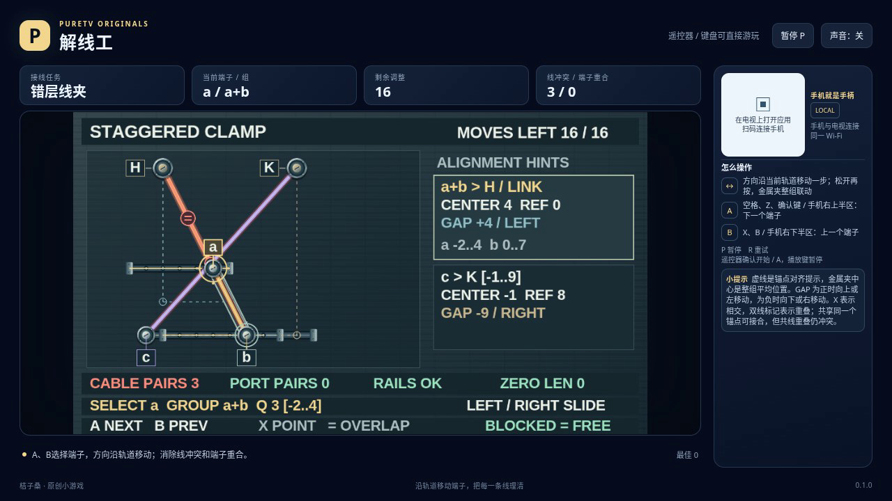 |
| [CCTV Live](resource/apps/cctv/) | ecojust / 桔子桑 | 0.5.0 | 40.9 KB | 央视官网播放器与电视频道导航 | 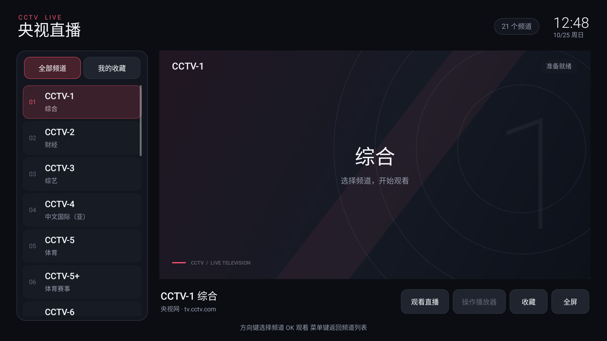 |
| [齿轮同刻](resource/apps/clockwork-align/) | ecojust / 桔子桑 | 0.1.0 | 297.3 KB | 调节齿轮列的离合与制动，在有限调节次数内让所有指针于预约时间窗中持续对齐目标；挑战三种齿比结构。 |  |
| [Coast Kart TV](resource/apps/coast-kart/) | ecojust / 桔子桑 | 0.5.2 | 257.6 KB | 原创卡丁车竞速，支持漂移、道具和手机扫码双人分屏 | 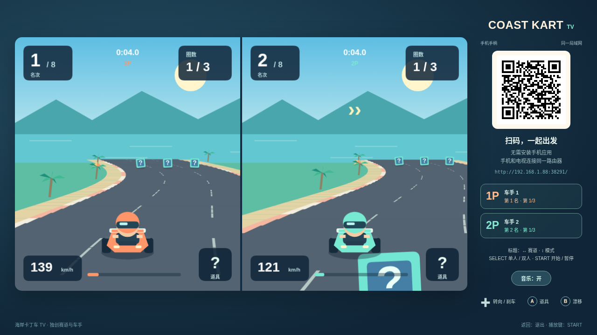 |
| [纹码破译](resource/apps/codebreaker/) | ecojust / 桔子桑 | 0.1.0 | 285.3 KB | 利用位置正确和颜色正确的数量反馈，在有限尝试内破解允许重复图形的四位密码。 | 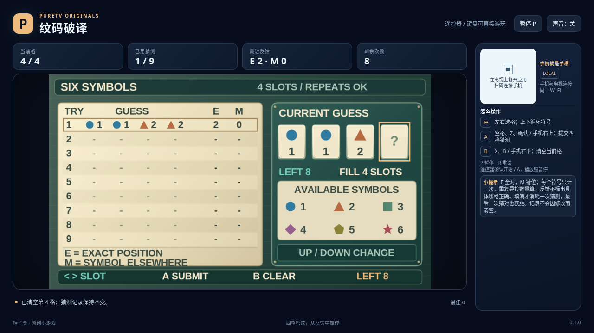 |
| [染色连疆](resource/apps/color-frontier/) | ecojust / 桔子桑 | 0.1.0 | 285.3 KB | 选择染料扩展左上角连通区域，在有限次数内统一全图；只沿四边连通，撤回会恢复地图但不返还染料次数，三张公开地图，支持手机扫码单人操作。 | 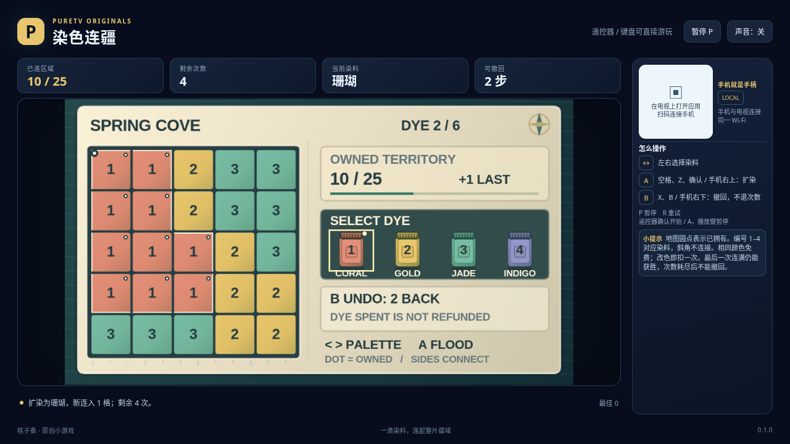 |
| [窗口装配](resource/apps/conveyor-window/) | ecojust / 桔子桑 | 0.1.0 | 297.3 KB | 左右移动夹具抓取零件，旋转到正确朝向，在快门开放时投送到匹配槽位；避免损坏、保持连续装配，完成三条传送线关卡。 |  |
| [Cozy Island TV](resource/apps/cozy-island/) | ecojust / 桔子桑 | 0.5.2 | 269.6 KB | 原创岛屿生活，支持采集、钓鱼、布置和手机扫码双人游玩 | 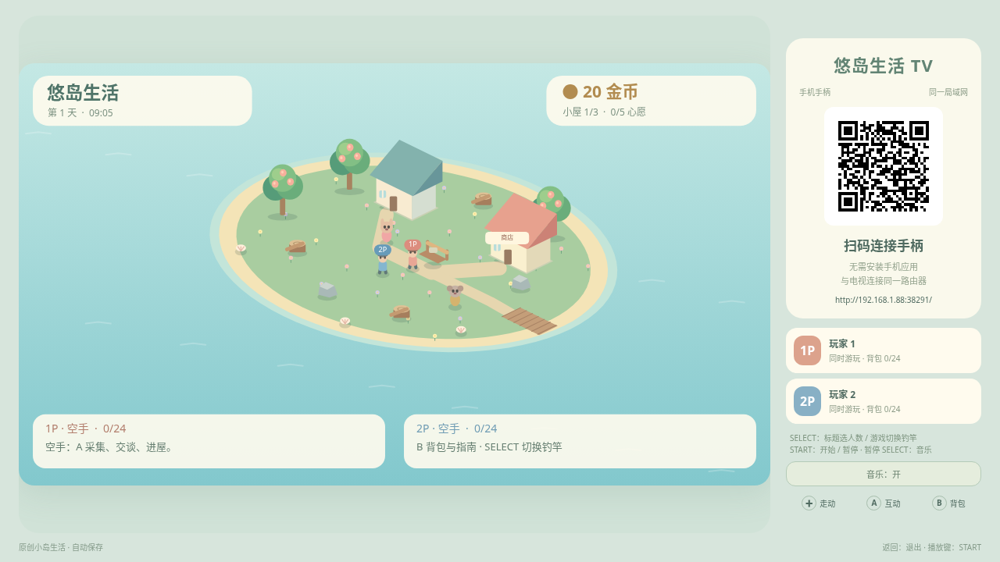 |
| [点线围格](resource/apps/dots-boxes/) | ecojust / 桔子桑 | 0.1.0 | 285.3 KB | 选择边线围成方格，利用得格续手掌握回合节奏，与公开规则的对手争夺最后一格。 |  |
| [跳吃棋径](resource/apps/draughts-trail/) | ecojust / 桔子桑 | 0.1.0 | 285.3 KB | 在六路跳棋残局中强制连跳吃子，保护兵并升为王棋，遵循合法移动击败公开规则的对手。 | 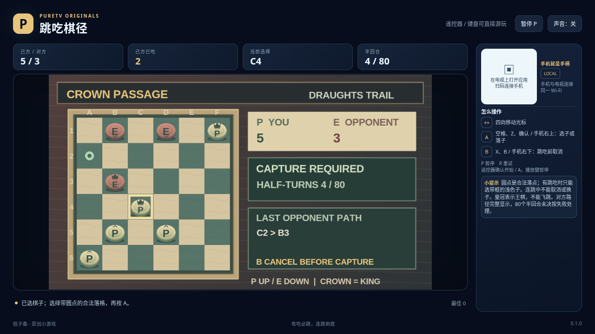 |
| [回声探图](resource/apps/echo-cartographer/) | ecojust / 桔子桑 | 0.1.0 | 289.3 KB | 在有限照明下发射声呐测绘暗室，控制脚步噪声避开巡逻机，收集信标后返回入口，支持手机扫码单人操作 |  |
| [防火带](resource/apps/firebreak-planner/) | ecojust / 桔子桑 | 0.1.0 | 289.3 KB | 用有限行动点提前清理防火带，依据固定变风与累积热量阻断同时蔓延的山火；保护全部村落与至少七成存活森林，清理本身也会减少林木。 |  |
| [四子列阵](resource/apps/four-in-row/) | ecojust / 桔子桑 | 0.1.0 | 285.3 KB | 在七列棋盘中让棋子按重力落下，与会预判落点的对手较量，率先横、竖或斜连四子。 |  |
| [冰面刹停](resource/apps/frost-brake/) | ecojust / 桔子桑 | 0.1.0 | 289.3 KB | 左右推动惯性货橇，按住 A 放下冰爪，只有结霜带提供额外制动；完整停入逐渐收窄的交付区并驻留，避开冰面边界和急刹造成的货损。 |  |
| [折光工坊](resource/apps/glass-fold/) | ecojust / 桔子桑 | 0.1.0 | 289.3 KB | 沿折线翻叠半透明彩片，用轮廓与叠色匹配目标花窗；三张谜题、有限折叠与90秒有效时间，支持撤销修正和手机扫码单人操作 |  |
| [引力快递](resource/apps/gravity-courier/) | ecojust / 桔子桑 | 0.1.1 | 285.3 KB | 驾驶惯性小艇绕行引力星体，管理燃料并完成三次星际配送，支持手机扫码单人操作 |  |
| [温室旋钮](resource/apps/greenhouse-dials/) | ecojust / 桔子桑 | 0.1.0 | 289.3 KB | 通过延迟生效的通风、遮阳和滴灌控制调节共享温湿度与土壤水分，管理有限水量，使三种作物分别达到成熟度并避免枯死。 |  |
| [港口配重](resource/apps/harbor-counterweight/) | ecojust / 桔子桑 | 0.1.0 | 293.3 KB | 按指定顺序装卸六件货物，在吊机作业时移动配重控制船体横摇；保持货物可取，完成四件交付后让两件出口货物稳定离港。 | 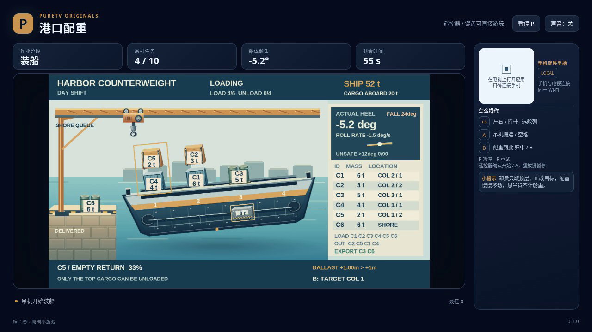 |
| [六角连线](resource/apps/hex-connection/) | ecojust / 桔子桑 | 0.1.0 | 285.3 KB | 在六角棋盘上落子连接左右两岸，识别六邻接通路并阻挡试图连通上下边的公开规则对手。 | 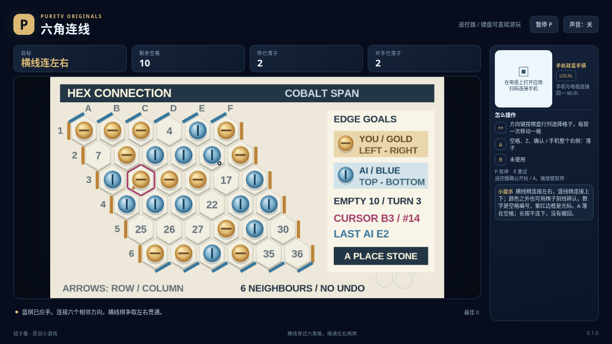 |
| [隐墙测绘](resource/apps/hidden-corridors/) | ecojust / 桔子桑 | 0.1.0 | 289.3 KB | 依据每行通路格数与最短边数，用有限探针推断4×4隐藏墙体，再提交安全且长度正确的路线；三关固定布局，支持手机扫码单人操作 | 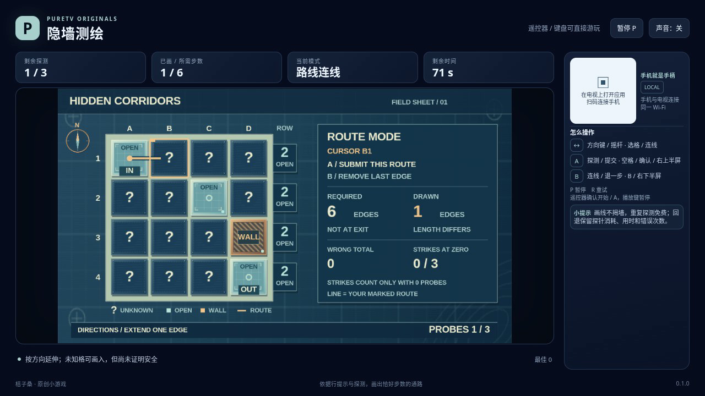 |
| [HIFINi TV](resource/apps/hifini/) | ecojust / 桔子桑 | 0.5.0 | 201.1 KB | 基于 HiFiNi 的电视音乐播放器 | 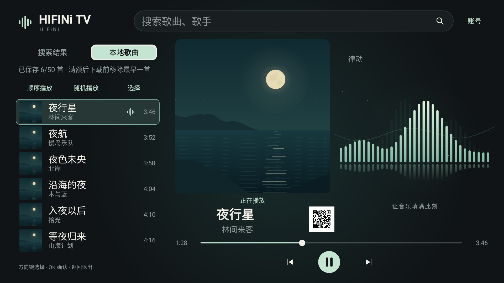 |
| [双岛联结](resource/apps/island-dominoes/) | ecojust / 桔子桑 | 0.1.0 | 289.3 KB | 按桥牌的直线长度与目标颜色连结岛屿，避开交叉并用尽所有独立桥牌组成连通网络；支持原片撤销，三关固定布局与90秒时限，手机扫码单人操作 |  |
| [Jackal TV](resource/apps/jackal/) | ecojust / 桔子桑 | 0.5.2 | 11.95 MB | 独立重写的六关吉普车营救游戏，支持手机扫码双人合作 | 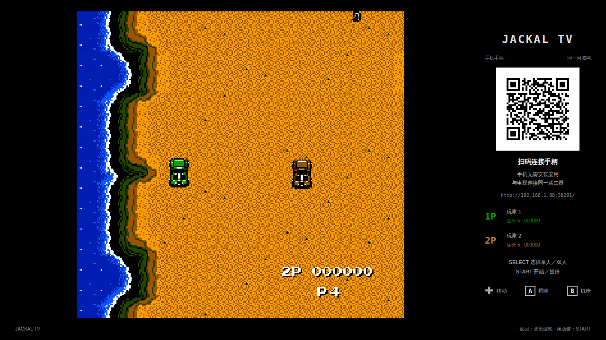 |
| [Magic Jewelry TV](resource/apps/jewel/) | ecojust / 桔子桑 | 0.5.2 | 81.4 KB | 经典三宝石连锁消除，支持手机扫码单人或双人比拼 | 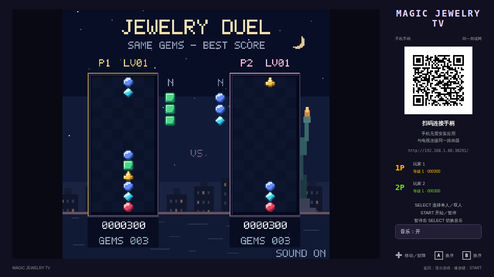 |
| [万花钥匙](resource/apps/kaleido-keys/) | ecojust / 桔子桑 | 0.1.0 | 289.3 KB | 把有限图符摆进源扇区，旋转并选择万花阶数，让整圈镜像钥匙与目标完全一致；核对左右交换、朝向与空格后验收，四次错误即失败，无倒计时。 |  |
| [马步巡游](resource/apps/knight-circuit/) | ecojust / 桔子桑 | 0.1.0 | 285.3 KB | 按国际象棋马的跳法巡游棋盘，每个可走格只能访问一次；规划三种不同棋盘的完整路线，管理三张回退券，避免走入死路，支持手机扫码单人操作。 | 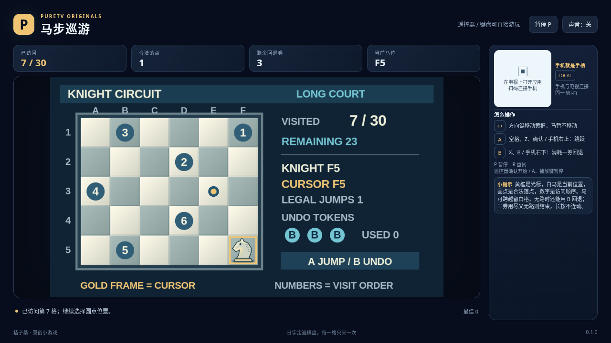 |
| [灯塔节拍](resource/apps/lantern-rhythm/) | ecojust / 桔子桑 | 0.1.0 | 289.3 KB | 观察方向与短长灯号，再按节拍真实按住并松开按钮，依次点亮三座灯塔；两次主动重听、有限失误与90秒有效时间，支持手机扫码单人操作 |  |
| [焦距实验室](resource/apps/lens-distance/) | ecojust / 桔子桑 | 0.1.0 | 289.3 KB | 原创单人光学益智游戏：移动透镜和屏幕，调节光阑，让实像的清晰度与亮度同时达标。三个光台各有两张底片，分别管理曝光电量与调整额度；手机方向区和上下双操作区控制。 |  |
| [环线果园](resource/apps/loop-orchard/) | ecojust / 桔子桑 | 0.1.0 | 289.3 KB | 在格点之间铺设一条连通闭环，经过必经果树、避开禁水花坛并满足数字区域的边数提示；带编号管件可铺拆和精确撤销，剩余库存允许，须主动启动水泵，三次错误或90秒结束，手机扫码单人操作 | 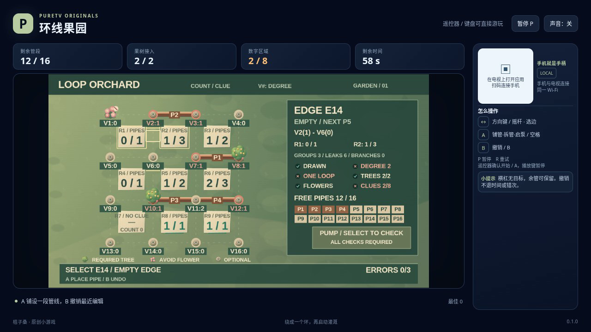 |
| [磁极仓库](resource/apps/magnetic-warehouse/) | ecojust / 桔子桑 | 0.1.0 | 289.3 KB | 切换磁极，隔空吸引或排斥编号货箱；处理墙体遮挡与同步移动，在有限行动内把每箱送到对应货位，支持手机扫码单人操作 |  |
| [量杯转运](resource/apps/measure-pour/) | ecojust / 桔子桑 | 0.1.0 | 285.3 KB | 在三只不同容量的量杯间倾倒，每次必须倒满接收杯或倒空来源杯；保持总水量守恒，在有限倾倒次数内让三杯同时达到公开目标。三个配额关卡，支持手机扫码操作。 | 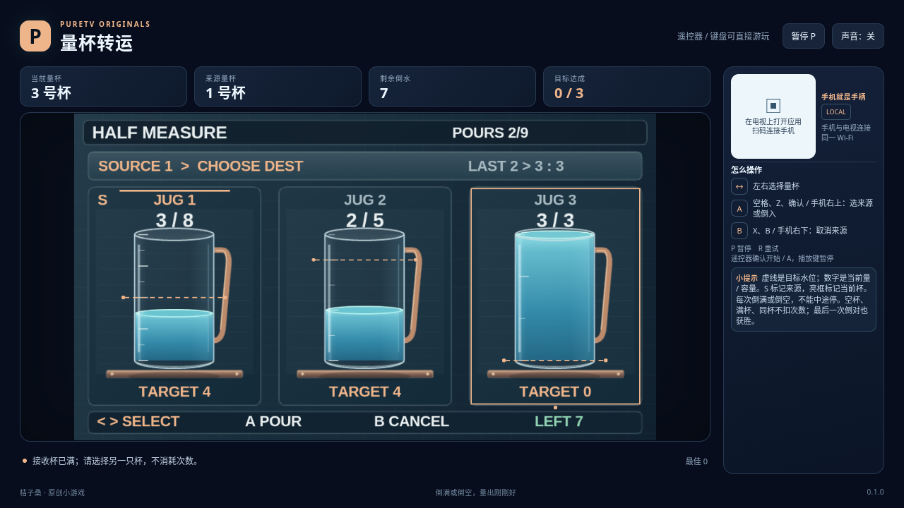 |
| [记忆陈列](resource/apps/memory-gallery/) | ecojust / 桔子桑 | 0.1.0 | 285.3 KB | 记住短暂亮出的图形与编号，在有限错配次数内翻开全部相同展品。支持电视遥控器与局域网手机手柄。 | 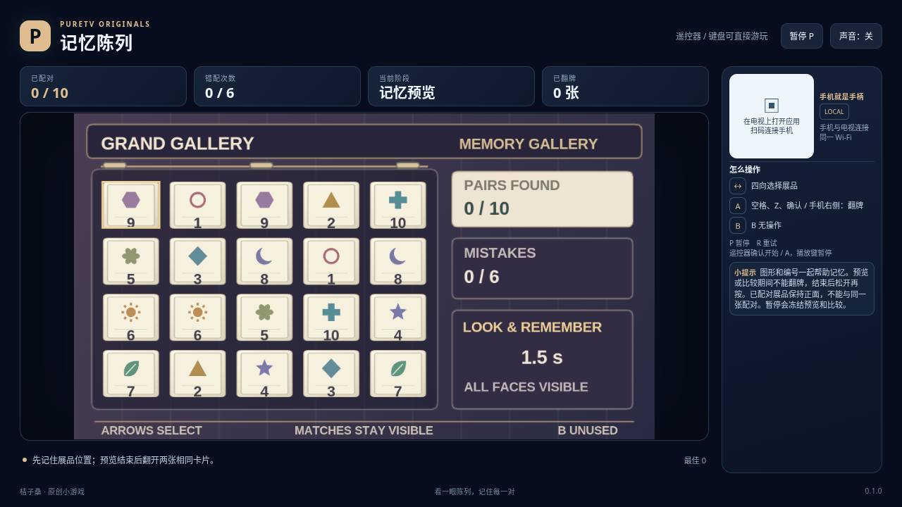 |
| [数字汇聚](resource/apps/merge-tiles/) | ecojust / 桔子桑 | 0.1.0 | 285.3 KB | 滑动棋盘合并相同数字，每次滑动只合并一次；管理确定生成的新砖和有限撤销，在步数内达成32、64、128目标。 | 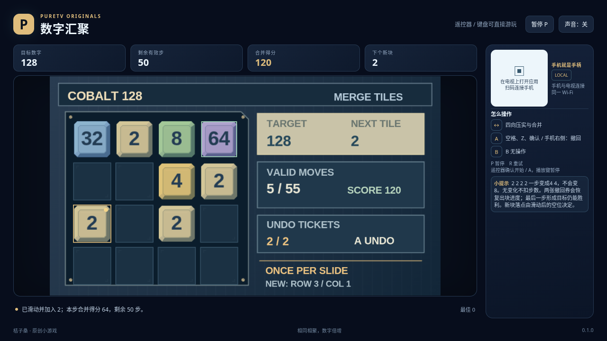 |
| [节拍闸道](resource/apps/metronome-gates/) | ecojust / 桔子桑 | 0.1.0 | 293.3 KB | 先排方向和等待，按固定节拍穿过周期闸门；在拍数预算内收齐标记并抵达出口，B 可撤回未执行的队尾命令。 | 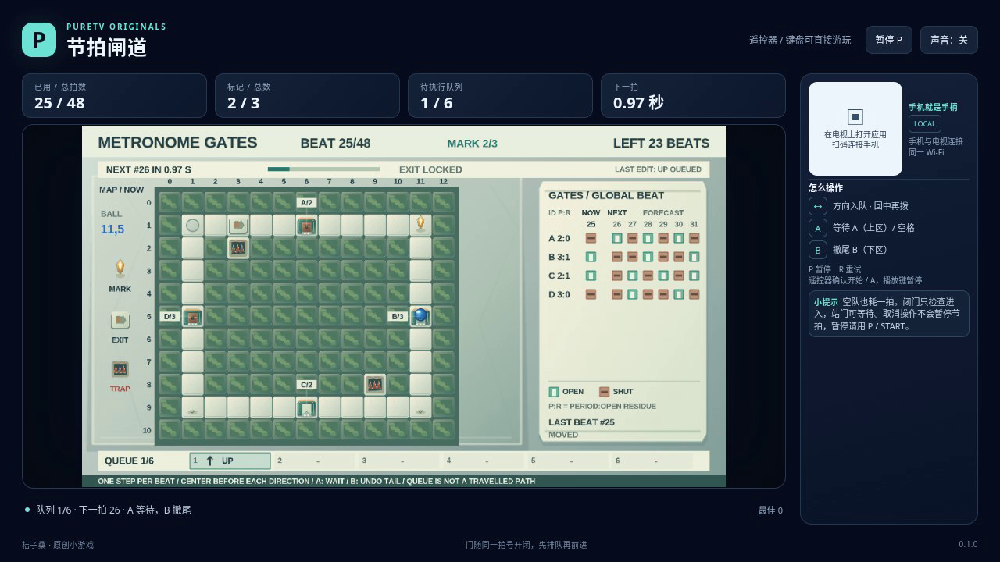 |
| [雷纹勘探](resource/apps/mine-survey/) | ecojust / 桔子桑 | 0.1.0 | 285.3 KB | 依据周围八格的雷数线索，逐步勘明所有安全格；旗标只作推理笔记，探到雷即失败。三张可凭公开线索推理的地图，支持手机扫码单人操作。 | 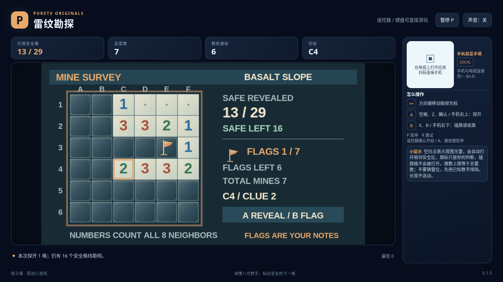 |
| [纹幕校准](resource/apps/moire-atelier/) | ecojust / 桔子桑 | 0.1.0 | 289.3 KB | 滑动并旋转两层周期纹幕，让五个测点的当前明暗同时符合目标；参考可见定位标记，在限时与验收次数内完成三种光学校准。 | 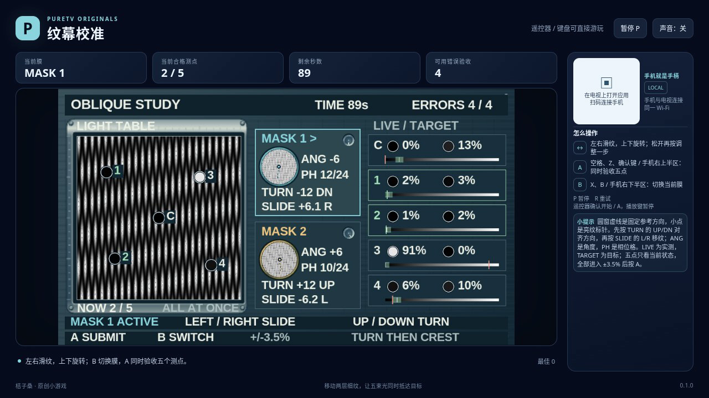 |
| [沙丘数列](resource/apps/number-dunes/) | ecojust / 桔子桑 | 0.1.0 | 289.3 KB | 选择一行或一列，保持段内顺序压实数字石，不合并、不跨岩柱；蛇形读数严格递增且全部空洞吻合目标才能获胜，撤销恢复原石原格但不退已用步数或时间，手机扫码单人操作 | 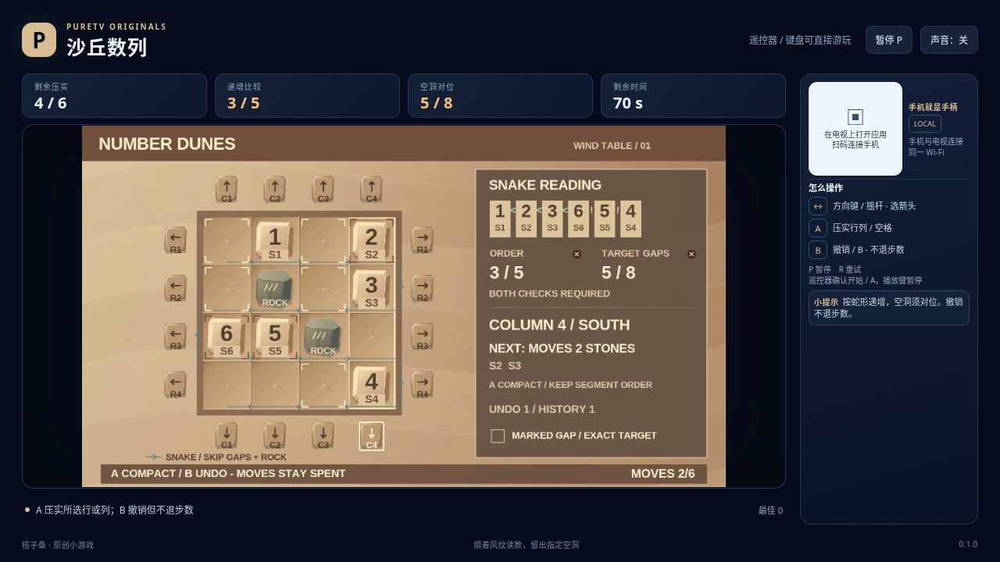 |
| [果园游蛇](resource/apps/orchard-snake/) | ecojust / 桔子桑 | 0.1.0 | 285.3 KB | 预排下一拍的转向，绕开石墙与蛇身收集果实；使用有限刹车规划路线，完成三座果园。 |  |
| [异形装箱](resource/apps/packing-sculptor/) | ecojust / 桔子桑 | 0.1.0 | 289.3 KB | 原创单人异形装箱益智游戏：移动、旋转有限零件，装入异形箱体，并为指定零件保留可完整直线抽出的出口。三种箱体、四次检查机会；手机方向区与上下双操作区控制。 | 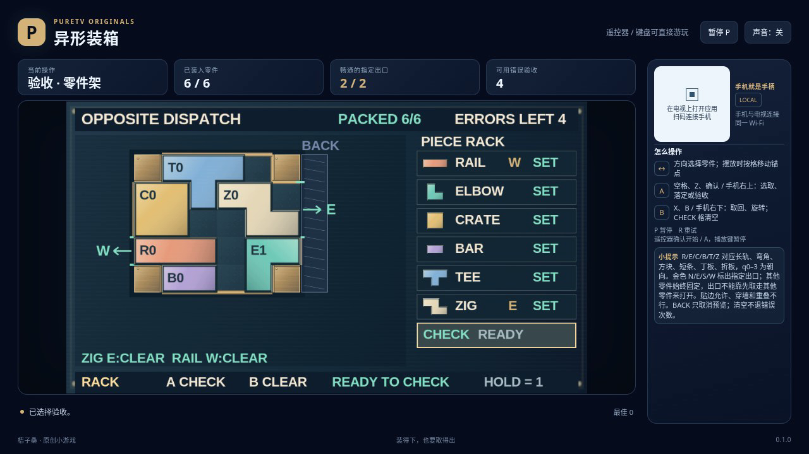 |
| [视差天际](resource/apps/parallax-skyline/) | ecojust / 桔子桑 | 0.1.0 | 285.3 KB | 移动近远两层建筑，在两个观察点同时对齐天际线与屋顶标记；小心只匹配主视角的错觉，撤销移动不会返还容错次数。 |  |
| [奇偶花圃](resource/apps/parity-garden/) | ecojust / 桔子桑 | 0.1.0 | 285.3 KB | 用十字与斜角喷头翻转4×4花圃，让目标花形和标记花的直接浇水偶数条件同时成立；重复浇水不退水，三道有限水量谜题，支持手机扫码单人操作 |  |
| [路径刻印](resource/apps/path-glyphs/) | ecojust / 桔子桑 | 0.1.0 | 289.3 KB | 在5×5石板上规划不重复的路径，按入边条件收集方向符号，在出口提交与目标完全一致的刻印；三道公开谜题，支持手机扫码单人操作 |  |
| [像素线索](resource/apps/pixel-clues/) | ecojust / 桔子桑 | 0.1.0 | 285.3 KB | 根据公开的行列连续段数字涂出像素图，叉号仅作留白笔记；在三张逐渐增大的画纸上匹配全部线索，分别管理60、90、120秒有效时间，支持手机扫码单人操作。 | 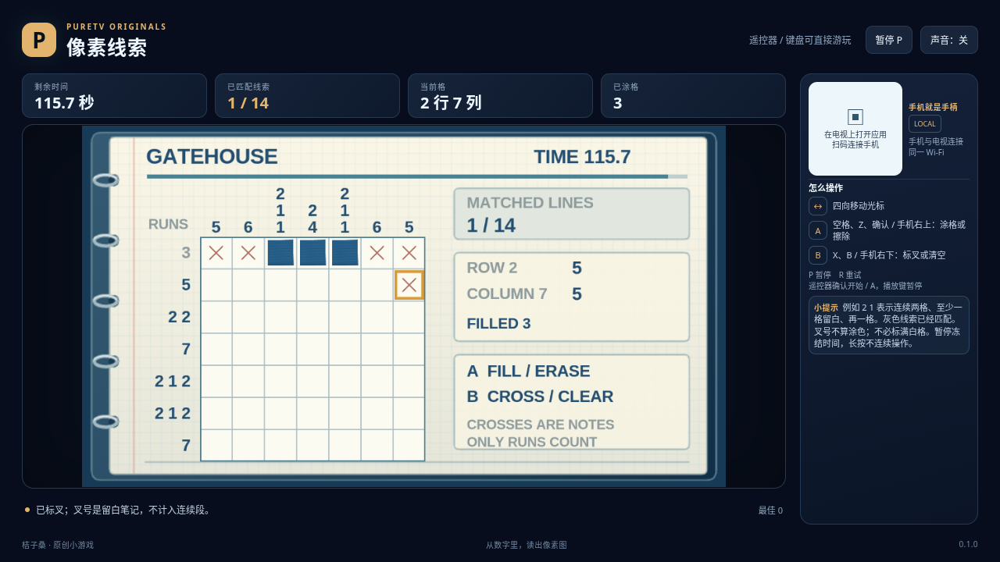 |
| [传粉契约](resource/apps/pollinator-contract/) | ecojust / 桔子桑 | 0.1.0 | 289.3 KB | 调度两支蜂群，在有限花期和前置任务间完成授粉；途中改派并及时返巢恢复耐力，完成三关花园契约。 | 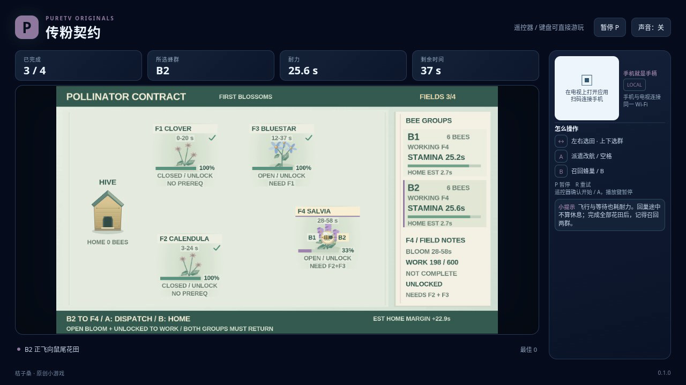 |
| [压力封装](resource/apps/pressure-seal/) | ecojust / 桔子桑 | 0.1.0 | 289.3 KB | 控制加热与泄压，让三种包装依次在目标压力内完成密封；松手后的余热仍会改变压力。 |  |
| [镜光接力](resource/apps/prism-relay/) | ecojust / 桔子桑 | 0.1.1 | 285.3 KB | 旋转镜片与分色棱镜，让彩色光束准确抵达接收器，包含反射、分色与合光三关，支持手机扫码单人操作 | 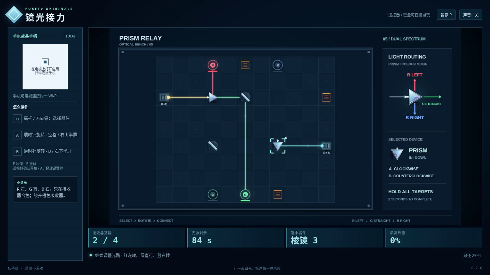 |
| [脉冲储库](resource/apps/pulse-vault/) | ecojust / 桔子桑 | 0.1.0 | 293.3 KB | 按住收集有限脉冲，选择档位向顺序门锁放电；控制储能溢出和热峰，开启四门并保留终储备，完成三种供能关卡。 | 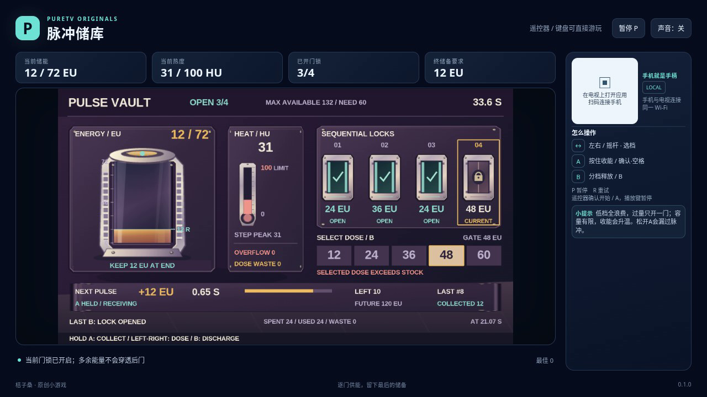 |
| [星盘皇后](resource/apps/queen-constellation/) | ecojust / 桔子桑 | 0.1.0 | 285.3 KB | 在六、七、八阶星盘上摆放互不攻击的皇后，遵守固定皇后和禁放格限制；允许调整并观察行、列、对角线冲突，用三次手动检查完成布局，支持手机扫码单人操作。 | 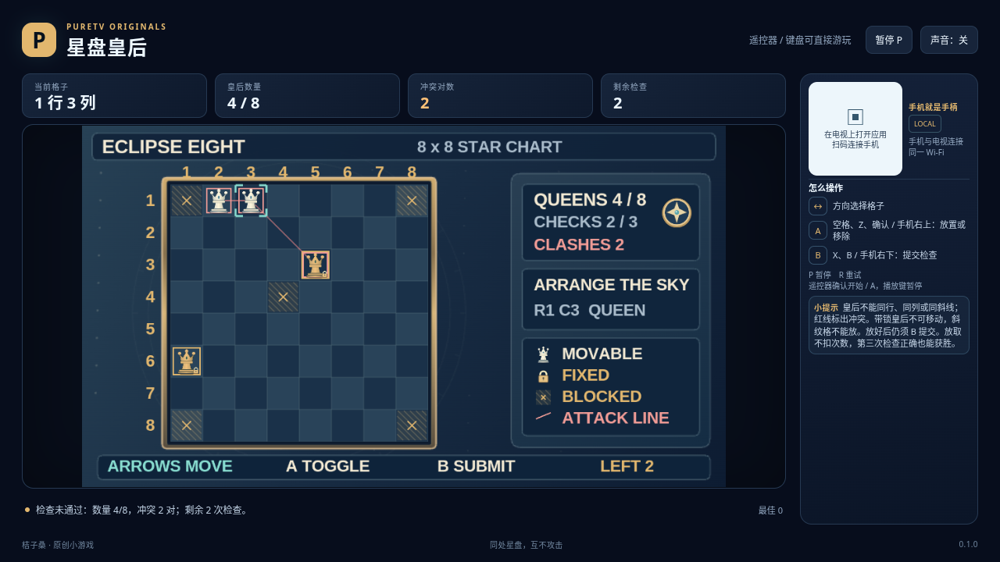 |
| [四季蓄水](resource/apps/reservoir-seasons/) | ecojust / 桔子桑 | 0.1.0 | 289.3 KB | 根据四季天气预报向居民、农田和生态河流配水；撤销尚未提交的计划，守住居民每季用水底线，并分别完成三方年度目标。 | 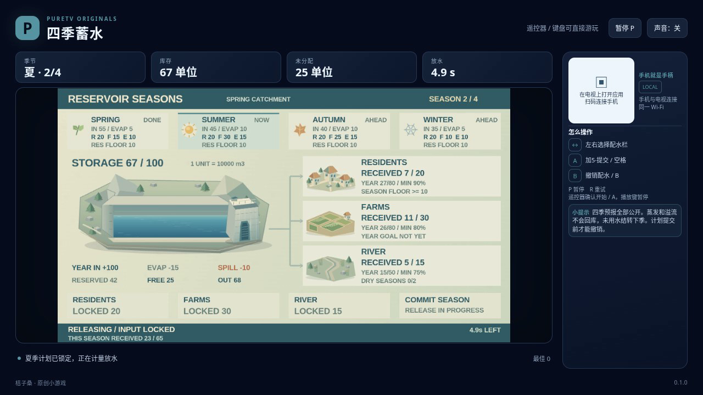 |
| [共振浮桥](resource/apps/resonance-bridge/) | ecojust / 桔子桑 | 0.1.0 | 289.3 KB | 调节三块浮桥的频率和相位，派遣行人在持续安全接触时过桥；控制共振增幅，完成三个渡口关卡。 | 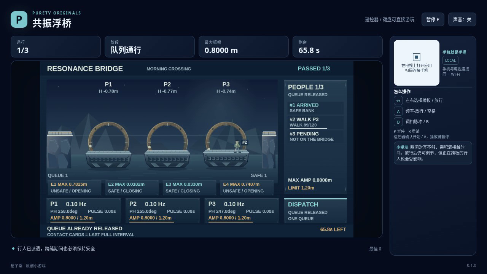 |
| [翻面棋局](resource/apps/reversi-relay/) | ecojust / 桔子桑 | 0.1.0 | 285.3 KB | 挑战三道6×6翻面棋残局，用八方向夹击翻转棋子，与确定性电脑对手轮流落子；无合法落点时让行，终局以棋子多数获胜，支持手机扫码单人操作。 | 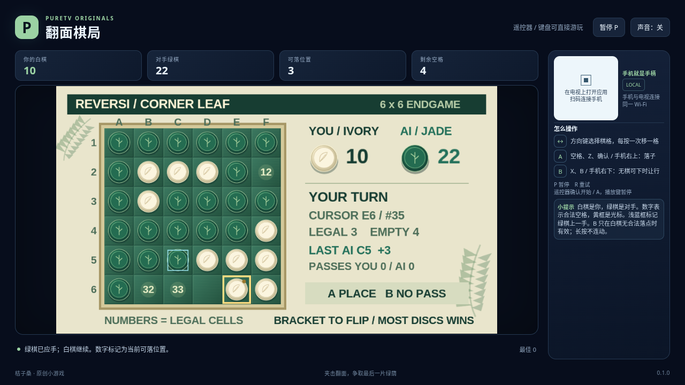 |
| [环塔迁移](resource/apps/ring-towers/) | ecojust / 桔子桑 | 0.1.0 | 285.3 KB | 在三根塔柱之间搬运圆环，每次只能移动顶环，小环必须放在大环上；用有限搬动次数将整塔迁到目标柱，挑战三环、四环与五环布局，支持手机扫码单人操作。 | 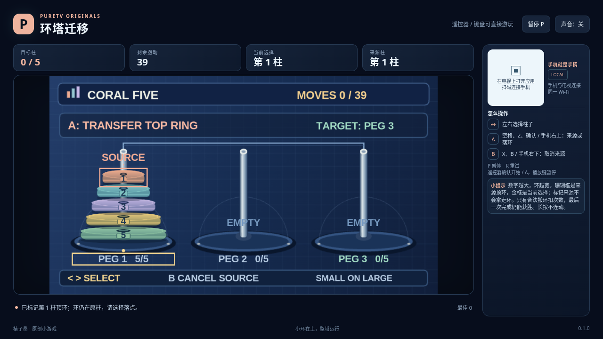 |
| [渡河守则](resource/apps/river-guard/) | ecojust / 桔子桑 | 0.1.0 | 285.3 KB | 安排有限船位往返两岸，避免无人看守的冲突组合，用公开规则把所有物品安全运到对岸。 |  |
| [旋环锁匠](resource/apps/rotor-locksmith/) | ecojust / 桔子桑 | 0.1.0 | 293.3 KB | 左右拨转三层锁环，按住 A 推进、B 退回；进入核心取得钥匙，再将完整钥匙带出，避开碰壁造成的耐久损失和阻力。 |  |
| [分流沙漏](resource/apps/sandglass-split/) | ecojust / 桔子桑 | 0.1.0 | 289.3 KB | 开关共享料斗并旋转两块挡片，把连续落沙分给三只计量杯；在途沙束保留已确定的路线，耗尽沙量后让三杯都处于目标容差内且没有溢出。 |  |
| [播子棋盘](resource/apps/seed-mancala/) | ecojust / 桔子桑 | 0.1.0 | 285.3 KB | 沿棋穴逐粒播种，利用入仓续手与对穴吃子争取过半种子，并应对规则公开的对手。 |  |
| [影形铸坊](resource/apps/shadow-foundry/) | ecojust / 桔子桑 | 0.1.0 | 285.3 KB | 旋转金属工件与侧向光源，覆盖全部青色目标格并避开禁区；两种控制独立调整，最后一次机会也能完成铸影。 |  |
| [影窗快门](resource/apps/shadow-shutter/) | ecojust / 桔子桑 | 0.1.0 | 297.3 KB | 移动取景框并切换横竖画幅，避开遮光纸带，让三片剪影完整入窗并依序拍成目标；用有限胶片完成三组影窗作品。 |  |
| [ShortVideo TV](resource/apps/shortvideo/) | ecojust / 桔子桑 | 0.5.0 | 32.7 KB | 遥控器短视频播放器 |  |
| [数塔天际](resource/apps/skyline-numbers/) | ecojust / 桔子桑 | 0.1.0 | 285.3 KB | 按照行列数字不重复和边缘可见塔数线索，完成逐渐扩大的数字天际棋盘。 |  |
| [滑格归序](resource/apps/sliding-order/) | ecojust / 桔子桑 | 0.1.0 | 281.3 KB | 移动九宫格中的空格，让八块数字瓷砖按顺序归位；管理有限滑动次数，撤销恢复棋盘但不退步数。三种独立初始布局，支持手机扫码单人操作。 |  |
| [逐日供电](resource/apps/solar-shift/) | ecojust / 桔子桑 | 0.1.0 | 289.3 KB | 随日照与阴影调整太阳板朝向，为不同优先级的设备供电；管理有限电池与温度，完成昼夜周期及各设备的独立供电配额。 |  |
| [序栈货运](resource/apps/stack-dispatch/) | ecojust / 桔子桑 | 0.1.0 | 285.3 KB | 用单件吊机和三个后进先出的货栈，按公开货单顺序出港；管理有限容量与搬动额度，三次错序出货失败。三个调度关卡，支持手机扫码单人操作。 |  |
| [石箱归位](resource/apps/stone-bay/) | ecojust / 桔子桑 | 0.1.0 | 285.3 KB | 在三座庭院里推动石箱，让每个石座都被占据；只能推、不能拉，步行不扣推力，撤回恢复位置但不返还推力。管理有限推动额度，支持手机扫码单人操作。 |  |
| [Super Mario TV](resource/apps/super-mario/) | ecojust / 桔子桑 | 0.5.2 | 93.4 KB | 8 世界 32 关平台冒险，支持手机扫码单人或双人轮流 |  |
| [分岔调度](resource/apps/switchyard-minute/) | ecojust / 桔子桑 | 0.1.1 | 289.3 KB | 切换道岔、错开放行，把双向货车送到同色站台，管理追尾风险与累计延误，支持手机扫码单人操作 |  |
| [Tank TV](resource/apps/tank/) | ecojust / 桔子桑 | 0.5.2 | 258.3 KB | 独立重写的 35 关坦克大战，支持手机扫码双人合作 |  |
| [拉索桥梁](resource/apps/tension-span/) | ecojust / 桔子桑 | 0.1.0 | 289.3 KB | 在材料预算内搭建拉索桥，观察索线张力和桥面变形；失败后恢复方案、改索重试，让货车完整驶过桥面，支持手机扫码单人操作 |  |
| [Tetris TV](resource/apps/tetris/) | ecojust / 桔子桑 | 0.5.2 | 81.4 KB | 经典俄罗斯方块，支持手机扫码单人或双人比拼 |  |
| [热流滑翔](resource/apps/thermal-glider/) | ecojust / 桔子桑 | 0.1.0 | 293.3 KB | 驾驶无引擎滑翔翼利用热流穿过有序观测圈，使用空气刹车与襟翼管理能量，满足位置、速度与姿态后实际降落；三条航线，支持手机扫码单人操作 |  |
| [潮汐闸门](resource/apps/tide-lock/) | ecojust / 桔子桑 | 0.1.1 | 289.3 KB | 调节两级船闸水位，安全开启闸门，把货船送往高水位出口；管理水量守恒、溢流和搁浅，支持手机扫码单人操作 |  |
| [叠塔工匠](resource/apps/tower-overlap/) | ecojust / 桔子桑 | 0.1.0 | 285.3 KB | 抓准移动石板与下层重叠的时机落板，只留下重叠部分，逐层完成六层、八层和十层塔楼。 |  |
| [车阵出口](resource/apps/traffic-escape/) | ecojust / 桔子桑 | 0.1.0 | 285.3 KB | 在拥挤车阵中沿车身方向逐格挪车，利用有限撤销腾出通路，将目标车辆驶出右侧出口。 |  |
| [三角跳珠](resource/apps/triangle-pegs/) | ecojust / 桔子桑 | 0.1.0 | 285.3 KB | 在十五孔三角棋盘上，沿六个方向跳过相邻棋珠并移除它，最终只留一珠；管理三次撤回机会，三个不同起始空孔，支持手机扫码单人操作。 |  |
| [三角拼域](resource/apps/triangular-tessera/) | ecojust / 桔子桑 | 0.1.0 | 289.3 KB | 旋转与镜像三角彩砖，让共享边同色并形成指定数量的红绿蓝色域；三关各有有限步数和90秒时限，每次操作都消耗一步，支持手机扫码单人操作。 |  |
| [极品二手车](resource/apps/used-car-racing/) | ecojust / 桔子桑 | 0.1.3 | 1.66 MB | 随机车况与机械故障的三维赛车，支持手机扫码一至两人竞速和 AI 对手 |  |
| [WebTV](resource/apps/webtv/) | ecojust / 桔子桑 | 0.5.0 | 44.8 KB | 电视直播与 M3U 播放器 |  |
| [砝码账本](resource/apps/weight-ledger/) | ecojust / 桔子桑 | 0.1.0 | 285.3 KB | 将六枚独立编号的砝码分配到三个共享盘，同时配平三条整数衡式；预选拿取、有限搬动与真实撤销，三道公开谜题，支持手机扫码单人操作 |  |

<!-- resource-index:end -->

桔子桑开发的电视应用 APK 与源码见 [resource/apps/](resource/apps/)。

## MCP / Agent

在「设备连接 → MCP · Agent 调试」复制配置到客户端，保持管理器窗口打开。34 个工具覆盖系统信息、连接、应用管理、APK 安装、启动器切换与布局、市场目录／下载／安装、背景图、ADB 配置、语言与主题、取消及记录；Agent 与界面共享状态。

[完整 MCP 接入与参数](desktop/docs/mcp.md)。

## 开发文档

构建与测试说明见 [resource 开发 README](resource/README-development.md)。

### 自定义启动器布局

`layout.json` 是连接启动器与管理器显示的协议文件：电视和电脑使用同一份布局，管理器可以重现桌面并调整应用块。Home 和 Apps 支持独立背景、布局与切页设置；用户应用可编辑，系统组件仅供查看。

在启动器页面选择「调整布局」，可添加已安装用户应用、拖动、框选、对齐或平铺排布，确认后应用到电视。使用新版布局需同时更新管理器与配套启动器。

完整字段说明、JSON 示例与画面对照见 [layout.json 协议规范](resource/README-development.md#layoutjson-协议规范与画面对照)。

## 许可与致谢

pureTV 使用 [MIT](LICENSE) 许可。部分电视端启动器代码参考 [Gathin23/cleanyourtv](https://github.com/Gathin23/cleanyourtv)，原作者版权与许可保留于 [NOTICE.md](NOTICE.md)。字体见 [OFL 许可](resource/launcher/puretv/FONT-LICENSE-OFL.txt)。应用使用的第三方代码、字体和其他素材保留各自的版权及许可声明。
