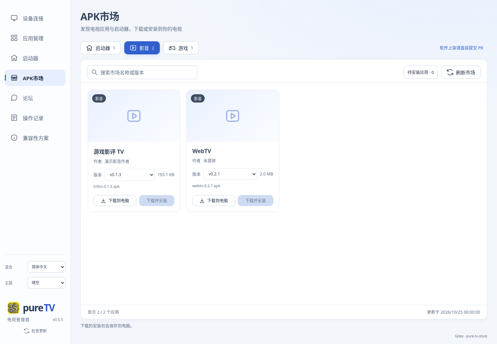

# pureTV Manager 0.5.5 发布验证

**已发布并设为最新稳定版。** [下载0.5.5](https://github.com/ecojust/pureTV/releases/tag/desktop-v0.5.5)，发布时间 `2026-11-08T05:59:23Z`。五份安装包及SHA256清单均已实际完整下载，大小和SHA256同时匹配发布API及清单；发行说明与冻结源码一致，旧0.5.4标签未修改。

## 改动与来源

APK市场在每款软件名称下显示作者，来自Gitee对应APK同目录 `manifest.json` 的 `provider`。按固定目录提交中的Git blob读取并核对大小/哈希；同内容去重获取，作者不改变APK身份或下载缓存。

缺失、无效或无法读取的作者显示「未提供」，可用作者按原文显示，长名称保留完整title。新v3缓存会在升级后重新获取作者，旧v2只用于过期离线回退。实际Gitee三种manifest及Base64/UTF-8/Git blob约定已独立只读核验，见 [来源记录](release-0.5.5-evidence/gitee-manifests.json)及[接口核验](release-0.5.5-evidence/gitee-blob-contract.json)。这与模拟网络的Rust测试分别记录。

源码固定在 [`45df495dd5605fee3761654b1648793957c9f56b`](https://github.com/ecojust/pureTV/commit/45df495dd5605fee3761654b1648793957c9f56b)，标签 `desktop-v0.5.5`。7份项目版本/锁文件一致，第三方依赖没有变更。

## 验证结果

[正式流程42452344249](https://github.com/ecojust/pureTV/actions/runs/42452344249) 四个平台及publish全部成功，无CI失败重跑。

- 每个平台核心测试110项通过；原生测试Windows104、Linux105、两Mac各106项通过，包含5项新作者目录/缓存回归。核心ignored为Windows2、其余1；原生各8，未执行项不计入通过数。
- 各平台采集28项、子网3项及Google/腾讯ADB实际下载检查通过；Linux完整UI171项、SVG7项及运行中管理器/MCP联调通过。MCP日志中的72条PASS含重复轮询和12条预期拒绝，不表示72种独立操作。
- 本机31项市场浏览器场景通过，覆盖作者原文、缺失/空白、跨目录隔离、HTML转义、三语、版本选择/刷新、缓存及紧凑窗口。版本更新后复用其中1项导出0.5.5截图；前端构建与744条文案检查通过。
- Windows与两Mac实际0.4.10→0.5.5升级、正常退出、重新启动和测试数据保留通过；Linux核验DEB身份及更新准备，未执行系统安装。
- 两Mac核对完整应用签名、ARM64/Intel架构、macOS11最低版本、DMG安装副本运行5秒及正常退出。未执行Apple公证或Gatekeeper验收。

原始日志摘录、提取脚本与完整日志SHA256见 [证据目录](release-0.5.5-evidence/)，步骤、统计和公开下载结果见 [机器记录](release-0.5.5-validation.json)。4份完整CI日志合计1,012,560字节，原始副本保留于本次scratch；永久保留相关原始摘录及各完整日志哈希。

预览由实际前端在浏览器中渲染，目录和设备状态为模拟数据。`physicalTvTested:false`，本次没有新增实体电视验收。

## 公开安装包

| 文件 | 字节数 |
| --- | ---: |
| `pureTV-Manager-0.5.5-linux-x64.deb` | 4,183,594 |
| `pureTV-Manager-0.5.5-macos-arm64.dmg` | 9,808,676 |
| `pureTV-Manager-0.5.5-macos-x64.dmg` | 10,060,969 |
| `pureTV-Manager-0.5.5-windows-x64-portable.exe` | 5,551,104 |
| `pureTV-Manager-0.5.5-windows-x64-setup.exe` | 2,273,383 |

永久校验清单见 [SHA256SUMS.txt](release-0.5.5-evidence/SHA256SUMS.txt)。检查过程流式读取全部公开安装包，没有用HEAD请求代替下载核验。

## 更新入口

发布后只读核查Gitee的client目录仍为0.5.4三个安装包，本次未上传Gitee。应用内更新尚不能取得0.5.5，请从GitHub发布页下载。作者来源的Gitee目录和管理器安装包更新源是不同用途，不把读取成功当作发布完成。

发布过程见 [本次记录](../../history/2026-11-08-002.md)。
