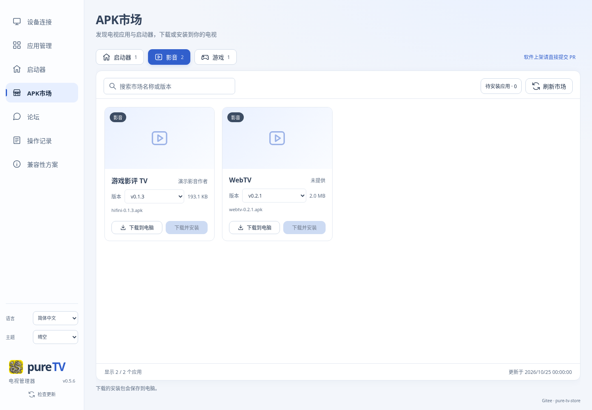
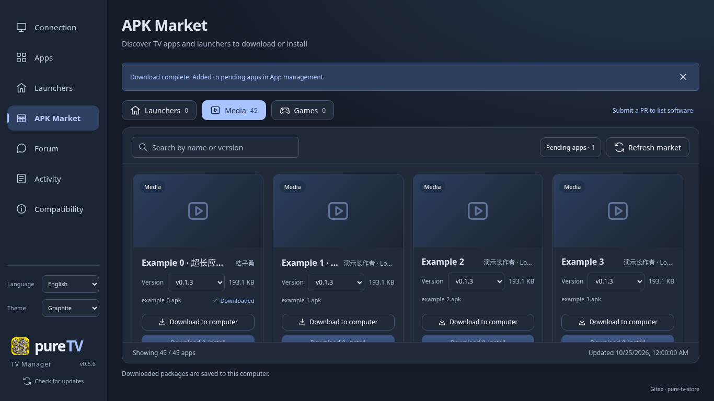

# pureTV Manager 0.5.6 发布验证

**已发布并设为最新稳定版。** [下载0.5.6](https://github.com/ecojust/pureTV/releases/tag/desktop-v0.5.6)，发布时间 `2026-11-08T06:43:00Z`。五份安装包及SHA256清单已从公开HTTPS地址完整下载，大小和哈希同时匹配Release API及清单；发布正文与冻结源码一致，旧0.5.5标签未修改。

## 改动

APK市场在应用名右侧直接显示 `manifest.json` 的 `provider` 名称，移除独立信息行和“作者”标签。应用名可以缩短，优先保留右侧短姓名；两边都过长时分别省略，悬停可查看完整内容。“已下载”移至文件信息行，避免挤占名称空间。

来源读取、缓存及下载安装后端沿用0.5.5。源码固定在 [`a3b1ef17`](https://github.com/ecojust/pureTV/commit/a3b1ef17a08e574c5ad5e607f27dd5d1bc4d8166)，标签 `desktop-v0.5.6`。7份版本/锁文件精确更新，第三方依赖未变。

## 验证结果

[正式流程42455034353](https://github.com/ecojust/pureTV/actions/runs/42455034353) 四个平台及发布全部通过，首次运行完成，无失败重跑。

- 本机前端构建通过（TypeScript、744条文案、Vite）；市场回归31/31通过。补充约250px最小卡片检查后仅复跑修改场景，1/1通过。正式CI在最终冻结测试文件上执行完整UI171项与SVG7项，全部通过。
- 晴空、海盐、石墨主题已实际渲染并目视检查。短姓名在长应用名旁完整显示；双长文本有界省略，下载状态不影响标题空间。原文、缺失/空白、转义、三语和版本切换检查保留。
- 四平台核心测试各110通过；原生Windows104、Linux105、两Mac各106通过。core ignored为Windows2、其余1，native各8，未执行项未计入通过数；各平台另外显式执行Google、腾讯ADB下载和更新准备检查。
- 各平台兼容性采集28项、子网3项通过。Linux运行中MCP日志有72条PASS（含重复状态查询及12条预期拒绝），不代表72种独立功能；UI/SVG/MCP仅在Linux执行。
- Windows及两Mac实际0.4.10→0.5.6升级、正常退出、重新启动和测试数据保留通过；Linux验证DEB身份与更新准备，未执行系统安装。
- 两Mac的完整应用签名、目标架构、macOS11最低版本及DMG安装副本运行5秒/正常退出通过。使用ad-hoc签名，未执行Apple公证或Gatekeeper验收。

步骤、计数和公开下载结果见 [机器记录](release-0.5.6-validation.json)。4份完整CI日志共1,012,831字节；相关原始摘录、完整日志SHA256、实际提取脚本和本地日志归档于 [证据目录](release-0.5.6-evidence/)，完整原始CI日志保留在本次scratch。

截图来自0.5.6真实前端渲染，目录及设备状态为模拟数据。`physicalTvTested:false`，本次没有新增实体电视验收。

## 公开安装包

| 文件 | 字节数 |
| --- | ---: |
| `pureTV-Manager-0.5.6-linux-x64.deb` | 4,183,690 |
| `pureTV-Manager-0.5.6-macos-arm64.dmg` | 9,811,512 |
| `pureTV-Manager-0.5.6-macos-x64.dmg` | 10,060,993 |
| `pureTV-Manager-0.5.6-windows-x64-portable.exe` | 5,551,104 |
| `pureTV-Manager-0.5.6-windows-x64-setup.exe` | 2,273,072 |

[SHA256SUMS.txt](release-0.5.6-evidence/SHA256SUMS.txt) 与 [公开下载核验脚本](release-0.5.6-evidence/verify-public.py) 均已归档。文件经过完整流式下载核验，没有以HEAD请求代替。

## 更新入口

发布后只读核查Gitee提交 `cf8f5ea495cbaddd90d6709335318f804eccb6d6`，`client/` 已由外部更新至0.5.5三个安装包，但没有0.5.6。本次未上传Gitee，应用内更新暂不能取得0.5.6，请从GitHub发布页下载。

发布过程见 [任务记录](../../history/2026-11-08-002.md)。
