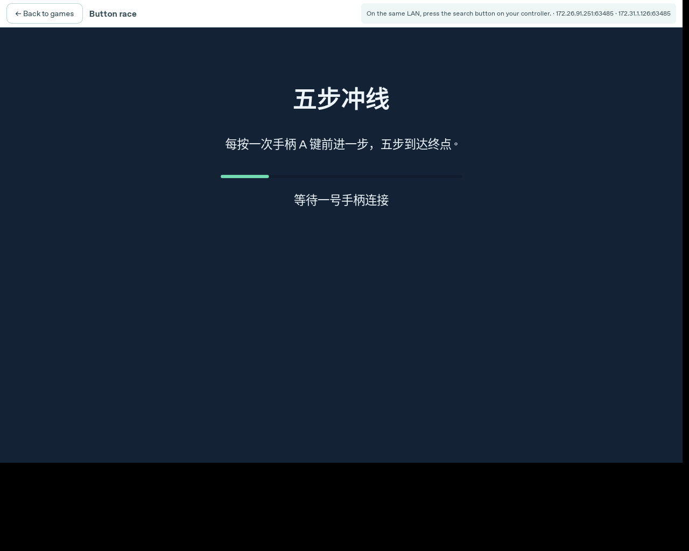

# Manager 0.9.0 本地网页游戏验收

- 在 Linux 的实际 Tauri 窗口中，通过 stdio MCP 登记含中文路径的静态网页目录并打开「五步冲线」。网页通过 WebSocket 订阅当局的双人手柄服务。测试拒绝过期会话，使用当前会话发送 A 键；Rust 快照分别记录按下、释放，WebKit 中的进度条随后前进一步。[可运行的示例](../examples/button-race/index.html) · [端到端测试](../../scripts/verify-mcp.py)
- 用仓库的 Python JoystickClient 连接 TCP 接收器。Chromium 中的示例在按下 A 时前进，断开后显示等待手柄，随后用虚拟手柄继续前进至终点。测试使用软件手柄，没有连接实体手柄。
- 原生回归覆盖目录持久化与并发登记、相对资源与范围请求、退出后撤销挂载、WebSocket 握手、手柄断开与重连、拒绝旧会话及满座时保留玩家。前端回归覆盖在线目录、离线缓存、电视部署、本地目录与 MCP 启动。[功能 PR](https://github.com/ecojust/pureTV/pull/105) · [跨平台检验](https://github.com/ecojust/pureTV/actions/runs/46145069074)

0.8.4 先发布了点封面游玩、下载标记与部署到电视的卡片。该版五个公开下载的 SHA-256 已核对。0.9.0 在同一套卡片的基础上增加本地游戏页与六个 MCP 工具。[0.8.4 下载](https://github.com/ecojust/pureTV/releases/tag/desktop-v0.8.4) · [0.8.4 发布检验](https://github.com/ecojust/pureTV/actions/runs/46144946635)

## 公开下载

0.9.0 标签指向 `b81eabe535a36b666ea331d2437fc7dbf686e067`，2026-11-28 12:58 UTC 公开发布。Windows x64 安装版与便携版、两种 macOS DMG、Linux x64 DEB 均已从公开链接匿名下载，大小与 GitHub 记录一致，SHA-256 与发布清单逐项相符。正式构建还通过了无外网条件下的 Android TV 模拟器部署测试。[逐包大小与摘要](public-downloads.json) · [发行构建](https://github.com/ecojust/pureTV/actions/runs/46146210460) · [下载](https://github.com/ecojust/pureTV/releases/tag/desktop-v0.9.0)

从上述公开 Linux DEB 提取版本 0.9.0 的可执行文件，再次运行完整原生 MCP 验收，退出码为 0。示例实际订阅了 WebSocket，测试按键使 WebKit 中的游戏前进，过期会话被拒绝。

