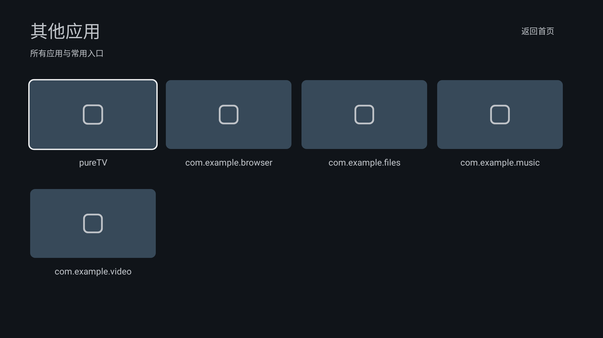

# 验证记录

## 环境与范围

- Linux x86_64，完整 OpenJDK 21，Gradle 8.9。
- Android SDK Platform 35、Build Tools 34.0.0。
- Robolectric 模拟 Android 9（API 28），原生图形渲染验证 1920×1080 与 640×360 布局。
- 未连接电视；Robolectric 不等同于电视实机或完整系统模拟器。

## 检查结果

- Debug 与 Release 构建成功（公开发布 APK 另外使用项目发布密钥签名）；应用标识 `com.ecojust.cleanyourtv`，版本 `0.1.1`。
- 20 项测试全部通过：4 项壁纸下载、13 项入口与页面导航、3 项原生图形布局。
- 布局验证：四个桌面卡片位于屏幕下半部，首次进入显示焦点；小屏卡片不越界；应用页可展示 8 个占位项。
- 桌面顺序验证：音乐、哔哩哔哩、文件、应用；中文与小屏渲染检查对应的卡片位置和焦点。
- 应用卡片跳转：优先打开已安装商城，支持标准厂商商城入口；没有商城时打开当贝官网；商城和浏览器都不可用时显示提示。
- 文件卡片跳转：优先打开已安装文件管理器，否则打开系统文件选择器；选择后授予只读访问权限并通过适当应用打开，没有管理器/选择器时显示提示。
- 音乐通过 HTTPS 浏览器 Intent 打开 SomaFM；底部「全部应用」及下方向键仍进入占位列表，返回关闭列表。
- 当贝官网检查返回 HTTP 200；厂商商城与文件管理器跳转以模拟安装信息验证，仍需实机确认。
- 音乐站点：`https://somafm.com/player/` 与官方频道列表均返回成功响应，检查时包含 51 个免费电台频道。网页可访问检查不能替代电视端浏览器的音频播放实测。
- lint 为 0 errors / 82 warnings，仍有参考资源的旧版本属性、未使用资源及布局建议。
- Android XML 可解析；Bash 安装和壁纸脚本通过语法检查。
- 壁纸脚本以模拟 adb 验证默认/自定义端口、含空格路径、PNG 输入、缺失参数与文件时提前退出；所有设备操作均指定目标设备。
- Picsum 地址实际下载返回 HTTP 200、JPEG、1920×1080；壁纸测试覆盖字节保真、恰好 4 MiB、无 Content-Length 的超限流及网络中断。

```bash
cd resource/launcher/puretv
./gradlew --no-daemon assembleDebug assembleRelease lintDebug testDebugUnitTest
```

## 界面渲染预览

以下图片来自真实 Android XML 与 Java 界面的 Robolectric 原生渲染，并非电视实机截图。桌面预览使用指定 Picsum 地址的样例图片；天气默认关闭，所以不显示天气行。




测试默认不生成文件。需要导出预览时，可设置 `CLEAN_UI_CAPTURE_DIR` 指定目录，`CLEAN_UI_TEST_WALLPAPER` 可指定一张本地测试图片；这两个变量只用于测试，不影响 APK。

## 电视上仍需验证

1. 安装后可从系统应用列表打开，设为默认桌面后按 Home 返回。
2. 真机遥控器遍历音乐、哔哩哔哩、文件、应用入口与顶栏；应用卡片正常打开商城，文件卡片正常打开管理器或选择器。
3. 安装哔哩哔哩 TV 版后能从对应卡片启动；未安装时提示明确。
4. 开启每日随机壁纸后成功显示；同日重复开启使用缓存；关闭后保留当前图；断网时保留旧图。
5. 本地图片导入/移除、减弱动画、天气城市搜索、网络设置和输入源按设备能力工作。
6. 可选无障碍快捷键及系统时钟屏保正常。

应用页当前为占位预览，尚未接入真实已安装应用列表。厂商默认桌面限制、遥控器键值及系统设置入口仍需要对应设备验证。


## v0.1.4 / WebTV 0.1.0（2026-10-23）

- 新增独立包 `com.ecojust.webtv`，原生单播放器卫视／央视直播；频道分类、收藏、线路切换、全屏遥控器，以及 URL／本地 M3U 导入。
- 桌面应用页新增 WebTV，保持首页四入口及其顺序。桌面版本 0.1.4（code 5），Music 0.1.1、ShortVideo 0.1.0 不变。
- 自动测试共 93 项：桌面 24、Music 20、ShortVideo 22、WebTV 27，零失败。WebTV 覆盖 M3U 大小和数量限制、取消、原子缓存、无效导入保留旧列表、媒体超时、切台释放及后台释放。960×540dp、640×360dp 控件渲染通过；预览不包含 Surface 视频层。
- 本地 Debug、签名 Release、lint 及三个独立播放器的 5 MiB 体积门禁通过。WebTV 签名 APK 34,204 字节，零生产环境第三方依赖；只申请 INTERNET 权限。
- 开发网络 FFprobe 和 FFmpeg 验证广东卫视 720p H.264／AAC、湖南卫视 4K HEVC／AAC 前三秒解码成功。默认优先广东。部分其他候选线路超时、403、404 或 503，不能保证内置频道全部可用。
- 未进行电视实机安装、持续直播、4K HEVC 硬解兼容或内存峰值测量。源有效性与实际网络相关，用户可更换线路或导入自己的 M3U；无 EPG、回看、DRM 和协议扩展支持。


## v0.1.5 / pureTV 更名（2026-10-23）

- 仓库迁移为 `ecojust/pureTV`，启动器显示名、Gradle 项目名、文档链接、安装提示及 CI 产物名称同步为 pureTV。
- 启动器版本 0.1.5（code 6）；25 份 app_name 资源及 Release APK 的语言标签均核对为 pureTV。
- 保留包名 `com.ecojust.cleanyourtv`、Java 组件路径与既有签名，支持覆盖升级旧版及保留配置。核对了 APK 的包名、递增版本号和签名证书；未进行电视实机覆盖升级。
- 启动器 Debug／签名 Release 构建、24 项测试及 lint 通过，lint 无错误。签名 APK 为 349,264 字节（341.1 KiB）。
- Music 0.1.1、ShortVideo 0.1.0、WebTV 0.1.0 的发布文件复用 v0.1.4，字节一致；其功能和已记录的验证限制继续适用。
