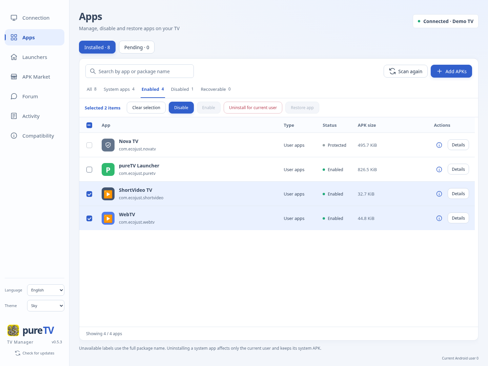

# Using pureTV

[简体中文](README.md) · **English** · [Home](../../README.en.md) · [Developer guide](development.en.md)

pureTV Manager runs on your computer and manages Android TV and Google TV devices over ADB. To browse, install or check for apps directly on your TV, install putrtv Store. On your computer, open **Games** in the manager or play directly in a browser. On a TV, install the game and connect the controller. [putrtv Store 0.1.3 APK](../../resource/apps/putrtv-store/putrtv-store-0.1.3.apk?raw=1) · [Browse games by genre](../../README.en.md#games)

## Install or upgrade the desktop manager

Download **pureTV Manager 0.8.1** for your computer. The release lists file sizes and SHA256 checksums. [Download 0.8.1](https://github.com/ecojust/pureTV/releases/tag/desktop-v0.8.1)

| Platform | Installation |
| --- | --- |
| Windows x64 | Choose the setup EXE or portable EXE. Updating from the portable edition through the manager switches to the installed edition. |
| macOS 11 or later | Choose the Apple Silicon ARM64 or Intel x86_64 DMG. Drag `pureTV Manager.app` to Applications and open it there. The manager uses an ad-hoc signature and has no Apple notarization. [First launch and file verification (Chinese)](../../desktop/README.md#macos-安装与首次打开) |
| Linux x64 | Download the DEB. The in-app updater uses the system's `pkexec` and `dpkg`. |

**When upgrading from 0.5.7 or earlier, install 0.8.1 manually.** Quit the old manager and replace it. You can keep its settings and the apps on your TV. The older client retains its original download address. Version 0.5.9 uses `apps.b14f.com` for the APK market and client updates. It checks once after startup or when you choose **Check for updates** next to the version in the sidebar. **Download and install** downloads and verifies the selected package before handing it to the installer and restarting the manager. In-app availability depends on which packages the update server provides for your platform. [Client directory](https://apps.b14f.com/client/) · [Update behavior and troubleshooting](../../desktop/docs/client-updates.md#update-behavior-english)

Version 0.8.1 includes the offline game library. Earlier updaters have a 256 MiB file limit. If the updater rejects the file size, download the installer for your platform directly from the release and install it over your current copy.



## Connect the TV

1. Connect the computer and TV to networks that can reach each other. Enable ADB or network debugging in the TV's developer options.
2. On **Device connection**, enter the TV's IP address or hostname and debugging port. Authorize this computer on the TV. Port `5555` is common. Use the port shown by your TV.
3. If ADB is missing, read and accept the Android SDK license, then select **Download and configure ADB**. The manager tries Google first and uses the Tencent mirror if that fails. You can also select an existing ADB installation.

The connected home page shows the model, Android and SDK versions, security patch level, CPU, memory, `/data` capacity, resolution and uptime. Other pages keep the current connection status at the top. [Connection troubleshooting (Chinese)](../../desktop/README.md#连接失败排查)

## Manage apps, the market and launchers

| Task | Where to find it |
| --- | --- |
| Manage installed apps | Search or filter **Apps**. Enable or disable apps in batches, uninstall them for the current user, or restore system apps whose APKs are still present. Uninstalling a system app for that user preserves its data and the APK on the system partition. The manager protects core components and the current default launcher. |
| Identify packages and check their size | Select the circled **i** to see the package's purpose, uninstall risk, source and retrieval time. Unknown packages are marked. Sizes cover the main APK and split APKs and exclude private data, caches and optimized files. Unreadable sizes are shown as unknown. |
| Install a local APK | Import APKs under **Pending apps**. Install from a row or select items for a batch. Successful items leave the queue. Failed and unprocessed items remain. The list scrolls with fixed headers and batch actions. |
| Install from the market | Find APKs for launchers, media apps and games in **TV Apps**. Download to the pending list or install directly on a connected TV. Each card offers up to five versions, most recent first. [Browse the game directory](https://apps.b14f.com/game/) |
| Change the home screen | Import and install launcher APKs from **Launchers**. Choose the default launcher or restore the previous one, then press Home on the remote. An active launcher that supports the layout protocol shows **Adjust layout**. |

Connecting, refreshing, batch operations and applying a layout show progress followed by a result dialog. Batch results distinguish successful, failed and unprocessed items. Automatic background reads run without repeated dialogs.

Under **TV Apps → Launchers**, set the installed launcher as the default and choose **Customize home screen**. In the editor, add installed user apps with launchable activities to Home or Apps. Drag and select multiple tiles, align or arrange them in rows, columns or a grid. Each page has its own background, layout and navigation. Changing a tile's app or adding a new tile uses the sibling `logo.svg` cached with a market download. Confirm **Apply to TV** to update the launcher. Update both the manager and its companion launcher to use a newer layout protocol. [Layout editor details (Chinese)](../../desktop/docs/launcher-layout.md)

Cards for compatible launchers display their Home background even when inactive. Change that background in **Adjust layout**. The pending-APK preview reads the embedded Home background and falls back to a sibling `thumb.png` or `APK-name.thumb.png` if it cannot read one.

The TV store and the desktop manager read the same Media, Games and Launchers directories. On the computer, game APKs are listed under **TV Apps → Games**. Open a card to choose from up to five versions. The TV store works with updated launchers to let you choose the position of an app on the home screen. To use English on supported launchers and first-party TV apps, select English in the TV system settings. User-provided app names, playlists and media titles retain their original text. [TV store guide](../../resource/apps/putrtv-store/README.en.md) · [Full resource catalog](../../resource/README.md)

## Install a game and connect a controller

### Play on a computer

In the current development build, open **Games** just above **Forum** in the sidebar. Select a card in the online catalog to play on your computer. For games that support offline play, the manager automatically downloads and verifies the files the first time you play. When **Downloaded** appears in the lower-right corner of the cover, you can open the game again offline. Playing on the computer needs no TV connection.

Eight games in the list require an internet connection to play. Kart Rush and CF Transport Ship use an online player on desktop and download the original TV package on first deployment. The following six games load from their authors’ sites on both desktop and TV.

| Category | Games |
| --- | --- |
| Action, RPGs and exploration | Vault Breakers (formerly Bandit), NOIR EXTREME, Vespertine, Daejeon Urban Science High School Department Tour |
| Flight simulation | Struggle Bus |
| Puzzles and brainteasers | Fish Loop |

Choose **Game guide** for objectives, controls and the meaning of on-screen terms. These six games use the input devices supported by each author. The other 50 games support pureTV Wi-Fi controllers. Connect the controller to the same LAN as the computer and press its search button while the game is open. Choose **Back to games** to return to the catalog.

To play from the project homepage, select **Play in browser** on a game card. The browser version supports keyboard play without installing the manager. [Browse web games](https://ecojust.github.io/pureTV/)

#### Prepare a TV APK from a web game

1. Connect and authorize your TV under **Device connection** and check the selected Android user. A local network with no internet access is sufficient for an established ADB connection.
2. Choose **Deploy to TV** on the game card. The manager prepares the APK and shows installation progress. For games that support offline play, it downloads any missing files the first time you deploy. Once downloaded, you can deploy the game over your local network without internet access or the Android SDK.
3. When installation succeeds, open the TV launcher’s app list, choose the game and add it to the home screen. You can also open it directly from the app list.

#### Use a standalone installer

Find your game on the homepage and select its Apple or Windows icon. On macOS, open the DMG and drag the game to Applications. On Windows, run the installer and open the game from the Start menu. [Browse installers by game](../../README.en.md#games)

The original batch of 37 standalone installers includes the game assets for offline play. The macOS games open in their own windows and quit with Command-Q. The Windows games open in your default browser and quit when you close the game's console. Some 3D games require WebGL 2. [Current downloads and SHA-256 checksums](../releases/gameplay-icons-2026.11.21/clients.json) · [Original 37-installer release](https://github.com/ecojust/pureTV/releases/tag/standalone-games-2026.11.21)

#### Use the multi-game player

Open the Windows x64 player, choose a game with the arrow keys and press Enter. The player downloads the game on first launch, verifies it and opens it in your default browser. Subsequent launches use the local copy. Follow the game's own keyboard prompts, or use a pureTV Wi-Fi controller on the same LAN. Keep the player running while you play. [Download the Windows player](../../tools/pc-games/packages/pureTV-Games.exe?raw=1)

On macOS or Linux, extract the portable ZIP, open a terminal in the extracted folder and run the following commands with Python 3.10 or later. Pass a game ID to start it directly, for example `.venv/bin/python launcher.py tetris`. [Download the portable player](../../tools/pc-games/packages/pureTV-Games-portable.zip?raw=1)

```sh
python3 -m venv .venv
.venv/bin/python -m pip install -r requirements.txt
.venv/bin/python launcher.py
```

### Join a TV game from a phone

Choose a game on the homepage, select its TV icon to download the signed APK, and install it on the television. If you downloaded the source archive, extract it and install the APK from `joystick-games/<game-id>/`. [Browse the homepage game catalog](../../README.en.md#games) · [Download the six updated and new games](../../joystick-games/README.md#game-expansion)

The six author-hosted games are also available together in one Android TV app, linked from the homepage. Open pureTV Online Games and select a title with the remote or scan the code with a phone on the same network. Press Back during play to see the Chinese guide and controls. [TV app and controls](../../resource/apps/hosted-games/)

Open the game on the TV. Connect your phone to the same LAN and scan the QR code on the game's menu. The page on the phone becomes a virtual controller. Use its direction pad and action buttons while watching the TV. The connection display shows the occupied seat. Open the menu or pause screen to view connection details.

### Connect a pureTV Wi-Fi controller

1. Choose a game by genre on the project homepage. Select the television icon to download the Android TV APK. A game card shows a macOS or Windows icon when the game has a standalone download for that platform. Select the icon to download that game’s installer. The gamepad icon marks pureTV controller support. Open the game title or preview for controls, portable packages and tested platforms. [Browse games by genre](../../README.en.md#games)
2. Connect the controller and game device to the same reachable LAN. Open the game and press the controller's **GPIO 23 search button**. The firmware automatically connects when it finds exactly one valid service. If several games are open, close the other services or enter the game's IPv4 address and port on the controller's setup page.
3. The default TCP port is **63485**. If it was occupied at startup, use the actual port displayed by the game. Connection details identify the seat and controller ID. The game updates the seat when the controller disconnects. Press **START (GPIO 27)** to begin or pause. The D-pad and A commonly select and confirm. Consult each game's instructions for other buttons, two-player support and resuming after disconnect. [Controller mappings and multiplayer (Chinese)](../readme-controller-support/README.md) · [Connection indicator examples](../controller-client-status/README.md)

The controller-enabled APKs for the 20 featured TV games in the original catalog require Android 8.0 or later. Check each game's WebView and graphics requirements. Some 3D games require WebGL2. The nine desktop racers require macOS 11+ on Mac, or Windows 10 1903+ x64 or Windows 11 with the WebView2 Runtime on Windows. Universal Mac packages contain Apple Silicon and Intel binaries. Consult per-game results for tested gameplay. Among the nine puzzle games, Story Thief, Atlas of Ink and Starbase Spooky passed native Intel gameplay checks. The remaining six timed out before displaying the menu on the test machine. [Racing downloads](../../joystick-games/README.md#九款赛车游戏下载) · [Puzzle downloads and test records](../puzzle-nine/README.md#下载安装)

The standalone macOS downloads for Backroad Rally, Alchemist’s Lattice, Bumble Basket, STARSLING, Solder & Rain, Oathstones and NEON ARCANA are preview builds.

## Resources, license and acknowledgments

- TV launchers, media apps and tools live under `resource/`. Each game has its own folder under `joystick-games/` with its source code and APK. Historical TV releases use `android-v*` tags. Desktop manager versions use `desktop-v*`. The nine TV games covered by the 0.5.1 rules update retain their 0.5.0 certificate and support in-place upgrades from that version. [Resource catalog](../../resource/README.md) · [Game fidelity review (Chinese)](../game-releases/game-fidelity-0.5.1.md)
- The third-party TV app catalog provides icons, covers, manifests and upstream information. [Third-party apps](../../fork/README.md) · [Oversized files and implementation notes](../../fork/OVERSIZED.md)
- pureTV uses the MIT license. Some TV launcher code draws on Gathin23's cleanyourtv and retains the original authors' copyright and license notices. Third-party code, fonts and assets retain their respective licenses. [MIT](../../LICENSE) · [NOTICE](../../NOTICE.md) · [cleanyourtv](https://github.com/Gathin23/cleanyourtv) · [Font OFL license](../../resource/launcher/puretv/FONT-LICENSE-OFL.txt)
