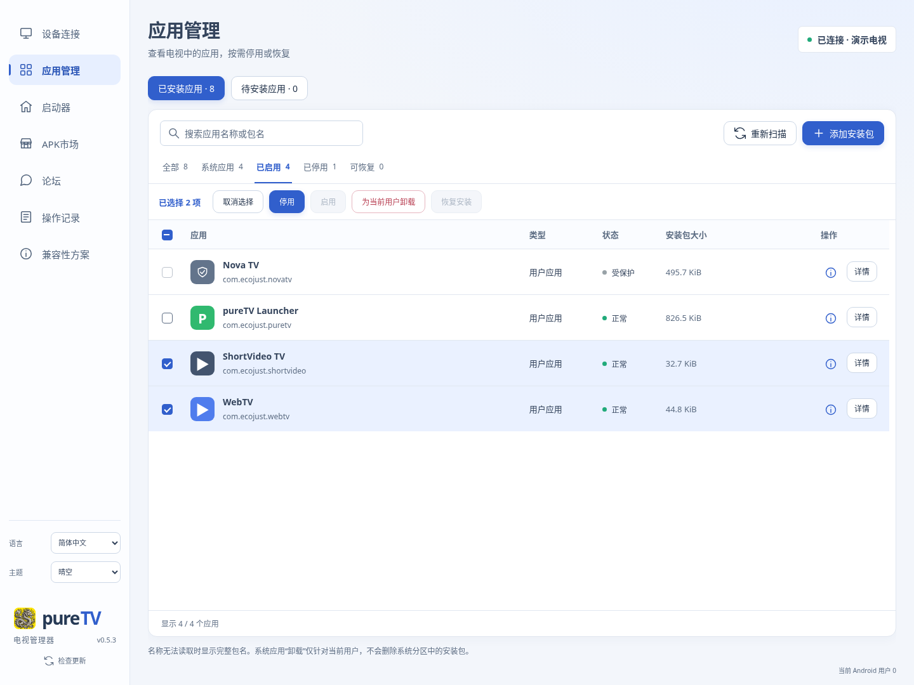

# pureTV 使用指南

**简体中文** · [English](README.en.md) · [返回首页](../../README.md) · [开发指南](development.md)

pureTV Manager 在电脑上通过 ADB 管理 Android TV / Google TV。要在电视上直接浏览、安装应用或检查更新，可以安装 putrtv 商城。在电脑上玩游戏，可以从管理器的「游戏」栏目进入，也可以直接打开网页版。在电视上游玩时，先安装对应的游戏 APK，再连接手柄。[电视端商城 APK 0.1.3](../../resource/apps/putrtv-store/putrtv-store-0.1.3.apk?raw=1) · [按类型浏览游戏](../../README.md#games)

## 安装与升级电脑管理器

从 **pureTV Manager 0.6.0** 发布页下载与电脑匹配的文件。发布页提供文件大小及 SHA256 校验清单。[下载 0.6.0](https://github.com/ecojust/pureTV/releases/tag/desktop-v0.6.0)

| 电脑系统 | 安装方式 |
| --- | --- |
| Windows x64 | 选择安装版 EXE 或便携版 EXE。便携版通过客户端更新时会转为安装版。 |
| macOS 11 及以上 | 按芯片选择 Apple Silicon ARM64 或 Intel x86_64 DMG。将 `pureTV Manager.app` 拖入「应用程序」，再从那里打开。管理器使用 ad-hoc 签名，尚未经过 Apple 公证。[首次打开与校验](../../desktop/README.md#macos-安装与首次打开) |
| Linux x64 | 下载 DEB。客户端自动安装更新时使用系统的 `pkexec` 和 `dpkg`。 |

**从 0.5.7 及更早版本升级，请手动安装 0.6.0。** 退出旧管理器后覆盖安装即可，电视上的应用和管理器配置可以保留。旧客户端继续使用原下载地址，0.5.9 将 APK 市场和客户端更新迁移到了 `apps.b14f.com`。新管理器在启动后检查一次更新，也可点击左下角版本旁的「检查更新」。选择「下载并安装」后，它才下载、校验并交给更新助手安装、重启。应用内可更新的版本以服务器实际提供的对应平台文件为准。[客户端目录](https://apps.b14f.com/client/) · [分平台更新与旧版故障处理](../../desktop/docs/client-updates.md)



## 连接电视

1. 让电脑和电视接入可互通的网络，在电视的开发者选项中开启 ADB／网络调试。
2. 在管理器「设备连接」输入电视 IP 或主机名和调试端口，并在电视上允许这台电脑连接。常见端口为 `5555`，以电视实际设置为准。
3. 缺少 ADB 时，先阅读并同意 Android SDK 许可，再点「下载并配置 ADB」。管理器优先使用 Google 下载源，失败时尝试腾讯镜像。也可选择电脑上已有的 ADB。

连接后，首页显示电视型号、Android 和 SDK 版本、安全补丁、CPU、内存、`/data` 磁盘容量、分辨率及运行时间。其他页面顶部显示当前连接状态。[连接失败排查](../../desktop/README.md#连接失败排查)

## 管理应用、市场与启动器

| 操作 | 在管理器里怎么做 |
| --- | --- |
| 查看和管理已安装应用 | 在「应用管理」搜索或筛选，可批量启用、停用、为当前用户卸载，或恢复仍保有安装包的系统应用。系统应用卸载会保留数据和系统分区 APK。当前默认桌面与核心组件受保护。 |
| 查包名与大小 | 点击应用行的圆圈 **i**，查看包的用途、卸载风险、来源和获取时间。未知包会标明。显示的大小只合计主 APK 和分包。无法读取的大小显示为「未知」。 |
| 安装自己的 APK | 将本地 APK 导入「待安装应用」，在行尾安装单项或勾选批量安装。成功项移出队列，失败和未执行项保留。列表可独立滚动，表头和批量操作按钮固定。 |
| 从市场安装 | 在「市场」搜索或预览服务器 `launcher/`、`media/` 和 `game/` 中的资源。可下载到待安装列表，或连接电视后直接安装。每个应用或启动器合并显示最近五个版本，默认最新版。服务器新增 APK 后刷新即可发现。[浏览服务器目录](https://apps.b14f.com/launcher/) |
| 更换默认桌面 | 在「启动器」页导入并安装启动器 APK，选择默认桌面，或恢复原桌面。切换后可按电视遥控器 Home 键进入。支持布局接口的当前启动器会出现「调整布局」。 |

主动连接、刷新、批量管理或应用布局时，管理器先显示进度，再反馈成功、失败和未执行项。后台自动读取不会反复弹窗。

在「调整布局」中，可将已安装且具备启动入口的用户应用加到 Home 或 Apps 页面，拖动、框选、对齐或平铺应用块。两页可独立设置背景、布局和切页方式。市场下载 APK 时会缓存同目录的 `logo.svg`，添加或更换应用块时自动使用。确认「应用到电视」后，桌面会显示新布局。升级布局协议时需同时更新管理器与配套启动器。[布局编辑说明](../../desktop/docs/launcher-layout.md)

启动器列表会显示支持协议的各个启动器的 Home 背景，包括未激活的启动器。更换背景请在「调整布局」里操作。待安装 APK 优先预览内置布局的 Home 背景，无法读取时再使用同目录的 `thumb.png` 或 `APK名.thumb.png`。

电视端 putrtv 商城与电脑端 APK 市场读取相同的影音、游戏和启动器目录。打开应用详情可选择最近五个版本中的一个。商城还可配合新版启动器选择应用的桌面位置。电视系统语言设为英语时，支持英语的启动器与自研电视应用会切换语言，用户提供的应用名、播放列表和媒体标题保持原文。[商城使用说明](../../resource/apps/putrtv-store/README.md) · [启动器与电视应用完整目录](../../resource/README.md)

## 安装游戏与连接手柄

### 在电脑上玩

电脑联网后，打开 pureTV Manager 左侧的「游戏」，点击封面即可在管理器内全屏游玩。键盘按键见游戏画面提示。使用 pureTV 无线手柄时，让手柄和电脑接入同一局域网，打开游戏后按手柄上的搜索键。游玩结束后，选择「返回游戏列表」即可换一款游戏。

在项目首页的游戏卡片下点击「网页游玩」，即可直接在浏览器使用键盘游玩，无需安装管理器。[浏览全部网页游戏](https://ecojust.github.io/pureTV/)

#### 使用独立安装包

在首页找到游戏，点击苹果或 Windows 图标下载这款游戏的独立客户端。macOS 打开 DMG，将游戏拖入“应用程序”。Windows 运行安装程序后，从开始菜单打开游戏。[按游戏选择安装包](../../README.md#games)

37 个独立客户端的首发安装包都已内置游戏资源，可以离线启动。macOS 在独立窗口中运行，按 ⌘Q 退出。Windows 在默认浏览器中运行，关闭游戏控制台即可退出。部分 3D 游戏需要支持 WebGL 2 的图形环境。[当前客户端与 SHA-256 校验值](../releases/gameplay-icons-2026.11.21/clients.json) · [首批 37 个安装包的发布记录](https://github.com/ecojust/pureTV/releases/tag/standalone-games-2026.11.21)

#### 使用多游戏启动器

Windows x64 用户打开游戏启动器，用方向键选择游戏，按回车开始。启动器首次下载并校验游戏，在默认浏览器中打开。之后可从本机缓存启动。键盘操作按各游戏画面的提示，也可以连接同一局域网内的 pureTV 无线手柄。游玩时请保持启动器运行。[下载 Windows 启动器](../../tools/pc-games/packages/pureTV-Games.exe?raw=1)

macOS 和 Linux 用户可解压便携包，在解压目录用 Python 3.10 或更新版本运行下面的命令。若要直接打开某款游戏，可在启动命令后加游戏 ID，例如 `.venv/bin/python launcher.py tetris`。[下载便携启动器](../../tools/pc-games/packages/pureTV-Games-portable.zip?raw=1)

```sh
python3 -m venv .venv
.venv/bin/python -m pip install -r requirements.txt
.venv/bin/python launcher.py
```

### 在电视上扫码加入

在首页选择游戏，点击电视图标下载该款签名 APK，然后将它安装到电视。下载源码包的用户也可以解压后直接安装 `joystick-games/<游戏 ID>/` 中的 APK。[浏览首页游戏目录](../../README.md#games) · [本批六款 APK](../../joystick-games/README.md#game-expansion)

首页「作者在线原版」下的六款共用一个 Android TV 安装包。打开「pureTV 在线游戏」后可用方向键选游戏，也可以用同一局域网的手机扫码。游玩时按返回键打开中文指南和手柄说明。[电视客户端下载与操作说明](../../resource/apps/hosted-games/)

在电视上打开游戏，让手机接入同一局域网，扫描游戏菜单中的二维码。手机浏览器会打开虚拟手柄，在手机上按方向和动作键，看电视画面游玩。电视显示已连接的玩家席位，进入菜单或暂停时可以查看连接详情。

### 连接 pureTV 无线手柄

1. 在首页游戏专栏按类型选择游戏。电视图标下载这款游戏的 Android TV 安装包。游戏有独立的 macOS 或 Windows 安装包时，卡片会显示对应的平台图标，点击即可下载该游戏的安装包。手柄图标表示支持 pureTV 手柄。点击游戏名称或截图可查看按键、便携包和该版本的兼容性。[按类型浏览游戏](../../README.md#games)
2. 将手柄和运行游戏的电视或电脑接入同一个可互通的局域网，启动游戏。按手柄搜索键 **GPIO 23** 发现游戏。当前固件只会自动连接发现的唯一有效服务。若同时打开了其他游戏，先关闭其他服务，或在手柄配网页手动填写游戏主机的 IPv4 地址和实际端口。
3. 游戏默认使用 TCP **63485**。如果启动时端口已被占用，以游戏显示的实际端口为准。连接后可在连接详情中查看玩家席位和设备 ID。断开后，游戏会更新席位状态。按 **START（GPIO 27）** 开始或暂停。方向键和 A 常用于选择和确认，其他操作、双人支持与断线后如何继续请按该游戏说明。[按键与双人支持](../readme-controller-support/README.md) · [客户端标识示例](../controller-client-status/README.md)

原首页精选的 20 款电视游戏手柄版支持 Android 8.0 及以上。其他游戏也要看系统 WebView 和图形要求，部分 3D 游戏需要 WebGL2。桌面手柄版中的九款赛车要求 macOS 11+，Windows 版使用 Windows 10 1903+ x64 或 Windows 11 和 WebView2 Runtime。Universal 包提供 Apple Silicon 与 Intel 两种架构，Intel 原生游戏画面是否通过验证仍按款列出。九款解谜游戏中，Story Thief、Atlas of Ink 和 Starbase Spooky 通过 Intel 原生玩法检查，另六款在测试机上进入菜单前超时。[赛车版本表](../../joystick-games/README.md#九款赛车游戏下载) · [解谜版本与测试记录](../puzzle-nine/README.md#下载安装)

Backroad Rally、炼金方阵、蜜蜂果篮、星际弹弓、雨夜维修铺、誓约宝石和霓虹秘仪的 macOS 独立安装包为预览版。

## 其他资源与许可

- 电视启动器、影音与工具应用位于 `resource/`。游戏源码和 APK 按游戏存放在 `joystick-games/`。历史电视端 `android-v*` 与电脑管理器 `desktop-v*` 各自编号。原九款电视游戏的 0.5.1 规则更新沿用 0.5.0 证书，可覆盖原版本。[完整资源目录](../../resource/README.md) · [0.5.1 规则与地图复核](../game-releases/game-fidelity-0.5.1.md)
- 第三方电视应用另有分类目录，保留各应用的图标、封面、manifest 及上游资料。[第三方应用](../../fork/README.md) · [超限文件与复刻参考](../../fork/OVERSIZED.md)
- pureTV 使用 MIT 许可。部分电视启动器代码参考 Gathin23 的 cleanyourtv，保留原作者的版权与许可声明。字体及其他第三方素材遵循各自许可证。[MIT](../../LICENSE) · [NOTICE](../../NOTICE.md) · [cleanyourtv](https://github.com/Gathin23/cleanyourtv) · [字体 OFL 许可](../../resource/launcher/puretv/FONT-LICENSE-OFL.txt)
