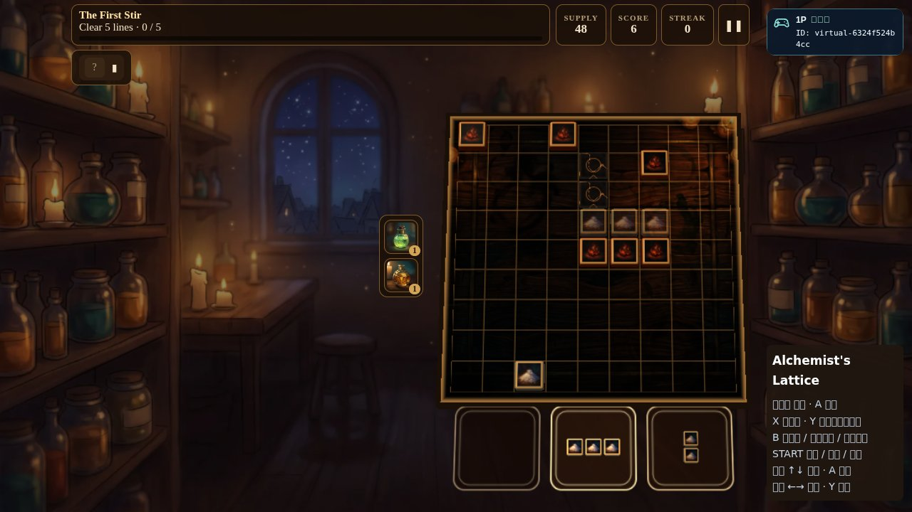
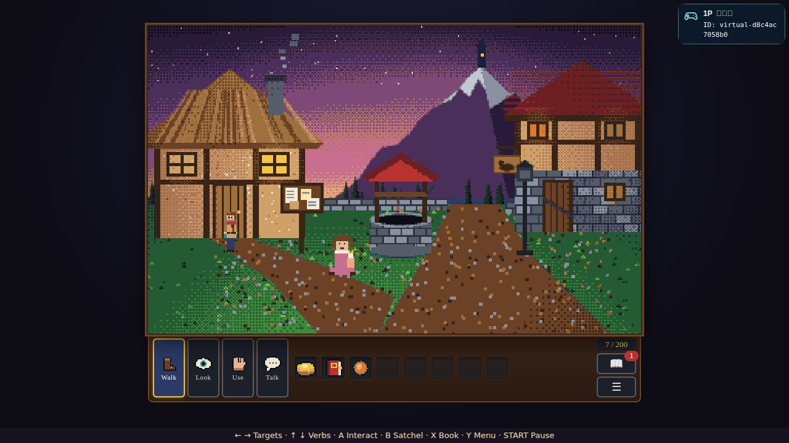
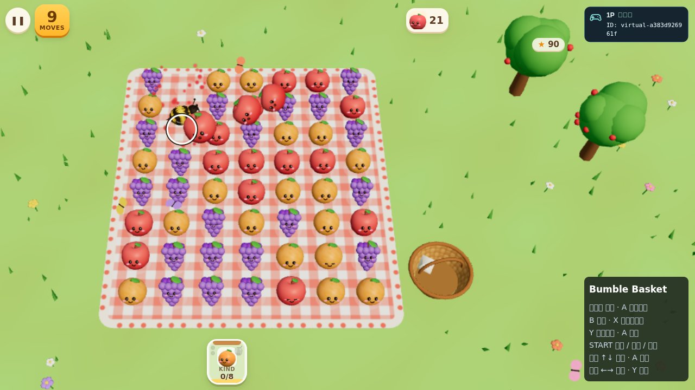
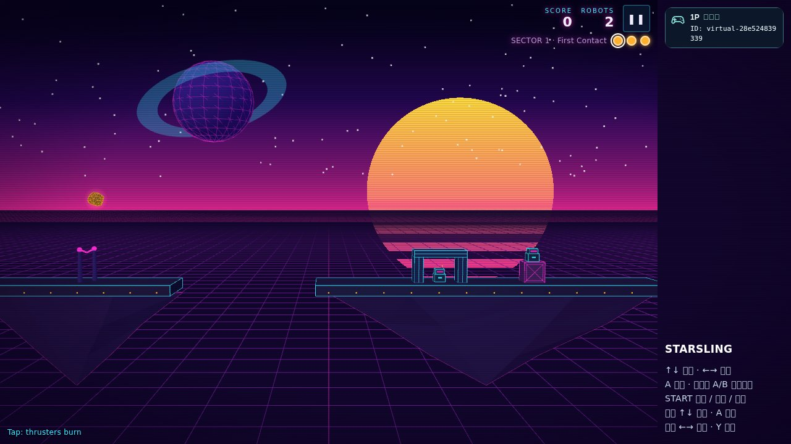
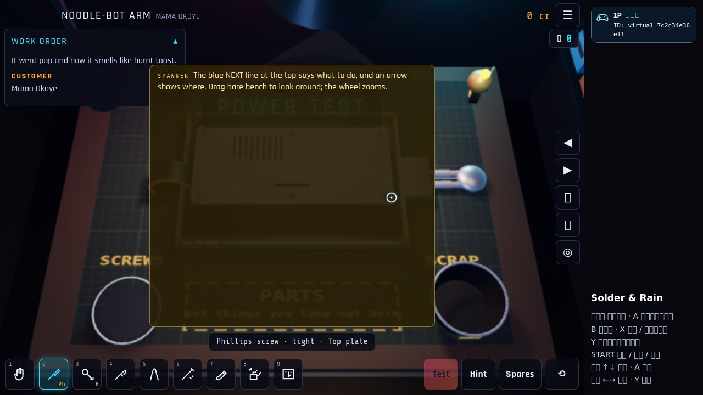
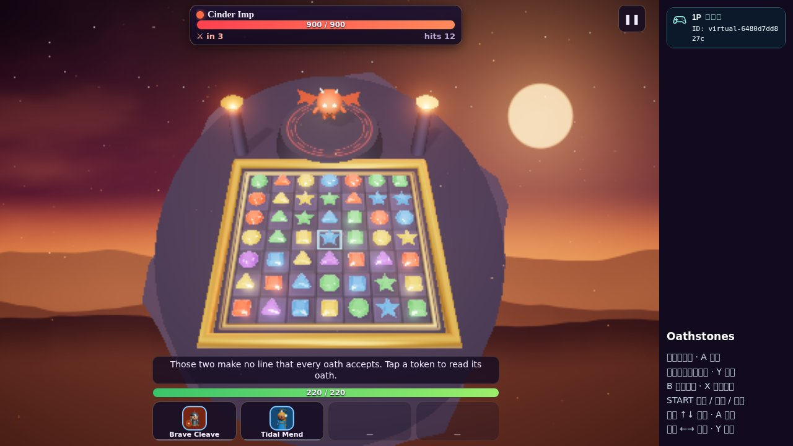
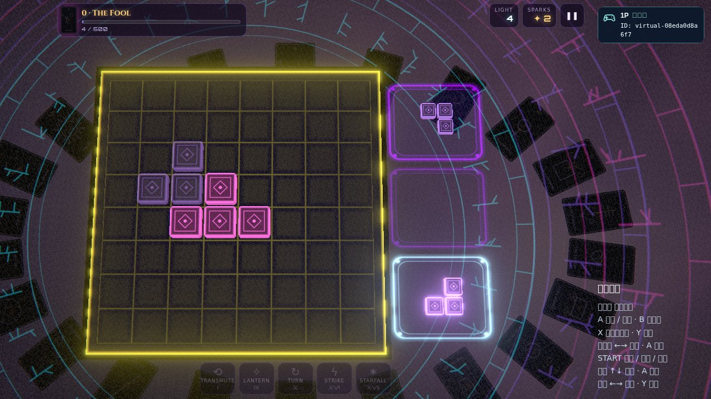
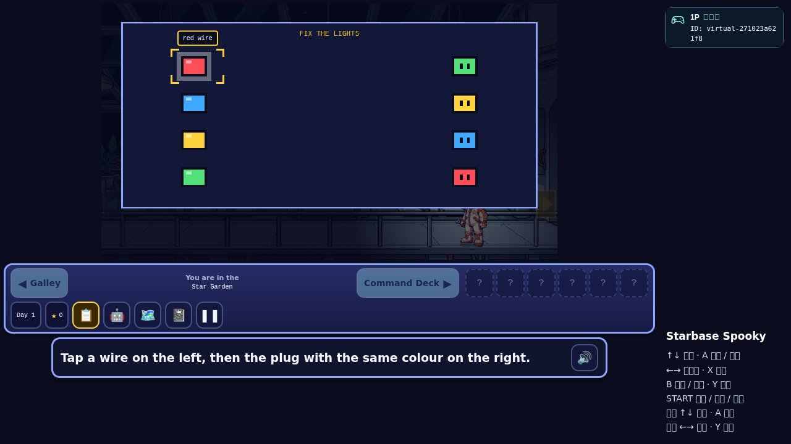

# 九款解谜与益智手柄游戏

这九款从 pureTV 参考清单的 65 个解谜与益智条目中选出。它们都是独立原作，各有自己的棋盘、关卡或故事。每款支持 pureTV 九键 Wi-Fi 手柄，START 用于开始、暂停和继续。电视或电脑与手柄需在同一局域网。游戏界面和剧情沿用原作英文，每款的中文操作说明可从下表打开。

| 游戏 | 在游戏里做什么 | 原作 |
| --- | --- | --- |
| [炼金方阵 · Alchemist’s Lattice](../../joystick-games/alchemists-lattice/) | 在 9×9 炼金台摆放手牌，填满行列、剥开矿藏，沿学徒地图解锁能力。 | [game-027](https://github.com/triptych/web-games-andrew/tree/a7051c34fe2e7550fd206e6272f758df171855b0/game-027) |
| [灰斗篷山的故事大盗 · The Story Thief of Greymantle](../../joystick-games/story-thief/) | 在十个场景里寻找物品，和角色交谈，用背包里的道具解开故事谜题。 | [game-044](https://github.com/triptych/web-games-andrew/tree/a7051c34fe2e7550fd206e6272f758df171855b0/game-044) |
| [蜜蜂果篮 · Bumble Basket](../../joystick-games/bumble-basket/) | 按颜色、种类或大小逐颗连接相邻水果，再把整串收入篮中。 | [game-058](https://github.com/triptych/web-games-andrew/tree/a7051c34fe2e7550fd206e6272f758df171855b0/game-058) |
| [星际弹弓 · STARSLING](../../joystick-games/starsling/) | 调整角度与力度，把陨石送入引力场，借弯曲的轨迹击中太空设施。 | [game-102](https://github.com/triptych/web-games-andrew/tree/a7051c34fe2e7550fd206e6272f758df171855b0/game-102) |
| [雨夜维修铺 · Solder & Rain](../../joystick-games/solder-and-rain/) | 在维修台选择工具，拆开电器排查故障，修好之后通电测试。 | [game-105](https://github.com/triptych/web-games-andrew/tree/a7051c34fe2e7550fd206e6272f758df171855b0/game-105) |
| [誓约宝石 · Oathstones](../../joystick-games/oathstones/) | 遵循符石的誓约，交换相邻符石，用连锁与技能推进战役。 | [game-108](https://github.com/triptych/web-games-andrew/tree/a7051c34fe2e7550fd206e6272f758df171855b0/game-108) |
| [霓虹秘仪 · NEON ARCANA](../../joystick-games/neon-arcana/) | 从三枚手牌中选择形状，摆进 8×8 格盘，清行并点亮塔罗牌。 | [game-111](https://github.com/triptych/web-games-andrew/tree/a7051c34fe2e7550fd206e6272f758df171855b0/game-111) |
| [墨绘地图集 · Atlas of Ink](../../joystick-games/atlas-of-ink/) | 移动羽毛笔，蓄力感知海岸和暗礁，为委托人画出一张地图。 | [game-123](https://github.com/triptych/web-games-andrew/tree/a7051c34fe2e7550fd206e6272f758df171855b0/game-123) |
| [幽灵空间站 · Starbase Spooky](../../joystick-games/starbase-spooky/) | 在八个房间里调查线索，修理电线、匹配电池、排列行星、记住闪灯和旋律。 | [game-130](https://github.com/triptych/web-games-andrew/tree/a7051c34fe2e7550fd206e6272f758df171855b0/game-130) |

游戏使用 Andrew Wooldridge 的 MIT 授权源码。各游戏目录的 NOTICE 列出实际随包使用的引擎、字体及其他素材。场景、声音和运行依赖随各游戏安装包离线提供。[原作合辑与许可证](https://github.com/triptych/web-games-andrew/tree/a7051c34fe2e7550fd206e6272f758df171855b0)

## 下载安装

上表的游戏名可打开各款详情页，页首提供该游戏的 Android TV 签名 APK、macOS DMG 和 Windows x64 安装程序。[按类型浏览当前下载](../../README.md#games) · [客户端版本与 SHA-256 校验值](../releases/gameplay-icons-2026.11.21/clients.json)

<!-- verified-puzzle-files -->
### 首批 45 个安装文件与实玩记录

Android TV 安装 APK。macOS 的 DMG 和 ZIP 都包含通用应用，Apple Silicon 原生、端口被占用后的连接和 Rosetta 运行均已实玩。Windows x64 可选安装版 EXE，或完整解压便携 ZIP 后打开 PureTVGame.exe。Intel 栏记录每款在原生 Intel macOS 上的实玩结果。

| 游戏 | 版本 | Android TV | macOS 通用包 | Intel 原生实玩 | Windows x64 |
| --- | --- | --- | --- | --- | --- |
| 炼金方阵 | 0.1.1 | [APK](../../joystick-games/alchemists-lattice/alchemists-lattice-0.1.1.apk?raw=1) | [DMG](https://github.com/ecojust/pureTV/releases/download/joystick-alchemists-lattice-v0.1.1/AlchemistsLattice-0.1.1-macos-universal.dmg) · [ZIP](https://github.com/ecojust/pureTV/releases/download/joystick-alchemists-lattice-v0.1.1/AlchemistsLattice-0.1.1-macos-universal.zip)（预览） | 尚未通过 | [安装 EXE](https://github.com/ecojust/pureTV/releases/download/joystick-alchemists-lattice-v0.1.1/AlchemistsLattice-0.1.1-windows-x64-setup.exe) · [便携 ZIP](https://github.com/ecojust/pureTV/releases/download/joystick-alchemists-lattice-v0.1.1/AlchemistsLattice-0.1.1-windows-x64.zip) |
| 灰斗篷山的故事大盗 | 0.1.1 | [APK](../../joystick-games/story-thief/story-thief-0.1.1.apk?raw=1) | [DMG](https://github.com/ecojust/pureTV/releases/download/joystick-story-thief-v0.1.1/StoryThief-0.1.1-macos-universal.dmg) · [ZIP](https://github.com/ecojust/pureTV/releases/download/joystick-story-thief-v0.1.1/StoryThief-0.1.1-macos-universal.zip) | 通过 | [安装 EXE](https://github.com/ecojust/pureTV/releases/download/joystick-story-thief-v0.1.1/StoryThief-0.1.1-windows-x64-setup.exe) · [便携 ZIP](https://github.com/ecojust/pureTV/releases/download/joystick-story-thief-v0.1.1/StoryThief-0.1.1-windows-x64.zip) |
| 蜜蜂果篮 | 0.1.2 | [APK](../../joystick-games/bumble-basket/bumble-basket-0.1.2.apk?raw=1) | [DMG](https://github.com/ecojust/pureTV/releases/download/joystick-bumble-basket-v0.1.2/BumbleBasket-0.1.2-macos-universal.dmg) · [ZIP](https://github.com/ecojust/pureTV/releases/download/joystick-bumble-basket-v0.1.2/BumbleBasket-0.1.2-macos-universal.zip)（预览） | 尚未通过 | [安装 EXE](https://github.com/ecojust/pureTV/releases/download/joystick-bumble-basket-v0.1.2/BumbleBasket-0.1.2-windows-x64-setup.exe) · [便携 ZIP](https://github.com/ecojust/pureTV/releases/download/joystick-bumble-basket-v0.1.2/BumbleBasket-0.1.2-windows-x64.zip) |
| 星际弹弓 | 0.1.1 | [APK](../../joystick-games/starsling/starsling-0.1.1.apk?raw=1) | [DMG](https://github.com/ecojust/pureTV/releases/download/joystick-starsling-v0.1.1/Starsling-0.1.1-macos-universal.dmg) · [ZIP](https://github.com/ecojust/pureTV/releases/download/joystick-starsling-v0.1.1/Starsling-0.1.1-macos-universal.zip)（预览） | 尚未通过 | [安装 EXE](https://github.com/ecojust/pureTV/releases/download/joystick-starsling-v0.1.1/Starsling-0.1.1-windows-x64-setup.exe) · [便携 ZIP](https://github.com/ecojust/pureTV/releases/download/joystick-starsling-v0.1.1/Starsling-0.1.1-windows-x64.zip) |
| 雨夜维修铺 | 0.1.0 | [APK](../../joystick-games/solder-and-rain/solder-and-rain-0.1.0.apk?raw=1) | [DMG](https://github.com/ecojust/pureTV/releases/download/joystick-solder-and-rain-v0.1.0/SolderAndRain-0.1.0-macos-universal.dmg) · [ZIP](https://github.com/ecojust/pureTV/releases/download/joystick-solder-and-rain-v0.1.0/SolderAndRain-0.1.0-macos-universal.zip)（预览） | 尚未通过 | [安装 EXE](https://github.com/ecojust/pureTV/releases/download/joystick-solder-and-rain-v0.1.0/SolderAndRain-0.1.0-windows-x64-setup.exe) · [便携 ZIP](https://github.com/ecojust/pureTV/releases/download/joystick-solder-and-rain-v0.1.0/SolderAndRain-0.1.0-windows-x64.zip) |
| 誓约宝石 | 0.1.0 | [APK](../../joystick-games/oathstones/oathstones-0.1.0.apk?raw=1) | [DMG](https://github.com/ecojust/pureTV/releases/download/joystick-oathstones-v0.1.0/Oathstones-0.1.0-macos-universal.dmg) · [ZIP](https://github.com/ecojust/pureTV/releases/download/joystick-oathstones-v0.1.0/Oathstones-0.1.0-macos-universal.zip)（预览） | 尚未通过 | [安装 EXE](https://github.com/ecojust/pureTV/releases/download/joystick-oathstones-v0.1.0/Oathstones-0.1.0-windows-x64-setup.exe) · [便携 ZIP](https://github.com/ecojust/pureTV/releases/download/joystick-oathstones-v0.1.0/Oathstones-0.1.0-windows-x64.zip) |
| 霓虹秘仪 | 0.1.1 | [APK](../../joystick-games/neon-arcana/neon-arcana-0.1.1.apk?raw=1) | [DMG](https://github.com/ecojust/pureTV/releases/download/joystick-neon-arcana-v0.1.1/NeonArcana-0.1.1-macos-universal.dmg) · [ZIP](https://github.com/ecojust/pureTV/releases/download/joystick-neon-arcana-v0.1.1/NeonArcana-0.1.1-macos-universal.zip)（预览） | 尚未通过 | [安装 EXE](https://github.com/ecojust/pureTV/releases/download/joystick-neon-arcana-v0.1.1/NeonArcana-0.1.1-windows-x64-setup.exe) · [便携 ZIP](https://github.com/ecojust/pureTV/releases/download/joystick-neon-arcana-v0.1.1/NeonArcana-0.1.1-windows-x64.zip) |
| 墨绘地图集 | 0.1.1 | [APK](../../joystick-games/atlas-of-ink/atlas-of-ink-0.1.1.apk?raw=1) | [DMG](https://github.com/ecojust/pureTV/releases/download/joystick-atlas-of-ink-v0.1.1/AtlasOfInk-0.1.1-macos-universal.dmg) · [ZIP](https://github.com/ecojust/pureTV/releases/download/joystick-atlas-of-ink-v0.1.1/AtlasOfInk-0.1.1-macos-universal.zip) | 通过 | [安装 EXE](https://github.com/ecojust/pureTV/releases/download/joystick-atlas-of-ink-v0.1.1/AtlasOfInk-0.1.1-windows-x64-setup.exe) · [便携 ZIP](https://github.com/ecojust/pureTV/releases/download/joystick-atlas-of-ink-v0.1.1/AtlasOfInk-0.1.1-windows-x64.zip) |
| 幽灵空间站 | 0.1.2 | [APK](../../joystick-games/starbase-spooky/starbase-spooky-0.1.2.apk?raw=1) | [DMG](https://github.com/ecojust/pureTV/releases/download/joystick-starbase-spooky-v0.1.2/StarbaseSpooky-0.1.2-macos-universal.dmg) · [ZIP](https://github.com/ecojust/pureTV/releases/download/joystick-starbase-spooky-v0.1.2/StarbaseSpooky-0.1.2-macos-universal.zip) | 通过 | [安装 EXE](https://github.com/ecojust/pureTV/releases/download/joystick-starbase-spooky-v0.1.2/StarbaseSpooky-0.1.2-windows-x64-setup.exe) · [便携 ZIP](https://github.com/ecojust/pureTV/releases/download/joystick-starbase-spooky-v0.1.2/StarbaseSpooky-0.1.2-windows-x64.zip) |

表中 6 款 WebGL 2 游戏的 Intel 原生实玩尚未通过，它们的 macOS 文件作为预览提供。九款的 Android TV 和 Windows x64 均已安装，并通过默认端口和端口占用两种原生手柄实玩。

45 个公开文件均已完整下载并核对字节数和 SHA-256。[下载校验与平台记录](download-verification.json) · [游戏来源与离线分发核查](source-audit/README.md)
<!-- /verified-puzzle-files -->

## 实际游戏画面

下图来自 1280×720 的手柄实玩，点选画面可查看操作说明。每款也在 960×540 下用同一方案完成原作动作、断线暂停和显式继续。[九款原始实玩与截图](https://github.com/ecojust/pureTV/tree/888897d75faf073b758c0759b080a8f0ad276b3b) · [蜜蜂果篮 0.1.2 复验](https://github.com/ecojust/pureTV/actions/runs/44716017753) · [幽灵空间站 0.1.2 复验](https://github.com/ecojust/pureTV/actions/runs/44717389566)

<table>
<tr>
<td width="33%" align="center"><a href="../../joystick-games/alchemists-lattice/"> 炼金方阵</a></td>
<td width="33%" align="center"><a href="../../joystick-games/story-thief/"> 灰斗篷山的故事大盗</a></td>
<td width="33%" align="center"><a href="../../joystick-games/bumble-basket/"> 蜜蜂果篮</a></td>
</tr>
<tr>
<td width="33%" align="center"><a href="../../joystick-games/starsling/"> 星际弹弓</a></td>
<td width="33%" align="center"><a href="../../joystick-games/solder-and-rain/"> 雨夜维修铺</a></td>
<td width="33%" align="center"><a href="../../joystick-games/oathstones/"> 誓约宝石</a></td>
</tr>
<tr>
<td width="33%" align="center"><a href="../../joystick-games/neon-arcana/"> 霓虹秘仪</a></td>
<td width="33%" align="center"><a href="../../joystick-games/atlas-of-ink/"> 墨绘地图集</a></td>
<td width="33%" align="center"><a href="../../joystick-games/starbase-spooky/"> 幽灵空间站</a></td>
</tr>
</table>

## 设备与连接

Android TV 需要 Android 8.0 或以上版本。macOS 通用包包含 Apple Silicon 和 Intel 两种架构，采用 ad-hoc 签名，尚未经过 Apple 公证。Windows 安装版与便携版均未做 Authenticode 签名。Windows 支持 Windows 10 1903 起及 Windows 11 的 x64 电脑，需要 Microsoft Edge WebView2 Runtime。[Windows 宿主说明](../../joystick-games/shared/windows/README.md)

《灰斗篷山的故事大盗》《墨绘地图集》《幽灵空间站》使用 Canvas 2D。其余六款需要系统 WebView 和图形驱动支持 WebGL 2。运行游戏后让手柄在同一局域网搜索，屏幕右侧会显示已连接的手柄 ID。游戏默认使用 TCP 63485，端口被占用时会广播实际使用的端口。[手柄连接与协议](../../puretv-joystick/README.md)

六款 WebGL 2 游戏在两种托管 Intel Mac 系统上均遇到图形上下文丢失。各游戏的下载与原生验证按实际芯片分别记录。[Intel Mac 图形诊断](intel-macos/README.md)
