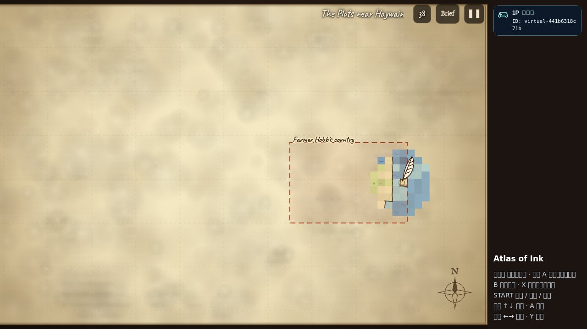

# 九款解谜与益智手柄游戏

这九款从 pureTV 参考清单的 65 个解谜与益智条目中选出。它们都是独立原作，各有自己的棋盘、关卡或故事。每款支持 pureTV 九键 Wi-Fi 手柄，START 用于开始、暂停和继续。电视或电脑与手柄需在同一局域网。

| 游戏 | 在游戏里做什么 | 原作 |
| --- | --- | --- |
| [Alchemist’s Lattice](../../joystick-games/alchemists-lattice/) | 在 9×9 炼金台摆放手牌，填满行列、剥开矿藏，沿学徒地图解锁能力。 | [game-027](https://github.com/triptych/web-games-andrew/tree/a7051c34fe2e7550fd206e6272f758df171855b0/game-027) |
| [The Story Thief of Greymantle](../../joystick-games/story-thief/) | 在十个场景里寻找物品，和角色交谈，用背包里的道具解开故事谜题。 | [game-044](https://github.com/triptych/web-games-andrew/tree/a7051c34fe2e7550fd206e6272f758df171855b0/game-044) |
| [Bumble Basket](../../joystick-games/bumble-basket/) | 按颜色、种类或大小逐颗连接相邻水果，再把整串收入篮中。 | [game-058](https://github.com/triptych/web-games-andrew/tree/a7051c34fe2e7550fd206e6272f758df171855b0/game-058) |
| [STARSLING](../../joystick-games/starsling/) | 调整角度与力度，把陨石送入引力场，借弯曲的轨迹击中太空设施。 | [game-102](https://github.com/triptych/web-games-andrew/tree/a7051c34fe2e7550fd206e6272f758df171855b0/game-102) |
| [Solder & Rain](../../joystick-games/solder-and-rain/) | 在维修台选择工具，拆开电器排查故障，修好之后通电测试。 | [game-105](https://github.com/triptych/web-games-andrew/tree/a7051c34fe2e7550fd206e6272f758df171855b0/game-105) |
| [Oathstones](../../joystick-games/oathstones/) | 遵循符石的誓约，交换相邻符石，用连锁与技能推进战役。 | [game-108](https://github.com/triptych/web-games-andrew/tree/a7051c34fe2e7550fd206e6272f758df171855b0/game-108) |
| [NEON ARCANA](../../joystick-games/neon-arcana/) | 从三枚手牌中选择形状，摆进 8×8 格盘，清行并点亮塔罗牌。 | [game-111](https://github.com/triptych/web-games-andrew/tree/a7051c34fe2e7550fd206e6272f758df171855b0/game-111) |
| [Atlas of Ink](../../joystick-games/atlas-of-ink/) | 移动羽毛笔，蓄力感知海岸和暗礁，为委托人画出一张地图。 | [game-123](https://github.com/triptych/web-games-andrew/tree/a7051c34fe2e7550fd206e6272f758df171855b0/game-123) |
| [Starbase Spooky](../../joystick-games/starbase-spooky/) | 在八个房间里调查线索，修理电线、匹配电池、排列行星、记住闪灯和旋律。 | [game-130](https://github.com/triptych/web-games-andrew/tree/a7051c34fe2e7550fd206e6272f758df171855b0/game-130) |

游戏使用 Andrew Wooldridge 的 MIT 授权源码。各游戏目录的 NOTICE 列出实际随包使用的引擎、字体及其他素材。场景、声音和运行依赖随各游戏安装包离线提供。[原作合辑与许可证](https://github.com/triptych/web-games-andrew/tree/a7051c34fe2e7550fd206e6272f758df171855b0)

## 实际游戏画面

下图来自 1280×720 的手柄实玩，点选画面可查看操作说明。每款也在 960×540 下用同一方案完成原作动作、断线暂停和显式继续。[原始实玩与截图](https://github.com/ecojust/pureTV/tree/888897d75faf073b758c0759b080a8f0ad276b3b)

<table>
<tr>
<td width="33%" align="center"><a href="../../joystick-games/alchemists-lattice/"> 炼金方阵</a></td>
<td width="33%" align="center"><a href="../../joystick-games/story-thief/"> 灰斗篷山的故事大盗</a></td>
<td width="33%" align="center"><a href="../../joystick-games/bumble-basket/"> 蜜蜂果篮</a></td>
</tr>
<tr>
<td width="33%" align="center"><a href="../../joystick-games/starsling/"> 星际弹弓</a></td>
<td width="33%" align="center"><a href="../../joystick-games/solder-and-rain/"> 雨夜维修铺</a></td>
<td width="33%" align="center"><a href="../../joystick-games/oathstones/"> 誓约宝石</a></td>
</tr>
<tr>
<td width="33%" align="center"><a href="../../joystick-games/neon-arcana/"> 霓虹秘仪</a></td>
<td width="33%" align="center"><a href="../../joystick-games/atlas-of-ink/"> 墨绘地图集</a></td>
<td width="33%" align="center"><a href="../../joystick-games/starbase-spooky/"> 幽灵空间站</a></td>
</tr>
</table>

## 设备与连接

Android TV 需要 Android 8.0 或以上版本。macOS 通用包包含 Apple Silicon 和 Intel 两种架构。Windows 支持 Windows 10 1903 起及 Windows 11 的 x64 电脑，需要 Microsoft Edge WebView2 Runtime。[Windows 宿主说明](../../joystick-games/shared/windows/README.md)

《灰斗篷山的故事大盗》《墨绘地图集》《幽灵空间站》使用 Canvas 2D。其余六款需要系统 WebView 和图形驱动支持 WebGL 2。运行游戏后让手柄在同一局域网搜索，屏幕右侧会显示已连接的手柄 ID。游戏默认使用 TCP 63485，端口被占用时会广播实际使用的端口。[手柄连接与协议](../../puretv-joystick/README.md)
