# 九款赛车对比与三平台适配

已检查扩充前 README 中的 **31 个赛车候选**，以画面与玩法各 **50 分**选出以下 **9 款**。30款有分，F1因缺少足够清晰的赛中画面暂不评分；分数是本次有范围限制的评审估计，不是外部评分或 GitHub 星标。

**九款赛车均可下载 Android TV、macOS 和 Windows x64 安装文件。** 27 个游戏／平台组合中，24 个已完成相应平台的原生手柄验收，3 款 Android TV 游戏提供测试版。Android TV 6/9、Mac 9/9、Windows 9/9 已验证；Kart Rush、Dirt Crown、Night Racer、Penguintrack、Turbo Kart Rush、Last Track 三平台均有游玩记录。[逐款下载与测试范围](../../joystick-games/README.md#九款赛车游戏下载)

Backroad Rally 新增 [Windows 安装版和便携包](https://github.com/ecojust/pureTV/releases/tag/joystick-backroad-rally-windows-v0.1.0)，两种端口模式都已验证芬兰赛段实际驾驶、暂停和存档恢复。[原生验证](https://github.com/ecojust/pureTV/actions/runs/44679344457) · [下载校验](backroad-windows-publication.json)。Night Racer、Penguintrack、Last Track、Dirt Crown 的 Windows 包均沿用已验原始构建；正常端口与占用回退模式各通过 10 项检查，安装／卸载和存档重启通过。Turbo Kart Rush 的 Windows 两模式也各通过 10 项检查；该游戏未声明存档字段，没有验证实际游戏存档恢复。

目标是 Android TV、macOS 通用包（Apple Silicon／Intel）与 Windows x64，支持 pureTV 九键手柄、默认 TCP 63485、真实连接 ID、断线／失焦取消和手动恢复。Mac 包保留 Apple Silicon 原生、端口占用及 Rosetta 通过记录；Backroad Rally 作为预发布提供，其公开 ZIP 已在 Apple Silicon 上通过手柄驾驶与存档重启复验。Intel 图形运行仍未验证，尚未 Apple 公证。Windows 未做 Authenticode 签名；检查覆盖 96 DPI，其他显示缩放与实体手柄未测试。其余原生验证继续，九款完整交付尚未完成。

## 入选九款

| 游戏 | 画面 /50 | 玩法 /50 | 合计 /100 | 选择理由 |
| --- | ---: | ---: | ---: | --- |
| [backroad rally](reviews/driving/comparison.json) | 44 | 43 | **87** | 林间光照与密集植被、拉力驾驶、车辆损伤和多赛段。 |
| [Ponpoko Kart](reviews/karts/comparison.json) | 44 | 41 | **85** | 灯会、角色与和风赛道风格完整，漂移和道具竞速。 |
| [Night Racer](reviews/driving/comparison.json) | 41 | 43 | **84** | 雨夜灯光、原车型和多场景，车库改装与本地幽灵。 |
| [Penguintrack](reviews/arcade/comparison.json) | 41 | 42 | **83** | 清晰冰雪赛道与企鹅车辆，35关计时、奖牌与编辑器。 |
| [Last Track](reviews/driving/comparison.json) | 39 | 43 | **82** | 武装赛车、武器和伤害HUD，多赛道与改装成长。 |
| [Dirt Crown](reviews/rally/comparison.json) | 38 | 44 | **82** | 泥地赛事、20条赛道定义、26个生涯赛事和升级。 |
| [Turbo Kart Rush](reviews/karts/comparison.json) | 40 | 40 | **80** | 八车道具竞速、四赛道、大奖赛与漂移加速。 |
| [Kart Rush](reviews/rally/comparison.json) | 39 | 41 | **80** | 动物车手、八条赛道、七站大奖赛与多种道具。 |
| [Kart Royale](reviews/karts/comparison.json) | 44 | 35 | **79** | 赛道材质、光照和漂移特效突出；同分时画面优先。 |

## 画面对比

下列为评审所用图片；作者原图和本轮实际运行画面分别注明。起跑图不代表已完成驾驶验证。

<table>
<tr>
<td width="25%" align="center"><a href="reviews/driving/backroad/author-images/slide-sunset.jpg">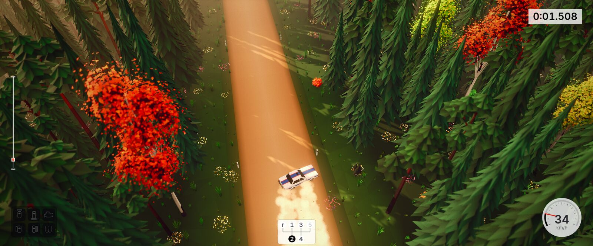</a> <b>backroad rally</b> 作者固定原图</td>
<td width="25%" align="center"><a href="reviews/karts/ponpoko-kart/author-captures/matsuri.jpg">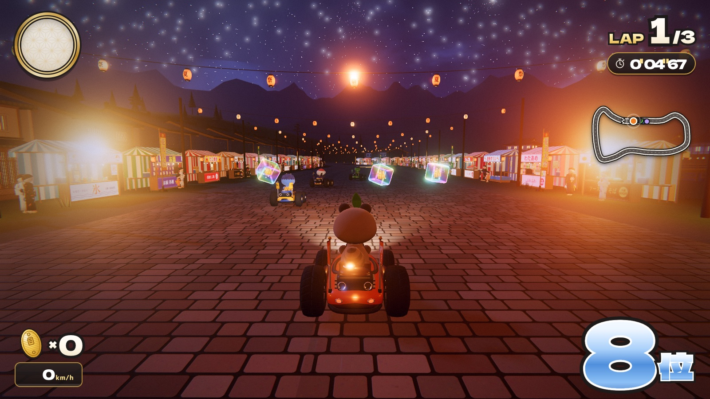</a> <b>Ponpoko Kart</b> 作者固定原图</td>
<td width="25%" align="center"><a href="reviews/driving/night/attempt-2/started.png">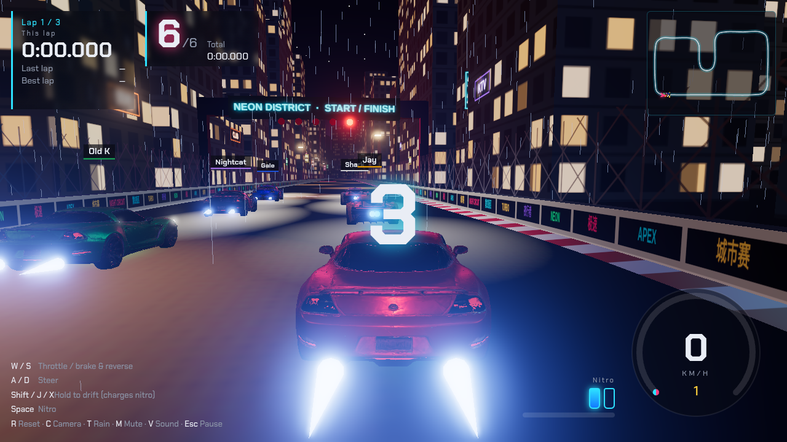</a> <b>Night Racer</b> 本轮起跑／倒计时</td>
<td width="25%" align="center"><a href="reviews/arcade/penguintrack/attempt-1/driving.png">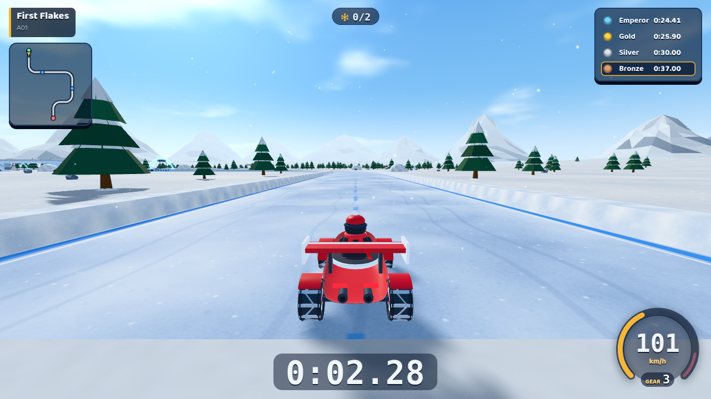</a> <b>Penguintrack</b> 本轮短时驾驶</td>
</tr>
<tr>
<td width="25%" align="center"><a href="reviews/driving/lasttrack/attempt-2/after-input.png">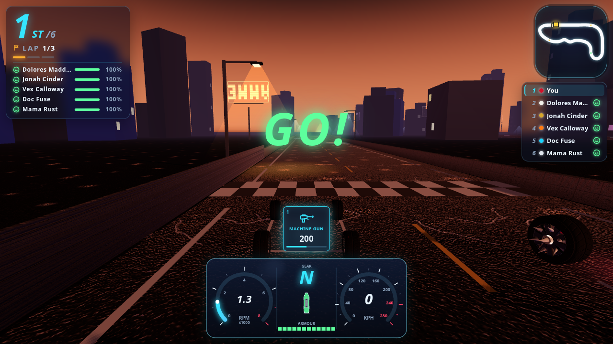</a> <b>Last Track</b> 本轮起跑／倒计时</td>
<td width="25%" align="center"><a href="reviews/rally/dirt-crown/attempt-2-fixed/started.png">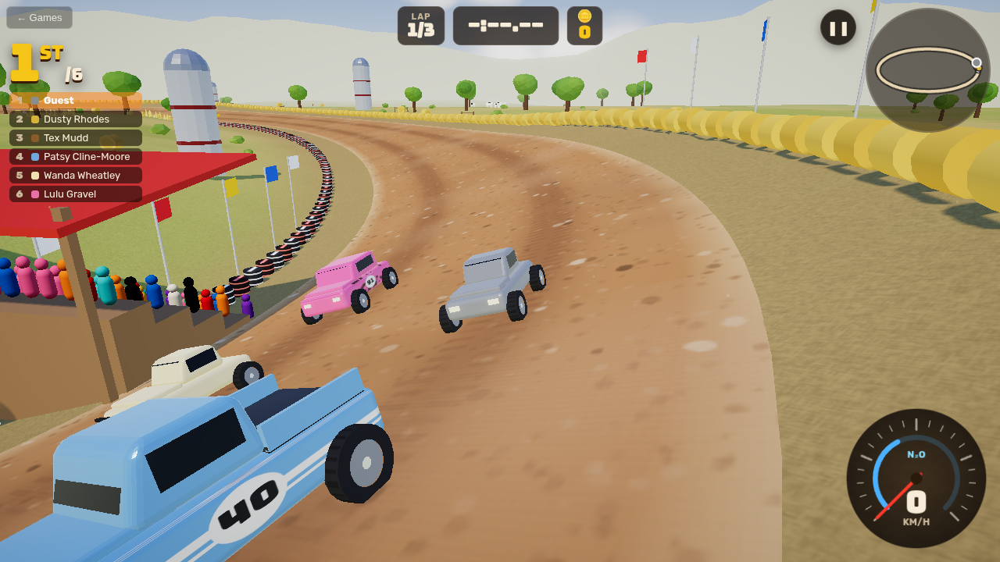</a> <b>Dirt Crown</b> 本轮起跑／倒计时</td>
<td width="25%" align="center"><a href="reviews/karts/turbo-kart-rush/live-attempt-2/drive.png">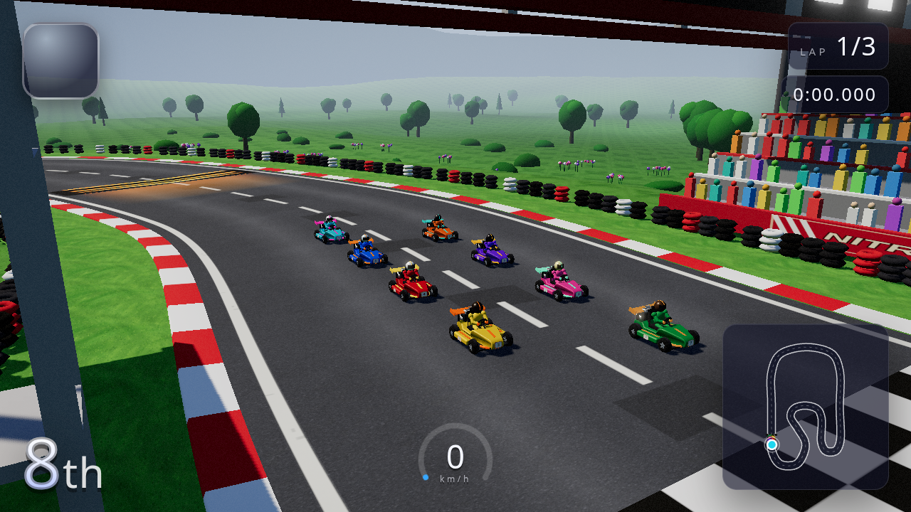</a> <b>Turbo Kart Rush</b> 本轮起跑／倒计时</td>
<td width="25%" align="center"><a href="reviews/rally/kart-rush/attempt-1/driving-straight.png">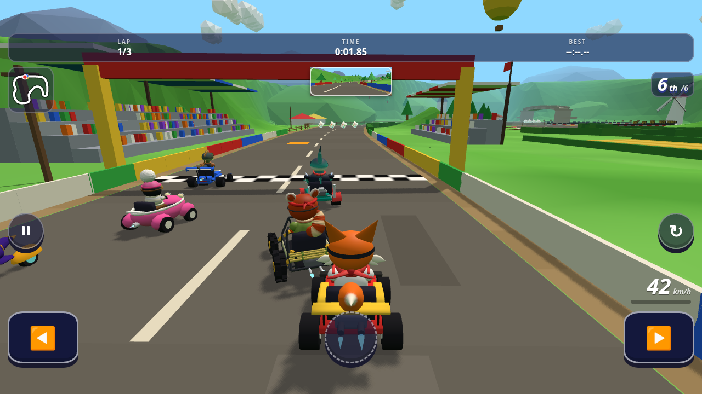</a> <b>Kart Rush</b> 本轮短时驾驶</td>
</tr>
<tr>
<td width="25%" align="center"><a href="reviews/karts/kart-royale/author-captures/hero-drift.png">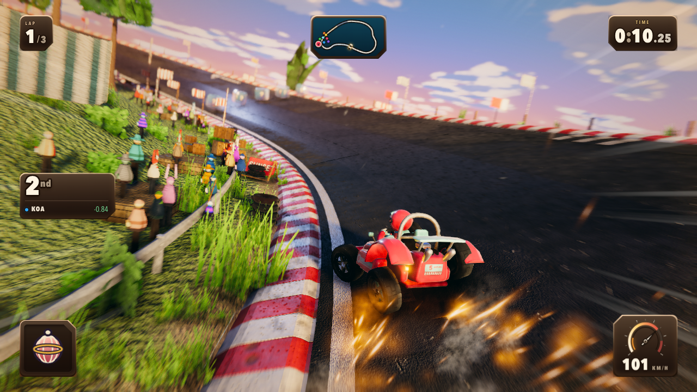</a> <b>Kart Royale</b> 作者固定原图</td>
<td width="25%" align="center"><a href="reviews/arcade/poly-gt/attempt-2/driving.png">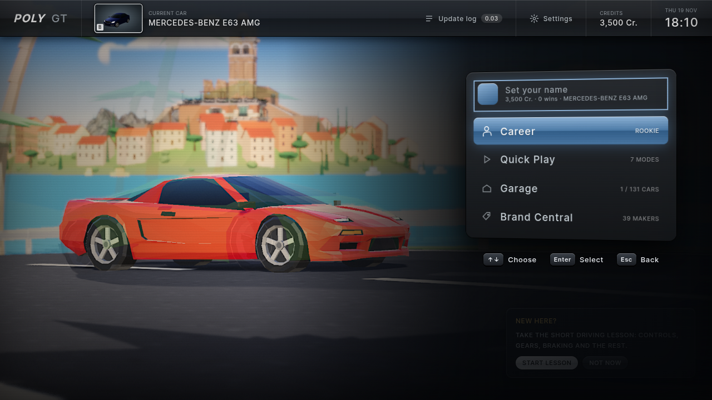</a> <b>Poly GT</b> 本轮起跑／倒计时</td>
<td width="25%" align="center"><a href="reviews/arcade/kart-racer/attempt-2/driving.png">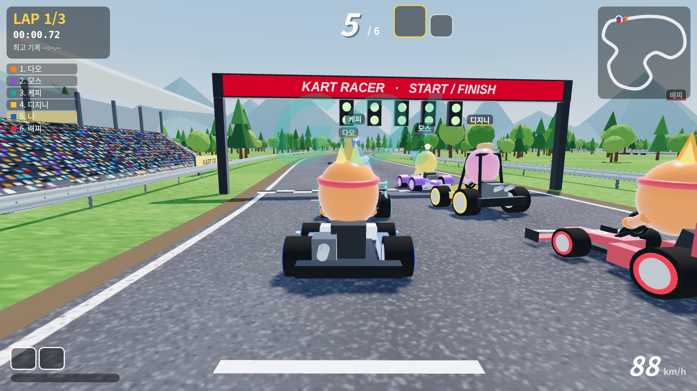</a> <b>KART RACER</b> 本轮起跑／倒计时</td>
<td width="25%" align="center"><a href="reviews/driving/carrace/attempt-2/after-input.png">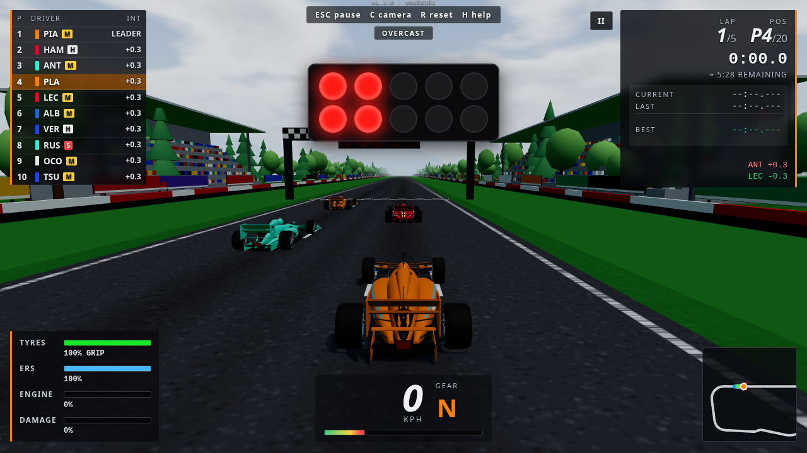</a> <b>CarRace</b> 本轮起跑／倒计时</td>
</tr>
</table>

## 全部候选

| 排名 | 游戏 | 画面 | 玩法 | 合计 | 结果与证据范围 |
| ---: | --- | ---: | ---: | ---: | --- |
| 1 | [backroad rally](reviews/driving/comparison.json) | 44 | 43 | 87 | 入选 |
| 2 | [Ponpoko Kart](reviews/karts/comparison.json) | 44 | 41 | 85 | 入选 |
| 3 | [Night Racer](reviews/driving/comparison.json) | 41 | 43 | 84 | 入选 |
| 4 | [Penguintrack](reviews/arcade/comparison.json) | 41 | 42 | 83 | 入选 |
| 5 | [Last Track](reviews/driving/comparison.json) | 39 | 43 | 82 | 入选 |
| 6 | [Dirt Crown](reviews/rally/comparison.json) | 38 | 44 | 82 | 入选 |
| 7 | [Turbo Kart Rush](reviews/karts/comparison.json) | 40 | 40 | 80 | 入选 |
| 8 | [Kart Rush](reviews/rally/comparison.json) | 39 | 41 | 80 | 入选 |
| 9 | [Kart Royale](reviews/karts/comparison.json) | 44 | 35 | 79 | 入选 |
| 10 | [Poly GT](reviews/arcade/comparison.json) | 39 | 40 | 79 | 暂估；菜单场景＋源码，未驾驶 |
| 11 | [KART RACER](reviews/arcade/comparison.json) | 41 | 37 | 78 | 候选 |
| 12 | [CarRace](reviews/driving/comparison.json) | 37 | 41 | 78 | 候选 |
| 13 | [QQ 飞车](reviews/existing/comparison.json) | 38 | 39 | 77 | 候选 |
| 14 | [Kartipelago](reviews/karts/comparison.json) | 38 | 38 | 76 | 候选 |
| 15 | [Suburban Turismo](reviews/arcade/comparison.json) | 37 | 39 | 76 | 候选 |
| 16 | [Elden Kart](reviews/karts/comparison.json) | 36 | 39 | 75 | 候选 |
| 17 | [Coast Kart TV](reviews/existing/comparison.json) | 34 | 40 | 74 | 候选 |
| 18 | [Neuro Rivals](reviews/driving/comparison.json) | 33 | 41 | 74 | 候选 |
| 19 | [Turbo Kart Rally](reviews/karts/comparison.json) | 38 | 35 | 73 | 候选 |
| 20 | [极品二手车](reviews/existing/comparison.json) | 38 | 35 | 73 | 候选 |
| 21 | [Redline Riot](reviews/existing/comparison.json) | 34 | 34 | 68 | 候选 |
| 22 | [Rally Navigator](reviews/rally/comparison.json) | 35 | 32 | 67 | 候选 |
| 23 | [霓虹飞车](reviews/existing/comparison.json) | 33 | 34 | 67 | 候选 |
| 24 | [Long Road](reviews/rally/comparison.json) | 37 | 28 | 65 | 候选 |
| 25 | [Turbo Rush (ATEAMROCKX)](reviews/arcade/comparison.json) | 28 | 37 | 65 | 候选 |
| 26 | [Neon Racer](reviews/arcade/comparison.json) | 33 | 30 | 63 | 候选 |
| 27 | [RoadRush LAN](reviews/existing/comparison.json) | 29 | 34 | 63 | 候选 |
| 28 | [Frostline Kart](reviews/rally/comparison.json) | 34 | 28 | 62 | 候选 |
| 29 | [Mini 4WD Racer 四驅車大賽](reviews/rally/comparison.json) | 26 | 35 | 61 | 候选 |
| 30 | [Math Racing](reviews/existing/comparison.json) | 25 | 17 | 42 | 候选 |
| — | [F1 Racing Game](reviews/driving/comparison.json) | — | — | — | 未评分；仅模糊菜单背景，原观察失败保留 |

画面考察场景与美术15、车辆10、光照特效10、可读性10、动态表现5；玩法考察驾驶15、竞赛反馈10、赛道模式10、成长重玩10、完整比赛流程5。软件 GPU 的慢速和排队时间不计为游戏画面质量，也不冒称电视帧率。

同分时优先画面分。Kart Royale 与 Poly GT 同为79分；前者画面44分且有清晰的固定赛中原图，后者39分仅为菜单场景暂估，因此选择 Kart Royale。F1未评分是证据不足，不能解读为低质量。

多款尚未完成整场比赛：玩法内容由固定源码核实，作者图片、线上版本和固定源码的差异均在原分组报告中保留。许可、外部服务、音频支持与资源体积另列，不暗中折算成画面分。

完整字段、证据类型、局限与图片哈希见 [comparison.json](comparison.json)，固定来源见 [候选清单](candidate-catalog.json)，root逐图复核见 [画面复核](root-visual-crosscheck.json)。原93款批量适配仍暂停；新增79项参考不会自动加入这9款任务。工作记录见 [2026-11-19-002](../../history/2026-11-19-002.md)。
