# TVAPP 小体积应用收录

从 [youhunwl/TVAPP](https://github.com/youhunwl/TVAPP) 的固定提交 [`08ec332c`](https://github.com/youhunwl/TVAPP/tree/08ec332c0a25e9ae97fb73d3b3e40784dab65fc3) 收录全部严格小于 **10,000,000字节** 的APK：**14款应用（按包名分组），23个APK，共142,336,497字节**。不同版本和架构命名变体均保留；筛选针对该提交实际存放的APK，不含历史已删除文件或外链仓库。

每款应用提供原APK、`logo.svg`、原图标（可提取时）、`thumb.png`、`manifest.json`、`assets.json`、README和SHA256清单。下方封面均为生成的介绍卡，不是运行截图。署名没有可靠依据时provider为null，未把收集者当作应用作者。

[机器目录](catalog.json) · [完整性校验](verification/report.json) · [来源与许可](NOTICE.md) · [维护说明](MAINTENANCE.md)

本目录为独立第三方归档，尚未接入Gitee APK市场或电视商城。原APK未改签、未执行；包签名验证只证明完整性，不代表原开发者身份或内容安全。戏曲多多两版签名不同，详见对应目录。

## 影音 / media（11款 / 20个APK）

<table>
<tr><td width="25%" align="center"><a href="media/bbll/">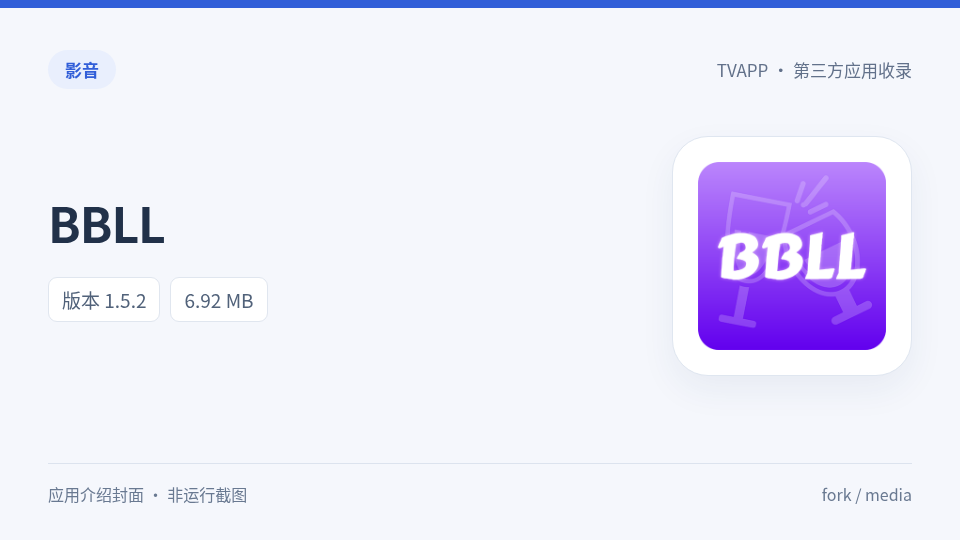 BBLL</a></td><td width="25%" align="center"><a href="media/bilibili-tv/">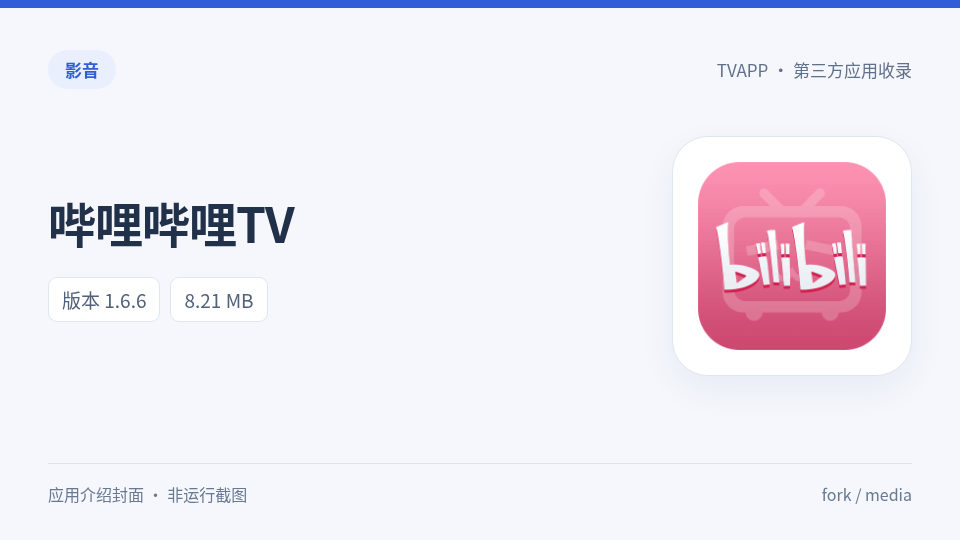 哔哩哔哩TV</a></td><td width="25%" align="center"><a href="media/fantaiying/">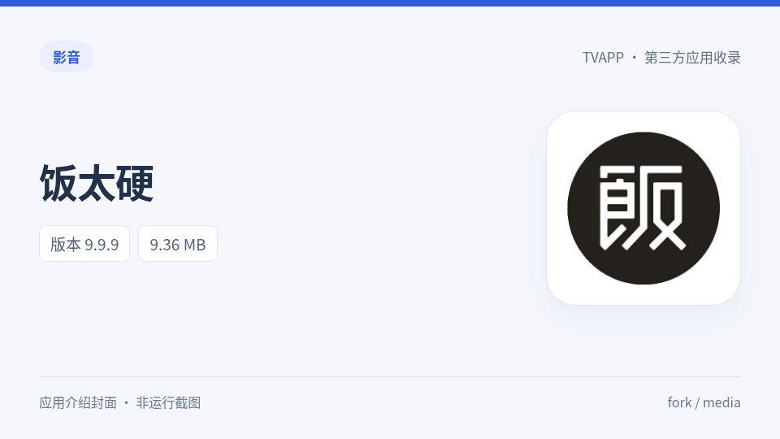 饭太硬</a></td><td width="25%" align="center"><a href="media/kuandai-tv/">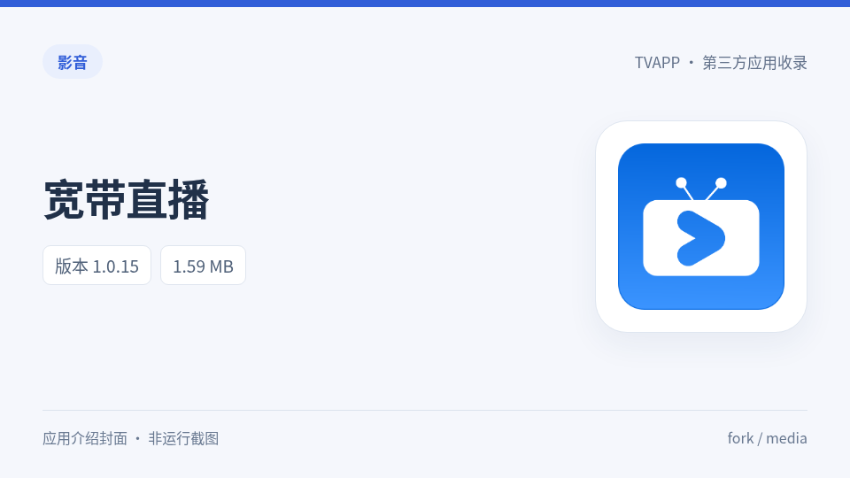 宽带直播</a></td></tr>
<tr><td width="25%" align="center"><a href="media/my-tv/">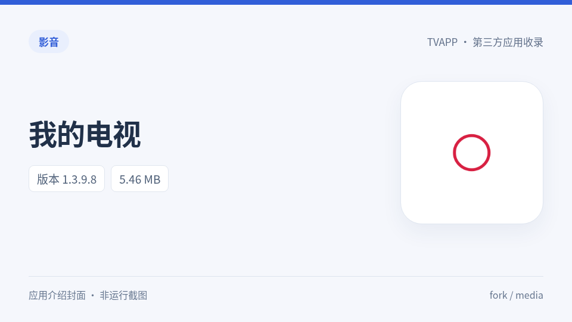 我的电视</a></td><td width="25%" align="center"><a href="media/myyy/">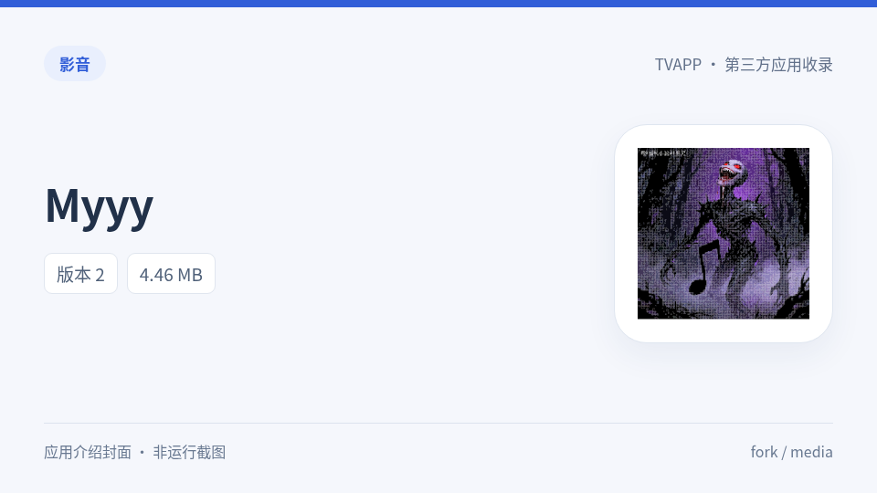 Myyy</a></td><td width="25%" align="center"><a href="media/qianxun-tv/">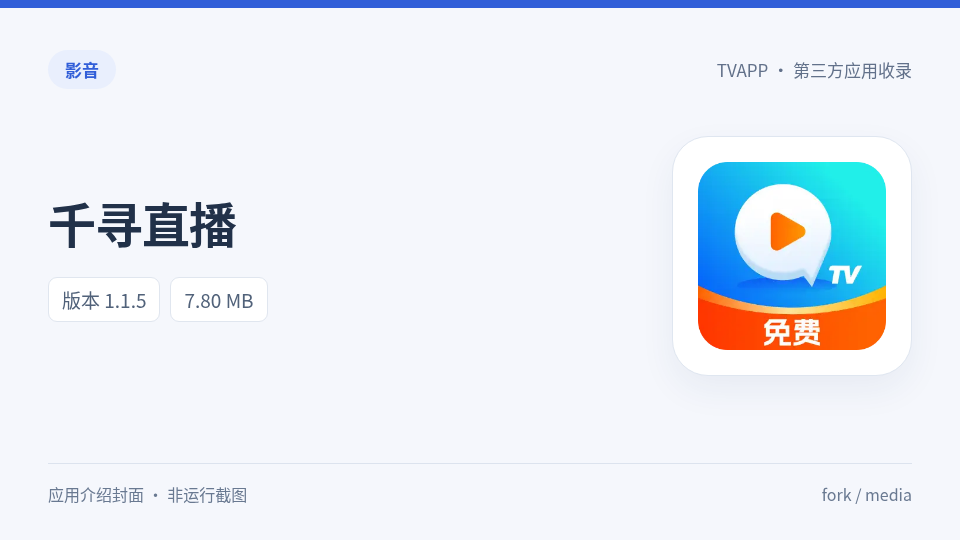 千寻直播</a></td><td width="25%" align="center"><a href="media/vstv/">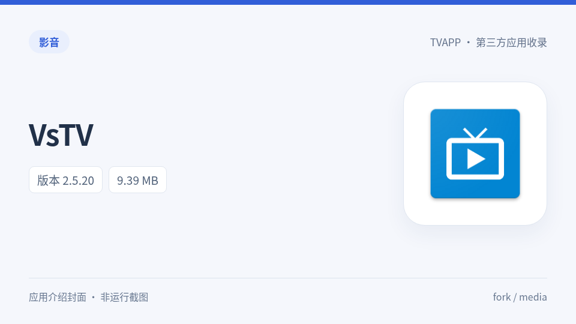 VsTV</a></td></tr>
<tr><td width="25%" align="center"><a href="media/vstv-harmony/">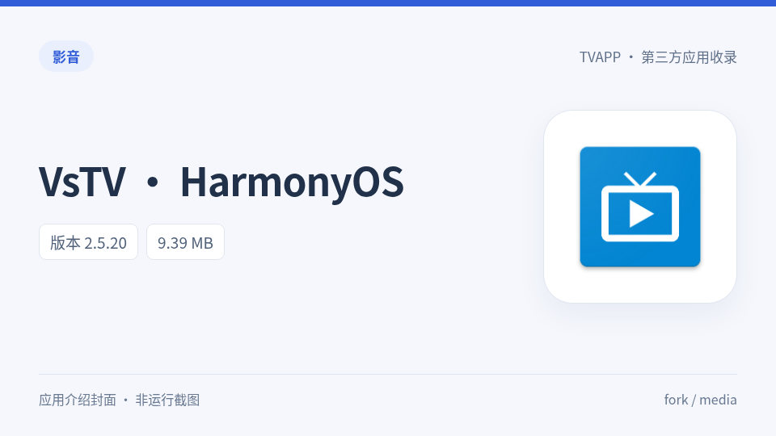 VsTV · HarmonyOS</a></td><td width="25%" align="center"><a href="media/webviewtv/">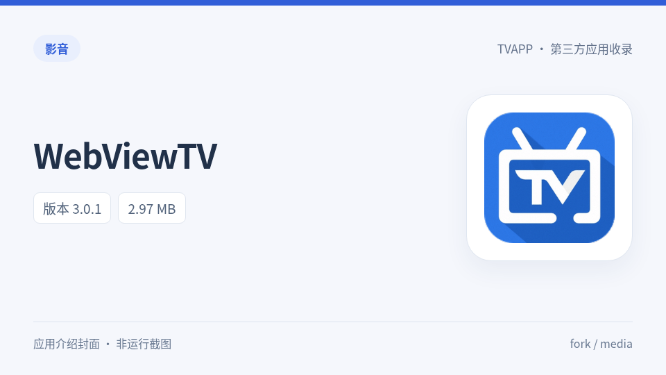 WebViewTV</a></td><td width="25%" align="center"><a href="media/xiqu-duoduo/">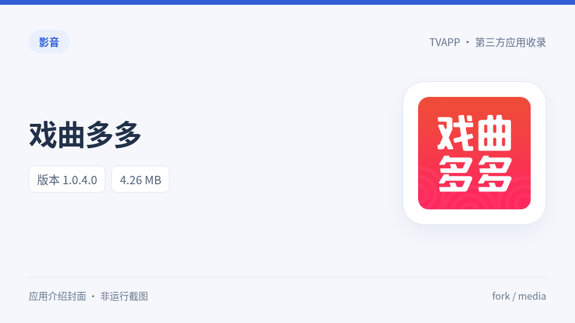 戏曲多多</a></td><td width="25%"></td></tr>
</table>

## 游戏 / game（0款 / 0个APK）

上游3个游戏APK均超过限制，最小为24,678,211字节，本次不收录。

## 教育 / education（0款 / 0个APK）

上游8个教育APK均超过限制，最小为14,096,805字节，本次不收录。

## 工具 / tools（2款 / 2个APK）

<table>
<tr><td width="25%" align="center"><a href="tools/huan-assistant/">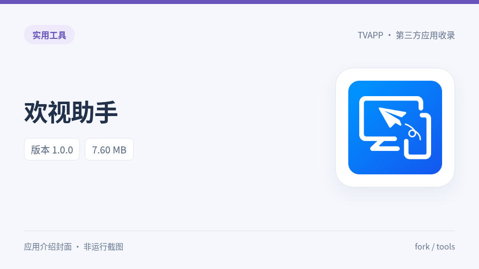 欢视助手</a></td><td width="25%" align="center"><a href="tools/tv-screen-master/">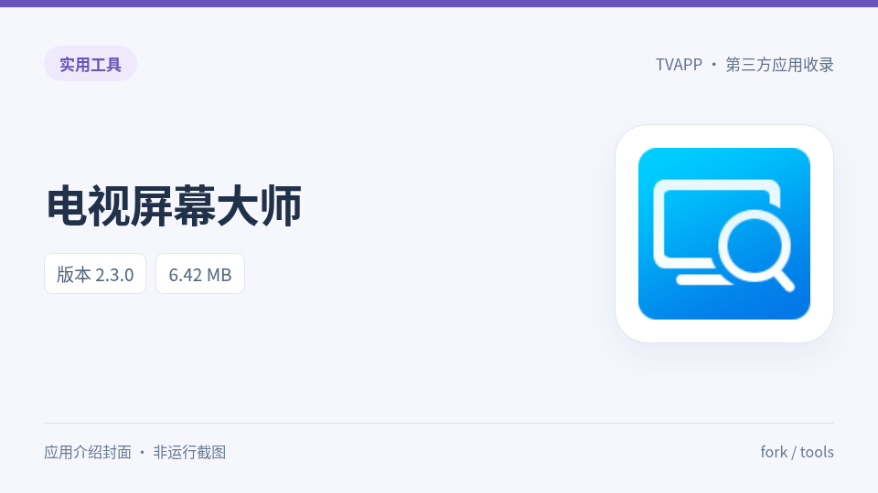 电视屏幕大师</a></td><td width="25%"></td><td width="25%"></td></tr>
</table>

## 健身 / fitness（1款 / 1个APK）

<table>
<tr><td width="25%" align="center"><a href="fitness/fittime-tv/">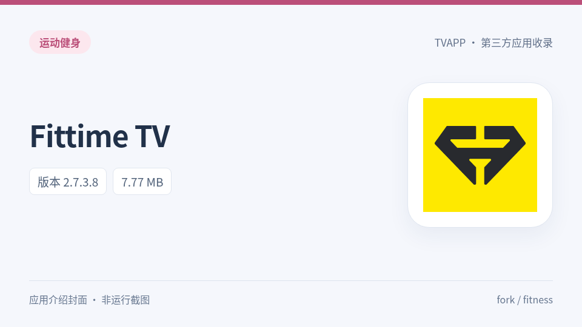 Fittime TV</a></td><td width="25%"></td><td width="25%"></td><td width="25%"></td></tr>
</table>
