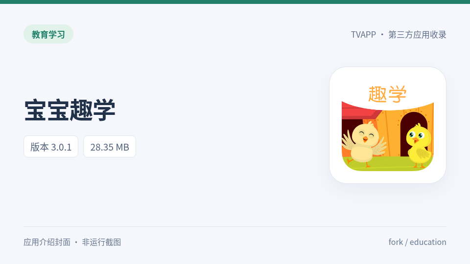
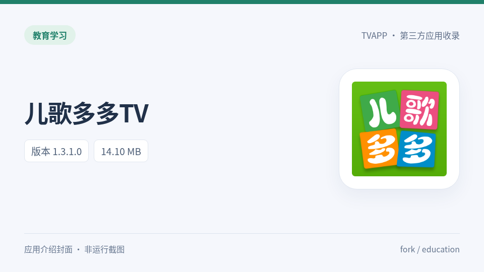

# 教育 / education（3款 / 3个APK）

<table>
<tr><td width="25%" align="center"><a href="../education/baby-fun-learning/"> 宝宝趣学</a></td><td width="25%" align="center"><a href="../education/ergeduoduo/"> 儿歌多多TV</a></td><td width="25%" align="center"><a href="../education/taozhi-classroom/"> 淘知学堂TV</a></td><td width="25%"></td></tr>
</table>

- [宝宝趣学 3.0.1](../education/baby-fun-learning/)：含 ARM64 和普通启动入口，无电视桌面入口。Linux / Android TV 16 对照中安装成功，但启动后处理视频列表及更新信息时触发空指针异常；Mac 是否同因仍待日志，暂不标记为可正常运行。 [检查记录](../verification/2026-11-10-education-compatibility/README.md)
- [儿歌多多TV 1.3.1.0](../education/ergeduoduo/)：仅含32位 ARM（armeabi-v7a）原生库；用户在 Apple Silicon / APK Checker 电视模拟器安装时报 INSTALL_FAILED_NO_MATCHING_ABIS。需要支持该32位 ABI 的 Android 系统或原作者提供 ARM64 版本。 [检查记录](../verification/2026-11-10-education-compatibility/README.md)

[返回收录目录](../README.md)
