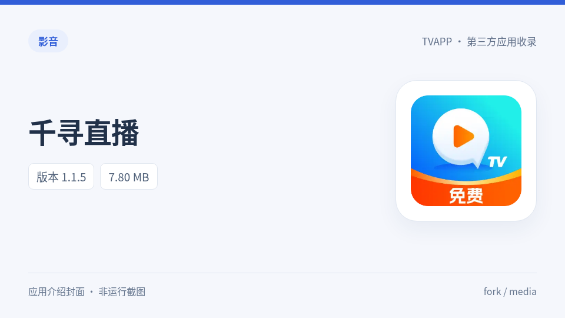

# 千寻直播

千寻电视直播应用。

分类：影音。原作者信息：上游未提供，manifest的provider保留为null。

| APK下载（上游原文件名） | 实际版本 / versionCode | 字节数 | 最低SDK |
| --- | --- | ---: | ---: |
| [千寻_1.1.5.apk](%E5%8D%83%E5%AF%BB_1.1.5.apk?raw=1) | 1.1.5 / 16 | 7,802,273 | 19 |
| [千寻TV_1.1.2.apk](%E5%8D%83%E5%AF%BBTV_1.1.2.apk?raw=1) | 1.1.2 / 13 | 8,404,302 | 19 |
| [千寻直播_1.1.0[支持语音换台].apk](%E5%8D%83%E5%AF%BB%E7%9B%B4%E6%92%AD_1.1.0%5B%E6%94%AF%E6%8C%81%E8%AF%AD%E9%9F%B3%E6%8D%A2%E5%8F%B0%5D.apk?raw=1) | 1.1.0 / 11 | 8,400,271 | 19 |

每份APK均保留原始二进制与签名，通过上游Git blob、SHA256、ZIP CRC及apksigner校验。未在实体电视运行；最低SDK来自APK声明，不表示已验证所有设备兼容性。

[完整元数据](manifest.json) · [资源生成来源](assets.json) · [64×64 SVG](logo.svg) · [校验清单](SHA256SUMS.txt)

图标来源和转换方式见assets.json；thumb是生成的应用介绍封面，不是应用运行截图。

来源：[youhunwl/TVAPP](https://github.com/youhunwl/TVAPP/tree/08ec332c0a25e9ae97fb73d3b3e40784dab65fc3)。每份APK的固定提交原路径、真实包名/版本/架构、证书SHA256及校验输出均在manifest中记录。APK和原图标权利归原作者；详见[来源与许可说明](../../NOTICE.md)。

[返回分类](../README.md) · [全部收录](../../README.md)
