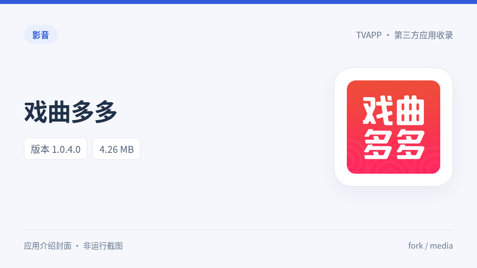

# 戏曲多多

戏曲、曲艺等内容播放应用。

分类：影音。原作者信息：上游未提供，manifest的provider保留为null。

| APK下载（上游原文件名） | 实际版本 / versionCode | 字节数 | 最低SDK |
| --- | --- | ---: | ---: |
| [戏曲多多TV_老版本免费版.apk](%E6%88%8F%E6%9B%B2%E5%A4%9A%E5%A4%9ATV_%E8%80%81%E7%89%88%E6%9C%AC%E5%85%8D%E8%B4%B9%E7%89%88.apk?raw=1) | 9.9.9 / 9999 | 6,240,902 | 17 |
| [戏曲多多.apk](%E6%88%8F%E6%9B%B2%E5%A4%9A%E5%A4%9A.apk?raw=1) | 1.0.4.0 / 1040 | 4,259,670 | 17 |

每份APK均保留原始二进制与签名，通过上游Git blob、SHA256、ZIP CRC及apksigner校验。未在实体电视运行；最低SDK来自APK声明，不表示已验证所有设备兼容性。

- 同包名的收录版本使用不同签名，不能作为同一签名链直接覆盖升级。
- 上游“老版本免费版”的内部版本为9.9.9/code9999；保留真实元数据，不把此数值解释为官方最新版本。

[完整元数据](manifest.json) · [资源生成来源](assets.json) · [64×64 SVG](logo.svg) · [校验清单](SHA256SUMS.txt)

图标来源和转换方式见assets.json；thumb是生成的应用介绍封面，不是应用运行截图。

来源：[youhunwl/TVAPP](https://github.com/youhunwl/TVAPP/tree/08ec332c0a25e9ae97fb73d3b3e40784dab65fc3)。每份APK的固定提交原路径、真实包名/版本/架构、证书SHA256及校验输出均在manifest中记录。APK和原图标权利归原作者；详见[来源与许可说明](../../NOTICE.md)。

[返回分类](../README.md) · [全部收录](../../README.md)
