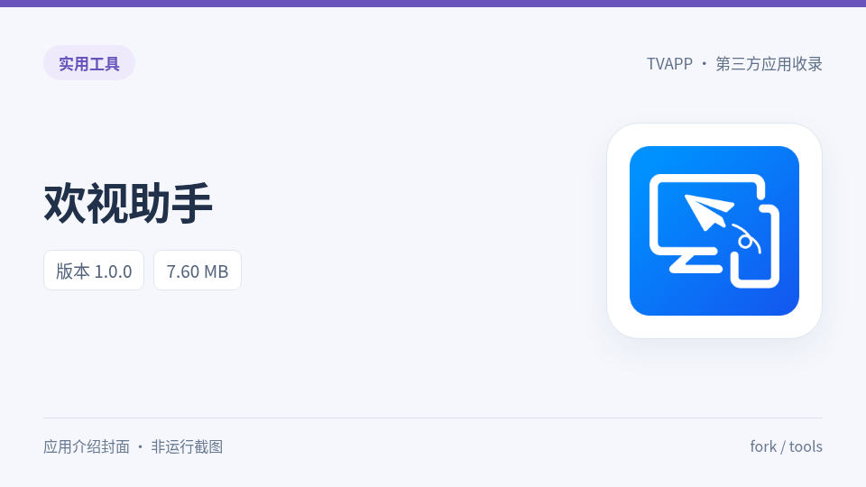
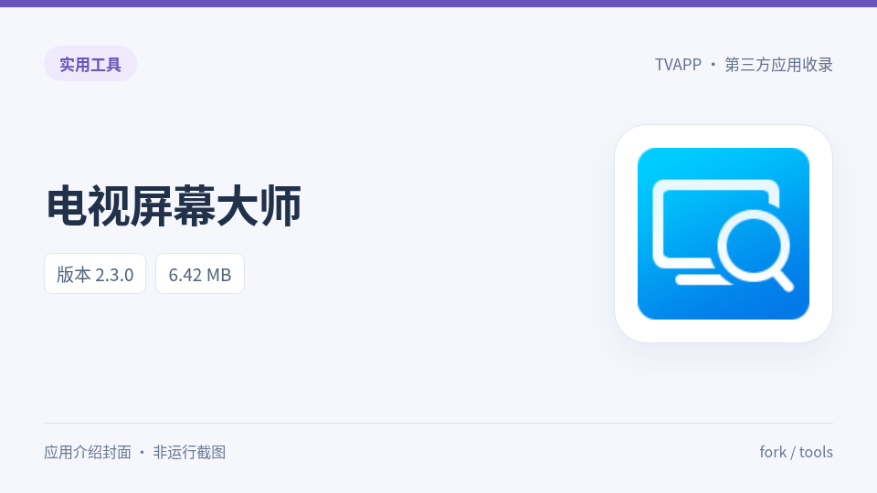

# 工具 / tools（2款 / 2个APK）

<table>
<tr><td width="25%" align="center"><a href="../tools/huan-assistant/"> 欢视助手</a></td><td width="25%" align="center"><a href="../tools/tv-screen-master/"> 电视屏幕大师</a></td><td width="25%"></td><td width="25%"></td></tr>
</table>

[返回收录目录](../README.md)
