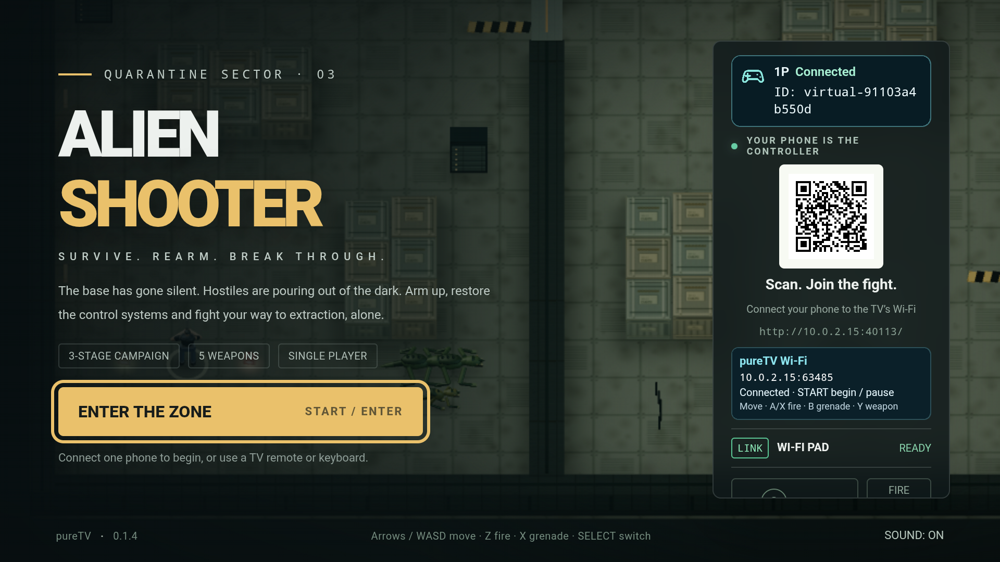
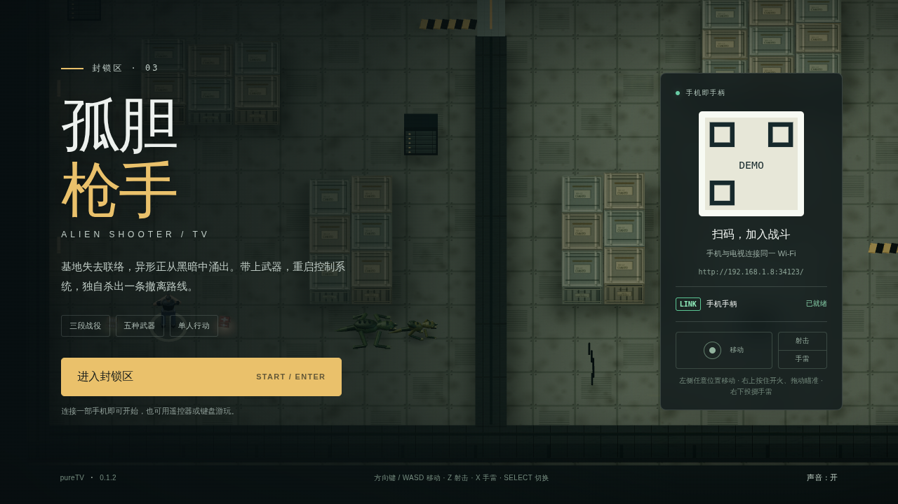
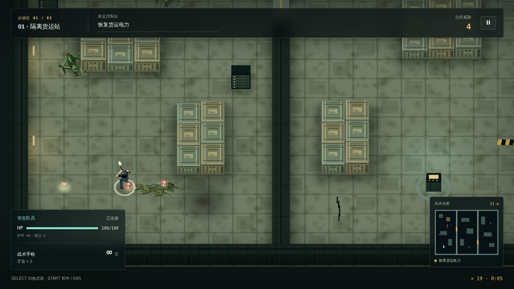
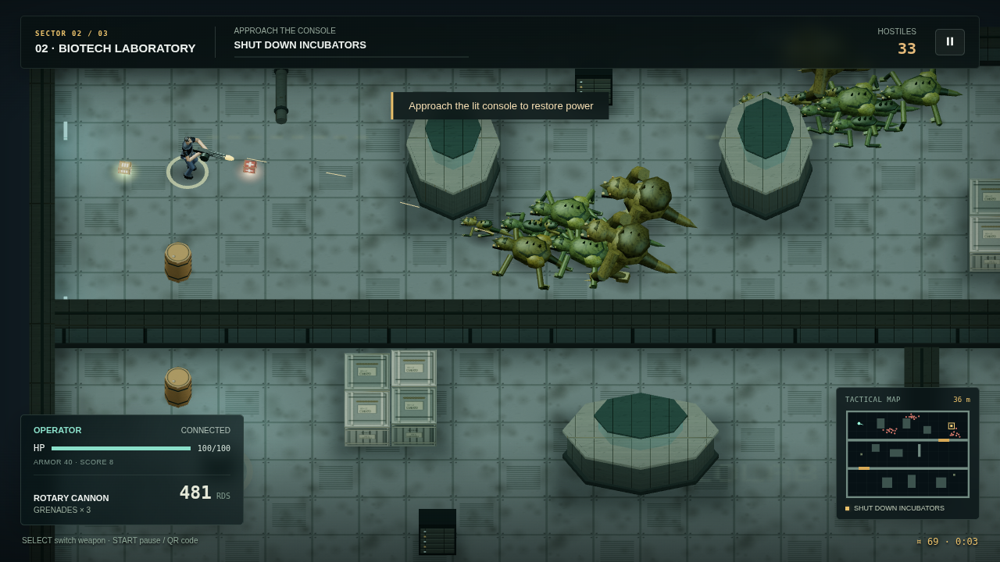
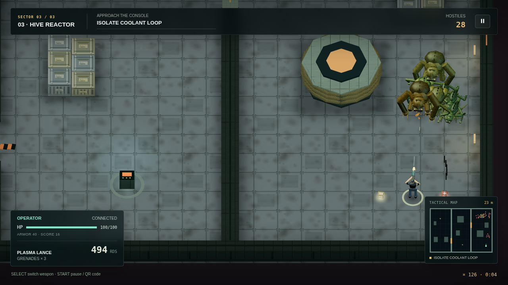

# 孤胆枪手 TV

<!-- apk-resource:start -->
[Android TV 0.1.7 · APK](alien-shooter-0.1.7.apk?raw=1) · [macOS · DMG](https://github.com/ecojust/pureTV/releases/download/games-zh-cn-2026.11.25/alien-shooter-macos.dmg) · [Windows x64 · 安装程序](https://github.com/ecojust/pureTV/releases/download/games-zh-cn-2026.11.25/alien-shooter-windows-x64-setup.exe)
<!-- apk-resource:end -->

历史安装包（Android 0.1.6） · [Android 0.1.6 APK](alien-shooter-0.1.6.apk?raw=1) · [Windows x64](https://github.com/ecojust/pureTV/releases/download/gameplay-icons-2026.11.21/alien-shooter-windows-x64-setup.exe) · [macOS](https://github.com/ecojust/pureTV/releases/download/gameplay-icons-2026.11.21/alien-shooter-macos.dmg) · [图标与安装验证](docs/releases/0.1.6/android-icon-receipt.json) · [文件校验](SHA256SUMS.txt) · [0.1.5 实玩录像](docs/releases/0.1.5/gameplay.mp4?raw=1)

## 历史 Android 版本 0.1.5 · 手柄与手机连接

[下载签名 APK](alien-shooter-0.1.5.apk?raw=1) · [校验值](SHA256SUMS.txt) · [安装包与源码](resource.json)

可用键盘、pureTV Wi-Fi 手柄，或用同一局域网内的手机扫描电视房间二维码。连接标识区分玩家，连接与断开时保留游戏画布尺寸。[连接手柄指南](../../docs/guide/README.md#安装游戏与连接手柄)

此签名 APK 已从 0.1.4 在 Android TV 模拟器完成覆盖安装。原版手柄 SDK 通过 8 项检查，实际发出的 72 条消息全部收到同序号确认。[游戏截图](docs/releases/0.1.5/gameplay.png) · [Android 玩法录像](docs/releases/0.1.5/gameplay.mp4?raw=1) · [验证记录与测试范围](docs/releases/0.1.5/verification.json)

[中文](README.md) · [English](README.en.md)

<!-- controller-client-status:start -->
## 历史版本 0.1.4 · 手柄连接标识

<!-- previous-apk-resource:start -->
[下载签名 APK](alien-shooter-0.1.4.apk?raw=1) · [校验值](SHA256SUMS.txt) · [签名与来源](resource.json) · [源码](src/) · [图标](logo.svg)
<!-- previous-apk-resource:end -->

Android **0.1.4 / versionCode 5**：手柄连接后，侧边显示手柄图标、玩家席位（按游戏人数显示 1P/2P）和设备完整连接 ID；断开后隐藏。默认 TCP 端口仍为 **63485**。当前手柄固件未上报 RSSI，因此不显示信号强弱。

[连接截图](docs/releases/0.1.4/connected.png) · [连接状态专项录像](docs/releases/0.1.4/controller-status.mp4?raw=1) · [版本验证](docs/releases/0.1.4/verification.json) · [20 款更新记录](../../docs/controller-client-status/README.md)

安装包沿用原发布证书。本轮在 Android TV 模拟器中验证连接身份、断开／重连状态及同证书覆盖安装；截图和录像记录菜单中的连接状态专项，没有重做完整玩法验收。未改规则模型按精确哈希复用历史依据，旧版报告继续保留。尚未验证实体电视、手机、ESP32 或带已有存档的升级与数据保留。


<!-- controller-client-status:end -->

一款独立制作的斜俯视基地射击游戏。进入被异形占据的货运站、实验室和反应堆，恢复控制台、守住怪潮、购买补给，击败母巢守卫后撤离。专为单人游玩设计，支持电视大屏与一部手机扫码操作。

当前版本 **0.1.6** · 包名 `com.ecojust.alienshootertv` · Android 8.0 及以上。

## 开始游玩

1. 手机和电视连接同一局域网，在电视打开游戏。
2. 用一部手机扫描标题画面右侧的二维码，房间仅接受一个手柄。
3. 按 START 直接进入封锁区。
4. 靠近亮起的控制台充能，击退敌人后进入下一区域。完成三个目标后前往绿色撤离标记。

右下战术地图显示墙体、未开的闸门、玩家、敌人和当前目标距离，黄色方框指向控制台，绿色方框指向撤离点。

战斗时扫码栏会收起，为场景保留空间；按 START 暂停即可再次显示。手柄断线会暂停，重新连接后需要按 START 明确继续。按电视 Home 切出或确认退出会结束本次战役并关闭房间。

| 手机手柄 | 功能 |
| --- | --- |
| 左侧约 2/3 屏幕 | 任意落指位置建立浮动摇杆，控制移动 |
| 右侧 1/3 的上半区 | 任意位置按住连续射击；拖动进行独立瞄准，不拖动时辅助瞄准视线内敌人 |
| 右侧 1/3 的下半区 | 投掷手雷，持续按住只投一枚，松开后可再次投掷 |
| SELECT | 切换已拥有武器；补给站选择商品 |
| START | 开始、暂停、继续；补给站前往下一关 |

移动、瞄准、开火可以同时进行。手柄操作区禁止选中文字、长按菜单与页面滚动，触控取消、失焦或断线会释放动作。

也可使用键盘：方向键 / WASD 移动，Z / 空格射击，X / G 手雷，Q / Shift 切枪，Enter / P 开始或暂停。鼠标可独立瞄准，按住左键开火。电视遥控器支持方向键移动、确认射击、播放键开始或暂停。

## 战役与补给

| 区域 | 任务 |
| --- | --- |
| 隔离货运站 | 恢复货运电力、解除隔离闸门、打开撤离通道 |
| 生物研究设施 | 关闭培养舱、净化通道、回收研究记录 |
| 母巢反应堆 | 切断冷却循环、启动过载、消灭母巢守卫 |

五种武器分别是无限弹药的战术手枪、冲锋枪、霰弹枪、六管重机枪和有溅射伤害的等离子枪。弹药补给可解锁初始冲锋枪；关间补给站可购买其他武器、弹药、治疗、护甲、手雷和最大生命升级。

敌人包括爬行者、快速近战异形、远程喷吐者、重甲兽和最终首领。墙体会挡住射击与视线，爆炸桶可以用于突破包围。击败敌人赚取补给资金，购买装备强化自己；生命耗尽即行动结束，可重新开始战役。

本版战役在本次运行内进行，退出会结束当前战役；声音开关保存在本机。重新打开应用会创建新的局域网房间，请重新扫码。

## 历史画面与声音（0.1.1–0.1.2）

采用本地打包的 WebGL 三维场景和低模角色。0.1.1 将货箱的加固带、铆钉、标签、磨损等细节烘焙进 1024 图集，三关共享高清地板材质，分别使用预烘焙的接触暗部与局部光照图。静态不透明场景合批；同类敌人的身体、步态与尸体共用实例化绘制，屏外对象不提交绘制，动态缓冲只更新使用部分。

0.1.2 参考原版官方公开画面调整人物与异形：人物采用轻装、短发、深色上衣和蓝灰长裤，双手持枪；怪物区分低伏四足、细长疾行和后腿承重的重型轮廓。腿部按实际位移推进关节动作，上身瞄准与下肢移动分开处理，改善前跑、侧移、倒退及停步。模型和动画均为独立制作。

界面保留 HUD 节点和小地图静态底图，暂停时停止重复绘制相同场景。弹丸、粒子和尸体保留数量上限，手机输入与游戏逻辑的处理频率保持不变。枪械、爆炸、拾取与工业环境声由 Web Audio 合成，不依赖在线资源。

详见[0.1.2 历史角色动作与对照视频](docs/character-motion.md)、[烘焙方法](docs/baking.md)和 [0.1.1 环境优化性能对照](docs/performance.md)。

[观看 0.1.2 历史关卡游玩视频](docs/gameplay-0.1.2.mp4) · [录制说明](docs/gameplay.md)。视频使用正式游戏页面与正常操作输入，展示自动操控下的战斗过程；不是电视实拍或人工操作录像。

下方截图由实际游戏页面在 Chromium 中渲染，使用模拟的 Android 房间桥接；关卡展示采用测试场景，不代表电视实机画面或完整人工通关录像。









## 开发

以下命令是可复现的检查入口，不表示本轮已经全部执行通过；本轮实际执行结果见上方验收记录。

```sh
node --test joystick-games/alien-shooter/tests/*.test.cjs
node joystick-games/alien-shooter/tests/controller.mjs
node joystick-games/alien-shooter/tests/integration.mjs
node joystick-games/alien-shooter/tests/runtime-performance.mjs
node joystick-games/alien-shooter/tests/animation.mjs
node joystick-games/alien-shooter/tests/performance.mjs --samples 6 --warmup 1 --regressions
node joystick-games/alien-shooter/tools/bake-materials.mjs --verify

cd resource/launcher/puretv
./gradlew :alien-shooter:testDebugUnitTest :alien-shooter:lintDebug :alien-shooter:assembleRelease :alien-shooter:verifyReleaseSize
```

浏览器检查使用 desktop 的 Playwright 依赖；可以通过 `CHROMIUM_PATH` 指定 Chromium，通过 `ALIEN_SHOOTER_UI_CAPTURE_DIR` 指定截图输出目录。真实电视性能、手机触控延迟及设备兼容性仍需实机验证。

地图、代码、角色、纹理与声音由本项目独立实现；参考范围、素材来源和边界见[制作说明](docs/reference.md)。应用代码与自制素材使用 [MIT](LICENSE)，随包附带 Three.js 的许可证。

## pureTV Wi-Fi 手柄

电视与手柄连接同一局域网，打开游戏后按手柄 GPIO 23 搜索键。界面显示真实地址、端口和发现状态；默认 TCP 端口为 **63485**，仅首次被占用时选备用端口，临时失焦期间保持已选端口；按 Home 或切换应用退出会关闭服务。同网只运行一个游戏接收服务时才能自动选中。

START 开始、暂停或继续。方向键移动；A / X 持续射击并使用游戏原有的近敌自动瞄准；B 投掷手雷；Y 切换武器。 手机扫码、遥控器和键盘仍可使用；此游戏的 Y 是 SELECT 功能，X 与 A 为同一动作。

断线、手柄会话替换或控制来源切换会取消旧输入并暂停。重新连接后先松开按键，再按 START 继续，保持的按键不会自动触发操作。本作支持一只 Wi-Fi 手柄。

<!-- controller-client-status-history:start -->
<details>
<summary>历史 0.1.3 安装包与验收记录</summary>

以下为旧版发布记录，其测试与画面不代表本次连接 ID 界面验收。[原提交中的完整说明](https://github.com/ecojust/pureTV/blob/9af9f197855eb7a0ce7174c0e6295c8974b3250d/resource/apps/alien-shooter/README.md)。

[下载 APK](alien-shooter-0.1.3.apk?raw=1) · [校验值](docs/controller-status-baseline/0.1.3/SHA256SUMS.txt) · [签名及构建来源](docs/controller-status-baseline/0.1.3/resource.json) · [源码](src/) · [64×64 SVG 图标](logo.svg)

APK 已使用原 pureTV 发布证书签名，已在 Android TV 模拟器完成 0.1.2 → 0.1.3 覆盖安装；未验证带存档升级及数据保留。若设备中存在使用旧证书的同包应用，Android 无法直接覆盖安装；需先备份数据并卸载旧包。

## 0.1.3 pureTV 手柄更新

历史版本 **0.1.3 / versionCode 4** 新增 pureTV Wi-Fi 手柄输入，默认 TCP 端口 **63485**，保留扫码手机手柄和电视遥控器。APK 已沿用原发布证书正式签名。Android TV 模拟器中的实际 APK 手柄验收已通过 8/8，覆盖 START、实际玩法输入、暂停恢复、断线重连和同序号 ACK。

实际结果和限制见[当时 20 款游戏验收记录](../../docs/readme-controller-support/README.md)及[发布进度](../../docs/readme-controller-support/rollout.json)。下文保留的旧版 CI、录像和截图均为历史依据。

该历史版本验收资源：[菜单截图](docs/releases/0.1.3/menu.png) · [实际 APK 运行录像](docs/releases/0.1.3/gameplay.mp4?raw=1) · [验证记录](docs/releases/0.1.3/verification.json)。截图和录像来自 Android TV 模拟器，未做实体电视测试。完整归档、具体检查范围与限制见验证记录。

</details>
<!-- controller-client-status-history:end -->
