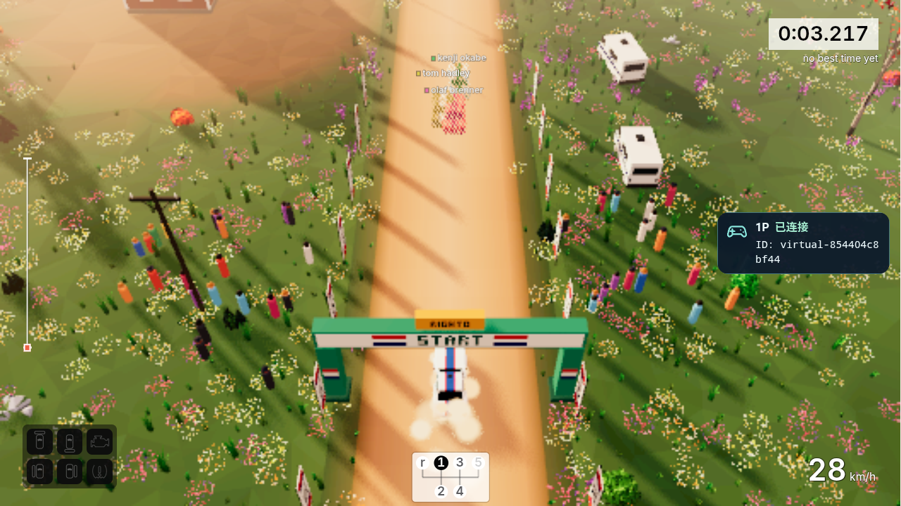
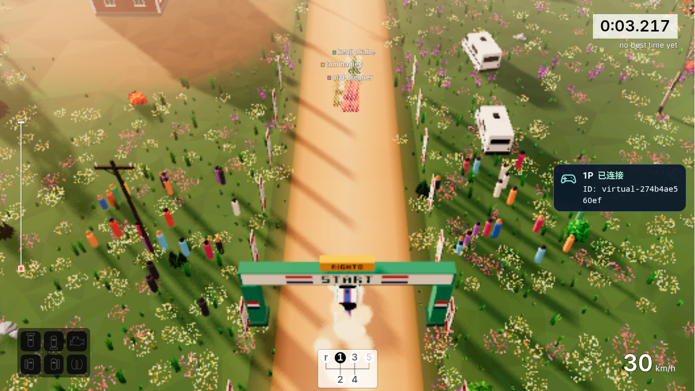
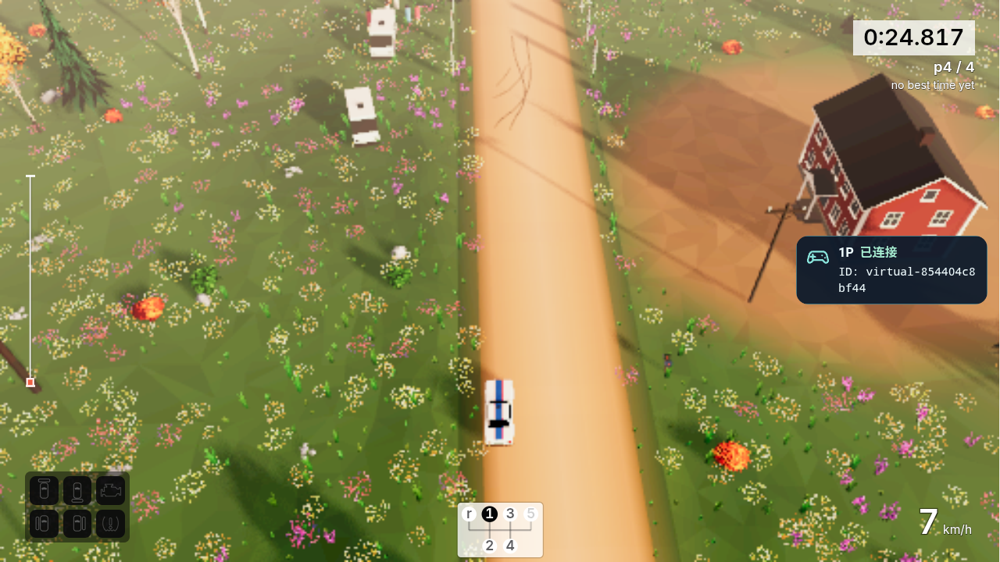
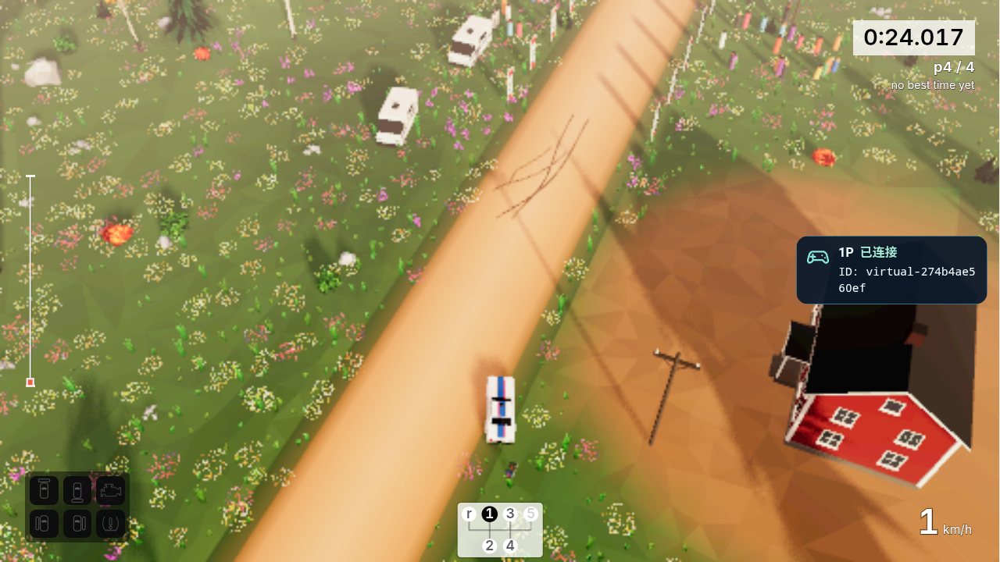

# Backroad Rally 0.1.2 Android TV

原签名 APK 在 Android TV 16、x86_64、1280 × 720 模拟器上，用原版 pureTV TCP 手柄 SDK 从主菜单进入芬兰快速赛。两种端口模式分别按原游戏菜单选车、选赛段并等待倒数，随后执行油门、右转与手刹、切换视角、切换牵引力辅助、显式暂停和恢复。共执行原目录计划中的 16 个快速赛操作，沿用玩家首次进入时的自动画质和分辨率。设置和生涯菜单的扩展 39 步计划另行追踪。[签名 APK](https://github.com/ecojust/pureTV/releases/download/joystick-backroad-rally-android-v0.1.2/backroad-rally-0.1.2.apk) · [签名收据核验](https://github.com/ecojust/pureTV/actions/runs/44688535161) · [原始测试](https://github.com/ecojust/pureTV/actions/runs/44699060584)

| 端口模式 | 游戏内检查 | 输入 / 唯一 ACK | 按下油门后的游戏采样 | 稍后系统截图的速度 |
| --- | ---: | ---: | ---: | ---: |
| 默认 63485 | 56 | 552 / 552 | 16.44 km/h | 28 km/h |
| 默认端口占用，回退 37463 | 56 | 552 / 552 | 18.69 km/h | 30 km/h |

每个模式都检查了九键按下与松开、第二只手柄被拒、原生退出对话框失焦、断线松键、重连保留原手柄标识，以及玩家按 START 后才恢复。四张截图均来自系统抓图，未加标注。每张截图的芬兰道路与草地取样包含 1,705 个像素，未出现旧驱动的异常紫色。每种模式另有九张系统截图及一段 MP4，留存文件的大小与 SHA-256 均已逐个核对。[默认端口原图、录像及完整报告](https://github.com/ecojust/pureTV/tree/1e2d4ba2812a5d719e04493bcf5a39ee00e5baf1/evidence/joystick-android-runtime-backroad-rally/backroad-rally-normal) · [回退端口原图、录像及完整报告](https://github.com/ecojust/pureTV/tree/1e2d4ba2812a5d719e04493bcf5a39ee00e5baf1/evidence/joystick-android-runtime-backroad-rally/backroad-rally-occupied) · [逐文件校验数据](verification.json)

| 场景 | 默认端口 | 端口占用回退 |
| --- | --- | --- |
| 加速 |  |  |
| 重连后按 START 恢复驾驶 |  |  |

模拟器启动参数为 `-gpu host`，宿主使用 Mesa Vulkan 软件驱动，Android 的 SurfaceFlinger 报告 Mesa 25.2.8、llvmpipe LLVM 20.1.2。两个玩家测试进程的退出码均为 0。之后附加的 WebView GPU 标识采集未完成，导致整次工作流显示失败；本次只能确定系统合成器的驱动。另一次同 APK 的 ANGLE/Vulkan 原生诊断也能正确绘出芬兰赛道，旧版 `swiftshader_indirect` GLES 配置会只显示 HUD。实体电视、ESP32 手柄和完整生涯通关尚未测试。[实际环境与玩家路线退出码](https://github.com/ecojust/pureTV/tree/1e2d4ba2812a5d719e04493bcf5a39ee00e5baf1/evidence/joystick-android-runtime-backroad-rally/backroad-rally/host-renderer) · [两种模式的独立退出码](https://github.com/ecojust/pureTV/blob/1e2d4ba2812a5d719e04493bcf5a39ee00e5baf1/evidence/joystick-android-runtime-backroad-rally/backroad-rally-outcomes.json) · [图形后端对照](../android-0.1.2/README.md)
