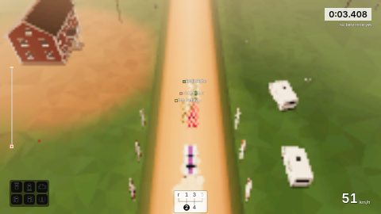

# Backroad Rally 0.1.3 浏览器驾驶对照

在 Linux 的 Google Chrome 157.0.8103.78 中用原版 SwiftShader 驱动 Finland 赛道。静态资源树与 0.1.3 打包源逐字节一致。低画质、浏览器缩放系数 0.5、画布 480 × 270、页面 960 × 540 CSS 像素、DPR 2。WebGL2 继续报告支持浮点颜色缓冲；实测默认绘图缓冲为单采样，`antialias=false`、`SAMPLES=0`，游戏显示 `post off`。[运行 44690447440](https://github.com/ecojust/pureTV/actions/runs/44690447440) · [原始日志](https://github.com/ecojust/pureTV/blob/7dde5b0d4e2217469db6aaefd205020d868d74e7/driving.log)

原作倒数结束后按住 W，游戏油门达到 1，赛段时钟到达 4.31 秒，赛车 X 坐标从 54.00 到 75.37，速度读数为 47.42。随后取得的 1920 × 1080 截图可见白色赛车、土路、两侧路标、房屋和 50 km/h 的 HUD。这个浏览器对照只覆盖首段驾驶；Android 原生系统画面和手柄验收有独立记录。[原始脚本](https://github.com/ecojust/pureTV/blob/7dde5b0d4e2217469db6aaefd205020d868d74e7/drive.cjs) · [机器可读收据](verification.json)

