# 合集另列的游戏

[全量目录](README.md) · [候选清单](../todo.md) · [Excel 核对表](../game-audit.xlsx)

本页序号 **3,889–4,383**，共 495 款。这 495 款来自来源合集的 bad-games.md，也可逐款勾选。

编辑清单时可将 `[ ]` 改为 `[x]`，也可以直接回复游戏名和仓库。名称链接通向合集笔记。

| 序号 | 勾选 | 游戏 | 截图
 | 上游仓库 | 许可和素材说明 | 手柄线索 | 截图分 | 试玩或演示入口 |
| ---: | --- | --- | --- | --- | --- | --- | ---: | --- |
| 3889 | [ ] | [1-Bit Cricket (Android)](<https://github.com/gamingnews5/awesome-opus-5.5-games/blob/9a29b570e56bd19f15a3cd6bbac0b8c682f2c48c/games/1-bit-cricket-android/readme.md>) | 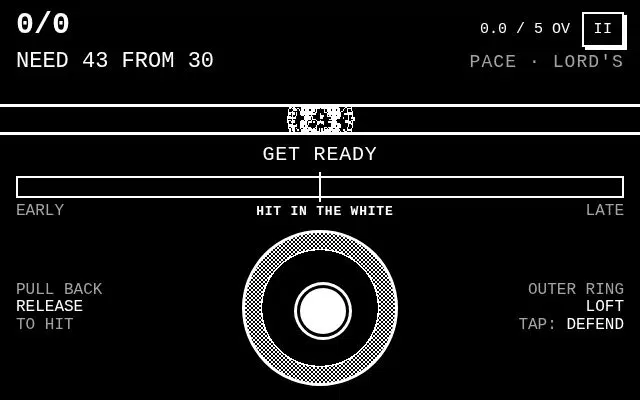 [源码网页实截](<https://github.com/gdbismi-cmd/OneBitCricket/blob/main/app/src/main/assets/index.html>) | [gdbismi-cmd/OneBitCricket](<https://github.com/gdbismi-cmd/OneBitCricket>) | 常见根目录许可文件未找到 | 待核 | — | 未列入口 |
| 3890 | [ ] | [2024026025 이지원 게임](<https://github.com/gamingnews5/awesome-opus-5.5-games/blob/9a29b570e56bd19f15a3cd6bbac0b8c682f2c48c/games/2024026025/readme.md>) | 待补截图 | [powerwon03/game](<https://github.com/powerwon03/game>) | 常见根目录许可文件未找到 | 待核 | — | [可达 · 合集所列网页](<https://game-flax-alpha.vercel.app>) |
| 3891 | [ ] | [2048](<https://github.com/gamingnews5/awesome-opus-5.5-games/blob/9a29b570e56bd19f15a3cd6bbac0b8c682f2c48c/games/2048-rmehreteab-2048/readme.md>) | 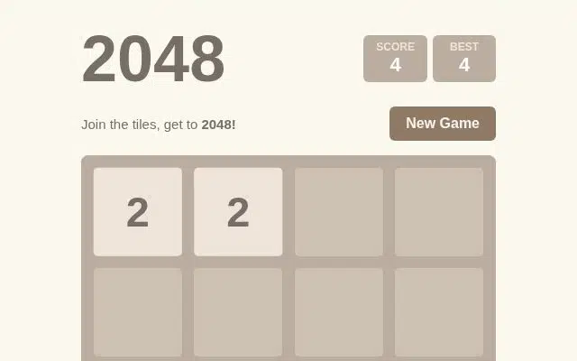 [源码网页实截](<https://github.com/rmehreteab/2048/blob/main/index.html>) | [rmehreteab/2048](<https://github.com/rmehreteab/2048>) | 常见根目录许可文件未找到 | 待核 | — | 未列入口 |
| 3892 | [ ] | [2048 (thanhvd)](<https://github.com/gamingnews5/awesome-opus-5.5-games/blob/9a29b570e56bd19f15a3cd6bbac0b8c682f2c48c/games/2048-thanhvd/readme.md>) | 待补截图 | [thanhvd/game-2048](<https://github.com/thanhvd/game-2048>) | [MIT](<https://github.com/thanhvd/game-2048/blob/HEAD/LICENSE>) | 待核 | — | 未列入口 |
| 3893 | [ ] | [2R1E: Two Rooms, One Exit](<https://github.com/gamingnews5/awesome-opus-5.5-games/blob/9a29b570e56bd19f15a3cd6bbac0b8c682f2c48c/games/2r1e-two-rooms-one-exit/readme.md>) | 待补截图 | [jpflores0404/21RE](<https://github.com/jpflores0404/21RE>) | 常见根目录许可文件未找到 | 待核 | — | 未列入口 |
| 3894 | [ ] | [3D Chess](<https://github.com/gamingnews5/awesome-opus-5.5-games/blob/9a29b570e56bd19f15a3cd6bbac0b8c682f2c48c/games/3d-chess/readme.md>) | 待补截图 | [businessfordevsav/3d-chess](<https://github.com/businessfordevsav/3d-chess>) | 常见根目录许可文件未找到 | 待核 | — | 未列入口 |
| 3895 | [ ] | [3D Retro Arcade Cabinet](<https://github.com/gamingnews5/awesome-opus-5.5-games/blob/9a29b570e56bd19f15a3cd6bbac0b8c682f2c48c/games/3d-retro-arcade-cabinet/readme.md>) | 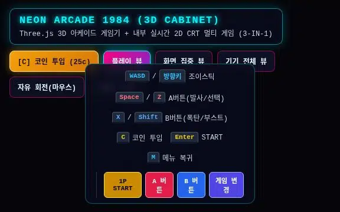 [源码运行首页](<https://github.com/minjun1177/gemini-4-argon-demo/blob/main/index.html>) | [minjun1177/gemini-4-argon-demo](<https://github.com/minjun1177/gemini-4-argon-demo>) | 常见根目录许可文件未找到 | 待核 | — | 未列入口 |
| 3896 | [ ] | [5 Senses](<https://github.com/gamingnews5/awesome-opus-5.5-games/blob/9a29b570e56bd19f15a3cd6bbac0b8c682f2c48c/games/5-senses/readme.md>) | 待补截图 | [Tboy450/five-senses](<https://github.com/Tboy450/five-senses>) | 常见根目录许可文件未找到 | 待核 | — | [可达 · 合集所列网页](<https://five-senses-together-core.tboy450.chatgpt.site>) |
| 3897 | [ ] | [5Stones](<https://github.com/gamingnews5/awesome-opus-5.5-games/blob/9a29b570e56bd19f15a3cd6bbac0b8c682f2c48c/games/5stones/readme.md>) | 待补截图 | [nusbaumm01/5stones](<https://github.com/nusbaumm01/5stones>) | 常见根目录许可文件未找到 | 待核 | — | 未列入口 |
| 3898 | [ ] | [67 Arcade](<https://github.com/gamingnews5/awesome-opus-5.5-games/blob/9a29b570e56bd19f15a3cd6bbac0b8c682f2c48c/games/67-arcade/readme.md>) | 待补截图 | [tanlanman123/mobile-stuff](<https://github.com/tanlanman123/mobile-stuff>) | 常见根目录许可文件未找到 | 待核 | — | 未列入口 |
| 3899 | [ ] | [A Caminhada de Carlo](<https://github.com/gamingnews5/awesome-opus-5.5-games/blob/9a29b570e56bd19f15a3cd6bbac0b8c682f2c48c/games/a-caminhada-de-carlo/readme.md>) | 待补截图 | [vocacaodepai/carloacutisrpg](<https://github.com/vocacaodepai/carloacutisrpg>) | 常见根目录许可文件未找到 | 待核 | — | 未列入口 |
| 3900 | [ ] | [A Game](<https://github.com/gamingnews5/awesome-opus-5.5-games/blob/9a29b570e56bd19f15a3cd6bbac0b8c682f2c48c/games/a-game/readme.md>) | 待补截图 | [sfgeekgit/game\_e](<https://github.com/sfgeekgit/game_e>) | 常见根目录许可文件未找到 | 待核 | — | [可达 · 合集所列网页](<https://documentbrain.com/agame/>) |
| 3901 | [ ] | [Aaki's Birthday Quest 🎂](<https://github.com/gamingnews5/awesome-opus-5.5-games/blob/9a29b570e56bd19f15a3cd6bbac0b8c682f2c48c/games/aaki-s-birthday-quest/readme.md>) | 待补截图 | [RaiyanS20/aaki](<https://github.com/RaiyanS20/aaki>) | 常见根目录许可文件未找到 | 待核 | — | 未列入口 |
| 3902 | [ ] | [ADA Coal Rush](<https://github.com/gamingnews5/awesome-opus-5.5-games/blob/9a29b570e56bd19f15a3cd6bbac0b8c682f2c48c/games/ada-coal-rush/readme.md>) | 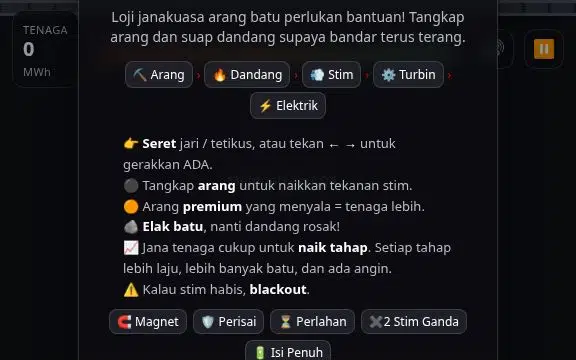 [源码运行首页](<https://github.com/adzimaziz/ada-power-game/blob/main/index.html>) | [adzimaziz/ada-power-game](<https://github.com/adzimaziz/ada-power-game>) | 常见根目录许可文件未找到 | 待核 | — | 未列入口 |
| 3903 | [ ] | [Adam: City Fixer (working title)](<https://github.com/gamingnews5/awesome-opus-5.5-games/blob/9a29b570e56bd19f15a3cd6bbac0b8c682f2c48c/games/adam-city-fixer-working-title/readme.md>) | 待补截图 | [tjjahan055-ai/adam-game](<https://github.com/tjjahan055-ai/adam-game>) | 常见根目录许可文件未找到 | 待核 | — | 未列入口 |
| 3904 | [ ] | [Afterglow](<https://github.com/gamingnews5/awesome-opus-5.5-games/blob/9a29b570e56bd19f15a3cd6bbac0b8c682f2c48c/games/afterglow/readme.md>) | 待补截图 | [ThakornToon/neon-runner](<https://github.com/ThakornToon/neon-runner>) | 常见根目录许可文件未找到 | 待核 | — | 未列入口 |
| 3905 | [ ] | [Agent drift game](<https://github.com/gamingnews5/awesome-opus-5.5-games/blob/9a29b570e56bd19f15a3cd6bbac0b8c682f2c48c/games/agent-drift-game/readme.md>) | 待补截图 | [amingclawdev/agent-drift-game](<https://github.com/amingclawdev/agent-drift-game>) | 常见根目录许可文件未找到 | 待核 | — | 未列入口 |
| 3906 | [ ] | [AI Quest](<https://github.com/gamingnews5/awesome-opus-5.5-games/blob/9a29b570e56bd19f15a3cd6bbac0b8c682f2c48c/games/ai-quest/readme.md>) | 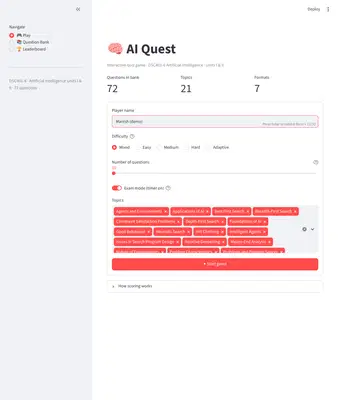 [游戏菜单或界面](<https://github.com/manishehehe/streamlit.app/blob/main/screenshots/01_home.png>) | [manishehehe/streamlit.app](<https://github.com/manishehehe/streamlit.app>) | 常见根目录许可文件未找到 | 待核 | [3.8](<https://github.com/manishehehe/streamlit.app/blob/main/screenshots/01_home.png>) | 未列入口 |
| 3907 | [ ] | [AI Slop Games](<https://github.com/gamingnews5/awesome-opus-5.5-games/blob/9a29b570e56bd19f15a3cd6bbac0b8c682f2c48c/games/ai-slop-games/readme.md>) | 待补截图 | [anttiraisala/ai-slop-games](<https://github.com/anttiraisala/ai-slop-games>) | 常见根目录许可文件未找到 | 待核 | — | 未列入口 |
| 3908 | [ ] | [Aim Trainer](<https://github.com/gamingnews5/awesome-opus-5.5-games/blob/9a29b570e56bd19f15a3cd6bbac0b8c682f2c48c/games/aim-trainer/readme.md>) | 待补截图 | [RomanUserExpert/aim-trainer](<https://github.com/RomanUserExpert/aim-trainer>) | 常见根目录许可文件未找到 | 待核 | — | 未列入口 |
| 3909 | [ ] | [Alibi](<https://github.com/gamingnews5/awesome-opus-5.5-games/blob/9a29b570e56bd19f15a3cd6bbac0b8c682f2c48c/games/alibi/readme.md>) | 待补截图 | [indieocean/alibi-web](<https://github.com/indieocean/alibi-web>) | 常见根目录许可文件未找到 | 待核 | — | 未列入口 |
| 3910 | [ ] | [amade-mines-game](<https://github.com/gamingnews5/awesome-opus-5.5-games/blob/9a29b570e56bd19f15a3cd6bbac0b8c682f2c48c/games/amade-mines-game/readme.md>) | 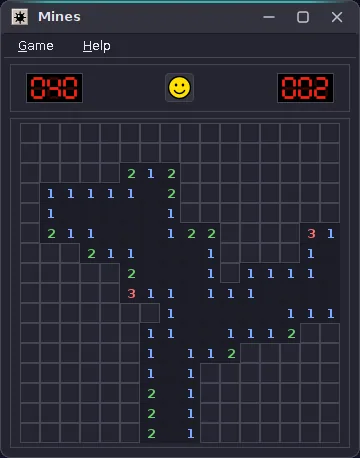 [上游游戏截图](<https://github.com/datazuul/amade-mines-game/blob/HEAD/docs/screenshots/amade-mines-game.png>) | [datazuul/amade-mines-game](<https://github.com/datazuul/amade-mines-game>) | [许可文件需人工判读](<https://github.com/datazuul/amade-mines-game/blob/HEAD/LICENSE>) | 待核 | — | 未列入口 |
| 3911 | [ ] | [Ancient Combat](<https://github.com/gamingnews5/awesome-opus-5.5-games/blob/9a29b570e56bd19f15a3cd6bbac0b8c682f2c48c/games/ancient-combat/readme.md>) | 待补截图 | [Cod3rJ4hn/Ancient-Combat](<https://github.com/Cod3rJ4hn/Ancient-Combat>) | 常见根目录许可文件未找到 | 待核 | — | 未列入口 |
| 3912 | [ ] | [Arcade](<https://github.com/gamingnews5/awesome-opus-5.5-games/blob/9a29b570e56bd19f15a3cd6bbac0b8c682f2c48c/games/arcade-nicb-coder-bot-arcade/readme.md>) | 待补截图 | [NicB-coder-bot/arcade](<https://github.com/NicB-coder-bot/arcade>) | 常见根目录许可文件未找到 | 待核 | — | 未列入口 |
| 3913 | [ ] | [ARCOLOGY](<https://github.com/gamingnews5/awesome-opus-5.5-games/blob/9a29b570e56bd19f15a3cd6bbac0b8c682f2c48c/games/arcology/readme.md>) | 待补截图 | [ftrain/arcology](<https://github.com/ftrain/arcology>) | 常见根目录许可文件未找到 | 待核 | — | [可达 · 合集所列网页](<https://ftrain.github.io/arcology/>) |
| 3914 | [ ] | [Asderg](<https://github.com/gamingnews5/awesome-opus-5.5-games/blob/9a29b570e56bd19f15a3cd6bbac0b8c682f2c48c/games/asderg/readme.md>) | 待补截图 | [eleventake/asderg-game](<https://github.com/eleventake/asderg-game>) | 常见根目录许可文件未找到 | 待核 | [7.2](<https://github.com/eleventake/asderg-game/blob/main/images/castle.jpg>) | 未列入口 |
| 3915 | [ ] | [Astro Typer 🚀](<https://github.com/gamingnews5/awesome-opus-5.5-games/blob/9a29b570e56bd19f15a3cd6bbac0b8c682f2c48c/games/astro-typer/readme.md>) |  [源码运行首页](<https://github.com/TechSnazzy/astro-typer/blob/main/index.html>) | [TechSnazzy/astro-typer](<https://github.com/TechSnazzy/astro-typer>) | 常见根目录许可文件未找到 | 待核 | — | 未列入口 |
| 3916 | [ ] | [ATLAS 🌍](<https://github.com/gamingnews5/awesome-opus-5.5-games/blob/9a29b570e56bd19f15a3cd6bbac0b8c682f2c48c/games/atlas/readme.md>) | 待补截图 | [Anudeepgona/atlas-game](<https://github.com/Anudeepgona/atlas-game>) | 常见根目录许可文件未找到 | 待核 | — | 未列入口 |
| 3917 | [ ] | [Austin's Fantasy DD's](<https://github.com/gamingnews5/awesome-opus-5.5-games/blob/9a29b570e56bd19f15a3cd6bbac0b8c682f2c48c/games/austin-s-fantasy-dd-s/readme.md>) | 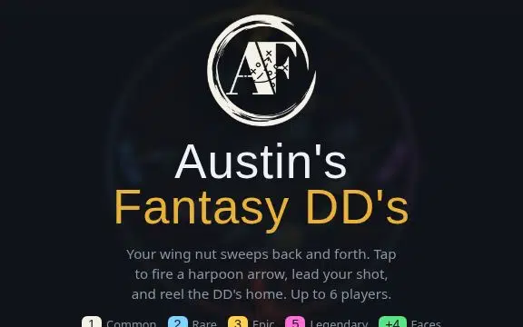 [源码运行首页](<https://github.com/natemiller39/DD-s/blob/main/public/index.html>) | [natemiller39/DD-s](<https://github.com/natemiller39/DD-s>) | 常见根目录许可文件未找到 | 待核 | — | 未列入口 |
| 3918 | [ ] | [Avoid 3](<https://github.com/gamingnews5/awesome-opus-5.5-games/blob/9a29b570e56bd19f15a3cd6bbac0b8c682f2c48c/games/avoid-3/readme.md>) | 待补截图 | [cggs-matthew-pham/avoid3\_ui](<https://github.com/cggs-matthew-pham/avoid3_ui>) | 常见根目录许可文件未找到 | 待核 | — | 未列入口 |
| 3919 | [ ] | [Backseat Bingo](<https://github.com/gamingnews5/awesome-opus-5.5-games/blob/9a29b570e56bd19f15a3cd6bbac0b8c682f2c48c/games/backseat-bingo/readme.md>) | 待补截图 | [MakeRocketGoNow/backseatbingo](<https://github.com/MakeRocketGoNow/backseatbingo>) | [许可文件需人工判读](<https://github.com/MakeRocketGoNow/backseatbingo/blob/HEAD/LICENSE.md>) | 待核 | — | 未列入口 |
| 3920 | [ ] | [Badge Realms](<https://github.com/gamingnews5/awesome-opus-5.5-games/blob/9a29b570e56bd19f15a3cd6bbac0b8c682f2c48c/games/badge-realms/readme.md>) | 待补截图 | [0LauraGelvez/Badge-realms](<https://github.com/0LauraGelvez/Badge-realms>) | 常见根目录许可文件未找到 | 待核 | — | 未列入口 |
| 3921 | [ ] | [Battleship](<https://github.com/gamingnews5/awesome-opus-5.5-games/blob/9a29b570e56bd19f15a3cd6bbac0b8c682f2c48c/games/battleship/readme.md>) | 待补截图 | [Sanunaishunter/Battleship](<https://github.com/Sanunaishunter/Battleship>) | 常见根目录许可文件未找到 | 待核 | — | 未列入口 |
| 3922 | [ ] | [Battleship (hboudali)](<https://github.com/gamingnews5/awesome-opus-5.5-games/blob/9a29b570e56bd19f15a3cd6bbac0b8c682f2c48c/games/battleship-hboudali/readme.md>) | 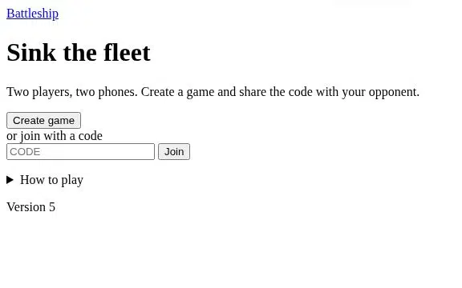 [源码运行首页](<https://github.com/hboudali/BattleShip/blob/main/index.html>) | [hboudali/BattleShip](<https://github.com/hboudali/BattleShip>) | 常见根目录许可文件未找到 | 待核 | — | 未列入口 |
| 3923 | [ ] | [Beard Plucker](<https://github.com/gamingnews5/awesome-opus-5.5-games/blob/9a29b570e56bd19f15a3cd6bbac0b8c682f2c48c/games/beard-plucker/readme.md>) | 待补截图 | [moritzherb/AppOne](<https://github.com/moritzherb/AppOne>) | 常见根目录许可文件未找到 | 待核 | — | 未列入口 |
| 3924 | [ ] | [Bees Nest](<https://github.com/gamingnews5/awesome-opus-5.5-games/blob/9a29b570e56bd19f15a3cd6bbac0b8c682f2c48c/games/bees-nest/readme.md>) | 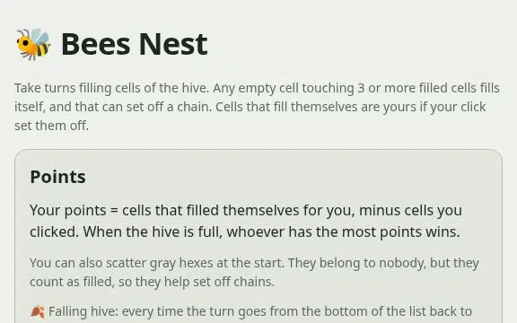 [源码运行首页](<https://github.com/verdeyen-k/beesnest/blob/main/index.html>) | [verdeyen-k/beesnest](<https://github.com/verdeyen-k/beesnest>) | 常见根目录许可文件未找到 | 待核 | — | 未列入口 |
| 3925 | [ ] | [Bexhill College Business Tycoon](<https://github.com/gamingnews5/awesome-opus-5.5-games/blob/9a29b570e56bd19f15a3cd6bbac0b8c682f2c48c/games/bexhill-college-business-tycoon/readme.md>) | 待补截图 | [tom-landy/OpenEvening2627](<https://github.com/tom-landy/OpenEvening2627>) | 常见根目录许可文件未找到 | 待核 | — | 未列入口 |
| 3926 | [ ] | [Bhabhi Thulla Online](<https://github.com/gamingnews5/awesome-opus-5.5-games/blob/9a29b570e56bd19f15a3cd6bbac0b8c682f2c48c/games/bhabhi-thulla-online/readme.md>) | 待补截图 | [Taha-Bin-Talib/Getaway-Card-Game](<https://github.com/Taha-Bin-Talib/Getaway-Card-Game>) | 常见根目录许可文件未找到 | 待核 | — | 未列入口 |
| 3927 | [ ] | [Bidlock](<https://github.com/gamingnews5/awesome-opus-5.5-games/blob/9a29b570e56bd19f15a3cd6bbac0b8c682f2c48c/games/bidlock/readme.md>) | 待补截图 | [VolcanicWorks/bidlock](<https://github.com/VolcanicWorks/bidlock>) | [MIT](<https://github.com/VolcanicWorks/bidlock/blob/HEAD/LICENSE>) | 待核 | — | 未列入口 |
| 3928 | [ ] | [Big 2](<https://github.com/gamingnews5/awesome-opus-5.5-games/blob/9a29b570e56bd19f15a3cd6bbac0b8c682f2c48c/games/big-2/readme.md>) | 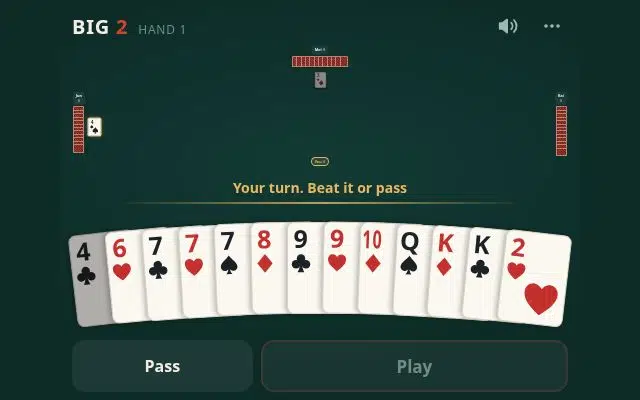 [源码网页实截](<https://github.com/dschoenblum/big2/blob/main/index.html>) | [dschoenblum/big2](<https://github.com/dschoenblum/big2>) | 常见根目录许可文件未找到 | 待核 | — | 未列入口 |
| 3929 | [ ] | [Bilang Ride](<https://github.com/gamingnews5/awesome-opus-5.5-games/blob/9a29b570e56bd19f15a3cd6bbac0b8c682f2c48c/games/bilang-ride/readme.md>) |  [源码运行首页](<https://github.com/questxllc/AI-Builder/blob/main/index.html>) | [questxllc/AI-Builder](<https://github.com/questxllc/AI-Builder>) | 常见根目录许可文件未找到 | 待核 | — | 未列入口 |
| 3930 | [ ] | [Binaroo](<https://github.com/gamingnews5/awesome-opus-5.5-games/blob/9a29b570e56bd19f15a3cd6bbac0b8c682f2c48c/games/binaroo/readme.md>) | 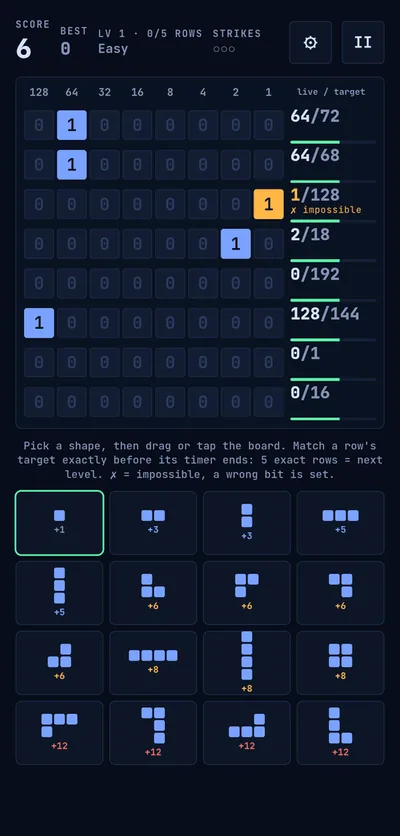 [上游游戏截图](<https://github.com/Gernika-Labs/binaroo/blob/HEAD/site/src/assets/screenshot-play-dark.png>) | [Gernika-Labs/binaroo](<https://github.com/Gernika-Labs/binaroo>) | [README 许可段声明保留权利、限制使用或尚未授权](<https://github.com/Gernika-Labs/binaroo/blob/HEAD/README.md>) | 待核 | — | 未列入口 |
| 3931 | [ ] | [Bird Tic-Toe](<https://github.com/gamingnews5/awesome-opus-5.5-games/blob/9a29b570e56bd19f15a3cd6bbac0b8c682f2c48c/games/bird-tic-toe/readme.md>) | 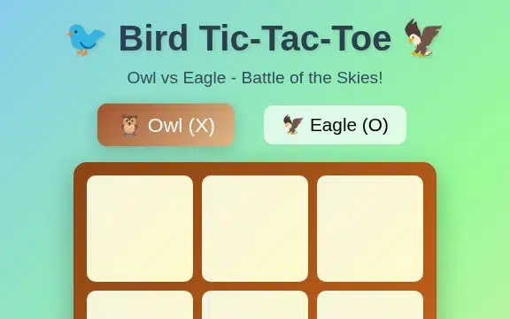 [源码运行画面](<https://github.com/vriveras/bird-tic-toe/blob/HEAD/index.html>) | [vriveras/bird-tic-toe](<https://github.com/vriveras/bird-tic-toe>) | [MIT（package.json 声明）](<https://github.com/vriveras/bird-tic-toe/blob/HEAD/package.json>) | 待核 | — | 未列入口 |
| 3932 | [ ] | [Birthday Suffocation](<https://github.com/gamingnews5/awesome-opus-5.5-games/blob/9a29b570e56bd19f15a3cd6bbac0b8c682f2c48c/games/birthday-suffocation/readme.md>) | 待补截图 | [williamedwards/birthday-suffocation](<https://github.com/williamedwards/birthday-suffocation>) | 常见根目录许可文件未找到 | 待核 | — | [可达 · itch.io 内嵌游戏页](<https://aembear.itch.io/birthday-suffocation>) |
| 3933 | [ ] | [Bitcoin Game](<https://github.com/gamingnews5/awesome-opus-5.5-games/blob/9a29b570e56bd19f15a3cd6bbac0b8c682f2c48c/games/bitcoin-game/readme.md>) | 待补截图 | [hechoenosa/bitcoin-game](<https://github.com/hechoenosa/bitcoin-game>) | 常见根目录许可文件未找到 | 待核 | — | [可达 · 含游戏画布／引擎的网页](<https://sparknightbitcoingame.netlify.app>) |
| 3934 | [ ] | [Bits Fetch](<https://github.com/gamingnews5/awesome-opus-5.5-games/blob/9a29b570e56bd19f15a3cd6bbac0b8c682f2c48c/games/bits-fetch/readme.md>) | 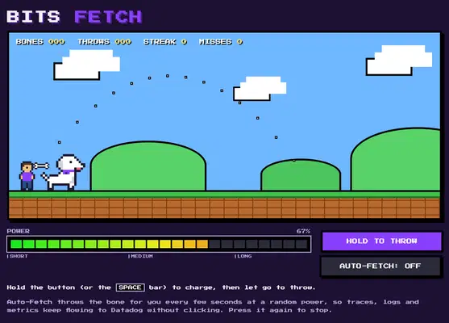 [合集截图](<https://github.com/ddjess/bits-fetch/blob/main/docs/screenshots/charge.png>) | [ddjess/bits-fetch](<https://github.com/ddjess/bits-fetch>) | 常见根目录许可文件未找到 | 待核 | [5.6](<https://github.com/ddjess/bits-fetch/blob/main/docs/screenshots/charge.png>) | 未列入口 |
| 3935 | [ ] | [Blackjack Table](<https://github.com/gamingnews5/awesome-opus-5.5-games/blob/9a29b570e56bd19f15a3cd6bbac0b8c682f2c48c/games/blackjack-table/readme.md>) | 待补截图 | [davidrf88/blackjack](<https://github.com/davidrf88/blackjack>) | 常见根目录许可文件未找到 | 待核 | — | 未列入口 |
| 3936 | [ ] | [Blacksmith Prototype](<https://github.com/gamingnews5/awesome-opus-5.5-games/blob/9a29b570e56bd19f15a3cd6bbac0b8c682f2c48c/games/blacksmith-prototype/readme.md>) | 待补截图 | [Miiiiiiiid/blacksmith](<https://github.com/Miiiiiiiid/blacksmith>) | 常见根目录许可文件未找到 | 待核 | — | 未列入口 |
| 3937 | [ ] | [Blind Buzzer](<https://github.com/gamingnews5/awesome-opus-5.5-games/blob/9a29b570e56bd19f15a3cd6bbac0b8c682f2c48c/games/blind-buzzer/readme.md>) |  [源码运行首页](<https://github.com/muhammedqais/blind-buzzer/blob/main/index.html>) | [muhammedqais/blind-buzzer](<https://github.com/muhammedqais/blind-buzzer>) | 常见根目录许可文件未找到 | 待核 | — | 未列入口 |
| 3938 | [ ] | [Block Puzzle 3D](<https://github.com/gamingnews5/awesome-opus-5.5-games/blob/9a29b570e56bd19f15a3cd6bbac0b8c682f2c48c/games/block-puzzle-3d/readme.md>) | 待补截图 | [hung-wellbyte/block-puzzle-3d](<https://github.com/hung-wellbyte/block-puzzle-3d>) | 常见根目录许可文件未找到 | 待核 | — | 未列入口 |
| 3939 | [ ] | [Blox](<https://github.com/gamingnews5/awesome-opus-5.5-games/blob/9a29b570e56bd19f15a3cd6bbac0b8c682f2c48c/games/blox-mtcllvhmr-blox/readme.md>) | 待补截图 | [mtcllvhmr/blox](<https://github.com/mtcllvhmr/blox>) | 常见根目录许可文件未找到 | 待核 | — | [可达 · 合集所列网页](<https://mtcllvhmr.github.io/blox/>) |
| 3940 | [ ] | [Blue Fox Games](<https://github.com/gamingnews5/awesome-opus-5.5-games/blob/9a29b570e56bd19f15a3cd6bbac0b8c682f2c48c/games/blue-fox-games/readme.md>) | 待补截图 | [FelipeFerraz4/blue-fox-games](<https://github.com/FelipeFerraz4/blue-fox-games>) | 常见根目录许可文件未找到 | 待核 | — | 未列入口 |
| 3941 | [ ] | [Bohemia](<https://github.com/gamingnews5/awesome-opus-5.5-games/blob/9a29b570e56bd19f15a3cd6bbac0b8c682f2c48c/games/bohemia/readme.md>) | 待补截图 | [claryaldringen/bohemia](<https://github.com/claryaldringen/bohemia>) | 常见根目录许可文件未找到 | 待核 | — | 未列入口 |
| 3942 | [ ] | [Bomber-Chess](<https://github.com/gamingnews5/awesome-opus-5.5-games/blob/9a29b570e56bd19f15a3cd6bbac0b8c682f2c48c/games/bomber-chess/readme.md>) | 待补截图 | [JorSanders/bomber-chess](<https://github.com/JorSanders/bomber-chess>) | [Unlicense](<https://github.com/JorSanders/bomber-chess/blob/HEAD/LICENSE>) | 待核 | — | 未列入口 |
| 3943 | [ ] | [BombLine](<https://github.com/gamingnews5/awesome-opus-5.5-games/blob/9a29b570e56bd19f15a3cd6bbac0b8c682f2c48c/games/bombline/readme.md>) | 待补截图 | [JakaMale/BombLine](<https://github.com/JakaMale/BombLine>) | 常见根目录许可文件未找到 | 待核 | — | 未列入口 |
| 3944 | [ ] | [Bounce Game](<https://github.com/gamingnews5/awesome-opus-5.5-games/blob/9a29b570e56bd19f15a3cd6bbac0b8c682f2c48c/games/bounce-game/readme.md>) |  [源码运行画面](<https://github.com/EmmanuelEsoh/bounce-game/blob/main/index.html>) | [EmmanuelEsoh/bounce-game](<https://github.com/EmmanuelEsoh/bounce-game>) | 常见根目录许可文件未找到 | 待核 | — | 未列入口 |
| 3945 | [ ] | [Brainbrew](<https://github.com/gamingnews5/awesome-opus-5.5-games/blob/9a29b570e56bd19f15a3cd6bbac0b8c682f2c48c/games/brainbrew/readme.md>) | 待补截图 | [alveek31/detective-redwing](<https://github.com/alveek31/detective-redwing>) | 常见根目录许可文件未找到 | 待核 | — | 未列入口 |
| 3946 | [ ] | [Breakout](<https://github.com/gamingnews5/awesome-opus-5.5-games/blob/9a29b570e56bd19f15a3cd6bbac0b8c682f2c48c/games/breakout-goyalion17-breakout-game/readme.md>) | 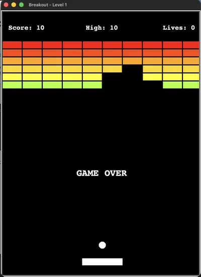 [合集截图](<https://github.com/goyalion17/breakout-game/blob/main/screenshot.png>) | [goyalion17/breakout-game](<https://github.com/goyalion17/breakout-game>) | 常见根目录许可文件未找到 | 待核 | [4.6](<https://github.com/goyalion17/breakout-game/blob/main/screenshot.png>) | 未列入口 |
| 3947 | [ ] | [Breakout (martinherje)](<https://github.com/gamingnews5/awesome-opus-5.5-games/blob/9a29b570e56bd19f15a3cd6bbac0b8c682f2c48c/games/breakout-martinherje/readme.md>) | 待补截图 | [martinherje/omsynsfangaren](<https://github.com/martinherje/omsynsfangaren>) | 常见根目录许可文件未找到 | 待核 | — | 未列入口 |
| 3948 | [ ] | [Breakout Pygame](<https://github.com/gamingnews5/awesome-opus-5.5-games/blob/9a29b570e56bd19f15a3cd6bbac0b8c682f2c48c/games/breakout-pygame/readme.md>) | 待补截图 | [drjasonharrison/breakout-video-pygame](<https://github.com/drjasonharrison/breakout-video-pygame>) | [BSD-3-Clause](<https://github.com/drjasonharrison/breakout-video-pygame/blob/HEAD/LICENSE>) | 待核 | — | 未列入口 |
| 3949 | [ ] | [Brick Breaker](<https://github.com/gamingnews5/awesome-opus-5.5-games/blob/9a29b570e56bd19f15a3cd6bbac0b8c682f2c48c/games/brick-breaker/readme.md>) |  [源码运行首页](<https://github.com/dmendoza2121/Test/blob/claude/brick-breaker-game-vhifue/index.html>) | [dmendoza2121/Test](<https://github.com/dmendoza2121/Test>) | 常见根目录许可文件未找到 | 待核 | — | 未列入口 |
| 3950 | [ ] | [Bridge Lab](<https://github.com/gamingnews5/awesome-opus-5.5-games/blob/9a29b570e56bd19f15a3cd6bbac0b8c682f2c48c/games/bridge-lab/readme.md>) | 待补截图 | [KFTamang/sim\_game](<https://github.com/KFTamang/sim_game>) | 常见根目录许可文件未找到 | 待核 | — | 未列入口 |
| 3951 | [ ] | [browser-game-1](<https://github.com/gamingnews5/awesome-opus-5.5-games/blob/9a29b570e56bd19f15a3cd6bbac0b8c682f2c48c/games/browser-game-1/readme.md>) | 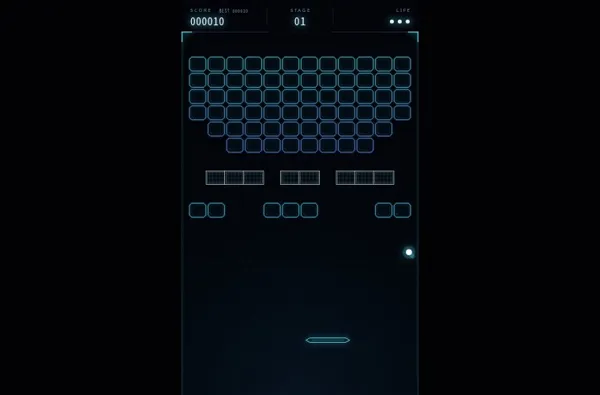 [源码运行画面](<https://github.com/riatan-code/browser-game-1/blob/main/index.html>) | [riatan-code/browser-game-1](<https://github.com/riatan-code/browser-game-1>) | 常见根目录许可文件未找到 | 待核 | — | 未列入口 |
| 3952 | [ ] | [Build the Most Secure System](<https://github.com/gamingnews5/awesome-opus-5.5-games/blob/9a29b570e56bd19f15a3cd6bbac0b8c682f2c48c/games/build-the-most-secure-system/readme.md>) | 待补截图 | [NelliTarkkaKPMG/Security-Trade-off-Game](<https://github.com/NelliTarkkaKPMG/Security-Trade-off-Game>) | [MIT（package.json 声明）](<https://github.com/NelliTarkkaKPMG/Security-Trade-off-Game/blob/HEAD/package.json>) | 待核 | — | 未列入口 |
| 3953 | [ ] | [Burg-RPG](<https://github.com/gamingnews5/awesome-opus-5.5-games/blob/9a29b570e56bd19f15a3cd6bbac0b8c682f2c48c/games/burg-rpg/readme.md>) | 待补截图 | [HazVentura/Burg-RPG](<https://github.com/HazVentura/Burg-RPG>) | 常见根目录许可文件未找到 | 待核 | — | 未列入口 |
| 3954 | [ ] | [Business Lab — «Обери своє рішення»](<https://github.com/gamingnews5/awesome-opus-5.5-games/blob/9a29b570e56bd19f15a3cd6bbac0b8c682f2c48c/games/business-lab/readme.md>) | 待补截图 | [Yarik-Kolesnikov/Online-Game-Quantum](<https://github.com/Yarik-Kolesnikov/Online-Game-Quantum>) | 常见根目录许可文件未找到 | 待核 | — | 未列入口 |
| 3955 | [ ] | [Calm Blocks](<https://github.com/gamingnews5/awesome-opus-5.5-games/blob/9a29b570e56bd19f15a3cd6bbac0b8c682f2c48c/games/calm-blocks/readme.md>) | 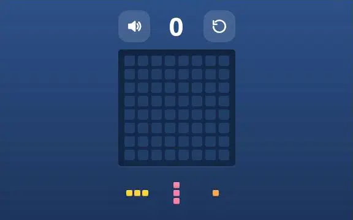 [源码运行画面](<https://github.com/wightboy/calm-blocks/blob/main/index.html>) | [wightboy/calm-blocks](<https://github.com/wightboy/calm-blocks>) | 常见根目录许可文件未找到 | 待核 | — | 未列入口 |
| 3956 | [ ] | [CapchAI](<https://github.com/gamingnews5/awesome-opus-5.5-games/blob/9a29b570e56bd19f15a3cd6bbac0b8c682f2c48c/games/capchai/readme.md>) | 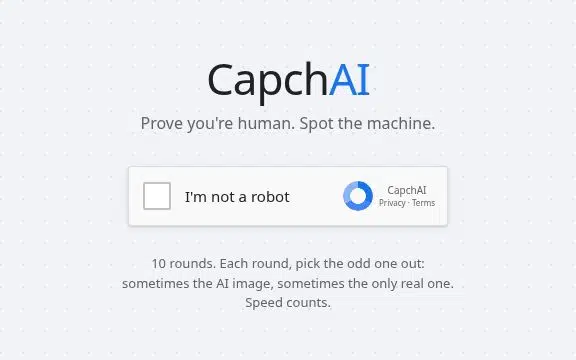 [源码运行首页](<https://github.com/BeargleIndustries/capchai/blob/main/index.html>) | [BeargleIndustries/capchai](<https://github.com/BeargleIndustries/capchai>) | 常见根目录许可文件未找到 | 待核 | — | 未列入口 |
| 3957 | [ ] | [Capital Duel](<https://github.com/gamingnews5/awesome-opus-5.5-games/blob/9a29b570e56bd19f15a3cd6bbac0b8c682f2c48c/games/capital-duel/readme.md>) | 待补截图 | [TudorTodea/Capital-Duel](<https://github.com/TudorTodea/Capital-Duel>) | [ISC（package.json 声明）](<https://github.com/TudorTodea/Capital-Duel/blob/HEAD/package.json>) | 待核 | — | 未列入口 |
| 3958 | [ ] | [Card Shark](<https://github.com/gamingnews5/awesome-opus-5.5-games/blob/9a29b570e56bd19f15a3cd6bbac0b8c682f2c48c/games/card-shark/readme.md>) | 待补截图 | [MoneyGotLonger/card-shark](<https://github.com/MoneyGotLonger/card-shark>) | 常见根目录许可文件未找到 | 待核 | — | 未列入口 |
| 3959 | [ ] | [Carla's Video Poker Game](<https://github.com/gamingnews5/awesome-opus-5.5-games/blob/9a29b570e56bd19f15a3cd6bbac0b8c682f2c48c/games/carla-s-video-poker-game/readme.md>) |  [合集截图](<https://github.com/kendallmark3/video-poker/blob/main/screenshots/r9-wide.png>) | [kendallmark3/video-poker](<https://github.com/kendallmark3/video-poker>) | 常见根目录许可文件未找到 | 待核 | [6.3](<https://github.com/kendallmark3/video-poker/blob/main/screenshots/r9-wide.png>) | 未列入口 |
| 3960 | [ ] | [Carrot Clicker](<https://github.com/gamingnews5/awesome-opus-5.5-games/blob/9a29b570e56bd19f15a3cd6bbac0b8c682f2c48c/games/carrot-clicker/readme.md>) | 待补截图 | [cvcool-eng/carrot-clicker](<https://github.com/cvcool-eng/carrot-clicker>) | 常见根目录许可文件未找到 | 待核 | — | 未列入口 |
| 3961 | [ ] | [Carters Catch](<https://github.com/gamingnews5/awesome-opus-5.5-games/blob/9a29b570e56bd19f15a3cd6bbac0b8c682f2c48c/games/carters-catch/readme.md>) | 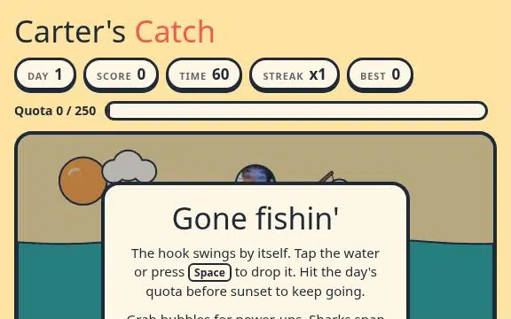 [源码运行首页](<https://github.com/ImmortalBobik/carters-catch/blob/main/index.html>) | [ImmortalBobik/carters-catch](<https://github.com/ImmortalBobik/carters-catch>) | 常见根目录许可文件未找到 | 待核 | — | 未列入口 |
| 3962 | [ ] | [Cat Fisher](<https://github.com/gamingnews5/awesome-opus-5.5-games/blob/9a29b570e56bd19f15a3cd6bbac0b8c682f2c48c/games/cat-fisher/readme.md>) | 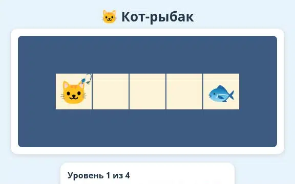 [源码运行画面](<https://github.com/skyfion/cat-fisher/blob/main/index.html>) | [skyfion/cat-fisher](<https://github.com/skyfion/cat-fisher>) | 常见根目录许可文件未找到 | 待核 | — | 未列入口 |
| 3963 | [ ] | [CeitG](<https://github.com/gamingnews5/awesome-opus-5.5-games/blob/9a29b570e56bd19f15a3cd6bbac0b8c682f2c48c/games/ceitg/readme.md>) | 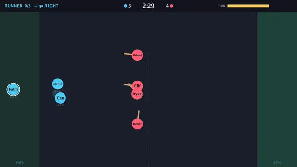 [合集截图](<https://github.com/faithere1/CeitG/blob/main/docs/gameplay.png>) | [faithere1/CeitG](<https://github.com/faithere1/CeitG>) | 常见根目录许可文件未找到 | 待核 | [4.0](<https://github.com/faithere1/CeitG/blob/main/docs/gameplay.png>) | 未列入口 |
| 3964 | [ ] | [Chameleon](<https://github.com/gamingnews5/awesome-opus-5.5-games/blob/9a29b570e56bd19f15a3cd6bbac0b8c682f2c48c/games/chameleon/readme.md>) | 待补截图 | [DeAnthonee/Liargame](<https://github.com/DeAnthonee/Liargame>) | [MIT（package.json 声明）](<https://github.com/DeAnthonee/Liargame/blob/HEAD/package.json>) | 待核 | — | 未列入口 |
| 3965 | [ ] | [Chess Lab](<https://github.com/gamingnews5/awesome-opus-5.5-games/blob/9a29b570e56bd19f15a3cd6bbac0b8c682f2c48c/games/chess-lab/readme.md>) | 待补截图 | [AarinSingh1/chess-lab](<https://github.com/AarinSingh1/chess-lab>) | 常见根目录许可文件未找到 | 待核 | — | 未列入口 |
| 3966 | [ ] | [ChessPage](<https://github.com/gamingnews5/awesome-opus-5.5-games/blob/9a29b570e56bd19f15a3cd6bbac0b8c682f2c48c/games/chesspage/readme.md>) | 待补截图 | [saadalibaig1/chesspage](<https://github.com/saadalibaig1/chesspage>) | 常见根目录许可文件未找到 | 待核 | — | 未列入口 |
| 3967 | [ ] | [Chicken Crossing](<https://github.com/gamingnews5/awesome-opus-5.5-games/blob/9a29b570e56bd19f15a3cd6bbac0b8c682f2c48c/games/chicken-crossing/readme.md>) |  [源码运行首页](<https://github.com/firstofakind935-dev/Crossy-Hager/blob/main/index.html>) | [firstofakind935-dev/Crossy-Hager](<https://github.com/firstofakind935-dev/Crossy-Hager>) | 常见根目录许可文件未找到 | 待核 | — | 未列入口 |
| 3968 | [ ] | [Chinese Word Hunt](<https://github.com/gamingnews5/awesome-opus-5.5-games/blob/9a29b570e56bd19f15a3cd6bbac0b8c682f2c48c/games/chinese-word-hunt/readme.md>) | 待补截图 | [02dtan/ChineseWordHunt](<https://github.com/02dtan/ChineseWordHunt>) | 常见根目录许可文件未找到 | 待核 | — | 未列入口 |
| 3969 | [ ] | [chinese-whist](<https://github.com/gamingnews5/awesome-opus-5.5-games/blob/9a29b570e56bd19f15a3cd6bbac0b8c682f2c48c/games/chinese-whist/readme.md>) |  [源码运行首页](<https://github.com/mtmcdermott00-cpu/chinese-whist/blob/main/index.html>) | [mtmcdermott00-cpu/chinese-whist](<https://github.com/mtmcdermott00-cpu/chinese-whist>) | 常见根目录许可文件未找到 | 待核 | — | 未列入口 |
| 3970 | [ ] | [Choose Your Own Adventure (AP Computer Science A)](<https://github.com/gamingnews5/awesome-opus-5.5-games/blob/9a29b570e56bd19f15a3cd6bbac0b8c682f2c48c/games/choose-your-own-adventure-ap-computer-science-a/readme.md>) | 待补截图 | [WaffleKraken/compsci-choose-your-own-adventure](<https://github.com/WaffleKraken/compsci-choose-your-own-adventure>) | 常见根目录许可文件未找到 | 待核 | — | 未列入口 |
| 3971 | [ ] | [Classic Solitaire](<https://github.com/gamingnews5/awesome-opus-5.5-games/blob/9a29b570e56bd19f15a3cd6bbac0b8c682f2c48c/games/classic-solitaire/readme.md>) | 待补截图 | [Beebopcat/classic-solitaire](<https://github.com/Beebopcat/classic-solitaire>) | 常见根目录许可文件未找到 | 待核 | [5.0（原图失效）](<https://github.com/Beebopcat/classic-solitaire/blob/main/docs/media/redesign-table-desktop.webp>) | [入口已失效 · 合集所列网页](<https://beebopcat.github.io/classic-solitaire/>) |
| 3972 | [ ] | [Claude for Gamers](<https://github.com/gamingnews5/awesome-opus-5.5-games/blob/9a29b570e56bd19f15a3cd6bbac0b8c682f2c48c/games/claude-for-gamers/readme.md>) | 待补截图 | [Kadi-Technology/claude-for-gamers-build-day](<https://github.com/Kadi-Technology/claude-for-gamers-build-day>) | [MIT](<https://github.com/Kadi-Technology/claude-for-gamers-build-day/blob/HEAD/LICENSE>) | [README 提及](<https://github.com/Kadi-Technology/claude-for-gamers-build-day/blob/HEAD/README.md#L29>) | — | 未列入口 |
| 3973 | [ ] | [Claude of Duty](<https://github.com/gamingnews5/awesome-opus-5.5-games/blob/9a29b570e56bd19f15a3cd6bbac0b8c682f2c48c/games/claude-of-duty-mshumer-claude-of-duty/readme.md>) | 待补截图 | [mshumer/Claude-of-Duty](<https://github.com/mshumer/Claude-of-Duty>) | [MIT](<https://github.com/mshumer/Claude-of-Duty/blob/HEAD/LICENSE>) | 待核 | — | 未列入口 |
| 3974 | [ ] | [Claude's Game](<https://github.com/gamingnews5/awesome-opus-5.5-games/blob/9a29b570e56bd19f15a3cd6bbac0b8c682f2c48c/games/claude-s-game/readme.md>) |  [源码运行首页](<https://github.com/johnvsbabylon/claudes_game/blob/HEAD/index.html>) | [johnvsbabylon/claudes\_game](<https://github.com/johnvsbabylon/claudes_game>) | [许可文件需人工判读](<https://github.com/johnvsbabylon/claudes_game/blob/HEAD/LICENSE.md>) | 待核 | — | 未列入口 |
| 3975 | [ ] | [Clawd Dino](<https://github.com/gamingnews5/awesome-opus-5.5-games/blob/9a29b570e56bd19f15a3cd6bbac0b8c682f2c48c/games/clawd-dino/readme.md>) | 待补截图 | [RaphaelKhalid/clawd-dino](<https://github.com/RaphaelKhalid/clawd-dino>) | [MIT](<https://github.com/RaphaelKhalid/clawd-dino/blob/HEAD/LICENSE>) | 待核 | — | 未列入口 |
| 3976 | [ ] | [Clay Court Baccarat](<https://github.com/gamingnews5/awesome-opus-5.5-games/blob/9a29b570e56bd19f15a3cd6bbac0b8c682f2c48c/games/clay-court-baccarat/readme.md>) | 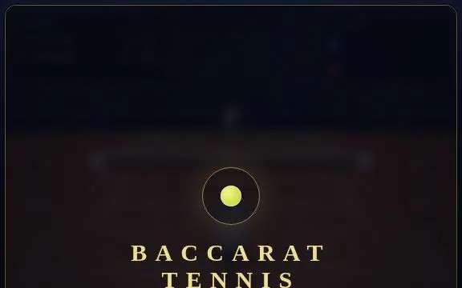 [源码运行首页](<https://github.com/818tom-design/clay-court-baccarat/blob/main/index.html>) | [818tom-design/clay-court-baccarat](<https://github.com/818tom-design/clay-court-baccarat>) | 常见根目录许可文件未找到 | 待核 | — | 未列入口 |
| 3977 | [ ] | [Coast Road GP](<https://github.com/gamingnews5/awesome-opus-5.5-games/blob/9a29b570e56bd19f15a3cd6bbac0b8c682f2c48c/games/coast-road-gp/readme.md>) |  [源码运行首页](<https://github.com/groovebak/Browser-Car-Racing/blob/claude/eloquent-euler-w5tyfx/index.html>) | [groovebak/Browser-Car-Racing](<https://github.com/groovebak/Browser-Car-Racing>) | 常见根目录许可文件未找到 | 待核 | — | 未列入口 |
| 3978 | [ ] | [Codebams](<https://github.com/gamingnews5/awesome-opus-5.5-games/blob/9a29b570e56bd19f15a3cd6bbac0b8c682f2c48c/games/codebams/readme.md>) | 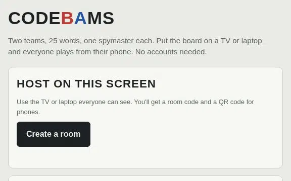 [源码运行首页](<https://github.com/NolanHickey/CodeBams/blob/main/index.html>) | [NolanHickey/CodeBams](<https://github.com/NolanHickey/CodeBams>) | 常见根目录许可文件未找到 | 待核 | — | 未列入口 |
| 3979 | [ ] | [Coin Dash Arena](<https://github.com/gamingnews5/awesome-opus-5.5-games/blob/9a29b570e56bd19f15a3cd6bbac0b8c682f2c48c/games/coin-dash-arena/readme.md>) | 待补截图 | [Ekekwecharles/coin-dash-arena](<https://github.com/Ekekwecharles/coin-dash-arena>) | 常见根目录许可文件未找到 | 待核 | [6.2](<https://github.com/Ekekwecharles/coin-dash-arena/blob/main/cover.png>) | 未列入口 |
| 3980 | [ ] | [Collide](<https://github.com/gamingnews5/awesome-opus-5.5-games/blob/9a29b570e56bd19f15a3cd6bbac0b8c682f2c48c/games/collide/readme.md>) | 待补截图 | [mahfuzt786/collide-game](<https://github.com/mahfuzt786/collide-game>) | [MIT（package.json 声明）](<https://github.com/mahfuzt786/collide-game/blob/HEAD/package.json>) | 待核 | — | 未列入口 |
| 3981 | [ ] | [Colour Flood Duel](<https://github.com/gamingnews5/awesome-opus-5.5-games/blob/9a29b570e56bd19f15a3cd6bbac0b8c682f2c48c/games/colour-flood-duel/readme.md>) | 待补截图 | [RKsAuto/colour-flood-duel](<https://github.com/RKsAuto/colour-flood-duel>) | 常见根目录许可文件未找到 | 待核 | — | 未列入口 |
| 3982 | [ ] | [Comm250 Elm Review](<https://github.com/gamingnews5/awesome-opus-5.5-games/blob/9a29b570e56bd19f15a3cd6bbac0b8c682f2c48c/games/comm250-elm-review/readme.md>) | 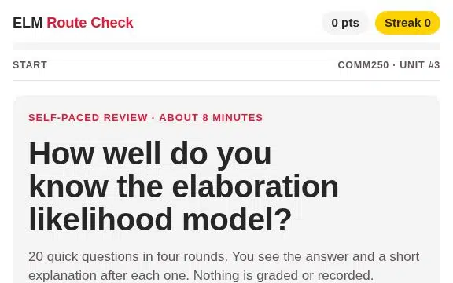 [源码运行首页](<https://github.com/zirongvannal1/comm250-elm-review/blob/main/index.html>) | [zirongvannal1/comm250-elm-review](<https://github.com/zirongvannal1/comm250-elm-review>) | 常见根目录许可文件未找到 | 待核 | — | 未列入口 |
| 3983 | [ ] | [Congress Guess](<https://github.com/gamingnews5/awesome-opus-5.5-games/blob/9a29b570e56bd19f15a3cd6bbac0b8c682f2c48c/games/congress-guess/readme.md>) |  [源码运行画面](<https://github.com/jboesen/congress-guess/blob/main/index.html>) | [jboesen/congress-guess](<https://github.com/jboesen/congress-guess>) | 常见根目录许可文件未找到 | 待核 | — | 未列入口 |
| 3984 | [ ] | [Conwaysgameoflaifu](<https://github.com/gamingnews5/awesome-opus-5.5-games/blob/9a29b570e56bd19f15a3cd6bbac0b8c682f2c48c/games/conwaysgameoflaifu/readme.md>) |  [源码运行画面](<https://github.com/rnikoopour/conwaysgameoflaifu/blob/main/index.html>) | [rnikoopour/conwaysgameoflaifu](<https://github.com/rnikoopour/conwaysgameoflaifu>) | 常见根目录许可文件未找到 | 待核 | — | 未列入口 |
| 3985 | [ ] | [Copter Duel Sloppy Edition](<https://github.com/gamingnews5/awesome-opus-5.5-games/blob/9a29b570e56bd19f15a3cd6bbac0b8c682f2c48c/games/copter-duel-sloppy-edition/readme.md>) | 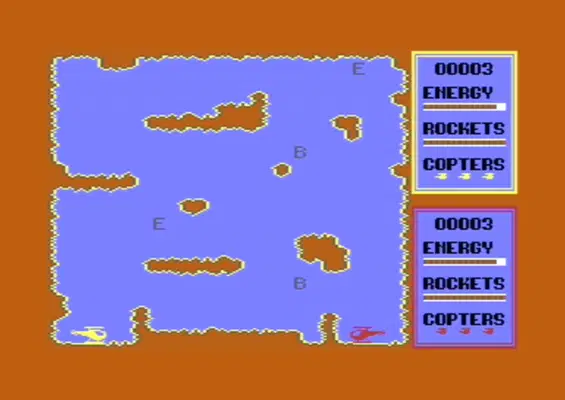 [合集截图](<https://github.com/laamella-gad/copter_duel_sloppy_edition/blob/master/screenshots/start.png>) | [laamella-gad/copter\_duel\_sloppy\_edition](<https://github.com/laamella-gad/copter_duel_sloppy_edition>) | 常见根目录许可文件未找到 | 待核 | [5.6](<https://github.com/laamella-gad/copter_duel_sloppy_edition/blob/master/screenshots/start.png>) | 未列入口 |
| 3986 | [ ] | [Cosmic Hop](<https://github.com/gamingnews5/awesome-opus-5.5-games/blob/9a29b570e56bd19f15a3cd6bbac0b8c682f2c48c/games/cosmic-hop/readme.md>) | 待补截图 | [Dylon99/cosmic-hop](<https://github.com/Dylon99/cosmic-hop>) | 常见根目录许可文件未找到 | 待核 | — | 未列入口 |
| 3987 | [ ] | [Cow Clicker](<https://github.com/gamingnews5/awesome-opus-5.5-games/blob/9a29b570e56bd19f15a3cd6bbac0b8c682f2c48c/games/cow-clicker/readme.md>) | 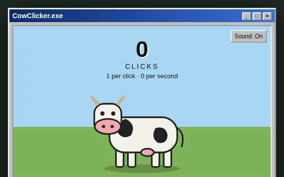 [源码运行画面](<https://github.com/TheDorkKnightCodes/cow-clicker/blob/main/index.html>) | [TheDorkKnightCodes/cow-clicker](<https://github.com/TheDorkKnightCodes/cow-clicker>) | 常见根目录许可文件未找到 | 待核 | — | 未列入口 |
| 3988 | [ ] | [Crate Drop Dash](<https://github.com/gamingnews5/awesome-opus-5.5-games/blob/9a29b570e56bd19f15a3cd6bbac0b8c682f2c48c/games/crate-drop-dash/readme.md>) | 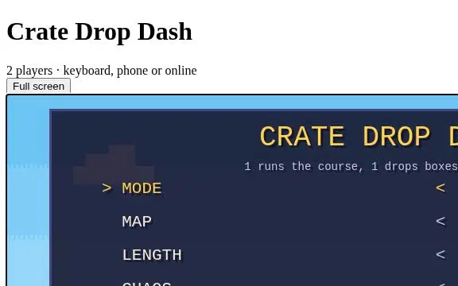 [源码运行首页](<https://github.com/bergerg/crate-drop-dash/blob/main/index.html>) | [bergerg/crate-drop-dash](<https://github.com/bergerg/crate-drop-dash>) | 常见根目录许可文件未找到 | 待核 | — | 未列入口 |
| 3989 | [ ] | [Crayon Ladder Game](<https://github.com/gamingnews5/awesome-opus-5.5-games/blob/9a29b570e56bd19f15a3cd6bbac0b8c682f2c48c/games/crayon-ladder-game/readme.md>) | 待补截图 | [bakhoon/ladder-luck-game](<https://github.com/bakhoon/ladder-luck-game>) | 常见根目录许可文件未找到 | 待核 | — | [可达 · 合集所列网页](<https://bakhoon.github.io/ladder-luck-game/>) |
| 3990 | [ ] | [Crowd Runner (no scam)](<https://github.com/gamingnews5/awesome-opus-5.5-games/blob/9a29b570e56bd19f15a3cd6bbac0b8c682f2c48c/games/crowd-runner-no-scam/readme.md>) | 待补截图 | [barakthecat/Crowdrunner-game-noscam-](<https://github.com/barakthecat/Crowdrunner-game-noscam->) | 常见根目录许可文件未找到 | 待核 | — | 未列入口 |
| 3991 | [ ] | [CRUNCHER](<https://github.com/gamingnews5/awesome-opus-5.5-games/blob/9a29b570e56bd19f15a3cd6bbac0b8c682f2c48c/games/cruncher/readme.md>) | 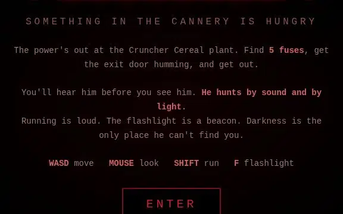 [源码运行首页](<https://github.com/2k-lc/cruncher/blob/claude/horror-game-cruncher-czdssl/index.html>) | [2k-lc/cruncher](<https://github.com/2k-lc/cruncher>) | 常见根目录许可文件未找到 | 待核 | — | 未列入口 |
| 3992 | [ ] | [CSI-GAME-UMMTO](<https://github.com/gamingnews5/awesome-opus-5.5-games/blob/9a29b570e56bd19f15a3cd6bbac0b8c682f2c48c/games/csi-game-ummto/readme.md>) | 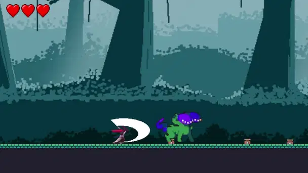 [合集截图](<https://github.com/nightmere33/CSI-GAME-UMMTO/blob/main/docs/screenshots/jungle.jpg>) | [nightmere33/CSI-GAME-UMMTO](<https://github.com/nightmere33/CSI-GAME-UMMTO>) | 常见根目录许可文件未找到 | 待核 | [6.4](<https://github.com/nightmere33/CSI-GAME-UMMTO/blob/main/docs/screenshots/jungle.jpg>) | 未列入口 |
| 3993 | [ ] | [D&amp;D Item Search Pexeso](<https://github.com/gamingnews5/awesome-opus-5.5-games/blob/9a29b570e56bd19f15a3cd6bbac0b8c682f2c48c/games/d-d-item-search-pexeso/readme.md>) | 待补截图 | [LordWizardy/DnD-Item-search-pexeso](<https://github.com/LordWizardy/DnD-Item-search-pexeso>) | 常见根目录许可文件未找到 | 待核 | — | 未列入口 |
| 3994 | [ ] | [Dark Maze](<https://github.com/gamingnews5/awesome-opus-5.5-games/blob/9a29b570e56bd19f15a3cd6bbac0b8c682f2c48c/games/dark-maze/readme.md>) | 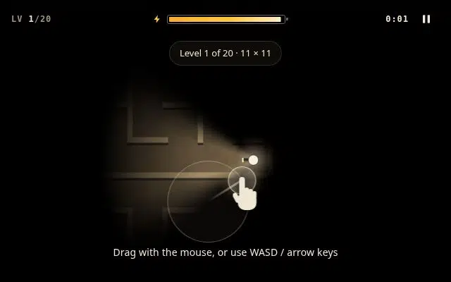 [源码网页实截](<https://github.com/Teamonics/darkmaze/blob/claude/dark-maze-game/index.html>) | [Teamonics/darkmaze](<https://github.com/Teamonics/darkmaze>) | 常见根目录许可文件未找到 | 待核 | — | 未列入口 |
| 3995 | [ ] | [darmok-games](<https://github.com/gamingnews5/awesome-opus-5.5-games/blob/9a29b570e56bd19f15a3cd6bbac0b8c682f2c48c/games/darmok-games/readme.md>) | 待补截图 | [EinarTho/darmok-games](<https://github.com/EinarTho/darmok-games>) | 常见根目录许可文件未找到 | 待核 | — | 未列入口 |
| 3996 | [ ] | [Data Center Tycoon](<https://github.com/gamingnews5/awesome-opus-5.5-games/blob/9a29b570e56bd19f15a3cd6bbac0b8c682f2c48c/games/data-center-tycoon/readme.md>) | 待补截图 | [RafiAlaydrus/DataCenterTycoon](<https://github.com/RafiAlaydrus/DataCenterTycoon>) | 常见根目录许可文件未找到 | 待核 | — | 未列入口 |
| 3997 | [ ] | [deadpan](<https://github.com/gamingnews5/awesome-opus-5.5-games/blob/9a29b570e56bd19f15a3cd6bbac0b8c682f2c48c/games/deadpan/readme.md>) | 待补截图 | [pashafateev/deadpan](<https://github.com/pashafateev/deadpan>) | 常见根目录许可文件未找到 | 待核 | — | 未列入口 |
| 3998 | [ ] | [DEALS4U.biz](<https://github.com/gamingnews5/awesome-opus-5.5-games/blob/9a29b570e56bd19f15a3cd6bbac0b8c682f2c48c/games/deals4u-biz/readme.md>) | 待补截图 | [MauritsLaubser/Deals4U](<https://github.com/MauritsLaubser/Deals4U>) | 常见根目录许可文件未找到 | 待核 | — | 未列入口 |
| 3999 | [ ] | [Deep Dive (mantidman)](<https://github.com/gamingnews5/awesome-opus-5.5-games/blob/9a29b570e56bd19f15a3cd6bbac0b8c682f2c48c/games/deep-dive-mantidman/readme.md>) | 待补截图 | [mantidman/2d\_app01](<https://github.com/mantidman/2d_app01>) | 常见根目录许可文件未找到 | 待核 | — | 未列入口 |
| 4000 | [ ] | [Deep Drill](<https://github.com/gamingnews5/awesome-opus-5.5-games/blob/9a29b570e56bd19f15a3cd6bbac0b8c682f2c48c/games/deep-drill/readme.md>) | 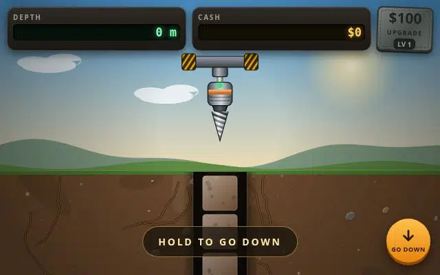 [源码网页实截](<https://github.com/randan96mk/Deep-Drill/blob/main/app/src/main/assets/index.html>) | [randan96mk/Deep-Drill](<https://github.com/randan96mk/Deep-Drill>) | 常见根目录许可文件未找到 | 待核 | — | 未列入口 |
| 4001 | [ ] | [Dhull Garden](<https://github.com/gamingnews5/awesome-opus-5.5-games/blob/9a29b570e56bd19f15a3cd6bbac0b8c682f2c48c/games/dhull-garden/readme.md>) | 待补截图 | [JackVoltaire/Dhull-Garden](<https://github.com/JackVoltaire/Dhull-Garden>) | 常见根目录许可文件未找到 | 待核 | — | 未列入口 |
| 4002 | [ ] | [dima.vaschuk.com](<https://github.com/gamingnews5/awesome-opus-5.5-games/blob/9a29b570e56bd19f15a3cd6bbac0b8c682f2c48c/games/dima-vaschuk-com/readme.md>) | 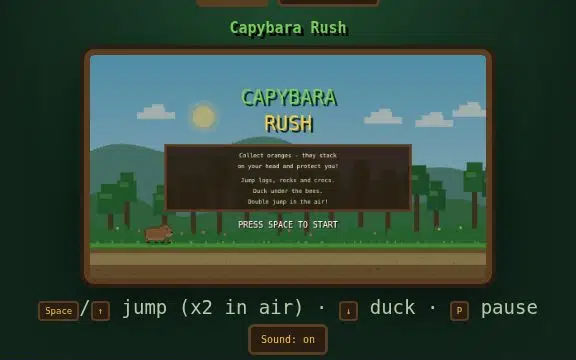 [源码运行首页](<https://github.com/igorvaschuk/dima-vaschuk-com/blob/main/public/index.html>) | [igorvaschuk/dima-vaschuk-com](<https://github.com/igorvaschuk/dima-vaschuk-com>) | 常见根目录许可文件未找到 | 待核 | — | 未列入口 |
| 4003 | [ ] | [Dino Jetpack](<https://github.com/gamingnews5/awesome-opus-5.5-games/blob/9a29b570e56bd19f15a3cd6bbac0b8c682f2c48c/games/dino-jetpack/readme.md>) | 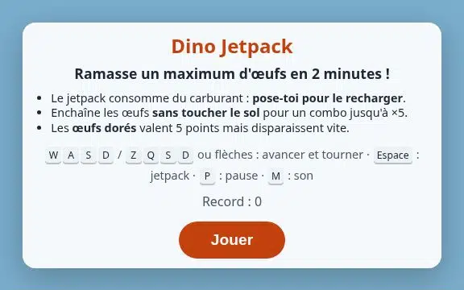 [源码运行首页](<https://github.com/Petzia/dino-jetpack/blob/main/index.html>) | [Petzia/dino-jetpack](<https://github.com/Petzia/dino-jetpack>) | [MIT（package.json 声明）](<https://github.com/Petzia/dino-jetpack/blob/HEAD/package.json>) | 待核 | — | 未列入口 |
| 4004 | [ ] | [Dino Run 3D](<https://github.com/gamingnews5/awesome-opus-5.5-games/blob/9a29b570e56bd19f15a3cd6bbac0b8c682f2c48c/games/dino-run-3d/readme.md>) | 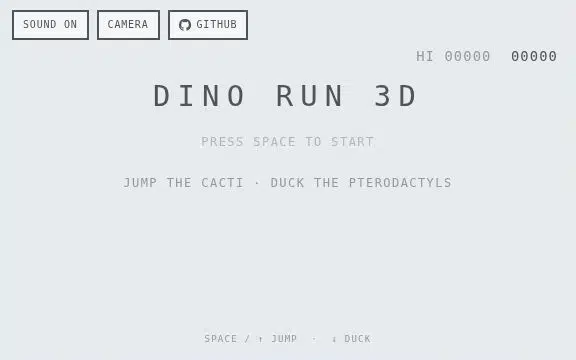 [源码运行首页](<https://github.com/romainavalle/dino-3d/blob/main/index.html>) | [romainavalle/dino-3d](<https://github.com/romainavalle/dino-3d>) | 常见根目录许可文件未找到 | 待核 | — | 未列入口 |
| 4005 | [ ] | [Dino Runner](<https://github.com/gamingnews5/awesome-opus-5.5-games/blob/9a29b570e56bd19f15a3cd6bbac0b8c682f2c48c/games/dino-runner-nikhilbelwate-dino-runner/readme.md>) | 待补截图 | [NikhilBelwate/dino-runner](<https://github.com/NikhilBelwate/dino-runner>) | 常见根目录许可文件未找到 | 待核 | — | [可达 · 含游戏画布／引擎的网页](<https://nikhilbelwate.github.io/dino-runner/>) |
| 4006 | [ ] | [Dixie game](<https://github.com/gamingnews5/awesome-opus-5.5-games/blob/9a29b570e56bd19f15a3cd6bbac0b8c682f2c48c/games/dixie-game/readme.md>) | 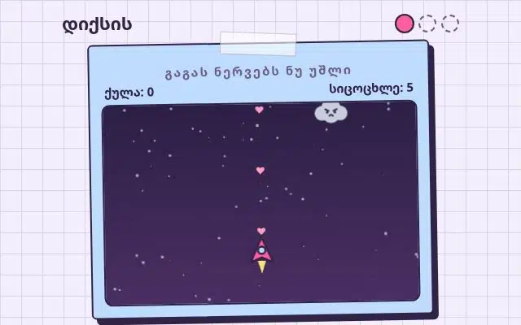 [源码网页实截](<https://github.com/gagaarabuli77-arch/Dixie-game-/blob/main/index.html>) | [gagaarabuli77-arch/Dixie-game-](<https://github.com/gagaarabuli77-arch/Dixie-game->) | 常见根目录许可文件未找到 | 待核 | — | 未列入口 |
| 4007 | [ ] | [Doom Furniture Refurb](<https://github.com/gamingnews5/awesome-opus-5.5-games/blob/9a29b570e56bd19f15a3cd6bbac0b8c682f2c48c/games/doom-furniture-refurb/readme.md>) | 待补截图 | [cbx-nz/mrcrayfishfurniturerefurb-doom](<https://github.com/cbx-nz/mrcrayfishfurniturerefurb-doom>) | [MIT](<https://github.com/cbx-nz/mrcrayfishfurniturerefurb-doom/blob/HEAD/LICENSE>) [README 许可段另述素材或第三方内容](<https://raw.githubusercontent.com/cbx-nz/mrcrayfishfurniturerefurb-doom/HEAD/README.md>) | 待核 | — | 未列入口 |
| 4008 | [ ] | [Dot and Box](<https://github.com/gamingnews5/awesome-opus-5.5-games/blob/9a29b570e56bd19f15a3cd6bbac0b8c682f2c48c/games/dot-and-box/readme.md>) | 待补截图 | [aniketsagar/dot-n-box-web](<https://github.com/aniketsagar/dot-n-box-web>) | 常见根目录许可文件未找到 | 待核 | — | 未列入口 |
| 4009 | [ ] | [Down the Rabbit Hole](<https://github.com/gamingnews5/awesome-opus-5.5-games/blob/9a29b570e56bd19f15a3cd6bbac0b8c682f2c48c/games/down-the-rabbit-hole/readme.md>) | 待补截图 | [sharonlevy9/Down\_The\_Rabbit\_Hole](<https://github.com/sharonlevy9/Down_The_Rabbit_Hole>) | 常见根目录许可文件未找到 | 待核 | — | 未列入口 |
| 4010 | [ ] | [Downshaft](<https://github.com/gamingnews5/awesome-opus-5.5-games/blob/9a29b570e56bd19f15a3cd6bbac0b8c682f2c48c/games/downshaft/readme.md>) | 待补截图 | [themanprince/downshaft](<https://github.com/themanprince/downshaft>) | 常见根目录许可文件未找到 | 待核 | — | 未列入口 |
| 4011 | [ ] | [Dragon Quest-style RPG Game 2](<https://github.com/gamingnews5/awesome-opus-5.5-games/blob/9a29b570e56bd19f15a3cd6bbac0b8c682f2c48c/games/dragon-quest-style-rpg-game-2/readme.md>) |  [源码运行首页](<https://github.com/Isusun/rpg_test_fable5/blob/HEAD/index.html>) | [Isusun/rpg\_test\_fable5](<https://github.com/Isusun/rpg_test_fable5>) | 常见根目录许可文件未找到 | 待核 | — | 未列入口 |
| 4012 | [ ] | [Dragon Quest-style RPG Game 3](<https://github.com/gamingnews5/awesome-opus-5.5-games/blob/9a29b570e56bd19f15a3cd6bbac0b8c682f2c48c/games/dragon-quest-style-rpg-game-3/readme.md>) | 待补截图 | [Isusun/rpg\_fable5\_3](<https://github.com/Isusun/rpg_fable5_3>) | 常见根目录许可文件未找到 | 待核 | — | 未列入口 |
| 4013 | [ ] | [Drakonix Picross](<https://github.com/gamingnews5/awesome-opus-5.5-games/blob/9a29b570e56bd19f15a3cd6bbac0b8c682f2c48c/games/drakonix-picross/readme.md>) | 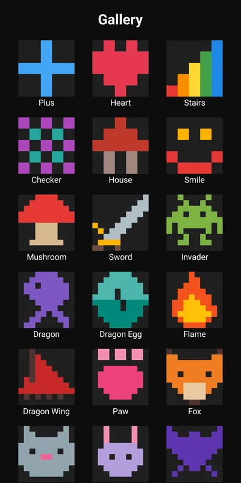 [合集截图](<https://github.com/meltingscales/DrakonixPicrossAndroid/blob/main/screenshots/play/gallery-1.png>) | [meltingscales/DrakonixPicrossAndroid](<https://github.com/meltingscales/DrakonixPicrossAndroid>) | 常见根目录许可文件未找到 | 待核 | [5.4](<https://github.com/meltingscales/DrakonixPicrossAndroid/blob/main/screenshots/play/gallery-1.png>) | 未列入口 |
| 4014 | [ ] | [Drive (AI for Accessibility)](<https://github.com/gamingnews5/awesome-opus-5.5-games/blob/9a29b570e56bd19f15a3cd6bbac0b8c682f2c48c/games/drive-ai-for-accessibility/readme.md>) | 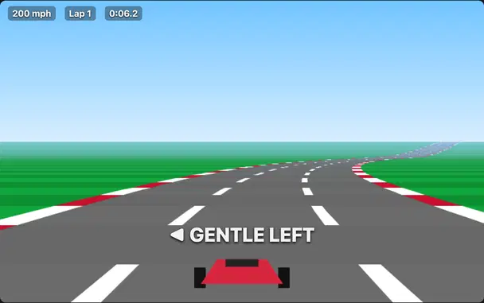 [合集截图](<https://github.com/anoopsinha/ai4a11y-driving-demo/blob/main/docs/screenshot.png>) | [anoopsinha/ai4a11y-driving-demo](<https://github.com/anoopsinha/ai4a11y-driving-demo>) | [许可文件需人工判读](<https://github.com/anoopsinha/ai4a11y-driving-demo/blob/HEAD/LICENSE>) | 待核 | [4.5](<https://github.com/anoopsinha/ai4a11y-driving-demo/blob/main/docs/screenshot.png>) | 未列入口 |
| 4015 | [ ] | [Duck Hunt](<https://github.com/gamingnews5/awesome-opus-5.5-games/blob/9a29b570e56bd19f15a3cd6bbac0b8c682f2c48c/games/duck-hunt/readme.md>) | 待补截图 | [georstar/DuckHuntGame](<https://github.com/georstar/DuckHuntGame>) | 常见根目录许可文件未找到 | 待核 | — | 未列入口 |
| 4016 | [ ] | [Dune Browser Game](<https://github.com/gamingnews5/awesome-opus-5.5-games/blob/9a29b570e56bd19f15a3cd6bbac0b8c682f2c48c/games/dune-browser-game/readme.md>) | 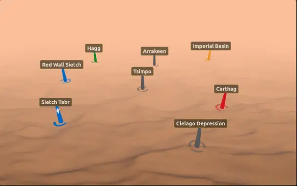 [上游游戏截图](<https://github.com/cocodedk/Dune-Browser-Game/blob/HEAD/docs/screenshots/dune-3d-map.png>) | [cocodedk/Dune-Browser-Game](<https://github.com/cocodedk/Dune-Browser-Game>) | [许可文件需人工判读](<https://github.com/cocodedk/Dune-Browser-Game/blob/HEAD/LICENSE>) | 待核 | — | [可达 · 合集所列网页](<https://cocodedk.github.io/Dune-Browser-Game/>) |
| 4017 | [ ] | [Dungeons: To The Bottom](<https://github.com/gamingnews5/awesome-opus-5.5-games/blob/9a29b570e56bd19f15a3cd6bbac0b8c682f2c48c/games/dungeons-to-the-bottom/readme.md>) | 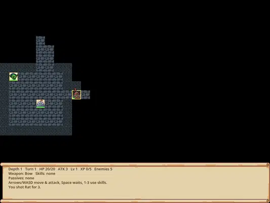 [合集截图](<https://github.com/rix346/godot/blob/main/docs/game.png>) | [rix346/godot](<https://github.com/rix346/godot>) | 常见根目录许可文件未找到 | 待核 | [4.0](<https://github.com/rix346/godot/blob/main/docs/game.png>) | 未列入口 |
| 4018 | [ ] | [dungeonsandlegends](<https://github.com/gamingnews5/awesome-opus-5.5-games/blob/9a29b570e56bd19f15a3cd6bbac0b8c682f2c48c/games/dungeonsandlegends/readme.md>) |  [源码运行首页](<https://github.com/EliBarrett11/dungeonsandlegends/blob/main/index.html>) | [EliBarrett11/dungeonsandlegends](<https://github.com/EliBarrett11/dungeonsandlegends>) | 常见根目录许可文件未找到 | 待核 | — | 未列入口 |
| 4019 | [ ] | [Echo](<https://github.com/gamingnews5/awesome-opus-5.5-games/blob/9a29b570e56bd19f15a3cd6bbac0b8c682f2c48c/games/echo-kvmukul-echo-game/readme.md>) | 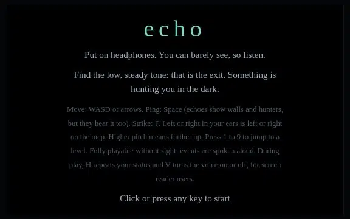 [源码运行首页](<https://github.com/kvmukul/echo-game/blob/main/index.html>) | [kvmukul/echo-game](<https://github.com/kvmukul/echo-game>) | 常见根目录许可文件未找到 | 待核 | — | 未列入口 |
| 4020 | [ ] | [ECHO（暂定）](<https://github.com/gamingnews5/awesome-opus-5.5-games/blob/9a29b570e56bd19f15a3cd6bbac0b8c682f2c48c/games/echo-nanfeidexumu-aigameproject/readme.md>) | 待补截图 | [NanFeiDeXuMu/AIGameProject](<https://github.com/NanFeiDeXuMu/AIGameProject>) | 常见根目录许可文件未找到 | 待核 | — | 未列入口 |
| 4021 | [ ] | [Ember Valley](<https://github.com/gamingnews5/awesome-opus-5.5-games/blob/9a29b570e56bd19f15a3cd6bbac0b8c682f2c48c/games/ember-valley/readme.md>) | 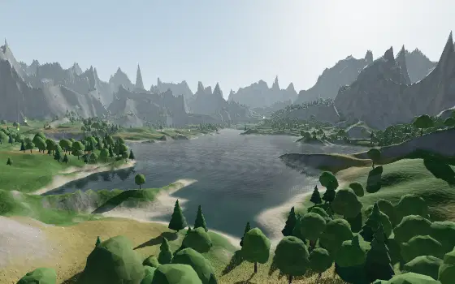 [合集截图](<https://github.com/hardwaremack-prog/ember-valley/blob/main/screenshot.png>) | [hardwaremack-prog/ember-valley](<https://github.com/hardwaremack-prog/ember-valley>) | 常见根目录许可文件未找到 | 待核 | [7.2](<https://github.com/hardwaremack-prog/ember-valley/blob/main/screenshot.png>) | 未列入口 |
| 4022 | [ ] | [Endless Puzzle Pop](<https://github.com/gamingnews5/awesome-opus-5.5-games/blob/9a29b570e56bd19f15a3cd6bbac0b8c682f2c48c/games/endless-puzzle-pop/readme.md>) |  [源码运行首页](<https://github.com/georrrgess-jpg/puzzlel-game/blob/claude/wizardly-bohr-gi6wjp/index.html>) | [georrrgess-jpg/puzzlel-game](<https://github.com/georrrgess-jpg/puzzlel-game>) | 常见根目录许可文件未找到 | 待核 | — | 未列入口 |
| 4023 | [ ] | [Escape the College](<https://github.com/gamingnews5/awesome-opus-5.5-games/blob/9a29b570e56bd19f15a3cd6bbac0b8c682f2c48c/games/escape-the-college/readme.md>) | 待补截图 | [atxlya/escape-the-college](<https://github.com/atxlya/escape-the-college>) | 常见根目录许可文件未找到 | 待核 | — | 未列入口 |
| 4024 | [ ] | [Evil Binary Search](<https://github.com/gamingnews5/awesome-opus-5.5-games/blob/9a29b570e56bd19f15a3cd6bbac0b8c682f2c48c/games/evil-binary-search/readme.md>) |  [源码运行首页](<https://github.com/ahmadmohalwes/evil-binary-search/blob/main/index.html>) | [ahmadmohalwes/evil-binary-search](<https://github.com/ahmadmohalwes/evil-binary-search>) | 常见根目录许可文件未找到 | 待核 | — | 未列入口 |
| 4025 | [ ] | [Family Party](<https://github.com/gamingnews5/awesome-opus-5.5-games/blob/9a29b570e56bd19f15a3cd6bbac0b8c682f2c48c/games/family-party/readme.md>) |  [源码运行首页](<https://github.com/gpicha3/family-party/blob/main/index.html>) | [gpicha3/family-party](<https://github.com/gpicha3/family-party>) | 常见根目录许可文件未找到 | 待核 | — | 未列入口 |
| 4026 | [ ] | [FamilyFun Club](<https://github.com/gamingnews5/awesome-opus-5.5-games/blob/9a29b570e56bd19f15a3cd6bbac0b8c682f2c48c/games/familyfun-club/readme.md>) | 待补截图 | [mahesh-vakeel/familyfun-club](<https://github.com/mahesh-vakeel/familyfun-club>) | 常见根目录许可文件未找到 | 待核 | — | 未列入口 |
| 4027 | [ ] | [Feed the Fat-Tailed Gecko  (팻테일게코 벌레잡기)](<https://github.com/gamingnews5/awesome-opus-5.5-games/blob/9a29b570e56bd19f15a3cd6bbac0b8c682f2c48c/games/feed-the-fat-tailed-gecko/readme.md>) | 待补截图 | [iamthomaslee/feed-fat-tailed-gecko](<https://github.com/iamthomaslee/feed-fat-tailed-gecko>) | 常见根目录许可文件未找到 | 待核 | — | [可达 · 含游戏画布／引擎的网页](<https://iamthomaslee.github.io/feed-fat-tailed-gecko/>) |
| 4028 | [ ] | [Filmion](<https://github.com/gamingnews5/awesome-opus-5.5-games/blob/9a29b570e56bd19f15a3cd6bbac0b8c682f2c48c/games/filmion/readme.md>) |  [源码运行画面](<https://github.com/Icnussa/Filmion/blob/main/index.html>) | [Icnussa/Filmion](<https://github.com/Icnussa/Filmion>) | 常见根目录许可文件未找到 | 待核 | — | 未列入口 |
| 4029 | [ ] | [Find It](<https://github.com/gamingnews5/awesome-opus-5.5-games/blob/9a29b570e56bd19f15a3cd6bbac0b8c682f2c48c/games/find-it-jwc983-find-it/readme.md>) |  [源码运行首页](<https://github.com/jwc983/find-it/blob/main/index.html>) | [jwc983/find-it](<https://github.com/jwc983/find-it>) | 常见根目录许可文件未找到 | 待核 | — | 未列入口 |
| 4030 | [ ] | [Finding Mama](<https://github.com/gamingnews5/awesome-opus-5.5-games/blob/9a29b570e56bd19f15a3cd6bbac0b8c682f2c48c/games/finding-mama/readme.md>) |  [源码运行首页](<https://github.com/Harrylever/finding-mama/blob/main/index.html>) | [Harrylever/finding-mama](<https://github.com/Harrylever/finding-mama>) | 常见根目录许可文件未找到 | 待核 | — | 未列入口 |
| 4031 | [ ] | [Finger Ninja — AR Fruit Slicer](<https://github.com/gamingnews5/awesome-opus-5.5-games/blob/9a29b570e56bd19f15a3cd6bbac0b8c682f2c48c/games/finger-ninja-ar-fruit-slicer/readme.md>) | 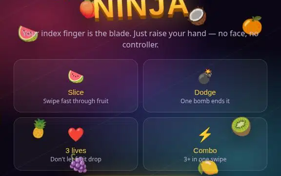 [源码运行首页](<https://github.com/MohitOrange/finger-ninja/blob/main/index.html>) | [MohitOrange/finger-ninja](<https://github.com/MohitOrange/finger-ninja>) | 常见根目录许可文件未找到 | 待核 | — | 未列入口 |
| 4032 | [ ] | [Firefly Run](<https://github.com/gamingnews5/awesome-opus-5.5-games/blob/9a29b570e56bd19f15a3cd6bbac0b8c682f2c48c/games/firefly-run/readme.md>) |  [源码运行首页](<https://github.com/AhmedShela/firefly-run/blob/main/www/index.html>) | [AhmedShela/firefly-run](<https://github.com/AhmedShela/firefly-run>) | [GPL-3.0](<https://github.com/AhmedShela/firefly-run/blob/HEAD/LICENSE>) | 待核 | — | 未列入口 |
| 4033 | [ ] | [Fishterious Happenings](<https://github.com/gamingnews5/awesome-opus-5.5-games/blob/9a29b570e56bd19f15a3cd6bbac0b8c682f2c48c/games/fishterious-happenings/readme.md>) | 待补截图 | [KairosProtocol/Fishterious-Happenings](<https://github.com/KairosProtocol/Fishterious-Happenings>) | 常见根目录许可文件未找到 | 待核 | — | 未列入口 |
| 4034 | [ ] | [Flappy](<https://github.com/gamingnews5/awesome-opus-5.5-games/blob/9a29b570e56bd19f15a3cd6bbac0b8c682f2c48c/games/flappy/readme.md>) | 待补截图 | [hetp4401/flappy](<https://github.com/hetp4401/flappy>) | 常见根目录许可文件未找到 | 待核 | — | 未列入口 |
| 4035 | [ ] | [Flappy Bird (Bevy ECS)](<https://github.com/gamingnews5/awesome-opus-5.5-games/blob/9a29b570e56bd19f15a3cd6bbac0b8c682f2c48c/games/flappy-bird-bevy-ecs/readme.md>) | 待补截图 | [twigmytwig/flappy-bird-bevy-ecs](<https://github.com/twigmytwig/flappy-bird-bevy-ecs>) | 常见根目录许可文件未找到 | 待核 | — | 未列入口 |
| 4036 | [ ] | [Flappy Bird Clone](<https://github.com/gamingnews5/awesome-opus-5.5-games/blob/9a29b570e56bd19f15a3cd6bbac0b8c682f2c48c/games/flappy-bird-clone/readme.md>) | 待补截图 | [Caio0501/godot-flappy-bird-clone](<https://github.com/Caio0501/godot-flappy-bird-clone>) | 常见根目录许可文件未找到 | 待核 | — | 未列入口 |
| 4037 | [ ] | [Flappy Bird Opus 4.7](<https://github.com/gamingnews5/awesome-opus-5.5-games/blob/9a29b570e56bd19f15a3cd6bbac0b8c682f2c48c/games/flappy-bird-opus-4-7/readme.md>) | 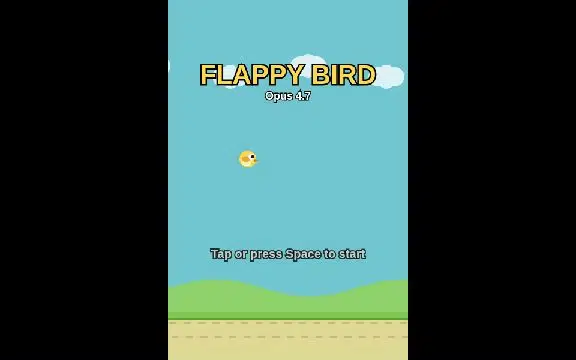 [源码运行首页](<https://github.com/marcoakes/flappy-bird-opus-4-7/blob/HEAD/index.html>) | [marcoakes/flappy-bird-opus-4-7](<https://github.com/marcoakes/flappy-bird-opus-4-7>) | 常见根目录许可文件未找到 | 待核 | — | 未列入口 |
| 4038 | [ ] | [Flappy Nyan Cat](<https://github.com/gamingnews5/awesome-opus-5.5-games/blob/9a29b570e56bd19f15a3cd6bbac0b8c682f2c48c/games/flappy-nyan-cat/readme.md>) | 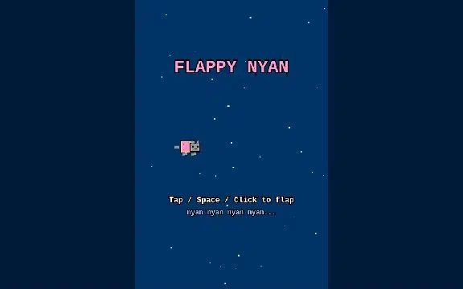 [源码运行首页](<https://github.com/hunterawsome1243/flappy-cat/blob/9782188aecdb661ed08c6f2f0356374fbe71e547/index.html>) | [hunterawsome1243/flappy-cat](<https://github.com/hunterawsome1243/flappy-cat>) | 常见根目录许可文件未找到 | 待核 | — | 未列入口 |
| 4039 | [ ] | [Flee the Balrog](<https://github.com/gamingnews5/awesome-opus-5.5-games/blob/9a29b570e56bd19f15a3cd6bbac0b8c682f2c48c/games/flee-the-balrog/readme.md>) | 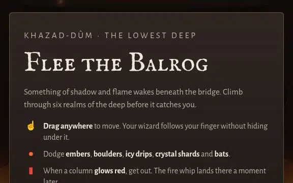 [源码运行首页](<https://github.com/cjv74nyt7y-bot/Balrog/blob/claude/ipad-game-s277bo/index.html>) | [cjv74nyt7y-bot/Balrog](<https://github.com/cjv74nyt7y-bot/Balrog>) | 常见根目录许可文件未找到 | 待核 | — | 未列入口 |
| 4040 | [ ] | [Forklift Yard](<https://github.com/gamingnews5/awesome-opus-5.5-games/blob/9a29b570e56bd19f15a3cd6bbac0b8c682f2c48c/games/forklift-yard/readme.md>) | 待补截图 | [cfg-jabba/forklift-yard](<https://github.com/cfg-jabba/forklift-yard>) | 常见根目录许可文件未找到 | 待核 | — | 未列入口 |
| 4041 | [ ] | [Fossil Vault](<https://github.com/gamingnews5/awesome-opus-5.5-games/blob/9a29b570e56bd19f15a3cd6bbac0b8c682f2c48c/games/fossil-vault/readme.md>) | 待补截图 | [facingshootingstar/fossil-vault](<https://github.com/facingshootingstar/fossil-vault>) | 常见根目录许可文件未找到 | 待核 | — | 未列入口 |
| 4042 | [ ] | [freehtmlgames](<https://github.com/gamingnews5/awesome-opus-5.5-games/blob/9a29b570e56bd19f15a3cd6bbac0b8c682f2c48c/games/freehtmlgames/readme.md>) | 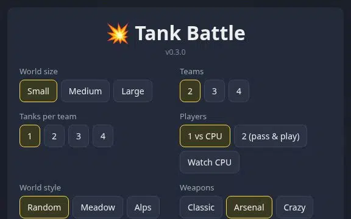 [源码运行首页](<https://github.com/HadaHector/freehtmlgames/blob/main/tanks/index.html>) | [HadaHector/freehtmlgames](<https://github.com/HadaHector/freehtmlgames>) | 常见根目录许可文件未找到 | 待核 | — | 未列入口 |
| 4043 | [ ] | [Frosty Tactics](<https://github.com/gamingnews5/awesome-opus-5.5-games/blob/9a29b570e56bd19f15a3cd6bbac0b8c682f2c48c/games/frosty-tactics/readme.md>) | 待补截图 | [Ninaji/Frosty-Tatics](<https://github.com/Ninaji/Frosty-Tatics>) | 常见根目录许可文件未找到 | 待核 | — | [可达 · 含游戏画布／引擎的网页](<https://ninaji.github.io/Frosty-Tatics/>) |
| 4044 | [ ] | [FZ Prozess Quest](<https://github.com/gamingnews5/awesome-opus-5.5-games/blob/9a29b570e56bd19f15a3cd6bbac0b8c682f2c48c/games/fz-prozess-quest/readme.md>) | 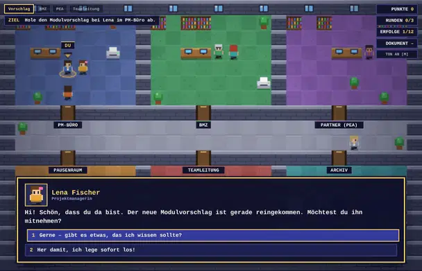 [上游游戏截图](<https://github.com/jzakotnik/devadventure/blob/HEAD/docs/screenshots/dialog.png>) | [jzakotnik/devadventure](<https://github.com/jzakotnik/devadventure>) | [MIT](<https://github.com/jzakotnik/devadventure/blob/HEAD/LICENSE>) | 待核 | — | 未列入口 |
| 4045 | [ ] | [Galaxy Stars](<https://github.com/gamingnews5/awesome-opus-5.5-games/blob/9a29b570e56bd19f15a3cd6bbac0b8c682f2c48c/games/galaxy-stars/readme.md>) | 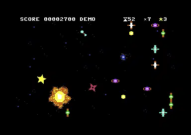 [合集截图](<https://github.com/revlayle/galaxy-stars/blob/main/docs/images/gameplay.png>) | [revlayle/galaxy-stars](<https://github.com/revlayle/galaxy-stars>) | [根文件含 MIT 正文及额外说明，须复核适用范围](<https://github.com/revlayle/galaxy-stars/blob/HEAD/LICENSE>) | [README 提及](<https://github.com/revlayle/galaxy-stars/blob/HEAD/README.md#L46>) | [5.6](<https://github.com/revlayle/galaxy-stars/blob/main/docs/images/gameplay.png>) | 未列入口 |
| 4046 | [ ] | [GalType (gtype)](<https://github.com/gamingnews5/awesome-opus-5.5-games/blob/9a29b570e56bd19f15a3cd6bbac0b8c682f2c48c/games/galtype-gtype/readme.md>) | 待补截图 | [semputs/gtype](<https://github.com/semputs/gtype>) | 常见根目录许可文件未找到 | 待核 | — | 未列入口 |
| 4047 | [ ] | [Game Night](<https://github.com/gamingnews5/awesome-opus-5.5-games/blob/9a29b570e56bd19f15a3cd6bbac0b8c682f2c48c/games/game-night-mushinskyy-game-night/readme.md>) |  [源码运行首页](<https://github.com/mushinskyy/game-night/blob/main/index.html>) | [mushinskyy/game-night](<https://github.com/mushinskyy/game-night>) | 常见根目录许可文件未找到 | 待核 | — | 未列入口 |
| 4048 | [ ] | [Game of Squids](<https://github.com/gamingnews5/awesome-opus-5.5-games/blob/9a29b570e56bd19f15a3cd6bbac0b8c682f2c48c/games/game-of-squids/readme.md>) | 待补截图 | [ilovefree1s/game-of-squids](<https://github.com/ilovefree1s/game-of-squids>) | 常见根目录许可文件未找到 | [README 提及](<https://github.com/ilovefree1s/game-of-squids/blob/HEAD/README.md#L15>) | — | 未列入口 |
| 4049 | [ ] | [games](<https://github.com/gamingnews5/awesome-opus-5.5-games/blob/9a29b570e56bd19f15a3cd6bbac0b8c682f2c48c/games/games-lorisgith-games/readme.md>) |  [源码运行画面](<https://github.com/LorisGitH/games/blob/main/sumplete/index.html>) | [LorisGitH/games](<https://github.com/LorisGitH/games>) | 常见根目录许可文件未找到 | 待核 | — | 未列入口 |
| 4050 | [ ] | [Games (sabomaster)](<https://github.com/gamingnews5/awesome-opus-5.5-games/blob/9a29b570e56bd19f15a3cd6bbac0b8c682f2c48c/games/games-sabomaster/readme.md>) | 待补截图 | [sabomaster/games](<https://github.com/sabomaster/games>) | 常见根目录许可文件未找到 | [README 提及](<https://github.com/sabomaster/games/blob/HEAD/README.md#L36>) | [6.0](<https://github.com/sabomaster/games/blob/main/test-driver/cover.jpg>) | 未列入口 |
| 4051 | [ ] | [Garage Stack](<https://github.com/gamingnews5/awesome-opus-5.5-games/blob/9a29b570e56bd19f15a3cd6bbac0b8c682f2c48c/games/garage-stack/readme.md>) | 待补截图 | [p32nicky/garage-stack](<https://github.com/p32nicky/garage-stack>) | 常见根目录许可文件未找到 | 待核 | — | 未列入口 |
| 4052 | [ ] | [Gate Fixer](<https://github.com/gamingnews5/awesome-opus-5.5-games/blob/9a29b570e56bd19f15a3cd6bbac0b8c682f2c48c/games/gate-fixer/readme.md>) | 待补截图 | [maevlyn/gate-fixer](<https://github.com/maevlyn/gate-fixer>) | 常见根目录许可文件未找到 | 待核 | — | 未列入口 |
| 4053 | [ ] | [Gearshift](<https://github.com/gamingnews5/awesome-opus-5.5-games/blob/9a29b570e56bd19f15a3cd6bbac0b8c682f2c48c/games/gearshift/readme.md>) | 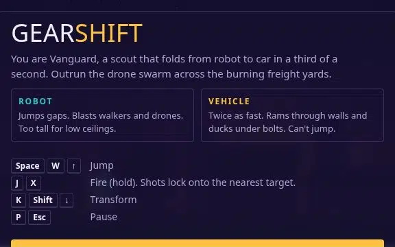 [源码运行首页](<https://github.com/arbabkhan03/Gearshift/blob/main/index.html>) | [arbabkhan03/Gearshift](<https://github.com/arbabkhan03/Gearshift>) | 常见根目录许可文件未找到 | 待核 | — | 未列入口 |
| 4054 | [ ] | [Gem Tycoon](<https://github.com/gamingnews5/awesome-opus-5.5-games/blob/9a29b570e56bd19f15a3cd6bbac0b8c682f2c48c/games/gem-tycoon/readme.md>) | 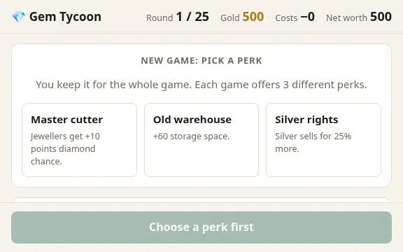 [源码运行画面](<https://github.com/Klopapier1/Ecogame/blob/main/index.html>) | [Klopapier1/Ecogame](<https://github.com/Klopapier1/Ecogame>) | 常见根目录许可文件未找到 | 待核 | — | 未列入口 |
| 4055 | [ ] | [General Knowledge Challenge](<https://github.com/gamingnews5/awesome-opus-5.5-games/blob/9a29b570e56bd19f15a3cd6bbac0b8c682f2c48c/games/general-knowledge-challenge/readme.md>) |  [源码运行首页](<https://github.com/Fala243/mini-app-Quiz-Game/blob/main/index.html>) | [Fala243/mini-app-Quiz-Game](<https://github.com/Fala243/mini-app-Quiz-Game>) | 常见根目录许可文件未找到 | 待核 | — | 未列入口 |
| 4056 | [ ] | [Geo Games](<https://github.com/gamingnews5/awesome-opus-5.5-games/blob/9a29b570e56bd19f15a3cd6bbac0b8c682f2c48c/games/geo-games/readme.md>) | 待补截图 | [hectorei19/geo-games](<https://github.com/hectorei19/geo-games>) | 常见根目录许可文件未找到 | 待核 | — | [入口已失效 · 合集所列网页](<https://hectorei19.github.io/geo-games/>) |
| 4057 | [ ] | [Ghost Snake](<https://github.com/gamingnews5/awesome-opus-5.5-games/blob/9a29b570e56bd19f15a3cd6bbac0b8c682f2c48c/games/ghost-snake/readme.md>) | 待补截图 | [AbhishekSahukar/ghost-snake](<https://github.com/AbhishekSahukar/ghost-snake>) | 常见根目录许可文件未找到 | 待核 | — | 未列入口 |
| 4058 | [ ] | [Girl Soup, Boy Soup](<https://github.com/gamingnews5/awesome-opus-5.5-games/blob/9a29b570e56bd19f15a3cd6bbac0b8c682f2c48c/games/girl-soup-boy-soup/readme.md>) | 待补截图 | [FindingJohnny/boysoupgirlsoup](<https://github.com/FindingJohnny/boysoupgirlsoup>) | [许可正文明确限制再利用，详见原文](<https://github.com/FindingJohnny/boysoupgirlsoup/blob/HEAD/LICENSE>) | 待核 | — | 未列入口 |
| 4059 | [ ] | [Glacier Maze](<https://github.com/gamingnews5/awesome-opus-5.5-games/blob/9a29b570e56bd19f15a3cd6bbac0b8c682f2c48c/games/glacier-maze/readme.md>) | 待补截图 | [yangjiwook/glacier-maze](<https://github.com/yangjiwook/glacier-maze>) | 常见根目录许可文件未找到 | 待核 | — | 未列入口 |
| 4060 | [ ] | [Glitter Rain 💖](<https://github.com/gamingnews5/awesome-opus-5.5-games/blob/9a29b570e56bd19f15a3cd6bbac0b8c682f2c48c/games/glitter-rain/readme.md>) | 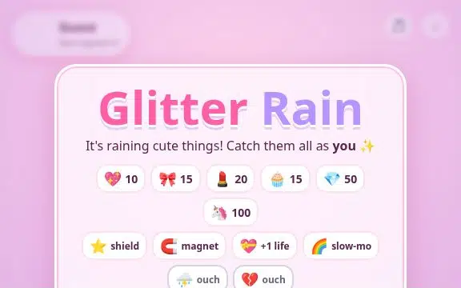 [源码运行首页](<https://github.com/AMercy-lab/Glitter-Rain-Game/blob/main/index.html>) | [AMercy-lab/Glitter-Rain-Game](<https://github.com/AMercy-lab/Glitter-Rain-Game>) | 常见根目录许可文件未找到 | 待核 | — | 未列入口 |
| 4061 | [ ] | [glowcell](<https://github.com/gamingnews5/awesome-opus-5.5-games/blob/9a29b570e56bd19f15a3cd6bbac0b8c682f2c48c/games/glowcell/readme.md>) |  [源码运行首页](<https://github.com/Davemad93/glowcell/blob/main/index.html>) | [Davemad93/glowcell](<https://github.com/Davemad93/glowcell>) | 常见根目录许可文件未找到 | 待核 | — | 未列入口 |
| 4062 | [ ] | [Gone Fishing!](<https://github.com/gamingnews5/awesome-opus-5.5-games/blob/9a29b570e56bd19f15a3cd6bbac0b8c682f2c48c/games/gone-fishing/readme.md>) | 待补截图 | [mattotodd/fish-for-fish](<https://github.com/mattotodd/fish-for-fish>) | 常见根目录许可文件未找到 | [README 提及](<https://github.com/mattotodd/fish-for-fish/blob/HEAD/README.md#L13>) | — | 未列入口 |
| 4063 | [ ] | [Goobr TD](<https://github.com/gamingnews5/awesome-opus-5.5-games/blob/9a29b570e56bd19f15a3cd6bbac0b8c682f2c48c/games/goobr-td/readme.md>) | 待补截图 | [jaredmichaelbench/Goobr-td](<https://github.com/jaredmichaelbench/Goobr-td>) | 常见根目录许可文件未找到 | 待核 | — | 未列入口 |
| 4064 | [ ] | [Goodlock app](<https://github.com/gamingnews5/awesome-opus-5.5-games/blob/9a29b570e56bd19f15a3cd6bbac0b8c682f2c48c/games/goodlock-app/readme.md>) | 待补截图 | [Nathleb/Goodlock-client](<https://github.com/Nathleb/Goodlock-client>) | 常见根目录许可文件未找到 | 待核 | — | 未列入口 |
| 4065 | [ ] | [Graveyard Gridiron](<https://github.com/gamingnews5/awesome-opus-5.5-games/blob/9a29b570e56bd19f15a3cd6bbac0b8c682f2c48c/games/graveyard-gridiron/readme.md>) |  [源码运行画面](<https://github.com/deloy4/graveyard-gridiron/blob/main/index.html>) | [deloy4/graveyard-gridiron](<https://github.com/deloy4/graveyard-gridiron>) | 常见根目录许可文件未找到 | 待核 | — | 未列入口 |
| 4066 | [ ] | [gravity-flip](<https://github.com/gamingnews5/awesome-opus-5.5-games/blob/9a29b570e56bd19f15a3cd6bbac0b8c682f2c48c/games/gravity-flip-aniketsagar-gravity-flip/readme.md>) | 待补截图 | [aniketsagar/gravity-flip](<https://github.com/aniketsagar/gravity-flip>) | 常见根目录许可文件未找到 | 待核 | — | 未列入口 |
| 4067 | [ ] | [GrimWorld](<https://github.com/gamingnews5/awesome-opus-5.5-games/blob/9a29b570e56bd19f15a3cd6bbac0b8c682f2c48c/games/grimworld/readme.md>) | 待补截图 | [Itros97/GrimWorld](<https://github.com/Itros97/GrimWorld>) | [MIT](<https://github.com/Itros97/GrimWorld/blob/HEAD/LICENSE>) [README 许可段另述素材或第三方内容](<https://raw.githubusercontent.com/Itros97/GrimWorld/HEAD/README.md>) | 待核 | — | 未列入口 |
| 4068 | [ ] | [guess-the-flag](<https://github.com/gamingnews5/awesome-opus-5.5-games/blob/9a29b570e56bd19f15a3cd6bbac0b8c682f2c48c/games/guess-the-flag/readme.md>) |  [源码运行首页](<https://github.com/dmwhyatt/guess-the-flag/blob/main/index.html>) | [dmwhyatt/guess-the-flag](<https://github.com/dmwhyatt/guess-the-flag>) | [MIT](<https://github.com/dmwhyatt/guess-the-flag/blob/HEAD/LICENSE>) | 待核 | — | 未列入口 |
| 4069 | [ ] | [Guildie](<https://github.com/gamingnews5/awesome-opus-5.5-games/blob/9a29b570e56bd19f15a3cd6bbac0b8c682f2c48c/games/guildie/readme.md>) | 待补截图 | [MarcialPimentel/guildie](<https://github.com/MarcialPimentel/guildie>) | 常见根目录许可文件未找到 | 待核 | — | 未列入口 |
| 4070 | [ ] | [Gurka](<https://github.com/gamingnews5/awesome-opus-5.5-games/blob/9a29b570e56bd19f15a3cd6bbac0b8c682f2c48c/games/gurka/readme.md>) | 待补截图 | [robintranberg/Gurka](<https://github.com/robintranberg/Gurka>) | 常见根目录许可文件未找到 | 待核 | — | 未列入口 |
| 4071 | [ ] | [Hackenbush](<https://github.com/gamingnews5/awesome-opus-5.5-games/blob/9a29b570e56bd19f15a3cd6bbac0b8c682f2c48c/games/hackenbush/readme.md>) |  [合集截图](<https://github.com/sen-ltd/hackenbush/blob/main/assets/screenshot.png>) | [sen-ltd/hackenbush](<https://github.com/sen-ltd/hackenbush>) | [MIT](<https://github.com/sen-ltd/hackenbush/blob/HEAD/LICENSE>) | 待核 | [5.0](<https://github.com/sen-ltd/hackenbush/blob/main/assets/screenshot.png>) | 未列入口 |
| 4072 | [ ] | [Hand-Brain GeoGrid](<https://github.com/gamingnews5/awesome-opus-5.5-games/blob/9a29b570e56bd19f15a3cd6bbac0b8c682f2c48c/games/hand-brain-geogrid/readme.md>) | 待补截图 | [briangoodell/HBGG](<https://github.com/briangoodell/HBGG>) | 常见根目录许可文件未找到 | 待核 | — | 未列入口 |
| 4073 | [ ] | [Happy Birthday, Sonali](<https://github.com/gamingnews5/awesome-opus-5.5-games/blob/9a29b570e56bd19f15a3cd6bbac0b8c682f2c48c/games/happy-birthday-sonali/readme.md>) | 待补截图 | [chintan-dhamecha/a-little-adventure](<https://github.com/chintan-dhamecha/a-little-adventure>) | 常见根目录许可文件未找到 | 待核 | — | 未列入口 |
| 4074 | [ ] | [Harvard Art Collection](<https://github.com/gamingnews5/awesome-opus-5.5-games/blob/9a29b570e56bd19f15a3cd6bbac0b8c682f2c48c/games/harvard-art-collection/readme.md>) | 待补截图 | [rmehreteab/harvard-art-collection](<https://github.com/rmehreteab/harvard-art-collection>) | 常见根目录许可文件未找到 | 待核 | — | [可达 · 合集所列网页](<https://harvard-art-collection.vercel.app>) |
| 4075 | [ ] | [Hati Hati](<https://github.com/gamingnews5/awesome-opus-5.5-games/blob/9a29b570e56bd19f15a3cd6bbac0b8c682f2c48c/games/hati-hati/readme.md>) | 待补截图 | [auraproject00-web/hati-hati\_game\_troll](<https://github.com/auraproject00-web/hati-hati_game_troll>) | 常见根目录许可文件未找到 | 待核 | — | 未列入口 |
| 4076 | [ ] | [HEARTLINE](<https://github.com/gamingnews5/awesome-opus-5.5-games/blob/9a29b570e56bd19f15a3cd6bbac0b8c682f2c48c/games/heartline/readme.md>) | 待补截图 | [olibrook/claude-ai-romance-game](<https://github.com/olibrook/claude-ai-romance-game>) | 常见根目录许可文件未找到 | 待核 | — | 未列入口 |
| 4077 | [ ] | [Here to Slay](<https://github.com/gamingnews5/awesome-opus-5.5-games/blob/9a29b570e56bd19f15a3cd6bbac0b8c682f2c48c/games/here-to-slay/readme.md>) | 待补截图 | [Bergie15/here-to-slay-clone](<https://github.com/Bergie15/here-to-slay-clone>) | 常见根目录许可文件未找到 | 待核 | — | 未列入口 |
| 4078 | [ ] | [Hivewing88](<https://github.com/gamingnews5/awesome-opus-5.5-games/blob/9a29b570e56bd19f15a3cd6bbac0b8c682f2c48c/games/hivewing88/readme.md>) | 待补截图 | [kajarral-381/Hivewing88](<https://github.com/kajarral-381/Hivewing88>) | 常见根目录许可文件未找到 | 待核 | — | 未列入口 |
| 4079 | [ ] | [Hollow House](<https://github.com/gamingnews5/awesome-opus-5.5-games/blob/9a29b570e56bd19f15a3cd6bbac0b8c682f2c48c/games/hollow-house/readme.md>) | 待补截图 | [daedalist/hollow-house](<https://github.com/daedalist/hollow-house>) | 常见根目录许可文件未找到 | 待核 | — | 未列入口 |
| 4080 | [ ] | [Hopper](<https://github.com/gamingnews5/awesome-opus-5.5-games/blob/9a29b570e56bd19f15a3cd6bbac0b8c682f2c48c/games/hopper/readme.md>) | 待补截图 | [nurbeks-hub/hopper](<https://github.com/nurbeks-hub/hopper>) | 常见根目录许可文件未找到 | 待核 | — | 未列入口 |
| 4081 | [ ] | [Horror Game](<https://github.com/gamingnews5/awesome-opus-5.5-games/blob/9a29b570e56bd19f15a3cd6bbac0b8c682f2c48c/games/horror-game/readme.md>) |  [源码运行首页](<https://github.com/game943/horror-game/blob/claude/serene-gates-7xy7p4/index.html>) | [game943/horror-game](<https://github.com/game943/horror-game>) | 常见根目录许可文件未找到 | 待核 | — | 未列入口 |
| 4082 | [ ] | [Hyderabad Traffic ah Majaka nah](<https://github.com/gamingnews5/awesome-opus-5.5-games/blob/9a29b570e56bd19f15a3cd6bbac0b8c682f2c48c/games/hyderabad-traffic-ah-majaka-nah/readme.md>) |  [源码运行画面](<https://github.com/VGokulsai/hyderabad-traffic-ah-majaka-nah/blob/master/index.html>) | [VGokulsai/hyderabad-traffic-ah-majaka-nah](<https://github.com/VGokulsai/hyderabad-traffic-ah-majaka-nah>) | 常见根目录许可文件未找到 | 待核 | — | 未列入口 |
| 4083 | [ ] | [Imposter (Innovation-Surge)](<https://github.com/gamingnews5/awesome-opus-5.5-games/blob/9a29b570e56bd19f15a3cd6bbac0b8c682f2c48c/games/imposter-innovation-surge/readme.md>) | 待补截图 | [Innovation-Surge/catch-the-imposter](<https://github.com/Innovation-Surge/catch-the-imposter>) | [MIT（package.json 声明）](<https://github.com/Innovation-Surge/catch-the-imposter/blob/HEAD/package.json>) | 待核 | — | 未列入口 |
| 4084 | [ ] | [Imposter Game](<https://github.com/gamingnews5/awesome-opus-5.5-games/blob/9a29b570e56bd19f15a3cd6bbac0b8c682f2c48c/games/imposter-game/readme.md>) |  [源码运行首页](<https://github.com/omri2003/imposter-game/blob/main/index.html>) | [omri2003/imposter-game](<https://github.com/omri2003/imposter-game>) | 常见根目录许可文件未找到 | 待核 | — | 未列入口 |
| 4085 | [ ] | [Imposter Ko Ho?](<https://github.com/gamingnews5/awesome-opus-5.5-games/blob/9a29b570e56bd19f15a3cd6bbac0b8c682f2c48c/games/imposter-ko-ho/readme.md>) | 待补截图 | [Suuwam/imposter-ko-ho](<https://github.com/Suuwam/imposter-ko-ho>) | 常见根目录许可文件未找到 | 待核 | — | 未列入口 |
| 4086 | [ ] | [Inferno Tag](<https://github.com/gamingnews5/awesome-opus-5.5-games/blob/9a29b570e56bd19f15a3cd6bbac0b8c682f2c48c/games/inferno-tag/readme.md>) |  [源码运行首页](<https://github.com/MDeanH/inferno-tag/blob/main/public/board.html>) | [MDeanH/inferno-tag](<https://github.com/MDeanH/inferno-tag>) | [MIT（package.json 声明）](<https://github.com/MDeanH/inferno-tag/blob/HEAD/package.json>) | 待核 | — | 未列入口 |
| 4087 | [ ] | [Island War](<https://github.com/gamingnews5/awesome-opus-5.5-games/blob/9a29b570e56bd19f15a3cd6bbac0b8c682f2c48c/games/island-war/readme.md>) | 待补截图 | [nicholaspanico97-art/Islandwar](<https://github.com/nicholaspanico97-art/Islandwar>) | 常见根目录许可文件未找到 | 待核 | — | 未列入口 |
| 4088 | [ ] | [ITU-CS-464-LAB-05-BSSE23040](<https://github.com/gamingnews5/awesome-opus-5.5-games/blob/9a29b570e56bd19f15a3cd6bbac0b8c682f2c48c/games/itu-cs-464-lab-05-bsse23040/readme.md>) |  [合集截图](<https://github.com/bsse23040/ITU-CS-464-LAB-05-BSSE23040/blob/main/Docs/screenshots/1-playing.png>) | [bsse23040/ITU-CS-464-LAB-05-BSSE23040](<https://github.com/bsse23040/ITU-CS-464-LAB-05-BSSE23040>) | 常见根目录许可文件未找到 | 待核 | [3.4](<https://github.com/bsse23040/ITU-CS-464-LAB-05-BSSE23040/blob/main/Docs/screenshots/1-playing.png>) | 未列入口 |
| 4089 | [ ] | [İmposter Oyunu](<https://github.com/gamingnews5/awesome-opus-5.5-games/blob/9a29b570e56bd19f15a3cd6bbac0b8c682f2c48c/games/imposter-oyunu/readme.md>) | 待补截图 | [abdullayevilkin/game\_imposter](<https://github.com/abdullayevilkin/game_imposter>) | 常见根目录许可文件未找到 | 待核 | — | [可达 · 合集所列网页](<https://abdullayevilkin.github.io/game_imposter/>) |
| 4090 | [ ] | [J! Archive Game](<https://github.com/gamingnews5/awesome-opus-5.5-games/blob/9a29b570e56bd19f15a3cd6bbac0b8c682f2c48c/games/j-archive-game/readme.md>) | 待补截图 | [jamespherman/jarchive-game](<https://github.com/jamespherman/jarchive-game>) | 常见根目录许可文件未找到 | 待核 | — | 未列入口 |
| 4091 | [ ] | [Jeopardy](<https://github.com/gamingnews5/awesome-opus-5.5-games/blob/9a29b570e56bd19f15a3cd6bbac0b8c682f2c48c/games/jeopardy/readme.md>) |  [源码运行首页](<https://github.com/robertpallas/jeopardy/blob/main/index.html>) | [robertpallas/jeopardy](<https://github.com/robertpallas/jeopardy>) | 常见根目录许可文件未找到 | 待核 | — | 未列入口 |
| 4092 | [ ] | [Johnson Family Game Night](<https://github.com/gamingnews5/awesome-opus-5.5-games/blob/9a29b570e56bd19f15a3cd6bbac0b8c682f2c48c/games/johnson-family-game-night/readme.md>) |  [源码运行首页](<https://github.com/thetomorrowteacher/johnson-game-night/blob/main/index.html>) | [thetomorrowteacher/johnson-game-night](<https://github.com/thetomorrowteacher/johnson-game-night>) | 常见根目录许可文件未找到 | 待核 | — | 未列入口 |
| 4093 | [ ] | [Jonah Jeopardy](<https://github.com/gamingnews5/awesome-opus-5.5-games/blob/9a29b570e56bd19f15a3cd6bbac0b8c682f2c48c/games/jonah-jeopardy/readme.md>) |  [源码运行首页](<https://github.com/Jayburd727/jonah-jeopardy/blob/main/index.html>) | [Jayburd727/jonah-jeopardy](<https://github.com/Jayburd727/jonah-jeopardy>) | 常见根目录许可文件未找到 | 待核 | — | 未列入口 |
| 4094 | [ ] | [Jump Map](<https://github.com/gamingnews5/awesome-opus-5.5-games/blob/9a29b570e56bd19f15a3cd6bbac0b8c682f2c48c/games/jump-map/readme.md>) |  [源码运行首页](<https://github.com/game943/jump-map/blob/claude/eloquent-wozniak-hn9w35/index.html>) | [game943/jump-map](<https://github.com/game943/jump-map>) | 常见根目录许可文件未找到 | 待核 | — | 未列入口 |
| 4095 | [ ] | [Kaleitris](<https://github.com/gamingnews5/awesome-opus-5.5-games/blob/9a29b570e56bd19f15a3cd6bbac0b8c682f2c48c/games/kaleitris/readme.md>) |  [源码运行首页](<https://github.com/markalroberts/Kaleitris/blob/main/index.html>) | [markalroberts/Kaleitris](<https://github.com/markalroberts/Kaleitris>) | 常见根目录许可文件未找到 | 待核 | — | 未列入口 |
| 4096 | [ ] | [Keezen](<https://github.com/gamingnews5/awesome-opus-5.5-games/blob/9a29b570e56bd19f15a3cd6bbac0b8c682f2c48c/games/keezen/readme.md>) | 待补截图 | [BRONDIJKxyz/Keezen](<https://github.com/BRONDIJKxyz/Keezen>) | 常见根目录许可文件未找到 | 待核 | — | 未列入口 |
| 4097 | [ ] | [Kibbutz Bike Race](<https://github.com/gamingnews5/awesome-opus-5.5-games/blob/9a29b570e56bd19f15a3cd6bbac0b8c682f2c48c/games/kibbutz-bike-race/readme.md>) | 待补截图 | [QuickReader/kibbutz-bike-race](<https://github.com/QuickReader/kibbutz-bike-race>) | [根文件声明保留所有权利](<https://github.com/QuickReader/kibbutz-bike-race/blob/HEAD/LICENSE>) | 待核 | — | 未列入口 |
| 4098 | [ ] | [Kids Game Play](<https://github.com/gamingnews5/awesome-opus-5.5-games/blob/9a29b570e56bd19f15a3cd6bbac0b8c682f2c48c/games/kids-game-play/readme.md>) |  [源码网页实截](<https://github.com/yubiquita/kids-game-play/blob/main/index.html>) | [yubiquita/kids-game-play](<https://github.com/yubiquita/kids-game-play>) | 常见根目录许可文件未找到 | 待核 | — | 未列入口 |
| 4099 | [ ] | [kidsgame](<https://github.com/gamingnews5/awesome-opus-5.5-games/blob/9a29b570e56bd19f15a3cd6bbac0b8c682f2c48c/games/kidsgame/readme.md>) | 待补截图 | [kimsiang/kidsgame](<https://github.com/kimsiang/kidsgame>) | 常见根目录许可文件未找到 | 待核 | — | 未列入口 |
| 4100 | [ ] | [King's Cup](<https://github.com/gamingnews5/awesome-opus-5.5-games/blob/9a29b570e56bd19f15a3cd6bbac0b8c682f2c48c/games/king-s-cup/readme.md>) | 待补截图 | [ngfamclam-cpu/kings-cup](<https://github.com/ngfamclam-cpu/kings-cup>) | 常见根目录许可文件未找到 | 待核 | — | [可达 · 合集所列网页](<https://ngfamclam-cpu.github.io/kings-cup/>) |
| 4101 | [ ] | [KrONE](<https://github.com/gamingnews5/awesome-opus-5.5-games/blob/9a29b570e56bd19f15a3cd6bbac0b8c682f2c48c/games/krone/readme.md>) | 待补截图 | [asubjecthumanity/krone](<https://github.com/asubjecthumanity/krone>) | 常见根目录许可文件未找到 | 待核 | — | 未列入口 |
| 4102 | [ ] | [Lab Test Sonnet Medium Superpowers Simple](<https://github.com/gamingnews5/awesome-opus-5.5-games/blob/9a29b570e56bd19f15a3cd6bbac0b8c682f2c48c/games/lab-test-sonnet-medium-superpowers-simple/readme.md>) | 待补截图 | [franks-ai-cafe-test/lab-test-sonnet-medium-superpowers-simple](<https://github.com/franks-ai-cafe-test/lab-test-sonnet-medium-superpowers-simple>) | 常见根目录许可文件未找到 | 待核 | — | [入口已失效 · 合集所列网页](<https://franks-ai-cafe-test.github.io/lab-test-sonnet-medium-superpowers-simple/>) |
| 4103 | [ ] | [Landfall](<https://github.com/gamingnews5/awesome-opus-5.5-games/blob/9a29b570e56bd19f15a3cd6bbac0b8c682f2c48c/games/landfall/readme.md>) |  [源码运行首页](<https://github.com/ethanterrero/landfall/blob/main/index.html>) | [ethanterrero/landfall](<https://github.com/ethanterrero/landfall>) | [Apache-2.0](<https://github.com/ethanterrero/landfall/blob/HEAD/LICENSE>) | 待核 | — | 未列入口 |
| 4104 | [ ] | [Lane Runner](<https://github.com/gamingnews5/awesome-opus-5.5-games/blob/9a29b570e56bd19f15a3cd6bbac0b8c682f2c48c/games/lane-runner/readme.md>) | 待补截图 | [Snehiths19/lane-runner](<https://github.com/Snehiths19/lane-runner>) | 常见根目录许可文件未找到 | 待核 | — | [入口已失效 · 合集所列网页](<https://snehiths19.github.io/lane-runner/>) |
| 4105 | [ ] | [Lantern Run (felix123r9-design)](<https://github.com/gamingnews5/awesome-opus-5.5-games/blob/9a29b570e56bd19f15a3cd6bbac0b8c682f2c48c/games/lantern-run-felix123r9-design/readme.md>) |  [源码运行首页](<https://github.com/felix123r9-design/lantern-run/blob/main/index.html>) | [felix123r9-design/lantern-run](<https://github.com/felix123r9-design/lantern-run>) | 常见根目录许可文件未找到 | 待核 | — | 未列入口 |
| 4106 | [ ] | [Learning Godot by Rebuilding Asteroids](<https://github.com/gamingnews5/awesome-opus-5.5-games/blob/9a29b570e56bd19f15a3cd6bbac0b8c682f2c48c/games/learning-godot-by-rebuilding-asteroids/readme.md>) | 待补截图 | [mfrench71/godot-asteroids](<https://github.com/mfrench71/godot-asteroids>) | 常见根目录许可文件未找到 | 待核 | — | 未列入口 |
| 4107 | [ ] | [Leons Memory](<https://github.com/gamingnews5/awesome-opus-5.5-games/blob/9a29b570e56bd19f15a3cd6bbac0b8c682f2c48c/games/leons-memory/readme.md>) |  [源码运行首页](<https://github.com/bjoern-roccor/leon-memory/blob/main/index.html>) | [bjoern-roccor/leon-memory](<https://github.com/bjoern-roccor/leon-memory>) | 常见根目录许可文件未找到 | 待核 | — | 未列入口 |
| 4108 | [ ] | [Letter Rush](<https://github.com/gamingnews5/awesome-opus-5.5-games/blob/9a29b570e56bd19f15a3cd6bbac0b8c682f2c48c/games/letter-rush/readme.md>) |  [源码运行首页](<https://github.com/adam-gibson/letter-rush/blob/main/index.html>) | [adam-gibson/letter-rush](<https://github.com/adam-gibson/letter-rush>) | 常见根目录许可文件未找到 | 待核 | — | 未列入口 |
| 4109 | [ ] | [LHC Mystery Night](<https://github.com/gamingnews5/awesome-opus-5.5-games/blob/9a29b570e56bd19f15a3cd6bbac0b8c682f2c48c/games/lhc-mystery-night/readme.md>) | 待补截图 | [mhmdnab/lhc-mystery-night](<https://github.com/mhmdnab/lhc-mystery-night>) | 常见根目录许可文件未找到 | 待核 | — | 未列入口 |
| 4110 | [ ] | [Lighthouse Archipelago](<https://github.com/gamingnews5/awesome-opus-5.5-games/blob/9a29b570e56bd19f15a3cd6bbac0b8c682f2c48c/games/lighthouse-archipelago/readme.md>) | 待补截图 | [JoeyGlasserCS/OneHourGame](<https://github.com/JoeyGlasserCS/OneHourGame>) | 常见根目录许可文件未找到 | 待核 | — | 未列入口 |
| 4111 | [ ] | [Lighthouse Keeper](<https://github.com/gamingnews5/awesome-opus-5.5-games/blob/9a29b570e56bd19f15a3cd6bbac0b8c682f2c48c/games/lighthouse-keeper/readme.md>) | 待补截图 | [ReadySetDive/lighthouse-keeper](<https://github.com/ReadySetDive/lighthouse-keeper>) | 常见根目录许可文件未找到 | 待核 | — | 未列入口 |
| 4112 | [ ] | [Loom Logic](<https://github.com/gamingnews5/awesome-opus-5.5-games/blob/9a29b570e56bd19f15a3cd6bbac0b8c682f2c48c/games/loom-logic/readme.md>) |  [源码运行首页](<https://github.com/moblized/loom-logic/blob/main/index.html>) | [moblized/loom-logic](<https://github.com/moblized/loom-logic>) | 常见根目录许可文件未找到 | 待核 | — | 未列入口 |
| 4113 | [ ] | [Love Quest](<https://github.com/gamingnews5/awesome-opus-5.5-games/blob/9a29b570e56bd19f15a3cd6bbac0b8c682f2c48c/games/love-quest/readme.md>) |  [源码运行首页](<https://github.com/naileahas/love-quest/blob/main/index.html>) | [naileahas/love-quest](<https://github.com/naileahas/love-quest>) | 常见根目录许可文件未找到 | 待核 | — | 未列入口 |
| 4114 | [ ] | [LO’s Burgers](<https://github.com/gamingnews5/awesome-opus-5.5-games/blob/9a29b570e56bd19f15a3cd6bbac0b8c682f2c48c/games/lo-s-burgers/readme.md>) | 待补截图 | [markusswedpal/los-burgers](<https://github.com/markusswedpal/los-burgers>) | 常见根目录许可文件未找到 | 待核 | — | 未列入口 |
| 4115 | [ ] | [Lunar Lander](<https://github.com/gamingnews5/awesome-opus-5.5-games/blob/9a29b570e56bd19f15a3cd6bbac0b8c682f2c48c/games/lunar-lander/readme.md>) | 待补截图 | [andr3w/lunar](<https://github.com/andr3w/lunar>) | 常见根目录许可文件未找到 | 待核 | — | 未列入口 |
| 4116 | [ ] | [Mahjong](<https://github.com/gamingnews5/awesome-opus-5.5-games/blob/9a29b570e56bd19f15a3cd6bbac0b8c682f2c48c/games/mahjong/readme.md>) | 待补截图 | [TheHGremlin/mahjong](<https://github.com/TheHGremlin/mahjong>) | 常见根目录许可文件未找到 | 待核 | — | 未列入口 |
| 4117 | [ ] | [Maple's Clues](<https://github.com/gamingnews5/awesome-opus-5.5-games/blob/9a29b570e56bd19f15a3cd6bbac0b8c682f2c48c/games/maple-s-clues/readme.md>) | 待补截图 | [BigYosko/maples-clues](<https://github.com/BigYosko/maples-clues>) | 常见根目录许可文件未找到 | 待核 | — | 未列入口 |
| 4118 | [ ] | [Mastermind](<https://github.com/gamingnews5/awesome-opus-5.5-games/blob/9a29b570e56bd19f15a3cd6bbac0b8c682f2c48c/games/mastermind/readme.md>) | 待补截图 | [perkli/mastermind](<https://github.com/perkli/mastermind>) | 常见根目录许可文件未找到 | 待核 | — | [可达 · 合集所列网页](<https://perkli.github.io/mastermind/>) |
| 4119 | [ ] | [Math Crosswords](<https://github.com/gamingnews5/awesome-opus-5.5-games/blob/9a29b570e56bd19f15a3cd6bbac0b8c682f2c48c/games/math-crosswords/readme.md>) | 待补截图 | [eredko1/MathPuzzle](<https://github.com/eredko1/MathPuzzle>) | 常见根目录许可文件未找到 | 待核 | — | 未列入口 |
| 4120 | [ ] | [Math Game](<https://github.com/gamingnews5/awesome-opus-5.5-games/blob/9a29b570e56bd19f15a3cd6bbac0b8c682f2c48c/games/math-game/readme.md>) | 待补截图 | [bakhoon/math-game](<https://github.com/bakhoon/math-game>) | 常见根目录许可文件未找到 | 待核 | — | [可达 · 合集所列网页](<https://bakhoon.github.io/math-game/>) |
| 4121 | [ ] | [Maze Breaker](<https://github.com/gamingnews5/awesome-opus-5.5-games/blob/9a29b570e56bd19f15a3cd6bbac0b8c682f2c48c/games/maze-breaker/readme.md>) |  [源码运行首页](<https://github.com/TanmayMehta-ml/maze-breaker/blob/main/index.html>) | [TanmayMehta-ml/maze-breaker](<https://github.com/TanmayMehta-ml/maze-breaker>) | 常见根目录许可文件未找到 | 待核 | — | 未列入口 |
| 4122 | [ ] | [Maze Heist](<https://github.com/gamingnews5/awesome-opus-5.5-games/blob/9a29b570e56bd19f15a3cd6bbac0b8c682f2c48c/games/maze-heist/readme.md>) |  [源码运行首页](<https://github.com/KhodorShhoury/maze-heist/blob/main/public/index.html>) | [KhodorShhoury/maze-heist](<https://github.com/KhodorShhoury/maze-heist>) | 常见根目录许可文件未找到 | 待核 | — | 未列入口 |
| 4123 | [ ] | [Memory Match](<https://github.com/gamingnews5/awesome-opus-5.5-games/blob/9a29b570e56bd19f15a3cd6bbac0b8c682f2c48c/games/memory-match/readme.md>) | 待补截图 | [rakagaul433-cloud/memory-match](<https://github.com/rakagaul433-cloud/memory-match>) | [MIT](<https://github.com/rakagaul433-cloud/memory-match/blob/HEAD/LICENSE>) | 待核 | — | 未列入口 |
| 4124 | [ ] | [Mine Cells](<https://github.com/gamingnews5/awesome-opus-5.5-games/blob/9a29b570e56bd19f15a3cd6bbac0b8c682f2c48c/games/mine-cells/readme.md>) |  [源码运行首页](<https://github.com/chris-chamberlain/mine-cells/blob/main/index.html>) | [chris-chamberlain/mine-cells](<https://github.com/chris-chamberlain/mine-cells>) | 常见根目录许可文件未找到 | 待核 | — | 未列入口 |
| 4125 | [ ] | [Minesweeper (jyyi7484)](<https://github.com/gamingnews5/awesome-opus-5.5-games/blob/9a29b570e56bd19f15a3cd6bbac0b8c682f2c48c/games/minesweeper-jyyi7484/readme.md>) |  [源码运行画面](<https://github.com/jyyi7484/game/blob/main/minesweeper.html>) | [jyyi7484/game](<https://github.com/jyyi7484/game>) | 常见根目录许可文件未找到 | 待核 | — | 未列入口 |
| 4126 | [ ] | [Minigames](<https://github.com/gamingnews5/awesome-opus-5.5-games/blob/9a29b570e56bd19f15a3cd6bbac0b8c682f2c48c/games/minigames/readme.md>) |  [源码运行首页](<https://github.com/about2crash/minigames/blob/main/site/games/second-shot/index.html>) | [about2crash/minigames](<https://github.com/about2crash/minigames>) | [Apache-2.0](<https://github.com/about2crash/minigames/blob/HEAD/LICENSE>) | 待核 | — | 未列入口 |
| 4127 | [ ] | [MiniGameSuite](<https://github.com/gamingnews5/awesome-opus-5.5-games/blob/9a29b570e56bd19f15a3cd6bbac0b8c682f2c48c/games/minigamesuite/readme.md>) | 待补截图 | [saitokodomopg/MiniGameSuite](<https://github.com/saitokodomopg/MiniGameSuite>) | 常见根目录许可文件未找到 | 待核 | — | 未列入口 |
| 4128 | [ ] | [Mirage](<https://github.com/gamingnews5/awesome-opus-5.5-games/blob/9a29b570e56bd19f15a3cd6bbac0b8c682f2c48c/games/mirage/readme.md>) |  [合集截图](<https://github.com/nulljosh/mirage/blob/main/docs/shots/canyon.png>) | [nulljosh/mirage](<https://github.com/nulljosh/mirage>) | [MIT](<https://github.com/nulljosh/mirage/blob/HEAD/LICENSE>) | 待核 | [6.2](<https://github.com/nulljosh/mirage/blob/main/docs/shots/canyon.png>) | [可达 · 含游戏画布／引擎的网页](<https://mirage.jaybulb.com>) |
| 4129 | [ ] | [Mirairshaid Math Game](<https://github.com/gamingnews5/awesome-opus-5.5-games/blob/9a29b570e56bd19f15a3cd6bbac0b8c682f2c48c/games/mirairshaid-math-game/readme.md>) | 待补截图 | [edu-tech-school/MiraIrshaid-Math-Game](<https://github.com/edu-tech-school/MiraIrshaid-Math-Game>) | 常见根目录许可文件未找到 | 待核 | — | 未列入口 |
| 4130 | [ ] | [misionsobris](<https://github.com/gamingnews5/awesome-opus-5.5-games/blob/9a29b570e56bd19f15a3cd6bbac0b8c682f2c48c/games/misionsobris/readme.md>) | 待补截图 | [antotaverna/mision\_sobris](<https://github.com/antotaverna/mision_sobris>) | [MIT](<https://github.com/antotaverna/mision_sobris/blob/HEAD/LICENSE>) | 待核 | — | 未列入口 |
| 4131 | [ ] | [Mochi's Nap Room](<https://github.com/gamingnews5/awesome-opus-5.5-games/blob/9a29b570e56bd19f15a3cd6bbac0b8c682f2c48c/games/mochi-s-nap-room/readme.md>) | 待补截图 | [Antisophy/cat-game](<https://github.com/Antisophy/cat-game>) | 常见根目录许可文件未找到 | 待核 | — | 未列入口 |
| 4132 | [ ] | [Money Maze: a live Q&amp;A game for your talk](<https://github.com/gamingnews5/awesome-opus-5.5-games/blob/9a29b570e56bd19f15a3cd6bbac0b8c682f2c48c/games/money-maze-a-live-q-a-game-for-your-talk/readme.md>) | 待补截图 | [pricilaModesto20/money-maze](<https://github.com/pricilaModesto20/money-maze>) | 常见根目录许可文件未找到 | 待核 | — | 未列入口 |
| 4133 | [ ] | [Monopoly — Lagos Edition](<https://github.com/gamingnews5/awesome-opus-5.5-games/blob/9a29b570e56bd19f15a3cd6bbac0b8c682f2c48c/games/monopoly-lagos-edition/readme.md>) | 待补截图 | [millitheplug/monopoly](<https://github.com/millitheplug/monopoly>) | 常见根目录许可文件未找到 | 待核 | — | 未列入口 |
| 4134 | [ ] | [MONQUEST](<https://github.com/gamingnews5/awesome-opus-5.5-games/blob/9a29b570e56bd19f15a3cd6bbac0b8c682f2c48c/games/monquest/readme.md>) | 待补截图 | [Ajay9o9/MONQUEST](<https://github.com/Ajay9o9/MONQUEST>) | 常见根目录许可文件未找到 | 待核 | — | 未列入口 |
| 4135 | [ ] | [Moonberry Trail](<https://github.com/gamingnews5/awesome-opus-5.5-games/blob/9a29b570e56bd19f15a3cd6bbac0b8c682f2c48c/games/moonberry-trail/readme.md>) |  [源码运行首页](<https://github.com/the-missionary-company/moonberry-trail/blob/HEAD/index.html>) | [the-missionary-company/moonberry-trail](<https://github.com/the-missionary-company/moonberry-trail>) | 常见根目录许可文件未找到 | 待核 | — | 未列入口 |
| 4136 | [ ] | [Moongirl was in love with the ocean](<https://github.com/gamingnews5/awesome-opus-5.5-games/blob/9a29b570e56bd19f15a3cd6bbac0b8c682f2c48c/games/moongirl-was-in-love-with-the-ocean/readme.md>) | 待补截图 | [iggieselig/moongirl](<https://github.com/iggieselig/moongirl>) | 常见根目录许可文件未找到 | 待核 | — | [可达 · 合集所列网页](<https://iggieselig.github.io/moongirl/>) |
| 4137 | [ ] | [Morrowlight](<https://github.com/gamingnews5/awesome-opus-5.5-games/blob/9a29b570e56bd19f15a3cd6bbac0b8c682f2c48c/games/morrowlight/readme.md>) |  [游戏菜单或界面](<https://github.com/Attacktive/morrowlight/blob/main/store/images/morrowlight-garden.webp>) | [Attacktive/morrowlight](<https://github.com/Attacktive/morrowlight>) | [MIT](<https://github.com/Attacktive/morrowlight/blob/HEAD/LICENSE>) | 待核 | [4.4](<https://github.com/Attacktive/morrowlight/blob/main/store/images/morrowlight-garden.webp>) | 未列入口 |
| 4138 | [ ] | [Music Memory](<https://github.com/gamingnews5/awesome-opus-5.5-games/blob/9a29b570e56bd19f15a3cd6bbac0b8c682f2c48c/games/music-memory/readme.md>) | 待补截图 | [thomaswiener/music-memory](<https://github.com/thomaswiener/music-memory>) | 常见根目录许可文件未找到 | 待核 | — | 未列入口 |
| 4139 | [ ] | [Mystery Wordle](<https://github.com/gamingnews5/awesome-opus-5.5-games/blob/9a29b570e56bd19f15a3cd6bbac0b8c682f2c48c/games/mystery-wordle/readme.md>) | 待补截图 | [vishaldocs03-ai/mystery-wordle](<https://github.com/vishaldocs03-ai/mystery-wordle>) | 常见根目录许可文件未找到 | 待核 | — | 未列入口 |
| 4140 | [ ] | [Nebula Rush](<https://github.com/gamingnews5/awesome-opus-5.5-games/blob/9a29b570e56bd19f15a3cd6bbac0b8c682f2c48c/games/nebula-rush/readme.md>) | 待补截图 | [Shivom-Sood/nebula-rush](<https://github.com/Shivom-Sood/nebula-rush>) | 常见根目录许可文件未找到 无根LICENSE。 | 待核 | — | [可达 · 含游戏画布／引擎的网页](<https://shivom-sood.github.io/nebula-rush/>) |
| 4141 | [ ] | [Neon Dodge Arena](<https://github.com/gamingnews5/awesome-opus-5.5-games/blob/9a29b570e56bd19f15a3cd6bbac0b8c682f2c48c/games/neon-dodge-arena/readme.md>) | 待补截图 | [Jabaraj16/neon-dodge-arena](<https://github.com/Jabaraj16/neon-dodge-arena>) | 常见根目录许可文件未找到 | 待核 | — | 未列入口 |
| 4142 | [ ] | [NEON SNAKE](<https://github.com/gamingnews5/awesome-opus-5.5-games/blob/9a29b570e56bd19f15a3cd6bbac0b8c682f2c48c/games/neon-snake/readme.md>) |  [源码运行首页](<https://github.com/Blackscorche/snakeGame/blob/main/snake.html>) | [Blackscorche/snakeGame](<https://github.com/Blackscorche/snakeGame>) | 常见根目录许可文件未找到 | 待核 | — | 未列入口 |
| 4143 | [ ] | [Neon War](<https://github.com/gamingnews5/awesome-opus-5.5-games/blob/9a29b570e56bd19f15a3cd6bbac0b8c682f2c48c/games/neon-war/readme.md>) | 待补截图 | [rNavarrete/neon-war](<https://github.com/rNavarrete/neon-war>) | 常见根目录许可文件未找到 | 待核 | [6.8](<https://github.com/rNavarrete/neon-war/blob/main/docs/board-mockup.jpg>) | 未列入口 |
| 4144 | [ ] | [Niche](<https://github.com/gamingnews5/awesome-opus-5.5-games/blob/9a29b570e56bd19f15a3cd6bbac0b8c682f2c48c/games/niche/readme.md>) |  [源码运行首页](<https://github.com/xmoonl/niche/blob/main/public/index.html>) | [xmoonl/niche](<https://github.com/xmoonl/niche>) | 常见根目录许可文件未找到 | 待核 | — | 未列入口 |
| 4145 | [ ] | [Ninas magneter](<https://github.com/gamingnews5/awesome-opus-5.5-games/blob/9a29b570e56bd19f15a3cd6bbac0b8c682f2c48c/games/ninas-magneter/readme.md>) |  [源码运行画面](<https://github.com/tgwizard/magnet-spelet/blob/main/index.html>) | [tgwizard/magnet-spelet](<https://github.com/tgwizard/magnet-spelet>) | 常见根目录许可文件未找到 | 待核 | — | 未列入口 |
| 4146 | [ ] | [Nmr Game](<https://github.com/gamingnews5/awesome-opus-5.5-games/blob/9a29b570e56bd19f15a3cd6bbac0b8c682f2c48c/games/nmr-game/readme.md>) |  [源码运行首页](<https://github.com/michaeltao1/nmr-game/blob/main/index.html>) | [michaeltao1/nmr-game](<https://github.com/michaeltao1/nmr-game>) | 常见根目录许可文件未找到 | 待核 | — | 未列入口 |
| 4147 | [ ] | [Now Serving](<https://github.com/gamingnews5/awesome-opus-5.5-games/blob/9a29b570e56bd19f15a3cd6bbac0b8c682f2c48c/games/now-serving/readme.md>) |  [源码运行画面](<https://github.com/adove-gitaitool/now-serving/blob/main/index.html>) | [adove-gitaitool/now-serving](<https://github.com/adove-gitaitool/now-serving>) | 常见根目录许可文件未找到 | 待核 | — | 未列入口 |
| 4148 | [ ] | [One-Ball Billiards](<https://github.com/gamingnews5/awesome-opus-5.5-games/blob/9a29b570e56bd19f15a3cd6bbac0b8c682f2c48c/games/one-ball-billiards/readme.md>) |  [合集截图](<https://github.com/bederson/learn-to-code/blob/main/docs/screenshot.png>) | [bederson/learn-to-code](<https://github.com/bederson/learn-to-code>) | [ISC（package.json 声明）](<https://github.com/bederson/learn-to-code/blob/HEAD/package.json>) | 待核 | [4.6](<https://github.com/bederson/learn-to-code/blob/main/docs/screenshot.png>) | [可达 · 含游戏画布／引擎的网页](<https://bederson.github.io/learn-to-code/>) |
| 4149 | [ ] | [Ooo](<https://github.com/gamingnews5/awesome-opus-5.5-games/blob/9a29b570e56bd19f15a3cd6bbac0b8c682f2c48c/games/ooo/readme.md>) |  [源码运行首页](<https://github.com/ivankozel262-cloud/Ooo/blob/claude/capabilities-usage-vva4p6/index.html>) | [ivankozel262-cloud/Ooo](<https://github.com/ivankozel262-cloud/Ooo>) | 常见根目录许可文件未找到 | 待核 | — | 未列入口 |
| 4150 | [ ] | [orb-rush-unity](<https://github.com/gamingnews5/awesome-opus-5.5-games/blob/9a29b570e56bd19f15a3cd6bbac0b8c682f2c48c/games/orb-rush-unity/readme.md>) | 待补截图 | [Sup3rMar10/orb-rush-unity](<https://github.com/Sup3rMar10/orb-rush-unity>) | [MIT](<https://github.com/Sup3rMar10/orb-rush-unity/blob/HEAD/LICENSE>) | [上游说明不支持](<https://github.com/Sup3rMar10/orb-rush-unity/blob/HEAD/README.md>) | — | 未列入口 |
| 4151 | [ ] | [Orbit Hop](<https://github.com/gamingnews5/awesome-opus-5.5-games/blob/9a29b570e56bd19f15a3cd6bbac0b8c682f2c48c/games/orbit-hop/readme.md>) | 待补截图 | [ebubekirsezer/orbit-hop](<https://github.com/ebubekirsezer/orbit-hop>) | 常见根目录许可文件未找到 | 待核 | — | 未列入口 |
| 4152 | [ ] | [ORION](<https://github.com/gamingnews5/awesome-opus-5.5-games/blob/9a29b570e56bd19f15a3cd6bbac0b8c682f2c48c/games/orion/readme.md>) | 待补截图 | [Adichapati/Orion](<https://github.com/Adichapati/Orion>) | 常见根目录许可文件未找到 | 待核 | [3.0](<https://github.com/Adichapati/Orion/blob/main/docs/images/castle-map.png>) | 未列入口 |
| 4153 | [ ] | [OXen // 2099](<https://github.com/gamingnews5/awesome-opus-5.5-games/blob/9a29b570e56bd19f15a3cd6bbac0b8c682f2c48c/games/oxen-2099/readme.md>) | 待补截图 | [AlStartlight/linden-engine-oxen-spaceship](<https://github.com/AlStartlight/linden-engine-oxen-spaceship>) | 常见根目录许可文件未找到 | [README 提及](<https://github.com/AlStartlight/linden-engine-oxen-spaceship/blob/HEAD/README.md#L32>) | — | 未列入口 |
| 4154 | [ ] | [Pawnbroker](<https://github.com/gamingnews5/awesome-opus-5.5-games/blob/9a29b570e56bd19f15a3cd6bbac0b8c682f2c48c/games/pawnbroker/readme.md>) | 待补截图 | [LK1248/Pawnbroker](<https://github.com/LK1248/Pawnbroker>) | 常见根目录许可文件未找到 | 待核 | — | 未列入口 |
| 4155 | [ ] | [Pika Jump](<https://github.com/gamingnews5/awesome-opus-5.5-games/blob/9a29b570e56bd19f15a3cd6bbac0b8c682f2c48c/games/pika-jump/readme.md>) |  [合集截图](<https://github.com/matthewjack/pika-jump/blob/main/docs/images/2-win-screen.png>) | [matthewjack/pika-jump](<https://github.com/matthewjack/pika-jump>) | 常见根目录许可文件未找到 | 待核 | [6.0](<https://github.com/matthewjack/pika-jump/blob/main/docs/images/2-win-screen.png>) | 未列入口 |
| 4156 | [ ] | [Pilgrim's Path](<https://github.com/gamingnews5/awesome-opus-5.5-games/blob/9a29b570e56bd19f15a3cd6bbac0b8c682f2c48c/games/pilgrim-s-path/readme.md>) | 待补截图 | [beneisenberg/pilgrims-path](<https://github.com/beneisenberg/pilgrims-path>) | [CC0-1.0](<https://github.com/beneisenberg/pilgrims-path/blob/HEAD/LICENSE>) | 待核 | — | [可达 · 合集所列网页](<https://beneisenberg.github.io/pilgrims-path/>) |
| 4157 | [ ] | [Pinpoint](<https://github.com/gamingnews5/awesome-opus-5.5-games/blob/9a29b570e56bd19f15a3cd6bbac0b8c682f2c48c/games/pinpoint/readme.md>) | 待补截图 | [Kristianand/pinpoint](<https://github.com/Kristianand/pinpoint>) | 常见根目录许可文件未找到 | 待核 | — | 未列入口 |
| 4158 | [ ] | [Pinpoint Airports](<https://github.com/gamingnews5/awesome-opus-5.5-games/blob/9a29b570e56bd19f15a3cd6bbac0b8c682f2c48c/games/pinpoint-airports/readme.md>) | 待补截图 | [felipeharker/dev\_pinpoint\_airports](<https://github.com/felipeharker/dev_pinpoint_airports>) | 常见根目录许可文件未找到 | 待核 | — | 未列入口 |
| 4159 | [ ] | [Pirate Bird](<https://github.com/gamingnews5/awesome-opus-5.5-games/blob/9a29b570e56bd19f15a3cd6bbac0b8c682f2c48c/games/pirate-bird/readme.md>) |  [上游动图截帧](<https://github.com/Ameer-Assi/pirate-bird-fpga/blob/main/docs/gameplay.gif>) | [Ameer-Assi/pirate-bird-fpga](<https://github.com/Ameer-Assi/pirate-bird-fpga>) | 常见根目录许可文件未找到 | [README 提及](<https://github.com/Ameer-Assi/pirate-bird-fpga/blob/HEAD/README.md#L226>) | [4.0](<https://github.com/Ameer-Assi/pirate-bird-fpga/blob/main/docs/gameplay.gif>) | 未列入口 |
| 4160 | [ ] | [Pitch Pilot](<https://github.com/gamingnews5/awesome-opus-5.5-games/blob/9a29b570e56bd19f15a3cd6bbac0b8c682f2c48c/games/pitch-pilot/readme.md>) |  [源码运行首页](<https://github.com/malikgharra/pitch-pilot/blob/main/index.html>) | [malikgharra/pitch-pilot](<https://github.com/malikgharra/pitch-pilot>) | 常见根目录许可文件未找到 | 待核 | — | 未列入口 |
| 4161 | [ ] | [Pitch, Hitch, or Ditch](<https://github.com/gamingnews5/awesome-opus-5.5-games/blob/9a29b570e56bd19f15a3cd6bbac0b8c682f2c48c/games/pitch-hitch-or-ditch/readme.md>) |  [源码运行首页](<https://github.com/mattschiering/pitch-hitch-ditch/blob/main/index.html>) | [mattschiering/pitch-hitch-ditch](<https://github.com/mattschiering/pitch-hitch-ditch>) | 常见根目录许可文件未找到 | 待核 | — | 未列入口 |
| 4162 | [ ] | [Pixel Game](<https://github.com/gamingnews5/awesome-opus-5.5-games/blob/9a29b570e56bd19f15a3cd6bbac0b8c682f2c48c/games/pixel-game/readme.md>) | 待补截图 | [Nagias/pixel-game](<https://github.com/Nagias/pixel-game>) | 常见根目录许可文件未找到 | 待核 | — | 未列入口 |
| 4163 | [ ] | [Pixel Game (adgnvtefc)](<https://github.com/gamingnews5/awesome-opus-5.5-games/blob/9a29b570e56bd19f15a3cd6bbac0b8c682f2c48c/games/pixel-game-adgnvtefc/readme.md>) | 待补截图 | [adgnvtefc/jewels](<https://github.com/adgnvtefc/jewels>) | 常见根目录许可文件未找到 | 待核 | — | 未列入口 |
| 4164 | [ ] | [Pixis](<https://github.com/gamingnews5/awesome-opus-5.5-games/blob/9a29b570e56bd19f15a3cd6bbac0b8c682f2c48c/games/pixis/readme.md>) | 待补截图 | [Oitow/pixis](<https://github.com/Oitow/pixis>) | 常见根目录许可文件未找到 | 待核 | [5.0](<https://github.com/Oitow/pixis/blob/ccr-a561733e-ydt86o/tests/visual/golden/gallery-1.png>) | 未列入口 |
| 4165 | [ ] | [Planeswalker](<https://github.com/gamingnews5/awesome-opus-5.5-games/blob/9a29b570e56bd19f15a3cd6bbac0b8c682f2c48c/games/planeswalker/readme.md>) | 待补截图 | [abedley/planeswalker](<https://github.com/abedley/planeswalker>) | 常见根目录许可文件未找到 | [README 提及](<https://github.com/abedley/planeswalker/blob/HEAD/README.md#L863>) | — | 未列入口 |
| 4166 | [ ] | [Pocket Poker](<https://github.com/gamingnews5/awesome-opus-5.5-games/blob/9a29b570e56bd19f15a3cd6bbac0b8c682f2c48c/games/pocket-poker/readme.md>) | 待补截图 | [debrockmathis-prog/puker](<https://github.com/debrockmathis-prog/puker>) | [ISC（package.json 声明）](<https://github.com/debrockmathis-prog/puker/blob/HEAD/package.json>) | 待核 | — | 未列入口 |
| 4167 | [ ] | [Pocket Snake (ilecom)](<https://github.com/gamingnews5/awesome-opus-5.5-games/blob/9a29b570e56bd19f15a3cd6bbac0b8c682f2c48c/games/pocket-snake-ilecom/readme.md>) |  [源码运行首页](<https://github.com/ilecom/playground/blob/claude/awesome-planck-cmf5f0/index.html>) | [ilecom/playground](<https://github.com/ilecom/playground>) | 常见根目录许可文件未找到 | 待核 | — | 未列入口 |
| 4168 | [ ] | [Pocket Snake (shyamkirankotnana)](<https://github.com/gamingnews5/awesome-opus-5.5-games/blob/9a29b570e56bd19f15a3cd6bbac0b8c682f2c48c/games/pocket-snake-shyamkirankotnana/readme.md>) |  [源码运行首页](<https://github.com/shyamkirankotnana/pocket-snake/blob/main/snake.html>) | [shyamkirankotnana/pocket-snake](<https://github.com/shyamkirankotnana/pocket-snake>) | 常见根目录许可文件未找到 | 待核 | — | 未列入口 |
| 4169 | [ ] | [pokemon-tower](<https://github.com/gamingnews5/awesome-opus-5.5-games/blob/9a29b570e56bd19f15a3cd6bbac0b8c682f2c48c/games/pokemon-tower/readme.md>) | 待补截图 | [cozy-corner/pokemon-tower](<https://github.com/cozy-corner/pokemon-tower>) | 常见根目录许可文件未找到 | 待核 | — | 未列入口 |
| 4170 | [ ] | [pokerussi](<https://github.com/gamingnews5/awesome-opus-5.5-games/blob/9a29b570e56bd19f15a3cd6bbac0b8c682f2c48c/games/pokerussi/readme.md>) | 待补截图 | [RamonPegoretti/pokerussi](<https://github.com/RamonPegoretti/pokerussi>) | 常见根目录许可文件未找到 | 待核 | — | 未列入口 |
| 4171 | [ ] | [PokoPoko](<https://github.com/gamingnews5/awesome-opus-5.5-games/blob/9a29b570e56bd19f15a3cd6bbac0b8c682f2c48c/games/pokopoko/readme.md>) | 待补截图 | [WWAndene2/PokoPoko](<https://github.com/WWAndene2/PokoPoko>) | 常见根目录许可文件未找到 | 待核 | — | 未列入口 |
| 4172 | [ ] | [Pose Master](<https://github.com/gamingnews5/awesome-opus-5.5-games/blob/9a29b570e56bd19f15a3cd6bbac0b8c682f2c48c/games/pose-master/readme.md>) | 待补截图 | [HKSINGHTHAKUR/Pose-Master](<https://github.com/HKSINGHTHAKUR/Pose-Master>) | [MIT](<https://github.com/HKSINGHTHAKUR/Pose-Master/blob/HEAD/LICENSE>) | 待核 | [3.8](<https://github.com/HKSINGHTHAKUR/Pose-Master/blob/main/src/main/resources/Background_Images/Background1.png>) | 未列入口 |
| 4173 | [ ] | [Potato Throw](<https://github.com/gamingnews5/awesome-opus-5.5-games/blob/9a29b570e56bd19f15a3cd6bbac0b8c682f2c48c/games/potato-throw/readme.md>) | 待补截图 | [MProffitt-RedGate/potato-throw](<https://github.com/MProffitt-RedGate/potato-throw>) | 常见根目录许可文件未找到 | 待核 | — | 未列入口 |
| 4174 | [ ] | [Powder Run](<https://github.com/gamingnews5/awesome-opus-5.5-games/blob/9a29b570e56bd19f15a3cd6bbac0b8c682f2c48c/games/powder-run/readme.md>) | 待补截图 | [JustSparx/powder-run](<https://github.com/JustSparx/powder-run>) | 常见根目录许可文件未找到 | [README 提及](<https://github.com/JustSparx/powder-run/blob/HEAD/README.md#L14>) | — | 未列入口 |
| 4175 | [ ] | [PU5 — BlackJack Pick-Up 5 (All Saints Rules)](<https://github.com/gamingnews5/awesome-opus-5.5-games/blob/9a29b570e56bd19f15a3cd6bbac0b8c682f2c48c/games/pu5-blackjack-pick-up-5-all-saints-rules/readme.md>) |  [源码运行首页](<https://github.com/whoisuave/PU5/blob/claude/blackjack-pickup-5-game-a38ka7/index.html>) | [whoisuave/PU5](<https://github.com/whoisuave/PU5>) | 常见根目录许可文件未找到 | 待核 | — | 未列入口 |
| 4176 | [ ] | [Push Poker](<https://github.com/gamingnews5/awesome-opus-5.5-games/blob/9a29b570e56bd19f15a3cd6bbac0b8c682f2c48c/games/push-poker/readme.md>) | 待补截图 | [danielbank/push-poker](<https://github.com/danielbank/push-poker>) | [MIT](<https://github.com/danielbank/push-poker/blob/HEAD/LICENSE>) 已读取原许可全文；第三方素材和依赖授权范围另核。 | 待核 | — | 未列入口 |
| 4177 | [ ] | [Python Quest](<https://github.com/gamingnews5/awesome-opus-5.5-games/blob/9a29b570e56bd19f15a3cd6bbac0b8c682f2c48c/games/python-quest/readme.md>) | 待补截图 | [muqeem72-R/python-quest](<https://github.com/muqeem72-R/python-quest>) | 常见根目录许可文件未找到 | 待核 | — | 未列入口 |
| 4178 | [ ] | [Python Snake Game 🐍](<https://github.com/gamingnews5/awesome-opus-5.5-games/blob/9a29b570e56bd19f15a3cd6bbac0b8c682f2c48c/games/python-snake-game/readme.md>) | 待补截图 | [vczell-code/Snake-Case-Example](<https://github.com/vczell-code/Snake-Case-Example>) | 常见根目录许可文件未找到 | 待核 | — | 未列入口 |
| 4179 | [ ] | [Qingzhuo · Guandan](<https://github.com/gamingnews5/awesome-opus-5.5-games/blob/9a29b570e56bd19f15a3cd6bbac0b8c682f2c48c/games/qingzhuo-guandan/readme.md>) |  [合集截图](<https://github.com/ConnorChenyh/guandan/blob/main/docs/screenshots/mobile.jpg>) | [ConnorChenyh/guandan](<https://github.com/ConnorChenyh/guandan>) | 常见根目录许可文件未找到 | 待核 | [4.8](<https://github.com/ConnorChenyh/guandan/blob/main/docs/screenshots/mobile.jpg>) | 未列入口 |
| 4180 | [ ] | [Quality Showdown](<https://github.com/gamingnews5/awesome-opus-5.5-games/blob/9a29b570e56bd19f15a3cd6bbac0b8c682f2c48c/games/quality-showdown/readme.md>) |  [README 游戏截图](<https://github.com/MarusFaulkner/quality-showdown#readme>) | [MarusFaulkner/quality-showdown](<https://github.com/MarusFaulkner/quality-showdown>) | [根文件含 MIT 正文并另述素材范围，须逐项复核](<https://github.com/MarusFaulkner/quality-showdown/blob/HEAD/LICENSE>) [README 许可段另述素材或第三方内容](<https://raw.githubusercontent.com/MarusFaulkner/quality-showdown/HEAD/README.md>) | 待核 | — | 未列入口 |
| 4181 | [ ] | [Quidditch](<https://github.com/gamingnews5/awesome-opus-5.5-games/blob/9a29b570e56bd19f15a3cd6bbac0b8c682f2c48c/games/quidditch/readme.md>) |  [源码运行首页](<https://github.com/parkerfellows/quidditch/blob/main/quidditch.html>) | [parkerfellows/quidditch](<https://github.com/parkerfellows/quidditch>) | 常见根目录许可文件未找到 | 待核 | — | 未列入口 |
| 4182 | [ ] | [QuirkyChess](<https://github.com/gamingnews5/awesome-opus-5.5-games/blob/9a29b570e56bd19f15a3cd6bbac0b8c682f2c48c/games/quirkychess/readme.md>) |  [源码运行画面](<https://github.com/biswadipb/QuirkyChess/blob/main/index.html>) | [biswadipb/QuirkyChess](<https://github.com/biswadipb/QuirkyChess>) | [MIT](<https://github.com/biswadipb/QuirkyChess/blob/HEAD/LICENSE>) | 待核 | — | 未列入口 |
| 4183 | [ ] | [Quiz Duel](<https://github.com/gamingnews5/awesome-opus-5.5-games/blob/9a29b570e56bd19f15a3cd6bbac0b8c682f2c48c/games/quiz-duel/readme.md>) | 待补截图 | [ganeshbiju16-wq/quiz-duel](<https://github.com/ganeshbiju16-wq/quiz-duel>) | 常见根目录许可文件未找到 | 待核 | — | 未列入口 |
| 4184 | [ ] | [Quizzo](<https://github.com/gamingnews5/awesome-opus-5.5-games/blob/9a29b570e56bd19f15a3cd6bbac0b8c682f2c48c/games/quizzo/readme.md>) | 待补截图 | [LupangSyS/Kahoot](<https://github.com/LupangSyS/Kahoot>) | 常见根目录许可文件未找到 | 待核 | — | 未列入口 |
| 4185 | [ ] | [Rabbit Jump](<https://github.com/gamingnews5/awesome-opus-5.5-games/blob/9a29b570e56bd19f15a3cd6bbac0b8c682f2c48c/games/rabbit-jump/readme.md>) |  [源码运行首页](<https://github.com/WarmReset/claude-edu-session/blob/main/index.html>) | [WarmReset/claude-edu-session](<https://github.com/WarmReset/claude-edu-session>) | 常见根目录许可文件未找到 | 待核 | — | 未列入口 |
| 4186 | [ ] | [Raccoon Heist](<https://github.com/gamingnews5/awesome-opus-5.5-games/blob/9a29b570e56bd19f15a3cd6bbac0b8c682f2c48c/games/raccoon-heist/readme.md>) | 待补截图 | [simonw/raccoon-heist](<https://github.com/simonw/raccoon-heist>) | 常见根目录许可文件未找到 | 待核 | — | [可达 · 合集所列网页](<https://simonw.github.io/raccoon-heist/>) |
| 4187 | [ ] | [Radu's CG100 Applications](<https://github.com/gamingnews5/awesome-opus-5.5-games/blob/9a29b570e56bd19f15a3cd6bbac0b8c682f2c48c/games/radu-s-cg100-applications/readme.md>) | 待补截图 | [radu-paraian/radus-cg100-applications](<https://github.com/radu-paraian/radus-cg100-applications>) | [Apache-2.0](<https://github.com/radu-paraian/radus-cg100-applications/blob/HEAD/LICENSE>) | 待核 | — | 未列入口 |
| 4188 | [ ] | [Rando Dash](<https://github.com/gamingnews5/awesome-opus-5.5-games/blob/9a29b570e56bd19f15a3cd6bbac0b8c682f2c48c/games/rando-dash/readme.md>) |  [源码运行首页](<https://github.com/B-bossAUS/RandoGame/blob/claude/random-game-4du7nt/index.html>) | [B-bossAUS/RandoGame](<https://github.com/B-bossAUS/RandoGame>) | 常见根目录许可文件未找到 | 待核 | — | 未列入口 |
| 4189 | [ ] | [RE: flappy](<https://github.com/gamingnews5/awesome-opus-5.5-games/blob/9a29b570e56bd19f15a3cd6bbac0b8c682f2c48c/games/re-flappy/readme.md>) |  [上游动图截帧](<https://github.com/PChanida-B/RE-flappy/blob/main/_docs/demo.gif>) | [PChanida-B/RE-flappy](<https://github.com/PChanida-B/RE-flappy>) | [MIT（package.json 声明）](<https://github.com/PChanida-B/RE-flappy/blob/HEAD/package.json>) | 待核 | [4.6](<https://github.com/PChanida-B/RE-flappy/blob/main/_docs/demo.gif>) | 未列入口 |
| 4190 | [ ] | [Reef Runner](<https://github.com/gamingnews5/awesome-opus-5.5-games/blob/9a29b570e56bd19f15a3cd6bbac0b8c682f2c48c/games/reef-runner/readme.md>) |  [源码运行首页](<https://github.com/rehanraza0063-sudo/game-like-templerun01/blob/main/index.html>) | [rehanraza0063-sudo/game-like-templerun01](<https://github.com/rehanraza0063-sudo/game-like-templerun01>) | 常见根目录许可文件未找到 | 待核 | — | 未列入口 |
| 4191 | [ ] | [Reel It In – Fishing Game (Mobile)](<https://github.com/gamingnews5/awesome-opus-5.5-games/blob/9a29b570e56bd19f15a3cd6bbac0b8c682f2c48c/games/reel-it-in-fishing-game-mobile/readme.md>) | 待补截图 | [Muck52/Fishing-game](<https://github.com/Muck52/Fishing-game>) | 常见根目录许可文件未找到 | 待核 | — | 未列入口 |
| 4192 | [ ] | [retro-blocks](<https://github.com/gamingnews5/awesome-opus-5.5-games/blob/9a29b570e56bd19f15a3cd6bbac0b8c682f2c48c/games/retro-blocks/readme.md>) | 待补截图 | [benoit-bremaud/retro-blocks](<https://github.com/benoit-bremaud/retro-blocks>) | [MIT](<https://github.com/benoit-bremaud/retro-blocks/blob/HEAD/LICENSE>) | 待核 | — | 未列入口 |
| 4193 | [ ] | [Roblox100Days](<https://github.com/gamingnews5/awesome-opus-5.5-games/blob/9a29b570e56bd19f15a3cd6bbac0b8c682f2c48c/games/roblox100days/readme.md>) | 待补截图 | [Geniedevice/Roblox100Days](<https://github.com/Geniedevice/Roblox100Days>) | 常见根目录许可文件未找到 | 待核 | — | 未列入口 |
| 4194 | [ ] | [Robo-Grab](<https://github.com/gamingnews5/awesome-opus-5.5-games/blob/9a29b570e56bd19f15a3cd6bbac0b8c682f2c48c/games/robo-grab/readme.md>) |  [合集截图](<https://github.com/Hauke12345/Robot/blob/main/media/attempts_compare.png>) | [Hauke12345/Robot](<https://github.com/Hauke12345/Robot>) | 常见根目录许可文件未找到 | 待核 | [4.0](<https://github.com/Hauke12345/Robot/blob/main/media/attempts_compare.png>) | 未列入口 |
| 4195 | [ ] | [Rock Paper Scissors](<https://github.com/gamingnews5/awesome-opus-5.5-games/blob/9a29b570e56bd19f15a3cd6bbac0b8c682f2c48c/games/rock-paper-scissors/readme.md>) | 待补截图 | [TheGD26/rock-paper-scissors](<https://github.com/TheGD26/rock-paper-scissors>) | 常见根目录许可文件未找到 | 待核 | — | 未列入口 |
| 4196 | [ ] | [Rock Paper Scissors (PedroArthurBarrantesDev)](<https://github.com/gamingnews5/awesome-opus-5.5-games/blob/9a29b570e56bd19f15a3cd6bbac0b8c682f2c48c/games/rock-paper-scissors-pedroarthurbarrantesdev/readme.md>) | 待补截图 | [PedroArthurBarrantesDev/rock-paper-scissors](<https://github.com/PedroArthurBarrantesDev/rock-paper-scissors>) | [MIT](<https://github.com/PedroArthurBarrantesDev/rock-paper-scissors/blob/HEAD/LICENSE>) | 待核 | — | 未列入口 |
| 4197 | [ ] | [Roeto Dice Game](<https://github.com/gamingnews5/awesome-opus-5.5-games/blob/9a29b570e56bd19f15a3cd6bbac0b8c682f2c48c/games/roeto-dice-game/readme.md>) |  [游戏菜单或界面](<https://github.com/user-attachments/assets/b912e958-e438-4cf4-8618-02f308a813f0>) | [levikore/roeto-dice-game](<https://github.com/levikore/roeto-dice-game>) | 常见根目录许可文件未找到 | 待核 | [4.2](<https://github.com/user-attachments/assets/b912e958-e438-4cf4-8618-02f308a813f0>) | 未列入口 |
| 4198 | [ ] | [Row Bird](<https://github.com/gamingnews5/awesome-opus-5.5-games/blob/9a29b570e56bd19f15a3cd6bbac0b8c682f2c48c/games/row-bird/readme.md>) |  [源码运行首页](<https://github.com/bdeboer-x/row-bird/blob/main/index.html>) | [bdeboer-x/row-bird](<https://github.com/bdeboer-x/row-bird>) | 常见根目录许可文件未找到 | 待核 | — | 未列入口 |
| 4199 | [ ] | [rts-game](<https://github.com/gamingnews5/awesome-opus-5.5-games/blob/9a29b570e56bd19f15a3cd6bbac0b8c682f2c48c/games/rts-game/readme.md>) | 待补截图 | [smokim38/rts-game](<https://github.com/smokim38/rts-game>) | 常见根目录许可文件未找到 | 待核 | — | 未列入口 |
| 4200 | [ ] | [Ru's Squirrel Arcade](<https://github.com/gamingnews5/awesome-opus-5.5-games/blob/9a29b570e56bd19f15a3cd6bbac0b8c682f2c48c/games/ru-s-squirrel-arcade/readme.md>) |  [源码运行首页](<https://github.com/WillD23/squirrel-dash/blob/main/dash.html>) | [WillD23/squirrel-dash](<https://github.com/WillD23/squirrel-dash>) | 常见根目录许可文件未找到 | 待核 | — | 未列入口 |
| 4201 | [ ] | [Rush Line (donghee-ai)](<https://github.com/gamingnews5/awesome-opus-5.5-games/blob/9a29b570e56bd19f15a3cd6bbac0b8c682f2c48c/games/rush-line-donghee-ai/readme.md>) | 待补截图 | [donghee-ai/project\_ax](<https://github.com/donghee-ai/project_ax>) | 常见根目录许可文件未找到 | 待核 | — | [入口已失效 · 合集所列网页](<https://donghee-ai.github.io/project_ax/>) |
| 4202 | [ ] | [Samurai Dojo](<https://github.com/gamingnews5/awesome-opus-5.5-games/blob/9a29b570e56bd19f15a3cd6bbac0b8c682f2c48c/games/samurai-dojo/readme.md>) | 待补截图 | [dtmika2/Samuraj-Dojo](<https://github.com/dtmika2/Samuraj-Dojo>) | 常见根目录许可文件未找到 | 待核 | — | 未列入口 |
| 4203 | [ ] | [Santa's Surprise](<https://github.com/gamingnews5/awesome-opus-5.5-games/blob/9a29b570e56bd19f15a3cd6bbac0b8c682f2c48c/games/santa-s-surprise/readme.md>) |  [源码运行首页](<https://github.com/Dylan78Lange/santas-surprise/blob/main/index.html>) | [Dylan78Lange/santas-surprise](<https://github.com/Dylan78Lange/santas-surprise>) | [Apache-2.0](<https://github.com/Dylan78Lange/santas-surprise/blob/HEAD/LICENSE>) | 待核 | — | 未列入口 |
| 4204 | [ ] | [Satisfying Breakout](<https://github.com/gamingnews5/awesome-opus-5.5-games/blob/9a29b570e56bd19f15a3cd6bbac0b8c682f2c48c/games/satisfying-breakout/readme.md>) |  [源码运行画面](<https://github.com/hfujikawa77/satisfying-breakout/blob/main/index.html>) | [hfujikawa77/satisfying-breakout](<https://github.com/hfujikawa77/satisfying-breakout>) | 常见根目录许可文件未找到 | 待核 | — | 未列入口 |
| 4205 | [ ] | [Satisfying Lab](<https://github.com/gamingnews5/awesome-opus-5.5-games/blob/9a29b570e56bd19f15a3cd6bbac0b8c682f2c48c/games/satisfying-lab/readme.md>) | 待补截图 | [jpetree331/game-3d-physics-fun](<https://github.com/jpetree331/game-3d-physics-fun>) | 常见根目录许可文件未找到 | 待核 | — | [可达 · 含游戏画布／引擎的网页](<https://game-3d-physics-fun.vercel.app>) |
| 4206 | [ ] | [Save Mum!](<https://github.com/gamingnews5/awesome-opus-5.5-games/blob/9a29b570e56bd19f15a3cd6bbac0b8c682f2c48c/games/save-mum/readme.md>) |  [源码运行首页](<https://github.com/cyborg-garden/save-mum/blob/main/index.html>) | [cyborg-garden/save-mum](<https://github.com/cyborg-garden/save-mum>) | 常见根目录许可文件未找到 | [README 提及、源码有输入读取](<https://github.com/cyborg-garden/save-mum/blob/main/index.html#L77>) | — | 未列入口 |
| 4207 | [ ] | [Say Less](<https://github.com/gamingnews5/awesome-opus-5.5-games/blob/9a29b570e56bd19f15a3cd6bbac0b8c682f2c48c/games/say-less/readme.md>) | 待补截图 | [elo252/say-less](<https://github.com/elo252/say-less>) | 常见根目录许可文件未找到 | 待核 | — | 未列入口 |
| 4208 | [ ] | [Say the Letter](<https://github.com/gamingnews5/awesome-opus-5.5-games/blob/9a29b570e56bd19f15a3cd6bbac0b8c682f2c48c/games/say-the-letter/readme.md>) |  [源码运行画面](<https://github.com/nghelak/Alphabet-pronunciation-Game/blob/claude/alphabet-pronunciation-app-eoimmj/index.html>) | [nghelak/Alphabet-pronunciation-Game](<https://github.com/nghelak/Alphabet-pronunciation-Game>) | 常见根目录许可文件未找到 | 待核 | — | 未列入口 |
| 4209 | [ ] | [School.exe: DOS-style text adventures](<https://github.com/gamingnews5/awesome-opus-5.5-games/blob/9a29b570e56bd19f15a3cd6bbac0b8c682f2c48c/games/school-exe-dos-style-text-adventures/readme.md>) | 待补截图 | [lohchinchoong/cyoa-text-interactive](<https://github.com/lohchinchoong/cyoa-text-interactive>) | 常见根目录许可文件未找到 | 待核 | — | 未列入口 |
| 4210 | [ ] | [Schulte Grid](<https://github.com/gamingnews5/awesome-opus-5.5-games/blob/9a29b570e56bd19f15a3cd6bbac0b8c682f2c48c/games/schulte-grid/readme.md>) | 待补截图 | [AlbertHX86/schulte-grid](<https://github.com/AlbertHX86/schulte-grid>) | [MIT](<https://github.com/AlbertHX86/schulte-grid/blob/HEAD/LICENSE>) | 待核 | — | [可达 · 合集所列网页](<https://alberthx86.github.io/schulte-grid/>) |
| 4211 | [ ] | [Scorched Earth](<https://github.com/gamingnews5/awesome-opus-5.5-games/blob/9a29b570e56bd19f15a3cd6bbac0b8c682f2c48c/games/scorched-earth/readme.md>) |  [源码运行画面](<https://github.com/Klongshore/Scorched-Earth/blob/main/index.html>) | [Klongshore/Scorched-Earth](<https://github.com/Klongshore/Scorched-Earth>) | 常见根目录许可文件未找到 | 待核 | — | 未列入口 |
| 4212 | [ ] | [Scrap Droid](<https://github.com/gamingnews5/awesome-opus-5.5-games/blob/9a29b570e56bd19f15a3cd6bbac0b8c682f2c48c/games/scrap-droid/readme.md>) | 待补截图 | [kelleyblackmore/scrap-droid](<https://github.com/kelleyblackmore/scrap-droid>) | 常见根目录许可文件未找到 | 待核 | — | 未列入口 |
| 4213 | [ ] | [Sentence Guessing Game](<https://github.com/gamingnews5/awesome-opus-5.5-games/blob/9a29b570e56bd19f15a3cd6bbac0b8c682f2c48c/games/sentence-guessing-game/readme.md>) | 待补截图 | [michal-bre/sentence-guessing-game-Java](<https://github.com/michal-bre/sentence-guessing-game-Java>) | 常见根目录许可文件未找到 | 待核 | — | 未列入口 |
| 4214 | [ ] | [Shadow Harbor](<https://github.com/gamingnews5/awesome-opus-5.5-games/blob/9a29b570e56bd19f15a3cd6bbac0b8c682f2c48c/games/shadow-harbor/readme.md>) |  [源码运行首页](<https://github.com/kevinbenito853-commits/shadow-harbor/blob/main/public/index.html>) | [kevinbenito853-commits/shadow-harbor](<https://github.com/kevinbenito853-commits/shadow-harbor>) | [ISC（package.json 声明）](<https://github.com/kevinbenito853-commits/shadow-harbor/blob/HEAD/package.json>) | 待核 | — | 未列入口 |
| 4215 | [ ] | [Shikaku](<https://github.com/gamingnews5/awesome-opus-5.5-games/blob/9a29b570e56bd19f15a3cd6bbac0b8c682f2c48c/games/shikaku/readme.md>) |  [源码运行画面](<https://github.com/dqyi11/shikaku/blob/main/index.html>) | [dqyi11/shikaku](<https://github.com/dqyi11/shikaku>) | 常见根目录许可文件未找到 | 待核 | — | 未列入口 |
| 4216 | [ ] | [Shmeeks](<https://github.com/gamingnews5/awesome-opus-5.5-games/blob/9a29b570e56bd19f15a3cd6bbac0b8c682f2c48c/games/shmeeks/readme.md>) | 待补截图 | [2Steazy/Shmeeks](<https://github.com/2Steazy/Shmeeks>) | 常见根目录许可文件未找到 | 待核 | — | 未列入口 |
| 4217 | [ ] | [Shoot](<https://github.com/gamingnews5/awesome-opus-5.5-games/blob/9a29b570e56bd19f15a3cd6bbac0b8c682f2c48c/games/shoot/readme.md>) | 待补截图 | [davejef/shooter](<https://github.com/davejef/shooter>) | 常见根目录许可文件未找到 | 待核 | — | 未列入口 |
| 4218 | [ ] | [Simon Game](<https://github.com/gamingnews5/awesome-opus-5.5-games/blob/9a29b570e56bd19f15a3cd6bbac0b8c682f2c48c/games/simon-game/readme.md>) | 待补截图 | [kottuzik/simon-game](<https://github.com/kottuzik/simon-game>) | 常见根目录许可文件未找到 | 待核 | — | 未列入口 |
| 4219 | [ ] | [Skate](<https://github.com/gamingnews5/awesome-opus-5.5-games/blob/9a29b570e56bd19f15a3cd6bbac0b8c682f2c48c/games/skate/readme.md>) |  [源码运行首页](<https://github.com/lorenzaquinzi/skate/blob/main/index.html>) | [lorenzaquinzi/skate](<https://github.com/lorenzaquinzi/skate>) | 常见根目录许可文件未找到 | 待核 | — | 未列入口 |
| 4220 | [ ] | [Skill Quest](<https://github.com/gamingnews5/awesome-opus-5.5-games/blob/9a29b570e56bd19f15a3cd6bbac0b8c682f2c48c/games/skill-quest/readme.md>) |  [源码运行首页](<https://github.com/tjjahan055-ai/skill-quest/blob/main/index.html>) | [tjjahan055-ai/skill-quest](<https://github.com/tjjahan055-ai/skill-quest>) | 常见根目录许可文件未找到 | 待核 | — | 未列入口 |
| 4221 | [ ] | [Sky Ace](<https://github.com/gamingnews5/awesome-opus-5.5-games/blob/9a29b570e56bd19f15a3cd6bbac0b8c682f2c48c/games/sky-ace/readme.md>) |  [源码运行首页](<https://github.com/srispace1645/sky-ace/blob/main/index.html>) | [srispace1645/sky-ace](<https://github.com/srispace1645/sky-ace>) | 常见根目录许可文件未找到 | 待核 | — | 未列入口 |
| 4222 | [ ] | [Sky Stack: YouTube Playables oyunu](<https://github.com/gamingnews5/awesome-opus-5.5-games/blob/9a29b570e56bd19f15a3cd6bbac0b8c682f2c48c/games/sky-stack-youtube-playables-oyunu/readme.md>) | 待补截图 | [Utuglu/sky-stack](<https://github.com/Utuglu/sky-stack>) | 常见根目录许可文件未找到 | 待核 | — | 未列入口 |
| 4223 | [ ] | [Snack Hole](<https://github.com/gamingnews5/awesome-opus-5.5-games/blob/9a29b570e56bd19f15a3cd6bbac0b8c682f2c48c/games/snack-hole/readme.md>) |  [源码运行首页](<https://github.com/storrence88/snack-hole/blob/main/index.html>) | [storrence88/snack-hole](<https://github.com/storrence88/snack-hole>) | 常见根目录许可文件未找到 | 待核 | — | 未列入口 |
| 4224 | [ ] | [Snack Match](<https://github.com/gamingnews5/awesome-opus-5.5-games/blob/9a29b570e56bd19f15a3cd6bbac0b8c682f2c48c/games/snack-match/readme.md>) |  [源码运行画面](<https://github.com/rmayerson07/snack-match/blob/main/index.html>) | [rmayerson07/snack-match](<https://github.com/rmayerson07/snack-match>) | 常见根目录许可文件未找到 | 待核 | — | 未列入口 |
| 4225 | [ ] | [Snackerpillar 🐛](<https://github.com/gamingnews5/awesome-opus-5.5-games/blob/9a29b570e56bd19f15a3cd6bbac0b8c682f2c48c/games/snackerpillar/readme.md>) |  [上游游戏截图](<https://github.com/jessicasogge/snackerpillar/blob/HEAD/docs/screenshot.png>) | [jessicasogge/snackerpillar](<https://github.com/jessicasogge/snackerpillar>) | [MIT](<https://github.com/jessicasogge/snackerpillar/blob/HEAD/LICENSE>) [README 许可段另述素材或第三方内容](<https://raw.githubusercontent.com/jessicasogge/snackerpillar/HEAD/README.md>) | 待核 | — | 未列入口 |
| 4226 | [ ] | [Snail Game](<https://github.com/gamingnews5/awesome-opus-5.5-games/blob/9a29b570e56bd19f15a3cd6bbac0b8c682f2c48c/games/snail-game/readme.md>) |  [源码运行首页](<https://github.com/gravikinesis/snail-game/blob/main/www/index.html>) | [gravikinesis/snail-game](<https://github.com/gravikinesis/snail-game>) | 常见根目录许可文件未找到 | 待核 | — | 未列入口 |
| 4227 | [ ] | [Snake Game](<https://github.com/gamingnews5/awesome-opus-5.5-games/blob/9a29b570e56bd19f15a3cd6bbac0b8c682f2c48c/games/snake-game/readme.md>) | 待补截图 | [VAHTKA/snake-game](<https://github.com/VAHTKA/snake-game>) | 常见根目录许可文件未找到 | 待核 | — | 未列入口 |
| 4228 | [ ] | [Snake Game (jc7003)](<https://github.com/gamingnews5/awesome-opus-5.5-games/blob/9a29b570e56bd19f15a3cd6bbac0b8c682f2c48c/games/snake-game-jc7003/readme.md>) |  [源码运行首页](<https://github.com/jc7003/snack_game/blob/main/public/index.html>) | [jc7003/snack\_game](<https://github.com/jc7003/snack_game>) | 常见根目录许可文件未找到 | 待核 | — | 未列入口 |
| 4229 | [ ] | [Snake Game (niteshsrivastava484)](<https://github.com/gamingnews5/awesome-opus-5.5-games/blob/9a29b570e56bd19f15a3cd6bbac0b8c682f2c48c/games/snake-game-niteshsrivastava484/readme.md>) |  [源码运行首页](<https://github.com/niteshsrivastava484/snake-game/blob/main/index.html>) | [niteshsrivastava484/snake-game](<https://github.com/niteshsrivastava484/snake-game>) | 常见根目录许可文件未找到 | 待核 | — | 未列入口 |
| 4230 | [ ] | [Snakes &amp; Ladders](<https://github.com/gamingnews5/awesome-opus-5.5-games/blob/9a29b570e56bd19f15a3cd6bbac0b8c682f2c48c/games/snakes-ladders/readme.md>) | 待补截图 | [yaronavital/snakes-and-ladders](<https://github.com/yaronavital/snakes-and-ladders>) | 常见根目录许可文件未找到 | 待核 | — | [可达 · 合集所列网页](<https://yaronavital.github.io/snakes-and-ladders/>) |
| 4231 | [ ] | [Snakes And Ladders](<https://github.com/gamingnews5/awesome-opus-5.5-games/blob/9a29b570e56bd19f15a3cd6bbac0b8c682f2c48c/games/snakes-and-ladders-niteshsrivastava484-snakes-and-ladders/readme.md>) |  [源码运行画面](<https://github.com/niteshsrivastava484/snakes-and-ladders/blob/main/index.html>) | [niteshsrivastava484/snakes-and-ladders](<https://github.com/niteshsrivastava484/snakes-and-ladders>) | 常见根目录许可文件未找到 | 待核 | — | 未列入口 |
| 4232 | [ ] | [Sneaky](<https://github.com/gamingnews5/awesome-opus-5.5-games/blob/9a29b570e56bd19f15a3cd6bbac0b8c682f2c48c/games/sneaky/readme.md>) | 待补截图 | [ckopp22/Sneaky](<https://github.com/ckopp22/Sneaky>) | 常见根目录许可文件未找到 | 待核 | — | 未列入口 |
| 4233 | [ ] | [Sofia's games](<https://github.com/gamingnews5/awesome-opus-5.5-games/blob/9a29b570e56bd19f15a3cd6bbac0b8c682f2c48c/games/sofia-s-games/readme.md>) |  [源码运行首页](<https://github.com/Kogelet/sofia-games/blob/main/jungle/index.html>) | [Kogelet/sofia-games](<https://github.com/Kogelet/sofia-games>) | 常见根目录许可文件未找到 | 待核 | — | 未列入口 |
| 4234 | [ ] | [Sonic Passport](<https://github.com/gamingnews5/awesome-opus-5.5-games/blob/9a29b570e56bd19f15a3cd6bbac0b8c682f2c48c/games/sonic-passport/readme.md>) |  [源码运行首页](<https://github.com/bdush-coder/sonic-passport/blob/main/index.html>) | [bdush-coder/sonic-passport](<https://github.com/bdush-coder/sonic-passport>) | [许可正文明确限制再利用，详见原文](<https://github.com/bdush-coder/sonic-passport/blob/HEAD/LICENSE>) | 待核 | — | 未列入口 |
| 4235 | [ ] | [Sonic: Movie Adventure](<https://github.com/gamingnews5/awesome-opus-5.5-games/blob/9a29b570e56bd19f15a3cd6bbac0b8c682f2c48c/games/sonic-movie-adventure/readme.md>) |  [源码运行首页](<https://github.com/hatemalmasry74-coder/hatem-games-hub/blob/main/sonic/index.html>) | [hatemalmasry74-coder/hatem-games-hub](<https://github.com/hatemalmasry74-coder/hatem-games-hub>) | 常见根目录许可文件未找到 | 待核 | — | 未列入口 |
| 4236 | [ ] | [Sos Game](<https://github.com/gamingnews5/awesome-opus-5.5-games/blob/9a29b570e56bd19f15a3cd6bbac0b8c682f2c48c/games/sos-game/readme.md>) | 待补截图 | [sunkustar/sos-game](<https://github.com/sunkustar/sos-game>) | 常见根目录许可文件未找到 | 待核 | — | [可达 · 合集所列网页](<https://sunkustar.github.io/sos-game/>) |
| 4237 | [ ] | [Sound Merge](<https://github.com/gamingnews5/awesome-opus-5.5-games/blob/9a29b570e56bd19f15a3cd6bbac0b8c682f2c48c/games/sound-merge/readme.md>) | 待补截图 | [brodypark/MemeSoundGame](<https://github.com/brodypark/MemeSoundGame>) | 常见根目录许可文件未找到 | 待核 | — | 未列入口 |
| 4238 | [ ] | [Space Invaders (idand-boost)](<https://github.com/gamingnews5/awesome-opus-5.5-games/blob/9a29b570e56bd19f15a3cd6bbac0b8c682f2c48c/games/space-invaders-idand-boost-idand-boost-space-invaders-monday/readme.md>) | 待补截图 | [idand-boost/space-invaders-monday](<https://github.com/idand-boost/space-invaders-monday>) | 常见根目录许可文件未找到 | 待核 | — | 未列入口 |
| 4239 | [ ] | [Space Invaders (idand-boost)](<https://github.com/gamingnews5/awesome-opus-5.5-games/blob/9a29b570e56bd19f15a3cd6bbac0b8c682f2c48c/games/space-invaders-idand-boost/readme.md>) | 待补截图 | [idand-boost/space-invaders-monday-sdk](<https://github.com/idand-boost/space-invaders-monday-sdk>) | 常见根目录许可文件未找到 | 待核 | — | 未列入口 |
| 4240 | [ ] | [space-ship-game](<https://github.com/gamingnews5/awesome-opus-5.5-games/blob/9a29b570e56bd19f15a3cd6bbac0b8c682f2c48c/games/space-ship-game/readme.md>) | 待补截图 | [vagfsantos/space-ship-game](<https://github.com/vagfsantos/space-ship-game>) | [MIT](<https://github.com/vagfsantos/space-ship-game/blob/HEAD/LICENSE>) | 待核 | — | 未列入口 |
| 4241 | [ ] | [Spot It! Speed Run](<https://github.com/gamingnews5/awesome-opus-5.5-games/blob/9a29b570e56bd19f15a3cd6bbac0b8c682f2c48c/games/spot-it-speed-run/readme.md>) |  [源码运行首页](<https://github.com/scarlett-adams/spot-it/blob/main/index.html>) | [scarlett-adams/spot-it](<https://github.com/scarlett-adams/spot-it>) | 常见根目录许可文件未找到 | 待核 | — | 未列入口 |
| 4242 | [ ] | [Spray the Fly](<https://github.com/gamingnews5/awesome-opus-5.5-games/blob/9a29b570e56bd19f15a3cd6bbac0b8c682f2c48c/games/spray-the-fly/readme.md>) |  [源码运行首页](<https://github.com/jimmyscafe/game/blob/main/index.html>) | [jimmyscafe/game](<https://github.com/jimmyscafe/game>) | 常见根目录许可文件未找到 | 待核 | — | 未列入口 |
| 4243 | [ ] | [sqfangame — 「아보르 프로토콜」(가제)](<https://github.com/gamingnews5/awesome-opus-5.5-games/blob/9a29b570e56bd19f15a3cd6bbac0b8c682f2c48c/games/sqfangame/readme.md>) | 待补截图 | [alsskdhgkdy2-creator/sqfangame](<https://github.com/alsskdhgkdy2-creator/sqfangame>) | 常见根目录许可文件未找到 | 待核 | — | 未列入口 |
| 4244 | [ ] | [Star Catcher](<https://github.com/gamingnews5/awesome-opus-5.5-games/blob/9a29b570e56bd19f15a3cd6bbac0b8c682f2c48c/games/star-catcher/readme.md>) | 待补截图 | [Aarnivalkia/My-first-game](<https://github.com/Aarnivalkia/My-first-game>) | 常见根目录许可文件未找到 | 待核 | — | 未列入口 |
| 4245 | [ ] | [Star Catcher (cmdwedge)](<https://github.com/gamingnews5/awesome-opus-5.5-games/blob/9a29b570e56bd19f15a3cd6bbac0b8c682f2c48c/games/star-catcher-cmdwedge/readme.md>) | 待补截图 | [cmdwedge/godot](<https://github.com/cmdwedge/godot>) | 常见根目录许可文件未找到 | 待核 | — | 未列入口 |
| 4246 | [ ] | [Stargame – Sternen-Legespiel](<https://github.com/gamingnews5/awesome-opus-5.5-games/blob/9a29b570e56bd19f15a3cd6bbac0b8c682f2c48c/games/stargame-sternen-legespiel/readme.md>) |  [源码运行首页](<https://github.com/Schokoladenhase/Stargame/blob/main/index.html>) | [Schokoladenhase/Stargame](<https://github.com/Schokoladenhase/Stargame>) | 常见根目录许可文件未找到 | 待核 | — | 未列入口 |
| 4247 | [ ] | [Starts With, Ends With](<https://github.com/gamingnews5/awesome-opus-5.5-games/blob/9a29b570e56bd19f15a3cd6bbac0b8c682f2c48c/games/starts-with-ends-with/readme.md>) | 待补截图 | [ali-raheem/starts-with-ends-with](<https://github.com/ali-raheem/starts-with-ends-with>) | 常见根目录许可文件未找到 | 待核 | — | [可达 · 合集所列网页](<https://ali-raheem.github.io/starts-with-ends-with/>) |
| 4248 | [ ] | [Storm Shelter (GeauxHack 2026, "Life in Space")](<https://github.com/gamingnews5/awesome-opus-5.5-games/blob/9a29b570e56bd19f15a3cd6bbac0b8c682f2c48c/games/storm-shelter-geauxhack-2026-life-in-space/readme.md>) | 待补截图 | [ZacharyNguyen001/Hackathon-Fall-2026](<https://github.com/ZacharyNguyen001/Hackathon-Fall-2026>) | 常见根目录许可文件未找到 | 待核 | — | 未列入口 |
| 4249 | [ ] | [Stranger Things guessing game](<https://github.com/gamingnews5/awesome-opus-5.5-games/blob/9a29b570e56bd19f15a3cd6bbac0b8c682f2c48c/games/stranger-things-guessing-game/readme.md>) | 待补截图 | [uribrecher/stranger-things-guess](<https://github.com/uribrecher/stranger-things-guess>) | 常见根目录许可文件未找到 | 待核 | — | 未列入口 |
| 4250 | [ ] | [Sudoku](<https://github.com/gamingnews5/awesome-opus-5.5-games/blob/9a29b570e56bd19f15a3cd6bbac0b8c682f2c48c/games/sudoku-rohan-08-sudoku/readme.md>) | 待补截图 | [Rohan-08/sudoku](<https://github.com/Rohan-08/sudoku>) | 常见根目录许可文件未找到 | 待核 | — | 未列入口 |
| 4251 | [ ] | [Super L.E.O. Maker 3](<https://github.com/gamingnews5/awesome-opus-5.5-games/blob/9a29b570e56bd19f15a3cd6bbac0b8c682f2c48c/games/super-l-e-o-maker-3/readme.md>) | 待补截图 | [DistilleryPi/Super-L.E.O.-Maker-3](<https://github.com/DistilleryPi/Super-L.E.O.-Maker-3>) | 常见根目录许可文件未找到 | 待核 | — | 未列入口 |
| 4252 | [ ] | [Super Rollies](<https://github.com/gamingnews5/awesome-opus-5.5-games/blob/9a29b570e56bd19f15a3cd6bbac0b8c682f2c48c/games/super-rollies/readme.md>) | 待补截图 | [rkachniarz/SuperRollies](<https://github.com/rkachniarz/SuperRollies>) | 常见根目录许可文件未找到 | 待核 | — | 未列入口 |
| 4253 | [ ] | [SuperSnake](<https://github.com/gamingnews5/awesome-opus-5.5-games/blob/9a29b570e56bd19f15a3cd6bbac0b8c682f2c48c/games/supersnake/readme.md>) |  [README 游戏截图](<https://github.com/EastwoodNo1/SuperSnake#readme>) | [EastwoodNo1/SuperSnake](<https://github.com/EastwoodNo1/SuperSnake>) | 常见根目录许可文件未找到 | 待核 | — | 未列入口 |
| 4254 | [ ] | [Sympathy 4 the Grinch](<https://github.com/gamingnews5/awesome-opus-5.5-games/blob/9a29b570e56bd19f15a3cd6bbac0b8c682f2c48c/games/sympathy-4-the-grinch/readme.md>) | 待补截图 | [SamStauffer13/sympathy-4-the-grinch](<https://github.com/SamStauffer13/sympathy-4-the-grinch>) | 常见根目录许可文件未找到 | 待核 | — | 未列入口 |
| 4255 | [ ] | [Tamtech WEM Crossword](<https://github.com/gamingnews5/awesome-opus-5.5-games/blob/9a29b570e56bd19f15a3cd6bbac0b8c682f2c48c/games/tamtech-wem-crossword/readme.md>) | 待补截图 | [jordanlcn/crossword-game](<https://github.com/jordanlcn/crossword-game>) | 常见根目录许可文件未找到 | 待核 | — | 未列入口 |
| 4256 | [ ] | [Tank Battle](<https://github.com/gamingnews5/awesome-opus-5.5-games/blob/9a29b570e56bd19f15a3cd6bbac0b8c682f2c48c/games/tank-battle-yusu2247-lang-tank-battle/readme.md>) |  [源码运行首页](<https://github.com/yusu2247-lang/tank-battle/blob/main/index.html>) | [yusu2247-lang/tank-battle](<https://github.com/yusu2247-lang/tank-battle>) | [MIT（README 声明）](<https://github.com/yusu2247-lang/tank-battle/blob/HEAD/README.md>) | 待核 | — | 未列入口 |
| 4257 | [ ] | [Tank Battle 🛡️](<https://github.com/gamingnews5/awesome-opus-5.5-games/blob/9a29b570e56bd19f15a3cd6bbac0b8c682f2c48c/games/tank-battle/readme.md>) | 待补截图 | [orczhu/tank\_battle](<https://github.com/orczhu/tank_battle>) | 常见根目录许可文件未找到 | 待核 | — | 未列入口 |
| 4258 | [ ] | [Team Quiz Battle](<https://github.com/gamingnews5/awesome-opus-5.5-games/blob/9a29b570e56bd19f15a3cd6bbac0b8c682f2c48c/games/team-quiz-battle/readme.md>) | 待补截图 | [anhmt821152-ctrl/bea](<https://github.com/anhmt821152-ctrl/bea>) | 常见根目录许可文件未找到 | 待核 | — | 未列入口 |
| 4259 | [ ] | [Terminal Games](<https://github.com/gamingnews5/awesome-opus-5.5-games/blob/9a29b570e56bd19f15a3cd6bbac0b8c682f2c48c/games/terminal-games/readme.md>) | 待补截图 | [QB3L/terminal\_games](<https://github.com/QB3L/terminal_games>) | 常见根目录许可文件未找到 | 待核 | — | 未列入口 |
| 4260 | [ ] | [Terminal Snake](<https://github.com/gamingnews5/awesome-opus-5.5-games/blob/9a29b570e56bd19f15a3cd6bbac0b8c682f2c48c/games/terminal-snake/readme.md>) | 待补截图 | [Prashanth2902/Terminal-snake-game](<https://github.com/Prashanth2902/Terminal-snake-game>) | 常见根目录许可文件未找到 | 待核 | — | 未列入口 |
| 4261 | [ ] | [Tether (n3try)](<https://github.com/gamingnews5/awesome-opus-5.5-games/blob/9a29b570e56bd19f15a3cd6bbac0b8c682f2c48c/games/tether-n3try/readme.md>) |  [源码运行首页](<https://github.com/n3try/tether/blob/main/index.html>) | [n3try/tether](<https://github.com/n3try/tether>) | 常见根目录许可文件未找到 | 待核 | — | 未列入口 |
| 4262 | [ ] | [Tetris](<https://github.com/gamingnews5/awesome-opus-5.5-games/blob/9a29b570e56bd19f15a3cd6bbac0b8c682f2c48c/games/tetris/readme.md>) | 待补截图 | [ChrisBayer42/tetris-Claude120226](<https://github.com/ChrisBayer42/tetris-Claude120226>) | 常见根目录许可文件未找到 | 待核 | — | 未列入口 |
| 4263 | [ ] | [Tetris](<https://github.com/gamingnews5/awesome-opus-5.5-games/blob/9a29b570e56bd19f15a3cd6bbac0b8c682f2c48c/games/tetris-mcmmiguel-claude-tetris/readme.md>) | 待补截图 | [mcmmiguel/claude-tetris](<https://github.com/mcmmiguel/claude-tetris>) | 常见根目录许可文件未找到 | 待核 | — | 未列入口 |
| 4264 | [ ] | [Tetris (chsl1010-gif)](<https://github.com/gamingnews5/awesome-opus-5.5-games/blob/9a29b570e56bd19f15a3cd6bbac0b8c682f2c48c/games/tetris-chsl1010-gif/readme.md>) |  [源码运行首页](<https://github.com/chsl1010-gif/tetris/blob/main/index.html>) | [chsl1010-gif/tetris](<https://github.com/chsl1010-gif/tetris>) | 常见根目录许可文件未找到 | 待核 | — | 未列入口 |
| 4265 | [ ] | [Tetris (zanhlahtet)](<https://github.com/gamingnews5/awesome-opus-5.5-games/blob/9a29b570e56bd19f15a3cd6bbac0b8c682f2c48c/games/tetris-zanhlahtet/readme.md>) | 待补截图 | [zanhlahtet/tetris](<https://github.com/zanhlahtet/tetris>) | 常见根目录许可文件未找到 | 待核 | — | 未列入口 |
| 4266 | [ ] | [Tetrix](<https://github.com/gamingnews5/awesome-opus-5.5-games/blob/9a29b570e56bd19f15a3cd6bbac0b8c682f2c48c/games/tetrix/readme.md>) | 待补截图 | [sed1565/tetrix](<https://github.com/sed1565/tetrix>) | 常见根目录许可文件未找到 | 待核 | — | [可达 · 含游戏画布／引擎的网页](<https://sed1565.github.io/tetrix/>) |
| 4267 | [ ] | [The Brain](<https://github.com/gamingnews5/awesome-opus-5.5-games/blob/9a29b570e56bd19f15a3cd6bbac0b8c682f2c48c/games/the-brain/readme.md>) | 待补截图 | [katiesharp/the-brain](<https://github.com/katiesharp/the-brain>) | 常见根目录许可文件未找到 | 待核 | — | 未列入口 |
| 4268 | [ ] | [The Lost Crown](<https://github.com/gamingnews5/awesome-opus-5.5-games/blob/9a29b570e56bd19f15a3cd6bbac0b8c682f2c48c/games/the-lost-crown/readme.md>) | 待补截图 | [mattiasgalliano/the-lost-crown](<https://github.com/mattiasgalliano/the-lost-crown>) | 常见根目录许可文件未找到 | 待核 | — | 未列入口 |
| 4269 | [ ] | [The Mysterious Castle](<https://github.com/gamingnews5/awesome-opus-5.5-games/blob/9a29b570e56bd19f15a3cd6bbac0b8c682f2c48c/games/the-mysterious-castle/readme.md>) | 待补截图 | [mike-snodgrass/text-adventure-game](<https://github.com/mike-snodgrass/text-adventure-game>) | 常见根目录许可文件未找到 | 待核 | — | [可达 · 合集所列网页](<https://mike-snodgrass.github.io/text-adventure-game/>) |
| 4270 | [ ] | [The Narrated Self](<https://github.com/gamingnews5/awesome-opus-5.5-games/blob/9a29b570e56bd19f15a3cd6bbac0b8c682f2c48c/games/the-narrated-self/readme.md>) | 待补截图 | [b-gowland/narrated-self](<https://github.com/b-gowland/narrated-self>) | 常见根目录许可文件未找到 | 待核 | — | 未列入口 |
| 4271 | [ ] | [The Unwritten Vale: Endless](<https://github.com/gamingnews5/awesome-opus-5.5-games/blob/9a29b570e56bd19f15a3cd6bbac0b8c682f2c48c/games/the-unwritten-vale-endless/readme.md>) | 待补截图 | [DAH746/fable-games](<https://github.com/DAH746/fable-games>) | [Apache-2.0](<https://github.com/DAH746/fable-games/blob/HEAD/LICENSE>) | 待核 | — | 未列入口 |
| 4272 | [ ] | [The Vims](<https://github.com/gamingnews5/awesome-opus-5.5-games/blob/9a29b570e56bd19f15a3cd6bbac0b8c682f2c48c/games/the-vims/readme.md>) | 待补截图 | [slamcoderpt/the-vims](<https://github.com/slamcoderpt/the-vims>) | 常见根目录许可文件未找到 | 待核 | — | 未列入口 |
| 4273 | [ ] | [Threshold](<https://github.com/gamingnews5/awesome-opus-5.5-games/blob/9a29b570e56bd19f15a3cd6bbac0b8c682f2c48c/games/threshold-joshuakoester82-treshold-fable-5-1/readme.md>) | 待补截图 | [joshuakoester82/treshold-fable-5-1](<https://github.com/joshuakoester82/treshold-fable-5-1>) | 常见根目录许可文件未找到 | 待核 | — | 未列入口 |
| 4274 | [ ] | [Through the Stars](<https://github.com/gamingnews5/awesome-opus-5.5-games/blob/9a29b570e56bd19f15a3cd6bbac0b8c682f2c48c/games/through-the-stars/readme.md>) |  [源码运行画面](<https://github.com/LukasBiel/line-graphs/blob/main/index.html>) | [LukasBiel/line-graphs](<https://github.com/LukasBiel/line-graphs>) | 常见根目录许可文件未找到 | 待核 | — | 未列入口 |
| 4275 | [ ] | [Throughput](<https://github.com/gamingnews5/awesome-opus-5.5-games/blob/9a29b570e56bd19f15a3cd6bbac0b8c682f2c48c/games/throughput/readme.md>) | 待补截图 | [Ryan-J-Smith/throughput](<https://github.com/Ryan-J-Smith/throughput>) | [MIT](<https://github.com/Ryan-J-Smith/throughput/blob/HEAD/LICENSE>) 已读取原许可全文；第三方素材和依赖授权范围另核。 | [README 提及](<https://github.com/Ryan-J-Smith/throughput/blob/HEAD/README.md#L42>) | — | [可达 · 合集所列网页](<https://ryan-j-smith.github.io/throughput/>) |
| 4276 | [ ] | [Tic Tac Toe](<https://github.com/gamingnews5/awesome-opus-5.5-games/blob/9a29b570e56bd19f15a3cd6bbac0b8c682f2c48c/games/tic-tac-toe/readme.md>) | 待补截图 | [shuyangsun/az-game-tic-tac-toe](<https://github.com/shuyangsun/az-game-tic-tac-toe>) | 常见根目录许可文件未找到 | 待核 | — | 未列入口 |
| 4277 | [ ] | [Tic Tac Toe (amalfrost)](<https://github.com/gamingnews5/awesome-opus-5.5-games/blob/9a29b570e56bd19f15a3cd6bbac0b8c682f2c48c/games/tic-tac-toe-amalfrost/readme.md>) | 待补截图 | [amalfrost/Abb-Assesment](<https://github.com/amalfrost/Abb-Assesment>) | 常见根目录许可文件未找到 | 待核 | [5.6](<https://github.com/user-attachments/assets/db966b88-cd13-42bc-a95e-878971917dcd>) | 未列入口 |
| 4278 | [ ] | [Tic Tac Toe (franks-ai-cafe-test)](<https://github.com/gamingnews5/awesome-opus-5.5-games/blob/9a29b570e56bd19f15a3cd6bbac0b8c682f2c48c/games/tic-tac-toe-franks-ai-cafe-test-franks-ai-cafe-test-lab-test-opus-high-clean-simple/readme.md>) | 待补截图 | [franks-ai-cafe-test/lab-test-opus-high-clean-simple](<https://github.com/franks-ai-cafe-test/lab-test-opus-high-clean-simple>) | 常见根目录许可文件未找到 | 待核 | — | [入口已失效 · 合集所列网页](<https://franks-ai-cafe-test.github.io/lab-test-opus-high-clean-simple/>) |
| 4279 | [ ] | [TIC TAC TOE (franks-ai-cafe-test)](<https://github.com/gamingnews5/awesome-opus-5.5-games/blob/9a29b570e56bd19f15a3cd6bbac0b8c682f2c48c/games/tic-tac-toe-franks-ai-cafe-test-franks-ai-cafe-test-lab-test-opus-high-dev-messy-simple/readme.md>) | 待补截图 | [franks-ai-cafe-test/lab-test-opus-high-dev-messy-simple](<https://github.com/franks-ai-cafe-test/lab-test-opus-high-dev-messy-simple>) | 常见根目录许可文件未找到 | 待核 | — | [入口已失效 · 合集所列网页](<https://franks-ai-cafe-test.github.io/lab-test-opus-high-dev-messy-simple/>) |
| 4280 | [ ] | [Tic Tac Toe (franks-ai-cafe-test)](<https://github.com/gamingnews5/awesome-opus-5.5-games/blob/9a29b570e56bd19f15a3cd6bbac0b8c682f2c48c/games/tic-tac-toe-franks-ai-cafe-test-franks-ai-cafe-test-lab-test-opus-high-dev-stack-simple/readme.md>) | 待补截图 | [franks-ai-cafe-test/lab-test-opus-high-dev-stack-simple](<https://github.com/franks-ai-cafe-test/lab-test-opus-high-dev-stack-simple>) | 常见根目录许可文件未找到 | 待核 | — | [入口已失效 · 合集所列网页](<https://franks-ai-cafe-test.github.io/lab-test-opus-high-dev-stack-simple/>) |
| 4281 | [ ] | [Tic Tac Toe (franks-ai-cafe-test)](<https://github.com/gamingnews5/awesome-opus-5.5-games/blob/9a29b570e56bd19f15a3cd6bbac0b8c682f2c48c/games/tic-tac-toe-franks-ai-cafe-test/readme.md>) | 待补截图 | [franks-ai-cafe-test/lab-test-opus-high-superpowers-simple](<https://github.com/franks-ai-cafe-test/lab-test-opus-high-superpowers-simple>) | 常见根目录许可文件未找到 | 待核 | — | [入口已失效 · 合集所列网页](<https://franks-ai-cafe-test.github.io/lab-test-opus-high-superpowers-simple/>) |
| 4282 | [ ] | [Tic Tac Toe (franks-ai-cafe-test)](<https://github.com/gamingnews5/awesome-opus-5.5-games/blob/9a29b570e56bd19f15a3cd6bbac0b8c682f2c48c/games/tic-tac-toe-franks-ai-cafe-test-franks-ai-cafe-test-lab-test-opus-low-clean-simple/readme.md>) | 待补截图 | [franks-ai-cafe-test/lab-test-opus-low-clean-simple](<https://github.com/franks-ai-cafe-test/lab-test-opus-low-clean-simple>) | 常见根目录许可文件未找到 | 待核 | — | [入口已失效 · 合集所列网页](<https://franks-ai-cafe-test.github.io/lab-test-opus-low-clean-simple/>) |
| 4283 | [ ] | [Tic Tac Toe (franks-ai-cafe-test)](<https://github.com/gamingnews5/awesome-opus-5.5-games/blob/9a29b570e56bd19f15a3cd6bbac0b8c682f2c48c/games/tic-tac-toe-franks-ai-cafe-test-franks-ai-cafe-test-lab-test-opus-low-dev-messy-simple/readme.md>) | 待补截图 | [franks-ai-cafe-test/lab-test-opus-low-dev-messy-simple](<https://github.com/franks-ai-cafe-test/lab-test-opus-low-dev-messy-simple>) | 常见根目录许可文件未找到 | 待核 | — | [入口已失效 · 合集所列网页](<https://franks-ai-cafe-test.github.io/lab-test-opus-low-dev-messy-simple/>) |
| 4284 | [ ] | [Tic Tac Toe (franks-ai-cafe-test)](<https://github.com/gamingnews5/awesome-opus-5.5-games/blob/9a29b570e56bd19f15a3cd6bbac0b8c682f2c48c/games/tic-tac-toe-franks-ai-cafe-test-franks-ai-cafe-test-lab-test-opus-low-superpowers-simple/readme.md>) | 待补截图 | [franks-ai-cafe-test/lab-test-opus-low-superpowers-simple](<https://github.com/franks-ai-cafe-test/lab-test-opus-low-superpowers-simple>) | 常见根目录许可文件未找到 | 待核 | — | [入口已失效 · 合集所列网页](<https://franks-ai-cafe-test.github.io/lab-test-opus-low-superpowers-simple/>) |
| 4285 | [ ] | [Tic Tac Toe (franks-ai-cafe-test)](<https://github.com/gamingnews5/awesome-opus-5.5-games/blob/9a29b570e56bd19f15a3cd6bbac0b8c682f2c48c/games/tic-tac-toe-franks-ai-cafe-test-franks-ai-cafe-test-lab-test-opus-medium-clean-simple/readme.md>) | 待补截图 | [franks-ai-cafe-test/lab-test-opus-medium-clean-simple](<https://github.com/franks-ai-cafe-test/lab-test-opus-medium-clean-simple>) | 常见根目录许可文件未找到 | 待核 | — | [入口已失效 · 合集所列网页](<https://franks-ai-cafe-test.github.io/lab-test-opus-medium-clean-simple/>) |
| 4286 | [ ] | [TIC TAC TOE (franks-ai-cafe-test)](<https://github.com/gamingnews5/awesome-opus-5.5-games/blob/9a29b570e56bd19f15a3cd6bbac0b8c682f2c48c/games/tic-tac-toe-franks-ai-cafe-test-franks-ai-cafe-test-lab-test-opus-medium-dev-messy-simple/readme.md>) | 待补截图 | [franks-ai-cafe-test/lab-test-opus-medium-dev-messy-simple](<https://github.com/franks-ai-cafe-test/lab-test-opus-medium-dev-messy-simple>) | 常见根目录许可文件未找到 | 待核 | — | [入口已失效 · 合集所列网页](<https://franks-ai-cafe-test.github.io/lab-test-opus-medium-dev-messy-simple/>) |
| 4287 | [ ] | [Tic Tac Toe (franks-ai-cafe-test)](<https://github.com/gamingnews5/awesome-opus-5.5-games/blob/9a29b570e56bd19f15a3cd6bbac0b8c682f2c48c/games/tic-tac-toe-franks-ai-cafe-test-franks-ai-cafe-test-lab-test-opus-medium-dev-stack-simple/readme.md>) | 待补截图 | [franks-ai-cafe-test/lab-test-opus-medium-dev-stack-simple](<https://github.com/franks-ai-cafe-test/lab-test-opus-medium-dev-stack-simple>) | 常见根目录许可文件未找到 | 待核 | — | [入口已失效 · 合集所列网页](<https://franks-ai-cafe-test.github.io/lab-test-opus-medium-dev-stack-simple/>) |
| 4288 | [ ] | [Tic Tac Toe (franks-ai-cafe-test)](<https://github.com/gamingnews5/awesome-opus-5.5-games/blob/9a29b570e56bd19f15a3cd6bbac0b8c682f2c48c/games/tic-tac-toe-franks-ai-cafe-test-franks-ai-cafe-test-lab-test-sonnet-high-clean-simple/readme.md>) | 待补截图 | [franks-ai-cafe-test/lab-test-sonnet-high-clean-simple](<https://github.com/franks-ai-cafe-test/lab-test-sonnet-high-clean-simple>) | 常见根目录许可文件未找到 | 待核 | — | [入口已失效 · 合集所列网页](<https://franks-ai-cafe-test.github.io/lab-test-sonnet-high-clean-simple/>) |
| 4289 | [ ] | [Tic Tac Toe (franks-ai-cafe-test)](<https://github.com/gamingnews5/awesome-opus-5.5-games/blob/9a29b570e56bd19f15a3cd6bbac0b8c682f2c48c/games/tic-tac-toe-franks-ai-cafe-test-franks-ai-cafe-test-lab-test-sonnet-high-dev-messy-simple/readme.md>) | 待补截图 | [franks-ai-cafe-test/lab-test-sonnet-high-dev-messy-simple](<https://github.com/franks-ai-cafe-test/lab-test-sonnet-high-dev-messy-simple>) | 常见根目录许可文件未找到 | 待核 | — | [入口已失效 · 合集所列网页](<https://franks-ai-cafe-test.github.io/lab-test-sonnet-high-dev-messy-simple/>) |
| 4290 | [ ] | [Tic Tac Toe (franks-ai-cafe-test)](<https://github.com/gamingnews5/awesome-opus-5.5-games/blob/9a29b570e56bd19f15a3cd6bbac0b8c682f2c48c/games/tic-tac-toe-franks-ai-cafe-test-franks-ai-cafe-test-lab-test-sonnet-high-dev-stack-simple/readme.md>) | 待补截图 | [franks-ai-cafe-test/lab-test-sonnet-high-dev-stack-simple](<https://github.com/franks-ai-cafe-test/lab-test-sonnet-high-dev-stack-simple>) | 常见根目录许可文件未找到 | 待核 | — | [入口已失效 · 合集所列网页](<https://franks-ai-cafe-test.github.io/lab-test-sonnet-high-dev-stack-simple/>) |
| 4291 | [ ] | [Tic Tac Toe (franks-ai-cafe-test)](<https://github.com/gamingnews5/awesome-opus-5.5-games/blob/9a29b570e56bd19f15a3cd6bbac0b8c682f2c48c/games/tic-tac-toe-franks-ai-cafe-test-franks-ai-cafe-test-lab-test-sonnet-medium-clean-simple/readme.md>) | 待补截图 | [franks-ai-cafe-test/lab-test-sonnet-medium-clean-simple](<https://github.com/franks-ai-cafe-test/lab-test-sonnet-medium-clean-simple>) | 常见根目录许可文件未找到 | 待核 | — | [入口已失效 · 合集所列网页](<https://franks-ai-cafe-test.github.io/lab-test-sonnet-medium-clean-simple/>) |
| 4292 | [ ] | [Tic Tac Toe (nizzie-cmd)](<https://github.com/gamingnews5/awesome-opus-5.5-games/blob/9a29b570e56bd19f15a3cd6bbac0b8c682f2c48c/games/tic-tac-toe-nizzie-cmd/readme.md>) | 待补截图 | [nizzie-cmd/Web-Edits](<https://github.com/nizzie-cmd/Web-Edits>) | 常见根目录许可文件未找到 | 待核 | — | 未列入口 |
| 4293 | [ ] | [Tic Tac Toe (tasnimulAbir)](<https://github.com/gamingnews5/awesome-opus-5.5-games/blob/9a29b570e56bd19f15a3cd6bbac0b8c682f2c48c/games/tic-tac-toe-tasnimulabir/readme.md>) |  [源码运行画面](<https://github.com/tasnimulAbir/tic-tac-toe/blob/main/index.html>) | [tasnimulAbir/tic-tac-toe](<https://github.com/tasnimulAbir/tic-tac-toe>) | 常见根目录许可文件未找到 | 待核 | — | 未列入口 |
| 4294 | [ ] | [Tic-Tac-Toe](<https://github.com/gamingnews5/awesome-opus-5.5-games/blob/9a29b570e56bd19f15a3cd6bbac0b8c682f2c48c/games/tic-tac-toe-wpm-tic-tac-toe/readme.md>) | 待补截图 | [wpm/tic-tac-toe](<https://github.com/wpm/tic-tac-toe>) | 常见根目录许可文件未找到 | 待核 | — | 未列入口 |
| 4295 | [ ] | [Tic-Tac-Toe for Two](<https://github.com/gamingnews5/awesome-opus-5.5-games/blob/9a29b570e56bd19f15a3cd6bbac0b8c682f2c48c/games/tic-tac-toe-for-two/readme.md>) | 待补截图 | [YeseniaCarrasco/tictactoe-online](<https://github.com/YeseniaCarrasco/tictactoe-online>) | 常见根目录许可文件未找到 | 待核 | — | 未列入口 |
| 4296 | [ ] | [TicTacToe for SUPER DESKTOP](<https://github.com/gamingnews5/awesome-opus-5.5-games/blob/9a29b570e56bd19f15a3cd6bbac0b8c682f2c48c/games/tictactoe-for-super-desktop/readme.md>) |  [合集截图](<https://github.com/gladimdim/super-desktop-tictactoe/blob/main/docs/game.png>) | [gladimdim/super-desktop-tictactoe](<https://github.com/gladimdim/super-desktop-tictactoe>) | [MIT](<https://github.com/gladimdim/super-desktop-tictactoe/blob/HEAD/LICENSE>) | 待核 | [4.8](<https://github.com/gladimdim/super-desktop-tictactoe/blob/main/docs/game.png>) | 未列入口 |
| 4297 | [ ] | [tictactoe-5x5](<https://github.com/gamingnews5/awesome-opus-5.5-games/blob/9a29b570e56bd19f15a3cd6bbac0b8c682f2c48c/games/tictactoe-5x5/readme.md>) | 待补截图 | [ReasonedClub55/tictactoe-5x5](<https://github.com/ReasonedClub55/tictactoe-5x5>) | 常见根目录许可文件未找到 | 待核 | — | 未列入口 |
| 4298 | [ ] | [tictactoe-lab](<https://github.com/gamingnews5/awesome-opus-5.5-games/blob/9a29b570e56bd19f15a3cd6bbac0b8c682f2c48c/games/tictactoe-lab/readme.md>) | 待补截图 | [umar-s/tictactoe-lab](<https://github.com/umar-s/tictactoe-lab>) | 常见根目录许可文件未找到 | 待核 | — | 未列入口 |
| 4299 | [ ] | [Tile Merge](<https://github.com/gamingnews5/awesome-opus-5.5-games/blob/9a29b570e56bd19f15a3cd6bbac0b8c682f2c48c/games/tile-merge/readme.md>) | 待补截图 | [creativeprints1403-sudo/Puzzlegame](<https://github.com/creativeprints1403-sudo/Puzzlegame>) | 常见根目录许可文件未找到 | 待核 | — | 未列入口 |
| 4300 | [ ] | [Times Tables Game](<https://github.com/gamingnews5/awesome-opus-5.5-games/blob/9a29b570e56bd19f15a3cd6bbac0b8c682f2c48c/games/times-tables-game/readme.md>) |  [源码运行首页](<https://github.com/aloneden/times-tables-game/blob/main/index.html>) | [aloneden/times-tables-game](<https://github.com/aloneden/times-tables-game>) | 常见根目录许可文件未找到 | 待核 | — | 未列入口 |
| 4301 | [ ] | [Tiêu Tiền Tỷ Phú](<https://github.com/gamingnews5/awesome-opus-5.5-games/blob/9a29b570e56bd19f15a3cd6bbac0b8c682f2c48c/games/tieu-tien-ty-phu/readme.md>) |  [源码运行首页](<https://github.com/minhhoangly/tieu-tien-ty-phu/blob/main/index.html>) | [minhhoangly/tieu-tien-ty-phu](<https://github.com/minhhoangly/tieu-tien-ty-phu>) | 常见根目录许可文件未找到 | 待核 | — | 未列入口 |
| 4302 | [ ] | [Toddler Games](<https://github.com/gamingnews5/awesome-opus-5.5-games/blob/9a29b570e56bd19f15a3cd6bbac0b8c682f2c48c/games/toddler-games/readme.md>) | 待补截图 | [benny-abramov/toddler-games](<https://github.com/benny-abramov/toddler-games>) | 常见根目录许可文件未找到 | 待核 | — | [可达 · 合集所列网页](<https://toddler-games-ivory.vercel.app>) |
| 4303 | [ ] | [TOEIC Part 5 문법 훈련 게임](<https://github.com/gamingnews5/awesome-opus-5.5-games/blob/9a29b570e56bd19f15a3cd6bbac0b8c682f2c48c/games/toeic-part-5/readme.md>) |  [源码运行画面](<https://github.com/pjw7264/toeic-part5/blob/main/index.html>) | [pjw7264/toeic-part5](<https://github.com/pjw7264/toeic-part5>) | 常见根目录许可文件未找到 | 待核 | — | 未列入口 |
| 4304 | [ ] | [TOKEN TERROR](<https://github.com/gamingnews5/awesome-opus-5.5-games/blob/9a29b570e56bd19f15a3cd6bbac0b8c682f2c48c/games/token-terror/readme.md>) | 待补截图 | [ntreadway/token-terror](<https://github.com/ntreadway/token-terror>) | 常见根目录许可文件未找到 | 待核 | — | 未列入口 |
| 4305 | [ ] | [Tower Stacker](<https://github.com/gamingnews5/awesome-opus-5.5-games/blob/9a29b570e56bd19f15a3cd6bbac0b8c682f2c48c/games/tower-stacker/readme.md>) | 待补截图 | [brotipss1-droid/tower-stacker](<https://github.com/brotipss1-droid/tower-stacker>) | 常见根目录许可文件未找到 | 待核 | — | 未列入口 |
| 4306 | [ ] | [Trash Tycoon](<https://github.com/gamingnews5/awesome-opus-5.5-games/blob/9a29b570e56bd19f15a3cd6bbac0b8c682f2c48c/games/trash-tycoon/readme.md>) |  [合集截图](<https://github.com/MHelton1/Trash-Tycoon/blob/main/store/screenshots/1-route.png>) | [MHelton1/Trash-Tycoon](<https://github.com/MHelton1/Trash-Tycoon>) | 常见根目录许可文件未找到 | 待核 | [4.2](<https://github.com/MHelton1/Trash-Tycoon/blob/main/store/screenshots/1-route.png>) | 未列入口 |
| 4307 | [ ] | [Triple Three](<https://github.com/gamingnews5/awesome-opus-5.5-games/blob/9a29b570e56bd19f15a3cd6bbac0b8c682f2c48c/games/triple-three/readme.md>) |  [上游游戏截图](<https://github.com/sarail19th/triple-three/blob/HEAD/docs/screenshot.png>) | [sarail19th/triple-three](<https://github.com/sarail19th/triple-three>) | [MIT](<https://github.com/sarail19th/triple-three/blob/HEAD/LICENSE>) [README 许可段另述素材或第三方内容](<https://raw.githubusercontent.com/sarail19th/triple-three/HEAD/README.md>) | 待核 | — | 未列入口 |
| 4308 | [ ] | [Trivia Board](<https://github.com/gamingnews5/awesome-opus-5.5-games/blob/9a29b570e56bd19f15a3cd6bbac0b8c682f2c48c/games/trivia-board/readme.md>) | 待补截图 | [ashwin-raman-oss/diwalitrivia](<https://github.com/ashwin-raman-oss/diwalitrivia>) | 常见根目录许可文件未找到 | 待核 | — | 未列入口 |
| 4309 | [ ] | [TriviaMoba](<https://github.com/gamingnews5/awesome-opus-5.5-games/blob/9a29b570e56bd19f15a3cd6bbac0b8c682f2c48c/games/triviamoba/readme.md>) |  [源码运行画面](<https://github.com/okayline/triviamoba/blob/main/public/index.html>) | [okayline/triviamoba](<https://github.com/okayline/triviamoba>) | 常见根目录许可文件未找到 | 待核 | — | 未列入口 |
| 4310 | [ ] | [TURBO HORIZON – Car Racing Game](<https://github.com/gamingnews5/awesome-opus-5.5-games/blob/9a29b570e56bd19f15a3cd6bbac0b8c682f2c48c/games/turbo-horizon-car-racing-game/readme.md>) |  [源码运行首页](<https://github.com/rehanraza0063-sudo/car-racing-game/blob/main/index.html>) | [rehanraza0063-sudo/car-racing-game](<https://github.com/rehanraza0063-sudo/car-racing-game>) | 常见根目录许可文件未找到 | 待核 | — | 未列入口 |
| 4311 | [ ] | [Turbo Rush (rupeshparikh77-dot)](<https://github.com/gamingnews5/awesome-opus-5.5-games/blob/9a29b570e56bd19f15a3cd6bbac0b8c682f2c48c/games/turbo-rush-rupeshparikh77-dot/readme.md>) |  [源码运行首页](<https://github.com/rupeshparikh77-dot/turbo-rush/blob/main/public/index.html>) | [rupeshparikh77-dot/turbo-rush](<https://github.com/rupeshparikh77-dot/turbo-rush>) | 常见根目录许可文件未找到 | 待核 | — | 未列入口 |
| 4312 | [ ] | [Two Rings](<https://github.com/gamingnews5/awesome-opus-5.5-games/blob/9a29b570e56bd19f15a3cd6bbac0b8c682f2c48c/games/two-rings/readme.md>) |  [源码运行首页](<https://github.com/sreeharikalesh/two-rings/blob/main/index.html>) | [sreeharikalesh/two-rings](<https://github.com/sreeharikalesh/two-rings>) | 常见根目录许可文件未找到 | 待核 | — | 未列入口 |
| 4313 | [ ] | [Type and Seek](<https://github.com/gamingnews5/awesome-opus-5.5-games/blob/9a29b570e56bd19f15a3cd6bbac0b8c682f2c48c/games/type-and-seek/readme.md>) |  [源码运行首页](<https://github.com/verdeyen-k/typeandseek/blob/main/index.html>) | [verdeyen-k/typeandseek](<https://github.com/verdeyen-k/typeandseek>) | 常见根目录许可文件未找到 | 待核 | — | 未列入口 |
| 4314 | [ ] | [Unbeatable RPS](<https://github.com/gamingnews5/awesome-opus-5.5-games/blob/9a29b570e56bd19f15a3cd6bbac0b8c682f2c48c/games/unbeatable-rps/readme.md>) | 待补截图 | [Ankit-Silwal/unbeatableRPS](<https://github.com/Ankit-Silwal/unbeatableRPS>) | 常见根目录许可文件未找到 | 待核 | — | 未列入口 |
| 4315 | [ ] | [Unicorn in the Clouds](<https://github.com/gamingnews5/awesome-opus-5.5-games/blob/9a29b570e56bd19f15a3cd6bbac0b8c682f2c48c/games/unicorn-in-the-clouds/readme.md>) |  [源码运行首页](<https://github.com/woojos/unicorn-game/blob/main/index.html>) | [woojos/unicorn-game](<https://github.com/woojos/unicorn-game>) | 常见根目录许可文件未找到 | 待核 | — | 未列入口 |
| 4316 | [ ] | [unreal-coin-run](<https://github.com/gamingnews5/awesome-opus-5.5-games/blob/9a29b570e56bd19f15a3cd6bbac0b8c682f2c48c/games/unreal-coin-run/readme.md>) | 待补截图 | [Sup3rMar10/unreal-coin-run](<https://github.com/Sup3rMar10/unreal-coin-run>) | [MIT](<https://github.com/Sup3rMar10/unreal-coin-run/blob/HEAD/LICENSE>) | [上游说明不支持](<https://github.com/Sup3rMar10/unreal-coin-run/blob/HEAD/README.md>) | — | 未列入口 |
| 4317 | [ ] | [Vibe Pixel Rally](<https://github.com/gamingnews5/awesome-opus-5.5-games/blob/9a29b570e56bd19f15a3cd6bbac0b8c682f2c48c/games/vibe-pixel-rally/readme.md>) | 待补截图 | [jv4v2nw88z-hue/VibePixleRalley](<https://github.com/jv4v2nw88z-hue/VibePixleRalley>) | 常见根目录许可文件未找到 代码许可不自动覆盖第三方素材、品牌和在线服务。 | 待核 | — | 未列入口 |
| 4318 | [ ] | [VibePinball](<https://github.com/gamingnews5/awesome-opus-5.5-games/blob/9a29b570e56bd19f15a3cd6bbac0b8c682f2c48c/games/vibepinball/readme.md>) | 待补截图 | [Randroids-Dojo/VibePinball](<https://github.com/Randroids-Dojo/VibePinball>) | 常见根目录许可文件未找到 | 待核 | — | 未列入口 |
| 4319 | [ ] | [VictorOps Zombies](<https://github.com/gamingnews5/awesome-opus-5.5-games/blob/9a29b570e56bd19f15a3cd6bbac0b8c682f2c48c/games/victorops-zombies/readme.md>) | 待补截图 | [Victorious93/victorops-zombies](<https://github.com/Victorious93/victorops-zombies>) | [GPL-3.0](<https://github.com/Victorious93/victorops-zombies/blob/HEAD/LICENSE>) | [README 提及](<https://github.com/Victorious93/victorops-zombies/blob/HEAD/README.md#L102>) | — | 未列入口 |
| 4320 | [ ] | [videogame](<https://github.com/gamingnews5/awesome-opus-5.5-games/blob/9a29b570e56bd19f15a3cd6bbac0b8c682f2c48c/games/videogame/readme.md>) | 待补截图 | [antotaverna/videogame](<https://github.com/antotaverna/videogame>) | [MIT](<https://github.com/antotaverna/videogame/blob/HEAD/LICENSE>) | 待核 | — | 未列入口 |
| 4321 | [ ] | [Vigilant Tribble](<https://github.com/gamingnews5/awesome-opus-5.5-games/blob/9a29b570e56bd19f15a3cd6bbac0b8c682f2c48c/games/vigilant-tribble/readme.md>) |  [源码运行首页](<https://github.com/Anuttle/vigilant-tribble/blob/claude/star-catcher-lesson/star-catcher-lab.html>) | [Anuttle/vigilant-tribble](<https://github.com/Anuttle/vigilant-tribble>) | 常见根目录许可文件未找到 | 待核 | — | 未列入口 |
| 4322 | [ ] | [Villes de France](<https://github.com/gamingnews5/awesome-opus-5.5-games/blob/9a29b570e56bd19f15a3cd6bbac0b8c682f2c48c/games/villes-de-france/readme.md>) | 待补截图 | [RenaudAld/french-cities](<https://github.com/RenaudAld/french-cities>) | 常见根目录许可文件未找到 | 待核 | — | 未列入口 |
| 4323 | [ ] | [VinaX 8-Ball Pool 3D](<https://github.com/gamingnews5/awesome-opus-5.5-games/blob/9a29b570e56bd19f15a3cd6bbac0b8c682f2c48c/games/vinax-8-ball-pool-3d/readme.md>) | 待补截图 | [Vinay1812007/VinaX-Multiplayer-games](<https://github.com/Vinay1812007/VinaX-Multiplayer-games>) | 常见根目录许可文件未找到 | 待核 | — | 未列入口 |
| 4324 | [ ] | [Vlaggenjager Game](<https://github.com/gamingnews5/awesome-opus-5.5-games/blob/9a29b570e56bd19f15a3cd6bbac0b8c682f2c48c/games/vlaggenjager-game/readme.md>) | 待补截图 | [jimbosveld/vlaggenjager-game](<https://github.com/jimbosveld/vlaggenjager-game>) | 常见根目录许可文件未找到 | 待核 | — | 未列入口 |
| 4325 | [ ] | [Véspera — O Último Sino](<https://github.com/gamingnews5/awesome-opus-5.5-games/blob/9a29b570e56bd19f15a3cd6bbac0b8c682f2c48c/games/vespera-o-ultimo-sino/readme.md>) |  [源码运行首页](<https://github.com/BrunoRS17/vespera-game-experiment-gpt6/blob/832111a06ae499a1e3026f62220d84decc04e43f/index.html>) | [BrunoRS17/vespera-game-experiment-gpt6](<https://github.com/BrunoRS17/vespera-game-experiment-gpt6>) | 常见根目录许可文件未找到 | [README 提及、源码有输入读取](<https://github.com/BrunoRS17/vespera-game-experiment-gpt6/blob/832111a06ae499a1e3026f62220d84decc04e43f/src/core.js#L97>) | — | 未列入口 |
| 4326 | [ ] | [Wacky Chess](<https://github.com/gamingnews5/awesome-opus-5.5-games/blob/9a29b570e56bd19f15a3cd6bbac0b8c682f2c48c/games/wacky-chess/readme.md>) | 待补截图 | [Hanker5/wacky-chess](<https://github.com/Hanker5/wacky-chess>) | 常见根目录许可文件未找到 | 待核 | — | 未列入口 |
| 4327 | [ ] | [Wait Number Game](<https://github.com/gamingnews5/awesome-opus-5.5-games/blob/9a29b570e56bd19f15a3cd6bbac0b8c682f2c48c/games/wait-number-game/readme.md>) | 待补截图 | [mariusmhm/wait-game-w2e-1year](<https://github.com/mariusmhm/wait-game-w2e-1year>) | 常见根目录许可文件未找到 | 待核 | — | 未列入口 |
| 4328 | [ ] | [Warehouse FPS](<https://github.com/gamingnews5/awesome-opus-5.5-games/blob/9a29b570e56bd19f15a3cd6bbac0b8c682f2c48c/games/warehouse-fps/readme.md>) |  [合集截图](<https://github.com/404-Repo/404-game-recipe/blob/HEAD/docs/img/rig-before.png>) | [404-Repo/404-game-recipe](<https://github.com/404-Repo/404-game-recipe>) | [Apache-2.0](<https://github.com/404-Repo/404-game-recipe/blob/HEAD/LICENSE>) | 待核 | [6.5](<https://github.com/404-Repo/404-game-recipe/blob/HEAD/docs/img/rig-before.png>) | [可达 · 含游戏画布／引擎的网页](<https://404-repo.github.io/warehouse-fps/>) |
| 4329 | [ ] | [Warmer](<https://github.com/gamingnews5/awesome-opus-5.5-games/blob/9a29b570e56bd19f15a3cd6bbac0b8c682f2c48c/games/warmer/readme.md>) | 待补截图 | [jgaedtke/warmer](<https://github.com/jgaedtke/warmer>) | 常见根目录许可文件未找到 | 待核 | — | 未列入口 |
| 4330 | [ ] | [Watch Fishing](<https://github.com/gamingnews5/awesome-opus-5.5-games/blob/9a29b570e56bd19f15a3cd6bbac0b8c682f2c48c/games/watch-fishing/readme.md>) |  [合集截图](<https://github.com/Spidergy07/watch-fishing/blob/main/docs/waiting.jpg>) | [Spidergy07/watch-fishing](<https://github.com/Spidergy07/watch-fishing>) | [MIT](<https://github.com/Spidergy07/watch-fishing/blob/HEAD/LICENSE>) | 待核 | [5.8](<https://github.com/Spidergy07/watch-fishing/blob/main/docs/waiting.jpg>) | 未列入口 |
| 4331 | [ ] | [Where in the World](<https://github.com/gamingnews5/awesome-opus-5.5-games/blob/9a29b570e56bd19f15a3cd6bbac0b8c682f2c48c/games/where-in-the-world/readme.md>) |  [合集截图](<https://github.com/hurr-son/where-in-the-world-v2/blob/main/docs/screenshot-result.png>) | [hurr-son/where-in-the-world-v2](<https://github.com/hurr-son/where-in-the-world-v2>) | 常见根目录许可文件未找到 | 待核 | [4.6](<https://github.com/hurr-son/where-in-the-world-v2/blob/main/docs/screenshot-result.png>) | 未列入口 |
| 4332 | [ ] | [Whereabouts](<https://github.com/gamingnews5/awesome-opus-5.5-games/blob/9a29b570e56bd19f15a3cd6bbac0b8c682f2c48c/games/whereabouts/readme.md>) | 待补截图 | [vic-goncalves/whereabouts](<https://github.com/vic-goncalves/whereabouts>) | 常见根目录许可文件未找到 | 待核 | — | 未列入口 |
| 4333 | [ ] | [Wild-spin](<https://github.com/gamingnews5/awesome-opus-5.5-games/blob/9a29b570e56bd19f15a3cd6bbac0b8c682f2c48c/games/wild-spin/readme.md>) |  [源码运行画面](<https://github.com/rewildingtherapies/Wild-spin/blob/main/index.html>) | [rewildingtherapies/Wild-spin](<https://github.com/rewildingtherapies/Wild-spin>) | 常见根目录许可文件未找到 | 待核 | — | 未列入口 |
| 4334 | [ ] | [Wonder Jar](<https://github.com/gamingnews5/awesome-opus-5.5-games/blob/9a29b570e56bd19f15a3cd6bbac0b8c682f2c48c/games/wonder-jar/readme.md>) |  [源码运行画面](<https://github.com/victorabreu13/Wonder-Jar/blob/main/index.html>) | [victorabreu13/Wonder-Jar](<https://github.com/victorabreu13/Wonder-Jar>) | 常见根目录许可文件未找到 | 待核 | — | 未列入口 |
| 4335 | [ ] | [Wong (Godot 4.3)](<https://github.com/gamingnews5/awesome-opus-5.5-games/blob/9a29b570e56bd19f15a3cd6bbac0b8c682f2c48c/games/wong-godot-4-3/readme.md>) |  [游戏菜单或界面](<https://github.com/Ipodjockey/pong/blob/main/title_screen.png>) | [Ipodjockey/pong](<https://github.com/Ipodjockey/pong>) | 常见根目录许可文件未找到 | [README 提及](<https://github.com/Ipodjockey/pong/blob/HEAD/README.md#L23>) | [4.6](<https://github.com/Ipodjockey/pong/blob/main/title_screen.png>) | 未列入口 |
| 4336 | [ ] | [Word Scramble](<https://github.com/gamingnews5/awesome-opus-5.5-games/blob/9a29b570e56bd19f15a3cd6bbac0b8c682f2c48c/games/word-scramble/readme.md>) | 待补截图 | [GenAK79/WordScramble](<https://github.com/GenAK79/WordScramble>) | 常见根目录许可文件未找到 | 待核 | — | 未列入口 |
| 4337 | [ ] | [Word Zap](<https://github.com/gamingnews5/awesome-opus-5.5-games/blob/9a29b570e56bd19f15a3cd6bbac0b8c682f2c48c/games/word-zap/readme.md>) |  [源码运行首页](<https://github.com/teddybearhero/Word-Zap/blob/main/index.html>) | [teddybearhero/Word-Zap](<https://github.com/teddybearhero/Word-Zap>) | 常见根目录许可文件未找到 | 待核 | — | 未列入口 |
| 4338 | [ ] | [WordWise](<https://github.com/gamingnews5/awesome-opus-5.5-games/blob/9a29b570e56bd19f15a3cd6bbac0b8c682f2c48c/games/wordwise/readme.md>) | 待补截图 | [kosiew/wordwise](<https://github.com/kosiew/wordwise>) | 常见根目录许可文件未找到 | 待核 | — | 未列入口 |
| 4339 | [ ] | [Worldline](<https://github.com/gamingnews5/awesome-opus-5.5-games/blob/9a29b570e56bd19f15a3cd6bbac0b8c682f2c48c/games/worldline/readme.md>) |  [源码运行画面](<https://github.com/mikaelandblom-coder/Worldline/blob/main/index.html>) | [mikaelandblom-coder/Worldline](<https://github.com/mikaelandblom-coder/Worldline>) | 常见根目录许可文件未找到 | 待核 | — | 未列入口 |
| 4340 | [ ] | [Wyatville RPG](<https://github.com/gamingnews5/awesome-opus-5.5-games/blob/9a29b570e56bd19f15a3cd6bbac0b8c682f2c48c/games/wyatville-rpg/readme.md>) | 待补截图 | [nishanbaljian51/Wyatville-RPG](<https://github.com/nishanbaljian51/Wyatville-RPG>) | 常见根目录许可文件未找到 | 待核 | — | 未列入口 |
| 4341 | [ ] | [Xiang Qi](<https://github.com/gamingnews5/awesome-opus-5.5-games/blob/9a29b570e56bd19f15a3cd6bbac0b8c682f2c48c/games/xiang-qi/readme.md>) | 待补截图 | [shuyangsun/az-game-xiang-qi](<https://github.com/shuyangsun/az-game-xiang-qi>) | 常见根目录许可文件未找到 | 待核 | — | 未列入口 |
| 4342 | [ ] | [Yahav's Chicken Farm](<https://github.com/gamingnews5/awesome-opus-5.5-games/blob/9a29b570e56bd19f15a3cd6bbac0b8c682f2c48c/games/yahav-s-chicken-farm/readme.md>) |  [源码运行首页](<https://github.com/yairbenmena/chicken-farm/blob/main/index.html>) | [yairbenmena/chicken-farm](<https://github.com/yairbenmena/chicken-farm>) | 常见根目录许可文件未找到 | 待核 | — | 未列入口 |
| 4343 | [ ] | [Yılan Oyunu](<https://github.com/gamingnews5/awesome-opus-5.5-games/blob/9a29b570e56bd19f15a3cd6bbac0b8c682f2c48c/games/y-lan-oyunu/readme.md>) |  [源码运行画面](<https://github.com/dogannahmet/yilan-oyunu/blob/main/index.html>) | [dogannahmet/yilan-oyunu](<https://github.com/dogannahmet/yilan-oyunu>) | 常见根目录许可文件未找到 | 待核 | — | 未列入口 |
| 4344 | [ ] | [Zombie Co-op](<https://github.com/gamingnews5/awesome-opus-5.5-games/blob/9a29b570e56bd19f15a3cd6bbac0b8c682f2c48c/games/zombie-co-op/readme.md>) | 待补截图 | [Hotankhoi/zombie-game](<https://github.com/Hotankhoi/zombie-game>) | 常见根目录许可文件未找到 | 待核 | — | 未列入口 |
| 4345 | [ ] | [Zombie Survival Shooter](<https://github.com/gamingnews5/awesome-opus-5.5-games/blob/9a29b570e56bd19f15a3cd6bbac0b8c682f2c48c/games/zombie-survival-shooter/readme.md>) |  [合集截图](<https://github.com/ahmedayadeng-lang/zombie-survival-shooter/blob/main/docs/screenshot.png>) | [ahmedayadeng-lang/zombie-survival-shooter](<https://github.com/ahmedayadeng-lang/zombie-survival-shooter>) | 常见根目录许可文件未找到 | 待核 | [3.4](<https://github.com/ahmedayadeng-lang/zombie-survival-shooter/blob/main/docs/screenshot.png>) | 未列入口 |
| 4346 | [ ] | [ZONK](<https://github.com/gamingnews5/awesome-opus-5.5-games/blob/9a29b570e56bd19f15a3cd6bbac0b8c682f2c48c/games/zonk/readme.md>) | 待补截图 | [fapivnytsia/zonk](<https://github.com/fapivnytsia/zonk>) | 常见根目录许可文件未找到 | 待核 | — | 未列入口 |
| 4347 | [ ] | [Řekni to s Kiki („Say It with Kiki“)](<https://github.com/gamingnews5/awesome-opus-5.5-games/blob/9a29b570e56bd19f15a3cd6bbac0b8c682f2c48c/games/rekni-to-s-kiki-say-it-with-kiki/readme.md>) |  [游戏菜单或界面](<https://github.com/roman-ship-it-all/logoped/blob/claude/bold-gates-jfzn1q/reference/previews/adult-selection.png>) | [roman-ship-it-all/logoped](<https://github.com/roman-ship-it-all/logoped>) | 常见根目录许可文件未找到 | 待核 | [4.6](<https://github.com/roman-ship-it-all/logoped/blob/claude/bold-gates-jfzn1q/reference/previews/adult-selection.png>) | 未列入口 |
| 4348 | [ ] | [Запали Кристал чисел](<https://github.com/gamingnews5/awesome-opus-5.5-games/blob/9a29b570e56bd19f15a3cd6bbac0b8c682f2c48c/games/game-pyatochka-ctrlv-lesson18/readme.md>) |  [源码运行首页](<https://github.com/pyatochka-ctrlv/lesson18/blob/main/index.html>) | [pyatochka-ctrlv/lesson18](<https://github.com/pyatochka-ctrlv/lesson18>) | 常见根目录许可文件未找到 | 待核 | — | 未列入口 |
| 4349 | [ ] | [Коты против динозавров](<https://github.com/gamingnews5/awesome-opus-5.5-games/blob/9a29b570e56bd19f15a3cd6bbac0b8c682f2c48c/games/game-bytec0de0-cats-vs-dinosaurs/readme.md>) |  [合集截图](<https://github.com/ByteC0de0/cats-vs-dinosaurs/blob/main/screenshots/mobile_1.png>) | [ByteC0de0/cats-vs-dinosaurs](<https://github.com/ByteC0de0/cats-vs-dinosaurs>) | 常见根目录许可文件未找到 | 待核 | [5.5](<https://github.com/ByteC0de0/cats-vs-dinosaurs/blob/main/screenshots/mobile_1.png>) | 未列入口 |
| 4350 | [ ] | [Кофе-рейн](<https://github.com/gamingnews5/awesome-opus-5.5-games/blob/9a29b570e56bd19f15a3cd6bbac0b8c682f2c48c/games/game-condrusarsen-promo-game-case/readme.md>) |  [合集截图](<https://github.com/CondrusArsen/promo-game-case/blob/main/shots/2-play.png>) | [CondrusArsen/promo-game-case](<https://github.com/CondrusArsen/promo-game-case>) | 常见根目录许可文件未找到 | 待核 | [5.5](<https://github.com/CondrusArsen/promo-game-case/blob/main/shots/2-play.png>) | [可达 · 合集所列网页](<https://condrusarsen.github.io/promo-game-case/>) |
| 4351 | [ ] | [המסלול הבטוח שלי](<https://github.com/gamingnews5/awesome-opus-5.5-games/blob/9a29b570e56bd19f15a3cd6bbac0b8c682f2c48c/games/game-dovyt-route-game/readme.md>) |  [源码运行首页](<https://github.com/DovYT/route-game/blob/main/index.html>) | [DovYT/route-game](<https://github.com/DovYT/route-game>) | 常见根目录许可文件未找到 | 待核 | — | 未列入口 |
| 4352 | [ ] | [מדברים ומשחקים (Talk &amp; Play)](<https://github.com/gamingnews5/awesome-opus-5.5-games/blob/9a29b570e56bd19f15a3cd6bbac0b8c682f2c48c/games/talk-play/readme.md>) | 待补截图 | [amiramapps/talk-and-play](<https://github.com/amiramapps/talk-and-play>) | 常见根目录许可文件未找到 | 待核 | — | 未列入口 |
| 4353 | [ ] | [סיימון (Simon)](<https://github.com/gamingnews5/awesome-opus-5.5-games/blob/9a29b570e56bd19f15a3cd6bbac0b8c682f2c48c/games/simon-ninar1968-simon/readme.md>) | 待补截图 | [NinaR1968/Simon](<https://github.com/NinaR1968/Simon>) | 常见根目录许可文件未找到 | 待核 | — | 未列入口 |
| 4354 | [ ] | [ބަސް ހޯދާ](<https://github.com/gamingnews5/awesome-opus-5.5-games/blob/9a29b570e56bd19f15a3cd6bbac0b8c682f2c48c/games/game-4hus4n-dhivehi-word-finder/readme.md>) | 待补截图 | [4hus4n/dhivehi-word-finder](<https://github.com/4hus4n/dhivehi-word-finder>) | 常见根目录许可文件未找到 | 待核 | — | 未列入口 |
| 4355 | [ ] | [ต้นแบบเฟส 1: เกมแนว MU Origin (Unity)](<https://github.com/gamingnews5/awesome-opus-5.5-games/blob/9a29b570e56bd19f15a3cd6bbac0b8c682f2c48c/games/1-mu-origin-unity/readme.md>) | 待补截图 | [Tomqre01/MMORPG](<https://github.com/Tomqre01/MMORPG>) | 常见根目录许可文件未找到 | 待核 | — | 未列入口 |
| 4356 | [ ] | [ピタッとタワー](<https://github.com/gamingnews5/awesome-opus-5.5-games/blob/9a29b570e56bd19f15a3cd6bbac0b8c682f2c48c/games/game-gryng-pitatto-tower/readme.md>) |  [源码运行首页](<https://github.com/gryng/pitatto-tower/blob/main/index.html>) | [gryng/pitatto-tower](<https://github.com/gryng/pitatto-tower>) | 常见根目录许可文件未找到 | 待核 | — | 未列入口 |
| 4357 | [ ] | [商品消除 Match-3（Phaser 3 + GitHub Pages + LiveOps + GAS）](<https://github.com/gamingnews5/awesome-opus-5.5-games/blob/9a29b570e56bd19f15a3cd6bbac0b8c682f2c48c/games/match-3-phaser-3-github-pages-liveops-gas/readme.md>) | 待补截图 | [p12342234/tqgames](<https://github.com/p12342234/tqgames>) | 常见根目录许可文件未找到 | 待核 | — | 未列入口 |
| 4358 | [ ] | [坦克大战](<https://github.com/gamingnews5/awesome-opus-5.5-games/blob/9a29b570e56bd19f15a3cd6bbac0b8c682f2c48c/games/game-xinranc325-sys-tank-battle/readme.md>) | 待补截图 | [xinranc325-sys/tank-battle](<https://github.com/xinranc325-sys/tank-battle>) | [MIT（README 声明）](<https://github.com/xinranc325-sys/tank-battle/blob/HEAD/README.md>) | 待核 | — | 未列入口 |
| 4359 | [ ] | [坦克大战 (Battle City)](<https://github.com/gamingnews5/awesome-opus-5.5-games/blob/9a29b570e56bd19f15a3cd6bbac0b8c682f2c48c/games/battle-city-jhyb-rog-tank-battle/readme.md>) |  [源码运行首页](<https://github.com/jhyb-rog/tank-battle/blob/master/index.html>) | [jhyb-rog/tank-battle](<https://github.com/jhyb-rog/tank-battle>) | 常见根目录许可文件未找到 | 待核 | — | 未列入口 |
| 4360 | [ ] | [坦克大战 Tank Battle](<https://github.com/gamingnews5/awesome-opus-5.5-games/blob/9a29b570e56bd19f15a3cd6bbac0b8c682f2c48c/games/tank-battle-maybe726-maybedeku/readme.md>) |  [源码运行首页](<https://github.com/Maybe726/MaybeDeku/blob/main/index.html>) | [Maybe726/MaybeDeku](<https://github.com/Maybe726/MaybeDeku>) | [MIT（README 声明）](<https://github.com/Maybe726/MaybeDeku/blob/HEAD/README.md>) | 待核 | — | 未列入口 |
| 4361 | [ ] | [坦克大战 Tank Battle (yowinyop)](<https://github.com/gamingnews5/awesome-opus-5.5-games/blob/9a29b570e56bd19f15a3cd6bbac0b8c682f2c48c/games/tank-battle-yowinyop/readme.md>) |  [源码运行首页](<https://github.com/yowinyop/tank-battle/blob/main/index.html>) | [yowinyop/tank-battle](<https://github.com/yowinyop/tank-battle>) | [MIT](<https://github.com/yowinyop/tank-battle/blob/HEAD/LICENSE>) | 待核 | — | 未列入口 |
| 4362 | [ ] | [坦克大战 · Battle City](<https://github.com/gamingnews5/awesome-opus-5.5-games/blob/9a29b570e56bd19f15a3cd6bbac0b8c682f2c48c/games/battle-city-waizuiya-tank-battle/readme.md>) |  [源码运行首页](<https://github.com/waizuiya/tank-battle/blob/main/index.html>) | [waizuiya/tank-battle](<https://github.com/waizuiya/tank-battle>) | [MIT（README 声明）](<https://github.com/waizuiya/tank-battle/blob/HEAD/README.md>) | 待核 | — | 未列入口 |
| 4363 | [ ] | [坦克大战 · Tank Battle (Nailong556)](<https://github.com/gamingnews5/awesome-opus-5.5-games/blob/9a29b570e56bd19f15a3cd6bbac0b8c682f2c48c/games/tank-battle-nailong556/readme.md>) |  [源码运行首页](<https://github.com/Nailong556/tank-battle/blob/main/index.html>) | [Nailong556/tank-battle](<https://github.com/Nailong556/tank-battle>) | [MIT（README 声明）](<https://github.com/Nailong556/tank-battle/blob/HEAD/README.md>) | 待核 | — | 未列入口 |
| 4364 | [ ] | [坦克大战 · Tank Battle (rghrdxg-rdgbd)](<https://github.com/gamingnews5/awesome-opus-5.5-games/blob/9a29b570e56bd19f15a3cd6bbac0b8c682f2c48c/games/tank-battle-rghrdxg-rdgbd/readme.md>) |  [源码网页实截](<https://github.com/rghrdxg-rdgbd/tank-battle/blob/main/index.html>) | [rghrdxg-rdgbd/tank-battle](<https://github.com/rghrdxg-rdgbd/tank-battle>) | 常见根目录许可文件未找到 | 待核 | — | 未列入口 |
| 4365 | [ ] | [坦克大战（Battle Tank）](<https://github.com/gamingnews5/awesome-opus-5.5-games/blob/9a29b570e56bd19f15a3cd6bbac0b8c682f2c48c/games/battle-tank/readme.md>) |  [源码运行画面](<https://github.com/chopsticks0w0/tank-battle/blob/main/index.html>) | [chopsticks0w0/tank-battle](<https://github.com/chopsticks0w0/tank-battle>) | 常见根目录许可文件未找到 | 待核 | — | 未列入口 |
| 4366 | [ ] | [武林·自创绝学](<https://github.com/gamingnews5/awesome-opus-5.5-games/blob/9a29b570e56bd19f15a3cd6bbac0b8c682f2c48c/games/game-cmw831-stack-new-game-code/readme.md>) | 待补截图 | [cmw831-stack/new\_game\_code](<https://github.com/cmw831-stack/new_game_code>) | 常见根目录许可文件未找到 | 待核 | — | 未列入口 |
| 4367 | [ ] | [贪吃蛇 2.0](<https://github.com/gamingnews5/awesome-opus-5.5-games/blob/9a29b570e56bd19f15a3cd6bbac0b8c682f2c48c/games/2-0/readme.md>) | 待补截图 | [CharlieZhang7/snake-2](<https://github.com/CharlieZhang7/snake-2>) | 常见根目录许可文件未找到 | 待核 | — | [可达 · 含游戏画布／引擎的网页](<https://charliezhang7.github.io/snake-2/>) |
| 4368 | [ ] | [進化狂奔 Evo Runner](<https://github.com/gamingnews5/awesome-opus-5.5-games/blob/9a29b570e56bd19f15a3cd6bbac0b8c682f2c48c/games/evo-runner/readme.md>) |  [源码运行首页](<https://github.com/stwater20/evo-runner/blob/main/index.html>) | [stwater20/evo-runner](<https://github.com/stwater20/evo-runner>) | 常见根目录许可文件未找到 | 待核 | — | 未列入口 |
| 4369 | [ ] | [銀河英語闖關](<https://github.com/gamingnews5/awesome-opus-5.5-games/blob/9a29b570e56bd19f15a3cd6bbac0b8c682f2c48c/games/game-kuog88-galaxy-english/readme.md>) | 待补截图 | [kuog88/galaxy-english](<https://github.com/kuog88/galaxy-english>) | 常见根目录许可文件未找到 | 待核 | — | 未列入口 |
| 4370 | [ ] | [鱷魚穿搭 croc-outfit-game](<https://github.com/gamingnews5/awesome-opus-5.5-games/blob/9a29b570e56bd19f15a3cd6bbac0b8c682f2c48c/games/croc-outfit-game/readme.md>) | 待补截图 | [kukocliao/croc-outfit-game](<https://github.com/kukocliao/croc-outfit-game>) | 常见根目录许可文件未找到 | 待核 | — | 未列入口 |
| 4371 | [ ] | [경계선 (가칭)](<https://github.com/gamingnews5/awesome-opus-5.5-games/blob/9a29b570e56bd19f15a3cd6bbac0b8c682f2c48c/games/game-moncozrr-roguelike-game/readme.md>) | 待补截图 | [moncozrr/roguelike-game](<https://github.com/moncozrr/roguelike-game>) | 常见根目录许可文件未找到 | 待核 | — | 未列入口 |
| 4372 | [ ] | [공 피하기 게임 (Ball Dodge)](<https://github.com/gamingnews5/awesome-opus-5.5-games/blob/9a29b570e56bd19f15a3cd6bbac0b8c682f2c48c/games/ball-dodge/readme.md>) | 待补截图 | [Logan3731/ball-dodge-game](<https://github.com/Logan3731/ball-dodge-game>) | 常见根目录许可文件未找到 | 待核 | — | 未列入口 |
| 4373 | [ ] | [공룡의 비구름 대작전](<https://github.com/gamingnews5/awesome-opus-5.5-games/blob/9a29b570e56bd19f15a3cd6bbac0b8c682f2c48c/games/game-dojw7523-dino-rain-game/readme.md>) |  [源码运行画面](<https://github.com/dojw7523/dino-rain-game/blob/main/index.html>) | [dojw7523/dino-rain-game](<https://github.com/dojw7523/dino-rain-game>) | 常见根目录许可文件未找到 | 待核 | — | 未列入口 |
| 4374 | [ ] | [마카롱 벽돌깨기](<https://github.com/gamingnews5/awesome-opus-5.5-games/blob/9a29b570e56bd19f15a3cd6bbac0b8c682f2c48c/games/game-ysyny1126-bot-breakout/readme.md>) | 待补截图 | [ysyny1126-bot/breakout](<https://github.com/ysyny1126-bot/breakout>) | 常见根目录许可文件未找到 | 待核 | — | [可达 · 含游戏画布／引擎的网页](<https://ysyny1126-bot.github.io/breakout/>) |
| 4375 | [ ] | [막내의 차곡차곡 🥞](<https://github.com/gamingnews5/awesome-opus-5.5-games/blob/9a29b570e56bd19f15a3cd6bbac0b8c682f2c48c/games/game-hye-rim-chagok-game/readme.md>) | 待补截图 | [hye-rim/chagok-game](<https://github.com/hye-rim/chagok-game>) | 常见根目录许可文件未找到 | 待核 | — | 未列入口 |
| 4376 | [ ] | [미니 슈팅](<https://github.com/gamingnews5/awesome-opus-5.5-games/blob/9a29b570e56bd19f15a3cd6bbac0b8c682f2c48c/games/game-junhyeong05-game/readme.md>) | 待补截图 | [junhyeong05/game](<https://github.com/junhyeong05/game>) | 常见根目录许可文件未找到 | 待核 | — | [可达 · 含游戏画布／引擎的网页](<https://junhyeong05.github.io/game/>) |
| 4377 | [ ] | [예수님 스탬프 투어](<https://github.com/gamingnews5/awesome-opus-5.5-games/blob/9a29b570e56bd19f15a3cd6bbac0b8c682f2c48c/games/game-youngmi14-christ-game/readme.md>) |  [源码运行首页](<https://github.com/youngmi14/christ-game/blob/master/index.html>) | [youngmi14/christ-game](<https://github.com/youngmi14/christ-game>) | 常见根目录许可文件未找到 | 待核 | — | 未列入口 |
| 4378 | [ ] | [웹캠으로 조종하는 뱀게임](<https://github.com/gamingnews5/awesome-opus-5.5-games/blob/9a29b570e56bd19f15a3cd6bbac0b8c682f2c48c/games/game-worksenddl2-source-webcam-snake-game/readme.md>) | 待补截图 | [worksenddl2-source/webcam-snake-game](<https://github.com/worksenddl2-source/webcam-snake-game>) | 常见根目录许可文件未找到 | 待核 | — | 未列入口 |
| 4379 | [ ] | [자기장 서바이벌](<https://github.com/gamingnews5/awesome-opus-5.5-games/blob/9a29b570e56bd19f15a3cd6bbac0b8c682f2c48c/games/game-jhkimm96-zone-survival/readme.md>) |  [源码运行首页](<https://github.com/jhkimm96/zone-survival/blob/main/index.html>) | [jhkimm96/zone-survival](<https://github.com/jhkimm96/zone-survival>) | 常见根目录许可文件未找到 | 待核 | — | 未列入口 |
| 4380 | [ ] | [토끼야, 당근을 피해!](<https://github.com/gamingnews5/awesome-opus-5.5-games/blob/9a29b570e56bd19f15a3cd6bbac0b8c682f2c48c/games/game-gnslno1-rabbit-carrot-game/readme.md>) |  [源码运行首页](<https://github.com/gnslno1/rabbit-carrot-game/blob/main/index.html>) | [gnslno1/rabbit-carrot-game](<https://github.com/gnslno1/rabbit-carrot-game>) | 常见根目录许可文件未找到 | 待核 | — | 未列入口 |
| 4381 | [ ] | [토끼의 간식 바구니](<https://github.com/gamingnews5/awesome-opus-5.5-games/blob/9a29b570e56bd19f15a3cd6bbac0b8c682f2c48c/games/game-daedamchoi-mytest/readme.md>) |  [源码运行首页](<https://github.com/DaedamChoi/myTest/blob/claude/mobile-game-girls-67x72s/index.html>) | [DaedamChoi/myTest](<https://github.com/DaedamChoi/myTest>) | 常见根目录许可文件未找到 | 待核 | — | 未列入口 |
| 4382 | [ ] | [포근 농장 (Cozy Farm)](<https://github.com/gamingnews5/awesome-opus-5.5-games/blob/9a29b570e56bd19f15a3cd6bbac0b8c682f2c48c/games/cozy-farm/readme.md>) | 待补截图 | [YukitaRai18224/3d-heeling-game](<https://github.com/YukitaRai18224/3d-heeling-game>) | 常见根目录许可文件未找到 | 待核 | — | 未列入口 |
| 4383 | [ ] | [하늘길 질주](<https://github.com/gamingnews5/awesome-opus-5.5-games/blob/9a29b570e56bd19f15a3cd6bbac0b8c682f2c48c/games/game-xktkf147-my-car-game/readme.md>) |  [源码运行首页](<https://github.com/xktkf147/my-car-game/blob/main/index.html>) | [xktkf147/my-car-game](<https://github.com/xktkf147/my-car-game>) | 常见根目录许可文件未找到 | 待核 | — | 未列入口 |

[返回全量目录](README.md)
