# 代码许可尚未确认 · C–E

[全量目录](README.md) · [候选清单](../todo.md) · [Excel 核对表](../game-audit.xlsx)

本页序号 **950–1,398**，共 449 款。本次查找未确认覆盖游戏代码的许可证。可先勾选感兴趣的游戏，再查对应仓库或子目录的授权。

编辑清单时可将 `[ ]` 改为 `[x]`，也可以直接回复游戏名和仓库。名称链接通向合集笔记。

| 序号 | 勾选 | 游戏 | 截图
 | 上游仓库 | 许可和素材说明 | 手柄线索 | 截图分 | 试玩或演示入口 |
| ---: | --- | --- | --- | --- | --- | --- | ---: | --- |
| 950 | [ ] | [C — Hybrid Adventure](<https://github.com/gamingnews5/awesome-opus-5.5-games/blob/9a29b570e56bd19f15a3cd6bbac0b8c682f2c48c/games/c-hybrid-adventure/readme.md>) | 待补截图 | [SurachatMa/crystal-golem](<https://github.com/SurachatMa/crystal-golem>) | 常见根目录许可文件未找到 | 待核 | — | [入口已失效 · 合集所列网页](<https://surachatma.github.io/crystal-golem/>) |
| 951 | [ ] | [Cabin Night](<https://github.com/gamingnews5/awesome-opus-5.5-games/blob/9a29b570e56bd19f15a3cd6bbac0b8c682f2c48c/games/cabin-night/readme.md>) | 待补截图 | [bpmcginley/cabin-night](<https://github.com/bpmcginley/cabin-night>) | 常见根目录许可文件未找到 | 待核 | — | [可达 · 合集所列网页](<https://bpmcginley.github.io/cabin-night/>) |
| 952 | [ ] | [Cabo](<https://github.com/gamingnews5/awesome-opus-5.5-games/blob/9a29b570e56bd19f15a3cd6bbac0b8c682f2c48c/games/cabo/readme.md>) | 待补截图 | [kizmiz/cabo-rl](<https://github.com/kizmiz/cabo-rl>) | 常见根目录许可文件未找到 | 待核 | — | [入口已失效 · 软件包页面](<https://pypi.org/project/cabo-rl/>) |
| 953 | [ ] | [Cabo Online](<https://github.com/gamingnews5/awesome-opus-5.5-games/blob/9a29b570e56bd19f15a3cd6bbac0b8c682f2c48c/games/cabo-online/readme.md>) | 待补截图 | [utkarsh3mehta/cabo](<https://github.com/utkarsh3mehta/cabo>) | 常见根目录许可文件未找到 | 待核 | — | 未列入口 |
| 954 | [ ] | [cafe-sim-game](<https://github.com/gamingnews5/awesome-opus-5.5-games/blob/9a29b570e56bd19f15a3cd6bbac0b8c682f2c48c/games/cafe-sim-game/readme.md>) | 待补截图 | [KoraWolF/cafe-sim-game](<https://github.com/KoraWolF/cafe-sim-game>) | 常见根目录许可文件未找到 | 待核 | — | 未列入口 |
| 955 | [ ] | [Call of Doodie](<https://github.com/gamingnews5/awesome-opus-5.5-games/blob/9a29b570e56bd19f15a3cd6bbac0b8c682f2c48c/games/call-of-doodie/readme.md>) | 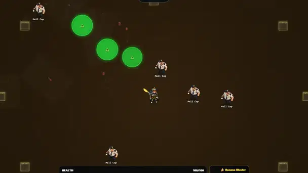 [上游游戏截图](<https://github.com/VaultSparkStudios/call-of-doodie/blob/HEAD/public/visual-assets/play-console-gameplay.webp>) | [VaultSparkStudios/call-of-doodie](<https://github.com/VaultSparkStudios/call-of-doodie>) | 常见根目录许可文件未找到 | [README 提及](<https://github.com/VaultSparkStudios/call-of-doodie/blob/HEAD/README.md#L22>) | — | 未列入口 |
| 956 | [ ] | [Call of Naija](<https://github.com/gamingnews5/awesome-opus-5.5-games/blob/9a29b570e56bd19f15a3cd6bbac0b8c682f2c48c/games/call-of-naija/readme.md>) | 待补截图 | [bigbadbillion/game](<https://github.com/bigbadbillion/game>) | 常见根目录许可文件未找到 | 待核 | — | 未列入口 |
| 957 | [ ] | [Call of Slop](<https://github.com/gamingnews5/awesome-opus-5.5-games/blob/9a29b570e56bd19f15a3cd6bbac0b8c682f2c48c/games/call-of-slop/readme.md>) | 待补截图 | [TwitchTheSniper/CallOfSlop](<https://github.com/TwitchTheSniper/CallOfSlop>) | 常见根目录许可文件未找到 | 待核 | — | 未列入口 |
| 958 | [ ] | [Calvin Boo Boo Ba Boo's Trip Home](<https://github.com/gamingnews5/awesome-opus-5.5-games/blob/9a29b570e56bd19f15a3cd6bbac0b8c682f2c48c/games/calvin-boo-boo-ba-boo-s-trip-home/readme.md>) | 待补截图 | [AsaGames/calvin](<https://github.com/AsaGames/calvin>) | 常见根目录许可文件未找到 | 待核 | — | [可达 · 含游戏画布／引擎的网页](<https://asagames.github.io/calvin/>) |
| 959 | [ ] | [Camera Games](<https://github.com/gamingnews5/awesome-opus-5.5-games/blob/9a29b570e56bd19f15a3cd6bbac0b8c682f2c48c/games/camera-games/readme.md>) | 待补截图 | [calum/camera-games](<https://github.com/calum/camera-games>) | 常见根目录许可文件未找到 | 待核 | — | [可达 · 含游戏画布／引擎的网页](<https://calum.github.io/camera-games/>) |
| 960 | [ ] | [Campus Crusher](<https://github.com/gamingnews5/awesome-opus-5.5-games/blob/9a29b570e56bd19f15a3cd6bbac0b8c682f2c48c/games/campus-crusher/readme.md>) | 待补截图 | [Tanmay182003/campus-crusher](<https://github.com/Tanmay182003/campus-crusher>) | 常见根目录许可文件未找到 | 待核 | [6.0（原图失效）](<https://github.com/Tanmay182003/campus-crusher/blob/main/shots/adams-state-u.webp>) | [可达 · 合集所列网页](<https://campuscrusher.com>) |
| 961 | [ ] | [Candy Wall](<https://github.com/gamingnews5/awesome-opus-5.5-games/blob/9a29b570e56bd19f15a3cd6bbac0b8c682f2c48c/games/candy-wall/readme.md>) | 待补截图 | [etwilliams/candy-wall](<https://github.com/etwilliams/candy-wall>) | 常见根目录许可文件未找到 | 待核 | [5.8（原图失效）](<https://github.com/etwilliams/candy-wall/blob/main/docs/gameplay.png>) | [入口已失效 · 合集所列网页](<https://etwilliams.github.io/candy-wall/>) |
| 962 | [ ] | [CANNONBALL](<https://github.com/gamingnews5/awesome-opus-5.5-games/blob/9a29b570e56bd19f15a3cd6bbac0b8c682f2c48c/games/cannonball/readme.md>) | 待补截图 | [Spencer0/Cannonballs](<https://github.com/Spencer0/Cannonballs>) | 常见根目录许可文件未找到 | 待核 | — | [可达 · 含游戏画布／引擎的网页](<https://spencer0.github.io/Cannonballs/>) |
| 963 | [ ] | [Canyon Run](<https://github.com/gamingnews5/awesome-opus-5.5-games/blob/9a29b570e56bd19f15a3cd6bbac0b8c682f2c48c/games/canyon-run/readme.md>) | 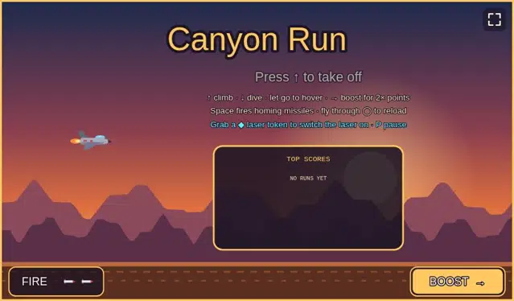 [试玩首页实截](<https://arbabkhan03.github.io/Canyon-run/>) | [arbabkhan03/Canyon-run](<https://github.com/arbabkhan03/Canyon-run>) | 常见根目录许可文件未找到 | 待核 | — | [可达 · 含游戏画布／引擎的网页](<https://arbabkhan03.github.io/Canyon-run/>) |
| 964 | [ ] | [Car Game at Sunset](<https://github.com/gamingnews5/awesome-opus-5.5-games/blob/9a29b570e56bd19f15a3cd6bbac0b8c682f2c48c/games/car-game-at-sunset/readme.md>) | 待补截图 | [taarichandaria/car-game-fable-5-test](<https://github.com/taarichandaria/car-game-fable-5-test>) | 常见根目录许可文件未找到 | 待核 | — | 未列入口 |
| 965 | [ ] | [Car Racer](<https://github.com/gamingnews5/awesome-opus-5.5-games/blob/9a29b570e56bd19f15a3cd6bbac0b8c682f2c48c/games/car-racer/readme.md>) | 待补截图 | [hokita/mouse2](<https://github.com/hokita/mouse2>) | 常见根目录许可文件未找到 | 待核 | — | [多游戏仓库入口 · 可达 · 合集所列网页](<https://mouse2-0357d0.web.app/>) |
| 966 | [ ] | [Card Game](<https://github.com/gamingnews5/awesome-opus-5.5-games/blob/9a29b570e56bd19f15a3cd6bbac0b8c682f2c48c/games/card-game/readme.md>) | 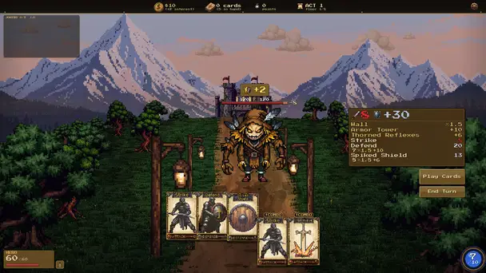 [上游商店截图](<https://github.com/Corttezz/card-game-love2d/blob/HEAD/steam/store/screenshots/en/03_road_battle.png>) | [Corttezz/card-game-love2d](<https://github.com/Corttezz/card-game-love2d>) | 常见根目录许可文件未找到 | [源码有输入读取](<https://github.com/Corttezz/card-game-love2d/blob/main/main.lua#L1975>) | — | 未列入口 |
| 967 | [ ] | [Card Vault](<https://github.com/gamingnews5/awesome-opus-5.5-games/blob/9a29b570e56bd19f15a3cd6bbac0b8c682f2c48c/games/card-vault/readme.md>) | 待补截图 | [hawnji/cardchamp](<https://github.com/hawnji/cardchamp>) | 常见根目录许可文件未找到 | 待核 | — | 未列入口 |
| 968 | [ ] | [Cargo Crane](<https://github.com/gamingnews5/awesome-opus-5.5-games/blob/9a29b570e56bd19f15a3cd6bbac0b8c682f2c48c/games/cargo-crane/readme.md>) | 待补截图 | [shironagasu-ai/claude-fable5-3D-games](<https://github.com/shironagasu-ai/claude-fable5-3D-games>) | 常见根目录许可文件未找到 | 待核 | — | [可达 · 合集所列网页](<https://shironagasu-ai.github.io/claude-fable5-3D-games/games/cargo-crane/>) |
| 969 | [ ] | [Cargo Truck Driver](<https://github.com/gamingnews5/awesome-opus-5.5-games/blob/9a29b570e56bd19f15a3cd6bbac0b8c682f2c48c/games/cargo-truck-driver/readme.md>) | 待补截图 | [semrush733-ux/cargo-truck-driver](<https://github.com/semrush733-ux/cargo-truck-driver>) | 常见根目录许可文件未找到 | [README 提及](<https://github.com/semrush733-ux/cargo-truck-driver/blob/HEAD/README.md#L25>) | — | 未列入口 |
| 970 | [ ] | [Carnival Cannon Crush](<https://github.com/gamingnews5/awesome-opus-5.5-games/blob/9a29b570e56bd19f15a3cd6bbac0b8c682f2c48c/games/carnival-cannon-crush/readme.md>) | 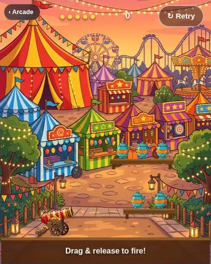 [对应子游戏玩法实截](<https://github.com/pawanp3/renderwolf-fable5-chart-toppers/blob/HEAD/games/smash-fest/index.html>) | [pawanp3/renderwolf-fable5-chart-toppers](<https://github.com/pawanp3/renderwolf-fable5-chart-toppers>) | 常见根目录许可文件未找到 | 待核 | — | [多游戏仓库入口 · 可达 · 合集所列网页](<https://pawanp3.github.io/renderwolf-fable5-chart-toppers/>) |
| 971 | [ ] | [Carnival Dozer](<https://github.com/gamingnews5/awesome-opus-5.5-games/blob/9a29b570e56bd19f15a3cd6bbac0b8c682f2c48c/games/carnival-dozer/readme.md>) |  [合集截图](<https://github.com/petegordon/discord-activity-coinpusher/blob/main/public/screenshots/desktop.png>) | [petegordon/discord-activity-coinpusher](<https://github.com/petegordon/discord-activity-coinpusher>) | 常见根目录许可文件未找到 | 待核 | [5.8](<https://github.com/petegordon/discord-activity-coinpusher/blob/main/public/screenshots/desktop.png>) | [可达 · 合集所列网页](<https://coins.housetandem.com>) |
| 972 | [ ] | [Caro / Gomoku](<https://github.com/gamingnews5/awesome-opus-5.5-games/blob/9a29b570e56bd19f15a3cd6bbac0b8c682f2c48c/games/caro-gomoku/readme.md>) | 待补截图 | [nhannht/caro-game](<https://github.com/nhannht/caro-game>) | 常见根目录许可文件未找到 | 待核 | — | 未列入口 |
| 973 | [ ] | [Carrazy](<https://github.com/gamingnews5/awesome-opus-5.5-games/blob/9a29b570e56bd19f15a3cd6bbac0b8c682f2c48c/games/carrazy/readme.md>) | 待补截图 | [GrantBuonviri/Carrazy](<https://github.com/GrantBuonviri/Carrazy>) | 常见根目录许可文件未找到 | 待核 | — | [可达 · 含游戏画布／引擎的网页](<https://grantbuonviri.github.io/Carrazy/>) |
| 974 | [ ] | [Carreras 3D](<https://github.com/gamingnews5/awesome-opus-5.5-games/blob/9a29b570e56bd19f15a3cd6bbac0b8c682f2c48c/games/carreras-3d/readme.md>) | 待补截图 | [kokellara12-maker/apps-k4m9q2](<https://github.com/kokellara12-maker/apps-k4m9q2>) | 常见根目录许可文件未找到 | 待核 | — | [可达 · 含游戏画布／引擎的网页](<https://kokellara12-maker.github.io/apps-k4m9q2/carreras3d.html>) |
| 975 | [ ] | [Carrying Capacity](<https://github.com/gamingnews5/awesome-opus-5.5-games/blob/9a29b570e56bd19f15a3cd6bbac0b8c682f2c48c/games/carrying-capacity/readme.md>) |  [合集截图](<https://github.com/irvincisneros-png/carrying-capacity/blob/main/docs/concept/act1-boom.png>) | [irvincisneros-png/carrying-capacity](<https://github.com/irvincisneros-png/carrying-capacity>) | 常见根目录许可文件未找到 | 待核 | [6.0](<https://github.com/irvincisneros-png/carrying-capacity/blob/main/docs/concept/act1-boom.png>) | 未列入口 |
| 976 | [ ] | [Carter PC Parkour](<https://github.com/gamingnews5/awesome-opus-5.5-games/blob/9a29b570e56bd19f15a3cd6bbac0b8c682f2c48c/games/carter-pc-parkour/readme.md>) | 待补截图 | [ImmortalBobik/carter-pc-parkour](<https://github.com/ImmortalBobik/carter-pc-parkour>) | 常见根目录许可文件未找到 | 待核 | — | [可达 · 含游戏画布／引擎的网页](<https://immortalbobik.github.io/carter-pc-parkour/>) |
| 977 | [ ] | [Cartographer's Company](<https://github.com/gamingnews5/awesome-opus-5.5-games/blob/9a29b570e56bd19f15a3cd6bbac0b8c682f2c48c/games/cartographer-s-company/readme.md>) | 待补截图 | [IckyAppBuilds/cartographers-company-play](<https://github.com/IckyAppBuilds/cartographers-company-play>) | 常见根目录许可文件未找到 | 待核 | — | [可达 · 合集所列网页](<https://ickyappbuilds.github.io/cartographers-company-play/>) |
| 978 | [ ] | [Cartopia (Roblox)](<https://github.com/gamingnews5/awesome-opus-5.5-games/blob/9a29b570e56bd19f15a3cd6bbac0b8c682f2c48c/games/cartopia-roblox/readme.md>) | 待补截图 | [KeganBerg/cartopia-roblox](<https://github.com/KeganBerg/cartopia-roblox>) | 常见根目录许可文件未找到 | 待核 | — | [可达 · 合集所列网页](<https://typescripttolua.github.io/>) |
| 979 | [ ] | [CARVE LINE](<https://github.com/gamingnews5/awesome-opus-5.5-games/blob/9a29b570e56bd19f15a3cd6bbac0b8c682f2c48c/games/carve-line/readme.md>) | 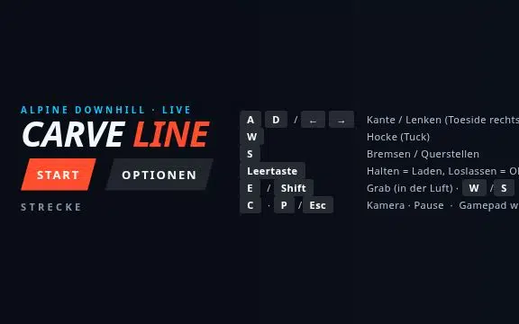 [源码运行首页](<https://github.com/TetrisSQC/carveline/blob/efe3bf22020986de38ad29e987a3b065e331d77e/index.html>) | [TetrisSQC/carveline](<https://github.com/TetrisSQC/carveline>) | 常见根目录许可文件未找到 | [README 提及、源码有输入读取](<https://github.com/TetrisSQC/carveline/blob/efe3bf22020986de38ad29e987a3b065e331d77e/index.html#L1434>) | — | 未列入口 |
| 980 | [ ] | [Cascade](<https://github.com/gamingnews5/awesome-opus-5.5-games/blob/9a29b570e56bd19f15a3cd6bbac0b8c682f2c48c/games/cascade/readme.md>) | 待补截图 | [mcarthey/CascadeGame](<https://github.com/mcarthey/CascadeGame>) | 常见根目录许可文件未找到 | 待核 | — | 未列入口 |
| 981 | [ ] | [Cash Out](<https://github.com/gamingnews5/awesome-opus-5.5-games/blob/9a29b570e56bd19f15a3cd6bbac0b8c682f2c48c/games/cash-out/readme.md>) | 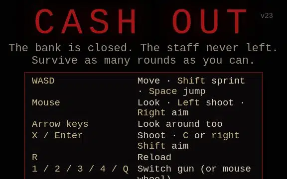 [源码运行首页](<https://github.com/mauricestuder/Cash-out/blob/main/index.html>) | [mauricestuder/Cash-out](<https://github.com/mauricestuder/Cash-out>) | 常见根目录许可文件未找到 | 待核 | — | [README · 入口已失效 · 上游 README 所列网页](<https://mauricestuder.github.io/Cash-out/>) |
| 982 | [ ] | [Cash Quest](<https://github.com/gamingnews5/awesome-opus-5.5-games/blob/9a29b570e56bd19f15a3cd6bbac0b8c682f2c48c/games/cash-quest/readme.md>) |  [同款源码启动画面实截](<https://github.com/forrestgump2000/cash-quest/blob/HEAD/index.html>) | [forrestgump2000/cash-quest](<https://github.com/forrestgump2000/cash-quest>) | 常见根目录许可文件未找到 | 待核 | — | [可达 · 含游戏画布／引擎的网页](<https://cash-quest.vercel.app>) |
| 983 | [ ] | [Cash to Freedom (Dòng Tiền 3D)](<https://github.com/gamingnews5/awesome-opus-5.5-games/blob/9a29b570e56bd19f15a3cd6bbac0b8c682f2c48c/games/cash-to-freedom-dong-tien-3d/readme.md>) | 待补截图 | [Napigostore/Cash-3D](<https://github.com/Napigostore/Cash-3D>) | 常见根目录许可文件未找到 | 待核 | — | 未列入口 |
| 984 | [ ] | [Cast](<https://github.com/gamingnews5/awesome-opus-5.5-games/blob/9a29b570e56bd19f15a3cd6bbac0b8c682f2c48c/games/cast/readme.md>) | 待补截图 | [afaucher/cast](<https://github.com/afaucher/cast>) | 常见根目录许可文件未找到 | 待核 | — | 未列入口 |
| 985 | [ ] | [Castle Defense (Slotsforsvar)](<https://github.com/gamingnews5/awesome-opus-5.5-games/blob/9a29b570e56bd19f15a3cd6bbac0b8c682f2c48c/games/castle-defense-slotsforsvar/readme.md>) | 待补截图 | [Lykhan28/slotsforsvar](<https://github.com/Lykhan28/slotsforsvar>) | 常见根目录许可文件未找到 | 待核 | — | 未列入口 |
| 986 | [ ] | [Castle Wars](<https://github.com/gamingnews5/awesome-opus-5.5-games/blob/9a29b570e56bd19f15a3cd6bbac0b8c682f2c48c/games/castle-wars/readme.md>) | 待补截图 | [darkstalkermap-prog/Experimental-Game](<https://github.com/darkstalkermap-prog/Experimental-Game>) | 常见根目录许可文件未找到 | 待核 | — | [可达 · 合集所列网页](<https://darkstalkermap-prog.github.io/Experimental-Game/>) |
| 987 | [ ] | [Cat Dog Queue](<https://github.com/gamingnews5/awesome-opus-5.5-games/blob/9a29b570e56bd19f15a3cd6bbac0b8c682f2c48c/games/cat-dog-queue/readme.md>) | 待补截图 | [Jinchaosss/cat-dog-queue](<https://github.com/Jinchaosss/cat-dog-queue>) | 常见根目录许可文件未找到 | 待核 | — | 未列入口 |
| 988 | [ ] | [Catan](<https://github.com/gamingnews5/awesome-opus-5.5-games/blob/9a29b570e56bd19f15a3cd6bbac0b8c682f2c48c/games/catan/readme.md>) | 待补截图 | [joelraj18/catan](<https://github.com/joelraj18/catan>) | 常见根目录许可文件未找到 | 待核 | — | 未列入口 |
| 989 | [ ] | [Catan CLI](<https://github.com/gamingnews5/awesome-opus-5.5-games/blob/9a29b570e56bd19f15a3cd6bbac0b8c682f2c48c/games/catan-cli/readme.md>) | 待补截图 | [vayuda/boardgame-CLI](<https://github.com/vayuda/boardgame-CLI>) | 常见根目录许可文件未找到 | 待核 | — | 未列入口 |
| 990 | [ ] | [Catan Online](<https://github.com/gamingnews5/awesome-opus-5.5-games/blob/9a29b570e56bd19f15a3cd6bbac0b8c682f2c48c/games/catan-online/readme.md>) | 待补截图 | [VarunS121/catan-online](<https://github.com/VarunS121/catan-online>) | 常见根目录许可文件未找到 | 待核 | — | 未列入口 |
| 991 | [ ] | [Catan Web (moddable)](<https://github.com/gamingnews5/awesome-opus-5.5-games/blob/9a29b570e56bd19f15a3cd6bbac0b8c682f2c48c/games/catan-web-moddable/readme.md>) | 待补截图 | [HeyItsDavis/catan-web](<https://github.com/HeyItsDavis/catan-web>) | 常见根目录许可文件未找到 | 待核 | — | [可达 · 合集所列网页](<https://heyitsdavis.github.io/catan-web/>) |
| 992 | [ ] | [Catch Angel](<https://github.com/gamingnews5/awesome-opus-5.5-games/blob/9a29b570e56bd19f15a3cd6bbac0b8c682f2c48c/games/catch-angel/readme.md>) | 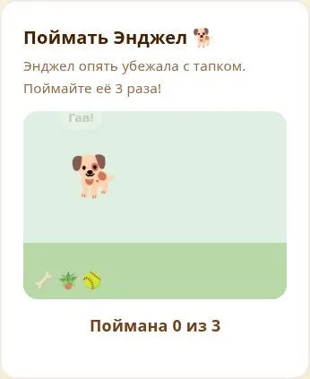 [对应子游戏玩法实截](<https://github.com/vitalirasin-web/valeriabirthday/blob/HEAD/index.html>) | [vitalirasin-web/valeriabirthday](<https://github.com/vitalirasin-web/valeriabirthday>) | 常见根目录许可文件未找到 | 待核 | — | [多游戏仓库入口 · 可达 · 合集所列网页](<https://vitalirasin-web.github.io/valeriabirthday/>) |
| 993 | [ ] | [Catch the Fly](<https://github.com/gamingnews5/awesome-opus-5.5-games/blob/9a29b570e56bd19f15a3cd6bbac0b8c682f2c48c/games/catch-the-fly/readme.md>) | 待补截图 | [emirhanemre/catch-the-fly](<https://github.com/emirhanemre/catch-the-fly>) | 常见根目录许可文件未找到 | 待核 | — | 未列入口 |
| 994 | [ ] | [Catch The Larper](<https://github.com/gamingnews5/awesome-opus-5.5-games/blob/9a29b570e56bd19f15a3cd6bbac0b8c682f2c48c/games/catch-the-larper/readme.md>) | 待补截图 | [ShinjiK1/Social-Deduction-Game-NLP-Project](<https://github.com/ShinjiK1/Social-Deduction-Game-NLP-Project>) | 常见根目录许可文件未找到 | 待核 | — | [可达 · 合集所列网页](<https://catchthelarper.com>) |
| 995 | [ ] | [Caughtgames](<https://github.com/gamingnews5/awesome-opus-5.5-games/blob/9a29b570e56bd19f15a3cd6bbac0b8c682f2c48c/games/caughtgames/readme.md>) |  [源码运行画面](<https://github.com/48dgpkws68-spec/caughtgames/blob/main/peek.html>) | [48dgpkws68-spec/caughtgames](<https://github.com/48dgpkws68-spec/caughtgames>) | 常见根目录许可文件未找到 | 待核 | — | 未列入口 |
| 996 | [ ] | [Cave Craft](<https://github.com/gamingnews5/awesome-opus-5.5-games/blob/9a29b570e56bd19f15a3cd6bbac0b8c682f2c48c/games/cave-craft/readme.md>) | 待补截图 | [Jakeclur/Claudecraft](<https://github.com/Jakeclur/Claudecraft>) | 常见根目录许可文件未找到 | 待核 | — | 未列入口 |
| 997 | [ ] | [Cavern of Code](<https://github.com/gamingnews5/awesome-opus-5.5-games/blob/9a29b570e56bd19f15a3cd6bbac0b8c682f2c48c/games/cavern-of-code/readme.md>) | 待补截图 | [bipinjr/Treasure-Hunt](<https://github.com/bipinjr/Treasure-Hunt>) | 常见根目录许可文件未找到 | 待核 | — | [可达 · 含游戏画布／引擎的网页](<https://treasure-hunt-seven-sigma.vercel.app>) |
| 998 | [ ] | [Cellblock Nine](<https://github.com/gamingnews5/awesome-opus-5.5-games/blob/9a29b570e56bd19f15a3cd6bbac0b8c682f2c48c/games/cellblock-nine/readme.md>) | 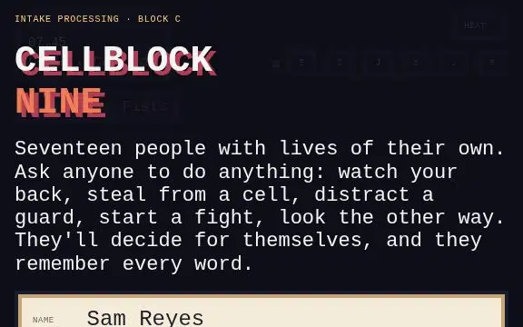 [源码运行首页](<https://github.com/gusb2320-lab/town-game-/blob/main/public/index.html>) | [gusb2320-lab/town-game-](<https://github.com/gusb2320-lab/town-game->) | 常见根目录许可文件未找到 | 待核 | — | 未列入口 |
| 999 | [ ] | [Celtic Cross](<https://github.com/gamingnews5/awesome-opus-5.5-games/blob/9a29b570e56bd19f15a3cd6bbac0b8c682f2c48c/games/celtic-cross/readme.md>) | 待补截图 | [richiewharris/CelticCross](<https://github.com/richiewharris/CelticCross>) | 常见根目录许可文件未找到 | 待核 | — | 未列入口 |
| 1000 | [ ] | [Ceryllian Duel: test build](<https://github.com/gamingnews5/awesome-opus-5.5-games/blob/9a29b570e56bd19f15a3cd6bbac0b8c682f2c48c/games/ceryllian-duel-test-build/readme.md>) | 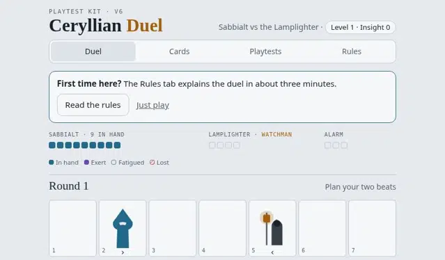 [试玩画面](<https://shacaska.github.io/Ceryllian_test/>) | [shacaska/Ceryllian\_test](<https://github.com/shacaska/Ceryllian_test>) | 常见根目录许可文件未找到 | 待核 | — | [可达 · 合集所列网页](<https://shacaska.github.io/Ceryllian_test/>) |
| 1001 | [ ] | [CGwF - Card Games with Friends](<https://github.com/gamingnews5/awesome-opus-5.5-games/blob/9a29b570e56bd19f15a3cd6bbac0b8c682f2c48c/games/cgwf-card-games-with-friends/readme.md>) | 待补截图 | [GNels-sys/cgwf](<https://github.com/GNels-sys/cgwf>) | 常见根目录许可文件未找到 | 待核 | — | 未列入口 |
| 1002 | [ ] | [Chacklate Chess](<https://github.com/gamingnews5/awesome-opus-5.5-games/blob/9a29b570e56bd19f15a3cd6bbac0b8c682f2c48c/games/chacklate-chess/readme.md>) | 待补截图 | [luvkesh/Chess](<https://github.com/luvkesh/Chess>) | [README 许可段声明保留权利、限制使用或尚未授权](<https://github.com/luvkesh/Chess/blob/HEAD/README.md>) | 待核 | — | 未列入口 |
| 1003 | [ ] | [Chaddow Wars](<https://github.com/gamingnews5/awesome-opus-5.5-games/blob/9a29b570e56bd19f15a3cd6bbac0b8c682f2c48c/games/chaddow-wars/readme.md>) | 待补截图 | [stefansl/chaddowars](<https://github.com/stefansl/chaddowars>) | 常见根目录许可文件未找到 | 待核 | — | [可达 · 含游戏画布／引擎的网页](<https://stefansl.github.io/chaddowars/>) |
| 1004 | [ ] | [Chaekgil Explorers](<https://github.com/gamingnews5/awesome-opus-5.5-games/blob/9a29b570e56bd19f15a3cd6bbac0b8c682f2c48c/games/chaekgil-explorers/readme.md>) | 待补截图 | [swulis00-crypto/library-game](<https://github.com/swulis00-crypto/library-game>) | 常见根目录许可文件未找到 | 待核 | — | [可达 · 合集所列网页](<https://swulis00-crypto.github.io/library-game/>) |
| 1005 | [ ] | [Chai Tapri Tycoon](<https://github.com/gamingnews5/awesome-opus-5.5-games/blob/9a29b570e56bd19f15a3cd6bbac0b8c682f2c48c/games/chai-tapri-tycoon/readme.md>) | 待补截图 | [samaybachao/chaitapri](<https://github.com/samaybachao/chaitapri>) | 常见根目录许可文件未找到 | 待核 | — | 未列入口 |
| 1006 | [ ] | [Chain of Command](<https://github.com/gamingnews5/awesome-opus-5.5-games/blob/9a29b570e56bd19f15a3cd6bbac0b8c682f2c48c/games/chain-of-command/readme.md>) | 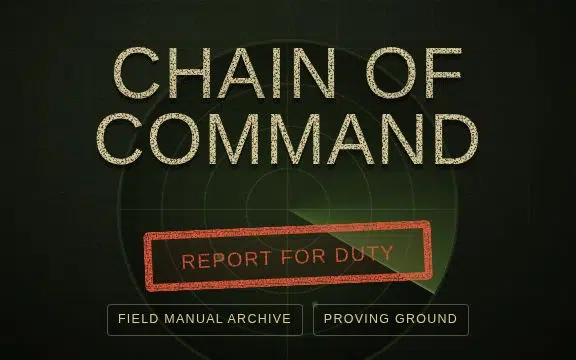 [同款源码启动画面实截](<https://github.com/shainyoreng/chain-of-command/blob/HEAD/web/index.html>) | [shainyoreng/chain-of-command](<https://github.com/shainyoreng/chain-of-command>) | 常见根目录许可文件未找到 | 待核 | — | [可达 · 合集所列网页](<https://shainyoreng.github.io/chain-of-command/>) |
| 1007 | [ ] | [Chainmates](<https://github.com/gamingnews5/awesome-opus-5.5-games/blob/9a29b570e56bd19f15a3cd6bbac0b8c682f2c48c/games/chainmates/readme.md>) | 待补截图 | [cev64/chainmates](<https://github.com/cev64/chainmates>) | 常见根目录许可文件未找到 | 待核 | — | [可达 · 合集所列网页](<https://cev64.github.io/chainmates/>) |
| 1008 | [ ] | [Chair Run × Mutual Mimu](<https://github.com/gamingnews5/awesome-opus-5.5-games/blob/9a29b570e56bd19f15a3cd6bbac0b8c682f2c48c/games/chair-run-mutual-mimu/readme.md>) | 待补截图 | [bertbaccaratt/mimu-mutual-game](<https://github.com/bertbaccaratt/mimu-mutual-game>) | 常见根目录许可文件未找到 | 待核 | — | 未列入口 |
| 1009 | [ ] | [Chalice](<https://github.com/gamingnews5/awesome-opus-5.5-games/blob/9a29b570e56bd19f15a3cd6bbac0b8c682f2c48c/games/chalice/readme.md>) | 待补截图 | [ceddikers/Chalice](<https://github.com/ceddikers/Chalice>) | 常见根目录许可文件未找到 | 待核 | — | 未列入口 |
| 1010 | [ ] | [Chalk Runner](<https://github.com/gamingnews5/awesome-opus-5.5-games/blob/9a29b570e56bd19f15a3cd6bbac0b8c682f2c48c/games/chalk-runner/readme.md>) | 待补截图 | [saedarm/ChalkRunner](<https://github.com/saedarm/ChalkRunner>) | 常见根目录许可文件未找到 | 待核 | — | 未列入口 |
| 1011 | [ ] | [Chameleon](<https://github.com/gamingnews5/awesome-opus-5.5-games/blob/9a29b570e56bd19f15a3cd6bbac0b8c682f2c48c/games/chameleon-destrukter-chameleon-app/readme.md>) | 待补截图 | [destrukter/Chameleon\_app](<https://github.com/destrukter/Chameleon_app>) | 常见根目录许可文件未找到 | 待核 | — | 未列入口 |
| 1012 | [ ] | [CHANNEL // SURF](<https://github.com/gamingnews5/awesome-opus-5.5-games/blob/9a29b570e56bd19f15a3cd6bbac0b8c682f2c48c/games/channel-surf/readme.md>) | 待补截图 | [steling1/Channel-Surfer](<https://github.com/steling1/Channel-Surfer>) | 常见根目录许可文件未找到 | 待核 | — | 未列入口 |
| 1013 | [ ] | [Chaos Theory](<https://github.com/gamingnews5/awesome-opus-5.5-games/blob/9a29b570e56bd19f15a3cd6bbac0b8c682f2c48c/games/chaos-theory/readme.md>) | 待补截图 | [riddhisingla2028-cpu/chaos-theory](<https://github.com/riddhisingla2028-cpu/chaos-theory>) | 常见根目录许可文件未找到 | 待核 | — | [可达 · 合集所列网页](<https://chaos-theory-eight.vercel.app>) |
| 1014 | [ ] | [CHAOS.exe](<https://github.com/gamingnews5/awesome-opus-5.5-games/blob/9a29b570e56bd19f15a3cd6bbac0b8c682f2c48c/games/chaos-exe/readme.md>) | 待补截图 | [DocDamage/chris-game](<https://github.com/DocDamage/chris-game>) | 常见根目录许可文件未找到 | [README 提及](<https://github.com/DocDamage/chris-game/blob/HEAD/README.md#L17>) | — | 未列入口 |
| 1015 | [ ] | [Chapter &amp; Verse](<https://github.com/gamingnews5/awesome-opus-5.5-games/blob/9a29b570e56bd19f15a3cd6bbac0b8c682f2c48c/games/chapter-verse/readme.md>) | 待补截图 | [tjelton/Bible-Learning](<https://github.com/tjelton/Bible-Learning>) | 常见根目录许可文件未找到 | 待核 | — | [可达 · 合集所列网页](<https://tjelton.github.io/Bible-Learning/>) |
| 1016 | [ ] | [Charades](<https://github.com/gamingnews5/awesome-opus-5.5-games/blob/9a29b570e56bd19f15a3cd6bbac0b8c682f2c48c/games/charades/readme.md>) | 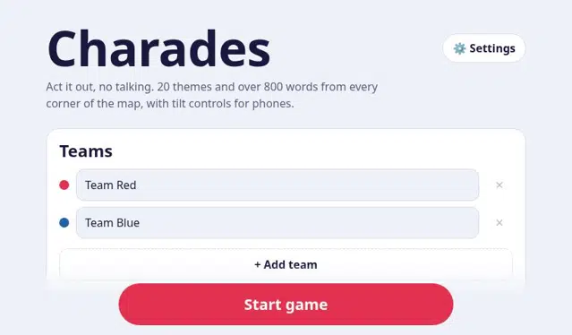 [试玩首页实截](<https://pietro-sillano.github.io/Charades/>) | [pietro-sillano/Charades](<https://github.com/pietro-sillano/Charades>) | 常见根目录许可文件未找到 | 待核 | — | [可达 · 合集所列网页](<https://pietro-sillano.github.io/Charades/>) |
| 1017 | [ ] | [Charmed Hold'em](<https://github.com/gamingnews5/awesome-opus-5.5-games/blob/9a29b570e56bd19f15a3cd6bbac0b8c682f2c48c/games/charmed-hold-em/readme.md>) | 待补截图 | [Oksem42/charmed-holdem](<https://github.com/Oksem42/charmed-holdem>) | 常见根目录许可文件未找到 | 待核 | — | [可达 · 合集所列网页](<https://oksem42.github.io/charmed-holdem/>) |
| 1018 | [ ] | [Checkers](<https://github.com/gamingnews5/awesome-opus-5.5-games/blob/9a29b570e56bd19f15a3cd6bbac0b8c682f2c48c/games/checkers/readme.md>) | 待补截图 | [JakeAve/airgap](<https://github.com/JakeAve/airgap>) | 常见根目录许可文件未找到 | 待核 | — | [多游戏仓库入口 · 可达 · 合集所列网页](<https://jakeave.github.io/airgap/>) |
| 1019 | [ ] | [Chemsha Bongo](<https://github.com/gamingnews5/awesome-opus-5.5-games/blob/9a29b570e56bd19f15a3cd6bbac0b8c682f2c48c/games/chemsha-bongo/readme.md>) |  [源码运行首页](<https://github.com/Jujulearning/ChemshaBongo-Tz/blob/main/app/index.html>) | [Jujulearning/ChemshaBongo-Tz](<https://github.com/Jujulearning/ChemshaBongo-Tz>) | 常见根目录许可文件未找到 | 待核 | — | 未列入口 |
| 1020 | [ ] | [Chess](<https://github.com/gamingnews5/awesome-opus-5.5-games/blob/9a29b570e56bd19f15a3cd6bbac0b8c682f2c48c/games/chess/readme.md>) | 待补截图 | [JakeAve/airgap](<https://github.com/JakeAve/airgap>) | 常见根目录许可文件未找到 | 待核 | — | [多游戏仓库入口 · 可达 · 合集所列网页](<https://jakeave.github.io/airgap/>) |
| 1021 | [ ] | [Chess Battle](<https://github.com/gamingnews5/awesome-opus-5.5-games/blob/9a29b570e56bd19f15a3cd6bbac0b8c682f2c48c/games/chess-battle/readme.md>) | 待补截图 | [forestmack/chess-battle](<https://github.com/forestmack/chess-battle>) | 常见根目录许可文件未找到 | 待核 | — | [可达 · 合集所列网页](<https://forestmack.github.io/chess-battle/>) |
| 1022 | [ ] | [Chess Platform](<https://github.com/gamingnews5/awesome-opus-5.5-games/blob/9a29b570e56bd19f15a3cd6bbac0b8c682f2c48c/games/chess-platform/readme.md>) | 待补截图 | [jaymandaliya/chess-game](<https://github.com/jaymandaliya/chess-game>) | 常见根目录许可文件未找到 | 待核 | — | 未列入口 |
| 1023 | [ ] | [Chess Realms](<https://github.com/gamingnews5/awesome-opus-5.5-games/blob/9a29b570e56bd19f15a3cd6bbac0b8c682f2c48c/games/chess-realms/readme.md>) | 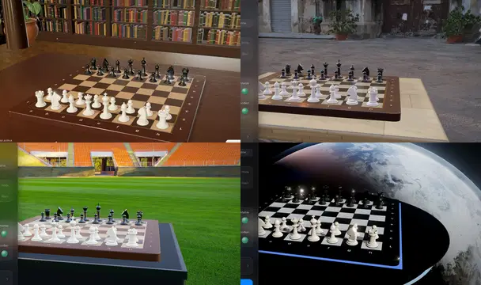 [合集截图](<https://github.com/kalpeshmahajan21/chess-realms/blob/main/docs/realistic_arenas.jpg>) | [kalpeshmahajan21/chess-realms](<https://github.com/kalpeshmahajan21/chess-realms>) | 常见根目录许可文件未找到 | [README 提及](<https://github.com/kalpeshmahajan21/chess-realms/blob/HEAD/README.md#L97>) | [6.4](<https://github.com/kalpeshmahajan21/chess-realms/blob/main/docs/realistic_arenas.jpg>) | [可达 · 合集所列网页](<https://chess-realms.vercel.app>) |
| 1024 | [ ] | [Chess with Character](<https://github.com/gamingnews5/awesome-opus-5.5-games/blob/9a29b570e56bd19f15a3cd6bbac0b8c682f2c48c/games/chess-with-character/readme.md>) | 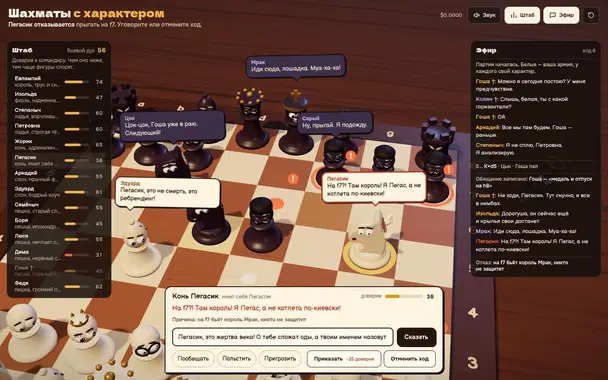 [合集截图](<https://github.com/swan4er/opus-100-projects/blob/main/101-chess-characters/preview.jpg>) | [swan4er/opus-100-projects](<https://github.com/swan4er/opus-100-projects>) | 常见根目录许可文件未找到 | 待核 | [7.5](<https://github.com/swan4er/opus-100-projects/blob/main/101-chess-characters/preview.jpg>) | [可达 · 含游戏画布／引擎的网页](<https://swan4er.github.io/opus-100-projects/101-chess-characters/>) |
| 1025 | [ ] | [Chess Yetu](<https://github.com/gamingnews5/awesome-opus-5.5-games/blob/9a29b570e56bd19f15a3cd6bbac0b8c682f2c48c/games/chess-yetu/readme.md>) | 待补截图 | [Akumu2022/chess\_yetu](<https://github.com/Akumu2022/chess_yetu>) | 常见根目录许可文件未找到 | 待核 | — | 未列入口 |
| 1026 | [ ] | [chess3dastra](<https://github.com/gamingnews5/awesome-opus-5.5-games/blob/9a29b570e56bd19f15a3cd6bbac0b8c682f2c48c/games/chess3dastra/readme.md>) | 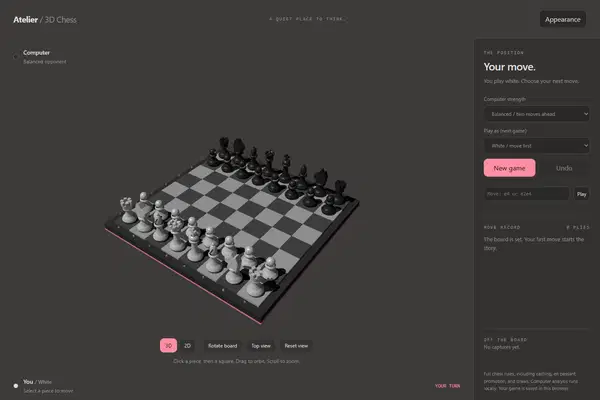 [合集截图](<https://github.com/yortch/chess3dastra/blob/main/docs/screenshots/3d-dark.png>) | [yortch/chess3dastra](<https://github.com/yortch/chess3dastra>) | 常见根目录许可文件未找到 | 待核 | [6.8](<https://github.com/yortch/chess3dastra/blob/main/docs/screenshots/3d-dark.png>) | [可达 · 合集所列网页](<https://yortch.github.io/chess3dastra/>) |
| 1027 | [ ] | [Chess: Machine Thoughts](<https://github.com/gamingnews5/awesome-opus-5.5-games/blob/9a29b570e56bd19f15a3cd6bbac0b8c682f2c48c/games/chess-machine-thoughts/readme.md>) | 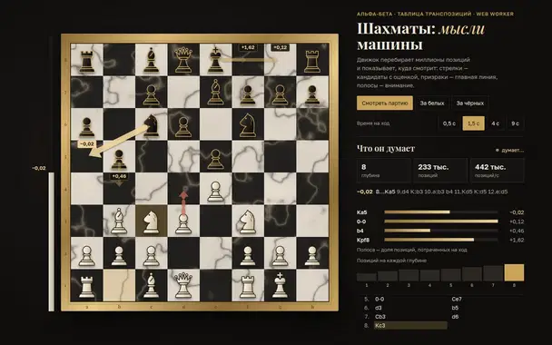 [合集截图](<https://github.com/swan4er/opus-100-projects/blob/main/002-chess-mind/preview.jpg>) | [swan4er/opus-100-projects](<https://github.com/swan4er/opus-100-projects>) | 常见根目录许可文件未找到 | 待核 | [7.0](<https://github.com/swan4er/opus-100-projects/blob/main/002-chess-mind/preview.jpg>) | [可达 · 合集所列网页](<https://swan4er.github.io/opus-100-projects/002-chess-mind/>) |
| 1028 | [ ] | [ChessDep](<https://github.com/gamingnews5/awesome-opus-5.5-games/blob/9a29b570e56bd19f15a3cd6bbac0b8c682f2c48c/games/chessdep/readme.md>) | 待补截图 | [Nick1t0s/ChessDep](<https://github.com/Nick1t0s/ChessDep>) | 常见根目录许可文件未找到 | 待核 | — | 未列入口 |
| 1029 | [ ] | [Chessy](<https://github.com/gamingnews5/awesome-opus-5.5-games/blob/9a29b570e56bd19f15a3cd6bbac0b8c682f2c48c/games/chessy/readme.md>) | 待补截图 | [garder500/chessy](<https://github.com/garder500/chessy>) | 常见根目录许可文件未找到 | 待核 | — | 未列入口 |
| 1030 | [ ] | [Chew &amp; Hide](<https://github.com/gamingnews5/awesome-opus-5.5-games/blob/9a29b570e56bd19f15a3cd6bbac0b8c682f2c48c/games/chew-hide/readme.md>) | 待补截图 | [tangbaoii/snack-before-the-bell](<https://github.com/tangbaoii/snack-before-the-bell>) | 常见根目录许可文件未找到 | 待核 | — | [可达 · 含游戏画布／引擎的网页](<https://tangbaoii.github.io/snack-before-the-bell/>) |
| 1031 | [ ] | [Chicago Streets](<https://github.com/gamingnews5/awesome-opus-5.5-games/blob/9a29b570e56bd19f15a3cd6bbac0b8c682f2c48c/games/chicago-streets/readme.md>) | 待补截图 | [mattchante/chicago-streets](<https://github.com/mattchante/chicago-streets>) | 常见根目录许可文件未找到 | 待核 | — | 未列入口 |
| 1032 | [ ] | [ChickenCoop](<https://github.com/gamingnews5/awesome-opus-5.5-games/blob/9a29b570e56bd19f15a3cd6bbac0b8c682f2c48c/games/chickencoop/readme.md>) | 待补截图 | [jnghadaki-ux/ChickenCoop](<https://github.com/jnghadaki-ux/ChickenCoop>) | 常见根目录许可文件未找到 | 待核 | — | 未列入口 |
| 1033 | [ ] | [Chihoot](<https://github.com/gamingnews5/awesome-opus-5.5-games/blob/9a29b570e56bd19f15a3cd6bbac0b8c682f2c48c/games/chihoot/readme.md>) | 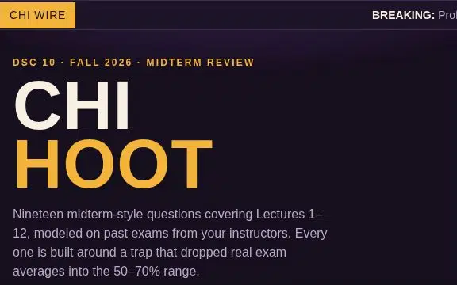 [源码运行首页](<https://github.com/rayray4059/chihoot/blob/main/index.html>) | [rayray4059/chihoot](<https://github.com/rayray4059/chihoot>) | 常见根目录许可文件未找到 | 待核 | — | 未列入口 |
| 1034 | [ ] | [Chiki Chase](<https://github.com/gamingnews5/awesome-opus-5.5-games/blob/9a29b570e56bd19f15a3cd6bbac0b8c682f2c48c/games/chiki-chase/readme.md>) | 待补截图 | [tzelynn/chikichase](<https://github.com/tzelynn/chikichase>) | 常见根目录许可文件未找到 | 待核 | — | 未列入口 |
| 1035 | [ ] | [Chipgrove](<https://github.com/gamingnews5/awesome-opus-5.5-games/blob/9a29b570e56bd19f15a3cd6bbac0b8c682f2c48c/games/chipgrove/readme.md>) | 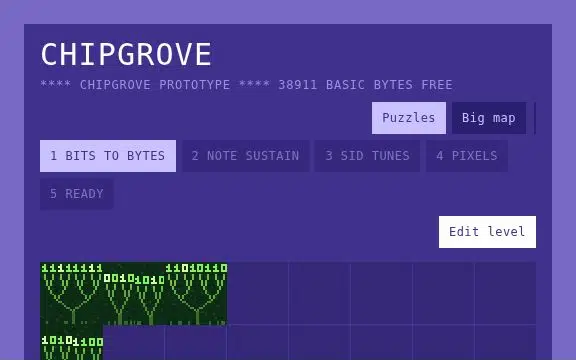 [源码运行画面](<https://github.com/Bencepapa/chipgrove/blob/main/prototype/index.html>) | [Bencepapa/chipgrove](<https://github.com/Bencepapa/chipgrove>) | 常见根目录许可文件未找到 | 待核 | — | 未列入口 |
| 1036 | [ ] | [Chog Contracts](<https://github.com/gamingnews5/awesome-opus-5.5-games/blob/9a29b570e56bd19f15a3cd6bbac0b8c682f2c48c/games/chog-contracts/readme.md>) | 待补截图 | [Ganrak/chog-contracts](<https://github.com/Ganrak/chog-contracts>) | 常见根目录许可文件未找到 | 待核 | — | [可达 · 合集所列网页](<https://chog-contracts.netlify.app>) |
| 1037 | [ ] | [CHOG//BREAK: Mutant Arena](<https://github.com/gamingnews5/awesome-opus-5.5-games/blob/9a29b570e56bd19f15a3cd6bbac0b8c682f2c48c/games/chog-break-mutant-arena/readme.md>) | 待补截图 | [Stella112/chog-break](<https://github.com/Stella112/chog-break>) | 常见根目录许可文件未找到 | 待核 | — | [可达 · 合集所列网页](<https://chog-break.vercel.app>) |
| 1038 | [ ] | [CHOP PRICER](<https://github.com/gamingnews5/awesome-opus-5.5-games/blob/9a29b570e56bd19f15a3cd6bbac0b8c682f2c48c/games/chop-pricer/readme.md>) | 待补截图 | [hurtz/choppricer](<https://github.com/hurtz/choppricer>) | 常见根目录许可文件未找到 | 待核 | — | 未列入口 |
| 1039 | [ ] | [Chop Squad](<https://github.com/gamingnews5/awesome-opus-5.5-games/blob/9a29b570e56bd19f15a3cd6bbac0b8c682f2c48c/games/chop-squad/readme.md>) | 待补截图 | [mirzamomin/chop-squad](<https://github.com/mirzamomin/chop-squad>) | 常见根目录许可文件未找到 | 待核 | — | 未列入口 |
| 1040 | [ ] | [Choplifter — Rescue Operations](<https://github.com/gamingnews5/awesome-opus-5.5-games/blob/9a29b570e56bd19f15a3cd6bbac0b8c682f2c48c/games/choplifter-rescue-operations/readme.md>) | 待补截图 | [danielpradilla/choplifter](<https://github.com/danielpradilla/choplifter>) | 常见根目录许可文件未找到 | 待核 | — | [可达 · 合集所列网页](<https://www.danielpradilla.info/projects/choplifter/choplifter-6-astra/>) |
| 1041 | [ ] | [Chridle](<https://github.com/gamingnews5/awesome-opus-5.5-games/blob/9a29b570e56bd19f15a3cd6bbac0b8c682f2c48c/games/chridle/readme.md>) | 待补截图 | [christiancrocetti01-sys/Chridle](<https://github.com/christiancrocetti01-sys/Chridle>) | 常见根目录许可文件未找到 | 待核 | — | [可达 · 合集所列网页](<https://christiancrocetti01-sys.github.io/Chridle/>) |
| 1042 | [ ] | [Chroma Lines](<https://github.com/gamingnews5/awesome-opus-5.5-games/blob/9a29b570e56bd19f15a3cd6bbac0b8c682f2c48c/games/chroma-lines/readme.md>) | 待补截图 | [mikeylambo/Chroma-Lines](<https://github.com/mikeylambo/Chroma-Lines>) | 常见根目录许可文件未找到 | 待核 | — | [可达 · 合集所列网页](<https://chroma-lines-chi.vercel.app>) |
| 1043 | [ ] | [chrome-dinosaur-game](<https://github.com/gamingnews5/awesome-opus-5.5-games/blob/9a29b570e56bd19f15a3cd6bbac0b8c682f2c48c/games/chrome-dinosaur-game/readme.md>) | 待补截图 | [abinavrameshs/chrome-dinosaur-game](<https://github.com/abinavrameshs/chrome-dinosaur-game>) | 常见根目录许可文件未找到 | [源码有输入读取](<https://github.com/abinavrameshs/chrome-dinosaur-game/blob/main/reference/chromium-dino/offline.ts#L1192>) | — | 未列入口 |
| 1044 | [ ] | [Chronologie](<https://github.com/gamingnews5/awesome-opus-5.5-games/blob/9a29b570e56bd19f15a3cd6bbac0b8c682f2c48c/games/chronologie/readme.md>) | 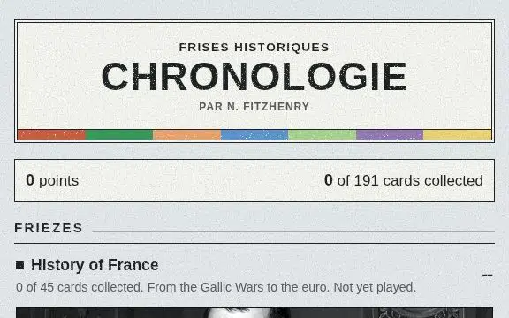 [源码运行画面](<https://github.com/NFitzhenry/-chronologie/blob/main/index.html>) | [NFitzhenry/-chronologie](<https://github.com/NFitzhenry/-chronologie>) | 常见根目录许可文件未找到 | 待核 | — | 未列入口 |
| 1045 | [ ] | [Chunky Cat Farms: play in your browser](<https://github.com/gamingnews5/awesome-opus-5.5-games/blob/9a29b570e56bd19f15a3cd6bbac0b8c682f2c48c/games/chunky-cat-farms-play-in-your-browser/readme.md>) | 待补截图 | [ChunkyCatLLC/chunkycatfarms-play](<https://github.com/ChunkyCatLLC/chunkycatfarms-play>) | 常见根目录许可文件未找到 | 待核 | — | [入口已失效 · 合集所列网页](<https://chunkycatllc.github.io/chunkycatfarms-play/>) |
| 1046 | [ ] | [Cinder Peak](<https://github.com/gamingnews5/awesome-opus-5.5-games/blob/9a29b570e56bd19f15a3cd6bbac0b8c682f2c48c/games/cinder-peak/readme.md>) | 待补截图 | [nickypeakin/fears-to-fathom](<https://github.com/nickypeakin/fears-to-fathom>) | 常见根目录许可文件未找到 | 待核 | — | [入口已失效 · 合集所列网页](<https://nickypeakin.github.io/fears-to-fathom/>) |
| 1047 | [ ] | [Cinder Yard](<https://github.com/gamingnews5/awesome-opus-5.5-games/blob/9a29b570e56bd19f15a3cd6bbac0b8c682f2c48c/games/cinder-yard/readme.md>) | 待补截图 | [octopus7/astracraft](<https://github.com/octopus7/astracraft>) | 常见根目录许可文件未找到 | 待核 | — | 未列入口 |
| 1048 | [ ] | [Circle Down](<https://github.com/gamingnews5/awesome-opus-5.5-games/blob/9a29b570e56bd19f15a3cd6bbac0b8c682f2c48c/games/circle-down/readme.md>) | 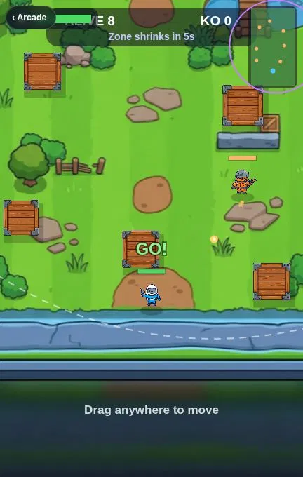 [对应子游戏玩法实截](<https://github.com/pawanp3/renderwolf-fable5-chart-toppers/blob/HEAD/games/fortnite/index.html>) | [pawanp3/renderwolf-fable5-chart-toppers](<https://github.com/pawanp3/renderwolf-fable5-chart-toppers>) | 常见根目录许可文件未找到 | 待核 | — | [多游戏仓库入口 · 可达 · 合集所列网页](<https://pawanp3.github.io/renderwolf-fable5-chart-toppers/>) |
| 1049 | [ ] | [Circle of Fifths Easter Egg](<https://github.com/gamingnews5/awesome-opus-5.5-games/blob/9a29b570e56bd19f15a3cd6bbac0b8c682f2c48c/games/circle-of-fifths-easter-egg/readme.md>) | 待补截图 | [Kyran-0412/Portfolio-test](<https://github.com/Kyran-0412/Portfolio-test>) | 常见根目录许可文件未找到 | 待核 | — | 未列入口 |
| 1050 | [ ] | [Circuit Racers](<https://github.com/gamingnews5/awesome-opus-5.5-games/blob/9a29b570e56bd19f15a3cd6bbac0b8c682f2c48c/games/circuit-racers/readme.md>) | 待补截图 | [zhixiang28/spacegame](<https://github.com/zhixiang28/spacegame>) | 常见根目录许可文件未找到 | 待核 | — | 未列入口 |
| 1051 | [ ] | [City Bombers](<https://github.com/gamingnews5/awesome-opus-5.5-games/blob/9a29b570e56bd19f15a3cd6bbac0b8c682f2c48c/games/city-bombers/readme.md>) | 待补截图 | [lasagneking/CityBombers](<https://github.com/lasagneking/CityBombers>) | 常见根目录许可文件未找到 | 待核 | — | 未列入口 |
| 1052 | [ ] | [CITY DRIVE](<https://github.com/gamingnews5/awesome-opus-5.5-games/blob/9a29b570e56bd19f15a3cd6bbac0b8c682f2c48c/games/city-drive/readme.md>) | 待补截图 | [isJongmin/DRIVE](<https://github.com/isJongmin/DRIVE>) | 常见根目录许可文件未找到 | 待核 | — | [入口已失效 · 合集所列网页](<https://isjongmin.github.io/DRIVE/>) |
| 1053 | [ ] | [City Grid](<https://github.com/gamingnews5/awesome-opus-5.5-games/blob/9a29b570e56bd19f15a3cd6bbac0b8c682f2c48c/games/city-grid/readme.md>) | 待补截图 | [hectorei19/city-grid](<https://github.com/hectorei19/city-grid>) | 常见根目录许可文件未找到 | 待核 | — | [入口已失效 · 合集所列网页](<https://hectorei19.github.io/country-grid/>) |
| 1054 | [ ] | [City Squirrel: East End](<https://github.com/gamingnews5/awesome-opus-5.5-games/blob/9a29b570e56bd19f15a3cd6bbac0b8c682f2c48c/games/city-squirrel-east-end/readme.md>) | 待补截图 | [etothesmith/city-squirrel](<https://github.com/etothesmith/city-squirrel>) | 常见根目录许可文件未找到 | [README 提及](<https://github.com/etothesmith/city-squirrel/blob/HEAD/README.md#L17>) | [6.4](<https://github.com/etothesmith/city-squirrel/blob/main/assets/og.jpg>) | [可达 · 合集所列网页](<https://etothesmith.github.io/city-squirrel/>) |
| 1055 | [ ] | [cityengine (Street Runner / Cycle Dash)](<https://github.com/gamingnews5/awesome-opus-5.5-games/blob/9a29b570e56bd19f15a3cd6bbac0b8c682f2c48c/games/cityengine-street-runner-cycle-dash/readme.md>) | 待补截图 | [dfeldman/cityengine](<https://github.com/dfeldman/cityengine>) | 常见根目录许可文件未找到 | 待核 | — | 未列入口 |
| 1056 | [ ] | [Civius Maximus](<https://github.com/gamingnews5/awesome-opus-5.5-games/blob/9a29b570e56bd19f15a3cd6bbac0b8c682f2c48c/games/civius-maximus/readme.md>) | 待补截图 | [PaytonKnopp/Civius-Maximus](<https://github.com/PaytonKnopp/Civius-Maximus>) | 常见根目录许可文件未找到 | 待核 | — | [可达 · 合集所列网页](<https://paytonknopp.github.io/Civius-Maximus/>) |
| 1057 | [ ] | [Classic Concentration](<https://github.com/gamingnews5/awesome-opus-5.5-games/blob/9a29b570e56bd19f15a3cd6bbac0b8c682f2c48c/games/classic-concentration/readme.md>) | 待补截图 | [luvcal1/classic-concentration](<https://github.com/luvcal1/classic-concentration>) | 常见根目录许可文件未找到 | 待核 | — | 未列入口 |
| 1058 | [ ] | [Classroom Games](<https://github.com/gamingnews5/awesome-opus-5.5-games/blob/9a29b570e56bd19f15a3cd6bbac0b8c682f2c48c/games/classroom-games/readme.md>) | 待补截图 | [encitysoftworks/classroom-games](<https://github.com/encitysoftworks/classroom-games>) | 常见根目录许可文件未找到 | 待核 | — | [可达 · 合集所列网页](<https://encitysoftworks.github.io/classroom-games/>) |
| 1059 | [ ] | [Classroom leadership games](<https://github.com/gamingnews5/awesome-opus-5.5-games/blob/9a29b570e56bd19f15a3cd6bbac0b8c682f2c48c/games/classroom-leadership-games/readme.md>) | 待补截图 | [ReMiKU/classroom-leadership-games](<https://github.com/ReMiKU/classroom-leadership-games>) | 常见根目录许可文件未找到 | 待核 | — | [可达 · 合集所列网页](<https://classroom-leadership-games.vercel.app/#home>) |
| 1060 | [ ] | [Claude Chess](<https://github.com/gamingnews5/awesome-opus-5.5-games/blob/9a29b570e56bd19f15a3cd6bbac0b8c682f2c48c/games/claude-chess/readme.md>) | 待补截图 | [mglass222/claude-chess-web](<https://github.com/mglass222/claude-chess-web>) | 常见根目录许可文件未找到 | 待核 | — | [可达 · 合集所列网页](<https://mglass222.github.io/claude-chess-web/>) |
| 1061 | [ ] | [Claude Game Arena](<https://github.com/gamingnews5/awesome-opus-5.5-games/blob/9a29b570e56bd19f15a3cd6bbac0b8c682f2c48c/games/claude-game-arena/readme.md>) | 待补截图 | [Furkiozknn/claude-game-arena](<https://github.com/Furkiozknn/claude-game-arena>) | 常见根目录许可文件未找到 | 待核 | [7.2（原图失效）](<https://github.com/Furkiozknn/claude-game-arena/blob/main/media/cay-ocagi.gif>) | [入口已失效 · 合集所列网页](<https://furkiozknn.github.io/claude-game-arena/>) |
| 1062 | [ ] | [Claude Games](<https://github.com/gamingnews5/awesome-opus-5.5-games/blob/9a29b570e56bd19f15a3cd6bbac0b8c682f2c48c/games/claude-games/readme.md>) | 待补截图 | [dayanivan681/Claude-games](<https://github.com/dayanivan681/Claude-games>) | 常见根目录许可文件未找到 | [源码有输入读取](<https://github.com/dayanivan681/Claude-games/blob/main/bomberman/index.html#L2850>) | — | 未列入口 |
| 1063 | [ ] | [Claude of Duty](<https://github.com/gamingnews5/awesome-opus-5.5-games/blob/9a29b570e56bd19f15a3cd6bbac0b8c682f2c48c/games/claude-of-duty/readme.md>) | 待补截图 | [brynary/claude-of-duty](<https://github.com/brynary/claude-of-duty>) | 常见根目录许可文件未找到 | 待核 | — | [可达 · 合集所列网页](<https://brynary.github.io/claude-of-duty/?bot=push&skill=average&seed=1337&run=90&quality=high&autostart=1&perf=1>) |
| 1064 | [ ] | [Claude Swarm](<https://github.com/gamingnews5/awesome-opus-5.5-games/blob/9a29b570e56bd19f15a3cd6bbac0b8c682f2c48c/games/claude-swarm/readme.md>) | 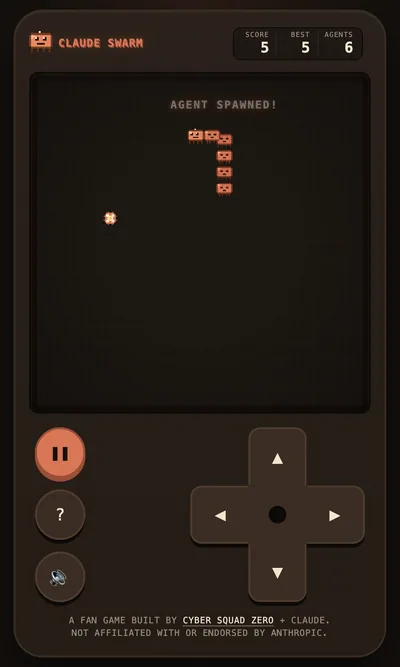 [合集截图](<https://github.com/meridian-knight/claude-swarm/blob/main/docs/screenshot-mobile.png>) | [meridian-knight/claude-swarm](<https://github.com/meridian-knight/claude-swarm>) | 常见根目录许可文件未找到 | 待核 | [4.0](<https://github.com/meridian-knight/claude-swarm/blob/main/docs/screenshot-mobile.png>) | [可达 · 含游戏画布／引擎的网页](<https://meridian-knight.github.io/claude-swarm/>) |
| 1065 | [ ] | [Claude Tyson](<https://github.com/gamingnews5/awesome-opus-5.5-games/blob/9a29b570e56bd19f15a3cd6bbac0b8c682f2c48c/games/claude-tyson/readme.md>) | 待补截图 | [anthskti/claude-tyson](<https://github.com/anthskti/claude-tyson>) | 常见根目录许可文件未找到 | 待核 | — | [可达 · 含游戏画布／引擎的网页](<https://claude-tyson.vercel.app>) |
| 1066 | [ ] | [Claude\\Zombies](<https://github.com/gamingnews5/awesome-opus-5.5-games/blob/9a29b570e56bd19f15a3cd6bbac0b8c682f2c48c/games/claude-zombies/readme.md>) | 待补截图 | [justinw916-sketch/claude-zombies](<https://github.com/justinw916-sketch/claude-zombies>) | 常见根目录许可文件未找到 | 待核 | — | [可达 · 含游戏画布／引擎的网页](<https://claude-zombies.pages.dev/>) |
| 1067 | [ ] | [ClawPlay](<https://github.com/gamingnews5/awesome-opus-5.5-games/blob/9a29b570e56bd19f15a3cd6bbac0b8c682f2c48c/games/clawplay/readme.md>) | 待补截图 | [BT-Rajan/bhagchal-aadupuli](<https://github.com/BT-Rajan/bhagchal-aadupuli>) | 常见根目录许可文件未找到 | 待核 | — | 未列入口 |
| 1068 | [ ] | [Clay Kart](<https://github.com/gamingnews5/awesome-opus-5.5-games/blob/9a29b570e56bd19f15a3cd6bbac0b8c682f2c48c/games/clay-kart/readme.md>) | 待补截图 | [godmosword/clay-kart](<https://github.com/godmosword/clay-kart>) | 常见根目录许可文件未找到 | 待核 | — | 未列入口 |
| 1069 | [ ] | [Clean Flow](<https://github.com/gamingnews5/awesome-opus-5.5-games/blob/9a29b570e56bd19f15a3cd6bbac0b8c682f2c48c/games/clean-flow/readme.md>) | 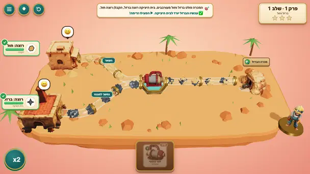 [合集截图](<https://github.com/AceDZN/clean-flow/blob/main/docs/captures/v2/actual-02-flowing.png>) | [AceDZN/clean-flow](<https://github.com/AceDZN/clean-flow>) | 常见根目录许可文件未找到 | 待核 | [6.0](<https://github.com/AceDZN/clean-flow/blob/main/docs/captures/v2/actual-02-flowing.png>) | 未列入口 |
| 1070 | [ ] | [Clean the Mirror](<https://github.com/gamingnews5/awesome-opus-5.5-games/blob/9a29b570e56bd19f15a3cd6bbac0b8c682f2c48c/games/clean-the-mirror/readme.md>) | 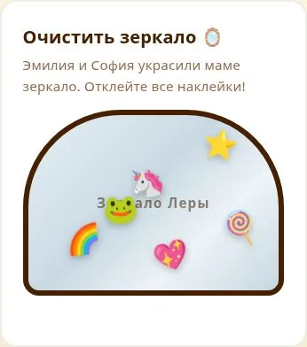 [对应子游戏玩法实截](<https://github.com/vitalirasin-web/valeriabirthday/blob/HEAD/index.html>) | [vitalirasin-web/valeriabirthday](<https://github.com/vitalirasin-web/valeriabirthday>) | 常见根目录许可文件未找到 | 待核 | — | [多游戏仓库入口 · 可达 · 合集所列网页](<https://vitalirasin-web.github.io/valeriabirthday/>) |
| 1071 | [ ] | [ClosingTime](<https://github.com/gamingnews5/awesome-opus-5.5-games/blob/9a29b570e56bd19f15a3cd6bbac0b8c682f2c48c/games/closingtime/readme.md>) | 待补截图 | [KimmelDevs/ClosingTime](<https://github.com/KimmelDevs/ClosingTime>) | 常见根目录许可文件未找到 | 待核 | — | 未列入口 |
| 1072 | [ ] | [closr.](<https://github.com/gamingnews5/awesome-opus-5.5-games/blob/9a29b570e56bd19f15a3cd6bbac0b8c682f2c48c/games/closr/readme.md>) | 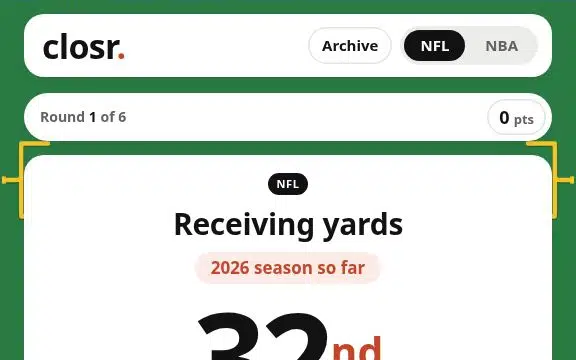 [源码运行画面](<https://github.com/AdvayMandalia422/closr/blob/main/index.html>) | [AdvayMandalia422/closr](<https://github.com/AdvayMandalia422/closr>) | 常见根目录许可文件未找到 | 待核 | — | 未列入口 |
| 1073 | [ ] | [Cloud Bounce](<https://github.com/gamingnews5/awesome-opus-5.5-games/blob/9a29b570e56bd19f15a3cd6bbac0b8c682f2c48c/games/cloud-bounce/readme.md>) |  [对应子游戏玩法实截](<https://github.com/gberry747-lab/gabriels-animation-studio/blob/HEAD/index.html>) | [gberry747-lab/gabriels-animation-studio](<https://github.com/gberry747-lab/gabriels-animation-studio>) | 常见根目录许可文件未找到 | 待核 | — | [多游戏仓库入口 · 可达 · 含游戏画布／引擎的网页](<https://gberry747-lab.github.io/gabriels-animation-studio/>) |
| 1074 | [ ] | [Cloudback](<https://github.com/gamingnews5/awesome-opus-5.5-games/blob/9a29b570e56bd19f15a3cd6bbac0b8c682f2c48c/games/cloudback/readme.md>) | 待补截图 | [buicongnguyen/new\_cute\_game](<https://github.com/buicongnguyen/new_cute_game>) | 常见根目录许可文件未找到 | 待核 | — | [可达 · 合集所列网页](<https://buicongnguyen.github.io/new_cute_game/>) |
| 1075 | [ ] | [Clown Squad](<https://github.com/gamingnews5/awesome-opus-5.5-games/blob/9a29b570e56bd19f15a3cd6bbac0b8c682f2c48c/games/clown-squad/readme.md>) | 待补截图 | [eddiedonesit/ClownSquad](<https://github.com/eddiedonesit/ClownSquad>) | 常见根目录许可文件未找到 | 待核 | — | 未列入口 |
| 1076 | [ ] | [Club Run](<https://github.com/gamingnews5/awesome-opus-5.5-games/blob/9a29b570e56bd19f15a3cd6bbac0b8c682f2c48c/games/club-run/readme.md>) | 待补截图 | [cuongluu8/tenable](<https://github.com/cuongluu8/tenable>) | 常见根目录许可文件未找到 | 待核 | — | [多游戏仓库入口 · 可达 · 合集所列网页](<https://top-10-tension.cuong-luu.workers.dev>) |
| 1077 | [ ] | [Cluedle](<https://github.com/gamingnews5/awesome-opus-5.5-games/blob/9a29b570e56bd19f15a3cd6bbac0b8c682f2c48c/games/cluedle/readme.md>) | 待补截图 | [szarroug3/cluedle](<https://github.com/szarroug3/cluedle>) | 常见根目录许可文件未找到 | 待核 | — | [可达 · 合集所列网页](<https://szarroug3.github.io/cluedle/>) |
| 1078 | [ ] | [CLUTCH: Football Draft](<https://github.com/gamingnews5/awesome-opus-5.5-games/blob/9a29b570e56bd19f15a3cd6bbac0b8c682f2c48c/games/clutch-football-draft/readme.md>) | 待补截图 | [shaanElgoat/clutch](<https://github.com/shaanElgoat/clutch>) | 常见根目录许可文件未找到 | 待核 | — | 未列入口 |
| 1079 | [ ] | [Cocopets](<https://github.com/gamingnews5/awesome-opus-5.5-games/blob/9a29b570e56bd19f15a3cd6bbac0b8c682f2c48c/games/cocopets/readme.md>) | 待补截图 | [chuongvoxx-ops/Cocopets](<https://github.com/chuongvoxx-ops/Cocopets>) | 常见根目录许可文件未找到 | 待核 | — | 未列入口 |
| 1080 | [ ] | [Code Blue: The Ward Round](<https://github.com/gamingnews5/awesome-opus-5.5-games/blob/9a29b570e56bd19f15a3cd6bbac0b8c682f2c48c/games/code-blue-the-ward-round/readme.md>) | 待补截图 | [jdrudolph/coding-game](<https://github.com/jdrudolph/coding-game>) | 常见根目录许可文件未找到 | 待核 | [6.0](<https://github.com/jdrudolph/coding-game/blob/ccr-ee965c46-moax6o/share-image.png>) | 未列入口 |
| 1081 | [ ] | [CodeQuest](<https://github.com/gamingnews5/awesome-opus-5.5-games/blob/9a29b570e56bd19f15a3cd6bbac0b8c682f2c48c/games/codequest/readme.md>) |  [游戏菜单或界面](<https://github.com/mason-keiser/code-quest/blob/master/docs/screenshots/host-lobby.png>) | [mason-keiser/code-quest](<https://github.com/mason-keiser/code-quest>) | 常见根目录许可文件未找到 | 待核 | [4.5](<https://github.com/mason-keiser/code-quest/blob/master/docs/screenshots/host-lobby.png>) | 未列入口 |
| 1082 | [ ] | [Coffee Empire](<https://github.com/gamingnews5/awesome-opus-5.5-games/blob/9a29b570e56bd19f15a3cd6bbac0b8c682f2c48c/games/coffee-empire/readme.md>) | 待补截图 | [baldking1629/coffee\_empire](<https://github.com/baldking1629/coffee_empire>) | 常见根目录许可文件未找到 | 待核 | — | 未列入口 |
| 1083 | [ ] | [Coil](<https://github.com/gamingnews5/awesome-opus-5.5-games/blob/9a29b570e56bd19f15a3cd6bbac0b8c682f2c48c/games/coil/readme.md>) | 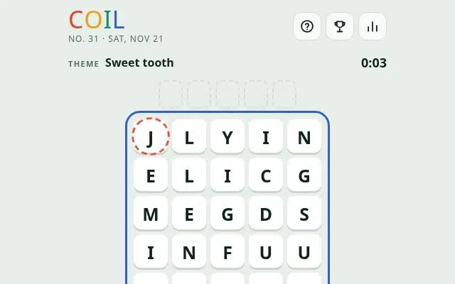 [源码网页实截](<https://github.com/PlayCOIL/playcoil.github.io/blob/main/index.html>) | [PlayCOIL/playcoil.github.io](<https://github.com/PlayCOIL/playcoil.github.io>) | 常见根目录许可文件未找到 | 待核 | — | 未列入口 |
| 1084 | [ ] | [Coin Duel (working title)](<https://github.com/gamingnews5/awesome-opus-5.5-games/blob/9a29b570e56bd19f15a3cd6bbac0b8c682f2c48c/games/coin-duel-working-title/readme.md>) | 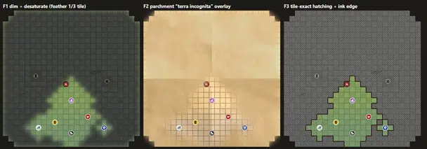 [合集截图](<https://github.com/Darkness9543/BoardGame-Project/blob/main/docs/analysis/research-art/fog-styles-euclid-cut.png>) | [Darkness9543/BoardGame-Project](<https://github.com/Darkness9543/BoardGame-Project>) | 常见根目录许可文件未找到 [游戏图标按 CC BY 3.0，3D 模型为 CC0。](<https://github.com/Darkness9543/BoardGame-Project/blob/HEAD/README.md#L142>) | 待核 | [5.0](<https://github.com/Darkness9543/BoardGame-Project/blob/main/docs/analysis/research-art/fog-styles-euclid-cut.png>) | 未列入口 |
| 1085 | [ ] | [Colchis](<https://github.com/gamingnews5/awesome-opus-5.5-games/blob/9a29b570e56bd19f15a3cd6bbac0b8c682f2c48c/games/colchis/readme.md>) | 待补截图 | [DavitChomakhidze/Colchis](<https://github.com/DavitChomakhidze/Colchis>) | 常见根目录许可文件未找到 | 待核 | — | 未列入口 |
| 1086 | [ ] | [Cold Gas Roadster](<https://github.com/gamingnews5/awesome-opus-5.5-games/blob/9a29b570e56bd19f15a3cd6bbac0b8c682f2c48c/games/cold-gas-roadster/readme.md>) | 待补截图 | [fadi0072/cold-gas-roadster](<https://github.com/fadi0072/cold-gas-roadster>) | 常见根目录许可文件未找到 | 待核 | — | [可达 · 含游戏画布／引擎的网页](<https://cold-gas-roadster.vercel.app>) |
| 1087 | [ ] | [Cold Read](<https://github.com/gamingnews5/awesome-opus-5.5-games/blob/9a29b570e56bd19f15a3cd6bbac0b8c682f2c48c/games/cold-read/readme.md>) | 待补截图 | [2Steazy/cold-read](<https://github.com/2Steazy/cold-read>) | 常见根目录许可文件未找到 | 待核 | — | 未列入口 |
| 1088 | [ ] | [Collapse](<https://github.com/gamingnews5/awesome-opus-5.5-games/blob/9a29b570e56bd19f15a3cd6bbac0b8c682f2c48c/games/party-chaos/readme.md>) | 待补截图 | [lawrenceandrewlargo/roblox-extreme-minigames](<https://github.com/lawrenceandrewlargo/roblox-extreme-minigames>) | 常见根目录许可文件未找到 | 待核 | — | 未列入口 |
| 1089 | [ ] | [Collect paintings](<https://github.com/gamingnews5/awesome-opus-5.5-games/blob/9a29b570e56bd19f15a3cd6bbac0b8c682f2c48c/games/collect-paintings/readme.md>) | 待补截图 | [anjali10102279-debug/Collect-paintings](<https://github.com/anjali10102279-debug/Collect-paintings>) | 常见根目录许可文件未找到 | 待核 | — | [可达 · 合集所列网页](<https://collect-paintings.vercel.app>) |
| 1090 | [ ] | [Collector Steph: Treasures of Morocco](<https://github.com/gamingnews5/awesome-opus-5.5-games/blob/9a29b570e56bd19f15a3cd6bbac0b8c682f2c48c/games/collector-steph-treasures-of-morocco/readme.md>) |  [合集截图](<https://github.com/errajim063-droid/collector-steph/blob/main/jeu/images/decors/salon.jpg>) | [errajim063-droid/collector-steph](<https://github.com/errajim063-droid/collector-steph>) | 常见根目录许可文件未找到 [采用 CC BY-SA 4.0 的照片，须保留署名并遵守相同方式共享条件。](<https://github.com/errajim063-droid/collector-steph/blob/HEAD/README.md#L56-L59>) | 待核 | [6.3](<https://github.com/errajim063-droid/collector-steph/blob/main/jeu/images/decors/salon.jpg>) | 未列入口 |
| 1091 | [ ] | [Colony Game](<https://github.com/gamingnews5/awesome-opus-5.5-games/blob/9a29b570e56bd19f15a3cd6bbac0b8c682f2c48c/games/colony-game/readme.md>) | 待补截图 | [bassettijonathan-rgb/Colony\_game](<https://github.com/bassettijonathan-rgb/Colony_game>) | 常见根目录许可文件未找到 | 待核 | — | 未列入口 |
| 1092 | [ ] | [Colony Sim](<https://github.com/gamingnews5/awesome-opus-5.5-games/blob/9a29b570e56bd19f15a3cd6bbac0b8c682f2c48c/games/colony-sim/readme.md>) | 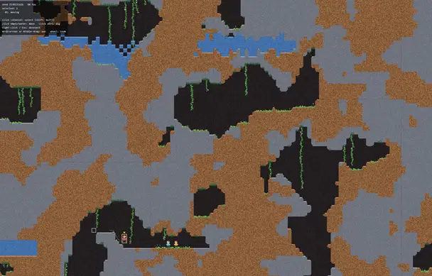 [合集截图](<https://github.com/yandayixia/ONI3D/blob/main/screenshot.png>) | [yandayixia/ONI3D](<https://github.com/yandayixia/ONI3D>) | 常见根目录许可文件未找到 | 待核 | [5.0](<https://github.com/yandayixia/ONI3D/blob/main/screenshot.png>) | 未列入口 |
| 1093 | [ ] | [Colony Sim (study-powered vault)](<https://github.com/gamingnews5/awesome-opus-5.5-games/blob/9a29b570e56bd19f15a3cd6bbac0b8c682f2c48c/games/colony-sim-study-powered-vault/readme.md>) | 待补截图 | [kani190spy-gif/Colon-Sim-Study](<https://github.com/kani190spy-gif/Colon-Sim-Study>) | 常见根目录许可文件未找到 | 待核 | — | 未列入口 |
| 1094 | [ ] | [Color Commute](<https://github.com/gamingnews5/awesome-opus-5.5-games/blob/9a29b570e56bd19f15a3cd6bbac0b8c682f2c48c/games/color-commute/readme.md>) | 待补截图 | [nisargpatel122/color-commute](<https://github.com/nisargpatel122/color-commute>) | 常见根目录许可文件未找到 | 待核 | — | [可达 · 含游戏画布／引擎的网页](<https://nisargpatel122.github.io/color-commute/>) |
| 1095 | [ ] | [Color Lab · معمل الألوان](<https://github.com/gamingnews5/awesome-opus-5.5-games/blob/9a29b570e56bd19f15a3cd6bbac0b8c682f2c48c/games/color-lab/readme.md>) | 待补截图 | [Didamony/color-pour](<https://github.com/Didamony/color-pour>) | 常见根目录许可文件未找到 | 待核 | — | 未列入口 |
| 1096 | [ ] | [Color Magic](<https://github.com/gamingnews5/awesome-opus-5.5-games/blob/9a29b570e56bd19f15a3cd6bbac0b8c682f2c48c/games/color-magic/readme.md>) | 待补截图 | [TimLeitch/color-match-game](<https://github.com/TimLeitch/color-match-game>) | 常见根目录许可文件未找到 | 待核 | — | [可达 · 合集所列网页](<https://timleitch.github.io/color-match-game/>) |
| 1097 | [ ] | [Color Rush](<https://github.com/gamingnews5/awesome-opus-5.5-games/blob/9a29b570e56bd19f15a3cd6bbac0b8c682f2c48c/games/color-rush/readme.md>) | 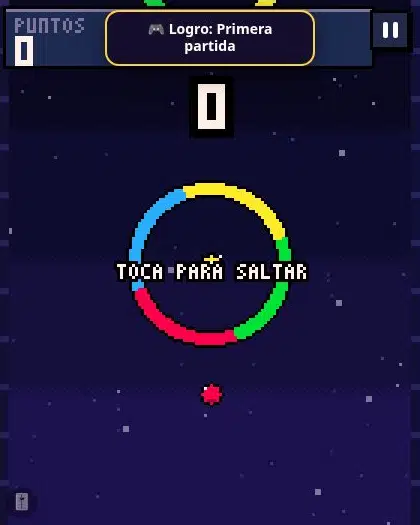 [对应子游戏玩法实截](<https://github.com/kokellara12-maker/apps-k4m9q2/blob/HEAD/colorrush.html>) | [kokellara12-maker/apps-k4m9q2](<https://github.com/kokellara12-maker/apps-k4m9q2>) | 常见根目录许可文件未找到 | 待核 | — | [可达 · 含游戏画布／引擎的网页](<https://kokellara12-maker.github.io/apps-k4m9q2/colorrush.html>) |
| 1098 | [ ] | [Color Rush](<https://github.com/gamingnews5/awesome-opus-5.5-games/blob/9a29b570e56bd19f15a3cd6bbac0b8c682f2c48c/games/party-chaos/readme.md>) | 待补截图 | [lawrenceandrewlargo/roblox-extreme-minigames](<https://github.com/lawrenceandrewlargo/roblox-extreme-minigames>) | 常见根目录许可文件未找到 | 待核 | — | 未列入口 |
| 1099 | [ ] | [Color Rush](<https://github.com/gamingnews5/awesome-opus-5.5-games/blob/9a29b570e56bd19f15a3cd6bbac0b8c682f2c48c/games/color-rush-salmanabdallah89-color-rush/readme.md>) | 待补截图 | [salmanabdallah89/Color-Rush](<https://github.com/salmanabdallah89/Color-Rush>) | 常见根目录许可文件未找到 | 待核 | — | 未列入口 |
| 1100 | [ ] | [Combo Challenge](<https://github.com/gamingnews5/awesome-opus-5.5-games/blob/9a29b570e56bd19f15a3cd6bbac0b8c682f2c48c/games/combo-challenge/readme.md>) |  [同款源码游戏实截](<https://github.com/mundeok/math-arcade-paradise/blob/master/src/games/g01_combo.js>) | [mundeok/math-arcade-paradise](<https://github.com/mundeok/math-arcade-paradise>) | 常见根目录许可文件未找到 | 待核 | — | 未列入口 |
| 1101 | [ ] | [Combo Grid](<https://github.com/gamingnews5/awesome-opus-5.5-games/blob/9a29b570e56bd19f15a3cd6bbac0b8c682f2c48c/games/combo-grid/readme.md>) | 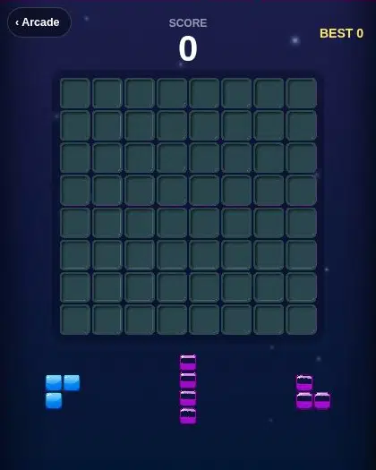 [对应子游戏玩法实截](<https://github.com/pawanp3/renderwolf-fable5-chart-toppers/blob/HEAD/games/block-blast/index.html>) | [pawanp3/renderwolf-fable5-chart-toppers](<https://github.com/pawanp3/renderwolf-fable5-chart-toppers>) | 常见根目录许可文件未找到 | 待核 | — | [多游戏仓库入口 · 可达 · 合集所列网页](<https://pawanp3.github.io/renderwolf-fable5-chart-toppers/>) |
| 1102 | [ ] | [Come By](<https://github.com/gamingnews5/awesome-opus-5.5-games/blob/9a29b570e56bd19f15a3cd6bbac0b8c682f2c48c/games/come-by/readme.md>) | 待补截图 | [Gboneck/come-by](<https://github.com/Gboneck/come-by>) | 常见根目录许可文件未找到 | 待核 | — | [可达 · 含游戏画布／引擎的网页](<https://gboneck.github.io/come-by/>) |
| 1103 | [ ] | [Commander Simulator](<https://github.com/gamingnews5/awesome-opus-5.5-games/blob/9a29b570e56bd19f15a3cd6bbac0b8c682f2c48c/games/commander-simulator/readme.md>) | 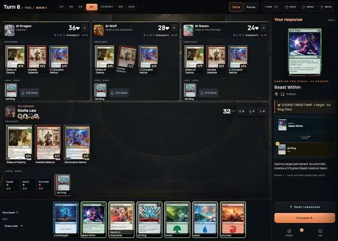 [合集截图](<https://github.com/tuitamogamer-gpt/mtg-commander-simulator/blob/main/assets/menu/command-table-preview.jpg>) | [tuitamogamer-gpt/mtg-commander-simulator](<https://github.com/tuitamogamer-gpt/mtg-commander-simulator>) | 常见根目录许可文件未找到 [部分卡牌素材属 Wizards of the Coast，上游按该公司的同人政策使用。](<https://github.com/tuitamogamer-gpt/mtg-commander-simulator/blob/HEAD/README.md#L855>) | 待核 | [6.5](<https://github.com/tuitamogamer-gpt/mtg-commander-simulator/blob/main/assets/menu/command-table-preview.jpg>) | [README · 可达 · 上游 README 所列网页](<https://mtgpod.xyz/>) |
| 1104 | [ ] | [COMO QUIZ](<https://github.com/gamingnews5/awesome-opus-5.5-games/blob/9a29b570e56bd19f15a3cd6bbac0b8c682f2c48c/games/como-quiz/readme.md>) | 待补截图 | [mergezalot/como](<https://github.com/mergezalot/como>) | 常见根目录许可文件未找到 | 待核 | — | 未列入口 |
| 1105 | [ ] | [Compound Builder](<https://github.com/gamingnews5/awesome-opus-5.5-games/blob/9a29b570e56bd19f15a3cd6bbac0b8c682f2c48c/games/compound-builder/readme.md>) | 待补截图 | [smolhaj/compound-builder](<https://github.com/smolhaj/compound-builder>) | 常见根目录许可文件未找到 | 待核 | — | 未列入口 |
| 1106 | [ ] | [ComptaTycoon](<https://github.com/gamingnews5/awesome-opus-5.5-games/blob/9a29b570e56bd19f15a3cd6bbac0b8c682f2c48c/games/comptatycoon/readme.md>) | 待补截图 | [nathanlr29/Comptatycoon](<https://github.com/nathanlr29/Comptatycoon>) | 常见根目录许可文件未找到 | 待核 | — | 未列入口 |
| 1107 | [ ] | [COMRADES](<https://github.com/gamingnews5/awesome-opus-5.5-games/blob/9a29b570e56bd19f15a3cd6bbac0b8c682f2c48c/games/comrades/readme.md>) | 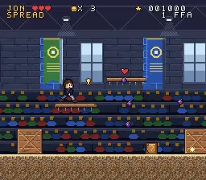 [合集截图](<https://github.com/CapMyAzzElmo/best-friends-snes/blob/main/art/screens/stage1.png>) | [CapMyAzzElmo/best-friends-snes](<https://github.com/CapMyAzzElmo/best-friends-snes>) | 常见根目录许可文件未找到 | 待核 | [5.8](<https://github.com/CapMyAzzElmo/best-friends-snes/blob/main/art/screens/stage1.png>) | 未列入口 |
| 1108 | [ ] | [Concrete Lines](<https://github.com/gamingnews5/awesome-opus-5.5-games/blob/9a29b570e56bd19f15a3cd6bbac0b8c682f2c48c/games/concrete-lines/readme.md>) | 待补截图 | [jonbeam1-netizen/concrete-lines](<https://github.com/jonbeam1-netizen/concrete-lines>) | 常见根目录许可文件未找到 | 待核 | — | 未列入口 |
| 1109 | [ ] | [Container Port Manager](<https://github.com/gamingnews5/awesome-opus-5.5-games/blob/9a29b570e56bd19f15a3cd6bbac0b8c682f2c48c/games/container-port-manager/readme.md>) | 待补截图 | [bezdomniy/container-port-manager](<https://github.com/bezdomniy/container-port-manager>) | 常见根目录许可文件未找到 | 待核 | — | 未列入口 |
| 1110 | [ ] | [Contour](<https://github.com/gamingnews5/awesome-opus-5.5-games/blob/9a29b570e56bd19f15a3cd6bbac0b8c682f2c48c/games/contour/readme.md>) | 待补截图 | [paravent/contour](<https://github.com/paravent/contour>) | 常见根目录许可文件未找到 | 待核 | — | [可达 · 合集所列网页](<https://metmuseum.github.io/>) |
| 1111 | [ ] | [Contrail.io](<https://github.com/gamingnews5/awesome-opus-5.5-games/blob/9a29b570e56bd19f15a3cd6bbac0b8c682f2c48c/games/contrail-io/readme.md>) | 待补截图 | [Gridmend/contrail](<https://github.com/Gridmend/contrail>) | 常见根目录许可文件未找到 | 待核 | — | [可达 · 合集所列网页](<https://contrail-io.netlify.app>) |
| 1112 | [ ] | [Contro](<https://github.com/gamingnews5/awesome-opus-5.5-games/blob/9a29b570e56bd19f15a3cd6bbac0b8c682f2c48c/games/contro/readme.md>) | 待补截图 | [soncsec/contro](<https://github.com/soncsec/contro>) | 常见根目录许可文件未找到 | [README 提及](<https://github.com/soncsec/contro/blob/HEAD/README.md#L20>) | — | 未列入口 |
| 1113 | [ ] | [Controller Game Hub](<https://github.com/gamingnews5/awesome-opus-5.5-games/blob/9a29b570e56bd19f15a3cd6bbac0b8c682f2c48c/games/controller-game-hub/readme.md>) | 待补截图 | [digvijay-gavas/control](<https://github.com/digvijay-gavas/control>) | 常见根目录许可文件未找到 | [README 提及](<https://github.com/digvijay-gavas/control/blob/HEAD/README.md#L3>) | — | 未列入口 |
| 1114 | [ ] | [Convince Me](<https://github.com/gamingnews5/awesome-opus-5.5-games/blob/9a29b570e56bd19f15a3cd6bbac0b8c682f2c48c/games/convince-me/readme.md>) | 待补截图 | [Vinzski/convince\_me](<https://github.com/Vinzski/convince_me>) | 常见根目录许可文件未找到 | 待核 | — | 未列入口 |
| 1115 | [ ] | [Cookie Quiz Show](<https://github.com/gamingnews5/awesome-opus-5.5-games/blob/9a29b570e56bd19f15a3cd6bbac0b8c682f2c48c/games/cookie-quiz-show/readme.md>) | 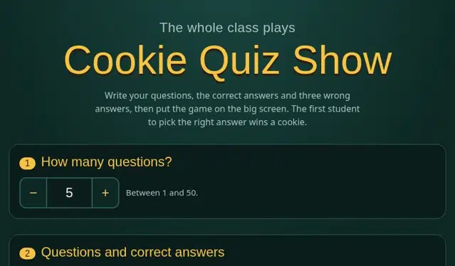 [试玩首页实截](<https://phanbt.github.io/Cookie_quizz_show/>) | [phanbt/Cookie\_quizz\_show](<https://github.com/phanbt/Cookie_quizz_show>) | 常见根目录许可文件未找到 | 待核 | — | [可达 · 合集所列网页](<https://phanbt.github.io/Cookie_quizz_show/>) |
| 1116 | [ ] | [cool tower defense game.exe](<https://github.com/gamingnews5/awesome-opus-5.5-games/blob/9a29b570e56bd19f15a3cd6bbac0b8c682f2c48c/games/cool-tower-defense-game-exe/readme.md>) | 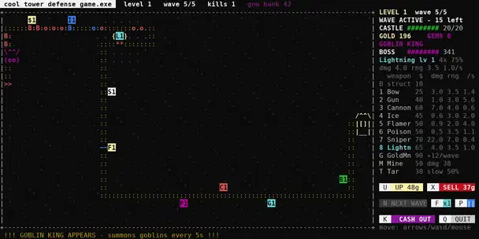 [上游游戏截图](<https://github.com/zsidiadi/Ball-Heckaton-ascii-game/blob/HEAD/docs/game.png>) | [zsidiadi/Ball-Heckaton-ascii-game](<https://github.com/zsidiadi/Ball-Heckaton-ascii-game>) | [README 许可段声明保留权利、限制使用或尚未授权](<https://github.com/zsidiadi/Ball-Heckaton-ascii-game/blob/HEAD/README.md>) | 待核 | — | 未列入口 |
| 1117 | [ ] | [Coordinator Challenge](<https://github.com/gamingnews5/awesome-opus-5.5-games/blob/9a29b570e56bd19f15a3cd6bbac0b8c682f2c48c/games/coordinator-challenge/readme.md>) | 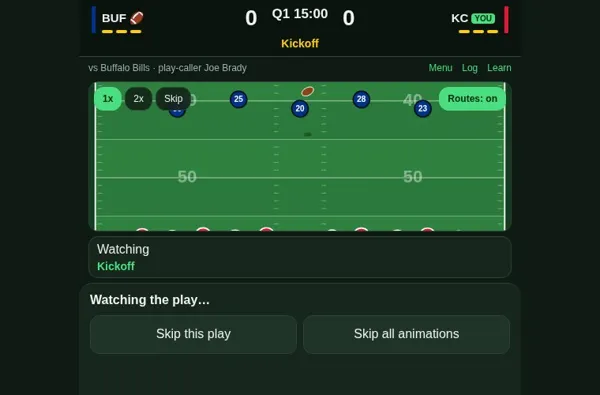 [源码运行画面](<https://github.com/benjtharm41/coordinator-challenge/blob/main/index.html>) | [benjtharm41/coordinator-challenge](<https://github.com/benjtharm41/coordinator-challenge>) | 常见根目录许可文件未找到 | 待核 | — | 未列入口 |
| 1118 | [ ] | [Cor](<https://github.com/gamingnews5/awesome-opus-5.5-games/blob/9a29b570e56bd19f15a3cd6bbac0b8c682f2c48c/games/cor/readme.md>) | 待补截图 | [olucasfl/nocap-app](<https://github.com/olucasfl/nocap-app>) | 常见根目录许可文件未找到 | 待核 | — | 未列入口 |
| 1119 | [ ] | [Coreatures: Deep Archive](<https://github.com/gamingnews5/awesome-opus-5.5-games/blob/9a29b570e56bd19f15a3cd6bbac0b8c682f2c48c/games/coreatures-deep-archive/readme.md>) | 待补截图 | [mendezm87/monster-rush](<https://github.com/mendezm87/monster-rush>) | 常见根目录许可文件未找到 | 待核 | — | [可达 · 合集所列网页](<https://mendezm87.github.io/monster-rush/>) |
| 1120 | [ ] | [Corporate Warfare](<https://github.com/gamingnews5/awesome-opus-5.5-games/blob/9a29b570e56bd19f15a3cd6bbac0b8c682f2c48c/games/corporate-warfare/readme.md>) | 待补截图 | [lakesidegamedev/corporate-warfare](<https://github.com/lakesidegamedev/corporate-warfare>) | 常见根目录许可文件未找到 | 待核 | — | 未列入口 |
| 1121 | [ ] | [Corruption2000](<https://github.com/gamingnews5/awesome-opus-5.5-games/blob/9a29b570e56bd19f15a3cd6bbac0b8c682f2c48c/games/corruption2000/readme.md>) | 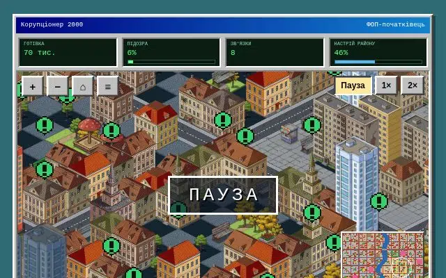 [源码网页实截](<https://github.com/yogi55/Corruption2000/blob/main/index.html>) | [yogi55/Corruption2000](<https://github.com/yogi55/Corruption2000>) | 常见根目录许可文件未找到 | 待核 | — | 未列入口 |
| 1122 | [ ] | [Cosa Nostra](<https://github.com/gamingnews5/awesome-opus-5.5-games/blob/9a29b570e56bd19f15a3cd6bbac0b8c682f2c48c/games/cosa-nostra/readme.md>) | 待补截图 | [Seymur/cosa\_nostra](<https://github.com/Seymur/cosa_nostra>) | 常见根目录许可文件未找到 | 待核 | — | 未列入口 |
| 1123 | [ ] | [Couch Party Island](<https://github.com/gamingnews5/awesome-opus-5.5-games/blob/9a29b570e56bd19f15a3cd6bbac0b8c682f2c48c/games/couch-party-island/readme.md>) | 待补截图 | [vonRotter/couch](<https://github.com/vonRotter/couch>) | 常见根目录许可文件未找到 | [README 提及](<https://github.com/vonRotter/couch/blob/HEAD/README.md#L1203>) | — | 未列入口 |
| 1124 | [ ] | [Cozy 2D MMORPG](<https://github.com/gamingnews5/awesome-opus-5.5-games/blob/9a29b570e56bd19f15a3cd6bbac0b8c682f2c48c/games/cozy-2d-mmorpg/readme.md>) | 待补截图 | [AnusitSrisawat/new-game-web-test-01](<https://github.com/AnusitSrisawat/new-game-web-test-01>) | 常见根目录许可文件未找到 | 待核 | — | 未列入口 |
| 1125 | [ ] | [Cozy Cat Sanctuary](<https://github.com/gamingnews5/awesome-opus-5.5-games/blob/9a29b570e56bd19f15a3cd6bbac0b8c682f2c48c/games/cozy-cat-sanctuary/readme.md>) | 待补截图 | [lambsubstitute/cozy-cat-sanctuary](<https://github.com/lambsubstitute/cozy-cat-sanctuary>) | 常见根目录许可文件未找到 | 待核 | — | [可达 · 含游戏画布／引擎的网页](<https://lambsubstitute.github.io/cozy-cat-sanctuary/>) |
| 1126 | [ ] | [CP Run](<https://github.com/gamingnews5/awesome-opus-5.5-games/blob/9a29b570e56bd19f15a3cd6bbac0b8c682f2c48c/games/cp-run/readme.md>) | 待补截图 | [KeemaKornToTo/ProgmethProject](<https://github.com/KeemaKornToTo/ProgmethProject>) | 常见根目录许可文件未找到 | 待核 | — | 未列入口 |
| 1127 | [ ] | [CPDB: Chor Police Dakat Babu](<https://github.com/gamingnews5/awesome-opus-5.5-games/blob/9a29b570e56bd19f15a3cd6bbac0b8c682f2c48c/games/cpdb-chor-police-dakat-babu/readme.md>) |  [游戏菜单或界面](<https://github.com/Avijit0104/Chor-Police-Dakat-Babu/blob/main/docs/screenshots/2-lobby.png>) | [Avijit0104/Chor-Police-Dakat-Babu](<https://github.com/Avijit0104/Chor-Police-Dakat-Babu>) | 常见根目录许可文件未找到 | 待核 | [4.6](<https://github.com/Avijit0104/Chor-Police-Dakat-Babu/blob/main/docs/screenshots/2-lobby.png>) | [可达 · 合集所列网页](<https://chor-police-dakat-babu.onrender.com>) |
| 1128 | [ ] | [Crab Dash](<https://github.com/gamingnews5/awesome-opus-5.5-games/blob/9a29b570e56bd19f15a3cd6bbac0b8c682f2c48c/games/crab-dash/readme.md>) | 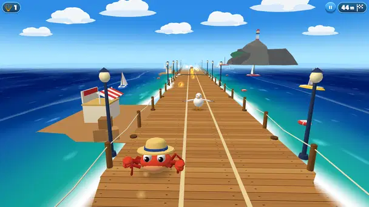 [合集截图](<https://github.com/georrrgess-jpg/Crab-Rush/blob/claude/great-cray-2m0jl9/docs/screenshots/m3-pier-desktop.png>) | [georrrgess-jpg/Crab-Rush](<https://github.com/georrrgess-jpg/Crab-Rush>) | 常见根目录许可文件未找到 | 待核 | [6.8](<https://github.com/georrrgess-jpg/Crab-Rush/blob/claude/great-cray-2m0jl9/docs/screenshots/m3-pier-desktop.png>) | 未列入口 |
| 1129 | [ ] | [Crabble](<https://github.com/gamingnews5/awesome-opus-5.5-games/blob/9a29b570e56bd19f15a3cd6bbac0b8c682f2c48c/games/crabble/readme.md>) | 待补截图 | [ptonkle/crabble](<https://github.com/ptonkle/crabble>) | 常见根目录许可文件未找到 | 待核 | — | 未列入口 |
| 1130 | [ ] | [Crabhouse v2](<https://github.com/gamingnews5/awesome-opus-5.5-games/blob/9a29b570e56bd19f15a3cd6bbac0b8c682f2c48c/games/crabhouse-v2/readme.md>) | 待补截图 | [kamibukuro18/opuscrabhouse](<https://github.com/kamibukuro18/opuscrabhouse>) | 常见根目录许可文件未找到 | 待核 | — | [可达 · 含游戏画布／引擎的网页](<https://kamibukuro18.github.io/opuscrabhouse/>) |
| 1131 | [ ] | [Crack the Code](<https://github.com/gamingnews5/awesome-opus-5.5-games/blob/9a29b570e56bd19f15a3cd6bbac0b8c682f2c48c/games/crack-the-code/readme.md>) | 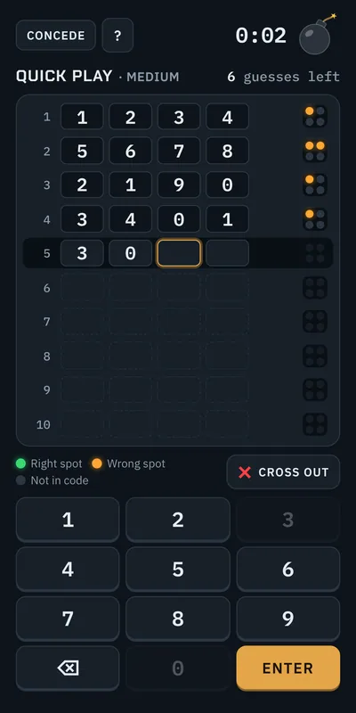 [上游游戏截图](<https://github.com/Nidoking41/Crack-The-Code/blob/HEAD/store/screenshots/android-2-quickplay.png>) | [Nidoking41/Crack-The-Code](<https://github.com/Nidoking41/Crack-The-Code>) | 常见根目录许可文件未找到 | 待核 | — | [可达 · 合集所列网页](<https://nidoking41.github.io/Crack-The-Code/>) |
| 1132 | [ ] | [CRACKED](<https://github.com/gamingnews5/awesome-opus-5.5-games/blob/9a29b570e56bd19f15a3cd6bbac0b8c682f2c48c/games/cracked/readme.md>) | 待补截图 | [duke1937/Cracked](<https://github.com/duke1937/Cracked>) | 常见根目录许可文件未找到 | 待核 | — | 未列入口 |
| 1133 | [ ] | [Cranial Combat: Trivia Showdown](<https://github.com/gamingnews5/awesome-opus-5.5-games/blob/9a29b570e56bd19f15a3cd6bbac0b8c682f2c48c/games/cranial-combat-trivia-showdown/readme.md>) | 待补截图 | [jasonadams76-eng/CranialCombat](<https://github.com/jasonadams76-eng/CranialCombat>) | 常见根目录许可文件未找到 | 待核 | — | [可达 · 合集所列网页](<https://jasonadams76-eng.github.io/CranialCombat/>) |
| 1134 | [ ] | [Crease](<https://github.com/gamingnews5/awesome-opus-5.5-games/blob/9a29b570e56bd19f15a3cd6bbac0b8c682f2c48c/games/crease/readme.md>) | 待补截图 | [anand1296/Crease](<https://github.com/anand1296/Crease>) | 常见根目录许可文件未找到 | [README 提及](<https://github.com/anand1296/Crease/blob/HEAD/README.md#L63>) | — | [可达 · 合集所列网页](<https://crease-orcin.vercel.app>) |
| 1135 | [ ] | [Creature Count](<https://github.com/gamingnews5/awesome-opus-5.5-games/blob/9a29b570e56bd19f15a3cd6bbac0b8c682f2c48c/games/creature-count/readme.md>) | 待补截图 | [mattadamcohen/study-time](<https://github.com/mattadamcohen/study-time>) | 常见根目录许可文件未找到 | 待核 | — | [可达 · 合集所列网页](<https://mattadamcohen.github.io/study-time/>) |
| 1136 | [ ] | [Creme's Kitchen 🍰](<https://github.com/gamingnews5/awesome-opus-5.5-games/blob/9a29b570e56bd19f15a3cd6bbac0b8c682f2c48c/games/creme-s-kitchen/readme.md>) | 待补截图 | [svedison/little-cake-kitchen](<https://github.com/svedison/little-cake-kitchen>) | 常见根目录许可文件未找到 | 待核 | — | 未列入口 |
| 1137 | [ ] | [CREXZ Arcade](<https://github.com/gamingnews5/awesome-opus-5.5-games/blob/9a29b570e56bd19f15a3cd6bbac0b8c682f2c48c/games/crexz-arcade/readme.md>) | 待补截图 | [ZIn34/Arcade](<https://github.com/ZIn34/Arcade>) | 常见根目录许可文件未找到 | 待核 | — | [可达 · 含游戏画布／引擎的网页](<https://zin34.github.io/Arcade/>) |
| 1138 | [ ] | [Crimson Plague](<https://github.com/gamingnews5/awesome-opus-5.5-games/blob/9a29b570e56bd19f15a3cd6bbac0b8c682f2c48c/games/crimson-plague/readme.md>) | 待补截图 | [papigetbusy/crimson-plague](<https://github.com/papigetbusy/crimson-plague>) | 常见根目录许可文件未找到 | 待核 | — | [可达 · 合集所列网页](<https://papigetbusy.github.io/crimson-plague/>) |
| 1139 | [ ] | [CRITICAL HIT](<https://github.com/gamingnews5/awesome-opus-5.5-games/blob/9a29b570e56bd19f15a3cd6bbac0b8c682f2c48c/games/critical-hit/readme.md>) | 待补截图 | [thequantummenece/Critical\_Hit](<https://github.com/thequantummenece/Critical_Hit>) | 常见根目录许可文件未找到 | 待核 | — | 未列入口 |
| 1140 | [ ] | [Critter Quest](<https://github.com/gamingnews5/awesome-opus-5.5-games/blob/9a29b570e56bd19f15a3cd6bbac0b8c682f2c48c/games/critter-quest/readme.md>) | 待补截图 | [applebloom3413-creator/critter-quest](<https://github.com/applebloom3413-creator/critter-quest>) | 常见根目录许可文件未找到 | 待核 | — | 未列入口 |
| 1141 | [ ] | [Cross-City Transit](<https://github.com/gamingnews5/awesome-opus-5.5-games/blob/9a29b570e56bd19f15a3cd6bbac0b8c682f2c48c/games/cross-city-transit/readme.md>) | 待补截图 | [Annabxclu/Cross-City-Transit](<https://github.com/Annabxclu/Cross-City-Transit>) | 常见根目录许可文件未找到 | 待核 | — | [可达 · 合集所列网页](<https://annabxclu.github.io/Cross-City-Transit/>) |
| 1142 | [ ] | [Crossroads Inn](<https://github.com/gamingnews5/awesome-opus-5.5-games/blob/9a29b570e56bd19f15a3cd6bbac0b8c682f2c48c/games/crossroads-inn/readme.md>) | 待补截图 | [rkaunismaa/CrossRoads-Inn](<https://github.com/rkaunismaa/CrossRoads-Inn>) | 常见根目录许可文件未找到 | 待核 | — | 未列入口 |
| 1143 | [ ] | [Crosstown](<https://github.com/gamingnews5/awesome-opus-5.5-games/blob/9a29b570e56bd19f15a3cd6bbac0b8c682f2c48c/games/crosstown/readme.md>) | 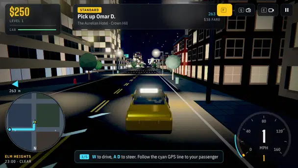 [合集截图](<https://github.com/jmzidek9/GTA-taxi-game/blob/main/media/screenshot-night.png>) | [jmzidek9/GTA-taxi-game](<https://github.com/jmzidek9/GTA-taxi-game>) | 常见根目录许可文件未找到 | [README 提及](<https://github.com/jmzidek9/GTA-taxi-game/blob/HEAD/README.md#L23>) | [6.4](<https://github.com/jmzidek9/GTA-taxi-game/blob/main/media/screenshot-night.png>) | [可达 · 合集所列网页](<https://jmzidek9.github.io/GTA-taxi-game/>) |
| 1144 | [ ] | [Crossy Farm](<https://github.com/gamingnews5/awesome-opus-5.5-games/blob/9a29b570e56bd19f15a3cd6bbac0b8c682f2c48c/games/crossy-farm/readme.md>) | 待补截图 | [sorrycc/fable-arcade](<https://github.com/sorrycc/fable-arcade>) | 常见根目录许可文件未找到 | 待核 | — | [可达 · 含游戏画布／引擎的网页](<https://sorrycc.github.io/fable-arcade/games/crossy-farm-car/>) |
| 1145 | [ ] | [crowdcoding-game](<https://github.com/gamingnews5/awesome-opus-5.5-games/blob/9a29b570e56bd19f15a3cd6bbac0b8c682f2c48c/games/crowdcoding-game/readme.md>) | 待补截图 | [morriskurz/crowdcoding-game](<https://github.com/morriskurz/crowdcoding-game>) | 常见根目录许可文件未找到 | 待核 | — | 未列入口 |
| 1146 | [ ] | [Crown Arcade Online](<https://github.com/gamingnews5/awesome-opus-5.5-games/blob/9a29b570e56bd19f15a3cd6bbac0b8c682f2c48c/games/crown-arcade-online/readme.md>) | 待补截图 | [songesx3-arch/Crown-arcade](<https://github.com/songesx3-arch/Crown-arcade>) | 常见根目录许可文件未找到 | 待核 | — | 未列入口 |
| 1147 | [ ] | [Crown Keeper](<https://github.com/gamingnews5/awesome-opus-5.5-games/blob/9a29b570e56bd19f15a3cd6bbac0b8c682f2c48c/games/party-chaos/readme.md>) | 待补截图 | [lawrenceandrewlargo/roblox-extreme-minigames](<https://github.com/lawrenceandrewlargo/roblox-extreme-minigames>) | 常见根目录许可文件未找到 | 待核 | — | 未列入口 |
| 1148 | [ ] | [Crownmere](<https://github.com/gamingnews5/awesome-opus-5.5-games/blob/9a29b570e56bd19f15a3cd6bbac0b8c682f2c48c/games/crownmere/readme.md>) | 待补截图 | [c0s1nlarry10/crownmere](<https://github.com/c0s1nlarry10/crownmere>) | 常见根目录许可文件未找到 | 待核 | — | [可达 · 含游戏画布／引擎的网页](<https://c0s1nlarry10.github.io/crownmere/>) |
| 1149 | [ ] | [CRTdle](<https://github.com/gamingnews5/awesome-opus-5.5-games/blob/9a29b570e56bd19f15a3cd6bbac0b8c682f2c48c/games/crtdle/readme.md>) | 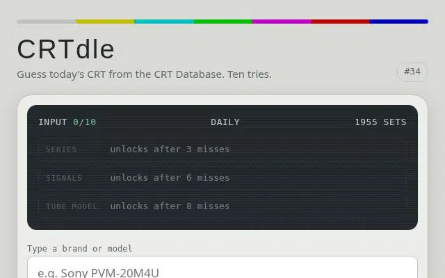 [源码网页实截](<https://github.com/HudsonBrownie/CRTdle/blob/main/index.html>) | [HudsonBrownie/CRTdle](<https://github.com/HudsonBrownie/CRTdle>) | 常见根目录许可文件未找到 | 待核 | — | 未列入口 |
| 1150 | [ ] | [Cruising USA VR](<https://github.com/gamingnews5/awesome-opus-5.5-games/blob/9a29b570e56bd19f15a3cd6bbac0b8c682f2c48c/games/cruising-usa-vr/readme.md>) | 待补截图 | [Mrimagemakers/CrusingUSA](<https://github.com/Mrimagemakers/CrusingUSA>) | 常见根目录许可文件未找到 | [源码有输入读取](<https://github.com/Mrimagemakers/CrusingUSA/blob/main/index.html#L2127>) | — | [可达 · 合集所列网页](<https://mrimagemakers.github.io/CrusingUSA/>) |
| 1151 | [ ] | [Crusader World](<https://github.com/gamingnews5/awesome-opus-5.5-games/blob/9a29b570e56bd19f15a3cd6bbac0b8c682f2c48c/games/crusader-world/readme.md>) | 待补截图 | [Gh0stDigital/projectCrusaderWorld](<https://github.com/Gh0stDigital/projectCrusaderWorld>) | 常见根目录许可文件未找到 | 待核 | — | 未列入口 |
| 1152 | [ ] | [CS Clone Fable5](<https://github.com/gamingnews5/awesome-opus-5.5-games/blob/9a29b570e56bd19f15a3cd6bbac0b8c682f2c48c/games/cs-clone-fable5/readme.md>) | 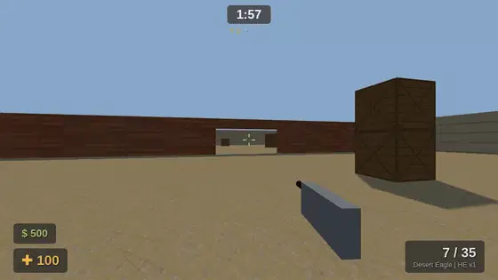 [上游动图截帧](<https://github.com/Gabry9110/CS-Clone-Fable5/blob/main/docs/gameplay.gif>) | [Gabry9110/CS-Clone-Fable5](<https://github.com/Gabry9110/CS-Clone-Fable5>) | 常见根目录许可文件未找到 | 待核 | [6.0](<https://github.com/Gabry9110/CS-Clone-Fable5/blob/main/docs/gameplay.gif>) | 未列入口 |
| 1153 | [ ] | [CSS Battle Royale](<https://github.com/gamingnews5/awesome-opus-5.5-games/blob/9a29b570e56bd19f15a3cd6bbac0b8c682f2c48c/games/css-battle-royale/readme.md>) | 待补截图 | [Shrxmy/kickoff-battle-royale](<https://github.com/Shrxmy/kickoff-battle-royale>) | 常见根目录许可文件未找到 | 待核 | — | [可达 · 合集所列网页](<https://kickoff-battle-royale.vercel.app>) |
| 1154 | [ ] | [Cube Basher](<https://github.com/gamingnews5/awesome-opus-5.5-games/blob/9a29b570e56bd19f15a3cd6bbac0b8c682f2c48c/games/cube-basher/readme.md>) | 待补截图 | [mreflow/cube-basher](<https://github.com/mreflow/cube-basher>) | 常见根目录许可文件未找到 | 待核 | — | [可达 · 合集所列网页](<https://mreflow.github.io/cube-basher/>) |
| 1155 | [ ] | [CubeCraft](<https://github.com/gamingnews5/awesome-opus-5.5-games/blob/9a29b570e56bd19f15a3cd6bbac0b8c682f2c48c/games/cubecraft/readme.md>) | 待补截图 | [kokellara12-maker/apps-k4m9q2](<https://github.com/kokellara12-maker/apps-k4m9q2>) | 常见根目录许可文件未找到 | 待核 | — | [可达 · 合集所列网页](<https://kokellara12-maker.github.io/apps-k4m9q2/cubecraft.html>) |
| 1156 | [ ] | [Cuckoo Clock](<https://github.com/gamingnews5/awesome-opus-5.5-games/blob/9a29b570e56bd19f15a3cd6bbac0b8c682f2c48c/games/cuckoo-clock/readme.md>) | 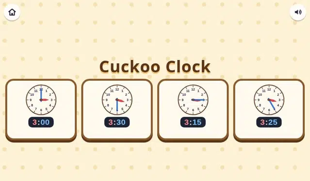 [试玩画面](<https://tb-x.github.io/cuckoo-clock/>) | [tb-x/cuckoo-clock](<https://github.com/tb-x/cuckoo-clock>) | 常见根目录许可文件未找到 | 待核 | — | [可达 · 合集所列网页](<https://tb-x.github.io/cuckoo-clock/>) |
| 1157 | [ ] | [Cuesies](<https://github.com/gamingnews5/awesome-opus-5.5-games/blob/9a29b570e56bd19f15a3cd6bbac0b8c682f2c48c/games/cuesies/readme.md>) | 待补截图 | [yu2tru/poolsies](<https://github.com/yu2tru/poolsies>) | 常见根目录许可文件未找到 | 待核 | — | [可达 · 含游戏画布／引擎的网页](<https://yu2tru.github.io/cuesies/>) |
| 1158 | [ ] | [Culture Wars](<https://github.com/gamingnews5/awesome-opus-5.5-games/blob/9a29b570e56bd19f15a3cd6bbac0b8c682f2c48c/games/culture-wars/readme.md>) | 待补截图 | [colinwillow/culture\_war](<https://github.com/colinwillow/culture_war>) | 常见根目录许可文件未找到 | 待核 | — | 未列入口 |
| 1159 | [ ] | [Curious Minds](<https://github.com/gamingnews5/awesome-opus-5.5-games/blob/9a29b570e56bd19f15a3cd6bbac0b8c682f2c48c/games/curious-minds/readme.md>) | 待补截图 | [nweinberg97/Curious-Minds](<https://github.com/nweinberg97/Curious-Minds>) | 常见根目录许可文件未找到 | 待核 | — | 未列入口 |
| 1160 | [ ] | [Curry Chaos](<https://github.com/gamingnews5/awesome-opus-5.5-games/blob/9a29b570e56bd19f15a3cd6bbac0b8c682f2c48c/games/curry-chaos/readme.md>) | 待补截图 | [serp83/curry-chaos](<https://github.com/serp83/curry-chaos>) | 常见根目录许可文件未找到 | 待核 | — | [入口已失效 · 合集所列网页](<https://serp83.github.io/curry-chaos/>) |
| 1161 | [ ] | [CUSTOMS — Escape Raid](<https://github.com/gamingnews5/awesome-opus-5.5-games/blob/9a29b570e56bd19f15a3cd6bbac0b8c682f2c48c/games/customs-escape-raid/readme.md>) | 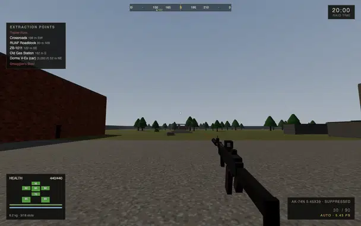 [合集截图](<https://github.com/INONONO66/tarkov-customs/blob/main/shots/raid.png>) | [INONONO66/tarkov-customs](<https://github.com/INONONO66/tarkov-customs>) | 常见根目录许可文件未找到 Tarkov风格参考；未见根LICENSE，不推定原游戏商标/设定许可。 | 待核 | [6.2](<https://github.com/INONONO66/tarkov-customs/blob/main/shots/raid.png>) | [可达 · 含游戏画布／引擎的网页](<https://inonono66.github.io/tarkov-customs/>) |
| 1162 | [ ] | [Cute Games](<https://github.com/gamingnews5/awesome-opus-5.5-games/blob/9a29b570e56bd19f15a3cd6bbac0b8c682f2c48c/games/cute-games/readme.md>) |  [同款源码启动画面实截](<https://github.com/nutputsorn2547-ai/cute-games/blob/HEAD/index.html>) | [nutputsorn2547-ai/cute-games](<https://github.com/nutputsorn2547-ai/cute-games>) | 常见根目录许可文件未找到 | 待核 | — | [可达 · 合集所列网页](<https://nutputsorn2547-ai.github.io/cute-games/>) |
| 1163 | [ ] | [CX GAME](<https://github.com/gamingnews5/awesome-opus-5.5-games/blob/9a29b570e56bd19f15a3cd6bbac0b8c682f2c48c/games/cx-game/readme.md>) | 待补截图 | [alexphilippon/cxgame](<https://github.com/alexphilippon/cxgame>) | 常见根目录许可文件未找到 | 待核 | — | [可达 · 合集所列网页](<https://cxgame.vercel.app>) |
| 1164 | [ ] | [Cyber City Tactics](<https://github.com/gamingnews5/awesome-opus-5.5-games/blob/9a29b570e56bd19f15a3cd6bbac0b8c682f2c48c/games/cyber-city-tactics/readme.md>) | 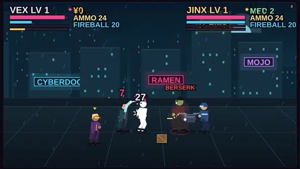 [合集截图](<https://github.com/CptNope/Cyber-City-Tactics/blob/main/docs/design/panels/shots/fight.png>) | [CptNope/Cyber-City-Tactics](<https://github.com/CptNope/Cyber-City-Tactics>) | 常见根目录许可文件未找到 | [README 提及](<https://github.com/CptNope/Cyber-City-Tactics/blob/HEAD/README.md#L273>) | [6.2](<https://github.com/CptNope/Cyber-City-Tactics/blob/main/docs/design/panels/shots/fight.png>) | [可达 · 含游戏画布／引擎的网页](<https://cptnope.github.io/Cyber-City-Tactics/>) |
| 1165 | [ ] | [Cyber City: Hack the Future](<https://github.com/gamingnews5/awesome-opus-5.5-games/blob/9a29b570e56bd19f15a3cd6bbac0b8c682f2c48c/games/cyber-city-hack-the-future/readme.md>) | 待补截图 | [cyberhubitacademy/cybercity](<https://github.com/cyberhubitacademy/cybercity>) | 常见根目录许可文件未找到 [两款字体采用 OFL。](<https://github.com/cyberhubitacademy/cybercity/blob/HEAD/README.md#L117>) | 待核 | [6.0](<https://github.com/cyberhubitacademy/cybercity/blob/main/public/social-preview.jpg>) | 未列入口 |
| 1166 | [ ] | [Cyber Defenders](<https://github.com/gamingnews5/awesome-opus-5.5-games/blob/9a29b570e56bd19f15a3cd6bbac0b8c682f2c48c/games/cyber-defenders/readme.md>) | 待补截图 | [abdulem-byte/cyber-defenders](<https://github.com/abdulem-byte/cyber-defenders>) | 常见根目录许可文件未找到 | 待核 | — | [可达 · 合集所列网页](<https://abdulem-byte.github.io/cyber-defenders/>) |
| 1167 | [ ] | [Cyber Run Pro](<https://github.com/gamingnews5/awesome-opus-5.5-games/blob/9a29b570e56bd19f15a3cd6bbac0b8c682f2c48c/games/cyber-run-pro/readme.md>) | 待补截图 | [Doberto555/cyber-racing-game](<https://github.com/Doberto555/cyber-racing-game>) | 常见根目录许可文件未找到 | 待核 | — | [可达 · 合集所列网页](<https://cyber-racing-game.vercel.app>) |
| 1168 | [ ] | [CYBER SUNDAY](<https://github.com/gamingnews5/awesome-opus-5.5-games/blob/9a29b570e56bd19f15a3cd6bbac0b8c682f2c48c/games/cyber-sunday/readme.md>) | 待补截图 | [influenza-dotcom/3D-RPG](<https://github.com/influenza-dotcom/3D-RPG>) | 常见根目录许可文件未找到 | 待核 | — | 未列入口 |
| 1169 | [ ] | [Cyberhood](<https://github.com/gamingnews5/awesome-opus-5.5-games/blob/9a29b570e56bd19f15a3cd6bbac0b8c682f2c48c/games/cyberhood/readme.md>) | 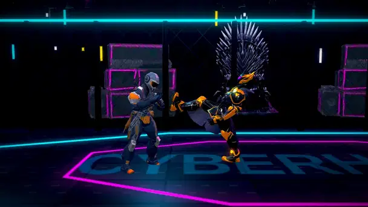 [合集截图](<https://github.com/thangvu030198-ai/cyberhood-/blob/main/web/assets/img/game/duel.webp>) | [thangvu030198-ai/cyberhood-](<https://github.com/thangvu030198-ai/cyberhood->) | 常见根目录许可文件未找到 [车辆及太空走廊采用 CC BY 4.0；部分其余资源为 CC0。](<https://github.com/thangvu030198-ai/cyberhood-/blob/HEAD/README.md#L60-L62>) | 待核 | [6.2](<https://github.com/thangvu030198-ai/cyberhood-/blob/main/web/assets/img/game/duel.webp>) | 未列入口 |
| 1170 | [ ] | [Cyberpunk Txt RPG](<https://github.com/gamingnews5/awesome-opus-5.5-games/blob/9a29b570e56bd19f15a3cd6bbac0b8c682f2c48c/games/cyberpunk-txt-rpg/readme.md>) | 待补截图 | [WH173-0U7/Cyberpunk-Txt-RPG](<https://github.com/WH173-0U7/Cyberpunk-Txt-RPG>) | 常见根目录许可文件未找到 | 待核 | — | [入口已失效 · 合集所列网页](<https://wh173-0u7.github.io/Cyberpunk-Txt-RPG/>) |
| 1171 | [ ] | [Cybersleeve](<https://github.com/gamingnews5/awesome-opus-5.5-games/blob/9a29b570e56bd19f15a3cd6bbac0b8c682f2c48c/games/cybersleeve/readme.md>) | 待补截图 | [Afrandsen87/Cybersleeve](<https://github.com/Afrandsen87/Cybersleeve>) | 常见根目录许可文件未找到 | 待核 | — | 未列入口 |
| 1172 | [ ] | [CyberSweeper](<https://github.com/gamingnews5/awesome-opus-5.5-games/blob/9a29b570e56bd19f15a3cd6bbac0b8c682f2c48c/games/cybersweeper/readme.md>) | 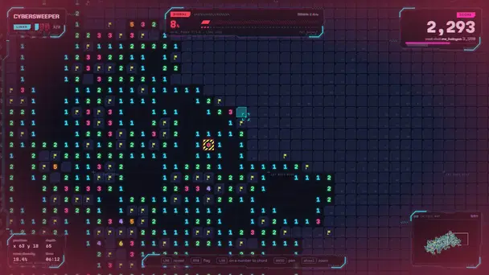 [合集截图](<https://github.com/jwelch00/CyberSweeper/blob/main/design/png/gameplay-critical.png>) | [jwelch00/CyberSweeper](<https://github.com/jwelch00/CyberSweeper>) | 常见根目录许可文件未找到 [字体随 OFL 许可分发。](<https://github.com/jwelch00/CyberSweeper/blob/HEAD/README.md#L157>) | 待核 | [6.2](<https://github.com/jwelch00/CyberSweeper/blob/main/design/png/gameplay-critical.png>) | 未列入口 |
| 1173 | [ ] | [Cân Bằng Đá (Stone Balance)](<https://github.com/gamingnews5/awesome-opus-5.5-games/blob/9a29b570e56bd19f15a3cd6bbac0b8c682f2c48c/games/can-bang-a-stone-balance/readme.md>) | 待补截图 | [lupin2498/game-stone](<https://github.com/lupin2498/game-stone>) | 常见根目录许可文件未找到 | 待核 | — | 未列入口 |
| 1174 | [ ] | [Cờ ca rô VN](<https://github.com/gamingnews5/awesome-opus-5.5-games/blob/9a29b570e56bd19f15a3cd6bbac0b8c682f2c48c/games/co-ca-ro-vn/readme.md>) | 待补截图 | [pMplayerI/cocarovn](<https://github.com/pMplayerI/cocarovn>) | 常见根目录许可文件未找到 | 待核 | — | 未列入口 |
| 1175 | [ ] | [Daily Baits](<https://github.com/gamingnews5/awesome-opus-5.5-games/blob/9a29b570e56bd19f15a3cd6bbac0b8c682f2c48c/games/daily-baits/readme.md>) | 待补截图 | [edvardseppala-tech/Daily-Baits](<https://github.com/edvardseppala-tech/Daily-Baits>) | 常见根目录许可文件未找到 | 待核 | — | 未列入口 |
| 1176 | [ ] | [Daily Categories](<https://github.com/gamingnews5/awesome-opus-5.5-games/blob/9a29b570e56bd19f15a3cd6bbac0b8c682f2c48c/games/daily-categories/readme.md>) | 待补截图 | [cuongluu8/tenable](<https://github.com/cuongluu8/tenable>) | 常见根目录许可文件未找到 | 待核 | — | [多游戏仓库入口 · 可达 · 合集所列网页](<https://top-10-tension.cuong-luu.workers.dev>) |
| 1177 | [ ] | [Daily Dx · Malady Wise](<https://github.com/gamingnews5/awesome-opus-5.5-games/blob/9a29b570e56bd19f15a3cd6bbac0b8c682f2c48c/games/daily-dx-malady-wise/readme.md>) | 待补截图 | [Maladywise/maladywise-game](<https://github.com/Maladywise/maladywise-game>) | 常见根目录许可文件未找到 | 待核 | — | 未列入口 |
| 1178 | [ ] | [Daily Grind (working title)](<https://github.com/gamingnews5/awesome-opus-5.5-games/blob/9a29b570e56bd19f15a3cd6bbac0b8c682f2c48c/games/daily-grind-working-title/readme.md>) | 待补截图 | [JohnnyNero/daily-grind](<https://github.com/JohnnyNero/daily-grind>) | 常见根目录许可文件未找到 | 待核 | — | [可达 · 含游戏画布／引擎的网页](<https://johnnynero.github.io/daily-grind/>) |
| 1179 | [ ] | [Daily Mini Games](<https://github.com/gamingnews5/awesome-opus-5.5-games/blob/9a29b570e56bd19f15a3cd6bbac0b8c682f2c48c/games/daily-mini-games/readme.md>) | 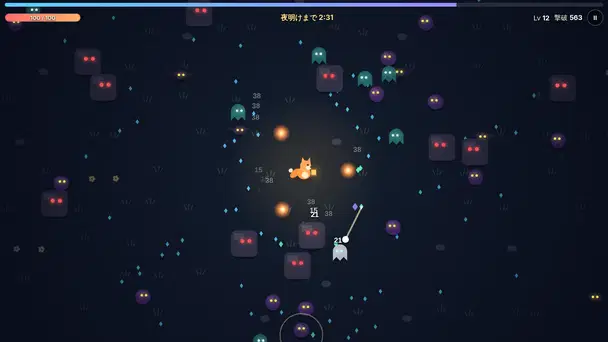 [合集截图](<https://github.com/kitsunecat/daily-mini-games/blob/main/games/2026-10-24-lantern-night/screenshot.png>) | [kitsunecat/daily-mini-games](<https://github.com/kitsunecat/daily-mini-games>) | 常见根目录许可文件未找到 | 待核 | [5.2](<https://github.com/kitsunecat/daily-mini-games/blob/main/games/2026-10-24-lantern-night/screenshot.png>) | [可达 · 合集所列网页](<https://kitsunecat.github.io/daily-mini-games/>) |
| 1180 | [ ] | [Daily Poké Catch](<https://github.com/gamingnews5/awesome-opus-5.5-games/blob/9a29b570e56bd19f15a3cd6bbac0b8c682f2c48c/games/daily-poke-catch/readme.md>) | 待补截图 | [TAziz05/daily-poke-catch](<https://github.com/TAziz05/daily-poke-catch>) | 常见根目录许可文件未找到 | 待核 | — | [可达 · 合集所列网页](<https://taziz05.github.io/daily-poke-catch/>) |
| 1181 | [ ] | [Dance With The Devil](<https://github.com/gamingnews5/awesome-opus-5.5-games/blob/9a29b570e56bd19f15a3cd6bbac0b8c682f2c48c/games/dance-with-the-devil/readme.md>) | 待补截图 | [SefaSelim/dance-with-the-devil](<https://github.com/SefaSelim/dance-with-the-devil>) | 常见根目录许可文件未找到 | 待核 | — | 未列入口 |
| 1182 | [ ] | [Dang: Rainy Cabin](<https://github.com/gamingnews5/awesome-opus-5.5-games/blob/9a29b570e56bd19f15a3cd6bbac0b8c682f2c48c/games/dang-rainy-cabin/readme.md>) | 待补截图 | [andmillionaire/Dang](<https://github.com/andmillionaire/Dang>) | 常见根目录许可文件未找到 | 待核 | — | 未列入口 |
| 1183 | [ ] | [Danny Abbo’s very own Monikers that makes up for him forgetting it](<https://github.com/gamingnews5/awesome-opus-5.5-games/blob/9a29b570e56bd19f15a3cd6bbac0b8c682f2c48c/games/danny-abbo-s-very-own-monikers-that-makes-up-for-him-forgetting-it/readme.md>) |  [源码运行首页](<https://github.com/dannyabbo/monikers/blob/main/index.html>) | [dannyabbo/monikers](<https://github.com/dannyabbo/monikers>) | 常见根目录许可文件未找到 | 待核 | — | 未列入口 |
| 1184 | [ ] | [Darkfate](<https://github.com/gamingnews5/awesome-opus-5.5-games/blob/9a29b570e56bd19f15a3cd6bbac0b8c682f2c48c/games/darkfate/readme.md>) | 待补截图 | [Audioscream/darkfate](<https://github.com/Audioscream/darkfate>) | 常见根目录许可文件未找到 | 待核 | — | 未列入口 |
| 1185 | [ ] | [Dash Strike](<https://github.com/gamingnews5/awesome-opus-5.5-games/blob/9a29b570e56bd19f15a3cd6bbac0b8c682f2c48c/games/dash-strike/readme.md>) | 待补截图 | [rzqwang/dash-strike](<https://github.com/rzqwang/dash-strike>) | 常见根目录许可文件未找到 | 待核 | — | 未列入口 |
| 1186 | [ ] | [DASHDUEL](<https://github.com/gamingnews5/awesome-opus-5.5-games/blob/9a29b570e56bd19f15a3cd6bbac0b8c682f2c48c/games/dashduel/readme.md>) | 待补截图 | [Js23321/Dashduel](<https://github.com/Js23321/Dashduel>) | 常见根目录许可文件未找到 | 待核 | — | 未列入口 |
| 1187 | [ ] | [Dawnmark](<https://github.com/gamingnews5/awesome-opus-5.5-games/blob/9a29b570e56bd19f15a3cd6bbac0b8c682f2c48c/games/dawnmark/readme.md>) | 待补截图 | [Funashigiri/dawnmark](<https://github.com/Funashigiri/dawnmark>) | 常见根目录许可文件未找到 | 待核 | — | 未列入口 |
| 1188 | [ ] | [Day Out 🌷](<https://github.com/gamingnews5/awesome-opus-5.5-games/blob/9a29b570e56bd19f15a3cd6bbac0b8c682f2c48c/games/day-out/readme.md>) | 待补截图 | [tang-hazei-20t10-ne/tang-hazei-20t10-ne.github.io](<https://github.com/tang-hazei-20t10-ne/tang-hazei-20t10-ne.github.io>) | 常见根目录许可文件未找到 | 待核 | — | 未列入口 |
| 1189 | [ ] | [Day2 Game Play](<https://github.com/gamingnews5/awesome-opus-5.5-games/blob/9a29b570e56bd19f15a3cd6bbac0b8c682f2c48c/games/day2-game-play/readme.md>) | 待补截图 | [whxoals03/day2-game-play](<https://github.com/whxoals03/day2-game-play>) | 常见根目录许可文件未找到 | 待核 | — | [可达 · 合集所列网页](<https://day2-game-play.vercel.app>) |
| 1190 | [ ] | [DCity](<https://github.com/gamingnews5/awesome-opus-5.5-games/blob/9a29b570e56bd19f15a3cd6bbac0b8c682f2c48c/games/dcity/readme.md>) | 待补截图 | [dbphx/game-center](<https://github.com/dbphx/game-center>) | 常见根目录许可文件未找到 | 待核 | — | 未列入口 |
| 1191 | [ ] | [De Lage Landen](<https://github.com/gamingnews5/awesome-opus-5.5-games/blob/9a29b570e56bd19f15a3cd6bbac0b8c682f2c48c/games/de-lage-landen/readme.md>) | 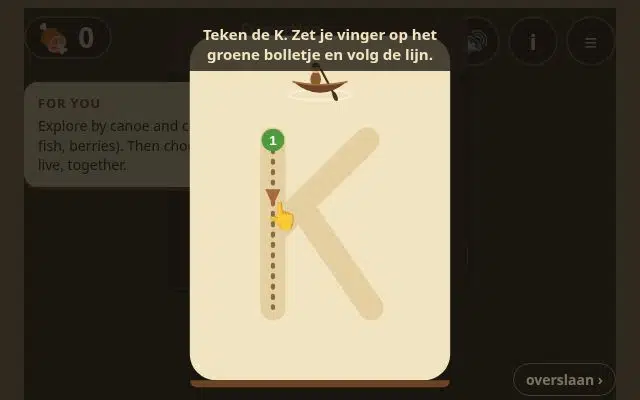 [源码网页实截](<https://github.com/RemcoG75/De-Lage-Landen/blob/main/index.html>) | [RemcoG75/De-Lage-Landen](<https://github.com/RemcoG75/De-Lage-Landen>) | 常见根目录许可文件未找到 | 待核 | — | 未列入口 |
| 1192 | [ ] | [De Vagabundo a Millonario](<https://github.com/gamingnews5/awesome-opus-5.5-games/blob/9a29b570e56bd19f15a3cd6bbac0b8c682f2c48c/games/de-vagabundo-a-millonario/readme.md>) | 待补截图 | [kokellara12-maker/apps-k4m9q2](<https://github.com/kokellara12-maker/apps-k4m9q2>) | 常见根目录许可文件未找到 | 待核 | — | [可达 · 合集所列网页](<https://kokellara12-maker.github.io/apps-k4m9q2/casa.html>) |
| 1193 | [ ] | [Dead Acre](<https://github.com/gamingnews5/awesome-opus-5.5-games/blob/9a29b570e56bd19f15a3cd6bbac0b8c682f2c48c/games/dead-acre/readme.md>) | 待补截图 | [keanemark2-afk/Zombie-shooter](<https://github.com/keanemark2-afk/Zombie-shooter>) | 常见根目录许可文件未找到 | 待核 | — | 未列入口 |
| 1194 | [ ] | [DEAD AIR](<https://github.com/gamingnews5/awesome-opus-5.5-games/blob/9a29b570e56bd19f15a3cd6bbac0b8c682f2c48c/games/dead-air/readme.md>) | 待补截图 | [PieterMey/theboys](<https://github.com/PieterMey/theboys>) | 常见根目录许可文件未找到 | 待核 | — | 未列入口 |
| 1195 | [ ] | [DEAD BLOCK](<https://github.com/gamingnews5/awesome-opus-5.5-games/blob/9a29b570e56bd19f15a3cd6bbac0b8c682f2c48c/games/dead-block/readme.md>) | 待补截图 | [Shantodotdev/zombie](<https://github.com/Shantodotdev/zombie>) | 常见根目录许可文件未找到 | 待核 | — | 未列入口 |
| 1196 | [ ] | [Dead Ground](<https://github.com/gamingnews5/awesome-opus-5.5-games/blob/9a29b570e56bd19f15a3cd6bbac0b8c682f2c48c/games/dead-ground/readme.md>) | 待补截图 | [GreenMachine414/dead-ground](<https://github.com/GreenMachine414/dead-ground>) | 常见根目录许可文件未找到 | 待核 | — | 未列入口 |
| 1197 | [ ] | [Dead Harvest](<https://github.com/gamingnews5/awesome-opus-5.5-games/blob/9a29b570e56bd19f15a3cd6bbac0b8c682f2c48c/games/dead-harvest/readme.md>) | 待补截图 | [JOSHIONCLAUDE/dead-harvest](<https://github.com/JOSHIONCLAUDE/dead-harvest>) | 常见根目录许可文件未找到 | 待核 | — | [可达 · 合集所列网页](<https://joshionclaude.github.io/dead-harvest/>) |
| 1198 | [ ] | [Dead Man's Run](<https://github.com/gamingnews5/awesome-opus-5.5-games/blob/9a29b570e56bd19f15a3cd6bbac0b8c682f2c48c/games/dead-man-s-run/readme.md>) | 待补截图 | [teachtyteach/Dead-Mans-Run](<https://github.com/teachtyteach/Dead-Mans-Run>) | 常见根目录许可文件未找到 | 待核 | — | 未列入口 |
| 1199 | [ ] | [Dead Waves](<https://github.com/gamingnews5/awesome-opus-5.5-games/blob/9a29b570e56bd19f15a3cd6bbac0b8c682f2c48c/games/dead-waves/readme.md>) | 待补截图 | [Megadeath11/dead-waves](<https://github.com/Megadeath11/dead-waves>) | 常见根目录许可文件未找到 | 待核 | — | 未列入口 |
| 1200 | [ ] | [Deadline Dash](<https://github.com/gamingnews5/awesome-opus-5.5-games/blob/9a29b570e56bd19f15a3cd6bbac0b8c682f2c48c/games/deadline-dash/readme.md>) |  [试玩首页实截](<https://atharvakarekar.github.io/Consulting/>) | [Atharvakarekar/Consulting](<https://github.com/Atharvakarekar/Consulting>) | 常见根目录许可文件未找到 | 待核 | — | [可达 · 含游戏画布／引擎的网页](<https://atharvakarekar.github.io/Consulting/>) |
| 1201 | [ ] | [Deadlock Guess Who](<https://github.com/gamingnews5/awesome-opus-5.5-games/blob/9a29b570e56bd19f15a3cd6bbac0b8c682f2c48c/games/deadlock-guess-who/readme.md>) | 待补截图 | [zxorshi/deadlock-guess-who](<https://github.com/zxorshi/deadlock-guess-who>) | 常见根目录许可文件未找到 | 待核 | — | [可达 · 合集所列网页](<https://zxorshi.github.io/deadlock-guess-who/>) |
| 1202 | [ ] | [Deal or No Deal](<https://github.com/gamingnews5/awesome-opus-5.5-games/blob/9a29b570e56bd19f15a3cd6bbac0b8c682f2c48c/games/deal-or-no-deal/readme.md>) |  [上游动图截帧](<https://github.com/srpatatas/produsa/blob/main/public/images/deal_intro.GIF>) | [srpatatas/produsa](<https://github.com/srpatatas/produsa>) | 常见根目录许可文件未找到 | 待核 | [3.0](<https://github.com/srpatatas/produsa/blob/main/public/images/deal_intro.GIF>) | 未列入口 |
| 1203 | [ ] | [Dealers Choice](<https://github.com/gamingnews5/awesome-opus-5.5-games/blob/9a29b570e56bd19f15a3cd6bbac0b8c682f2c48c/games/dealers-choice/readme.md>) | 待补截图 | [jimerb/Dealers-Choice](<https://github.com/jimerb/Dealers-Choice>) | 常见根目录许可文件未找到 | 待核 | [6.0](<https://github.com/jimerb/Dealers-Choice/blob/main/docs/images/showcase.jpg>) | [可达 · 合集所列网页](<https://jimerb.github.io/Dealers-Choice/>) |
| 1204 | [ ] | [Deathwalker](<https://github.com/gamingnews5/awesome-opus-5.5-games/blob/9a29b570e56bd19f15a3cd6bbac0b8c682f2c48c/games/deathwalker/readme.md>) | 待补截图 | [huuuda-aus/deathwalker](<https://github.com/huuuda-aus/deathwalker>) | 常见根目录许可文件未找到 | 待核 | — | 未列入口 |
| 1205 | [ ] | [Debug Dash](<https://github.com/gamingnews5/awesome-opus-5.5-games/blob/9a29b570e56bd19f15a3cd6bbac0b8c682f2c48c/games/debug-dash/readme.md>) | 待补截图 | [HaarisahHussain/Spin-The-Wheel-](<https://github.com/HaarisahHussain/Spin-The-Wheel->) | 常见根目录许可文件未找到 | 待核 | — | 未列入口 |
| 1206 | [ ] | [Declare](<https://github.com/gamingnews5/awesome-opus-5.5-games/blob/9a29b570e56bd19f15a3cd6bbac0b8c682f2c48c/games/declare/readme.md>) | 待补截图 | [Abhyuday2103/declare](<https://github.com/Abhyuday2103/declare>) | 常见根目录许可文件未找到 | 待核 | — | 未列入口 |
| 1207 | [ ] | [Decreto](<https://github.com/gamingnews5/awesome-opus-5.5-games/blob/9a29b570e56bd19f15a3cd6bbac0b8c682f2c48c/games/decreto/readme.md>) | 待补截图 | [viniciuspassos/decreto](<https://github.com/viniciuspassos/decreto>) | 常见根目录许可文件未找到 | 待核 | — | 未列入口 |
| 1208 | [ ] | [DECWAR](<https://github.com/gamingnews5/awesome-opus-5.5-games/blob/9a29b570e56bd19f15a3cd6bbac0b8c682f2c48c/games/decwar/readme.md>) | 待补截图 | [erictfree/DECWAR](<https://github.com/erictfree/DECWAR>) | 常见根目录许可文件未找到 | 待核 | — | [可达 · 合集所列网页](<https://decwar.org>) |
| 1209 | [ ] | [Deduction](<https://github.com/gamingnews5/awesome-opus-5.5-games/blob/9a29b570e56bd19f15a3cd6bbac0b8c682f2c48c/games/deduction/readme.md>) | 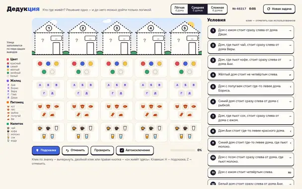 [合集截图](<https://github.com/swan4er/opus-100-projects/blob/main/093-deduction/preview.jpg>) | [swan4er/opus-100-projects](<https://github.com/swan4er/opus-100-projects>) | 常见根目录许可文件未找到 | 待核 | [7.0](<https://github.com/swan4er/opus-100-projects/blob/main/093-deduction/preview.jpg>) | [可达 · 含游戏画布／引擎的网页](<https://swan4er.github.io/opus-100-projects/093-deduction/>) |
| 1210 | [ ] | [Deep Bite 🐟](<https://github.com/gamingnews5/awesome-opus-5.5-games/blob/9a29b570e56bd19f15a3cd6bbac0b8c682f2c48c/games/deep-bite/readme.md>) | 待补截图 | [spicerpon/deep-bite](<https://github.com/spicerpon/deep-bite>) | 常见根目录许可文件未找到 | 待核 | — | 未列入口 |
| 1211 | [ ] | [Deep Bloom](<https://github.com/gamingnews5/awesome-opus-5.5-games/blob/9a29b570e56bd19f15a3cd6bbac0b8c682f2c48c/games/deep-bloom/readme.md>) | 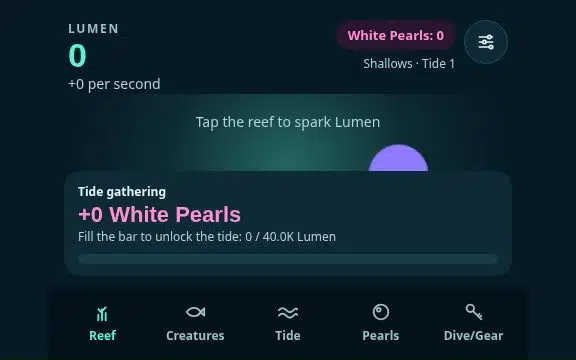 [源码运行画面](<https://github.com/dle-wrk/deep-bloom/blob/main/index.html>) | [dle-wrk/deep-bloom](<https://github.com/dle-wrk/deep-bloom>) | 常见根目录许可文件未找到 | 待核 | — | 未列入口 |
| 1212 | [ ] | [Deep Dive](<https://github.com/gamingnews5/awesome-opus-5.5-games/blob/9a29b570e56bd19f15a3cd6bbac0b8c682f2c48c/games/deep-dive/readme.md>) |  [合集截图](<https://github.com/chichiroxursox-droid/deep-dive/blob/1871bd392880ffe7179eb7c75054d105fc55ab4d/docs/goggles.png>) | [chichiroxursox-droid/deep-dive](<https://github.com/chichiroxursox-droid/deep-dive>) | 常见根目录许可文件未找到 | 待核 | [7.0](<https://github.com/chichiroxursox-droid/deep-dive/blob/1871bd392880ffe7179eb7c75054d105fc55ab4d/docs/goggles.png>) | [可达 · 合集所列网页](<https://deep-dive-rosy.vercel.app>) |
| 1213 | [ ] | [Deep Dive (jackmilner004-png)](<https://github.com/gamingnews5/awesome-opus-5.5-games/blob/9a29b570e56bd19f15a3cd6bbac0b8c682f2c48c/games/deep-dive-jackmilner004-png/readme.md>) |  [源码运行首页](<https://github.com/jackmilner004-png/Deep-Dive/blob/main/index.html>) | [jackmilner004-png/Deep-Dive](<https://github.com/jackmilner004-png/Deep-Dive>) | 常见根目录许可文件未找到 | 待核 | — | 未列入口 |
| 1214 | [ ] | [Deep Sea Serpent](<https://github.com/gamingnews5/awesome-opus-5.5-games/blob/9a29b570e56bd19f15a3cd6bbac0b8c682f2c48c/games/deep-sea-serpent/readme.md>) | 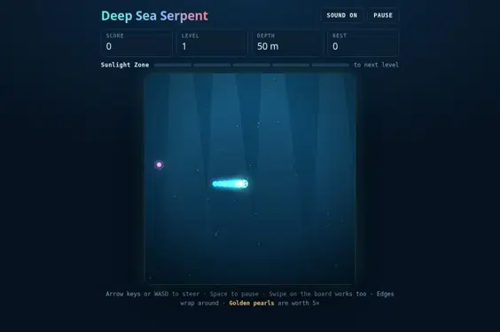 [试玩画面](<https://johnson-codes.github.io/deep-sea-serpent/>) | [johnson-codes/deep-sea-serpent](<https://github.com/johnson-codes/deep-sea-serpent>) | 常见根目录许可文件未找到 | 待核 | — | [可达 · 含游戏画布／引擎的网页](<https://johnson-codes.github.io/deep-sea-serpent/>) |
| 1215 | [ ] | [Deepcore](<https://github.com/gamingnews5/awesome-opus-5.5-games/blob/9a29b570e56bd19f15a3cd6bbac0b8c682f2c48c/games/deepcore/readme.md>) | 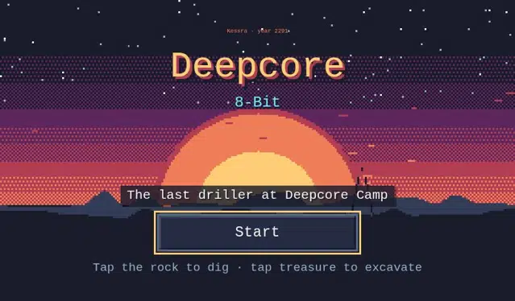 [试玩首页实截](<https://ishino.github.io/deepcore/>) | [Ishino/deepcore](<https://github.com/Ishino/deepcore>) | 常见根目录许可文件未找到 | 待核 | — | [可达 · 含游戏画布／引擎的网页](<https://ishino.github.io/deepcore/>) |
| 1216 | [ ] | [Deeper](<https://github.com/gamingnews5/awesome-opus-5.5-games/blob/9a29b570e56bd19f15a3cd6bbac0b8c682f2c48c/games/deeper/readme.md>) |  [合集截图](<https://github.com/swan4er/opus-100-projects/blob/main/060-deeper-roguelike/preview.jpg>) | [swan4er/opus-100-projects](<https://github.com/swan4er/opus-100-projects>) | 常见根目录许可文件未找到 | 待核 | [6.8](<https://github.com/swan4er/opus-100-projects/blob/main/060-deeper-roguelike/preview.jpg>) | [可达 · 含游戏画布／引擎的网页](<https://swan4er.github.io/opus-100-projects/060-deeper-roguelike/>) |
| 1217 | [ ] | [Deepward](<https://github.com/gamingnews5/awesome-opus-5.5-games/blob/9a29b570e56bd19f15a3cd6bbac0b8c682f2c48c/games/deepward/readme.md>) |  [上游游戏截图](<https://github.com/leehj825/Deepward/blob/HEAD/docs/screenshots/dungeon.png>) | [leehj825/Deepward](<https://github.com/leehj825/Deepward>) | 常见根目录许可文件未找到 | [README 提及](<https://github.com/leehj825/Deepward/blob/HEAD/README.md#L458>) | — | 未列入口 |
| 1218 | [ ] | [Defensive](<https://github.com/gamingnews5/awesome-opus-5.5-games/blob/9a29b570e56bd19f15a3cd6bbac0b8c682f2c48c/games/defensive/readme.md>) | 待补截图 | [dkeslowitz-afk/Defensive](<https://github.com/dkeslowitz-afk/Defensive>) | 常见根目录许可文件未找到 | 待核 | — | 未列入口 |
| 1219 | [ ] | [DEGEN LIFE](<https://github.com/gamingnews5/awesome-opus-5.5-games/blob/9a29b570e56bd19f15a3cd6bbac0b8c682f2c48c/games/degen-life/readme.md>) | 待补截图 | [papunapapashvili03/normielife](<https://github.com/papunapapashvili03/normielife>) | 常见根目录许可文件未找到 | 待核 | — | [可达 · 合集所列网页](<https://normielife.vercel.app>) |
| 1220 | [ ] | [Degen Pig](<https://github.com/gamingnews5/awesome-opus-5.5-games/blob/9a29b570e56bd19f15a3cd6bbac0b8c682f2c48c/games/degen-pig/readme.md>) | 待补截图 | [jonnycosmopoker/degen-pig](<https://github.com/jonnycosmopoker/degen-pig>) | 常见根目录许可文件未找到 | 待核 | — | 未列入口 |
| 1221 | [ ] | [DeltaNova: Uprising — Play](<https://github.com/gamingnews5/awesome-opus-5.5-games/blob/9a29b570e56bd19f15a3cd6bbac0b8c682f2c48c/games/deltanova-uprising-play/readme.md>) | 待补截图 | [garygrandchamp-cmyk/delta-nova-uprising-play](<https://github.com/garygrandchamp-cmyk/delta-nova-uprising-play>) | 常见根目录许可文件未找到 | [README 提及](<https://github.com/garygrandchamp-cmyk/delta-nova-uprising-play/blob/HEAD/README.md#L11>) | — | [可达 · 含游戏画布／引擎的网页](<https://garygrandchamp-cmyk.github.io/delta-nova-uprising-play/>) |
| 1222 | [ ] | [Delve](<https://github.com/gamingnews5/awesome-opus-5.5-games/blob/9a29b570e56bd19f15a3cd6bbac0b8c682f2c48c/games/delve/readme.md>) | 待补截图 | [Garebear72/delve](<https://github.com/Garebear72/delve>) | 常见根目录许可文件未找到 | 待核 | — | 未列入口 |
| 1223 | [ ] | [Dented Destiny · The Bellwether Abbey](<https://github.com/gamingnews5/awesome-opus-5.5-games/blob/9a29b570e56bd19f15a3cd6bbac0b8c682f2c48c/games/dented-destiny-the-bellwether-abbey/readme.md>) | 待补截图 | [michaelcrosato/DentedDestiny-Z7](<https://github.com/michaelcrosato/DentedDestiny-Z7>) | 常见根目录许可文件未找到 | 待核 | — | 未列入口 |
| 1224 | [ ] | [Depths of Tristfall](<https://github.com/gamingnews5/awesome-opus-5.5-games/blob/9a29b570e56bd19f15a3cd6bbac0b8c682f2c48c/games/depths-of-tristfall/readme.md>) |  [合集截图](<https://github.com/cosmin-l/IsometricGame/blob/main/docs/screenshots/town.png>) | [cosmin-l/IsometricGame](<https://github.com/cosmin-l/IsometricGame>) | 常见根目录许可文件未找到 | 待核 | [5.8](<https://github.com/cosmin-l/IsometricGame/blob/main/docs/screenshots/town.png>) | 未列入口 |
| 1225 | [ ] | [Der Große Jakob](<https://github.com/gamingnews5/awesome-opus-5.5-games/blob/9a29b570e56bd19f15a3cd6bbac0b8c682f2c48c/games/der-gro-e-jakob/readme.md>) | 待补截图 | [Ranger-Jones/the-big-jacob](<https://github.com/Ranger-Jones/the-big-jacob>) | 常见根目录许可文件未找到 | 待核 | — | [可达 · 合集所列网页](<https://the-big-jacob.vercel.app>) |
| 1226 | [ ] | [Derby Day](<https://github.com/gamingnews5/awesome-opus-5.5-games/blob/9a29b570e56bd19f15a3cd6bbac0b8c682f2c48c/games/derby-day/readme.md>) | 待补截图 | [zuzivian/derby-day](<https://github.com/zuzivian/derby-day>) | 常见根目录许可文件未找到 | 待核 | — | 未列入口 |
| 1227 | [ ] | [Desert Spaceport](<https://github.com/gamingnews5/awesome-opus-5.5-games/blob/9a29b570e56bd19f15a3cd6bbac0b8c682f2c48c/games/desert-spaceport/readme.md>) |  [上游实机演示截帧](<https://github.com/wr-max52/dune-game/blob/HEAD/docs/promo/openspace_promo.mp4>) | [wr-max52/dune-game](<https://github.com/wr-max52/dune-game>) | 常见根目录许可文件未找到 | 待核 | — | 未列入口 |
| 1228 | [ ] | [Dessert Pop! — 디저트 매치3 H5 게임](<https://github.com/gamingnews5/awesome-opus-5.5-games/blob/9a29b570e56bd19f15a3cd6bbac0b8c682f2c48c/games/dessert-pop-3-h5/readme.md>) | 待补截图 | [BryanRha/dessert-pop](<https://github.com/BryanRha/dessert-pop>) | 常见根目录许可文件未找到 | 待核 | — | [可达 · 含游戏画布／引擎的网页](<https://bryanrha.github.io/dessert-pop/>) |
| 1229 | [ ] | [Destroy the Cube!](<https://github.com/gamingnews5/awesome-opus-5.5-games/blob/9a29b570e56bd19f15a3cd6bbac0b8c682f2c48c/games/destroy-the-cube/readme.md>) | 待补截图 | [asivixlp44-cmyk/destroy-the-cube](<https://github.com/asivixlp44-cmyk/destroy-the-cube>) | 常见根目录许可文件未找到 | 待核 | — | [README · 可达 · 含游戏画布／引擎的网页](<https://destroy-the-cube.play.bloxity.io>) |
| 1230 | [ ] | [Deutsch Spielplatz](<https://github.com/gamingnews5/awesome-opus-5.5-games/blob/9a29b570e56bd19f15a3cd6bbac0b8c682f2c48c/games/deutsch-spielplatz/readme.md>) | 待补截图 | [arman1371/lingoat.games](<https://github.com/arman1371/lingoat.games>) | [README 许可段声明保留权利、限制使用或尚未授权](<https://github.com/arman1371/lingoat.games/blob/HEAD/README.md>) | 待核 | — | 未列入口 |
| 1231 | [ ] | [DEV QUEST](<https://github.com/gamingnews5/awesome-opus-5.5-games/blob/9a29b570e56bd19f15a3cd6bbac0b8c682f2c48c/games/dev-quest/readme.md>) |  [合集截图](<https://github.com/agutierrezclab/dev-quest/blob/HEAD/docs/screens/wave4_deploy.png>) | [agutierrezclab/dev-quest](<https://github.com/agutierrezclab/dev-quest>) | 常见根目录许可文件未找到 | 待核 | [6.4](<https://github.com/agutierrezclab/dev-quest/blob/HEAD/docs/screens/wave4_deploy.png>) | [可达 · 含游戏画布／引擎的网页](<https://dev-quest-nu.vercel.app/>) |
| 1232 | [ ] | [Devdle](<https://github.com/gamingnews5/awesome-opus-5.5-games/blob/9a29b570e56bd19f15a3cd6bbac0b8c682f2c48c/games/devdle/readme.md>) | 待补截图 | [mikemich/devdle](<https://github.com/mikemich/devdle>) | 常见根目录许可文件未找到 | 待核 | — | [可达 · 合集所列网页](<https://mikemich.github.io/devdle/>) |
| 1233 | [ ] | [Development Atlas](<https://github.com/gamingnews5/awesome-opus-5.5-games/blob/9a29b570e56bd19f15a3cd6bbac0b8c682f2c48c/games/development-atlas/readme.md>) |  [试玩首页实截](<https://marcusgrodem.github.io/development-atlas/>) | [MarcusGrodem/development-atlas](<https://github.com/MarcusGrodem/development-atlas>) | 常见根目录许可文件未找到 | 待核 | — | [可达 · 合集所列网页](<https://marcusgrodem.github.io/development-atlas/>) |
| 1234 | [ ] | [Devil's Lair](<https://github.com/gamingnews5/awesome-opus-5.5-games/blob/9a29b570e56bd19f15a3cd6bbac0b8c682f2c48c/games/devil-s-lair/readme.md>) |  [源码运行首页](<https://github.com/breezegiga-dot/devils-lair/blob/main/index.html>) | [breezegiga-dot/devils-lair](<https://github.com/breezegiga-dot/devils-lair>) | 常见根目录许可文件未找到 | 待核 | — | 未列入口 |
| 1235 | [ ] | [Dew Point · Code Game](<https://github.com/gamingnews5/awesome-opus-5.5-games/blob/9a29b570e56bd19f15a3cd6bbac0b8c682f2c48c/games/dew-point-code-game/readme.md>) | 待补截图 | [CieasCheligeman/Code-Game](<https://github.com/CieasCheligeman/Code-Game>) | 常见根目录许可文件未找到 | 待核 | — | 未列入口 |
| 1236 | [ ] | [Dh Ai Arcade](<https://github.com/gamingnews5/awesome-opus-5.5-games/blob/9a29b570e56bd19f15a3cd6bbac0b8c682f2c48c/games/dh-ai-arcade/readme.md>) | 待补截图 | [Valisium/dh-ai-arcade](<https://github.com/Valisium/dh-ai-arcade>) | 常见根目录许可文件未找到 | 待核 | — | 未列入口 |
| 1237 | [ ] | [Dice Arcade](<https://github.com/gamingnews5/awesome-opus-5.5-games/blob/9a29b570e56bd19f15a3cd6bbac0b8c682f2c48c/games/dice-arcade/readme.md>) | 待补截图 | [vipinmohan11/offline-games-bundle](<https://github.com/vipinmohan11/offline-games-bundle>) | 常见根目录许可文件未找到 | 待核 | — | 未列入口 |
| 1238 | [ ] | [Dice Bingo](<https://github.com/gamingnews5/awesome-opus-5.5-games/blob/9a29b570e56bd19f15a3cd6bbac0b8c682f2c48c/games/dice-bingo/readme.md>) | 待补截图 | [pradhanmantrielectionsgame/dice-bingo](<https://github.com/pradhanmantrielectionsgame/dice-bingo>) | 常见根目录许可文件未找到 | 待核 | — | 未列入口 |
| 1239 | [ ] | [Dice Catcher](<https://github.com/gamingnews5/awesome-opus-5.5-games/blob/9a29b570e56bd19f15a3cd6bbac0b8c682f2c48c/games/dice-catcher/readme.md>) | 待补截图 | [ArnasJuskevicius/dice-catcher](<https://github.com/ArnasJuskevicius/dice-catcher>) | 常见根目录许可文件未找到 | 待核 | — | 未列入口 |
| 1240 | [ ] | [Dice Den](<https://github.com/gamingnews5/awesome-opus-5.5-games/blob/9a29b570e56bd19f15a3cd6bbac0b8c682f2c48c/games/dice-den/readme.md>) |  [源码运行首页](<https://github.com/ANEONAGO/dice-den/blob/master/game.html>) | [ANEONAGO/dice-den](<https://github.com/ANEONAGO/dice-den>) | 常见根目录许可文件未找到 | 待核 | — | [README · 可达 · 上游 README 所列网页](<https://aneonago.github.io/dice-den/>) |
| 1241 | [ ] | [Dice Empire](<https://github.com/gamingnews5/awesome-opus-5.5-games/blob/9a29b570e56bd19f15a3cd6bbac0b8c682f2c48c/games/dice-empire/readme.md>) | 待补截图 | [rav291/dice-empire](<https://github.com/rav291/dice-empire>) | 常见根目录许可文件未找到 | 待核 | — | 未列入口 |
| 1242 | [ ] | [Dice Game](<https://github.com/gamingnews5/awesome-opus-5.5-games/blob/9a29b570e56bd19f15a3cd6bbac0b8c682f2c48c/games/dice-game/readme.md>) | 待补截图 | [gerterholyelvis-pixel/dice-game](<https://github.com/gerterholyelvis-pixel/dice-game>) | 常见根目录许可文件未找到 | 待核 | — | 未列入口 |
| 1243 | [ ] | [Digi Garden](<https://github.com/gamingnews5/awesome-opus-5.5-games/blob/9a29b570e56bd19f15a3cd6bbac0b8c682f2c48c/games/digi-garden/readme.md>) | 待补截图 | [phenomenal-manish/gpt6-astra-vs-opus5-digimon-sim](<https://github.com/phenomenal-manish/gpt6-astra-vs-opus5-digimon-sim>) | 常见根目录许可文件未找到 | 待核 | — | 未列入口 |
| 1244 | [ ] | [Digiplanes](<https://github.com/gamingnews5/awesome-opus-5.5-games/blob/9a29b570e56bd19f15a3cd6bbac0b8c682f2c48c/games/digiplanes/readme.md>) | 待补截图 | [gb1577/digiplanes](<https://github.com/gb1577/digiplanes>) | 常见根目录许可文件未找到 | 待核 | [6.8（原图失效）](<https://github.com/gb1577/digiplanes/blob/main/docs/cobalt.jpg>) | [可达 · 含游戏画布／引擎的网页](<https://gb1577.github.io/digiplanes/>) |
| 1245 | [ ] | [Dimensional](<https://github.com/gamingnews5/awesome-opus-5.5-games/blob/9a29b570e56bd19f15a3cd6bbac0b8c682f2c48c/games/dimensional/readme.md>) | 待补截图 | [henrythebaby1-ops/dimensional](<https://github.com/henrythebaby1-ops/dimensional>) | 常见根目录许可文件未找到 | 待核 | — | [可达 · 含游戏画布／引擎的网页](<https://henrythebaby1-ops.github.io/dimensional/>) |
| 1246 | [ ] | [Dimmer Switch](<https://github.com/gamingnews5/awesome-opus-5.5-games/blob/9a29b570e56bd19f15a3cd6bbac0b8c682f2c48c/games/dimmer-switch/readme.md>) |  [上游动图截帧](<https://github.com/ahab94/dimmer-switch/blob/main/docs/media/blackout.gif>) | [ahab94/dimmer-switch](<https://github.com/ahab94/dimmer-switch>) | 常见根目录许可文件未找到 | 待核 | [5.5](<https://github.com/ahab94/dimmer-switch/blob/main/docs/media/blackout.gif>) | [可达 · 含游戏画布／引擎的网页](<https://ahab94.github.io/dimmer-switch/>) |
| 1247 | [ ] | [Dingsty Demo](<https://github.com/gamingnews5/awesome-opus-5.5-games/blob/9a29b570e56bd19f15a3cd6bbac0b8c682f2c48c/games/dingsty-demo/readme.md>) | 待补截图 | [SUPERMAGIC1111/dingsty-demo](<https://github.com/SUPERMAGIC1111/dingsty-demo>) | 常见根目录许可文件未找到 | 待核 | — | 未列入口 |
| 1248 | [ ] | [Dino Blokwereld](<https://github.com/gamingnews5/awesome-opus-5.5-games/blob/9a29b570e56bd19f15a3cd6bbac0b8c682f2c48c/games/dino-blokwereld/readme.md>) | 待补截图 | [dalhhorn-ship-it/minespel](<https://github.com/dalhhorn-ship-it/minespel>) | 常见根目录许可文件未找到 | 待核 | — | 未列入口 |
| 1249 | [ ] | [Dino Breakout](<https://github.com/gamingnews5/awesome-opus-5.5-games/blob/9a29b570e56bd19f15a3cd6bbac0b8c682f2c48c/games/dino-breakout/readme.md>) | 待补截图 | [mellemnick-del/dino-breakout](<https://github.com/mellemnick-del/dino-breakout>) | 常见根目录许可文件未找到 | 待核 | — | 未列入口 |
| 1250 | [ ] | [Dino Day (Dinopäev)](<https://github.com/gamingnews5/awesome-opus-5.5-games/blob/9a29b570e56bd19f15a3cd6bbac0b8c682f2c48c/games/dino-day-dinopaev/readme.md>) | 待补截图 | [bokunobaka/dino-day](<https://github.com/bokunobaka/dino-day>) | 常见根目录许可文件未找到 | 待核 | — | [可达 · 含游戏画布／引擎的网页](<https://bokunobaka.github.io/dino-day/>) |
| 1251 | [ ] | [Dino Rush](<https://github.com/gamingnews5/awesome-opus-5.5-games/blob/9a29b570e56bd19f15a3cd6bbac0b8c682f2c48c/games/dino-rush/readme.md>) |  [同款源码网页实截](<https://github.com/DanialAlway/dino-rush/blob/HEAD/index.html>) | [DanialAlway/dino-rush](<https://github.com/DanialAlway/dino-rush>) | 常见根目录许可文件未找到 | 待核 | — | [可达 · 含游戏画布／引擎的网页](<https://danialalway.github.io/dino-rush/>) |
| 1252 | [ ] | [Dino-Match](<https://github.com/gamingnews5/awesome-opus-5.5-games/blob/9a29b570e56bd19f15a3cd6bbac0b8c682f2c48c/games/dino-match/readme.md>) |  [源码运行首页](<https://github.com/Wut-Lab/Dino-Match-/blob/main/index.html>) | [Wut-Lab/Dino-Match-](<https://github.com/Wut-Lab/Dino-Match->) | 常见根目录许可文件未找到 | 待核 | — | 未列入口 |
| 1253 | [ ] | [Disaster Island](<https://github.com/gamingnews5/awesome-opus-5.5-games/blob/9a29b570e56bd19f15a3cd6bbac0b8c682f2c48c/games/party-chaos/readme.md>) | 待补截图 | [lawrenceandrewlargo/roblox-extreme-minigames](<https://github.com/lawrenceandrewlargo/roblox-extreme-minigames>) | 常见根目录许可文件未找到 | 待核 | — | 未列入口 |
| 1254 | [ ] | [dna-builders-the-double-helix-challenge](<https://github.com/gamingnews5/awesome-opus-5.5-games/blob/9a29b570e56bd19f15a3cd6bbac0b8c682f2c48c/games/dna-builders-the-double-helix-challenge/readme.md>) | 待补截图 | [nidheeshgtech/dna-builders-the-double-helix-challenge](<https://github.com/nidheeshgtech/dna-builders-the-double-helix-challenge>) | 常见根目录许可文件未找到 | 待核 | — | [可达 · 合集所列网页](<https://dna-builders-the-double-helix-chall.vercel.app>) |
| 1255 | [ ] | [Do Not Disturb](<https://github.com/gamingnews5/awesome-opus-5.5-games/blob/9a29b570e56bd19f15a3cd6bbac0b8c682f2c48c/games/do-not-disturb/readme.md>) | 待补截图 | [SwartzCr/visualnovel](<https://github.com/SwartzCr/visualnovel>) | 常见根目录许可文件未找到 [打包的两款字体子集采用 OFL。](<https://github.com/SwartzCr/visualnovel/blob/HEAD/README.md#L77>) | 待核 | [5.6（原图失效）](<https://github.com/SwartzCr/visualnovel/blob/main/game/images/bg/ballroom_ark.png>) · [看备用画面](<https://raw.githubusercontent.com/SwartzCr/visualnovel/d46258094c28a4533aee481099051737ce7aa24c/game/images/bg/ballroom_ark.png>) | [可达 · 含游戏画布／引擎的网页](<https://swartzcr.github.io/visualnovel/>) |
| 1256 | [ ] | [Doberega — тиша та спокій](<https://github.com/gamingnews5/awesome-opus-5.5-games/blob/9a29b570e56bd19f15a3cd6bbac0b8c682f2c48c/games/doberega/readme.md>) |  [源码运行画面](<https://github.com/denislinnik948-lgtm/doberega/blob/main/index.html>) | [denislinnik948-lgtm/doberega](<https://github.com/denislinnik948-lgtm/doberega>) | 常见根目录许可文件未找到 | 待核 | — | 未列入口 |
| 1257 | [ ] | [Dodger](<https://github.com/gamingnews5/awesome-opus-5.5-games/blob/9a29b570e56bd19f15a3cd6bbac0b8c682f2c48c/games/dodger/readme.md>) | 待补截图 | [hokita/mouse2](<https://github.com/hokita/mouse2>) | 常见根目录许可文件未找到 | 待核 | — | [多游戏仓库入口 · 可达 · 合集所列网页](<https://mouse2-0357d0.web.app/>) |
| 1258 | [ ] | [Dog Dash](<https://github.com/gamingnews5/awesome-opus-5.5-games/blob/9a29b570e56bd19f15a3cd6bbac0b8c682f2c48c/games/dog-dash/readme.md>) |  [源码运行首页](<https://github.com/rauf-mushtaq/dogdash/blob/main/index.html>) | [rauf-mushtaq/dogdash](<https://github.com/rauf-mushtaq/dogdash>) | 常见根目录许可文件未找到 | 待核 | — | 未列入口 |
| 1259 | [ ] | [Dog Game](<https://github.com/gamingnews5/awesome-opus-5.5-games/blob/9a29b570e56bd19f15a3cd6bbac0b8c682f2c48c/games/dog-game/readme.md>) | 待补截图 | [sug0927-alt/dog-game](<https://github.com/sug0927-alt/dog-game>) | 常见根目录许可文件未找到 | 待核 | — | 未列入口 |
| 1260 | [ ] | [Dog — Swiss Card Board Game](<https://github.com/gamingnews5/awesome-opus-5.5-games/blob/9a29b570e56bd19f15a3cd6bbac0b8c682f2c48c/games/dog-swiss-card-board-game/readme.md>) | 待补截图 | [seppbucher-develop/dog](<https://github.com/seppbucher-develop/dog>) | 常见根目录许可文件未找到 | 待核 | — | 未列入口 |
| 1261 | [ ] | [Dogfight.io](<https://github.com/gamingnews5/awesome-opus-5.5-games/blob/9a29b570e56bd19f15a3cd6bbac0b8c682f2c48c/games/dogfight-io/readme.md>) | 待补截图 | [saizazur1/dogfight](<https://github.com/saizazur1/dogfight>) | 常见根目录许可文件未找到 | 待核 | — | 未列入口 |
| 1262 | [ ] | [DogFighter](<https://github.com/gamingnews5/awesome-opus-5.5-games/blob/9a29b570e56bd19f15a3cd6bbac0b8c682f2c48c/games/dogfighter/readme.md>) |  [合集截图](<https://github.com/mokguylee-prog/dogfighter/blob/main/img/screenshot.png>) | [mokguylee-prog/dogfighter](<https://github.com/mokguylee-prog/dogfighter>) | 常见根目录许可文件未找到 | [README 提及](<https://github.com/mokguylee-prog/dogfighter/blob/HEAD/README.md#L39>) | [5.7](<https://github.com/mokguylee-prog/dogfighter/blob/main/img/screenshot.png>) | 未列入口 |
| 1263 | [ ] | [Dogs of War](<https://github.com/gamingnews5/awesome-opus-5.5-games/blob/9a29b570e56bd19f15a3cd6bbac0b8c682f2c48c/games/dogs-of-war/readme.md>) | 待补截图 | [slampunk/dogs-of-war](<https://github.com/slampunk/dogs-of-war>) | 常见根目录许可文件未找到 | 待核 | — | 未列入口 |
| 1264 | [ ] | [Dokle?](<https://github.com/gamingnews5/awesome-opus-5.5-games/blob/9a29b570e56bd19f15a3cd6bbac0b8c682f2c48c/games/dokle/readme.md>) | 待补截图 | [Aalpaka/dokle](<https://github.com/Aalpaka/dokle>) | 常见根目录许可文件未找到 | 待核 | — | [HTTP 错误 · 合集所列网页](<https://dokle-pi.vercel.app>) |
| 1265 | [ ] | [Dollhouse of Doom](<https://github.com/gamingnews5/awesome-opus-5.5-games/blob/9a29b570e56bd19f15a3cd6bbac0b8c682f2c48c/games/dollhouse-of-doom/readme.md>) | 待补截图 | [NuMaiOwO/DollhouseOfDoom](<https://github.com/NuMaiOwO/DollhouseOfDoom>) | 常见根目录许可文件未找到 | 待核 | — | 未列入口 |
| 1266 | [ ] | [Don't Get Got — Holiday Edition](<https://github.com/gamingnews5/awesome-opus-5.5-games/blob/9a29b570e56bd19f15a3cd6bbac0b8c682f2c48c/games/don-t-get-got-holiday-edition/readme.md>) |  [同款源码启动画面实截](<https://github.com/nihakue/getgot/blob/HEAD/index.html>) | [nihakue/getgot](<https://github.com/nihakue/getgot>) | 常见根目录许可文件未找到 | 待核 | — | [可达 · 合集所列网页](<https://nihakue.github.io/getgot/>) |
| 1267 | [ ] | [DON'T LOOK BACK](<https://github.com/gamingnews5/awesome-opus-5.5-games/blob/9a29b570e56bd19f15a3cd6bbac0b8c682f2c48c/games/don-t-look-back/readme.md>) | 待补截图 | [Ankit-Silwal/HorrorThing](<https://github.com/Ankit-Silwal/HorrorThing>) | 常见根目录许可文件未找到 | 待核 | — | 未列入口 |
| 1268 | [ ] | [Don't Touch That Dial!](<https://github.com/gamingnews5/awesome-opus-5.5-games/blob/9a29b570e56bd19f15a3cd6bbac0b8c682f2c48c/games/don-t-touch-that-dial/readme.md>) | 待补截图 | [sosomyr/dont-touch-that-dial](<https://github.com/sosomyr/dont-touch-that-dial>) | 常见根目录许可文件未找到 | 待核 | — | [可达 · 含游戏画布／引擎的网页](<https://dont-touch-that-dial.vercel.app>) |
| 1269 | [ ] | [Don't Wake the Dragon](<https://github.com/gamingnews5/awesome-opus-5.5-games/blob/9a29b570e56bd19f15a3cd6bbac0b8c682f2c48c/games/don-t-wake-the-dragon/readme.md>) | 待补截图 | [Larslllllll/CrazyGames2](<https://github.com/Larslllllll/CrazyGames2>) | 常见根目录许可文件未找到 | 待核 | — | 未列入口 |
| 1270 | [ ] | [Doodad Doombad](<https://github.com/gamingnews5/awesome-opus-5.5-games/blob/9a29b570e56bd19f15a3cd6bbac0b8c682f2c48c/games/doodad-doombad/readme.md>) | 待补截图 | [weirdpug/doodad-doombad](<https://github.com/weirdpug/doodad-doombad>) | 常见根目录许可文件未找到 | [README 提及](<https://github.com/weirdpug/doodad-doombad/blob/HEAD/README.md#L17>) | — | [可达 · 合集所列网页](<https://weirdpug.github.io/doodad-doombad/>) |
| 1271 | [ ] | [Doodle Bridge](<https://github.com/gamingnews5/awesome-opus-5.5-games/blob/9a29b570e56bd19f15a3cd6bbac0b8c682f2c48c/games/doodle-bridge/readme.md>) | 待补截图 | [JLA92-bit/Doodle-Bridge](<https://github.com/JLA92-bit/Doodle-Bridge>) | 常见根目录许可文件未找到 | 待核 | — | 未列入口 |
| 1272 | [ ] | [Doodle-to-3D Marble Coaster Engine](<https://github.com/gamingnews5/awesome-opus-5.5-games/blob/9a29b570e56bd19f15a3cd6bbac0b8c682f2c48c/games/doodle-to-3d-marble-coaster-engine/readme.md>) | 待补截图 | [Aqsa-K/doodle-to-3d-marble-coaster](<https://github.com/Aqsa-K/doodle-to-3d-marble-coaster>) | 常见根目录许可文件未找到 | 待核 | — | 未列入口 |
| 1273 | [ ] | [Door Duty Contractors](<https://github.com/gamingnews5/awesome-opus-5.5-games/blob/9a29b570e56bd19f15a3cd6bbac0b8c682f2c48c/games/door-duty-contractors/readme.md>) | 待补截图 | [KyleLookingAround/door-duty-game](<https://github.com/KyleLookingAround/door-duty-game>) | 常见根目录许可文件未找到 | 待核 | — | 未列入口 |
| 1274 | [ ] | [Doorbuster](<https://github.com/gamingnews5/awesome-opus-5.5-games/blob/9a29b570e56bd19f15a3cd6bbac0b8c682f2c48c/games/doorbuster/readme.md>) |  [合集截图](<https://github.com/Pappydapimp69/Doorbuster/blob/ccr-1c80d350-gl0ii0/store/screenshots/02_toys_150s.png>) | [Pappydapimp69/Doorbuster](<https://github.com/Pappydapimp69/Doorbuster>) | 常见根目录许可文件未找到 | [README 提及、源码有输入读取](<https://github.com/Pappydapimp69/Doorbuster/blob/ccr-1c80d350-gl0ii0/src/main.js#L109>) | [5.4](<https://github.com/Pappydapimp69/Doorbuster/blob/ccr-1c80d350-gl0ii0/store/screenshots/02_toys_150s.png>) | 未列入口 |
| 1275 | [ ] | [Dot Grid](<https://github.com/gamingnews5/awesome-opus-5.5-games/blob/9a29b570e56bd19f15a3cd6bbac0b8c682f2c48c/games/dot-grid/readme.md>) | 待补截图 | [honzaves/dotgame](<https://github.com/honzaves/dotgame>) | 常见根目录许可文件未找到 | 待核 | — | 未列入口 |
| 1276 | [ ] | [Dotpio](<https://github.com/gamingnews5/awesome-opus-5.5-games/blob/9a29b570e56bd19f15a3cd6bbac0b8c682f2c48c/games/dotpio/readme.md>) | 待补截图 | [NAMYUNWOO/dotpio](<https://github.com/NAMYUNWOO/dotpio>) | 常见根目录许可文件未找到 | 待核 | — | 未列入口 |
| 1277 | [ ] | [Doughty's Links](<https://github.com/gamingnews5/awesome-opus-5.5-games/blob/9a29b570e56bd19f15a3cd6bbac0b8c682f2c48c/games/doughty-s-links/readme.md>) | 待补截图 | [delooze29-stack/Doughty-Links](<https://github.com/delooze29-stack/Doughty-Links>) | 常见根目录许可文件未找到 | 待核 | — | [可达 · 含游戏画布／引擎的网页](<https://delooze29-stack.github.io/Doughty-Links/>) |
| 1278 | [ ] | [Downhill Car Race](<https://github.com/gamingnews5/awesome-opus-5.5-games/blob/9a29b570e56bd19f15a3cd6bbac0b8c682f2c48c/games/downhill-car-race/readme.md>) | 待补截图 | [AndyWu/downhill-car-race](<https://github.com/AndyWu/downhill-car-race>) | 常见根目录许可文件未找到 | 待核 | — | 未列入口 |
| 1279 | [ ] | [Dox's RPG](<https://github.com/gamingnews5/awesome-opus-5.5-games/blob/9a29b570e56bd19f15a3cd6bbac0b8c682f2c48c/games/dox-s-rpg/readme.md>) | 待补截图 | [jonbeam1-netizen/doxs-rpg](<https://github.com/jonbeam1-netizen/doxs-rpg>) | 常见根目录许可文件未找到 | 待核 | — | [可达 · 合集所列网页](<https://jonbeam1-netizen.github.io/doxs-rpg/>) |
| 1280 | [ ] | [Draft Chaos](<https://github.com/gamingnews5/awesome-opus-5.5-games/blob/9a29b570e56bd19f15a3cd6bbac0b8c682f2c48c/games/draft-chaos/readme.md>) | 待补截图 | [orsplayvault/draft-chaos](<https://github.com/orsplayvault/draft-chaos>) | 常见根目录许可文件未找到 | 待核 | — | 未列入口 |
| 1281 | [ ] | [Draft Duel](<https://github.com/gamingnews5/awesome-opus-5.5-games/blob/9a29b570e56bd19f15a3cd6bbac0b8c682f2c48c/games/draft-duel/readme.md>) |  [游戏菜单或界面](<https://github.com/khalid413/Draft/blob/main/docs/screenshots/card-library.jpg>) | [khalid413/Draft](<https://github.com/khalid413/Draft>) | 常见根目录许可文件未找到 | 待核 | [4.0](<https://github.com/khalid413/Draft/blob/main/docs/screenshots/card-library.jpg>) | 未列入口 |
| 1282 | [ ] | [Dragon Ball Survivors](<https://github.com/gamingnews5/awesome-opus-5.5-games/blob/9a29b570e56bd19f15a3cd6bbac0b8c682f2c48c/games/dragon-ball-survivors/readme.md>) | 待补截图 | [danelxdev/dragon-ball](<https://github.com/danelxdev/dragon-ball>) | 常见根目录许可文件未找到 | 待核 | — | 未列入口 |
| 1283 | [ ] | [Dragon Quest III — Ebitengine Remake](<https://github.com/gamingnews5/awesome-opus-5.5-games/blob/9a29b570e56bd19f15a3cd6bbac0b8c682f2c48c/games/dragon-quest-iii-ebitengine-remake/readme.md>) |  [合集截图](<https://github.com/wicanr2/kinginformation-dq3-re/blob/HEAD/docs/img/jipang_orochi_first_battle.png>) | [wicanr2/kinginformation-dq3-re](<https://github.com/wicanr2/kinginformation-dq3-re>) | 常见根目录许可文件未找到 | 待核 | [6.8](<https://github.com/wicanr2/kinginformation-dq3-re/blob/HEAD/docs/img/jipang_orochi_first_battle.png>) | 未列入口 |
| 1284 | [ ] | [Dragons vs Machines](<https://github.com/gamingnews5/awesome-opus-5.5-games/blob/9a29b570e56bd19f15a3cd6bbac0b8c682f2c48c/games/dragons-vs-machines/readme.md>) | 待补截图 | [DavidIsaiah/dragons\_vs\_machines](<https://github.com/DavidIsaiah/dragons_vs_machines>) | 常见根目录许可文件未找到 | 待核 | — | 未列入口 |
| 1285 | [ ] | [Dragonshot](<https://github.com/gamingnews5/awesome-opus-5.5-games/blob/9a29b570e56bd19f15a3cd6bbac0b8c682f2c48c/games/dragonshot/readme.md>) | 待补截图 | [jakmartin13101/dragonshot](<https://github.com/jakmartin13101/dragonshot>) | 常见根目录许可文件未找到 | 待核 | — | 未列入口 |
| 1286 | [ ] | [DRAGONSLAYER: Rise of the North](<https://github.com/gamingnews5/awesome-opus-5.5-games/blob/9a29b570e56bd19f15a3cd6bbac0b8c682f2c48c/games/dragonslayer-rise-of-the-north/readme.md>) | 待补截图 | [Kabil081/Dragon-Slayer](<https://github.com/Kabil081/Dragon-Slayer>) | 常见根目录许可文件未找到 | 待核 | — | 未列入口 |
| 1287 | [ ] | [Drawdown](<https://github.com/gamingnews5/awesome-opus-5.5-games/blob/9a29b570e56bd19f15a3cd6bbac0b8c682f2c48c/games/drawdown/readme.md>) | 待补截图 | [substrateagnostic/drawdown](<https://github.com/substrateagnostic/drawdown>) | 常见根目录许可文件未找到 | 待核 | — | 未列入口 |
| 1288 | [ ] | [Dream Ball](<https://github.com/gamingnews5/awesome-opus-5.5-games/blob/9a29b570e56bd19f15a3cd6bbac0b8c682f2c48c/games/dream-ball/readme.md>) | 待补截图 | [Treyyy-dev/Dream-Ball](<https://github.com/Treyyy-dev/Dream-Ball>) | 常见根目录许可文件未找到 | 待核 | — | 未列入口 |
| 1289 | [ ] | [Dream Game](<https://github.com/gamingnews5/awesome-opus-5.5-games/blob/9a29b570e56bd19f15a3cd6bbac0b8c682f2c48c/games/dream-game/readme.md>) | 待补截图 | [brophya310/dream-game](<https://github.com/brophya310/dream-game>) | 常见根目录许可文件未找到 | 待核 | — | 未列入口 |
| 1290 | [ ] | [Dream XI Draw](<https://github.com/gamingnews5/awesome-opus-5.5-games/blob/9a29b570e56bd19f15a3cd6bbac0b8c682f2c48c/games/dream-xi-draw/readme.md>) |  [源码网页实截](<https://github.com/cathaledwardosullivan-glitch/dream-xi-draw/blob/main/index.html>) | [cathaledwardosullivan-glitch/dream-xi-draw](<https://github.com/cathaledwardosullivan-glitch/dream-xi-draw>) | 常见根目录许可文件未找到 | 待核 | — | 未列入口 |
| 1291 | [ ] | [Drift Away Arrows](<https://github.com/gamingnews5/awesome-opus-5.5-games/blob/9a29b570e56bd19f15a3cd6bbac0b8c682f2c48c/games/drift-away-arrows/readme.md>) |  [对应子游戏玩法实截](<https://github.com/pawanp3/renderwolf-fable5-chart-toppers/blob/HEAD/games/amaze-go/index.html>) | [pawanp3/renderwolf-fable5-chart-toppers](<https://github.com/pawanp3/renderwolf-fable5-chart-toppers>) | 常见根目录许可文件未找到 | 待核 | — | [多游戏仓库入口 · 可达 · 合集所列网页](<https://pawanp3.github.io/renderwolf-fable5-chart-toppers/>) |
| 1292 | [ ] | [Drift King](<https://github.com/gamingnews5/awesome-opus-5.5-games/blob/9a29b570e56bd19f15a3cd6bbac0b8c682f2c48c/games/drift-king/readme.md>) |  [对应子游戏玩法实截](<https://github.com/kokellara12-maker/apps-k4m9q2/blob/HEAD/driftking.html>) | [kokellara12-maker/apps-k4m9q2](<https://github.com/kokellara12-maker/apps-k4m9q2>) | 常见根目录许可文件未找到 | 待核 | — | [可达 · 含游戏画布／引擎的网页](<https://kokellara12-maker.github.io/apps-k4m9q2/driftking.html>) |
| 1293 | [ ] | [Drift Runner](<https://github.com/gamingnews5/awesome-opus-5.5-games/blob/9a29b570e56bd19f15a3cd6bbac0b8c682f2c48c/games/drift-runner/readme.md>) | 待补截图 | [kokellara12-maker/apps-k4m9q2](<https://github.com/kokellara12-maker/apps-k4m9q2>) | 常见根目录许可文件未找到 | 待核 | — | [可达 · 合集所列网页](<https://kokellara12-maker.github.io/apps-k4m9q2/driftrunner.html>) |
| 1294 | [ ] | [Drifter](<https://github.com/gamingnews5/awesome-opus-5.5-games/blob/9a29b570e56bd19f15a3cd6bbac0b8c682f2c48c/games/drifter/readme.md>) | 待补截图 | [louisamurray/drifter](<https://github.com/louisamurray/drifter>) | 常见根目录许可文件未找到 | [README 提及](<https://github.com/louisamurray/drifter/blob/HEAD/README.md#L44>) | — | [可达 · 含游戏画布／引擎的网页](<https://louisamurray.github.io/drifter/>) |
| 1295 | [ ] | [DRIFTLANDS](<https://github.com/gamingnews5/awesome-opus-5.5-games/blob/9a29b570e56bd19f15a3cd6bbac0b8c682f2c48c/games/driftlands/readme.md>) | 待补截图 | [DEADover/DRIFTLANDS](<https://github.com/DEADover/DRIFTLANDS>) | 常见根目录许可文件未找到 | 待核 | [8.0](<https://github.com/DEADover/DRIFTLANDS/blob/main/docs/banner.jpg>) | [可达 · 合集所列网页](<https://deadover.github.io/DRIFTLANDS/>) |
| 1296 | [ ] | [DRIFTWING](<https://github.com/gamingnews5/awesome-opus-5.5-games/blob/9a29b570e56bd19f15a3cd6bbac0b8c682f2c48c/games/driftwing/readme.md>) |  [合集截图](<https://github.com/KyleBuildsAI/driftwing/blob/ec17f78a9c3615adf90ecedc57f606143f1862d4/docs/screenshot-night.jpg>) | [KyleBuildsAI/driftwing](<https://github.com/KyleBuildsAI/driftwing>) | 常见根目录许可文件未找到 | [README 提及](<https://github.com/KyleBuildsAI/driftwing/blob/HEAD/README.md#L84>) | [8.0](<https://github.com/KyleBuildsAI/driftwing/blob/ec17f78a9c3615adf90ecedc57f606143f1862d4/docs/screenshot-night.jpg>) | [可达 · 合集所列网页](<https://kylebuildsai.github.io/driftwing/>) |
| 1297 | [ ] | [Driver Draft Game](<https://github.com/gamingnews5/awesome-opus-5.5-games/blob/9a29b570e56bd19f15a3cd6bbac0b8c682f2c48c/games/driver-draft-game/readme.md>) | 待补截图 | [zPanda20/driver-draft-game](<https://github.com/zPanda20/driver-draft-game>) | 常见根目录许可文件未找到 | 待核 | — | 未列入口 |
| 1298 | [ ] | [Drone Arena](<https://github.com/gamingnews5/awesome-opus-5.5-games/blob/9a29b570e56bd19f15a3cd6bbac0b8c682f2c48c/games/drone-arena/readme.md>) | 待补截图 | [shironagasu-ai/claude-fable5-3D-games](<https://github.com/shironagasu-ai/claude-fable5-3D-games>) | 常见根目录许可文件未找到 | 待核 | — | [可达 · 合集所列网页](<https://shironagasu-ai.github.io/claude-fable5-3D-games/games/drone-arena/>) |
| 1299 | [ ] | [Drone Drop](<https://github.com/gamingnews5/awesome-opus-5.5-games/blob/9a29b570e56bd19f15a3cd6bbac0b8c682f2c48c/games/drone-drop/readme.md>) |  [合集截图](<https://github.com/kenkwan22/drone-drop/blob/main/teaser/img/ape.webp>) | [kenkwan22/drone-drop](<https://github.com/kenkwan22/drone-drop>) | 常见根目录许可文件未找到 | 待核 | [6.0](<https://github.com/kenkwan22/drone-drop/blob/main/teaser/img/ape.webp>) | [可达 · 含游戏画布／引擎的网页](<https://kenkwan22.github.io/drone-drop/>) |
| 1300 | [ ] | [Drone Invaders](<https://github.com/gamingnews5/awesome-opus-5.5-games/blob/9a29b570e56bd19f15a3cd6bbac0b8c682f2c48c/games/drone-invaders/readme.md>) |  [试玩首页实截](<https://dron-invaders.vercel.app>) | [charlitoss/dron-invaders](<https://github.com/charlitoss/dron-invaders>) | 常见根目录许可文件未找到 无根LICENSE；需核背景/球队等标识素材。 | 待核 | — | [可达 · 含游戏画布／引擎的网页](<https://dron-invaders.vercel.app>) |
| 1301 | [ ] | [Drowned Light](<https://github.com/gamingnews5/awesome-opus-5.5-games/blob/9a29b570e56bd19f15a3cd6bbac0b8c682f2c48c/games/drowned-light/readme.md>) | 待补截图 | [GRIMDROWNED/Drowned-Light](<https://github.com/GRIMDROWNED/Drowned-Light>) | 常见根目录许可文件未找到 | [README 提及](<https://github.com/GRIMDROWNED/Drowned-Light/blob/HEAD/README.md#L18>) | — | 未列入口 |
| 1302 | [ ] | [Drpg](<https://github.com/gamingnews5/awesome-opus-5.5-games/blob/9a29b570e56bd19f15a3cd6bbac0b8c682f2c48c/games/drpg/readme.md>) | 待补截图 | [ywf2661/Drpg](<https://github.com/ywf2661/Drpg>) | 常见根目录许可文件未找到 | 待核 | — | [可达 · 合集所列网页](<https://ywf2661.github.io/Drpg/>) |
| 1303 | [ ] | [Drums of War: Warbands](<https://github.com/gamingnews5/awesome-opus-5.5-games/blob/9a29b570e56bd19f15a3cd6bbac0b8c682f2c48c/games/drums-of-war-warbands/readme.md>) | 待补截图 | [Leefless/drums-of-war-warbands](<https://github.com/Leefless/drums-of-war-warbands>) | 常见根目录许可文件未找到 | 待核 | [5.6](<https://github.com/Leefless/drums-of-war-warbands/blob/main/public/art/units/calBruteDemon.png>) | 未列入口 |
| 1304 | [ ] | [DSA Quest](<https://github.com/gamingnews5/awesome-opus-5.5-games/blob/9a29b570e56bd19f15a3cd6bbac0b8c682f2c48c/games/dsa-quest/readme.md>) | 待补截图 | [jams24/DSA](<https://github.com/jams24/DSA>) | 常见根目录许可文件未找到 | 待核 | — | 未列入口 |
| 1305 | [ ] | [Duat](<https://github.com/gamingnews5/awesome-opus-5.5-games/blob/9a29b570e56bd19f15a3cd6bbac0b8c682f2c48c/games/duat/readme.md>) | 待补截图 | [GiuseppeValguarnera/Duat](<https://github.com/GiuseppeValguarnera/Duat>) | 常见根目录许可文件未找到 | 待核 | — | [可达 · 含游戏画布／引擎的网页](<https://giuseppevalguarnera.github.io/Duat/>) |
| 1306 | [ ] | [Dublin Dash](<https://github.com/gamingnews5/awesome-opus-5.5-games/blob/9a29b570e56bd19f15a3cd6bbac0b8c682f2c48c/games/dublin-dash/readme.md>) | 待补截图 | [hudsonozello-student/Dublin-Dash](<https://github.com/hudsonozello-student/Dublin-Dash>) | 常见根目录许可文件未找到 | 待核 | — | [可达 · 含游戏画布／引擎的网页](<https://hudsonozello-student.github.io/Dublin-Dash/>) |
| 1307 | [ ] | [Dubparty](<https://github.com/gamingnews5/awesome-opus-5.5-games/blob/9a29b570e56bd19f15a3cd6bbac0b8c682f2c48c/games/dubparty/readme.md>) | 待补截图 | [marcelborbus/dubparty](<https://github.com/marcelborbus/dubparty>) | 常见根目录许可文件未找到 | 待核 | — | 未列入口 |
| 1308 | [ ] | [duckdrink](<https://github.com/gamingnews5/awesome-opus-5.5-games/blob/9a29b570e56bd19f15a3cd6bbac0b8c682f2c48c/games/duckdrink/readme.md>) | 待补截图 | [oacdlr/duckdrink](<https://github.com/oacdlr/duckdrink>) | 常见根目录许可文件未找到 | 待核 | — | [可达 · 含游戏画布／引擎的网页](<https://duckdrink.vercel.app>) |
| 1309 | [ ] | [Dumpet på Måne Syv](<https://github.com/gamingnews5/awesome-opus-5.5-games/blob/9a29b570e56bd19f15a3cd6bbac0b8c682f2c48c/games/dumpet-pa-mane-syv/readme.md>) | 待补截图 | [InajaraRutyna/maane-syv](<https://github.com/InajaraRutyna/maane-syv>) | 常见根目录许可文件未找到 | 待核 | — | [可达 · 含游戏画布／引擎的网页](<https://inajararutyna.github.io/maane-syv/>) |
| 1310 | [ ] | [Dungeon Boss Raid](<https://github.com/gamingnews5/awesome-opus-5.5-games/blob/9a29b570e56bd19f15a3cd6bbac0b8c682f2c48c/games/dungeon-boss-raid/readme.md>) | 待补截图 | [SSDHCMSH-26/Dungeon-Boss-raid-ssd](<https://github.com/SSDHCMSH-26/Dungeon-Boss-raid-ssd>) | 常见根目录许可文件未找到 | 待核 | — | [可达 · 合集所列网页](<https://ssdhcmsh-26.github.io/Dungeon-Boss-raid-ssd/>) |
| 1311 | [ ] | [Dungeon Crawler (working title)](<https://github.com/gamingnews5/awesome-opus-5.5-games/blob/9a29b570e56bd19f15a3cd6bbac0b8c682f2c48c/games/dungeon-crawler-working-title/readme.md>) | 待补截图 | [lucamaxi99-ai/dungeon-crawler](<https://github.com/lucamaxi99-ai/dungeon-crawler>) | 常见根目录许可文件未找到 | 待核 | — | 未列入口 |
| 1312 | [ ] | [Dungeon Degenerates](<https://github.com/gamingnews5/awesome-opus-5.5-games/blob/9a29b570e56bd19f15a3cd6bbac0b8c682f2c48c/games/dungeon-degenerates/readme.md>) | 待补截图 | [hlovestad/Dungeon-Degenerates](<https://github.com/hlovestad/Dungeon-Degenerates>) | 常见根目录许可文件未找到 | 待核 | — | [可达 · 含游戏画布／引擎的网页](<https://hlovestad.github.io/Dungeon-Degenerates/>) |
| 1313 | [ ] | [Dungeon Delve](<https://github.com/gamingnews5/awesome-opus-5.5-games/blob/9a29b570e56bd19f15a3cd6bbac0b8c682f2c48c/games/dungeon-delve/readme.md>) | 待补截图 | [soncsec/dungeon-delve](<https://github.com/soncsec/dungeon-delve>) | 常见根目录许可文件未找到 | 待核 | — | 未列入口 |
| 1314 | [ ] | [Dungeon Heart](<https://github.com/gamingnews5/awesome-opus-5.5-games/blob/9a29b570e56bd19f15a3cd6bbac0b8c682f2c48c/games/dungeon-heart/readme.md>) |  [源码运行首页](<https://github.com/Efkrdnz/opus-game-test-2/blob/3e7efc0528385e25fea3daf1a11373d9ec4b965f/index.html>) | [Efkrdnz/opus-game-test-2](<https://github.com/Efkrdnz/opus-game-test-2>) | 常见根目录许可文件未找到 | 待核 | — | 未列入口 |
| 1315 | [ ] | [Dungeon Loot Shoppe](<https://github.com/gamingnews5/awesome-opus-5.5-games/blob/9a29b570e56bd19f15a3cd6bbac0b8c682f2c48c/games/dungeon-loot-shoppe/readme.md>) |  [源码运行画面](<https://github.com/YourPhantomEngineer/loot-shoppe/blob/main/index.html>) | [YourPhantomEngineer/loot-shoppe](<https://github.com/YourPhantomEngineer/loot-shoppe>) | 常见根目录许可文件未找到 | 待核 | — | 未列入口 |
| 1316 | [ ] | [DungeonEclipse](<https://github.com/gamingnews5/awesome-opus-5.5-games/blob/9a29b570e56bd19f15a3cd6bbac0b8c682f2c48c/games/dungeoneclipse/readme.md>) | 待补截图 | [ForgeInDark88/DungeonEclipse](<https://github.com/ForgeInDark88/DungeonEclipse>) | 常见根目录许可文件未找到 | [README 提及](<https://github.com/ForgeInDark88/DungeonEclipse/blob/HEAD/README.md#L1064>) | — | 未列入口 |
| 1317 | [ ] | [DungeonMaster D&amp;D Game](<https://github.com/gamingnews5/awesome-opus-5.5-games/blob/9a29b570e56bd19f15a3cd6bbac0b8c682f2c48c/games/dungeonmaster-d-d-game/readme.md>) | 待补截图 | [SethSharp/codeverse](<https://github.com/SethSharp/codeverse>) | 常见根目录许可文件未找到 | 待核 | — | 未列入口 |
| 1318 | [ ] | [Dungepm — As Cisternas](<https://github.com/gamingnews5/awesome-opus-5.5-games/blob/9a29b570e56bd19f15a3cd6bbac0b8c682f2c48c/games/dungepm-as-cisternas/readme.md>) |  [合集截图](<https://github.com/Louzada-git/Dungeon-Crawler/blob/main/revisao/terceira/04-mesmo-lugar-isometrica.png>) | [Louzada-git/Dungeon-Crawler](<https://github.com/Louzada-git/Dungeon-Crawler>) | 常见根目录许可文件未找到 [Inter 字体采用 OFL。](<https://github.com/Louzada-git/Dungeon-Crawler/blob/HEAD/README.md#L121>) | 待核 | [6.9](<https://github.com/Louzada-git/Dungeon-Crawler/blob/main/revisao/terceira/04-mesmo-lugar-isometrica.png>) | [可达 · 素材／第三方资源](<https://elbolilloduro.itch.io/characters-psx>) |
| 1319 | [ ] | [Dunia Sai](<https://github.com/gamingnews5/awesome-opus-5.5-games/blob/9a29b570e56bd19f15a3cd6bbac0b8c682f2c48c/games/dunia-sai/readme.md>) |  [合集截图](<https://github.com/bajukelabuhebhk/Dunia-Sai/blob/main/img/boss-gerai.jpg>) | [bajukelabuhebhk/Dunia-Sai](<https://github.com/bajukelabuhebhk/Dunia-Sai>) | 常见根目录许可文件未找到 | 待核 | [6.2](<https://github.com/bajukelabuhebhk/Dunia-Sai/blob/main/img/boss-gerai.jpg>) | [可达 · 合集所列网页](<https://dunia-sai.pages.dev/pantau/>) |
| 1320 | [ ] | [DuQuantum](<https://github.com/gamingnews5/awesome-opus-5.5-games/blob/9a29b570e56bd19f15a3cd6bbac0b8c682f2c48c/games/duquantum/readme.md>) | 待补截图 | [yubrajbhandari923/DuQuantum](<https://github.com/yubrajbhandari923/DuQuantum>) | 常见根目录许可文件未找到 | 待核 | — | [可达 · 合集所列网页](<https://du-quantum.vercel.app>) |
| 1321 | [ ] | [Dusk Glider](<https://github.com/gamingnews5/awesome-opus-5.5-games/blob/9a29b570e56bd19f15a3cd6bbac0b8c682f2c48c/games/dusk-glider/readme.md>) |  [合集截图](<https://github.com/hardwaremack-prog/dusk-glider/blob/main/screenshots/flying.jpg>) | [hardwaremack-prog/dusk-glider](<https://github.com/hardwaremack-prog/dusk-glider>) | 常见根目录许可文件未找到 | 待核 | [5.6](<https://github.com/hardwaremack-prog/dusk-glider/blob/main/screenshots/flying.jpg>) | [可达 · 含游戏画布／引擎的网页](<https://hardwaremack-prog.github.io/dusk-glider/>) |
| 1322 | [ ] | [Dust &amp; Mandibles](<https://github.com/gamingnews5/awesome-opus-5.5-games/blob/9a29b570e56bd19f15a3cd6bbac0b8c682f2c48c/games/dust-mandibles/readme.md>) |  [合集截图](<https://github.com/TheRNGenie/DustAndMandibles/blob/main/docs/screenshots/aim.png>) | [TheRNGenie/DustAndMandibles](<https://github.com/TheRNGenie/DustAndMandibles>) | 常见根目录许可文件未找到 | 待核 | [6.0](<https://github.com/TheRNGenie/DustAndMandibles/blob/main/docs/screenshots/aim.png>) | 未列入口 |
| 1323 | [ ] | [Dust Duel](<https://github.com/gamingnews5/awesome-opus-5.5-games/blob/9a29b570e56bd19f15a3cd6bbac0b8c682f2c48c/games/dust-duel/readme.md>) | 待补截图 | [jomzrules-dotcom/dust-duel](<https://github.com/jomzrules-dotcom/dust-duel>) | 常见根目录许可文件未找到 | 待核 | — | 未列入口 |
| 1324 | [ ] | [Dustkill Arcade](<https://github.com/gamingnews5/awesome-opus-5.5-games/blob/9a29b570e56bd19f15a3cd6bbac0b8c682f2c48c/games/dustkill-arcade/readme.md>) | 待补截图 | [JohnCasAsh/dustkill-arcade](<https://github.com/JohnCasAsh/dustkill-arcade>) | 常见根目录许可文件未找到 | 待核 | — | [可达 · 合集所列网页](<https://dustkill-arcade.web.app>) |
| 1325 | [ ] | [DUSTMAKER](<https://github.com/gamingnews5/awesome-opus-5.5-games/blob/9a29b570e56bd19f15a3cd6bbac0b8c682f2c48c/games/dustmaker/readme.md>) | 待补截图 | [eriknomitch/dustmaker](<https://github.com/eriknomitch/dustmaker>) | 常见根目录许可文件未找到 | 待核 | — | 未列入口 |
| 1326 | [ ] | [Duty Shooter](<https://github.com/gamingnews5/awesome-opus-5.5-games/blob/9a29b570e56bd19f15a3cd6bbac0b8c682f2c48c/games/duty-shooter/readme.md>) | 待补截图 | [aleixribera/duty-shooter](<https://github.com/aleixribera/duty-shooter>) | 常见根目录许可文件未找到 | [README 提及](<https://github.com/aleixribera/duty-shooter/blob/HEAD/README.md#L134>) | — | 未列入口 |
| 1327 | [ ] | [DwarfCraft (Godot 4.3+)](<https://github.com/gamingnews5/awesome-opus-5.5-games/blob/9a29b570e56bd19f15a3cd6bbac0b8c682f2c48c/games/dwarfcraft-godot-4-3/readme.md>) | 待补截图 | [rfengl/dwarfcraft](<https://github.com/rfengl/dwarfcraft>) | 常见根目录许可文件未找到 | 待核 | — | 未列入口 |
| 1328 | [ ] | [DwarfMiner](<https://github.com/gamingnews5/awesome-opus-5.5-games/blob/9a29b570e56bd19f15a3cd6bbac0b8c682f2c48c/games/dwarfminer/readme.md>) | 待补截图 | [dainedwards/DwarfMiner](<https://github.com/dainedwards/DwarfMiner>) | 常见根目录许可文件未找到 | 待核 | — | 未列入口 |
| 1329 | [ ] | [Earth to Moon Learning Game](<https://github.com/gamingnews5/awesome-opus-5.5-games/blob/9a29b570e56bd19f15a3cd6bbac0b8c682f2c48c/games/earth-to-moon-learning-game/readme.md>) | 待补截图 | [drahmedyahia/yoyo](<https://github.com/drahmedyahia/yoyo>) | 常见根目录许可文件未找到 | 待核 | — | 未列入口 |
| 1330 | [ ] | [Earth Vanguard](<https://github.com/gamingnews5/awesome-opus-5.5-games/blob/9a29b570e56bd19f15a3cd6bbac0b8c682f2c48c/games/earth-vanguard/readme.md>) |  [合集截图](<https://github.com/killerfrost22/technica2026-EarthVanguard/blob/main/docs/screenshots/coop-blackhole.png>) | [killerfrost22/technica2026-EarthVanguard](<https://github.com/killerfrost22/technica2026-EarthVanguard>) | 常见根目录许可文件未找到 | [README 提及](<https://github.com/killerfrost22/technica2026-EarthVanguard/blob/HEAD/README.md#L50>) | [5.6](<https://github.com/killerfrost22/technica2026-EarthVanguard/blob/main/docs/screenshots/coop-blackhole.png>) | 未列入口 |
| 1331 | [ ] | [Earth: 2045](<https://github.com/gamingnews5/awesome-opus-5.5-games/blob/9a29b570e56bd19f15a3cd6bbac0b8c682f2c48c/games/earth-2045/readme.md>) | 待补截图 | [sk1z3m/earth2045](<https://github.com/sk1z3m/earth2045>) | 常见根目录许可文件未找到 | 待核 | — | 未列入口 |
| 1332 | [ ] | [Eastern Flank](<https://github.com/gamingnews5/awesome-opus-5.5-games/blob/9a29b570e56bd19f15a3cd6bbac0b8c682f2c48c/games/eastern-flank/readme.md>) |  [合集截图](<https://github.com/dawidczarczynski/eastern-flank/blob/master/docs/images/gameplay.png>) | [dawidczarczynski/eastern-flank](<https://github.com/dawidczarczynski/eastern-flank>) | 常见根目录许可文件未找到 [衍生地图适用 ODbL，另有高程等数据来源。](<https://github.com/dawidczarczynski/eastern-flank/blob/HEAD/README.md#L102>) | 待核 | [6.8](<https://github.com/dawidczarczynski/eastern-flank/blob/master/docs/images/gameplay.png>) | 未列入口 |
| 1333 | [ ] | [Eat This Playlist](<https://github.com/gamingnews5/awesome-opus-5.5-games/blob/9a29b570e56bd19f15a3cd6bbac0b8c682f2c48c/games/eat-this-playlist/readme.md>) | 待补截图 | [ericfu-tianchi/eat-this-playlist](<https://github.com/ericfu-tianchi/eat-this-playlist>) | 常见根目录许可文件未找到 | 待核 | — | 未列入口 |
| 1334 | [ ] | [ECHO](<https://github.com/gamingnews5/awesome-opus-5.5-games/blob/9a29b570e56bd19f15a3cd6bbac0b8c682f2c48c/games/echo/readme.md>) |  [上游游戏截图](<https://github.com/Pineman-PPAP/ECHO/blob/HEAD/echo/artwork/firefly-jar-gameplay.png>) | [Pineman-PPAP/ECHO](<https://github.com/Pineman-PPAP/ECHO>) | 常见根目录许可文件未找到 | 待核 | — | 未列入口 |
| 1335 | [ ] | [ECHO / SHIFT — Rhythm Bullet Hell](<https://github.com/gamingnews5/awesome-opus-5.5-games/blob/9a29b570e56bd19f15a3cd6bbac0b8c682f2c48c/games/echo-shift-rhythm-bullet-hell/readme.md>) |  [合集截图](<https://github.com/pyros-projects/Trial/blob/main/results/gpt-6_astra/12-rhythm-bullet-hell/evidence/screenshots/24-final-desktop-gameplay.png>) | [pyros-projects/Trial](<https://github.com/pyros-projects/Trial>) | 常见根目录许可文件未找到 | 待核 | [7.3](<https://github.com/pyros-projects/Trial/blob/main/results/gpt-6_astra/12-rhythm-bullet-hell/evidence/screenshots/24-final-desktop-gameplay.png>) | [多游戏仓库入口 · 可达 · 合集所列网页](<https://trial-by-pyro.netlify.app/>) |
| 1336 | [ ] | [Echo Lap](<https://github.com/gamingnews5/awesome-opus-5.5-games/blob/9a29b570e56bd19f15a3cd6bbac0b8c682f2c48c/games/echo-lap/readme.md>) | 待补截图 | [ramcc007/racing-app](<https://github.com/ramcc007/racing-app>) | 常见根目录许可文件未找到 | 待核 | [4.6（原图失效）](<https://github.com/ramcc007/racing-app/blob/main/ci-screens/ipad-pro-13_home.jpg>) | 未列入口 |
| 1337 | [ ] | [ECHO LOOP](<https://github.com/gamingnews5/awesome-opus-5.5-games/blob/9a29b570e56bd19f15a3cd6bbac0b8c682f2c48c/games/echo-loop/readme.md>) | 待补截图 | [djkdb/echo-loop](<https://github.com/djkdb/echo-loop>) | 常见根目录许可文件未找到 | 待核 | — | 未列入口 |
| 1338 | [ ] | [ECHO RUNNER](<https://github.com/gamingnews5/awesome-opus-5.5-games/blob/9a29b570e56bd19f15a3cd6bbac0b8c682f2c48c/games/echo-runner/readme.md>) |  [上游游戏截图](<https://github.com/antonzipperle/EchoRunner/blob/HEAD/docs/screenshots/02-gameplay.png>) | [antonzipperle/EchoRunner](<https://github.com/antonzipperle/EchoRunner>) | 常见根目录许可文件未找到 | 待核 | [6.0](<https://github.com/antonzipperle/EchoRunner/blob/main/docs/covers/cover-landscape-1920x1080.png>) | 未列入口 |
| 1339 | [ ] | [ECHO — Echo Loop Puzzler](<https://github.com/gamingnews5/awesome-opus-5.5-games/blob/9a29b570e56bd19f15a3cd6bbac0b8c682f2c48c/games/echo-echo-loop-puzzler/readme.md>) |  [合集截图](<https://github.com/pyros-projects/Trial/blob/main/results/gpt-6_astra/17-echo-loop-puzzler/evidence/screenshots/42-final-desktop.png>) | [pyros-projects/Trial](<https://github.com/pyros-projects/Trial>) | 常见根目录许可文件未找到 | 待核 | [7.1](<https://github.com/pyros-projects/Trial/blob/main/results/gpt-6_astra/17-echo-loop-puzzler/evidence/screenshots/42-final-desktop.png>) | [多游戏仓库入口 · 可达 · 合集所列网页](<https://trial-by-pyro.netlify.app/>) |
| 1340 | [ ] | [ECHOES](<https://github.com/gamingnews5/awesome-opus-5.5-games/blob/9a29b570e56bd19f15a3cd6bbac0b8c682f2c48c/games/echoes/readme.md>) |  [上游动图截帧](<https://github.com/dustinpolkrst/echoes/blob/main/docs/media/ferry-playthrough.gif>) | [dustinpolkrst/echoes](<https://github.com/dustinpolkrst/echoes>) | 常见根目录许可文件未找到 | [README 提及](<https://github.com/dustinpolkrst/echoes/blob/HEAD/README.md#L26>) | [5.2](<https://github.com/dustinpolkrst/echoes/blob/main/docs/media/ferry-playthrough.gif>) | [可达 · 合集所列网页](<https://dustinpolkrst.github.io/echoes/>) |
| 1341 | [ ] | [Echoes of the Forgotten Kingdom](<https://github.com/gamingnews5/awesome-opus-5.5-games/blob/9a29b570e56bd19f15a3cd6bbac0b8c682f2c48c/games/echoes-of-the-forgotten-kingdom/readme.md>) |  [作者分享图 · 游戏实景](<https://dreamdreams77.github.io/Echoes-/>) | [dreamdreams77/Echoes-](<https://github.com/dreamdreams77/Echoes->) | 常见根目录许可文件未找到 | [源码有输入读取](<https://github.com/dreamdreams77/Echoes-/blob/ccr-b5ba411c-x1ofxc/index.html#L887>) | — | [README · 可达 · 含游戏画布／引擎的网页](<https://dreamdreams77.github.io/Echoes-/>) |
| 1342 | [ ] | [Echofall](<https://github.com/gamingnews5/awesome-opus-5.5-games/blob/9a29b570e56bd19f15a3cd6bbac0b8c682f2c48c/games/echofall/readme.md>) |  [合集截图](<https://github.com/dharviksoni/echofall/blob/main/docs/move.png>) | [dharviksoni/echofall](<https://github.com/dharviksoni/echofall>) | 常见根目录许可文件未找到 [两款字体另按 OFL 授权。](<https://github.com/dharviksoni/echofall/blob/HEAD/README.md#L60>) | 待核 | [5.4](<https://github.com/dharviksoni/echofall/blob/main/docs/move.png>) | 未列入口 |
| 1343 | [ ] | [Economy](<https://github.com/gamingnews5/awesome-opus-5.5-games/blob/9a29b570e56bd19f15a3cd6bbac0b8c682f2c48c/games/economy/readme.md>) | 待补截图 | [thamuzlegend10-star/Economy-](<https://github.com/thamuzlegend10-star/Economy->) | 常见根目录许可文件未找到 | 待核 | — | 未列入口 |
| 1344 | [ ] | [Edictum](<https://github.com/gamingnews5/awesome-opus-5.5-games/blob/9a29b570e56bd19f15a3cd6bbac0b8c682f2c48c/games/edictum/readme.md>) | 待补截图 | [simmeh024/edictumgame](<https://github.com/simmeh024/edictumgame>) | 常见根目录许可文件未找到 | 待核 | — | [可达 · 合集所列网页](<https://edictum-staging.web.app>) |
| 1345 | [ ] | [Edison Format Simulator](<https://github.com/gamingnews5/awesome-opus-5.5-games/blob/9a29b570e56bd19f15a3cd6bbac0b8c682f2c48c/games/edison-format-simulator/readme.md>) |  [上游游戏截图](<https://github.com/akelius-Mm/Edison-Format/blob/HEAD/docs/screenshots/duel-chain.png>) | [akelius-Mm/Edison-Format](<https://github.com/akelius-Mm/Edison-Format>) | 常见根目录许可文件未找到 | 待核 | — | 未列入口 |
| 1346 | [ ] | [edu-games](<https://github.com/gamingnews5/awesome-opus-5.5-games/blob/9a29b570e56bd19f15a3cd6bbac0b8c682f2c48c/games/edu-games/readme.md>) | 待补截图 | [kartpop/edu-games](<https://github.com/kartpop/edu-games>) | 常见根目录许可文件未找到 | 待核 | — | [可达 · 合集所列网页](<https://kartpop.github.io/edu-games/>) |
| 1347 | [ ] | [EduGames](<https://github.com/gamingnews5/awesome-opus-5.5-games/blob/9a29b570e56bd19f15a3cd6bbac0b8c682f2c48c/games/edugames/readme.md>) | 待补截图 | [aosmann/edugames](<https://github.com/aosmann/edugames>) | 常见根目录许可文件未找到 | 待核 | — | [可达 · 合集所列网页](<https://aosmann.github.io/edugames/>) |
| 1348 | [ ] | [Egg-cellent!](<https://github.com/gamingnews5/awesome-opus-5.5-games/blob/9a29b570e56bd19f15a3cd6bbac0b8c682f2c48c/games/egg-cellent/readme.md>) | 待补截图 | [purple100-eva/brickbreaker](<https://github.com/purple100-eva/brickbreaker>) | 常见根目录许可文件未找到 | 待核 | — | [可达 · 含游戏画布／引擎的网页](<https://purple100-eva.github.io/brickbreaker/>) |
| 1349 | [ ] | [Eighth Segment](<https://github.com/gamingnews5/awesome-opus-5.5-games/blob/9a29b570e56bd19f15a3cd6bbac0b8c682f2c48c/games/eighth-segment/readme.md>) | 待补截图 | [ting39/eighth-segment](<https://github.com/ting39/eighth-segment>) | 常见根目录许可文件未找到 无根LICENSE；原演示URL本次HTTP404，源码可访问，须本地构建/部署评估。 | 待核 | — | [入口已失效 · 合集所列网页](<https://ting39.github.io/eighth-segment/>) |
| 1350 | [ ] | [Eko Rising](<https://github.com/gamingnews5/awesome-opus-5.5-games/blob/9a29b570e56bd19f15a3cd6bbac0b8c682f2c48c/games/eko-rising/readme.md>) |  [源码运行首页](<https://github.com/alternatefact/eko-rising/blob/main/index.html>) | [alternatefact/eko-rising](<https://github.com/alternatefact/eko-rising>) | 常见根目录许可文件未找到 | 待核 | — | [README · HTTP 错误 · 上游 README 所列网页](<https://alternatefactstudios.com/games/eko-rising/>) |
| 1351 | [ ] | [El Búnker Perfecto](<https://github.com/gamingnews5/awesome-opus-5.5-games/blob/9a29b570e56bd19f15a3cd6bbac0b8c682f2c48c/games/el-bunker-perfecto/readme.md>) | 待补截图 | [kokellara12-maker/apps-k4m9q2](<https://github.com/kokellara12-maker/apps-k4m9q2>) | 常见根目录许可文件未找到 | 待核 | — | [可达 · 合集所列网页](<https://kokellara12-maker.github.io/apps-k4m9q2/bunker.html>) |
| 1352 | [ ] | [El Impostor](<https://github.com/gamingnews5/awesome-opus-5.5-games/blob/9a29b570e56bd19f15a3cd6bbac0b8c682f2c48c/games/el-impostor/readme.md>) |  [同款源码启动画面实截](<https://github.com/kokellara12-maker/apps-k4m9q2/blob/HEAD/impostor.html>) | [kokellara12-maker/apps-k4m9q2](<https://github.com/kokellara12-maker/apps-k4m9q2>) | 常见根目录许可文件未找到 | 待核 | — | [可达 · 合集所列网页](<https://kokellara12-maker.github.io/apps-k4m9q2/impostor.html>) |
| 1353 | [ ] | [eldfari](<https://github.com/gamingnews5/awesome-opus-5.5-games/blob/9a29b570e56bd19f15a3cd6bbac0b8c682f2c48c/games/eldfari/readme.md>) | 待补截图 | [aleksejunas/eldfari](<https://github.com/aleksejunas/eldfari>) | 常见根目录许可文件未找到 | 待核 | — | [可达 · 合集所列网页](<https://aleksejunas.github.io/eldfari/>) |
| 1354 | [ ] | [Electron Pass](<https://github.com/gamingnews5/awesome-opus-5.5-games/blob/9a29b570e56bd19f15a3cd6bbac0b8c682f2c48c/games/electron-pass/readme.md>) |  [试玩首页实截](<https://wongcha.github.io/redox-ar-game/>) | [wongcha/redox-ar-game](<https://github.com/wongcha/redox-ar-game>) | 常见根目录许可文件未找到 | 待核 | — | [可达 · 含游戏画布／引擎的网页](<https://wongcha.github.io/redox-ar-game/>) |
| 1355 | [ ] | [Elementais: A Jornada dos Domadores](<https://github.com/gamingnews5/awesome-opus-5.5-games/blob/9a29b570e56bd19f15a3cd6bbac0b8c682f2c48c/games/elementais-a-jornada-dos-domadores/readme.md>) | 待补截图 | [alesssandrorohleder-glitch/PETSCAPTURE](<https://github.com/alesssandrorohleder-glitch/PETSCAPTURE>) | 常见根目录许可文件未找到 | 待核 | — | [入口已失效 · 合集所列网页](<https://petscapture.vercel.app>) |
| 1356 | [ ] | [Elk Dismount](<https://github.com/gamingnews5/awesome-opus-5.5-games/blob/9a29b570e56bd19f15a3cd6bbac0b8c682f2c48c/games/elk-dismount/readme.md>) |  [合集截图](<https://github.com/thevangelist/elk-dismount/blob/main/docs/evening-run.png>) | [thevangelist/elk-dismount](<https://github.com/thevangelist/elk-dismount>) | 常见根目录许可文件未找到 | 待核 | [7.1](<https://github.com/thevangelist/elk-dismount/blob/main/docs/evening-run.png>) | 未列入口 |
| 1357 | [ ] | [Ember](<https://github.com/gamingnews5/awesome-opus-5.5-games/blob/9a29b570e56bd19f15a3cd6bbac0b8c682f2c48c/games/ember/readme.md>) | 待补截图 | [ycgNem/ember](<https://github.com/ycgNem/ember>) | 常见根目录许可文件未找到 | 待核 | — | 未列入口 |
| 1358 | [ ] | [Ember Drift](<https://github.com/gamingnews5/awesome-opus-5.5-games/blob/9a29b570e56bd19f15a3cd6bbac0b8c682f2c48c/games/ember-drift/readme.md>) |  [合集截图](<https://github.com/1NullVoid1/ember-drift/blob/main/screenshots/director.png>) | [1NullVoid1/ember-drift](<https://github.com/1NullVoid1/ember-drift>) | 常见根目录许可文件未找到 | [README 提及](<https://github.com/1NullVoid1/ember-drift/blob/HEAD/README.md#L18>) | [5.2](<https://github.com/1NullVoid1/ember-drift/blob/main/screenshots/director.png>) | [可达 · 合集所列网页](<https://1nullvoid1.github.io/ember-drift/>) |
| 1359 | [ ] | [Ember Run](<https://github.com/gamingnews5/awesome-opus-5.5-games/blob/9a29b570e56bd19f15a3cd6bbac0b8c682f2c48c/games/ember-run/readme.md>) | 待补截图 | [mbilalameen/games.ai](<https://github.com/mbilalameen/games.ai>) | 常见根目录许可文件未找到 | 待核 | — | 未列入口 |
| 1360 | [ ] | [Ember Tactics](<https://github.com/gamingnews5/awesome-opus-5.5-games/blob/9a29b570e56bd19f15a3cd6bbac0b8c682f2c48c/games/ember-tactics/readme.md>) | 待补截图 | [badnewsgoonies-dot/ember-tactics](<https://github.com/badnewsgoonies-dot/ember-tactics>) | 常见根目录许可文件未找到 | 待核 | — | 未列入口 |
| 1361 | [ ] | [Ember Vigil](<https://github.com/gamingnews5/awesome-opus-5.5-games/blob/9a29b570e56bd19f15a3cd6bbac0b8c682f2c48c/games/ember-vigil/readme.md>) |  [试玩首页实截](<https://tommykalmer.github.io/EmberVigil/>) | [tommykalmer/EmberVigil](<https://github.com/tommykalmer/EmberVigil>) | 常见根目录许可文件未找到 | 待核 | — | [可达 · 合集所列网页](<https://tommykalmer.github.io/EmberVigil/>) |
| 1362 | [ ] | [Emberdeep](<https://github.com/gamingnews5/awesome-opus-5.5-games/blob/9a29b570e56bd19f15a3cd6bbac0b8c682f2c48c/games/emberdeep/readme.md>) | 待补截图 | [sttsspjy/emberdeep](<https://github.com/sttsspjy/emberdeep>) | 常见根目录许可文件未找到 | [README 提及](<https://github.com/sttsspjy/emberdeep/blob/HEAD/README.md#L13>) | — | [可达 · 含游戏画布／引擎的网页](<https://sttsspjy.github.io/emberdeep/>) |
| 1363 | [ ] | [Emberlight](<https://github.com/gamingnews5/awesome-opus-5.5-games/blob/9a29b570e56bd19f15a3cd6bbac0b8c682f2c48c/games/emberlight/readme.md>) | 待补截图 | [LeiGaoRobot/emberlight](<https://github.com/LeiGaoRobot/emberlight>) | 常见根目录许可文件未找到 | [README 提及](<https://github.com/LeiGaoRobot/emberlight/blob/HEAD/README.md#L41>) | — | [可达 · 含游戏画布／引擎的网页](<https://leigaorobot.github.io/emberlight/>) |
| 1364 | [ ] | [Embervault — Procedural Roguelike](<https://github.com/gamingnews5/awesome-opus-5.5-games/blob/9a29b570e56bd19f15a3cd6bbac0b8c682f2c48c/games/embervault-procedural-roguelike/readme.md>) |  [对应子游戏玩法实截](<https://github.com/pyros-projects/Trial/blob/HEAD/results/gpt-6_astra/16-procedural-roguelike/index.html>) | [pyros-projects/Trial](<https://github.com/pyros-projects/Trial>) | 常见根目录许可文件未找到 | 待核 | — | [多游戏仓库入口 · 可达 · 合集所列网页](<https://trial-by-pyro.netlify.app/>) |
| 1365 | [ ] | [Emberwood](<https://github.com/gamingnews5/awesome-opus-5.5-games/blob/9a29b570e56bd19f15a3cd6bbac0b8c682f2c48c/games/emberwood/readme.md>) |  [合集截图](<https://github.com/user-attachments/assets/06a3e8c9-91fc-4db3-96b3-7ce5e02aa878>) | [karamvirr/fable5-canvas-game](<https://github.com/karamvirr/fable5-canvas-game>) | 常见根目录许可文件未找到 | 待核 | [6.1](<https://github.com/user-attachments/assets/06a3e8c9-91fc-4db3-96b3-7ce5e02aa878>) | [可达 · 含游戏画布／引擎的网页](<https://karamvirr.github.io/fable5-canvas-game/>) |
| 1366 | [ ] | [Emblem Rogue](<https://github.com/gamingnews5/awesome-opus-5.5-games/blob/9a29b570e56bd19f15a3cd6bbac0b8c682f2c48c/games/emblem-rogue/readme.md>) |  [上游游戏截图](<https://github.com/virtu333/rogue-emblem/blob/HEAD/docs/art-direction/gameplay/strategy-layer/battle_beacon_desktop.png>) | [virtu333/rogue-emblem](<https://github.com/virtu333/rogue-emblem>) | 常见根目录许可文件未找到 | 待核 | — | [可达 · 合集所列网页](<https://emblem-rogue.netlify.app/>) |
| 1367 | [ ] | [Emfman](<https://github.com/gamingnews5/awesome-opus-5.5-games/blob/9a29b570e56bd19f15a3cd6bbac0b8c682f2c48c/games/emfman/readme.md>) |  [试玩首页实截](<https://emfman.vercel.app>) | [kplumgc/emfman](<https://github.com/kplumgc/emfman>) | 常见根目录许可文件未找到 | 待核 | — | [可达 · 含游戏画布／引擎的网页](<https://emfman.vercel.app>) |
| 1368 | [ ] | [EmilyGames](<https://github.com/gamingnews5/awesome-opus-5.5-games/blob/9a29b570e56bd19f15a3cd6bbac0b8c682f2c48c/games/emilygames/readme.md>) | 待补截图 | [pedrotung/EmilyGames](<https://github.com/pedrotung/EmilyGames>) | 常见根目录许可文件未找到 | 待核 | — | [可达 · 合集所列网页](<https://pedrotung.github.io/EmilyGames/>) |
| 1369 | [ ] | [Emoji Movie Showdown](<https://github.com/gamingnews5/awesome-opus-5.5-games/blob/9a29b570e56bd19f15a3cd6bbac0b8c682f2c48c/games/emoji-movie-showdown/readme.md>) | 待补截图 | [sharedsubs14-svg/emoji-movie-showdown](<https://github.com/sharedsubs14-svg/emoji-movie-showdown>) | 常见根目录许可文件未找到 | 待核 | — | 未列入口 |
| 1370 | [ ] | [Encaixe Molecular VR](<https://github.com/gamingnews5/awesome-opus-5.5-games/blob/9a29b570e56bd19f15a3cd6bbac0b8c682f2c48c/games/encaixe-molecular-vr/readme.md>) | 待补截图 | [deborahantunes/encaixe-perfeito](<https://github.com/deborahantunes/encaixe-perfeito>) | 常见根目录许可文件未找到 | 待核 | — | [可达 · 含游戏画布／引擎的网页](<https://deborahantunes.github.io/encaixe-perfeito/>) |
| 1371 | [ ] | [Endless Dash](<https://github.com/gamingnews5/awesome-opus-5.5-games/blob/9a29b570e56bd19f15a3cd6bbac0b8c682f2c48c/games/endless-dash/readme.md>) |  [对应子游戏玩法实截](<https://github.com/gberry747-lab/gabriels-animation-studio/blob/HEAD/index.html>) | [gberry747-lab/gabriels-animation-studio](<https://github.com/gberry747-lab/gabriels-animation-studio>) | 常见根目录许可文件未找到 | 待核 | — | [多游戏仓库入口 · 可达 · 含游戏画布／引擎的网页](<https://gberry747-lab.github.io/gabriels-animation-studio/>) |
| 1372 | [ ] | [Endless Siege](<https://github.com/gamingnews5/awesome-opus-5.5-games/blob/9a29b570e56bd19f15a3cd6bbac0b8c682f2c48c/games/endless-siege/readme.md>) |  [合集截图](<https://github.com/Luketss/Endless-Siege/blob/claude/serene-keller-kgh2k8/docs/img/construcao.jpg>) | [Luketss/Endless-Siege](<https://github.com/Luketss/Endless-Siege>) | 常见根目录许可文件未找到 | [README 提及](<https://github.com/Luketss/Endless-Siege/blob/HEAD/README.md#L55>) | [6.4](<https://github.com/Luketss/Endless-Siege/blob/claude/serene-keller-kgh2k8/docs/img/construcao.jpg>) | 未列入口 |
| 1373 | [ ] | [ENDZONE KINGS](<https://github.com/gamingnews5/awesome-opus-5.5-games/blob/9a29b570e56bd19f15a3cd6bbac0b8c682f2c48c/games/endzone-kings/readme.md>) | 待补截图 | [Habir-Studios/endzone-kings](<https://github.com/Habir-Studios/endzone-kings>) | 常见根目录许可文件未找到 | 待核 | — | [可达 · 含游戏画布／引擎的网页](<https://habir-studios.github.io/endzone-kings/>) |
| 1374 | [ ] | [Energy Clicker](<https://github.com/gamingnews5/awesome-opus-5.5-games/blob/9a29b570e56bd19f15a3cd6bbac0b8c682f2c48c/games/energy-clicker/readme.md>) |  [合集截图](<https://github.com/ferranrigual/raylib-clicker/blob/main/screenshots/mid_game.png>) | [ferranrigual/raylib-clicker](<https://github.com/ferranrigual/raylib-clicker>) | 常见根目录许可文件未找到 | 待核 | [5.4](<https://github.com/ferranrigual/raylib-clicker/blob/main/screenshots/mid_game.png>) | 未列入口 |
| 1375 | [ ] | [EnGame](<https://github.com/gamingnews5/awesome-opus-5.5-games/blob/9a29b570e56bd19f15a3cd6bbac0b8c682f2c48c/games/engame/readme.md>) | 待补截图 | [imarlenkz/engame](<https://github.com/imarlenkz/engame>) | 常见根目录许可文件未找到 | 待核 | — | 未列入口 |
| 1376 | [ ] | [EngGames](<https://github.com/gamingnews5/awesome-opus-5.5-games/blob/9a29b570e56bd19f15a3cd6bbac0b8c682f2c48c/games/enggames/readme.md>) |  [源码运行首页](<https://github.com/pptpddd/EngGames/blob/claude/push-english-html-kgcoa2/food-fight.html>) | [pptpddd/EngGames](<https://github.com/pptpddd/EngGames>) | 常见根目录许可文件未找到 | 待核 | — | 未列入口 |
| 1377 | [ ] | [Epic Racer](<https://github.com/gamingnews5/awesome-opus-5.5-games/blob/9a29b570e56bd19f15a3cd6bbac0b8c682f2c48c/games/epic-racer/readme.md>) | 待补截图 | [dinocode00/epic-racer](<https://github.com/dinocode00/epic-racer>) | 常见根目录许可文件未找到 | [README 提及](<https://github.com/dinocode00/epic-racer/blob/HEAD/README.md#L59>) | — | 未列入口 |
| 1378 | [ ] | [EPIC8 — Covenant of Stars (working title)](<https://github.com/gamingnews5/awesome-opus-5.5-games/blob/9a29b570e56bd19f15a3cd6bbac0b8c682f2c48c/games/epic8-covenant-of-stars-working-title/readme.md>) | 待补截图 | [MEZTKING/Epic-8](<https://github.com/MEZTKING/Epic-8>) | 常见根目录许可文件未找到 | 待核 | — | 未列入口 |
| 1379 | [ ] | [Equacross app (iPhone and Android)](<https://github.com/gamingnews5/awesome-opus-5.5-games/blob/9a29b570e56bd19f15a3cd6bbac0b8c682f2c48c/games/equacross-app-iphone-and-android/readme.md>) | 待补截图 | [Troysnew/equacross-app](<https://github.com/Troysnew/equacross-app>) | 常见根目录许可文件未找到 | 待核 | — | 未列入口 |
| 1380 | [ ] | [Equatile](<https://github.com/gamingnews5/awesome-opus-5.5-games/blob/9a29b570e56bd19f15a3cd6bbac0b8c682f2c48c/games/equatile/readme.md>) | 待补截图 | [Troysnew/equatile](<https://github.com/Troysnew/equatile>) | 常见根目录许可文件未找到 | 待核 | — | 未列入口 |
| 1381 | [ ] | [Eraly](<https://github.com/gamingnews5/awesome-opus-5.5-games/blob/9a29b570e56bd19f15a3cd6bbac0b8c682f2c48c/games/eraly/readme.md>) | 待补截图 | [B1zzyy/Eraly](<https://github.com/B1zzyy/Eraly>) | 常见根目录许可文件未找到 | 待核 | — | 未列入口 |
| 1382 | [ ] | [Escape the 10X Planet!](<https://github.com/gamingnews5/awesome-opus-5.5-games/blob/9a29b570e56bd19f15a3cd6bbac0b8c682f2c48c/games/escape-the-10x-planet/readme.md>) | 待补截图 | [ismailadel998-prog/10x-planet](<https://github.com/ismailadel998-prog/10x-planet>) | 常见根目录许可文件未找到 | 待核 | — | [可达 · 合集所列网页](<https://10x-planet.vercel.app>) |
| 1383 | [ ] | [Escape Velocity](<https://github.com/gamingnews5/awesome-opus-5.5-games/blob/9a29b570e56bd19f15a3cd6bbac0b8c682f2c48c/games/escape-velocity/readme.md>) |  [源码运行首页](<https://github.com/siddit-sawan/escape-velocity/blob/main/index.html>) | [siddit-sawan/escape-velocity](<https://github.com/siddit-sawan/escape-velocity>) | 常见根目录许可文件未找到 | 待核 | — | 未列入口 |
| 1384 | [ ] | [Escapement](<https://github.com/gamingnews5/awesome-opus-5.5-games/blob/9a29b570e56bd19f15a3cd6bbac0b8c682f2c48c/games/escapement/readme.md>) |  [试玩画面](<https://blake8086.github.io/escapement/>) | [blake8086/escapement](<https://github.com/blake8086/escapement>) | 常见根目录许可文件未找到 | 待核 | — | [可达 · 含游戏画布／引擎的网页](<https://blake8086.github.io/escapement/>) |
| 1385 | [ ] | [Escortia](<https://github.com/gamingnews5/awesome-opus-5.5-games/blob/9a29b570e56bd19f15a3cd6bbac0b8c682f2c48c/games/escortia/readme.md>) | 待补截图 | [RobertHajbok/escortia](<https://github.com/RobertHajbok/escortia>) | 常见根目录许可文件未找到 | 待核 | [5.8（原图失效）](<https://github.com/RobertHajbok/escortia/blob/main/store/feature-graphic-1024x500.png>) | 未列入口 |
| 1386 | [ ] | [Ethan's Math Adventure](<https://github.com/gamingnews5/awesome-opus-5.5-games/blob/9a29b570e56bd19f15a3cd6bbac0b8c682f2c48c/games/ethan-s-math-adventure/readme.md>) |  [试玩画面](<https://ethangame.vercel.app>) | [deberhardt33/Ethan-s-Game](<https://github.com/deberhardt33/Ethan-s-Game>) | 常见根目录许可文件未找到 | 待核 | — | [可达 · 合集所列网页](<https://ethangame.vercel.app>) |
| 1387 | [ ] | [Ether Road](<https://github.com/gamingnews5/awesome-opus-5.5-games/blob/9a29b570e56bd19f15a3cd6bbac0b8c682f2c48c/games/ether-road/readme.md>) | 待补截图 | [dj-qwik/ether-road](<https://github.com/dj-qwik/ether-road>) | 常见根目录许可文件未找到 | [README 提及](<https://github.com/dj-qwik/ether-road/blob/HEAD/README.md#L38>) | — | 未列入口 |
| 1388 | [ ] | [Euler's Expedition](<https://github.com/gamingnews5/awesome-opus-5.5-games/blob/9a29b570e56bd19f15a3cd6bbac0b8c682f2c48c/games/euler-s-expedition/readme.md>) | 待补截图 | [ubiquitousidea/eulergame](<https://github.com/ubiquitousidea/eulergame>) | 常见根目录许可文件未找到 | 待核 | — | [可达 · 含游戏画布／引擎的网页](<https://ubiquitousidea.github.io/eulergame/>) |
| 1389 | [ ] | [Eurocrat](<https://github.com/gamingnews5/awesome-opus-5.5-games/blob/9a29b570e56bd19f15a3cd6bbac0b8c682f2c48c/games/eurocrat/readme.md>) | 待补截图 | [valleverde-dev/city](<https://github.com/valleverde-dev/city>) | 常见根目录许可文件未找到 | 待核 | — | [可达 · 合集所列网页](<https://valleverde-dev.github.io/city/>) |
| 1390 | [ ] | [Ev Trumps](<https://github.com/gamingnews5/awesome-opus-5.5-games/blob/9a29b570e56bd19f15a3cd6bbac0b8c682f2c48c/games/ev-trumps/readme.md>) |  [源码运行画面](<https://github.com/matthewgjohnson/ev-trumps/blob/main/index.html>) | [matthewgjohnson/ev-trumps](<https://github.com/matthewgjohnson/ev-trumps>) | 常见根目录许可文件未找到 | 待核 | — | 未列入口 |
| 1391 | [ ] | [Everforge](<https://github.com/gamingnews5/awesome-opus-5.5-games/blob/9a29b570e56bd19f15a3cd6bbac0b8c682f2c48c/games/everforge/readme.md>) | 待补截图 | [izolight/Everforge](<https://github.com/izolight/Everforge>) | 常见根目录许可文件未找到 | 待核 | — | 未列入口 |
| 1392 | [ ] | [evo-game-claude](<https://github.com/gamingnews5/awesome-opus-5.5-games/blob/9a29b570e56bd19f15a3cd6bbac0b8c682f2c48c/games/evo-game-claude/readme.md>) | 待补截图 | [JackMead/evo-game-claude](<https://github.com/JackMead/evo-game-claude>) | 常见根目录许可文件未找到 | 待核 | — | [可达 · 合集所列网页](<https://jackmead.github.io/evo-game-claude/>) |
| 1393 | [ ] | [Evolution Arena](<https://github.com/gamingnews5/awesome-opus-5.5-games/blob/9a29b570e56bd19f15a3cd6bbac0b8c682f2c48c/games/evolution-arena/readme.md>) |  [源码网页实截](<https://github.com/Sarathbb/evoluation-areana/blob/main/index.html>) | [Sarathbb/evoluation-areana](<https://github.com/Sarathbb/evoluation-areana>) | 常见根目录许可文件未找到 | 待核 | — | 未列入口 |
| 1394 | [ ] | [Expandia HQ (hosted build)](<https://github.com/gamingnews5/awesome-opus-5.5-games/blob/9a29b570e56bd19f15a3cd6bbac0b8c682f2c48c/games/expandia-hq-hosted-build/readme.md>) | 待补截图 | [sroblempolver/expandia-hq-game](<https://github.com/sroblempolver/expandia-hq-game>) | 常见根目录许可文件未找到 | 待核 | — | 未列入口 |
| 1395 | [ ] | [Explottens: Survival](<https://github.com/gamingnews5/awesome-opus-5.5-games/blob/9a29b570e56bd19f15a3cd6bbac0b8c682f2c48c/games/explottens-survival/readme.md>) | 待补截图 | [Werplay/playable-explottens-survivor](<https://github.com/Werplay/playable-explottens-survivor>) | 常见根目录许可文件未找到 | 待核 | — | 未列入口 |
| 1396 | [ ] | [Expo Hustle](<https://github.com/gamingnews5/awesome-opus-5.5-games/blob/9a29b570e56bd19f15a3cd6bbac0b8c682f2c48c/games/expo-hustle/readme.md>) | 待补截图 | [aminfabrisight/expo-hustle](<https://github.com/aminfabrisight/expo-hustle>) | 常见根目录许可文件未找到 | 待核 | — | [可达 · 合集所列网页](<https://expo-hustle.vercel.app>) |
| 1397 | [ ] | [Extinction Event](<https://github.com/gamingnews5/awesome-opus-5.5-games/blob/9a29b570e56bd19f15a3cd6bbac0b8c682f2c48c/games/extinction-event/readme.md>) |  [合集截图](<https://github.com/tjdawgy/Extinction-Event/blob/main/docs/screenshots/667x375-2-intro-both-bases.png>) | [tjdawgy/Extinction-Event](<https://github.com/tjdawgy/Extinction-Event>) | 常见根目录许可文件未找到 | 待核 | [6.2](<https://github.com/tjdawgy/Extinction-Event/blob/main/docs/screenshots/667x375-2-intro-both-bases.png>) | 未列入口 |
| 1398 | [ ] | [Extraction Tycoon](<https://github.com/gamingnews5/awesome-opus-5.5-games/blob/9a29b570e56bd19f15a3cd6bbac0b8c682f2c48c/games/extraction-tycoon/readme.md>) | 待补截图 | [BirkleyG/Extraction](<https://github.com/BirkleyG/Extraction>) | 常见根目录许可文件未找到 | 待核 | — | [入口已失效 · 合集所列网页](<https://birkleyg.github.io/Extraction/play/>) |

[返回全量目录](README.md)
