# 代码许可尚未确认 · F–I

[全量目录](README.md) · [候选清单](../todo.md) · [Excel 核对表](../game-audit.xlsx)

本页序号 **1,399–1,862**，共 464 款。本次查找未确认覆盖游戏代码的许可证。可先勾选感兴趣的游戏，再查对应仓库或子目录的授权。

编辑清单时可将 `[ ]` 改为 `[x]`，也可以直接回复游戏名和仓库。名称链接通向合集笔记。

| 序号 | 勾选 | 游戏 | 截图
 | 上游仓库 | 许可和素材说明 | 手柄线索 | 截图分 | 试玩或演示入口 |
| ---: | --- | --- | --- | --- | --- | --- | ---: | --- |
| 1399 | [ ] | [F1 but it's Minecraft](<https://github.com/gamingnews5/awesome-opus-5.5-games/blob/9a29b570e56bd19f15a3cd6bbac0b8c682f2c48c/games/f1-but-it-s-minecraft/readme.md>) | <a href="https://f1butitsminecraft.grok.me/og.jpg">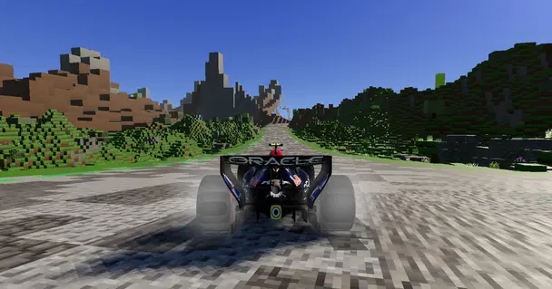</a> [作者分享图 · 游戏实景](<https://f1butitsminecraft.grok.me>) | [amsultan2010/f1-but-its-minecraft](<https://github.com/amsultan2010/f1-but-its-minecraft>) | 常见根目录许可文件未找到 | [README 提及、源码有输入读取](<https://github.com/amsultan2010/f1-but-its-minecraft/blob/main/docs/main.js#L5747>) | — | [README · 可达 · 含游戏画布／引擎的网页](<https://f1butitsminecraft.grok.me>) |
| 1400 | [ ] | [F1 Racing Game](<https://github.com/gamingnews5/awesome-opus-5.5-games/blob/9a29b570e56bd19f15a3cd6bbac0b8c682f2c48c/games/f1-racing-game/readme.md>) | 待补截图 | [hirosichen/ai-f1-racing-game](<https://github.com/hirosichen/ai-f1-racing-game>) | 常见根目录许可文件未找到 MIT；F1名称、车队/赞助视觉涉及的品牌范围需另核。 | 待核 | — | [可达 · 含游戏画布／引擎的网页](<https://vibe-f1-racing.pages.dev>) |
| 1401 | [ ] | [F1-Retro](<https://github.com/gamingnews5/awesome-opus-5.5-games/blob/9a29b570e56bd19f15a3cd6bbac0b8c682f2c48c/games/f1-retro/readme.md>) | 待补截图 | [Mino-oss-byte/f1-retro](<https://github.com/Mino-oss-byte/f1-retro>) | 常见根目录许可文件未找到 | 待核 | — | [可达 · 含游戏画布／引擎的网页](<https://mino-oss-byte.github.io/f1-retro/>) |
| 1402 | [ ] | [F1: race the AI](<https://github.com/gamingnews5/awesome-opus-5.5-games/blob/9a29b570e56bd19f15a3cd6bbac0b8c682f2c48c/games/f1-race-the-ai/readme.md>) | 待补截图 | [duckpop/f1-race-the-ai](<https://github.com/duckpop/f1-race-the-ai>) | 常见根目录许可文件未找到 | [README 提及、源码有输入读取](<https://github.com/duckpop/f1-race-the-ai/blob/main/game/inputs.py#L293>) | — | 未列入口 |
| 1403 | [ ] | [Fable City](<https://github.com/gamingnews5/awesome-opus-5.5-games/blob/9a29b570e56bd19f15a3cd6bbac0b8c682f2c48c/games/fable-city/readme.md>) | 待补截图 | [koviq4/fable-sandbox](<https://github.com/koviq4/fable-sandbox>) | 常见根目录许可文件未找到 | 待核 | — | 未列入口 |
| 1404 | [ ] | [Fable City GTA](<https://github.com/gamingnews5/awesome-opus-5.5-games/blob/9a29b570e56bd19f15a3cd6bbac0b8c682f2c48c/games/fable-city-gta/readme.md>) | 待补截图 | [Octavious/Fable5\_GTA](<https://github.com/Octavious/Fable5_GTA>) | 常见根目录许可文件未找到 | 待核 | — | 未列入口 |
| 1405 | [ ] | [Fable Flight](<https://github.com/gamingnews5/awesome-opus-5.5-games/blob/9a29b570e56bd19f15a3cd6bbac0b8c682f2c48c/games/fable-flight/readme.md>) | 待补截图 | [Arnie016/flight-simulator-fable5](<https://github.com/Arnie016/flight-simulator-fable5>) | 常见根目录许可文件未找到 README同时记录早期Claude Fable5与后续Codex/GPT-5.6开发；只能称多模型参与。MIT代码、Sketchfab模型CC-BY另计；语音教练需自己的API服务。 | [README 提及](<https://github.com/Arnie016/flight-simulator-fable5/blob/HEAD/README.md#L119>) | — | [可达 · 合集所列网页](<https://arnie016.github.io/flight-simulator-fable5/>) |
| 1406 | [ ] | [Fable Kart](<https://github.com/gamingnews5/awesome-opus-5.5-games/blob/9a29b570e56bd19f15a3cd6bbac0b8c682f2c48c/games/fable-kart/readme.md>) | 待补截图 | [koviq4/fable-sandbox](<https://github.com/koviq4/fable-sandbox>) | 常见根目录许可文件未找到 | 待核 | — | 未列入口 |
| 1407 | [ ] | [Fable Theft Auto 5.1](<https://github.com/gamingnews5/awesome-opus-5.5-games/blob/9a29b570e56bd19f15a3cd6bbac0b8c682f2c48c/games/fable-theft-auto-5-1/readme.md>) | 待补截图 | [sorrycc/fable-arcade](<https://github.com/sorrycc/fable-arcade>) | 常见根目录许可文件未找到 | 待核 | — | [可达 · 含游戏画布／引擎的网页](<https://sorrycc.github.io/fable-arcade/games/voxel-gta-city/>) |
| 1408 | [ ] | [Fable5](<https://github.com/gamingnews5/awesome-opus-5.5-games/blob/9a29b570e56bd19f15a3cd6bbac0b8c682f2c48c/games/fable5/readme.md>) | 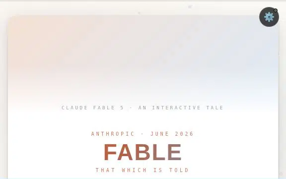 [源码运行首页](<https://github.com/vivmuk/fable5/blob/HEAD/index.html>) | [vivmuk/fable5](<https://github.com/vivmuk/fable5>) | 常见根目录许可文件未找到 | 待核 | — | 未列入口 |
| 1409 | [ ] | [Fable5 Minecraft](<https://github.com/gamingnews5/awesome-opus-5.5-games/blob/9a29b570e56bd19f15a3cd6bbac0b8c682f2c48c/games/fable5-minecraft/readme.md>) | 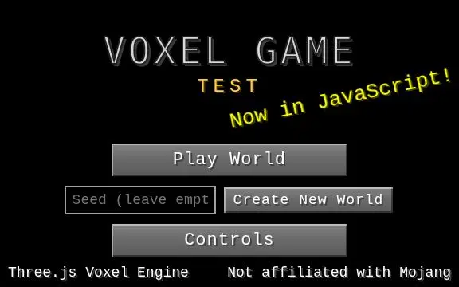 [源码运行首页](<https://github.com/Angais/Fable5-mc/blob/HEAD/index.html>) | [Angais/Fable5-mc](<https://github.com/Angais/Fable5-mc>) | 常见根目录许可文件未找到 | 待核 | — | 未列入口 |
| 1410 | [ ] | [Face Arcade](<https://github.com/gamingnews5/awesome-opus-5.5-games/blob/9a29b570e56bd19f15a3cd6bbac0b8c682f2c48c/games/face-arcade/readme.md>) | 待补截图 | [blurboy1985/face-arcade](<https://github.com/blurboy1985/face-arcade>) | 常见根目录许可文件未找到 | 待核 | — | [可达 · 合集所列网页](<https://blurboy1985.github.io/face-arcade/>) |
| 1411 | [ ] | [FACET FIGHTER](<https://github.com/gamingnews5/awesome-opus-5.5-games/blob/9a29b570e56bd19f15a3cd6bbac0b8c682f2c48c/games/facet-fighter/readme.md>) | 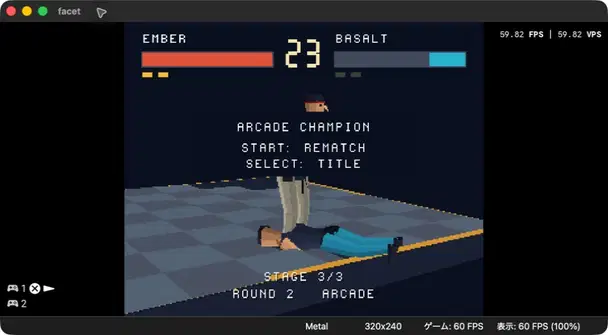 [游戏菜单或界面](<https://github.com/GOROman/gpt-6-astra-ps1-game-benchmark/blob/main/docs/screenshots/015-arcade-champion.png>) | [GOROman/gpt-6-astra-ps1-game-benchmark](<https://github.com/GOROman/gpt-6-astra-ps1-game-benchmark>) | 常见根目录许可文件未找到 | 待核 | [6.7](<https://github.com/GOROman/gpt-6-astra-ps1-game-benchmark/blob/main/docs/screenshots/015-arcade-champion.png>) | 未列入口 |
| 1412 | [ ] | [fafo](<https://github.com/gamingnews5/awesome-opus-5.5-games/blob/9a29b570e56bd19f15a3cd6bbac0b8c682f2c48c/games/fafo/readme.md>) | 待补截图 | [Elko-Lemiso/fafo](<https://github.com/Elko-Lemiso/fafo>) | 常见根目录许可文件未找到 | 待核 | — | 未列入口 |
| 1413 | [ ] | [fairytails](<https://github.com/gamingnews5/awesome-opus-5.5-games/blob/9a29b570e56bd19f15a3cd6bbac0b8c682f2c48c/games/fairytails/readme.md>) | 待补截图 | [AlanLiang28/HackTX26](<https://github.com/AlanLiang28/HackTX26>) | 常见根目录许可文件未找到 [自托管的两款字体采用 OFL。](<https://github.com/AlanLiang28/HackTX26/blob/HEAD/README.md#L224>) | 待核 | [5.8](<https://github.com/AlanLiang28/HackTX26/blob/main/public/images/fantasy-world.webp>) | 未列入口 |
| 1414 | [ ] | [Fall Line](<https://github.com/gamingnews5/awesome-opus-5.5-games/blob/9a29b570e56bd19f15a3cd6bbac0b8c682f2c48c/games/fall-line/readme.md>) |  [合集截图](<https://github.com/Nipale-ai/opus-5-5-overnight-builds/blob/main/vorschau-fall-line.jpg>) | [Nipale-ai/opus-5-5-overnight-builds](<https://github.com/Nipale-ai/opus-5-5-overnight-builds>) | 常见根目录许可文件未找到 | 待核 | [8.7](<https://github.com/Nipale-ai/opus-5-5-overnight-builds/blob/main/vorschau-fall-line.jpg>) | [可达 · 合集所列网页](<https://nipale-ai.github.io/opus-5-5-overnight-builds/fall-line/>) |
| 1415 | [ ] | [Falling Catch](<https://github.com/gamingnews5/awesome-opus-5.5-games/blob/9a29b570e56bd19f15a3cd6bbac0b8c682f2c48c/games/falling-catch/readme.md>) |  [同款源码游戏实截](<https://github.com/mundeok/math-arcade-paradise/blob/master/src/games/g02_catch.js>) | [mundeok/math-arcade-paradise](<https://github.com/mundeok/math-arcade-paradise>) | 常见根目录许可文件未找到 | 待核 | — | 未列入口 |
| 1416 | [ ] | [Falling Platforms](<https://github.com/gamingnews5/awesome-opus-5.5-games/blob/9a29b570e56bd19f15a3cd6bbac0b8c682f2c48c/games/party-chaos/readme.md>) | 待补截图 | [lawrenceandrewlargo/roblox-extreme-minigames](<https://github.com/lawrenceandrewlargo/roblox-extreme-minigames>) | 常见根目录许可文件未找到 | 待核 | — | 未列入口 |
| 1417 | [ ] | [False Ritual](<https://github.com/gamingnews5/awesome-opus-5.5-games/blob/9a29b570e56bd19f15a3cd6bbac0b8c682f2c48c/games/false-ritual/readme.md>) | 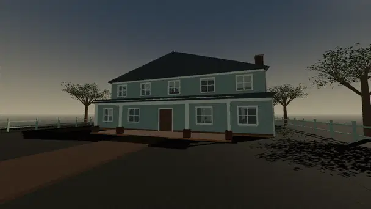 [合集截图](<https://github.com/lucas-wyd/False-Ritual/blob/main/art/reference/qa/carter/dusk_exterior_front.png>) | [lucas-wyd/False-Ritual](<https://github.com/lucas-wyd/False-Ritual>) | 常见根目录许可文件未找到 | 待核 | [7.0](<https://github.com/lucas-wyd/False-Ritual/blob/main/art/reference/qa/carter/dusk_exterior_front.png>) | 未列入口 |
| 1418 | [ ] | [Family Escape Room](<https://github.com/gamingnews5/awesome-opus-5.5-games/blob/9a29b570e56bd19f15a3cd6bbac0b8c682f2c48c/games/family-escape-room/readme.md>) |  [同款源码启动画面实截](<https://github.com/EsperBrose/family-escape-room/blob/HEAD/site/index.html>) | [EsperBrose/family-escape-room](<https://github.com/EsperBrose/family-escape-room>) | 常见根目录许可文件未找到 | 待核 | — | [可达 · 合集所列网页](<https://esperbrose.github.io/family-escape-room/>) |
| 1419 | [ ] | [Family Game Hub](<https://github.com/gamingnews5/awesome-opus-5.5-games/blob/9a29b570e56bd19f15a3cd6bbac0b8c682f2c48c/games/family-game-hub/readme.md>) | 待补截图 | [markwayne24/family-game-hub](<https://github.com/markwayne24/family-game-hub>) | 常见根目录许可文件未找到 | 待核 | — | 未列入口 |
| 1420 | [ ] | [Family Game Night](<https://github.com/gamingnews5/awesome-opus-5.5-games/blob/9a29b570e56bd19f15a3cd6bbac0b8c682f2c48c/games/family-game-night/readme.md>) |  [游戏菜单或界面](<https://github.com/anthony-codispoti/family-game-night/blob/main/shots/00-home-Dad.png>) | [anthony-codispoti/family-game-night](<https://github.com/anthony-codispoti/family-game-night>) | 常见根目录许可文件未找到 | 待核 | [4.8](<https://github.com/anthony-codispoti/family-game-night/blob/main/shots/00-home-Dad.png>) | [可达 · 合集所列网页](<https://family-game-night-rho.vercel.app>) |
| 1421 | [ ] | [Family Night](<https://github.com/gamingnews5/awesome-opus-5.5-games/blob/9a29b570e56bd19f15a3cd6bbac0b8c682f2c48c/games/family-night/readme.md>) | 待补截图 | [sebasfles/family-night](<https://github.com/sebasfles/family-night>) | 常见根目录许可文件未找到 | 待核 | — | 未列入口 |
| 1422 | [ ] | [Family Quiz](<https://github.com/gamingnews5/awesome-opus-5.5-games/blob/9a29b570e56bd19f15a3cd6bbac0b8c682f2c48c/games/family-quiz/readme.md>) | 待补截图 | [KenDarcy01/Quiz](<https://github.com/KenDarcy01/Quiz>) | 常见根目录许可文件未找到 | 待核 | — | [可达 · 合集所列网页](<https://kendarcy01.github.io/Quiz/>) |
| 1423 | [ ] | [Family Table Quest](<https://github.com/gamingnews5/awesome-opus-5.5-games/blob/9a29b570e56bd19f15a3cd6bbac0b8c682f2c48c/games/family-table-quest/readme.md>) | 待补截图 | [salesdatasystems/family-table-quest](<https://github.com/salesdatasystems/family-table-quest>) | 常见根目录许可文件未找到 | 待核 | — | [可达 · 合集所列网页](<https://family-table-quest.vercel.app>) |
| 1424 | [ ] | [Família Kart](<https://github.com/gamingnews5/awesome-opus-5.5-games/blob/9a29b570e56bd19f15a3cd6bbac0b8c682f2c48c/games/familia-kart/readme.md>) | 待补截图 | [guilherme-reis-ia/kart-mariana-henrique-elena](<https://github.com/guilherme-reis-ia/kart-mariana-henrique-elena>) | 常见根目录许可文件未找到 | 待核 | — | [可达 · 含游戏画布／引擎的网页](<https://guilherme-reis-ia.github.io/kart-mariana-henrique-elena/>) |
| 1425 | [ ] | [Fan Re-created Red Alert 2](<https://github.com/gamingnews5/awesome-opus-5.5-games/blob/9a29b570e56bd19f15a3cd6bbac0b8c682f2c48c/games/fan-re-created-red-alert-2/readme.md>) | 待补截图 | [xinbenlv/ra2-gpt-6-astra-2026-09-04](<https://github.com/xinbenlv/ra2-gpt-6-astra-2026-09-04>) | 常见根目录许可文件未找到 | 待核 | — | [入口已失效 · 合集所列网页](<https://xinbenlv.github.io/ra2-gpt-6-astra-2026-09-04/>) |
| 1426 | [ ] | [Fantasy League vs Field of Dreams](<https://github.com/gamingnews5/awesome-opus-5.5-games/blob/9a29b570e56bd19f15a3cd6bbac0b8c682f2c48c/games/fantasy-league-vs-field-of-dreams/readme.md>) | 待补截图 | [mzaiger/FantasyLeagueVsFieldOfDreams](<https://github.com/mzaiger/FantasyLeagueVsFieldOfDreams>) | 常见根目录许可文件未找到 | 待核 | — | 未列入口 |
| 1427 | [ ] | [fantasy-rpg](<https://github.com/gamingnews5/awesome-opus-5.5-games/blob/9a29b570e56bd19f15a3cd6bbac0b8c682f2c48c/games/fantasy-rpg/readme.md>) | 待补截图 | [Fomiller/fantasy-rpg](<https://github.com/Fomiller/fantasy-rpg>) | 常见根目录许可文件未找到 | 待核 | — | 未列入口 |
| 1428 | [ ] | [Farm Game](<https://github.com/gamingnews5/awesome-opus-5.5-games/blob/9a29b570e56bd19f15a3cd6bbac0b8c682f2c48c/games/farm-game/readme.md>) | 待补截图 | [BrilZliaN/farm-game](<https://github.com/BrilZliaN/farm-game>) | 常见根目录许可文件未找到 | 待核 | — | 未列入口 |
| 1429 | [ ] | [Farm to City (working title)](<https://github.com/gamingnews5/awesome-opus-5.5-games/blob/9a29b570e56bd19f15a3cd6bbac0b8c682f2c48c/games/farm-to-city-working-title/readme.md>) | 待补截图 | [patel-keyur-18/farm-to-city](<https://github.com/patel-keyur-18/farm-to-city>) | [README 许可段声明保留权利、限制使用或尚未授权](<https://github.com/patel-keyur-18/farm-to-city/blob/HEAD/README.md>) | 待核 | — | 未列入口 |
| 1430 | [ ] | [FarmGame](<https://github.com/gamingnews5/awesome-opus-5.5-games/blob/9a29b570e56bd19f15a3cd6bbac0b8c682f2c48c/games/farmgame/readme.md>) | 待补截图 | [tsunejui/farm-game](<https://github.com/tsunejui/farm-game>) | 常见根目录许可文件未找到 | 待核 | — | 未列入口 |
| 1431 | [ ] | [FarmLife](<https://github.com/gamingnews5/awesome-opus-5.5-games/blob/9a29b570e56bd19f15a3cd6bbac0b8c682f2c48c/games/farmlife/readme.md>) | 待补截图 | [Wut-Lab/FarmLife](<https://github.com/Wut-Lab/FarmLife>) | 常见根目录许可文件未找到 | 待核 | — | [可达 · 含游戏画布／引擎的网页](<https://wut-lab.github.io/FarmLife/>) |
| 1432 | [ ] | [Fart Together](<https://github.com/gamingnews5/awesome-opus-5.5-games/blob/9a29b570e56bd19f15a3cd6bbac0b8c682f2c48c/games/fart-together/readme.md>) | 待补截图 | [Callzik/fart-together](<https://github.com/Callzik/fart-together>) | 常见根目录许可文件未找到 | 待核 | [7.4（原图失效）](<https://github.com/Callzik/fart-together/blob/main/screenshot.png>) | [入口已失效 · 发行下载页](<https://github.com/Callzik/fart-together/releases/latest>) |
| 1433 | [ ] | [Fathom](<https://github.com/gamingnews5/awesome-opus-5.5-games/blob/9a29b570e56bd19f15a3cd6bbac0b8c682f2c48c/games/fathom/readme.md>) | 待补截图 | [andyqueyl/fathom](<https://github.com/andyqueyl/fathom>) | 常见根目录许可文件未找到 | 待核 | — | [可达 · 合集所列网页](<https://andyqueyl.github.io/fathom/>) |
| 1434 | [ ] | [FATHOM](<https://github.com/gamingnews5/awesome-opus-5.5-games/blob/9a29b570e56bd19f15a3cd6bbac0b8c682f2c48c/games/fathom-shibainkyoto-aivsai-game-comp-2/readme.md>) | 待补截图 | [ShibaInKyoto/AIvsAI-Game-Comp-2](<https://github.com/ShibaInKyoto/AIvsAI-Game-Comp-2>) | 常见根目录许可文件未找到 | 待核 | — | 未列入口 |
| 1435 | [ ] | [Feel It, Draw It](<https://github.com/gamingnews5/awesome-opus-5.5-games/blob/9a29b570e56bd19f15a3cd6bbac0b8c682f2c48c/games/feel-it-draw-it/readme.md>) | 待补截图 | [mickeyordog/FamilyGame](<https://github.com/mickeyordog/FamilyGame>) | 常见根目录许可文件未找到 | 待核 | — | [可达 · 合集所列网页](<https://mickeyordog.github.io/FamilyGame/>) |
| 1436 | [ ] | [Feet Fighter](<https://github.com/gamingnews5/awesome-opus-5.5-games/blob/9a29b570e56bd19f15a3cd6bbac0b8c682f2c48c/games/feet-fighter/readme.md>) | 待补截图 | [adamhindman/feet-fighter](<https://github.com/adamhindman/feet-fighter>) | 常见根目录许可文件未找到 | 待核 | — | [入口已失效 · 合集所列网页](<https://adamhindman.github.io/feet-fighter/>) |
| 1437 | [ ] | [Fell Runner](<https://github.com/gamingnews5/awesome-opus-5.5-games/blob/9a29b570e56bd19f15a3cd6bbac0b8c682f2c48c/games/fell-runner/readme.md>) | 待补截图 | [rmcrkd/fell-runner](<https://github.com/rmcrkd/fell-runner>) | 常见根目录许可文件未找到 | 待核 | [6.5（原图失效）](<https://github.com/rmcrkd/fell-runner/blob/main/docs/gameplay.gif>) | [入口已失效 · 合集所列网页](<https://rmcrkd.github.io/fell-runner/>) |
| 1438 | [ ] | [fellow-guys](<https://github.com/gamingnews5/awesome-opus-5.5-games/blob/9a29b570e56bd19f15a3cd6bbac0b8c682f2c48c/games/fellow-guys/readme.md>) | 待补截图 | [chandlerbillman2013-create/fellow-guys](<https://github.com/chandlerbillman2013-create/fellow-guys>) | 常见根目录许可文件未找到 | 待核 | — | 未列入口 |
| 1439 | [ ] | [Fieldrunners 2 Remake](<https://github.com/gamingnews5/awesome-opus-5.5-games/blob/9a29b570e56bd19f15a3cd6bbac0b8c682f2c48c/games/fieldrunners-2-remake/readme.md>) | 待补截图 | [TanBuiDev/fieldrunners2-remake](<https://github.com/TanBuiDev/fieldrunners2-remake>) | 常见根目录许可文件未找到 | 待核 | — | 未列入口 |
| 1440 | [ ] | [FIFA 96 Bananas (Godot 4.7)](<https://github.com/gamingnews5/awesome-opus-5.5-games/blob/9a29b570e56bd19f15a3cd6bbac0b8c682f2c48c/games/fifa-96-bananas-godot-4-7/readme.md>) | 待补截图 | [PolycarpusTack/OSCFootball](<https://github.com/PolycarpusTack/OSCFootball>) | 常见根目录许可文件未找到 | [README 提及](<https://github.com/PolycarpusTack/OSCFootball/blob/HEAD/README.md#L14>) | — | 未列入口 |
| 1441 | [ ] | [Fight for Fun](<https://github.com/gamingnews5/awesome-opus-5.5-games/blob/9a29b570e56bd19f15a3cd6bbac0b8c682f2c48c/games/fight-for-fun/readme.md>) | 待补截图 | [emurray1/fight4fun](<https://github.com/emurray1/fight4fun>) | 常见根目录许可文件未找到 | [源码有输入读取](<https://github.com/emurray1/fight4fun/blob/main/index.html#L2542>) | — | 未列入口 |
| 1442 | [ ] | [Fighter](<https://github.com/gamingnews5/awesome-opus-5.5-games/blob/9a29b570e56bd19f15a3cd6bbac0b8c682f2c48c/games/fighter/readme.md>) | 待补截图 | [Firex2200/fighter](<https://github.com/Firex2200/fighter>) | 常见根目录许可文件未找到 | [README 提及](<https://github.com/Firex2200/fighter/blob/HEAD/README.md#L73>) | — | [可达 · 合集所列网页](<https://firex2200.github.io/fighter/>) |
| 1443 | [ ] | [Figures &amp; Formulas](<https://github.com/gamingnews5/awesome-opus-5.5-games/blob/9a29b570e56bd19f15a3cd6bbac0b8c682f2c48c/games/figures-formulas/readme.md>) | 待补截图 | [kcy/figures-formulas](<https://github.com/kcy/figures-formulas>) | 常见根目录许可文件未找到 | 待核 | — | [可达 · 含游戏画布／引擎的网页](<https://kcy.github.io/figures-formulas/>) |
| 1444 | [ ] | [Find It!](<https://github.com/gamingnews5/awesome-opus-5.5-games/blob/9a29b570e56bd19f15a3cd6bbac0b8c682f2c48c/games/find-it/readme.md>) | 待补截图 | [harjunatn/nadhira-find-it-game](<https://github.com/harjunatn/nadhira-find-it-game>) | 常见根目录许可文件未找到 | 待核 | — | [可达 · 合集所列网页](<https://nadhira-find-it-game.vercel.app>) |
| 1445 | [ ] | [Find Panda](<https://github.com/gamingnews5/awesome-opus-5.5-games/blob/9a29b570e56bd19f15a3cd6bbac0b8c682f2c48c/games/find-panda/readme.md>) | 待补截图 | [Jinchaosss/find-panda](<https://github.com/Jinchaosss/find-panda>) | 常见根目录许可文件未找到 | 待核 | — | 未列入口 |
| 1446 | [ ] | [Finger Fight](<https://github.com/gamingnews5/awesome-opus-5.5-games/blob/9a29b570e56bd19f15a3cd6bbac0b8c682f2c48c/games/finger-fight/readme.md>) |  [源码运行首页](<https://github.com/P-Patsis/FingerFight/blob/main/index.html>) | [P-Patsis/FingerFight](<https://github.com/P-Patsis/FingerFight>) | 常见根目录许可文件未找到 | 待核 | — | 未列入口 |
| 1447 | [ ] | [FinOps Odyssey](<https://github.com/gamingnews5/awesome-opus-5.5-games/blob/9a29b570e56bd19f15a3cd6bbac0b8c682f2c48c/games/finops-odyssey/readme.md>) | 待补截图 | [chfinops/finops-odyssey](<https://github.com/chfinops/finops-odyssey>) | 常见根目录许可文件未找到 | 待核 | — | [可达 · 含游戏画布／引擎的网页](<https://finops-odyssey.vercel.app/game.html>) |
| 1448 | [ ] | [Fire Mission](<https://github.com/gamingnews5/awesome-opus-5.5-games/blob/9a29b570e56bd19f15a3cd6bbac0b8c682f2c48c/games/fire-mission/readme.md>) | 待补截图 | [iamboosted/fire-mission-play](<https://github.com/iamboosted/fire-mission-play>) | 常见根目录许可文件未找到 | 待核 | — | 未列入口 |
| 1449 | [ ] | [Firefly Dash](<https://github.com/gamingnews5/awesome-opus-5.5-games/blob/9a29b570e56bd19f15a3cd6bbac0b8c682f2c48c/games/firefly-dash/readme.md>) | 待补截图 | [Olusive/firefly-dash](<https://github.com/Olusive/firefly-dash>) | 常见根目录许可文件未找到 | 待核 | — | 未列入口 |
| 1450 | [ ] | [FireRed RPG](<https://github.com/gamingnews5/awesome-opus-5.5-games/blob/9a29b570e56bd19f15a3cd6bbac0b8c682f2c48c/games/firered-rpg/readme.md>) | 待补截图 | [blackscythe123/FireRed-RPG](<https://github.com/blackscythe123/FireRed-RPG>) | 常见根目录许可文件未找到 | 待核 | — | 未列入口 |
| 1451 | [ ] | [Fireworks (working title)](<https://github.com/gamingnews5/awesome-opus-5.5-games/blob/9a29b570e56bd19f15a3cd6bbac0b8c682f2c48c/games/fireworks-working-title/readme.md>) | 待补截图 | [capnseaaa/fireworks](<https://github.com/capnseaaa/fireworks>) | 常见根目录许可文件未找到 | 待核 | — | 未列入口 |
| 1452 | [ ] | [First-Person Blackjack](<https://github.com/gamingnews5/awesome-opus-5.5-games/blob/9a29b570e56bd19f15a3cd6bbac0b8c682f2c48c/games/first-person-blackjack/readme.md>) | 待补截图 | [FinDaHuman/ClaudeBlackJack](<https://github.com/FinDaHuman/ClaudeBlackJack>) | 常见根目录许可文件未找到 | 待核 | — | [入口已失效 · 合集所列网页](<https://findahuman.github.io/ClaudeBlackJack/>) |
| 1453 | [ ] | [Firstlearning Play](<https://github.com/gamingnews5/awesome-opus-5.5-games/blob/9a29b570e56bd19f15a3cd6bbac0b8c682f2c48c/games/firstlearning-play/readme.md>) | 待补截图 | [gnet100/firstlearning-play](<https://github.com/gnet100/firstlearning-play>) | 常见根目录许可文件未找到 | 待核 | [4.0（原图失效）](<https://github.com/gnet100/firstlearning-play/blob/main/games/shared/end-panel-preview.png>) | 未列入口 |
| 1454 | [ ] | [Fish Catch](<https://github.com/gamingnews5/awesome-opus-5.5-games/blob/9a29b570e56bd19f15a3cd6bbac0b8c682f2c48c/games/fish-catch/readme.md>) | 待补截图 | [hokita/mouse2](<https://github.com/hokita/mouse2>) | 常见根目录许可文件未找到 | 待核 | — | [多游戏仓库入口 · 可达 · 合集所列网页](<https://mouse2-0357d0.web.app/>) |
| 1455 | [ ] | [Fish Fight](<https://github.com/gamingnews5/awesome-opus-5.5-games/blob/9a29b570e56bd19f15a3cd6bbac0b8c682f2c48c/games/fish-fight/readme.md>) | 待补截图 | [NafeesMansoor/fish-fight](<https://github.com/NafeesMansoor/fish-fight>) | 常见根目录许可文件未找到 | 待核 | — | [可达 · 合集所列网页](<https://nafeesmansoor.github.io/fish-fight/>) |
| 1456 | [ ] | [Fish Game](<https://github.com/gamingnews5/awesome-opus-5.5-games/blob/9a29b570e56bd19f15a3cd6bbac0b8c682f2c48c/games/fish-game/readme.md>) | 待补截图 | [KyleleeSea/fish-hunt](<https://github.com/KyleleeSea/fish-hunt>) | 常见根目录许可文件未找到 | 待核 | — | 未列入口 |
| 1457 | [ ] | [Fish Loop](<https://github.com/gamingnews5/awesome-opus-5.5-games/blob/9a29b570e56bd19f15a3cd6bbac0b8c682f2c48c/games/fish-loop/readme.md>) |  [合集截图](<https://github.com/huykc1/fish-loop-phaser-demo/blob/main/art/reference/gameplay-1080x1920.webp>) | [huykc1/fish-loop-phaser-demo](<https://github.com/huykc1/fish-loop-phaser-demo>) | 常见根目录许可文件未找到 | 待核 | [6.0](<https://github.com/huykc1/fish-loop-phaser-demo/blob/main/art/reference/gameplay-1080x1920.webp>) | [可达 · 合集所列网页](<https://huykc1.github.io/fish-loop-phaser-demo/demo/>) |
| 1458 | [ ] | [Fishery](<https://github.com/gamingnews5/awesome-opus-5.5-games/blob/9a29b570e56bd19f15a3cd6bbac0b8c682f2c48c/games/fishery/readme.md>) |  [上游商店截图](<https://github.com/blackout-rain/application-development/blob/HEAD/fishery-game/app/store/screenshots/phone-02-boss-fight.png>) | [blackout-rain/application-development](<https://github.com/blackout-rain/application-development>) | 常见根目录许可文件未找到 | 待核 | — | 未列入口 |
| 1459 | [ ] | [Fishing Frenzy 2](<https://github.com/gamingnews5/awesome-opus-5.5-games/blob/9a29b570e56bd19f15a3cd6bbac0b8c682f2c48c/games/fishing-frenzy-2/readme.md>) | 待补截图 | [tarun-figmaboy-838/fishing-frenzy-2](<https://github.com/tarun-figmaboy-838/fishing-frenzy-2>) | 常见根目录许可文件未找到 | 待核 | — | [可达 · 合集所列网页](<https://fishing-frenzy-2-t6d6.vercel.app>) |
| 1460 | [ ] | [Fishslop](<https://github.com/gamingnews5/awesome-opus-5.5-games/blob/9a29b570e56bd19f15a3cd6bbac0b8c682f2c48c/games/fishslop/readme.md>) | 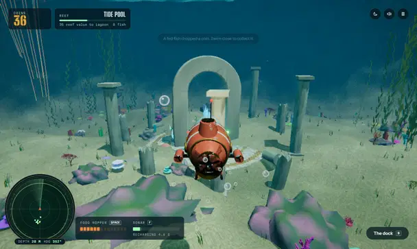 [合集截图](<https://github.com/vasu-devs/FishSlop_Opus5.5/blob/main/docs/screens/03-sonar.png>) | [vasu-devs/FishSlop\_Opus5.5](<https://github.com/vasu-devs/FishSlop_Opus5.5>) | 常见根目录许可文件未找到 已查当前源码树，未发现根许可证文件，不视为可自由再分发 | 待核 | [8.8](<https://github.com/vasu-devs/FishSlop_Opus5.5/blob/main/docs/screens/03-sonar.png>) | [可达 · 含游戏画布／引擎的网页](<https://vasu-devs.github.io/FishSlop_Opus5.5/>) |
| 1461 | [ ] | [Fizz Lab](<https://github.com/gamingnews5/awesome-opus-5.5-games/blob/9a29b570e56bd19f15a3cd6bbac0b8c682f2c48c/games/fizz-lab/readme.md>) | 待补截图 | [conar104/fizz-lab](<https://github.com/conar104/fizz-lab>) | 常见根目录许可文件未找到 | 待核 | — | [可达 · 含游戏画布／引擎的网页](<https://conar104.github.io/fizz-lab/>) |
| 1462 | [ ] | [Flag Catch](<https://github.com/gamingnews5/awesome-opus-5.5-games/blob/9a29b570e56bd19f15a3cd6bbac0b8c682f2c48c/games/flag-catch/readme.md>) | 待补截图 | [technotrue-bit/Flag-Catch](<https://github.com/technotrue-bit/Flag-Catch>) | 常见根目录许可文件未找到 | 待核 | — | [可达 · 合集所列网页](<https://flag-catch.vercel.app>) |
| 1463 | [ ] | [Flag Fight](<https://github.com/gamingnews5/awesome-opus-5.5-games/blob/9a29b570e56bd19f15a3cd6bbac0b8c682f2c48c/games/flag-fight/readme.md>) | 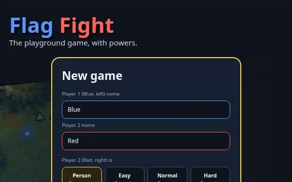 [源码运行首页](<https://github.com/bsimmons2007/flagfight-online/blob/main/index.html>) | [bsimmons2007/flagfight-online](<https://github.com/bsimmons2007/flagfight-online>) | 常见根目录许可文件未找到 | 待核 | — | 未列入口 |
| 1464 | [ ] | [FLAG GAME](<https://github.com/gamingnews5/awesome-opus-5.5-games/blob/9a29b570e56bd19f15a3cd6bbac0b8c682f2c48c/games/flag-game-bbonng-flaggame/readme.md>) |  [源码运行首页](<https://github.com/bbonng/flaggame/blob/main/index.html>) | [bbonng/flaggame](<https://github.com/bbonng/flaggame>) | 常见根目录许可文件未找到 | 待核 | — | 未列入口 |
| 1465 | [ ] | [Flag Game](<https://github.com/gamingnews5/awesome-opus-5.5-games/blob/9a29b570e56bd19f15a3cd6bbac0b8c682f2c48c/games/flag-game/readme.md>) | 待补截图 | [maxlep/flag-game](<https://github.com/maxlep/flag-game>) | 常见根目录许可文件未找到 | 待核 | — | 未列入口 |
| 1466 | [ ] | [Flappy Bird](<https://github.com/gamingnews5/awesome-opus-5.5-games/blob/9a29b570e56bd19f15a3cd6bbac0b8c682f2c48c/games/flappy-bird/readme.md>) | 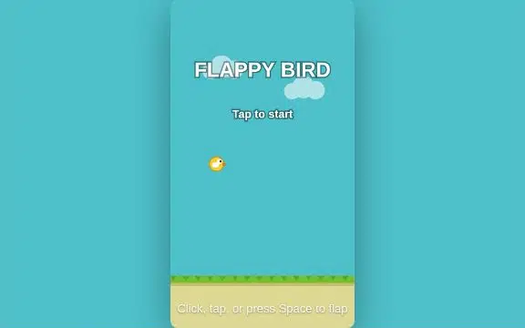 [源码运行首页](<https://github.com/astrosxmgkaung-ui/BhoneAlinkar/blob/main/index.html>) | [astrosxmgkaung-ui/BhoneAlinkar](<https://github.com/astrosxmgkaung-ui/BhoneAlinkar>) | 常见根目录许可文件未找到 | 待核 | — | 未列入口 |
| 1467 | [ ] | [Flappy Raccoon](<https://github.com/gamingnews5/awesome-opus-5.5-games/blob/9a29b570e56bd19f15a3cd6bbac0b8c682f2c48c/games/flappy-raccoon/readme.md>) | 待补截图 | [mirrash7/Games](<https://github.com/mirrash7/Games>) | 常见根目录许可文件未找到 | 待核 | — | 未列入口 |
| 1468 | [ ] | [Flappy Race](<https://github.com/gamingnews5/awesome-opus-5.5-games/blob/9a29b570e56bd19f15a3cd6bbac0b8c682f2c48c/games/flappy-race/readme.md>) | 待补截图 | [Baeinsoo/LeagueOfPhysical-Client](<https://github.com/Baeinsoo/LeagueOfPhysical-Client>) | 常见根目录许可文件未找到 | 待核 | — | 未列入口 |
| 1469 | [ ] | [Flappy Skies](<https://github.com/gamingnews5/awesome-opus-5.5-games/blob/9a29b570e56bd19f15a3cd6bbac0b8c682f2c48c/games/flappy-skies/readme.md>) | 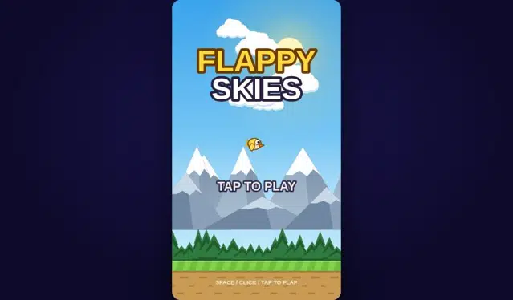 [试玩首页实截](<https://sorrycc.github.io/fable-arcade/games/flappy-bird/>) | [sorrycc/fable-arcade](<https://github.com/sorrycc/fable-arcade>) | 常见根目录许可文件未找到 | 待核 | — | [可达 · 含游戏画布／引擎的网页](<https://sorrycc.github.io/fable-arcade/games/flappy-bird/>) |
| 1470 | [ ] | [Flappy Ticket](<https://github.com/gamingnews5/awesome-opus-5.5-games/blob/9a29b570e56bd19f15a3cd6bbac0b8c682f2c48c/games/flappy-ticket/readme.md>) | 待补截图 | [krishnendu-2003/Floppy-Bird](<https://github.com/krishnendu-2003/Floppy-Bird>) | 常见根目录许可文件未找到 | 待核 | — | [可达 · 含游戏画布／引擎的网页](<https://floppy-bird.vercel.app>) |
| 1471 | [ ] | [Flick](<https://github.com/gamingnews5/awesome-opus-5.5-games/blob/9a29b570e56bd19f15a3cd6bbac0b8c682f2c48c/games/flick/readme.md>) |  [试玩首页实截](<https://sramanagiri99-creates.github.io/flick-mini-games/>) | [sramanagiri99-creates/flick-mini-games](<https://github.com/sramanagiri99-creates/flick-mini-games>) | 常见根目录许可文件未找到 | 待核 | — | [可达 · 含游戏画布／引擎的网页](<https://sramanagiri99-creates.github.io/flick-mini-games/>) |
| 1472 | [ ] | [Flintworks](<https://github.com/gamingnews5/awesome-opus-5.5-games/blob/9a29b570e56bd19f15a3cd6bbac0b8c682f2c48c/games/flintworks/readme.md>) | 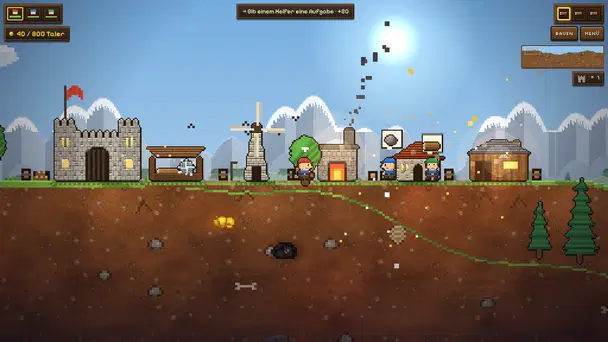 [合集截图](<https://github.com/kiezpower/Flintworks/blob/main/docs/itch/screenshot-1-de.png>) | [kiezpower/Flintworks](<https://github.com/kiezpower/Flintworks>) | 常见根目录许可文件未找到 | [README 提及](<https://github.com/kiezpower/Flintworks/blob/HEAD/README.md#L63>) | [7.4](<https://github.com/kiezpower/Flintworks/blob/main/docs/itch/screenshot-1-de.png>) | [可达 · 含游戏画布／引擎的网页](<https://kiezpower.github.io/Flintworks/>) |
| 1473 | [ ] | [Flip Wall](<https://github.com/gamingnews5/awesome-opus-5.5-games/blob/9a29b570e56bd19f15a3cd6bbac0b8c682f2c48c/games/flip-wall/readme.md>) | 待补截图 | [shironagasu-ai/claude-fable5-3D-games](<https://github.com/shironagasu-ai/claude-fable5-3D-games>) | 常见根目录许可文件未找到 | 待核 | — | [可达 · 合集所列网页](<https://shironagasu-ai.github.io/claude-fable5-3D-games/games/flip-wall/>) |
| 1474 | [ ] | [Flipper Duel](<https://github.com/gamingnews5/awesome-opus-5.5-games/blob/9a29b570e56bd19f15a3cd6bbac0b8c682f2c48c/games/flipper-duel/readme.md>) |  [试玩首页实截](<https://woodmandk.github.io/Flipper-Duel/>) | [Woodmandk/Flipper-Duel](<https://github.com/Woodmandk/Flipper-Duel>) | 常见根目录许可文件未找到 | 待核 | — | [可达 · 含游戏画布／引擎的网页](<https://woodmandk.github.io/Flipper-Duel/>) |
| 1475 | [ ] | [Floor 48](<https://github.com/gamingnews5/awesome-opus-5.5-games/blob/9a29b570e56bd19f15a3cd6bbac0b8c682f2c48c/games/floor-48/readme.md>) | 待补截图 | [Crinklyink/game-by-Opus](<https://github.com/Crinklyink/game-by-Opus>) | 常见根目录许可文件未找到 | 待核 | — | 未列入口 |
| 1476 | [ ] | [Floor Is Lava](<https://github.com/gamingnews5/awesome-opus-5.5-games/blob/9a29b570e56bd19f15a3cd6bbac0b8c682f2c48c/games/party-chaos/readme.md>) | 待补截图 | [lawrenceandrewlargo/roblox-extreme-minigames](<https://github.com/lawrenceandrewlargo/roblox-extreme-minigames>) | 常见根目录许可文件未找到 | 待核 | — | 未列入口 |
| 1477 | [ ] | [Flowstate Grill](<https://github.com/gamingnews5/awesome-opus-5.5-games/blob/9a29b570e56bd19f15a3cd6bbac0b8c682f2c48c/games/flowstate-grill/readme.md>) | 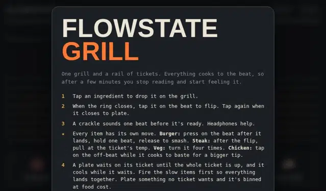 [试玩首页实截](<https://ljtyk.github.io/flowstate-grill/>) | [ljtyk/flowstate-grill](<https://github.com/ljtyk/flowstate-grill>) | 常见根目录许可文件未找到 | 待核 | — | [可达 · 含游戏画布／引擎的网页](<https://ljtyk.github.io/flowstate-grill/>) |
| 1478 | [ ] | [Flutter Quest XP](<https://github.com/gamingnews5/awesome-opus-5.5-games/blob/9a29b570e56bd19f15a3cd6bbac0b8c682f2c48c/games/flutter-quest-xp/readme.md>) | 待补截图 | [riihhzz/flutter\_quest](<https://github.com/riihhzz/flutter_quest>) | 常见根目录许可文件未找到 | 待核 | — | 未列入口 |
| 1479 | [ ] | [Fly Around SF](<https://github.com/gamingnews5/awesome-opus-5.5-games/blob/9a29b570e56bd19f15a3cd6bbac0b8c682f2c48c/games/fly-around-sf/readme.md>) | 待补截图 | [ayaangazali/fly-around-sf](<https://github.com/ayaangazali/fly-around-sf>) | 常见根目录许可文件未找到 | [README 提及](<https://github.com/ayaangazali/fly-around-sf/blob/HEAD/README.md#L25>) | — | [可达 · 含游戏画布／引擎的网页](<https://ayaangazali.github.io/fly-around-sf/>) |
| 1480 | [ ] | [Fly Fishing Incremental](<https://github.com/gamingnews5/awesome-opus-5.5-games/blob/9a29b570e56bd19f15a3cd6bbac0b8c682f2c48c/games/fly-fishing-incremental/readme.md>) | 待补截图 | [matearg/fly-fishing-incremental](<https://github.com/matearg/fly-fishing-incremental>) | 常见根目录许可文件未找到 | 待核 | — | 未列入口 |
| 1481 | [ ] | [Flying Tesla](<https://github.com/gamingnews5/awesome-opus-5.5-games/blob/9a29b570e56bd19f15a3cd6bbac0b8c682f2c48c/games/flying-tesla/readme.md>) | 待补截图 | [JUSTTNZ/flying-tesla](<https://github.com/JUSTTNZ/flying-tesla>) | 常见根目录许可文件未找到 | 待核 | — | [可达 · 含游戏画布／引擎的网页](<https://justtnz.github.io/flying-tesla/>) |
| 1482 | [ ] | [Flyingcarslife](<https://github.com/gamingnews5/awesome-opus-5.5-games/blob/9a29b570e56bd19f15a3cd6bbac0b8c682f2c48c/games/flyingcarslife/readme.md>) | 待补截图 | [wisssdorrmm/flyingcarslife](<https://github.com/wisssdorrmm/flyingcarslife>) | 常见根目录许可文件未找到 | 待核 | — | 未列入口 |
| 1483 | [ ] | [Fogbound](<https://github.com/gamingnews5/awesome-opus-5.5-games/blob/9a29b570e56bd19f15a3cd6bbac0b8c682f2c48c/games/fogbound/readme.md>) | 待补截图 | [gomorra/secret-game](<https://github.com/gomorra/secret-game>) | 常见根目录许可文件未找到 | 待核 | — | 未列入口 |
| 1484 | [ ] | [Fold Matrix](<https://github.com/gamingnews5/awesome-opus-5.5-games/blob/9a29b570e56bd19f15a3cd6bbac0b8c682f2c48c/games/fold-matrix/readme.md>) | 待补截图 | [ajaykumar-wq/fold-play](<https://github.com/ajaykumar-wq/fold-play>) | 常见根目录许可文件未找到 | 待核 | — | [可达 · 含游戏画布／引擎的网页](<https://ajaykumar-wq.github.io/fold-play/>) |
| 1485 | [ ] | [Follow Me: Walk with Jesus](<https://github.com/gamingnews5/awesome-opus-5.5-games/blob/9a29b570e56bd19f15a3cd6bbac0b8c682f2c48c/games/follow-me-walk-with-jesus/readme.md>) | 待补截图 | [hbuhrmanlll/follow-me-game](<https://github.com/hbuhrmanlll/follow-me-game>) | 常见根目录许可文件未找到 | 待核 | — | [入口已失效 · 合集所列网页](<https://hbuhrmanlll.github.io/follow-me-game/>) |
| 1486 | [ ] | [Food Fight](<https://github.com/gamingnews5/awesome-opus-5.5-games/blob/9a29b570e56bd19f15a3cd6bbac0b8c682f2c48c/games/food-fight/readme.md>) | 待补截图 | [amccool/foodfight](<https://github.com/amccool/foodfight>) | 常见根目录许可文件未找到 | 待核 | — | [可达 · 发行下载页](<https://github.com/amccool/foodfight/releases>) |
| 1487 | [ ] | [Food Run (web)](<https://github.com/gamingnews5/awesome-opus-5.5-games/blob/9a29b570e56bd19f15a3cd6bbac0b8c682f2c48c/games/food-run-web/readme.md>) | 待补截图 | [yeledpele/food-run](<https://github.com/yeledpele/food-run>) | 常见根目录许可文件未找到 | 待核 | — | [可达 · 含游戏画布／引擎的网页](<https://yeledpele.github.io/food-run/>) |
| 1488 | [ ] | [Food Truck Turf War](<https://github.com/gamingnews5/awesome-opus-5.5-games/blob/9a29b570e56bd19f15a3cd6bbac0b8c682f2c48c/games/food-truck-turf-war/readme.md>) | 待补截图 | [celestialdubsss/food-truck-turf-war](<https://github.com/celestialdubsss/food-truck-turf-war>) | 常见根目录许可文件未找到 | 待核 | — | [可达 · 合集所列网页](<https://celestialdubsss.github.io/food-truck-turf-war/>) |
| 1489 | [ ] | [Football Dice](<https://github.com/gamingnews5/awesome-opus-5.5-games/blob/9a29b570e56bd19f15a3cd6bbac0b8c682f2c48c/games/football-dice/readme.md>) | 待补截图 | [evanstom273/Claude-test-III](<https://github.com/evanstom273/Claude-test-III>) | 常见根目录许可文件未找到 | 待核 | — | 未列入口 |
| 1490 | [ ] | [Football Draft Game](<https://github.com/gamingnews5/awesome-opus-5.5-games/blob/9a29b570e56bd19f15a3cd6bbac0b8c682f2c48c/games/football-draft-game/readme.md>) | 待补截图 | [zPanda20/football-draft-game](<https://github.com/zPanda20/football-draft-game>) | 常见根目录许可文件未找到 | 待核 | — | 未列入口 |
| 1491 | [ ] | [FootbalLife](<https://github.com/gamingnews5/awesome-opus-5.5-games/blob/9a29b570e56bd19f15a3cd6bbac0b8c682f2c48c/games/footballife/readme.md>) | 待补截图 | [jpcpais01/FootballLife](<https://github.com/jpcpais01/FootballLife>) | 常见根目录许可文件未找到 | 待核 | — | 未列入口 |
| 1492 | [ ] | [Footnote](<https://github.com/gamingnews5/awesome-opus-5.5-games/blob/9a29b570e56bd19f15a3cd6bbac0b8c682f2c48c/games/footnote/readme.md>) | 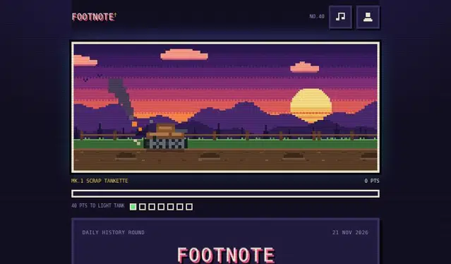 [试玩首页实截](<https://rayahms0667.github.io/footnote/>) | [RayAhms0667/footnote](<https://github.com/RayAhms0667/footnote>) | 常见根目录许可文件未找到 | 待核 | — | [可达 · 含游戏画布／引擎的网页](<https://rayahms0667.github.io/footnote/>) |
| 1493 | [ ] | [For The Greater Good](<https://github.com/gamingnews5/awesome-opus-5.5-games/blob/9a29b570e56bd19f15a3cd6bbac0b8c682f2c48c/games/for-the-greater-good/readme.md>) | 待补截图 | [HungLuuSB/ForTheGreaterGood](<https://github.com/HungLuuSB/ForTheGreaterGood>) | 常见根目录许可文件未找到 | 待核 | [5.6](<https://github.com/HungLuuSB/ForTheGreaterGood/blob/main/assets/models/chs_warlord/v1/export/preview_bar_35.png>) | 未列入口 |
| 1494 | [ ] | [Forest Duel](<https://github.com/gamingnews5/awesome-opus-5.5-games/blob/9a29b570e56bd19f15a3cd6bbac0b8c682f2c48c/games/forest-duel/readme.md>) | 待补截图 | [adilkhankokanov/forest-duel](<https://github.com/adilkhankokanov/forest-duel>) | 常见根目录许可文件未找到 | 待核 | [4.5（原图失效）](<https://github.com/adilkhankokanov/forest-duel/blob/main/tests/screens/web/autumn_arena.png>) | 未列入口 |
| 1495 | [ ] | [Forever Warlock Arcade](<https://github.com/gamingnews5/awesome-opus-5.5-games/blob/9a29b570e56bd19f15a3cd6bbac0b8c682f2c48c/games/forever-warlock-arcade/readme.md>) | 待补截图 | [XNWLK/ForeverWarlockArcade](<https://github.com/XNWLK/ForeverWarlockArcade>) | 常见根目录许可文件未找到 | 待核 | — | [可达 · 合集所列网页](<https://xnwlk.github.io/ForeverWarlockArcade/>) |
| 1496 | [ ] | [Forgotten Acorns](<https://github.com/gamingnews5/awesome-opus-5.5-games/blob/9a29b570e56bd19f15a3cd6bbac0b8c682f2c48c/games/forgotten-acorns/readme.md>) | 待补截图 | [Tarangrana/crrazyyyGAME](<https://github.com/Tarangrana/crrazyyyGAME>) | 常见根目录许可文件未找到 | [README 提及](<https://github.com/Tarangrana/crrazyyyGAME/blob/HEAD/README.md#L16>) | — | 未列入口 |
| 1497 | [ ] | [Fortepianissimo](<https://github.com/gamingnews5/awesome-opus-5.5-games/blob/9a29b570e56bd19f15a3cd6bbac0b8c682f2c48c/games/fortepianissimo/readme.md>) | 待补截图 | [EZPZme/fortepianissimo](<https://github.com/EZPZme/fortepianissimo>) | 常见根目录许可文件未找到 | 待核 | — | [可达 · 合集所列网页](<https://EZPZme.github.io/fortepianissimo/>) |
| 1498 | [ ] | [Fortress United](<https://github.com/gamingnews5/awesome-opus-5.5-games/blob/9a29b570e56bd19f15a3cd6bbac0b8c682f2c48c/games/fortress-united/readme.md>) | 待补截图 | [a-adz-1/fortress-united](<https://github.com/a-adz-1/fortress-united>) | 常见根目录许可文件未找到 | 待核 | — | 未列入口 |
| 1499 | [ ] | [Fortune of the Phoenix](<https://github.com/gamingnews5/awesome-opus-5.5-games/blob/9a29b570e56bd19f15a3cd6bbac0b8c682f2c48c/games/fortune-of-the-phoenix/readme.md>) | 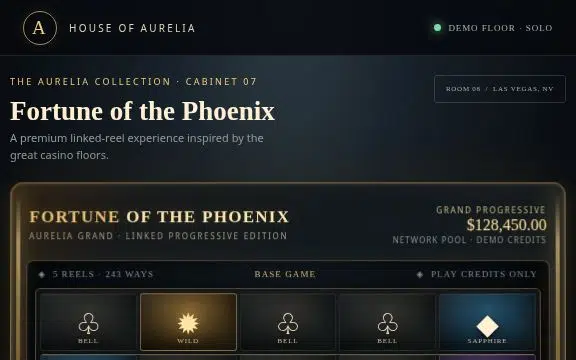 [同款源码网页实截](<https://github.com/CleanExpo/fortune-phoenix-demo/blob/HEAD/index.html>) | [CleanExpo/fortune-phoenix-demo](<https://github.com/CleanExpo/fortune-phoenix-demo>) | 常见根目录许可文件未找到 | 待核 | — | [可达 · 含游戏画布／引擎的网页](<https://fortune-phoenix-deploy.vercel.app>) |
| 1500 | [ ] | [Fossil Hunter](<https://github.com/gamingnews5/awesome-opus-5.5-games/blob/9a29b570e56bd19f15a3cd6bbac0b8c682f2c48c/games/fossil-hunter/readme.md>) | 待补截图 | [0xmeowmeow/fossil-hunter](<https://github.com/0xmeowmeow/fossil-hunter>) | 常见根目录许可文件未找到 | 待核 | — | [可达 · 含游戏画布／引擎的网页](<https://meow-meow.io/trilobite/>) |
| 1501 | [ ] | [Foundation](<https://github.com/gamingnews5/awesome-opus-5.5-games/blob/9a29b570e56bd19f15a3cd6bbac0b8c682f2c48c/games/foundation/readme.md>) | 待补截图 | [jnyinglis/foundation-series](<https://github.com/jnyinglis/foundation-series>) | 常见根目录许可文件未找到 | 待核 | — | 未列入口 |
| 1502 | [ ] | [Four Walls](<https://github.com/gamingnews5/awesome-opus-5.5-games/blob/9a29b570e56bd19f15a3cd6bbac0b8c682f2c48c/games/four-walls/readme.md>) | 待补截图 | [munisht06/four-walls](<https://github.com/munisht06/four-walls>) | 常见根目录许可文件未找到 | 待核 | — | 未列入口 |
| 1503 | [ ] | [Fraction Feast](<https://github.com/gamingnews5/awesome-opus-5.5-games/blob/9a29b570e56bd19f15a3cd6bbac0b8c682f2c48c/games/fraction-feast/readme.md>) | 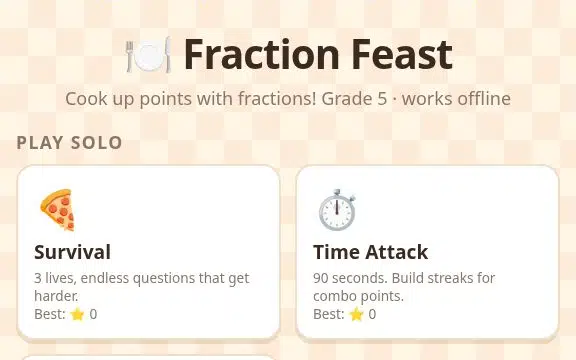 [源码运行首页](<https://github.com/Hawreirei/Fraction3/blob/claude/kind-lamport-0o8con/index.html>) | [Hawreirei/Fraction3](<https://github.com/Hawreirei/Fraction3>) | 常见根目录许可文件未找到 | 待核 | — | 未列入口 |
| 1504 | [ ] | [Fraction Quest](<https://github.com/gamingnews5/awesome-opus-5.5-games/blob/9a29b570e56bd19f15a3cd6bbac0b8c682f2c48c/games/fraction-quest/readme.md>) |  [合集截图](<https://github.com/gitsgulabjamun/fraction-quest/blob/main/docs/map.png>) | [gitsgulabjamun/fraction-quest](<https://github.com/gitsgulabjamun/fraction-quest>) | 常见根目录许可文件未找到 | 待核 | [4.8](<https://github.com/gitsgulabjamun/fraction-quest/blob/main/docs/map.png>) | [可达 · 含游戏画布／引擎的网页](<https://fraction-quest-beta.vercel.app>) |
| 1505 | [ ] | [Frankendom](<https://github.com/gamingnews5/awesome-opus-5.5-games/blob/9a29b570e56bd19f15a3cd6bbac0b8c682f2c48c/games/frankendom/readme.md>) | 待补截图 | [DomLynch/Frankendom-v3](<https://github.com/DomLynch/Frankendom-v3>) | 常见根目录许可文件未找到 | 待核 | [4.6（原图失效）](<https://github.com/DomLynch/Frankendom-v3/blob/main/docs/clips/blend/blend-v1-cut-3.jpg>) | 未列入口 |
| 1506 | [ ] | [Freddie's Last Set](<https://github.com/gamingnews5/awesome-opus-5.5-games/blob/9a29b570e56bd19f15a3cd6bbac0b8c682f2c48c/games/freddie-s-last-set/readme.md>) | 待补截图 | [Naebun/mobilegame](<https://github.com/Naebun/mobilegame>) | 常见根目录许可文件未找到 无根LICENSE；现README已改Naebun，旧发现名Freddie只作别名。 | 待核 | — | [可达 · 含游戏画布／引擎的网页](<https://naebun.github.io/mobilegame/>) |
| 1507 | [ ] | [Freddy's Fall](<https://github.com/gamingnews5/awesome-opus-5.5-games/blob/9a29b570e56bd19f15a3cd6bbac0b8c682f2c48c/games/freddy-s-fall/readme.md>) | 待补截图 | [kvelury/freddysfall](<https://github.com/kvelury/freddysfall>) | 常见根目录许可文件未找到 | [README 提及](<https://github.com/kvelury/freddysfall/blob/HEAD/README.md#L325>) | — | 未列入口 |
| 1508 | [ ] | [Fredy 80 quiz](<https://github.com/gamingnews5/awesome-opus-5.5-games/blob/9a29b570e56bd19f15a3cd6bbac0b8c682f2c48c/games/fredy-80-quiz/readme.md>) | 待补截图 | [lior-tech/fredy80-quiz](<https://github.com/lior-tech/fredy80-quiz>) | 常见根目录许可文件未找到 | 待核 | — | [可达 · 合集所列网页](<https://lior-tech.github.io/fredy80-quiz/>) |
| 1509 | [ ] | [Freefall](<https://github.com/gamingnews5/awesome-opus-5.5-games/blob/9a29b570e56bd19f15a3cd6bbac0b8c682f2c48c/games/freefall/readme.md>) | 待补截图 | [GamesbyVidal/freefall](<https://github.com/GamesbyVidal/freefall>) | 常见根目录许可文件未找到 | 待核 | [5.2](<https://github.com/GamesbyVidal/freefall/blob/main/preview.png>) | [可达 · 含游戏画布／引擎的网页](<https://gamesbyvidal.github.io/freefall/>) |
| 1510 | [ ] | [Freestyle ASMR Makeup Artist](<https://github.com/gamingnews5/awesome-opus-5.5-games/blob/9a29b570e56bd19f15a3cd6bbac0b8c682f2c48c/games/freestyle-asmr-makeup-artist/readme.md>) |  [上游游戏截图](<https://github.com/lrodeveloperr/Makeup-artist-/blob/HEAD/marketing/screenshots/landscape/01-lipstick-in-motion.png>) | [lrodeveloperr/Makeup-artist-](<https://github.com/lrodeveloperr/Makeup-artist->) | 常见根目录许可文件未找到 | 待核 | — | 未列入口 |
| 1511 | [ ] | [Freeze Tag](<https://github.com/gamingnews5/awesome-opus-5.5-games/blob/9a29b570e56bd19f15a3cd6bbac0b8c682f2c48c/games/party-chaos/readme.md>) | 待补截图 | [lawrenceandrewlargo/roblox-extreme-minigames](<https://github.com/lawrenceandrewlargo/roblox-extreme-minigames>) | 常见根目录许可文件未找到 | 待核 | — | 未列入口 |
| 1512 | [ ] | [French Fried!](<https://github.com/gamingnews5/awesome-opus-5.5-games/blob/9a29b570e56bd19f15a3cd6bbac0b8c682f2c48c/games/french-fried/readme.md>) | 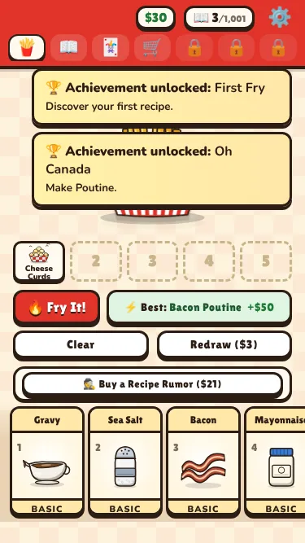 [合集截图](<https://github.com/DempKing/French_Fried/blob/main/docs/screenshots/mob375x667.png>) | [DempKing/French\_Fried](<https://github.com/DempKing/French_Fried>) | 常见根目录许可文件未找到 | 待核 | [4.4](<https://github.com/DempKing/French_Fried/blob/main/docs/screenshots/mob375x667.png>) | [可达 · 合集所列网页](<https://dempking.github.io/French_Fried/>) |
| 1513 | [ ] | [Fretline](<https://github.com/gamingnews5/awesome-opus-5.5-games/blob/9a29b570e56bd19f15a3cd6bbac0b8c682f2c48c/games/fretline/readme.md>) | 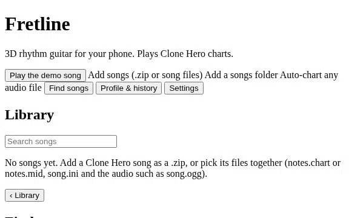 [源码运行首页](<https://github.com/dropchop/fretline/blob/main/index.html>) | [dropchop/fretline](<https://github.com/dropchop/fretline>) | 常见根目录许可文件未找到 | [README 提及](<https://github.com/dropchop/fretline/blob/HEAD/README.md#L86>) | — | 未列入口 |
| 1514 | [ ] | [Friday, 4:42 PM](<https://github.com/gamingnews5/awesome-opus-5.5-games/blob/9a29b570e56bd19f15a3cd6bbac0b8c682f2c48c/games/friday-4-42-pm/readme.md>) | 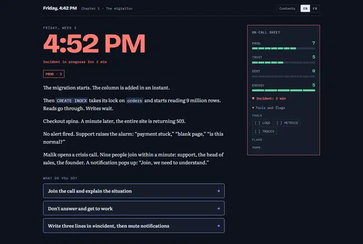 [合集截图](<https://github.com/underscoreloG/devops-gamebook/blob/main/docs/screenshots/incident.png>) | [underscoreloG/devops-gamebook](<https://github.com/underscoreloG/devops-gamebook>) | 常见根目录许可文件未找到 | 待核 | [4.0](<https://github.com/underscoreloG/devops-gamebook/blob/main/docs/screenshots/incident.png>) | [可达 · 合集所列网页](<https://underscorelog.github.io/devops-gamebook/>) |
| 1515 | [ ] | [Friend Monopoly](<https://github.com/gamingnews5/awesome-opus-5.5-games/blob/9a29b570e56bd19f15a3cd6bbac0b8c682f2c48c/games/friend-monopoly/readme.md>) |  [源码运行首页](<https://github.com/camdenshaw97-a11y/Friend-Monopoly/blob/main/tv.html>) | [camdenshaw97-a11y/Friend-Monopoly](<https://github.com/camdenshaw97-a11y/Friend-Monopoly>) | 常见根目录许可文件未找到 | 待核 | — | 未列入口 |
| 1516 | [ ] | [Friends Game](<https://github.com/gamingnews5/awesome-opus-5.5-games/blob/9a29b570e56bd19f15a3cd6bbac0b8c682f2c48c/games/friends-game/readme.md>) | 待补截图 | [oronanschel/friends-game](<https://github.com/oronanschel/friends-game>) | 常见根目录许可文件未找到 | 待核 | — | [可达 · 含游戏画布／引擎的网页](<https://oronanschel.github.io/friends-game/>) |
| 1517 | [ ] | [FriendSlop](<https://github.com/gamingnews5/awesome-opus-5.5-games/blob/9a29b570e56bd19f15a3cd6bbac0b8c682f2c48c/games/friendslop/readme.md>) | 待补截图 | [jamusyt-web/FriendSlop](<https://github.com/jamusyt-web/FriendSlop>) | 常见根目录许可文件未找到 | 待核 | — | 未列入口 |
| 1518 | [ ] | [Friendslop](<https://github.com/gamingnews5/awesome-opus-5.5-games/blob/9a29b570e56bd19f15a3cd6bbac0b8c682f2c48c/games/friendslop-ndrpnmrnk-friendslop/readme.md>) | 待补截图 | [ndrpnmrnk/friendslop](<https://github.com/ndrpnmrnk/friendslop>) | 常见根目录许可文件未找到 | [README 提及](<https://github.com/ndrpnmrnk/friendslop/blob/HEAD/README.md#L154>) | — | 未列入口 |
| 1519 | [ ] | [FRIENDSLOPPED](<https://github.com/gamingnews5/awesome-opus-5.5-games/blob/9a29b570e56bd19f15a3cd6bbac0b8c682f2c48c/games/friendslopped/readme.md>) | 待补截图 | [t3rrey/friendslopped](<https://github.com/t3rrey/friendslopped>) | 常见根目录许可文件未找到 | 待核 | — | 未列入口 |
| 1520 | [ ] | [Front Line](<https://github.com/gamingnews5/awesome-opus-5.5-games/blob/9a29b570e56bd19f15a3cd6bbac0b8c682f2c48c/games/front-line/readme.md>) | 待补截图 | [akskjjsjs6-alt/front-line](<https://github.com/akskjjsjs6-alt/front-line>) | 常见根目录许可文件未找到 | 待核 | — | 未列入口 |
| 1521 | [ ] | [Front Office](<https://github.com/gamingnews5/awesome-opus-5.5-games/blob/9a29b570e56bd19f15a3cd6bbac0b8c682f2c48c/games/front-office/readme.md>) | 待补截图 | [samahlersmeyer-prog/front-office](<https://github.com/samahlersmeyer-prog/front-office>) | 常见根目录许可文件未找到 | 待核 | — | [可达 · 合集所列网页](<https://samahlersmeyer-prog.github.io/front-office/>) |
| 1522 | [ ] | [Frontlines](<https://github.com/gamingnews5/awesome-opus-5.5-games/blob/9a29b570e56bd19f15a3cd6bbac0b8c682f2c48c/games/frontlines/readme.md>) | 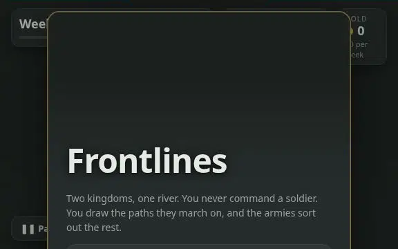 [源码运行首页](<https://github.com/mkjems/frontlines/blob/main/frontlines.html>) | [mkjems/frontlines](<https://github.com/mkjems/frontlines>) | 常见根目录许可文件未找到 | 待核 | — | [README · 可达 · 上游 README 所列网页](<https://frontlines.mkjems.dk/>) |
| 1523 | [ ] | [Frost &amp; Flame](<https://github.com/gamingnews5/awesome-opus-5.5-games/blob/9a29b570e56bd19f15a3cd6bbac0b8c682f2c48c/games/frost-flame/readme.md>) | 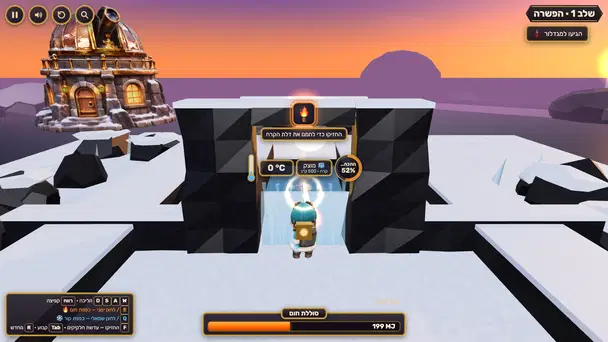 [合集截图](<https://github.com/AceDZN/frost-and-flame/blob/main/docs/captures/01-first-30s-actual.png>) | [AceDZN/frost-and-flame](<https://github.com/AceDZN/frost-and-flame>) | 常见根目录许可文件未找到 | 待核 | [6.4](<https://github.com/AceDZN/frost-and-flame/blob/main/docs/captures/01-first-30s-actual.png>) | 未列入口 |
| 1524 | [ ] | [Frost Hop](<https://github.com/gamingnews5/awesome-opus-5.5-games/blob/9a29b570e56bd19f15a3cd6bbac0b8c682f2c48c/games/frost-hop/readme.md>) | 待补截图 | [MrAllNeo/frost-hop](<https://github.com/MrAllNeo/frost-hop>) | 常见根目录许可文件未找到 | 待核 | — | 未列入口 |
| 1525 | [ ] | [Frost Peak Climber](<https://github.com/gamingnews5/awesome-opus-5.5-games/blob/9a29b570e56bd19f15a3cd6bbac0b8c682f2c48c/games/frost-peak-climber/readme.md>) | 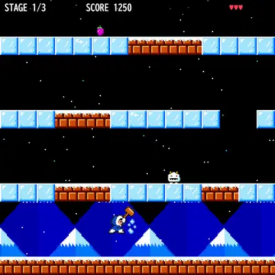 [合集截图](<https://github.com/kdt26aie40008-ux/-/blob/main/images/play.png>) | [kdt26aie40008-ux/-](<https://github.com/kdt26aie40008-ux/->) | 常见根目录许可文件未找到 | 待核 | [5.4](<https://github.com/kdt26aie40008-ux/-/blob/main/images/play.png>) | [可达 · 含游戏画布／引擎的网页](<https://kdt26aie40008-ux.github.io/-/>) |
| 1526 | [ ] | [Frostbite](<https://github.com/gamingnews5/awesome-opus-5.5-games/blob/9a29b570e56bd19f15a3cd6bbac0b8c682f2c48c/games/frostbite/readme.md>) | 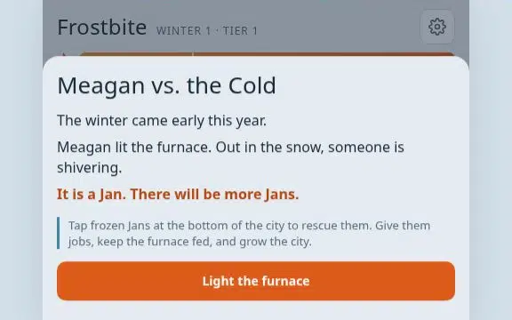 [源码运行画面](<https://github.com/Jazzwec/Frostbite1/blob/main/prototype/frostbite.html>) | [Jazzwec/Frostbite1](<https://github.com/Jazzwec/Frostbite1>) | 常见根目录许可文件未找到 | 待核 | — | 未列入口 |
| 1527 | [ ] | [Frostfall Cabins](<https://github.com/gamingnews5/awesome-opus-5.5-games/blob/9a29b570e56bd19f15a3cd6bbac0b8c682f2c48c/games/frostfall-cabins/readme.md>) | 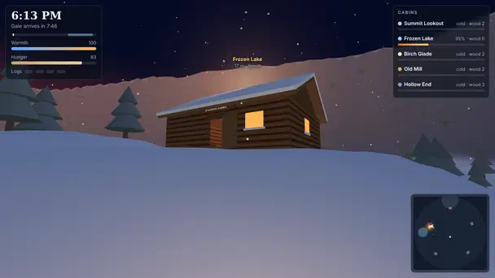 [合集截图](<https://github.com/hardwaremack-prog/frostfall-cabins/blob/main/screenshot.png>) | [hardwaremack-prog/frostfall-cabins](<https://github.com/hardwaremack-prog/frostfall-cabins>) | 常见根目录许可文件未找到 | 待核 | [6.3](<https://github.com/hardwaremack-prog/frostfall-cabins/blob/main/screenshot.png>) | 未列入口 |
| 1528 | [ ] | [Frostline Kart](<https://github.com/gamingnews5/awesome-opus-5.5-games/blob/9a29b570e56bd19f15a3cd6bbac0b8c682f2c48c/games/frostline-kart/readme.md>) | 待补截图 | [sorrycc/fable-arcade](<https://github.com/sorrycc/fable-arcade>) | 常见根目录许可文件未找到 | 待核 | — | [可达 · 含游戏画布／引擎的网页](<https://sorrycc.github.io/fable-arcade/games/mario-kart-snow/>) |
| 1529 | [ ] | [Frostwood](<https://github.com/gamingnews5/awesome-opus-5.5-games/blob/9a29b570e56bd19f15a3cd6bbac0b8c682f2c48c/games/frostwood/readme.md>) | 待补截图 | [jackedevathome/frostwood](<https://github.com/jackedevathome/frostwood>) | 常见根目录许可文件未找到 | 待核 | — | 未列入口 |
| 1530 | [ ] | [Fruitvlucht](<https://github.com/gamingnews5/awesome-opus-5.5-games/blob/9a29b570e56bd19f15a3cd6bbac0b8c682f2c48c/games/fruitvlucht/readme.md>) | 待补截图 | [pietertmortier-lab/fruitvlucht](<https://github.com/pietertmortier-lab/fruitvlucht>) | 常见根目录许可文件未找到 | 待核 | — | [入口已失效 · 合集所列网页](<https://pietertmortier-lab.github.io/fruitvlucht/>) |
| 1531 | [ ] | [FstreliBiciklina3D](<https://github.com/gamingnews5/awesome-opus-5.5-games/blob/9a29b570e56bd19f15a3cd6bbac0b8c682f2c48c/games/fstrelibiciklina3d/readme.md>) | 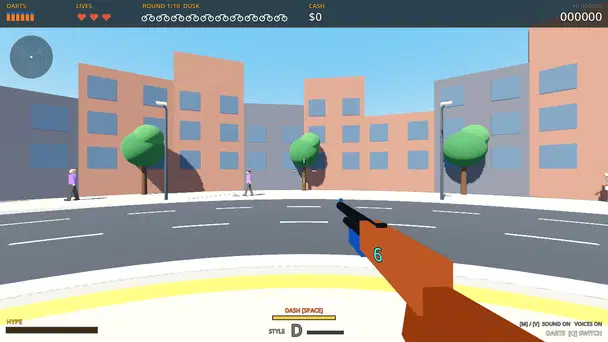 [上游游戏截图](<https://github.com/GVihi/FstreliBiciklina3D/blob/HEAD/docs/screenshots/f1-day-lighting-after.png>) | [GVihi/FstreliBiciklina3D](<https://github.com/GVihi/FstreliBiciklina3D>) | 常见根目录许可文件未找到 | [README 提及、源码有输入读取](<https://github.com/GVihi/FstreliBiciklina3D/blob/main/scripts/main.gd#L2171>) | — | 未列入口 |
| 1532 | [ ] | [Fuat Morel](<https://github.com/gamingnews5/awesome-opus-5.5-games/blob/9a29b570e56bd19f15a3cd6bbac0b8c682f2c48c/games/fuat-morel/readme.md>) | 待补截图 | [TAFTAFFF/fuat-morel](<https://github.com/TAFTAFFF/fuat-morel>) | 常见根目录许可文件未找到 | 待核 | — | 未列入口 |
| 1533 | [ ] | [Function Tracer](<https://github.com/gamingnews5/awesome-opus-5.5-games/blob/9a29b570e56bd19f15a3cd6bbac0b8c682f2c48c/games/function-tracer/readme.md>) |  [源码运行画面](<https://github.com/qkempe/CalHacks13.0-Proj/blob/main/public/index.html>) | [qkempe/CalHacks13.0-Proj](<https://github.com/qkempe/CalHacks13.0-Proj>) | 常见根目录许可文件未找到 | 待核 | — | 未列入口 |
| 1534 | [ ] | [FunPixelNest MGP — Multi Gaming Platform](<https://github.com/gamingnews5/awesome-opus-5.5-games/blob/9a29b570e56bd19f15a3cd6bbac0b8c682f2c48c/games/funpixelnest-mgp-multi-gaming-platform/readme.md>) | 待补截图 | [FunPixelNest/funpixelnest-mgp](<https://github.com/FunPixelNest/funpixelnest-mgp>) | 常见根目录许可文件未找到 | 待核 | — | 未列入口 |
| 1535 | [ ] | [Futkrill](<https://github.com/gamingnews5/awesome-opus-5.5-games/blob/9a29b570e56bd19f15a3cd6bbac0b8c682f2c48c/games/futkrill/readme.md>) | 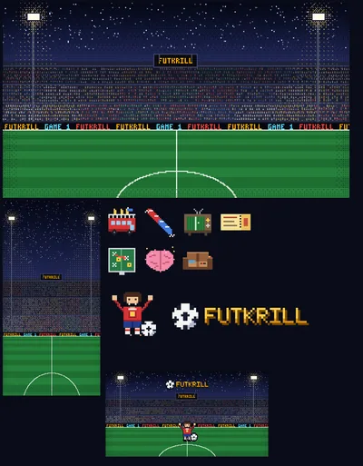 [上游游戏截图](<https://github.com/emrekapancibuilds/futbol-krillion/blob/HEAD/art/preview.png>) | [emrekapancibuilds/futbol-krillion](<https://github.com/emrekapancibuilds/futbol-krillion>) | 常见根目录许可文件未找到 | 待核 | — | 未列入口 |
| 1536 | [ ] | [Futt Sepia Games](<https://github.com/gamingnews5/awesome-opus-5.5-games/blob/9a29b570e56bd19f15a3cd6bbac0b8c682f2c48c/games/futt-sepia-games/readme.md>) | 待补截图 | [nafeesnafi/futty](<https://github.com/nafeesnafi/futty>) | 常见根目录许可文件未找到 | [README 提及](<https://github.com/nafeesnafi/futty/blob/HEAD/README.md#L139>) | — | [可达 · 合集所列网页](<https://futty-sepia.vercel.app>) |
| 1537 | [ ] | [Gacha Hoa 20/10](<https://github.com/gamingnews5/awesome-opus-5.5-games/blob/9a29b570e56bd19f15a3cd6bbac0b8c682f2c48c/games/gacha-hoa-20-10/readme.md>) | 待补截图 | [vtai2834/simpleProject](<https://github.com/vtai2834/simpleProject>) | 常见根目录许可文件未找到 | 待核 | — | [可达 · 合集所列网页](<https://simple-project-xi-navy.vercel.app>) |
| 1538 | [ ] | [Gaju's India Puzzle](<https://github.com/gamingnews5/awesome-opus-5.5-games/blob/9a29b570e56bd19f15a3cd6bbac0b8c682f2c48c/games/gaju-s-india-puzzle/readme.md>) | 待补截图 | [hema-g01/GajusIndiaPuzzle](<https://github.com/hema-g01/GajusIndiaPuzzle>) | 常见根目录许可文件未找到 | 待核 | — | 未列入口 |
| 1539 | [ ] | [Galaxica games](<https://github.com/gamingnews5/awesome-opus-5.5-games/blob/9a29b570e56bd19f15a3cd6bbac0b8c682f2c48c/games/galaxica-games/readme.md>) | 待补截图 | [aaron1612n-cmd/galaxica](<https://github.com/aaron1612n-cmd/galaxica>) | 常见根目录许可文件未找到 | [源码有输入读取](<https://github.com/aaron1612n-cmd/galaxica/blob/main/public/games/galaxica/index.html#L205>) | — | 未列入口 |
| 1540 | [ ] | [Galaxidi Dash](<https://github.com/gamingnews5/awesome-opus-5.5-games/blob/9a29b570e56bd19f15a3cd6bbac0b8c682f2c48c/games/galaxidi-dash/readme.md>) | 待补截图 | [latsoudisbrothersgames/galaxidi-dash](<https://github.com/latsoudisbrothersgames/galaxidi-dash>) | 常见根目录许可文件未找到 | 待核 | — | [可达 · 含游戏画布／引擎的网页](<https://latsoudis-games.pages.dev/dash/>) |
| 1541 | [ ] | [Galaxxis](<https://github.com/gamingnews5/awesome-opus-5.5-games/blob/9a29b570e56bd19f15a3cd6bbac0b8c682f2c48c/games/galaxxis/readme.md>) | 待补截图 | [Jazzman1976/galaxxis](<https://github.com/Jazzman1976/galaxxis>) | 常见根目录许可文件未找到 | 待核 | [3.8](<https://github.com/Jazzman1976/galaxxis/blob/develop/docs/archive/dummy-prototype/assets/images/galaxies.jpg>) | 未列入口 |
| 1542 | [ ] | [Galaxy Defender](<https://github.com/gamingnews5/awesome-opus-5.5-games/blob/9a29b570e56bd19f15a3cd6bbac0b8c682f2c48c/games/galaxy-defender/readme.md>) | 待补截图 | [milodinasour/galaxy-defender](<https://github.com/milodinasour/galaxy-defender>) | 常见根目录许可文件未找到 | 待核 | — | 未列入口 |
| 1543 | [ ] | [Galleria Streets](<https://github.com/gamingnews5/awesome-opus-5.5-games/blob/9a29b570e56bd19f15a3cd6bbac0b8c682f2c48c/games/galleria-streets/readme.md>) | 待补截图 | [mattchante/Galleria-Shopping-RPG](<https://github.com/mattchante/Galleria-Shopping-RPG>) | 常见根目录许可文件未找到 | 待核 | — | 未列入口 |
| 1544 | [ ] | [Gallicus 2.0](<https://github.com/gamingnews5/awesome-opus-5.5-games/blob/9a29b570e56bd19f15a3cd6bbac0b8c682f2c48c/games/gallicus-2-0/readme.md>) | 待补截图 | [Faratas410/Gallicus-2.0](<https://github.com/Faratas410/Gallicus-2.0>) | 常见根目录许可文件未找到 | 待核 | — | 未列入口 |
| 1545 | [ ] | [Gamacraft](<https://github.com/gamingnews5/awesome-opus-5.5-games/blob/9a29b570e56bd19f15a3cd6bbac0b8c682f2c48c/games/gamacraft/readme.md>) | 待补截图 | [alexandermacscott-del/GamaCraft](<https://github.com/alexandermacscott-del/GamaCraft>) | 常见根目录许可文件未找到 | 待核 | — | [可达 · 含游戏画布／引擎的网页](<https://alexandermacscott-del.github.io/GamaCraft/>) |
| 1546 | [ ] | [Gambling Roguelike](<https://github.com/gamingnews5/awesome-opus-5.5-games/blob/9a29b570e56bd19f15a3cd6bbac0b8c682f2c48c/games/gambling-roguelike/readme.md>) | 待补截图 | [MrKrob00/Gambling-Roguelike](<https://github.com/MrKrob00/Gambling-Roguelike>) | 常见根目录许可文件未找到 | 待核 | [6.4](<https://github.com/MrKrob00/Gambling-Roguelike/blob/main/docs/itch/cover_630x500.png>) | 未列入口 |
| 1547 | [ ] | [Game Arcade](<https://github.com/gamingnews5/awesome-opus-5.5-games/blob/9a29b570e56bd19f15a3cd6bbac0b8c682f2c48c/games/game-arcade/readme.md>) | 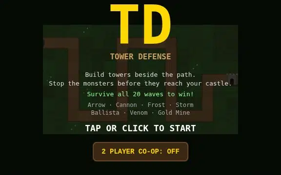 [源码运行首页](<https://github.com/wanderazimuth/game_project/blob/main/td/index.html>) | [wanderazimuth/game\_project](<https://github.com/wanderazimuth/game_project>) | 常见根目录许可文件未找到 | 待核 | — | 未列入口 |
| 1548 | [ ] | [Game Arcade (nickmosconi2)](<https://github.com/gamingnews5/awesome-opus-5.5-games/blob/9a29b570e56bd19f15a3cd6bbac0b8c682f2c48c/games/game-arcade-nickmosconi2/readme.md>) | 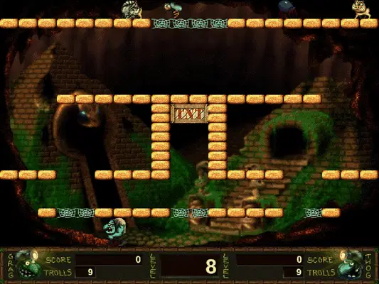 [合集截图](<https://github.com/nickmosconi2/game-arcade/blob/main/Bonkheads/shot1.png>) | [nickmosconi2/game-arcade](<https://github.com/nickmosconi2/game-arcade>) | 常见根目录许可文件未找到 | 待核 | [6.2](<https://github.com/nickmosconi2/game-arcade/blob/main/Bonkheads/shot1.png>) | 未列入口 |
| 1549 | [ ] | [Game Hangar](<https://github.com/gamingnews5/awesome-opus-5.5-games/blob/9a29b570e56bd19f15a3cd6bbac0b8c682f2c48c/games/game-hangar/readme.md>) | 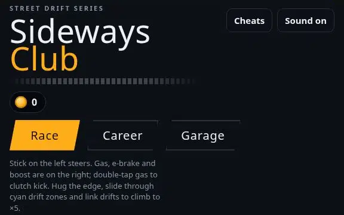 [源码运行首页](<https://github.com/delnoa98/Games/blob/main/sideways-club/index.html>) | [delnoa98/Games](<https://github.com/delnoa98/Games>) | 常见根目录许可文件未找到 | 待核 | — | [README · 入口已失效 · 上游 README 所列网页](<https://delnoa98.github.io/games/>) |
| 1550 | [ ] | [Game Hội Bạn](<https://github.com/gamingnews5/awesome-opus-5.5-games/blob/9a29b570e56bd19f15a3cd6bbac0b8c682f2c48c/games/game-hoi-ban/readme.md>) | 待补截图 | [buuhaucantho-ship-it/game-hoi-ban](<https://github.com/buuhaucantho-ship-it/game-hoi-ban>) | 常见根目录许可文件未找到 | 待核 | — | [可达 · 合集所列网页](<https://buuhaucantho-ship-it.github.io/game-hoi-ban/>) |
| 1551 | [ ] | [Game Jeopardy](<https://github.com/gamingnews5/awesome-opus-5.5-games/blob/9a29b570e56bd19f15a3cd6bbac0b8c682f2c48c/games/game-jeopardy/readme.md>) | 待补截图 | [najeeb101/Japanese-game](<https://github.com/najeeb101/Japanese-game>) | 常见根目录许可文件未找到 | 待核 | — | [可达 · 合集所列网页](<https://najeeb101.github.io/Japanese-game/>) |
| 1552 | [ ] | [Game Mecha](<https://github.com/gamingnews5/awesome-opus-5.5-games/blob/9a29b570e56bd19f15a3cd6bbac0b8c682f2c48c/games/game-mecha/readme.md>) | 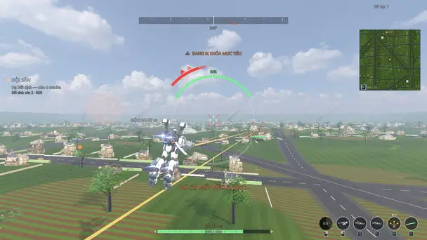 [合集截图](<https://github.com/nxtr1609/game-mecha/blob/main/docs/tran_dau.jpg>) | [nxtr1609/game-mecha](<https://github.com/nxtr1609/game-mecha>) | 常见根目录许可文件未找到 | 待核 | [6.6](<https://github.com/nxtr1609/game-mecha/blob/main/docs/tran_dau.jpg>) | 未列入口 |
| 1553 | [ ] | [Game night](<https://github.com/gamingnews5/awesome-opus-5.5-games/blob/9a29b570e56bd19f15a3cd6bbac0b8c682f2c48c/games/game-night-kevindeslauriers-hangman/readme.md>) | 待补截图 | [kevindeslauriers/hangman](<https://github.com/kevindeslauriers/hangman>) | 常见根目录许可文件未找到 | 待核 | — | 未列入口 |
| 1554 | [ ] | [Game Night](<https://github.com/gamingnews5/awesome-opus-5.5-games/blob/9a29b570e56bd19f15a3cd6bbac0b8c682f2c48c/games/game-night/readme.md>) | 待补截图 | [tomaras/game-night](<https://github.com/tomaras/game-night>) | 常见根目录许可文件未找到 | 待核 | — | [可达 · 合集所列网页](<https://squattersnights.fun/>) |
| 1555 | [ ] | [Game Night (MarshallHasenbeck)](<https://github.com/gamingnews5/awesome-opus-5.5-games/blob/9a29b570e56bd19f15a3cd6bbac0b8c682f2c48c/games/game-night-marshallhasenbeck/readme.md>) | 待补截图 | [MarshallHasenbeck/games-night](<https://github.com/MarshallHasenbeck/games-night>) | 常见根目录许可文件未找到 | 待核 | — | 未列入口 |
| 1556 | [ ] | [Game Night (VarunS121)](<https://github.com/gamingnews5/awesome-opus-5.5-games/blob/9a29b570e56bd19f15a3cd6bbac0b8c682f2c48c/games/game-night-varuns121/readme.md>) |  [合集截图](<https://github.com/VarunS121/Neon-Poker/blob/main/docs/screenshot.png>) | [VarunS121/Neon-Poker](<https://github.com/VarunS121/Neon-Poker>) | 常见根目录许可文件未找到 | 待核 | [6.6](<https://github.com/VarunS121/Neon-Poker/blob/main/docs/screenshot.png>) | 未列入口 |
| 1557 | [ ] | [Game of War: Strategy Board Game](<https://github.com/gamingnews5/awesome-opus-5.5-games/blob/9a29b570e56bd19f15a3cd6bbac0b8c682f2c48c/games/game-of-war-strategy-board-game/readme.md>) | 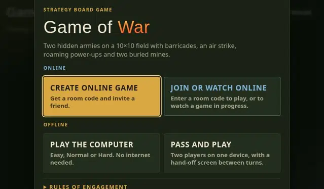 [试玩首页实截](<https://spacecarl9001.github.io/Game-of-War/>) | [SpaceCarl9001/Game-of-War](<https://github.com/SpaceCarl9001/Game-of-War>) | 常见根目录许可文件未找到 | 待核 | — | [可达 · 含游戏画布／引擎的网页](<https://spacecarl9001.github.io/Game-of-War/>) |
| 1558 | [ ] | [Game Preview Arcade](<https://github.com/gamingnews5/awesome-opus-5.5-games/blob/9a29b570e56bd19f15a3cd6bbac0b8c682f2c48c/games/game-preview-arcade/readme.md>) | 待补截图 | [auzanhasfi/game-preview](<https://github.com/auzanhasfi/game-preview>) | 常见根目录许可文件未找到 | 待核 | — | 未列入口 |
| 1559 | [ ] | [Game Room](<https://github.com/gamingnews5/awesome-opus-5.5-games/blob/9a29b570e56bd19f15a3cd6bbac0b8c682f2c48c/games/game-room/readme.md>) |  [源码运行首页](<https://github.com/Arnaldo2026/snake-game/blob/main/static/index.html>) | [Arnaldo2026/snake-game](<https://github.com/Arnaldo2026/snake-game>) | 常见根目录许可文件未找到 | 待核 | — | 未列入口 |
| 1560 | [ ] | [Game room](<https://github.com/gamingnews5/awesome-opus-5.5-games/blob/9a29b570e56bd19f15a3cd6bbac0b8c682f2c48c/games/game-room-innocentchikukwa-sketch-zimgames/readme.md>) | 待补截图 | [InnocentChikukwa-sketch/zimgames](<https://github.com/InnocentChikukwa-sketch/zimgames>) | 常见根目录许可文件未找到 | 待核 | — | [可达 · 合集所列网页](<https://zimgames.onrender.com/>) |
| 1561 | [ ] | [Game Shelf](<https://github.com/gamingnews5/awesome-opus-5.5-games/blob/9a29b570e56bd19f15a3cd6bbac0b8c682f2c48c/games/game-shelf/readme.md>) | 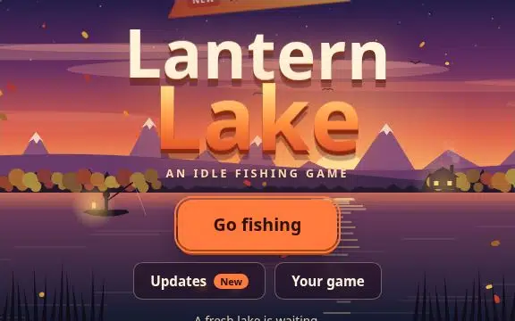 [源码运行首页](<https://github.com/sycorange/game-shelf/blob/main/public/lantern-lake/index.html>) | [sycorange/game-shelf](<https://github.com/sycorange/game-shelf>) | 常见根目录许可文件未找到 | 待核 | — | 未列入口 |
| 1562 | [ ] | [Game Suite](<https://github.com/gamingnews5/awesome-opus-5.5-games/blob/9a29b570e56bd19f15a3cd6bbac0b8c682f2c48c/games/game-suite/readme.md>) | 待补截图 | [JahangirB/Game-Suite](<https://github.com/JahangirB/Game-Suite>) | 常见根目录许可文件未找到 | 待核 | — | 未列入口 |
| 1563 | [ ] | [game-atelier](<https://github.com/gamingnews5/awesome-opus-5.5-games/blob/9a29b570e56bd19f15a3cd6bbac0b8c682f2c48c/games/game-atelier/readme.md>) | 待补截图 | [polos0117/game-atelier](<https://github.com/polos0117/game-atelier>) | 常见根目录许可文件未找到 | 待核 | — | 未列入口 |
| 1564 | [ ] | [Game-Hub](<https://github.com/gamingnews5/awesome-opus-5.5-games/blob/9a29b570e56bd19f15a3cd6bbac0b8c682f2c48c/games/game-hub/readme.md>) | 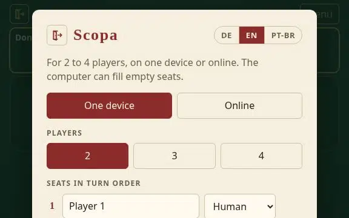 [源码运行首页](<https://github.com/ThisKsad/Game-Hub/blob/main/scopa/index.html>) | [ThisKsad/Game-Hub](<https://github.com/ThisKsad/Game-Hub>) | 常见根目录许可文件未找到 | 待核 | — | 未列入口 |
| 1565 | [ ] | [game-jam-0](<https://github.com/gamingnews5/awesome-opus-5.5-games/blob/9a29b570e56bd19f15a3cd6bbac0b8c682f2c48c/games/game-jam-0/readme.md>) | 待补截图 | [nullsatori/game-jam-0](<https://github.com/nullsatori/game-jam-0>) | 常见根目录许可文件未找到 | 待核 | — | 未列入口 |
| 1566 | [ ] | [Game-Legenda-Nusa-Kabut](<https://github.com/gamingnews5/awesome-opus-5.5-games/blob/9a29b570e56bd19f15a3cd6bbac0b8c682f2c48c/games/game-legenda-nusa-kabut/readme.md>) | 待补截图 | [johannesap/Game-Legenda-Nusa-Kabut](<https://github.com/johannesap/Game-Legenda-Nusa-Kabut>) | 常见根目录许可文件未找到 | 待核 | — | 未列入口 |
| 1567 | [ ] | [game-proto](<https://github.com/gamingnews5/awesome-opus-5.5-games/blob/9a29b570e56bd19f15a3cd6bbac0b8c682f2c48c/games/game-proto/readme.md>) | 待补截图 | [Chriszly/game-proto](<https://github.com/Chriszly/game-proto>) | 常见根目录许可文件未找到 | 待核 | — | 未列入口 |
| 1568 | [ ] | [game-recreation](<https://github.com/gamingnews5/awesome-opus-5.5-games/blob/9a29b570e56bd19f15a3cd6bbac0b8c682f2c48c/games/game-recreation/readme.md>) |  [源码运行首页](<https://github.com/alisafakaya624-coder/game-recreation/blob/main/games/fable-5.1/GTA6-Leonida.html>) | [alisafakaya624-coder/game-recreation](<https://github.com/alisafakaya624-coder/game-recreation>) | 常见根目录许可文件未找到 | 待核 | — | 未列入口 |
| 1569 | [ ] | [game-test (WebGPU action RPG)](<https://github.com/gamingnews5/awesome-opus-5.5-games/blob/9a29b570e56bd19f15a3cd6bbac0b8c682f2c48c/games/game-test-webgpu-action-rpg/readme.md>) | 待补截图 | [Kiikurage/game-test](<https://github.com/Kiikurage/game-test>) | 常见根目录许可文件未找到 | 待核 | — | [可达 · 合集所列网页](<https://kiikurage.github.io/game-test/>) |
| 1570 | [ ] | [GAME\_CORE — Adaptive Boss Arena](<https://github.com/gamingnews5/awesome-opus-5.5-games/blob/9a29b570e56bd19f15a3cd6bbac0b8c682f2c48c/games/game-core-adaptive-boss-arena/readme.md>) | 待补截图 | [Assassin29092005/GAME\_CORE](<https://github.com/Assassin29092005/GAME_CORE>) | 常见根目录许可文件未找到 | 待核 | — | 未列入口 |
| 1571 | [ ] | [GameCandycrushv1](<https://github.com/gamingnews5/awesome-opus-5.5-games/blob/9a29b570e56bd19f15a3cd6bbac0b8c682f2c48c/games/gamecandycrushv1/readme.md>) | 待补截图 | [jimjimxxx/Game\_Candycrush\_v1](<https://github.com/jimjimxxx/Game_Candycrush_v1>) | 常见根目录许可文件未找到 | 待核 | — | [入口已失效 · 合集所列网页](<https://jimjimxxx.github.io/Game_Candycrush_v1/>) |
| 1572 | [ ] | [GameJam](<https://github.com/gamingnews5/awesome-opus-5.5-games/blob/9a29b570e56bd19f15a3cd6bbac0b8c682f2c48c/games/gamejam/readme.md>) | 待补截图 | [ygtbekar/GameJam](<https://github.com/ygtbekar/GameJam>) | 常见根目录许可文件未找到 | 待核 | — | 未列入口 |
| 1573 | [ ] | [GAMELIFE：職場一日](<https://github.com/gamingnews5/awesome-opus-5.5-games/blob/9a29b570e56bd19f15a3cd6bbac0b8c682f2c48c/games/gamelife/readme.md>) | 待补截图 | [archi9882/GAMELIFE](<https://github.com/archi9882/GAMELIFE>) | 常见根目录许可文件未找到 | 待核 | — | 未列入口 |
| 1574 | [ ] | [GameNest · Mini Games](<https://github.com/gamingnews5/awesome-opus-5.5-games/blob/9a29b570e56bd19f15a3cd6bbac0b8c682f2c48c/games/gamenest-mini-games/readme.md>) | 待补截图 | [pnwadalkar/games](<https://github.com/pnwadalkar/games>) | 常见根目录许可文件未找到 | 待核 | — | 未列入口 |
| 1575 | [ ] | [GamePalace](<https://github.com/gamingnews5/awesome-opus-5.5-games/blob/9a29b570e56bd19f15a3cd6bbac0b8c682f2c48c/games/gamepalace/readme.md>) | 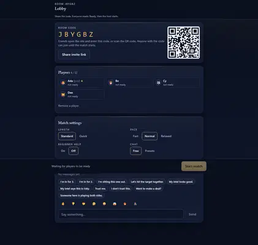 [合集截图](<https://github.com/rahul-reddy/GamePalace/blob/main/the-syndicate/docs/screenshots/02-lobby-host-desktop.png>) | [rahul-reddy/GamePalace](<https://github.com/rahul-reddy/GamePalace>) | 常见根目录许可文件未找到 | 待核 | [4.0](<https://github.com/rahul-reddy/GamePalace/blob/main/the-syndicate/docs/screenshots/02-lobby-host-desktop.png>) | 未列入口 |
| 1576 | [ ] | [Gamers-Gauntlet](<https://github.com/gamingnews5/awesome-opus-5.5-games/blob/9a29b570e56bd19f15a3cd6bbac0b8c682f2c48c/games/gamers-gauntlet/readme.md>) | 待补截图 | [Willlifer/Gamers-Gauntlet](<https://github.com/Willlifer/Gamers-Gauntlet>) | 常见根目录许可文件未找到 | 待核 | — | 未列入口 |
| 1577 | [ ] | [Games](<https://github.com/gamingnews5/awesome-opus-5.5-games/blob/9a29b570e56bd19f15a3cd6bbac0b8c682f2c48c/games/games/readme.md>) |  [源码运行首页](<https://github.com/ryansjack18-a11y/Games/blob/main/tower-of-doom/tower-of-doom.html>) | [ryansjack18-a11y/Games](<https://github.com/ryansjack18-a11y/Games>) | 常见根目录许可文件未找到 | 待核 | — | 未列入口 |
| 1578 | [ ] | [Games (5511-boop)](<https://github.com/gamingnews5/awesome-opus-5.5-games/blob/9a29b570e56bd19f15a3cd6bbac0b8c682f2c48c/games/games-5511-boop/readme.md>) | 待补截图 | [5511-boop/star-dash](<https://github.com/5511-boop/star-dash>) | 常见根目录许可文件未找到 | 待核 | — | [可达 · 合集所列网页](<https://5511-boop.github.io/star-dash/haunted/>) |
| 1579 | [ ] | [Games (abhi-sawant)](<https://github.com/gamingnews5/awesome-opus-5.5-games/blob/9a29b570e56bd19f15a3cd6bbac0b8c682f2c48c/games/games-abhi-sawant/readme.md>) | 待补截图 | [abhi-sawant/games](<https://github.com/abhi-sawant/games>) | 常见根目录许可文件未找到 | 待核 | — | [可达 · 合集所列网页](<https://games.slowatcoding.com>) |
| 1580 | [ ] | [Games (andrew1830)](<https://github.com/gamingnews5/awesome-opus-5.5-games/blob/9a29b570e56bd19f15a3cd6bbac0b8c682f2c48c/games/games-andrew1830/readme.md>) | 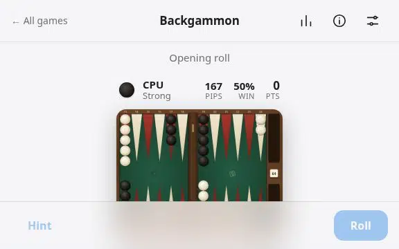 [源码运行画面](<https://github.com/andrew1830/games/blob/main/backgammon/index.html>) | [andrew1830/games](<https://github.com/andrew1830/games>) | 常见根目录许可文件未找到 | 待核 | — | 未列入口 |
| 1581 | [ ] | [Games (jadqarmoushah)](<https://github.com/gamingnews5/awesome-opus-5.5-games/blob/9a29b570e56bd19f15a3cd6bbac0b8c682f2c48c/games/games-jadqarmoushah/readme.md>) | 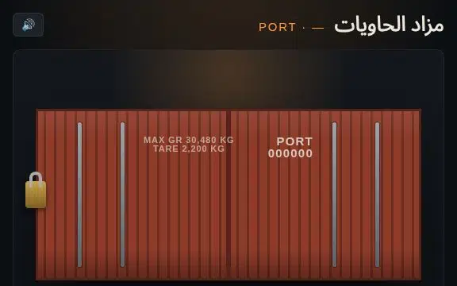 [源码运行画面](<https://github.com/jadqarmoushah/games/blob/main/auction/index.html>) | [jadqarmoushah/games](<https://github.com/jadqarmoushah/games>) | 常见根目录许可文件未找到 | 待核 | — | 未列入口 |
| 1582 | [ ] | [Games (lsliwko)](<https://github.com/gamingnews5/awesome-opus-5.5-games/blob/9a29b570e56bd19f15a3cd6bbac0b8c682f2c48c/games/games-lsliwko/readme.md>) | 待补截图 | [lsliwko/louis-claude](<https://github.com/lsliwko/louis-claude>) | 常见根目录许可文件未找到 | 待核 | — | [可达 · 合集所列网页](<https://lsliwko.github.io/louis-claude/>) |
| 1583 | [ ] | [Games (rujopereiric)](<https://github.com/gamingnews5/awesome-opus-5.5-games/blob/9a29b570e56bd19f15a3cd6bbac0b8c682f2c48c/games/games-rujopereiric/readme.md>) | 待补截图 | [rujopereiric/games](<https://github.com/rujopereiric/games>) | 常见根目录许可文件未找到 | 待核 | — | 未列入口 |
| 1584 | [ ] | [Games Unlimited](<https://github.com/gamingnews5/awesome-opus-5.5-games/blob/9a29b570e56bd19f15a3cd6bbac0b8c682f2c48c/games/games-unlimited/readme.md>) | 待补截图 | [SmoothHLiam/nytunlimited](<https://github.com/SmoothHLiam/nytunlimited>) | 常见根目录许可文件未找到 | 待核 | — | [可达 · 合集所列网页](<https://nytunlimited.vercel.app>) |
| 1585 | [ ] | [Gaming](<https://github.com/gamingnews5/awesome-opus-5.5-games/blob/9a29b570e56bd19f15a3cd6bbac0b8c682f2c48c/games/gaming/readme.md>) | 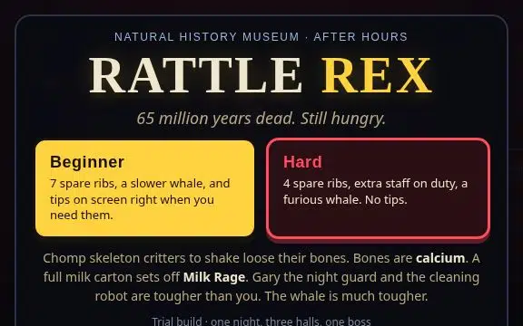 [源码运行首页](<https://github.com/AndreyKozyakov/Gaming/blob/main/rattle-rex/index.html>) | [AndreyKozyakov/Gaming](<https://github.com/AndreyKozyakov/Gaming>) | 常见根目录许可文件未找到 | 待核 | — | 未列入口 |
| 1586 | [ ] | [Gaming City · Duelo 1v1](<https://github.com/gamingnews5/awesome-opus-5.5-games/blob/9a29b570e56bd19f15a3cd6bbac0b8c682f2c48c/games/gaming-city-duelo-1v1/readme.md>) | 待补截图 | [juanmanuel2406/GameTrivia](<https://github.com/juanmanuel2406/GameTrivia>) | 常见根目录许可文件未找到 | 待核 | — | [可达 · 含游戏画布／引擎的网页](<https://trivia-gamingcity.vercel.app>) |
| 1587 | [ ] | [Gang of Legends](<https://github.com/gamingnews5/awesome-opus-5.5-games/blob/9a29b570e56bd19f15a3cd6bbac0b8c682f2c48c/games/gang-of-legends/readme.md>) | 待补截图 | [ahmed-okkio/gangoflegends](<https://github.com/ahmed-okkio/gangoflegends>) | 常见根目录许可文件未找到 | [源码有输入读取](<https://github.com/ahmed-okkio/gangoflegends/blob/main/game.js#L620>) | — | 未列入口 |
| 1588 | [ ] | [Garaad](<https://github.com/gamingnews5/awesome-opus-5.5-games/blob/9a29b570e56bd19f15a3cd6bbac0b8c682f2c48c/games/garaad/readme.md>) | 待补截图 | [amousamf/garaad](<https://github.com/amousamf/garaad>) | 常见根目录许可文件未找到 | 待核 | — | [可达 · 合集所列网页](<https://amousamf.github.io/Tiri/>) |
| 1589 | [ ] | [Garbage Kingdom](<https://github.com/gamingnews5/awesome-opus-5.5-games/blob/9a29b570e56bd19f15a3cd6bbac0b8c682f2c48c/games/garbage-kingdom/readme.md>) | 待补截图 | [antonycorp11-blip/garbage](<https://github.com/antonycorp11-blip/garbage>) | 常见根目录许可文件未找到 | 待核 | — | [可达 · 合集所列网页](<https://athg.antonycorp11.workers.dev>) |
| 1590 | [ ] | [Gardener Survivor](<https://github.com/gamingnews5/awesome-opus-5.5-games/blob/9a29b570e56bd19f15a3cd6bbac0b8c682f2c48c/games/gardener-survivor/readme.md>) | 待补截图 | [georstar/GardenerSurvivor](<https://github.com/georstar/GardenerSurvivor>) | 常见根目录许可文件未找到 | 待核 | — | 未列入口 |
| 1591 | [ ] | [Gary Is Hungry](<https://github.com/gamingnews5/awesome-opus-5.5-games/blob/9a29b570e56bd19f15a3cd6bbac0b8c682f2c48c/games/gary-is-hungry/readme.md>) |  [试玩首页实截](<https://anonymoesje.github.io/gary-is-hungry/>) | [Anonymoesje/gary-is-hungry](<https://github.com/Anonymoesje/gary-is-hungry>) | 常见根目录许可文件未找到 | [源码有输入读取](<https://github.com/Anonymoesje/gary-is-hungry/blob/main/docs/index.html#L2192>) | — | [可达 · 含游戏画布／引擎的网页](<https://anonymoesje.github.io/gary-is-hungry/>) |
| 1592 | [ ] | [GatorCampus 64](<https://github.com/gamingnews5/awesome-opus-5.5-games/blob/9a29b570e56bd19f15a3cd6bbac0b8c682f2c48c/games/gatorcampus-64/readme.md>) | 待补截图 | [Raamia/GatorCampus64](<https://github.com/Raamia/GatorCampus64>) | 常见根目录许可文件未找到 | 待核 | — | 未列入口 |
| 1593 | [ ] | [Gauntlet Loop × Unity CLI — 2.5D RPG](<https://github.com/gamingnews5/awesome-opus-5.5-games/blob/9a29b570e56bd19f15a3cd6bbac0b8c682f2c48c/games/gauntlet-loop-unity-cli-2-5d-rpg/readme.md>) | <a href="https://raw.githubusercontent.com/az9713/gauntlet-loop-unity-cli-demo/HEAD/demo.gif">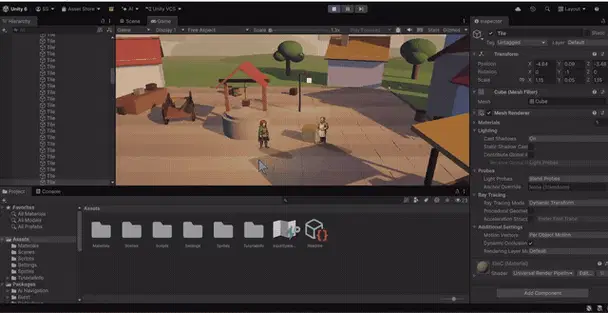</a> [上游动图截帧](<https://github.com/az9713/gauntlet-loop-unity-cli-demo#readme>) | [az9713/gauntlet-loop-unity-cli-demo](<https://github.com/az9713/gauntlet-loop-unity-cli-demo>) | 常见根目录许可文件未找到 | 待核 | — | [可达 · Claude 作品页](<https://claude.ai/code/artifact/f009240e-e3f7-4a28-99f4-6d23643b19a5>) |
| 1594 | [ ] | [Gcs Drone Arena](<https://github.com/gamingnews5/awesome-opus-5.5-games/blob/9a29b570e56bd19f15a3cd6bbac0b8c682f2c48c/games/gcs-drone-arena/readme.md>) | 待补截图 | [huyhoa308/gcs-drone-arena](<https://github.com/huyhoa308/gcs-drone-arena>) | 常见根目录许可文件未找到 | [README 提及](<https://github.com/huyhoa308/gcs-drone-arena/blob/HEAD/README.md#L43>) | — | [可达 · 素材／第三方资源](<https://capsule-render.vercel.app/api?type=waving&color=0:3a3f8f,100:0b1026&height=100&section=footer>) |
| 1595 | [ ] | [Gecko](<https://github.com/gamingnews5/awesome-opus-5.5-games/blob/9a29b570e56bd19f15a3cd6bbac0b8c682f2c48c/games/gecko/readme.md>) | 待补截图 | [alecoschwartz/gekko](<https://github.com/alecoschwartz/gekko>) | 常见根目录许可文件未找到 | 待核 | — | [可达 · 合集所列网页](<https://alecoschwartz.github.io/gekko/>) |
| 1596 | [ ] | [Gem TD Remastered](<https://github.com/gamingnews5/awesome-opus-5.5-games/blob/9a29b570e56bd19f15a3cd6bbac0b8c682f2c48c/games/gem-td-remastered/readme.md>) | 待补截图 | [chandrewz/gemtd-remastered](<https://github.com/chandrewz/gemtd-remastered>) | 常见根目录许可文件未找到 | 待核 | — | [README · 可达 · 含游戏画布／引擎的网页](<https://chandrewz.github.io/gemtd-remake/>) |
| 1597 | [ ] | [Gene Ranch](<https://github.com/gamingnews5/awesome-opus-5.5-games/blob/9a29b570e56bd19f15a3cd6bbac0b8c682f2c48c/games/gene-ranch/readme.md>) | 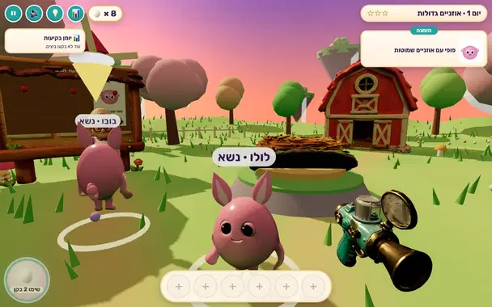 [合集截图](<https://github.com/AceDZN/gene-ranch/blob/main/docs/screenshots/01-first-30s.jpg>) | [AceDZN/gene-ranch](<https://github.com/AceDZN/gene-ranch>) | 常见根目录许可文件未找到 | 待核 | [6.4](<https://github.com/AceDZN/gene-ranch/blob/main/docs/screenshots/01-first-30s.jpg>) | 未列入口 |
| 1598 | [ ] | [General Orders: Sengoku Jidai](<https://github.com/gamingnews5/awesome-opus-5.5-games/blob/9a29b570e56bd19f15a3cd6bbac0b8c682f2c48c/games/general-orders-sengoku-jidai/readme.md>) | 待补截图 | [Toribash67/sengoku\_jidai](<https://github.com/Toribash67/sengoku_jidai>) | 常见根目录许可文件未找到 | 待核 | — | 未列入口 |
| 1599 | [ ] | [Gentle Giant](<https://github.com/gamingnews5/awesome-opus-5.5-games/blob/9a29b570e56bd19f15a3cd6bbac0b8c682f2c48c/games/gentle-giant/readme.md>) | 待补截图 | [ostromaj/gentle-giant](<https://github.com/ostromaj/gentle-giant>) | 常见根目录许可文件未找到 | 待核 | — | [可达 · 含游戏画布／引擎的网页](<https://ostromaj.github.io/gentle-giant/>) |
| 1600 | [ ] | [geo-shafaq](<https://github.com/gamingnews5/awesome-opus-5.5-games/blob/9a29b570e56bd19f15a3cd6bbac0b8c682f2c48c/games/geo-shafaq/readme.md>) | 待补截图 | [hakim-134/geo-shafaq](<https://github.com/hakim-134/geo-shafaq>) | 常见根目录许可文件未找到 | 待核 | — | 未列入口 |
| 1601 | [ ] | [Geography-test](<https://github.com/gamingnews5/awesome-opus-5.5-games/blob/9a29b570e56bd19f15a3cd6bbac0b8c682f2c48c/games/geography-test/readme.md>) |  [同款源码启动画面实截](<https://github.com/Bolotaure/Geography-test/blob/HEAD/index.html>) | [Bolotaure/Geography-test](<https://github.com/Bolotaure/Geography-test>) | 常见根目录许可文件未找到 | 待核 | — | [可达 · 合集所列网页](<https://htmlpreview.github.io/?https://github.com/Bolotaure/Geography-test/blob/main/index.html>) |
| 1602 | [ ] | [Geometry Quest](<https://github.com/gamingnews5/awesome-opus-5.5-games/blob/9a29b570e56bd19f15a3cd6bbac0b8c682f2c48c/games/geometry-quest/readme.md>) | 待补截图 | [sly-the-fox/geometry-quest](<https://github.com/sly-the-fox/geometry-quest>) | 常见根目录许可文件未找到 | 待核 | — | 未列入口 |
| 1603 | [ ] | [German learning games](<https://github.com/gamingnews5/awesome-opus-5.5-games/blob/9a29b570e56bd19f15a3cd6bbac0b8c682f2c48c/games/german-learning-games/readme.md>) | 待补截图 | [buffalonan/german-learning](<https://github.com/buffalonan/german-learning>) | 常见根目录许可文件未找到 | 待核 | — | [可达 · 合集所列网页](<https://buffalonan.github.io/german-learning/>) |
| 1604 | [ ] | [Ghost Game](<https://github.com/gamingnews5/awesome-opus-5.5-games/blob/9a29b570e56bd19f15a3cd6bbac0b8c682f2c48c/games/ghost-game/readme.md>) | 待补截图 | [alexmbrown/ghost-game](<https://github.com/alexmbrown/ghost-game>) | 常见根目录许可文件未找到 | 待核 | [3.2](<https://github.com/alexmbrown/ghost-game/blob/main/public/ui/crest_demons.webp>) | [可达 · 合集所列网页](<https://alexmbrown.github.io/ghost-game/>) |
| 1605 | [ ] | [Ghost Guild](<https://github.com/gamingnews5/awesome-opus-5.5-games/blob/9a29b570e56bd19f15a3cd6bbac0b8c682f2c48c/games/ghost-guild/readme.md>) |  [合集截图](<https://github.com/moura-code/ghost-guild/blob/main/art_previews/the_kiln.png>) | [moura-code/ghost-guild](<https://github.com/moura-code/ghost-guild>) | 常见根目录许可文件未找到 | 待核 | [6.5](<https://github.com/moura-code/ghost-guild/blob/main/art_previews/the_kiln.png>) | 未列入口 |
| 1606 | [ ] | [Ghost Hire](<https://github.com/gamingnews5/awesome-opus-5.5-games/blob/9a29b570e56bd19f15a3cd6bbac0b8c682f2c48c/games/ghost-hire/readme.md>) | 待补截图 | [joeljosephb2008-cell/ghost-hire](<https://github.com/joeljosephb2008-cell/ghost-hire>) | 常见根目录许可文件未找到 | 待核 | — | 未列入口 |
| 1607 | [ ] | [Ghost vs Jason](<https://github.com/gamingnews5/awesome-opus-5.5-games/blob/9a29b570e56bd19f15a3cd6bbac0b8c682f2c48c/games/ghost-vs-jason/readme.md>) | 待补截图 | [Ander-tsx/horror-game](<https://github.com/Ander-tsx/horror-game>) | 常见根目录许可文件未找到 | [README 提及](<https://github.com/Ander-tsx/horror-game/blob/HEAD/README.md#L31>) | — | [可达 · 含游戏画布／引擎的网页](<https://ander-tsx.github.io/horror-game/>) |
| 1608 | [ ] | [Ghostwolf](<https://github.com/gamingnews5/awesome-opus-5.5-games/blob/9a29b570e56bd19f15a3cd6bbac0b8c682f2c48c/games/ghostwolf/readme.md>) | 待补截图 | [nvdekay/GhostWolf](<https://github.com/nvdekay/GhostWolf>) | 常见根目录许可文件未找到 | 待核 | — | 未列入口 |
| 1609 | [ ] | [GITZILLA](<https://github.com/gamingnews5/awesome-opus-5.5-games/blob/9a29b570e56bd19f15a3cd6bbac0b8c682f2c48c/games/gitzilla/readme.md>) | 待补截图 | [gfhdhytghd/Gitzilla](<https://github.com/gfhdhytghd/Gitzilla>) | 常见根目录许可文件未找到 | 待核 | [4.0](<https://github.com/gfhdhytghd/Gitzilla/blob/main/brand/gitzilla-lockup.png>) | [README · 可达 · 上游 README 所列网页](<https://gitzilla.wilflin.me>) |
| 1610 | [ ] | [Giáng Long Que Hiệp](<https://github.com/gamingnews5/awesome-opus-5.5-games/blob/9a29b570e56bd19f15a3cd6bbac0b8c682f2c48c/games/giang-long-que-hiep/readme.md>) | 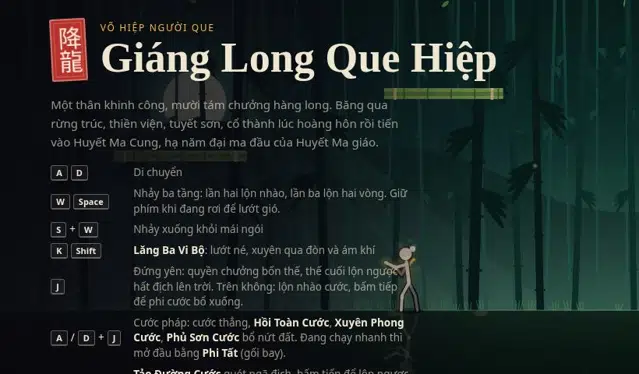 [试玩首页实截](<https://tiendat2308.github.io/giang-long-que-hiep/>) | [TienDat2308/giang-long-que-hiep](<https://github.com/TienDat2308/giang-long-que-hiep>) | 常见根目录许可文件未找到 | 待核 | — | [可达 · 含游戏画布／引擎的网页](<https://tiendat2308.github.io/giang-long-que-hiep/>) |
| 1611 | [ ] | [Giáng Ma Sư: Hàng Ma Ký](<https://github.com/gamingnews5/awesome-opus-5.5-games/blob/9a29b570e56bd19f15a3cd6bbac0b8c682f2c48c/games/giang-ma-su-hang-ma-ky/readme.md>) | 待补截图 | [shinningman94/giangmaluc](<https://github.com/shinningman94/giangmaluc>) | 常见根目录许可文件未找到 | 待核 | [3.6](<https://github.com/shinningman94/giangmaluc/blob/main/android/app/src/main/assets/img/amida.png>) | 未列入口 |
| 1612 | [ ] | [Glacial Strikers (Puckbound)](<https://github.com/gamingnews5/awesome-opus-5.5-games/blob/9a29b570e56bd19f15a3cd6bbac0b8c682f2c48c/games/glacial-strikers-puckbound/readme.md>) | 待补截图 | [sturlasnaer/glacial-strikers](<https://github.com/sturlasnaer/glacial-strikers>) | 常见根目录许可文件未找到 | 待核 | — | 未列入口 |
| 1613 | [ ] | [Glacier: Abandoned Offices](<https://github.com/gamingnews5/awesome-opus-5.5-games/blob/9a29b570e56bd19f15a3cd6bbac0b8c682f2c48c/games/glacier-abandoned-offices/readme.md>) | 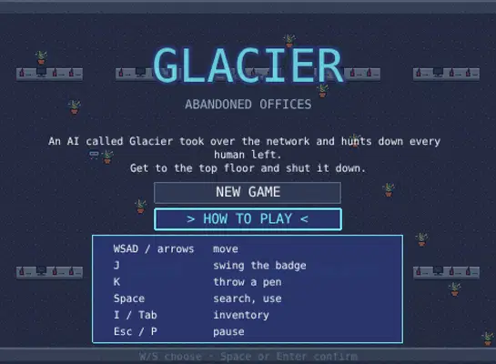 [游戏菜单或界面](<https://github.com/fabiansprycha/Glacier/blob/main/shots14/menu.png>) | [fabiansprycha/Glacier](<https://github.com/fabiansprycha/Glacier>) | 常见根目录许可文件未找到 | 待核 | [4.4](<https://github.com/fabiansprycha/Glacier/blob/main/shots14/menu.png>) | [README · 可达 · 上游 README 所列网页](<https://fabiansprycha.github.io/Glacier/>) |
| 1614 | [ ] | [Gladiator](<https://github.com/gamingnews5/awesome-opus-5.5-games/blob/9a29b570e56bd19f15a3cd6bbac0b8c682f2c48c/games/gladiator/readme.md>) | 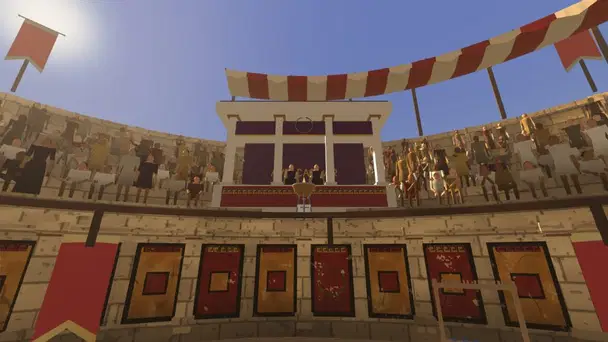 [合集截图](<https://github.com/Proximo0/gladiator/blob/main/docs/renders/arena-decor/after_1280x720_q2_box.jpg>) | [Proximo0/gladiator](<https://github.com/Proximo0/gladiator>) | 常见根目录许可文件未找到 | 待核 | [6.2](<https://github.com/Proximo0/gladiator/blob/main/docs/renders/arena-decor/after_1280x720_q2_box.jpg>) | 未列入口 |
| 1615 | [ ] | [Glam Studio](<https://github.com/gamingnews5/awesome-opus-5.5-games/blob/9a29b570e56bd19f15a3cd6bbac0b8c682f2c48c/games/glam-studio/readme.md>) |  [试玩首页实截](<https://samahlersmeyer-prog.github.io/glam-studio/>) | [samahlersmeyer-prog/glam-studio](<https://github.com/samahlersmeyer-prog/glam-studio>) | 常见根目录许可文件未找到 | 待核 | — | [可达 · 含游戏画布／引擎的网页](<https://samahlersmeyer-prog.github.io/glam-studio/>) |
| 1616 | [ ] | [Glassbox](<https://github.com/gamingnews5/awesome-opus-5.5-games/blob/9a29b570e56bd19f15a3cd6bbac0b8c682f2c48c/games/glassbox/readme.md>) | 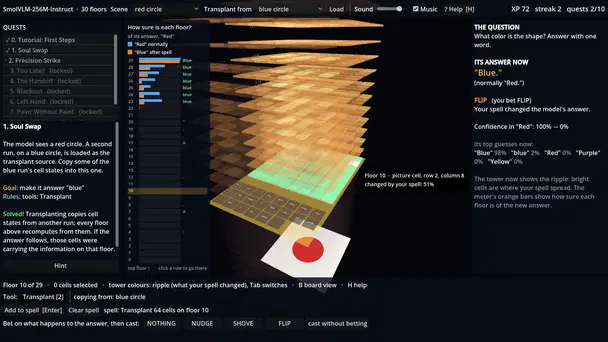 [合集截图](<https://github.com/AbrahamCain/glassbox/blob/main/docs/screenshot.png>) | [AbrahamCain/glassbox](<https://github.com/AbrahamCain/glassbox>) | 常见根目录许可文件未找到 | 待核 | [5.6](<https://github.com/AbrahamCain/glassbox/blob/main/docs/screenshot.png>) | 未列入口 |
| 1617 | [ ] | [Glichess](<https://github.com/gamingnews5/awesome-opus-5.5-games/blob/9a29b570e56bd19f15a3cd6bbac0b8c682f2c48c/games/glichess/readme.md>) | 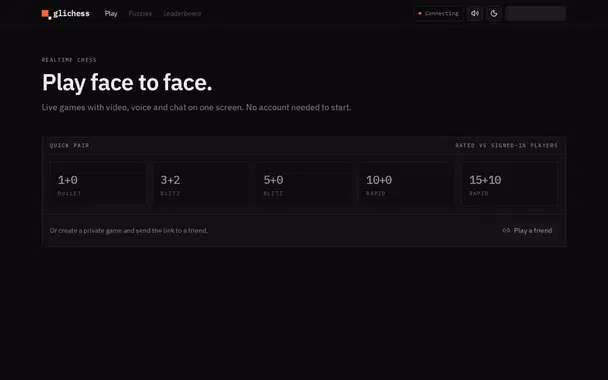 [上游动图截帧](<https://github.com/govindpvenu/glichess/blob/main/docs/demo.gif>) | [govindpvenu/glichess](<https://github.com/govindpvenu/glichess>) | 常见根目录许可文件未找到 | 待核 | [3.6](<https://github.com/govindpvenu/glichess/blob/main/docs/demo.gif>) | 未列入口 |
| 1618 | [ ] | [Glimmerfall](<https://github.com/gamingnews5/awesome-opus-5.5-games/blob/9a29b570e56bd19f15a3cd6bbac0b8c682f2c48c/games/glimmerfall/readme.md>) | 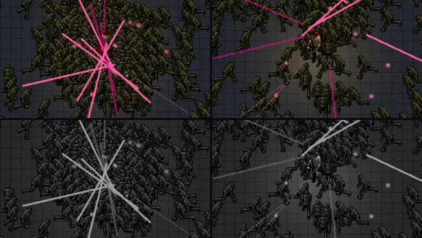 [合集截图](<https://github.com/ArtemChikolaev/Glimmerfall/blob/main/docs/spikes/img/g2-6-gray.png>) | [ArtemChikolaev/Glimmerfall](<https://github.com/ArtemChikolaev/Glimmerfall>) | 常见根目录许可文件未找到 | 待核 | [4.0](<https://github.com/ArtemChikolaev/Glimmerfall/blob/main/docs/spikes/img/g2-6-gray.png>) | 未列入口 |
| 1619 | [ ] | [GLITCHBOX arcade](<https://github.com/gamingnews5/awesome-opus-5.5-games/blob/9a29b570e56bd19f15a3cd6bbac0b8c682f2c48c/games/glitchbox-arcade/readme.md>) | 待补截图 | [glitchbox-games/glitchbox-games.github.io](<https://github.com/glitchbox-games/glitchbox-games.github.io>) | 常见根目录许可文件未找到 | 待核 | — | 未列入口 |
| 1620 | [ ] | [Gloaming Vale](<https://github.com/gamingnews5/awesome-opus-5.5-games/blob/9a29b570e56bd19f15a3cd6bbac0b8c682f2c48c/games/gloaming-vale/readme.md>) | 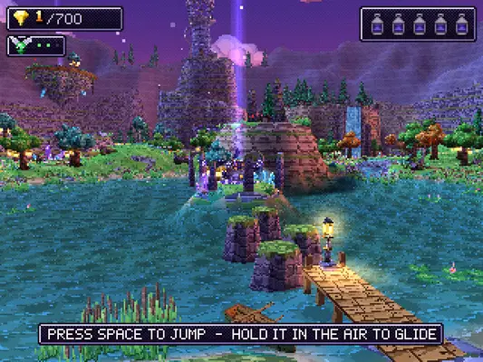 [合集截图](<https://github.com/juan504n/spyro-game/blob/92bbe27dd36c6f347db07e734a281591fb09c1c4/docs/shots/02-lake.png>) | [juan504n/spyro-game](<https://github.com/juan504n/spyro-game>) | 常见根目录许可文件未找到 | [README 提及](<https://github.com/juan504n/spyro-game/blob/HEAD/README.md#L53>) | [8.0](<https://github.com/juan504n/spyro-game/blob/92bbe27dd36c6f347db07e734a281591fb09c1c4/docs/shots/02-lake.png>) | 未列入口 |
| 1621 | [ ] | [Gloop Gloop](<https://github.com/gamingnews5/awesome-opus-5.5-games/blob/9a29b570e56bd19f15a3cd6bbac0b8c682f2c48c/games/gloop-gloop/readme.md>) | 待补截图 | [danielken03/Gloop-gloop](<https://github.com/danielken03/Gloop-gloop>) | 常见根目录许可文件未找到 | 待核 | — | [可达 · 含游戏画布／引擎的网页](<https://gloop-sigma.vercel.app>) |
| 1622 | [ ] | [Glosor Wordgame](<https://github.com/gamingnews5/awesome-opus-5.5-games/blob/9a29b570e56bd19f15a3cd6bbac0b8c682f2c48c/games/glosor-wordgame/readme.md>) | 待补截图 | [martingabrielsson/Glosor-WordGame](<https://github.com/martingabrielsson/Glosor-WordGame>) | 常见根目录许可文件未找到 | 待核 | — | 未列入口 |
| 1623 | [ ] | [Glyph Rumble](<https://github.com/gamingnews5/awesome-opus-5.5-games/blob/9a29b570e56bd19f15a3cd6bbac0b8c682f2c48c/games/glyph-rumble/readme.md>) |  [合集截图](<https://github.com/AY-gift/wenzibattle/blob/main/portal/media/basketball.jpg>) | [AY-gift/wenzibattle](<https://github.com/AY-gift/wenzibattle>) | 常见根目录许可文件未找到 | 待核 | [5.6](<https://github.com/AY-gift/wenzibattle/blob/main/portal/media/basketball.jpg>) | 未列入口 |
| 1624 | [ ] | [Glyphfall](<https://github.com/gamingnews5/awesome-opus-5.5-games/blob/9a29b570e56bd19f15a3cd6bbac0b8c682f2c48c/games/glyphfall/readme.md>) | 待补截图 | [dimitriskaramalikis/glyphfall](<https://github.com/dimitriskaramalikis/glyphfall>) | 常见根目录许可文件未找到 | 待核 | — | [可达 · 合集所列网页](<https://dimitriskaramalikis.github.io/glyphfall/>) |
| 1625 | [ ] | [Gnar Run](<https://github.com/gamingnews5/awesome-opus-5.5-games/blob/9a29b570e56bd19f15a3cd6bbac0b8c682f2c48c/games/gnar-run/readme.md>) | 待补截图 | [webgnar/skate-rogue](<https://github.com/webgnar/skate-rogue>) | 常见根目录许可文件未找到 | 待核 | — | [可达 · 含游戏画布／引擎的网页](<https://skate-rogue.vercel.app>) |
| 1626 | [ ] | [Gnome Life](<https://github.com/gamingnews5/awesome-opus-5.5-games/blob/9a29b570e56bd19f15a3cd6bbac0b8c682f2c48c/games/gnome-life/readme.md>) | 待补截图 | [7hpgypydbd-sudo/gnome-life](<https://github.com/7hpgypydbd-sudo/gnome-life>) | 常见根目录许可文件未找到 | 待核 | [5.0](<https://github.com/7hpgypydbd-sudo/gnome-life/blob/main/docs/art/backdrop.jpg>) | 未列入口 |
| 1627 | [ ] | [Gnomes vs Goblins](<https://github.com/gamingnews5/awesome-opus-5.5-games/blob/9a29b570e56bd19f15a3cd6bbac0b8c682f2c48c/games/gnomes-vs-goblins/readme.md>) | 待补截图 | [kllloh/gnome-strike](<https://github.com/kllloh/gnome-strike>) | 常见根目录许可文件未找到 | 待核 | — | [可达 · 合集所列网页](<https://kllloh.github.io/gnome-strike/>) |
| 1628 | [ ] | [Go](<https://github.com/gamingnews5/awesome-opus-5.5-games/blob/9a29b570e56bd19f15a3cd6bbac0b8c682f2c48c/games/go/readme.md>) | 待补截图 | [hanshenr/go](<https://github.com/hanshenr/go>) | 常见根目录许可文件未找到 | 待核 | — | 未列入口 |
| 1629 | [ ] | [Goal Kick](<https://github.com/gamingnews5/awesome-opus-5.5-games/blob/9a29b570e56bd19f15a3cd6bbac0b8c682f2c48c/games/goal-kick/readme.md>) | 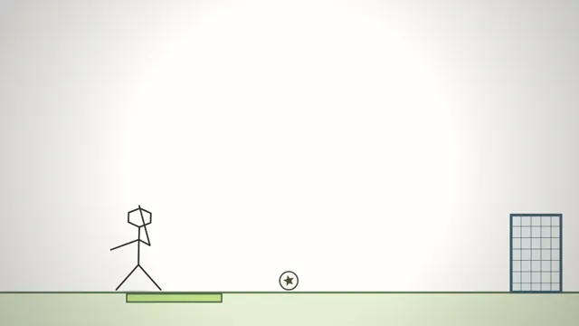 [对应子游戏玩法实截](<https://github.com/gberry747-lab/gabriels-animation-studio/blob/HEAD/index.html>) | [gberry747-lab/gabriels-animation-studio](<https://github.com/gberry747-lab/gabriels-animation-studio>) | 常见根目录许可文件未找到 | 待核 | — | [多游戏仓库入口 · 可达 · 含游戏画布／引擎的网页](<https://gberry747-lab.github.io/gabriels-animation-studio/>) |
| 1630 | [ ] | [GOAT World Cup](<https://github.com/gamingnews5/awesome-opus-5.5-games/blob/9a29b570e56bd19f15a3cd6bbac0b8c682f2c48c/games/goat-world-cup/readme.md>) |  [源码运行首页](<https://github.com/arcdental26-code/goat-world-cup/blob/main/index.html>) | [arcdental26-code/goat-world-cup](<https://github.com/arcdental26-code/goat-world-cup>) | 常见根目录许可文件未找到 | 待核 | — | 未列入口 |
| 1631 | [ ] | [Godot 2048](<https://github.com/gamingnews5/awesome-opus-5.5-games/blob/9a29b570e56bd19f15a3cd6bbac0b8c682f2c48c/games/godot-2048/readme.md>) | 待补截图 | [daiSky88/godot-2048](<https://github.com/daiSky88/godot-2048>) | 常见根目录许可文件未找到 | 待核 | — | 未列入口 |
| 1632 | [ ] | [Going Up!](<https://github.com/gamingnews5/awesome-opus-5.5-games/blob/9a29b570e56bd19f15a3cd6bbac0b8c682f2c48c/games/going-up/readme.md>) | 待补截图 | [tb-x/going-up](<https://github.com/tb-x/going-up>) | 常见根目录许可文件未找到 | 待核 | — | [可达 · 含游戏画布／引擎的网页](<https://tb-x.github.io/going-up/>) |
| 1633 | [ ] | [Golden Chess](<https://github.com/gamingnews5/awesome-opus-5.5-games/blob/9a29b570e56bd19f15a3cd6bbac0b8c682f2c48c/games/golden-chess/readme.md>) | 待补截图 | [ukazyra-collab/golden-chess](<https://github.com/ukazyra-collab/golden-chess>) | 常见根目录许可文件未找到 | 待核 | — | [可达 · 合集所列网页](<https://ukazyra-collab.github.io/golden-chess/>) |
| 1634 | [ ] | [Golferoo](<https://github.com/gamingnews5/awesome-opus-5.5-games/blob/9a29b570e56bd19f15a3cd6bbac0b8c682f2c48c/games/golferoo/readme.md>) | 待补截图 | [KingMoule/golferoo](<https://github.com/KingMoule/golferoo>) | 常见根目录许可文件未找到 | 待核 | — | 未列入口 |
| 1635 | [ ] | [Gone Bananas!!!](<https://github.com/gamingnews5/awesome-opus-5.5-games/blob/9a29b570e56bd19f15a3cd6bbac0b8c682f2c48c/games/gone-bananas/readme.md>) | 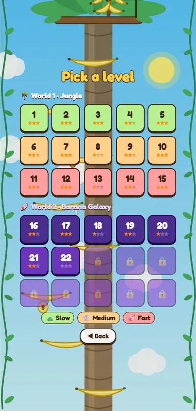 [合集截图](<https://github.com/sack2116/Gone-Bananas/blob/main/screenshots/levels.jpg>) | [sack2116/Gone-Bananas](<https://github.com/sack2116/Gone-Bananas>) | 常见根目录许可文件未找到 | 待核 | [3.8](<https://github.com/sack2116/Gone-Bananas/blob/main/screenshots/levels.jpg>) | [可达 · 含游戏画布／引擎的网页](<https://sack2116.github.io/Gone-Bananas/>) |
| 1636 | [ ] | [Gorillas](<https://github.com/gamingnews5/awesome-opus-5.5-games/blob/9a29b570e56bd19f15a3cd6bbac0b8c682f2c48c/games/gorillas/readme.md>) | 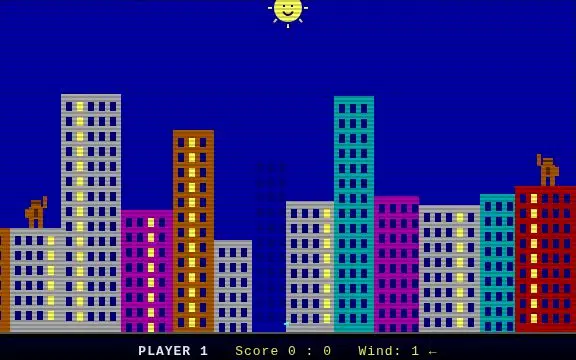 [源码运行画面](<https://github.com/aarongarciah/gorillas/blob/HEAD/index.html>) | [aarongarciah/gorillas](<https://github.com/aarongarciah/gorillas>) | 常见根目录许可文件未找到 | 待核 | — | 未列入口 |
| 1637 | [ ] | [Goth Family Island](<https://github.com/gamingnews5/awesome-opus-5.5-games/blob/9a29b570e56bd19f15a3cd6bbac0b8c682f2c48c/games/goth-family-island/readme.md>) | 待补截图 | [denis2003n28-sys/goth-family-island](<https://github.com/denis2003n28-sys/goth-family-island>) | 常见根目录许可文件未找到 | 待核 | — | 未列入口 |
| 1638 | [ ] | [Gotta Match 'Em All 👽💜](<https://github.com/gamingnews5/awesome-opus-5.5-games/blob/9a29b570e56bd19f15a3cd6bbac0b8c682f2c48c/games/gotta-match-em-all/readme.md>) | 待补截图 | [carinaburana/gotta-match-em-all](<https://github.com/carinaburana/gotta-match-em-all>) | 常见根目录许可文件未找到 | 待核 | — | [可达 · 合集所列网页](<https://gotta-match-em-all-indol.vercel.app>) |
| 1639 | [ ] | [GPT-6 Astra Side-Scroller](<https://github.com/gamingnews5/awesome-opus-5.5-games/blob/9a29b570e56bd19f15a3cd6bbac0b8c682f2c48c/games/gpt-6-astra-side-scroller/readme.md>) | 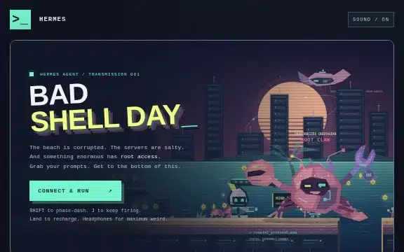 [源码运行首页](<https://github.com/NeoAiLabs/sidescroller/blob/main/gpt-6-astra.html>) | [NeoAiLabs/sidescroller](<https://github.com/NeoAiLabs/sidescroller>) | 常见根目录许可文件未找到 | 待核 | — | 未列入口 |
| 1640 | [ ] | [Grama](<https://github.com/gamingnews5/awesome-opus-5.5-games/blob/9a29b570e56bd19f15a3cd6bbac0b8c682f2c48c/games/grama/readme.md>) | 待补截图 | [ewajs/grama](<https://github.com/ewajs/grama>) | 常见根目录许可文件未找到 | 待核 | — | [入口已失效 · 合集所列网页](<https://ewajs.github.io/grama/>) |
| 1641 | [ ] | [Grammar Knight](<https://github.com/gamingnews5/awesome-opus-5.5-games/blob/9a29b570e56bd19f15a3cd6bbac0b8c682f2c48c/games/grammar-knight/readme.md>) | 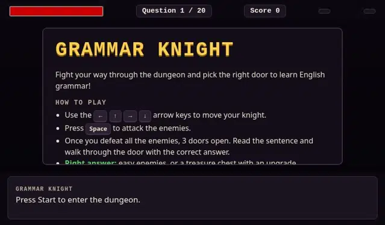 [试玩首页实截](<https://arosario28-ux.github.io/grammar-knight/>) | [arosario28-ux/grammar-knight](<https://github.com/arosario28-ux/grammar-knight>) | 常见根目录许可文件未找到 | 待核 | — | [可达 · 含游戏画布／引擎的网页](<https://arosario28-ux.github.io/grammar-knight/>) |
| 1642 | [ ] | [Grand Tech Auto: San Francisco](<https://github.com/gamingnews5/awesome-opus-5.5-games/blob/9a29b570e56bd19f15a3cd6bbac0b8c682f2c48c/games/grand-tech-auto-san-francisco/readme.md>) | 待补截图 | [TanmayKallakuri/gta-sf](<https://github.com/TanmayKallakuri/gta-sf>) | 常见根目录许可文件未找到 | 待核 | — | [可达 · 含游戏画布／引擎的网页](<https://grand-tech-auto-sf.vercel.app>) |
| 1643 | [ ] | [Grand Theft Amsterdam](<https://github.com/gamingnews5/awesome-opus-5.5-games/blob/9a29b570e56bd19f15a3cd6bbac0b8c682f2c48c/games/grand-theft-amsterdam/readme.md>) | 待补截图 | [SimonAlkemade/GrandTheftAmsterdam](<https://github.com/SimonAlkemade/GrandTheftAmsterdam>) | 常见根目录许可文件未找到 | 待核 | [6.2（原图失效）](<https://github.com/SimonAlkemade/GrandTheftAmsterdam/blob/main/out/shots/street.png>) | 未列入口 |
| 1644 | [ ] | [Grand Theft Argon](<https://github.com/gamingnews5/awesome-opus-5.5-games/blob/9a29b570e56bd19f15a3cd6bbac0b8c682f2c48c/games/grand-theft-argon/readme.md>) | 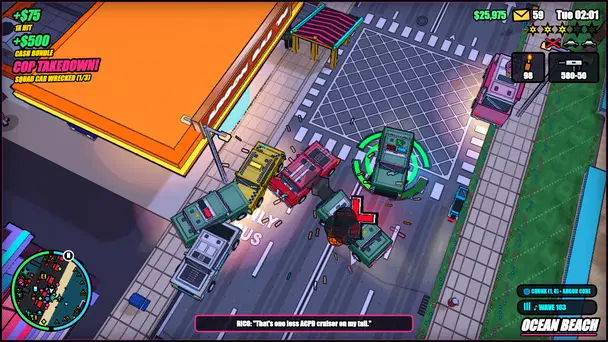 [上游游戏截图](<https://github.com/ammaarreshi/argon-games/blob/HEAD/docs/screenshots/grand-theft-argon.png>) | [ammaarreshi/argon-games](<https://github.com/ammaarreshi/argon-games>) | 常见根目录许可文件未找到 | 待核 | — | 未列入口 |
| 1645 | [ ] | [Grand Theft Astra](<https://github.com/gamingnews5/awesome-opus-5.5-games/blob/9a29b570e56bd19f15a3cd6bbac0b8c682f2c48c/games/grand-theft-astra/readme.md>) | 待补截图 | [angelaborowski/grand-theft-astra](<https://github.com/angelaborowski/grand-theft-astra>) | 常见根目录许可文件未找到 | 待核 | — | 未列入口 |
| 1646 | [ ] | [Grand Theft Auckland](<https://github.com/gamingnews5/awesome-opus-5.5-games/blob/9a29b570e56bd19f15a3cd6bbac0b8c682f2c48c/games/grand-theft-auckland/readme.md>) | 待补截图 | [jay-aye-see-kay/grand-theft-auckland](<https://github.com/jay-aye-see-kay/grand-theft-auckland>) | 常见根目录许可文件未找到 | 待核 | — | 未列入口 |
| 1647 | [ ] | [Grand Theft Freeway-BX](<https://github.com/gamingnews5/awesome-opus-5.5-games/blob/9a29b570e56bd19f15a3cd6bbac0b8c682f2c48c/games/grand-theft-freeway-bx/readme.md>) | 待补截图 | [michaelcrosato/gtav-cco55-shardfall](<https://github.com/michaelcrosato/gtav-cco55-shardfall>) | 常见根目录许可文件未找到 | [README 提及](<https://github.com/michaelcrosato/gtav-cco55-shardfall/blob/HEAD/README.md#L47>) | — | 未列入口 |
| 1648 | [ ] | [Grand Theft Lagos (GTL)](<https://github.com/gamingnews5/awesome-opus-5.5-games/blob/9a29b570e56bd19f15a3cd6bbac0b8c682f2c48c/games/grand-theft-lagos-gtl/readme.md>) | 待补截图 | [ajayidowuvictor/GTL](<https://github.com/ajayidowuvictor/GTL>) | 常见根目录许可文件未找到 | 待核 | — | 未列入口 |
| 1649 | [ ] | [Graphite Games](<https://github.com/gamingnews5/awesome-opus-5.5-games/blob/9a29b570e56bd19f15a3cd6bbac0b8c682f2c48c/games/graphite-games/readme.md>) |  [源码运行首页](<https://github.com/HarshGaba1196/graphite-games/blob/main/index.html>) | [HarshGaba1196/graphite-games](<https://github.com/HarshGaba1196/graphite-games>) | 常见根目录许可文件未找到 | 待核 | — | 未列入口 |
| 1650 | [ ] | [Grave Shift](<https://github.com/gamingnews5/awesome-opus-5.5-games/blob/9a29b570e56bd19f15a3cd6bbac0b8c682f2c48c/games/grave-shift/readme.md>) | 待补截图 | [ilovefree1s/graveyard-shift](<https://github.com/ilovefree1s/graveyard-shift>) | 常见根目录许可文件未找到 | 待核 | — | [可达 · 含游戏画布／引擎的网页](<https://ilovefree1s.github.io/graveyard-shift/>) |
| 1651 | [ ] | [Graveknit](<https://github.com/gamingnews5/awesome-opus-5.5-games/blob/9a29b570e56bd19f15a3cd6bbac0b8c682f2c48c/games/graveknit/readme.md>) | 待补截图 | [tysal21/graveknit](<https://github.com/tysal21/graveknit>) | 常见根目录许可文件未找到 | 待核 | — | [可达 · 合集所列网页](<https://tysal21.github.io/graveknit/>) |
| 1652 | [ ] | [Gravity Box — Campaign 100](<https://github.com/gamingnews5/awesome-opus-5.5-games/blob/9a29b570e56bd19f15a3cd6bbac0b8c682f2c48c/games/gravity-box-campaign-100/readme.md>) |  [合集截图](<https://github.com/nghienvothuat-a11y/GravityBox/blob/main/Docs/Images/Level16/Coop16BothOut.png>) | [nghienvothuat-a11y/GravityBox](<https://github.com/nghienvothuat-a11y/GravityBox>) | 常见根目录许可文件未找到 | 待核 | [5.3](<https://github.com/nghienvothuat-a11y/GravityBox/blob/main/Docs/Images/Level16/Coop16BothOut.png>) | 未列入口 |
| 1653 | [ ] | [Gravity Flip](<https://github.com/gamingnews5/awesome-opus-5.5-games/blob/9a29b570e56bd19f15a3cd6bbac0b8c682f2c48c/games/gravity-flip/readme.md>) | 待补截图 | [kokellara12-maker/apps-k4m9q2](<https://github.com/kokellara12-maker/apps-k4m9q2>) | 常见根目录许可文件未找到 | 待核 | — | [可达 · 合集所列网页](<https://kokellara12-maker.github.io/apps-k4m9q2/gravityflip.html>) |
| 1654 | [ ] | [Gravity Golf](<https://github.com/gamingnews5/awesome-opus-5.5-games/blob/9a29b570e56bd19f15a3cd6bbac0b8c682f2c48c/games/gravity-golf/readme.md>) |  [合集截图](<https://github.com/swan4er/opus-100-projects/blob/main/096-gravity-golf/preview.jpg>) | [swan4er/opus-100-projects](<https://github.com/swan4er/opus-100-projects>) | 常见根目录许可文件未找到 | 待核 | [6.6](<https://github.com/swan4er/opus-100-projects/blob/main/096-gravity-golf/preview.jpg>) | [可达 · 含游戏画布／引擎的网页](<https://swan4er.github.io/opus-100-projects/096-gravity-golf/>) |
| 1655 | [ ] | [Greeblis Town](<https://github.com/gamingnews5/awesome-opus-5.5-games/blob/9a29b570e56bd19f15a3cd6bbac0b8c682f2c48c/games/greeblis-town/readme.md>) | 待补截图 | [GorboGreeblis/GreeblisTown](<https://github.com/GorboGreeblis/GreeblisTown>) | 常见根目录许可文件未找到 | 待核 | — | 未列入口 |
| 1656 | [ ] | [Greece Battleground](<https://github.com/gamingnews5/awesome-opus-5.5-games/blob/9a29b570e56bd19f15a3cd6bbac0b8c682f2c48c/games/greece-battleground/readme.md>) | 待补截图 | [hieu-lee/greece-battleground](<https://github.com/hieu-lee/greece-battleground>) | 常见根目录许可文件未找到 | 待核 | — | [入口已失效 · 合集所列网页](<https://hieu-lee.github.io/greece-battleground/>) |
| 1657 | [ ] | [GREENLIGHT](<https://github.com/gamingnews5/awesome-opus-5.5-games/blob/9a29b570e56bd19f15a3cd6bbac0b8c682f2c48c/games/greenlight/readme.md>) | 待补截图 | [angelog27/Greenlit](<https://github.com/angelog27/Greenlit>) | 常见根目录许可文件未找到 | 待核 | — | 未列入口 |
| 1658 | [ ] | [GRID SOULS (PS1)](<https://github.com/gamingnews5/awesome-opus-5.5-games/blob/9a29b570e56bd19f15a3cd6bbac0b8c682f2c48c/games/grid-souls-ps1/readme.md>) | 待补截图 | [sandrinsol/psloje](<https://github.com/sandrinsol/psloje>) | 常见根目录许可文件未找到 | 待核 | — | [可达 · 合集所列网页](<https://ps1-test.vercel.app>) |
| 1659 | [ ] | [Gridiron Career](<https://github.com/gamingnews5/awesome-opus-5.5-games/blob/9a29b570e56bd19f15a3cd6bbac0b8c682f2c48c/games/gridiron-career/readme.md>) | 待补截图 | [nathandunn/gridiron-career](<https://github.com/nathandunn/gridiron-career>) | 常见根目录许可文件未找到 | 待核 | — | [README · 可达 · 含游戏画布／引擎的网页](<https://gridiron-career.apps.precogsoftwareservices.com>) |
| 1660 | [ ] | [Gridiron GM](<https://github.com/gamingnews5/awesome-opus-5.5-games/blob/9a29b570e56bd19f15a3cd6bbac0b8c682f2c48c/games/gridiron-gm/readme.md>) | 待补截图 | [VaultSparkStudios/gridiron-gm](<https://github.com/VaultSparkStudios/gridiron-gm>) | 常见根目录许可文件未找到 | 待核 | — | 未列入口 |
| 1661 | [ ] | [Gridiron QB](<https://github.com/gamingnews5/awesome-opus-5.5-games/blob/9a29b570e56bd19f15a3cd6bbac0b8c682f2c48c/games/gridiron-qb/readme.md>) | 待补截图 | [dyfds7p4ds-a11y/Football-Game](<https://github.com/dyfds7p4ds-a11y/Football-Game>) | 常见根目录许可文件未找到 | [README 提及](<https://github.com/dyfds7p4ds-a11y/Football-Game/blob/HEAD/README.md#L65>) | — | 未列入口 |
| 1662 | [ ] | [GridWatch Match Web](<https://github.com/gamingnews5/awesome-opus-5.5-games/blob/9a29b570e56bd19f15a3cd6bbac0b8c682f2c48c/games/gridwatch-match-web/readme.md>) | 待补截图 | [remeadows/GridWatchMatchWeb](<https://github.com/remeadows/GridWatchMatchWeb>) | 常见根目录许可文件未找到 | 待核 | — | [可达 · 合集所列网页](<https://GridWatchMatchWeb.warsignallabs.net/>) |
| 1663 | [ ] | [GridWatch: Signal Breach](<https://github.com/gamingnews5/awesome-opus-5.5-games/blob/9a29b570e56bd19f15a3cd6bbac0b8c682f2c48c/games/gridwatch-signal-breach/readme.md>) | 待补截图 | [remeadows/gridwatch-signal-breach](<https://github.com/remeadows/gridwatch-signal-breach>) | 常见根目录许可文件未找到 | 待核 | [5.4](<https://github.com/remeadows/gridwatch-signal-breach/blob/main/src/assets/board/phase6/gw-phase6-core-board-v1.webp>) | [可达 · 含游戏画布／引擎的网页](<https://GridWatch-SignalBreach.warsignallabs.net>) |
| 1664 | [ ] | [Grimoire](<https://github.com/gamingnews5/awesome-opus-5.5-games/blob/9a29b570e56bd19f15a3cd6bbac0b8c682f2c48c/games/grimoire/readme.md>) |  [源码运行首页](<https://github.com/leokayehsu-bit/grimoire/blob/main/index.html>) | [leokayehsu-bit/grimoire](<https://github.com/leokayehsu-bit/grimoire>) | 常见根目录许可文件未找到 | 待核 | — | 未列入口 |
| 1665 | [ ] | [Groot Theft Bakkie](<https://github.com/gamingnews5/awesome-opus-5.5-games/blob/9a29b570e56bd19f15a3cd6bbac0b8c682f2c48c/games/groot-theft-bakkie/readme.md>) |  [合集截图](<https://github.com/MichaelBernhardt/GTB6/blob/main/screenshots/groot-theft-bakkie-competition.png>) | [MichaelBernhardt/GTB6](<https://github.com/MichaelBernhardt/GTB6>) | 常见根目录许可文件未找到 | [README 提及](<https://github.com/MichaelBernhardt/GTB6/blob/HEAD/README.md#L88>) | [6.6](<https://github.com/MichaelBernhardt/GTB6/blob/main/screenshots/groot-theft-bakkie-competition.png>) | 未列入口 |
| 1666 | [ ] | [Group 53 Games](<https://github.com/gamingnews5/awesome-opus-5.5-games/blob/9a29b570e56bd19f15a3cd6bbac0b8c682f2c48c/games/group-53-games/readme.md>) | 待补截图 | [Shlok-Bhakta/group53-games](<https://github.com/Shlok-Bhakta/group53-games>) | 常见根目录许可文件未找到 | 待核 | — | 未列入口 |
| 1667 | [ ] | [Group Project](<https://github.com/gamingnews5/awesome-opus-5.5-games/blob/9a29b570e56bd19f15a3cd6bbac0b8c682f2c48c/games/group-project/readme.md>) |  [合集截图](<https://github.com/b14ck5tar/H4CKBOMB/blob/main/devpost-media/art-audit/after/idea-slam_1366x768.jpg>) | [b14ck5tar/H4CKBOMB](<https://github.com/b14ck5tar/H4CKBOMB>) | 常见根目录许可文件未找到 | 待核 | [6.0](<https://github.com/b14ck5tar/H4CKBOMB/blob/main/devpost-media/art-audit/after/idea-slam_1366x768.jpg>) | [可达 · 合集所列网页](<https://groupproject-game.vercel.app/tv>) |
| 1668 | [ ] | [Grow a Garden](<https://github.com/gamingnews5/awesome-opus-5.5-games/blob/9a29b570e56bd19f15a3cd6bbac0b8c682f2c48c/games/grow-a-garden/readme.md>) | 待补截图 | [kokellara12-maker/apps-k4m9q2](<https://github.com/kokellara12-maker/apps-k4m9q2>) | 常见根目录许可文件未找到 | 待核 | — | [可达 · 合集所列网页](<https://kokellara12-maker.github.io/apps-k4m9q2/growgarden.html>) |
| 1669 | [ ] | [Grow An Egg](<https://github.com/gamingnews5/awesome-opus-5.5-games/blob/9a29b570e56bd19f15a3cd6bbac0b8c682f2c48c/games/grow-an-egg/readme.md>) | 待补截图 | [LEGiON-Platforms/grow-an-egg](<https://github.com/LEGiON-Platforms/grow-an-egg>) | 常见根目录许可文件未找到 | 待核 | — | 未列入口 |
| 1670 | [ ] | [Grudge Ball](<https://github.com/gamingnews5/awesome-opus-5.5-games/blob/9a29b570e56bd19f15a3cd6bbac0b8c682f2c48c/games/grudge-ball/readme.md>) | 待补截图 | [artificialfear/grudgeball](<https://github.com/artificialfear/grudgeball>) | 常见根目录许可文件未找到 | 待核 | — | [可达 · 合集所列网页](<https://artificialfear.github.io/grudgeball/>) |
| 1671 | [ ] | [GSB World](<https://github.com/gamingnews5/awesome-opus-5.5-games/blob/9a29b570e56bd19f15a3cd6bbac0b8c682f2c48c/games/gsb-world/readme.md>) | 待补截图 | [jamescstapleton/gsbworld](<https://github.com/jamescstapleton/gsbworld>) | 常见根目录许可文件未找到 | 待核 | — | [可达 · 合集所列网页](<https://jamescstapleton.github.io/gsbworld/>) |
| 1672 | [ ] | [GTA V Made by 5 AI](<https://github.com/gamingnews5/awesome-opus-5.5-games/blob/9a29b570e56bd19f15a3cd6bbac0b8c682f2c48c/games/gta-v-made-by-5-ai/readme.md>) | 待补截图 | [oh-ashen-one/gta-v-made-by-5-ai](<https://github.com/oh-ashen-one/gta-v-made-by-5-ai>) | 常见根目录许可文件未找到 | 待核 | — | 未列入口 |
| 1673 | [ ] | [Gudrais suns](<https://github.com/gamingnews5/awesome-opus-5.5-games/blob/9a29b570e56bd19f15a3cd6bbac0b8c682f2c48c/games/gudrais-suns/readme.md>) | 待补截图 | [Liq0et-ev/2\_d\_sample\_pet\_game-2026-10-19\_08-53-54](<https://github.com/Liq0et-ev/2_d_sample_pet_game-2026-10-19_08-53-54>) | 常见根目录许可文件未找到 | 待核 | — | 未列入口 |
| 1674 | [ ] | [Guess the Accent](<https://github.com/gamingnews5/awesome-opus-5.5-games/blob/9a29b570e56bd19f15a3cd6bbac0b8c682f2c48c/games/guess-the-accent/readme.md>) |  [试玩首页实截](<https://yghub1.github.io/guess-the-accent/>) | [yghub1/guess-the-accent](<https://github.com/yghub1/guess-the-accent>) | 常见根目录许可文件未找到 | 待核 | — | [可达 · 含游戏画布／引擎的网页](<https://yghub1.github.io/guess-the-accent/>) |
| 1675 | [ ] | [Guess the Output](<https://github.com/gamingnews5/awesome-opus-5.5-games/blob/9a29b570e56bd19f15a3cd6bbac0b8c682f2c48c/games/guess-the-output/readme.md>) | 待补截图 | [HaarisahHussain/Spin-The-Wheel-](<https://github.com/HaarisahHussain/Spin-The-Wheel->) | 常见根目录许可文件未找到 | 待核 | — | 未列入口 |
| 1676 | [ ] | [Guessy](<https://github.com/gamingnews5/awesome-opus-5.5-games/blob/9a29b570e56bd19f15a3cd6bbac0b8c682f2c48c/games/guessy/readme.md>) | 待补截图 | [imedi0310-a11y/Guessy](<https://github.com/imedi0310-a11y/Guessy>) | 常见根目录许可文件未找到 | 待核 | — | 未列入口 |
| 1677 | [ ] | [Guildmaster: The Ember Crown](<https://github.com/gamingnews5/awesome-opus-5.5-games/blob/9a29b570e56bd19f15a3cd6bbac0b8c682f2c48c/games/guildmaster-the-ember-crown/readme.md>) |  [同款源码启动画面实截](<https://github.com/tofu-cmd/guildmaster/blob/HEAD/legacy/index.html>) | [tofu-cmd/guildmaster](<https://github.com/tofu-cmd/guildmaster>) | 常见根目录许可文件未找到 | 待核 | — | [可达 · 合集所列网页](<https://guildmaster-zeta.vercel.app>) |
| 1678 | [ ] | [Gujarati Play](<https://github.com/gamingnews5/awesome-opus-5.5-games/blob/9a29b570e56bd19f15a3cd6bbac0b8c682f2c48c/games/gujarati-play/readme.md>) | 待补截图 | [bansipatel/gujarati-play](<https://github.com/bansipatel/gujarati-play>) | 常见根目录许可文件未找到 | 待核 | — | 未列入口 |
| 1679 | [ ] | [Gulf Dominion](<https://github.com/gamingnews5/awesome-opus-5.5-games/blob/9a29b570e56bd19f15a3cd6bbac0b8c682f2c48c/games/gulf-dominion/readme.md>) |  [源码运行首页](<https://github.com/MoeyWoey/gulf-dominion/blob/main/docs/index.html>) | [MoeyWoey/gulf-dominion](<https://github.com/MoeyWoey/gulf-dominion>) | 常见根目录许可文件未找到 | 待核 | — | 未列入口 |
| 1680 | [ ] | [Guli &amp; Batto](<https://github.com/gamingnews5/awesome-opus-5.5-games/blob/9a29b570e56bd19f15a3cd6bbac0b8c682f2c48c/games/guli-batto/readme.md>) |  [合集截图](<https://github.com/shahadathhs/GuliBatto/blob/main/docs/design/app-strip-light.png>) | [shahadathhs/GuliBatto](<https://github.com/shahadathhs/GuliBatto>) | 常见根目录许可文件未找到 | 待核 | [5.0](<https://github.com/shahadathhs/GuliBatto/blob/main/docs/design/app-strip-light.png>) | [可达 · 合集所列网页](<https://playgulibatto.vercel.app>) |
| 1681 | [ ] | [Gullin' It](<https://github.com/gamingnews5/awesome-opus-5.5-games/blob/9a29b570e56bd19f15a3cd6bbac0b8c682f2c48c/games/gullin-it/readme.md>) | 待补截图 | [davidddhollander-cmd/GullinIT](<https://github.com/davidddhollander-cmd/GullinIT>) | 常见根目录许可文件未找到 | [README 提及](<https://github.com/davidddhollander-cmd/GullinIT/blob/HEAD/README.md#L32>) | [4.6（原图失效）](<https://github.com/davidddhollander-cmd/GullinIT/blob/main/assets/previews/adult-cast-32bit-style-review-v2.png>) · [看备用画面](<https://raw.githubusercontent.com/davidddhollander-cmd/GullinIT/f7acd688decf3f0ff9bc3fcc91f654fd3895df7a/assets/previews/adult-cast-32bit-style-review-v2.png>) | 未列入口 |
| 1682 | [ ] | [Gully Foam War](<https://github.com/gamingnews5/awesome-opus-5.5-games/blob/9a29b570e56bd19f15a3cd6bbac0b8c682f2c48c/games/gully-foam-war/readme.md>) | 待补截图 | [hepmatt/Gully-Foam-War](<https://github.com/hepmatt/Gully-Foam-War>) | 常见根目录许可文件未找到 | [源码有输入读取](<https://github.com/hepmatt/Gully-Foam-War/blob/main/js/game.js#L1955>) | — | 未列入口 |
| 1683 | [ ] | [GunBros](<https://github.com/gamingnews5/awesome-opus-5.5-games/blob/9a29b570e56bd19f15a3cd6bbac0b8c682f2c48c/games/gunbros/readme.md>) |  [合集截图](<https://github.com/skelzer/gunbros-public/blob/main/docs/ui/maps/temple_desktop.png>) | [skelzer/gunbros-public](<https://github.com/skelzer/gunbros-public>) | 常见根目录许可文件未找到 | 待核 | [7.6](<https://github.com/skelzer/gunbros-public/blob/main/docs/ui/maps/temple_desktop.png>) | [可达 · 合集所列网页](<https://play.gunbros.luquematte.com/>) |
| 1684 | [ ] | [Gura Gura Iseki](<https://github.com/gamingnews5/awesome-opus-5.5-games/blob/9a29b570e56bd19f15a3cd6bbac0b8c682f2c48c/games/gura-gura-iseki/readme.md>) |  [源码运行首页](<https://github.com/simosimo1333-png/5p-games-opus5/blob/HEAD/index.html>) | [simosimo1333-png/5p-games-opus5](<https://github.com/simosimo1333-png/5p-games-opus5>) | 常见根目录许可文件未找到 | 待核 | — | 未列入口 |
| 1685 | [ ] | [Gurugram Racer](<https://github.com/gamingnews5/awesome-opus-5.5-games/blob/9a29b570e56bd19f15a3cd6bbac0b8c682f2c48c/games/gurugram-racer/readme.md>) | 待补截图 | [venkateshjnv123/gurugramRacer](<https://github.com/venkateshjnv123/gurugramRacer>) | 常见根目录许可文件未找到 | 待核 | — | [README · 入口已失效 · 上游 README 所列网页](<https://venkateshjnv123.github.io/gurugramRacer/>) |
| 1686 | [ ] | [Gym Leader Battles](<https://github.com/gamingnews5/awesome-opus-5.5-games/blob/9a29b570e56bd19f15a3cd6bbac0b8c682f2c48c/games/gym-leader-battles/readme.md>) | 待补截图 | [trevermfield/Neofield](<https://github.com/trevermfield/Neofield>) | 常见根目录许可文件未找到 | 待核 | — | 未列入口 |
| 1687 | [ ] | [Gym Tycoon](<https://github.com/gamingnews5/awesome-opus-5.5-games/blob/9a29b570e56bd19f15a3cd6bbac0b8c682f2c48c/games/gym-tycoon/readme.md>) | 待补截图 | [neinkob12/gym](<https://github.com/neinkob12/gym>) | 常见根目录许可文件未找到 | 待核 | — | 未列入口 |
| 1688 | [ ] | [Halfsies: Daily Cut Puzzle](<https://github.com/gamingnews5/awesome-opus-5.5-games/blob/9a29b570e56bd19f15a3cd6bbac0b8c682f2c48c/games/halfsies-daily-cut-puzzle/readme.md>) | 待补截图 | [indieocean/halfsies](<https://github.com/indieocean/halfsies>) | 常见根目录许可文件未找到 | 待核 | [4.6（原图失效）](<https://github.com/indieocean/halfsies/blob/main/store-assets/public/screenshots/android/phone/en/02.png>) | 未列入口 |
| 1689 | [ ] | [HALL PASS](<https://github.com/gamingnews5/awesome-opus-5.5-games/blob/9a29b570e56bd19f15a3cd6bbac0b8c682f2c48c/games/hall-pass/readme.md>) | 待补截图 | [cryptochris8/hall-pass](<https://github.com/cryptochris8/hall-pass>) | 常见根目录许可文件未找到 | 待核 | — | 未列入口 |
| 1690 | [ ] | [Hand Wizard: The Arcane Awakening](<https://github.com/gamingnews5/awesome-opus-5.5-games/blob/9a29b570e56bd19f15a3cd6bbac0b8c682f2c48c/games/hand-wizard-the-arcane-awakening/readme.md>) | 待补截图 | [Tanisha-dey18/hand-wizard](<https://github.com/Tanisha-dey18/hand-wizard>) | 常见根目录许可文件未找到 | 待核 | — | 未列入口 |
| 1691 | [ ] | [Hannah's Game — Pearl Cove starting zone kit](<https://github.com/gamingnews5/awesome-opus-5.5-games/blob/9a29b570e56bd19f15a3cd6bbac0b8c682f2c48c/games/hannah-s-game-pearl-cove-starting-zone-kit/readme.md>) | 待补截图 | [vincedelatorre/hannhas-game](<https://github.com/vincedelatorre/hannhas-game>) | 常见根目录许可文件未找到 | 待核 | — | [入口已失效 · 合集所列网页](<https://vincedelatorre.github.io/hannhas-game/>) |
| 1692 | [ ] | [Happy Hour Trivia](<https://github.com/gamingnews5/awesome-opus-5.5-games/blob/9a29b570e56bd19f15a3cd6bbac0b8c682f2c48c/games/happy-hour-trivia/readme.md>) | 待补截图 | [mavrck/happy-hour-trivia](<https://github.com/mavrck/happy-hour-trivia>) | 常见根目录许可文件未找到 | 待核 | — | 未列入口 |
| 1693 | [ ] | [Harbor Master](<https://github.com/gamingnews5/awesome-opus-5.5-games/blob/9a29b570e56bd19f15a3cd6bbac0b8c682f2c48c/games/harbor-master/readme.md>) | 待补截图 | [hirosichen/ai-harbor-master-game](<https://github.com/hirosichen/ai-harbor-master-game>) | 常见根目录许可文件未找到 | 待核 | — | [可达 · 含游戏画布／引擎的网页](<https://vibe-harbor-master.pages.dev>) |
| 1694 | [ ] | [Hard Sell](<https://github.com/gamingnews5/awesome-opus-5.5-games/blob/9a29b570e56bd19f15a3cd6bbac0b8c682f2c48c/games/hard-sell/readme.md>) |  [试玩画面](<https://jshutts.github.io/hard-sell/>) | [jshutts/hard-sell](<https://github.com/jshutts/hard-sell>) | 常见根目录许可文件未找到 | 待核 | — | [可达 · 含游戏画布／引擎的网页](<https://jshutts.github.io/hard-sell/>) |
| 1695 | [ ] | [Hardline MTB](<https://github.com/gamingnews5/awesome-opus-5.5-games/blob/9a29b570e56bd19f15a3cd6bbac0b8c682f2c48c/games/hardline-mtb/readme.md>) | 待补截图 | [bkhiron-dot/Hironic-games](<https://github.com/bkhiron-dot/Hironic-games>) | 常见根目录许可文件未找到 | 待核 | — | [可达 · 含游戏画布／引擎的网页](<https://bkhiron-dot.github.io/Hironic-games/>) |
| 1696 | [ ] | [Hardwood 27](<https://github.com/gamingnews5/awesome-opus-5.5-games/blob/9a29b570e56bd19f15a3cd6bbac0b8c682f2c48c/games/hardwood-27/readme.md>) |  [合集截图](<https://github.com/hamishplatt11-art/Game/blob/claude/upbeat-sagan-933lob/docs/visual/01-full-court.jpg>) | [hamishplatt11-art/Game](<https://github.com/hamishplatt11-art/Game>) | 常见根目录许可文件未找到 | [README 提及](<https://github.com/hamishplatt11-art/Game/blob/HEAD/README.md#L119>) | [6.0](<https://github.com/hamishplatt11-art/Game/blob/claude/upbeat-sagan-933lob/docs/visual/01-full-court.jpg>) | 未列入口 |
| 1697 | [ ] | [Harmony Game](<https://github.com/gamingnews5/awesome-opus-5.5-games/blob/9a29b570e56bd19f15a3cd6bbac0b8c682f2c48c/games/harmony-game/readme.md>) | 待补截图 | [PrzemLews/harmony](<https://github.com/PrzemLews/harmony>) | 常见根目录许可文件未找到 | 待核 | — | 未列入口 |
| 1698 | [ ] | [Hat Ja Bhai! (हट जा भाई!)](<https://github.com/gamingnews5/awesome-opus-5.5-games/blob/9a29b570e56bd19f15a3cd6bbac0b8c682f2c48c/games/hat-ja-bhai/readme.md>) |  [源码运行首页](<https://github.com/thebiggeek/hatjabhai/blob/main/index.html>) | [thebiggeek/hatjabhai](<https://github.com/thebiggeek/hatjabhai>) | 常见根目录许可文件未找到 | 待核 | — | 未列入口 |
| 1699 | [ ] | [Haunted Hallways](<https://github.com/gamingnews5/awesome-opus-5.5-games/blob/9a29b570e56bd19f15a3cd6bbac0b8c682f2c48c/games/haunted-hallways/readme.md>) | 待补截图 | [JOSHIONCLAUDE/haunted-hallways](<https://github.com/JOSHIONCLAUDE/haunted-hallways>) | 常见根目录许可文件未找到 无根LICENSE；作者称人物美术原创。未下载或运行其APK/EXE。 | 待核 | — | [可达 · 含游戏画布／引擎的网页](<https://joshionclaude.github.io/haunted-hallways/>) |
| 1700 | [ ] | [Haunted Lobby](<https://github.com/gamingnews5/awesome-opus-5.5-games/blob/9a29b570e56bd19f15a3cd6bbac0b8c682f2c48c/games/haunted-lobby/readme.md>) | 待补截图 | [IsmailOpu1/haunted-lobby](<https://github.com/IsmailOpu1/haunted-lobby>) | 常见根目录许可文件未找到 | 待核 | — | [可达 · 含游戏画布／引擎的网页](<https://haunted-lobby.vercel.app>) |
| 1701 | [ ] | [Haunted Village](<https://github.com/gamingnews5/awesome-opus-5.5-games/blob/9a29b570e56bd19f15a3cd6bbac0b8c682f2c48c/games/haunted-village/readme.md>) | 待补截图 | [mikecutillo/haunted-village](<https://github.com/mikecutillo/haunted-village>) | 常见根目录许可文件未找到 | 待核 | [6.4](<https://github.com/mikecutillo/haunted-village/blob/main/img/mansion-hall.webp>) | 未列入口 |
| 1702 | [ ] | [Headbands](<https://github.com/gamingnews5/awesome-opus-5.5-games/blob/9a29b570e56bd19f15a3cd6bbac0b8c682f2c48c/games/headbands/readme.md>) | 待补截图 | [jmichaels2001/HeadsUp](<https://github.com/jmichaels2001/HeadsUp>) | 常见根目录许可文件未找到 | 待核 | — | [可达 · 合集所列网页](<https://heads-up-fawn.vercel.app>) |
| 1703 | [ ] | [Headliner](<https://github.com/gamingnews5/awesome-opus-5.5-games/blob/9a29b570e56bd19f15a3cd6bbac0b8c682f2c48c/games/headliner/readme.md>) | 待补截图 | [7z8jj5vscd-byte/headliner-](<https://github.com/7z8jj5vscd-byte/headliner->) | 常见根目录许可文件未找到 | 待核 | — | [可达 · 合集所列网页](<https://7z8jj5vscd-byte.github.io/headliner-/>) |
| 1704 | [ ] | [Headliners](<https://github.com/gamingnews5/awesome-opus-5.5-games/blob/9a29b570e56bd19f15a3cd6bbac0b8c682f2c48c/games/headliners/readme.md>) | 待补截图 | [gphill1396/headliners](<https://github.com/gphill1396/headliners>) | 常见根目录许可文件未找到 | 待核 | — | [可达 · 合集所列网页](<https://gphill1396.github.io/headliners/>) |
| 1705 | [ ] | [Heads Up Online](<https://github.com/gamingnews5/awesome-opus-5.5-games/blob/9a29b570e56bd19f15a3cd6bbac0b8c682f2c48c/games/heads-up-online/readme.md>) | 待补截图 | [clariantb/headsup-online](<https://github.com/clariantb/headsup-online>) | 常见根目录许可文件未找到 | 待核 | — | 未列入口 |
| 1706 | [ ] | [Healthcare Empire: Care &amp; Beyond — เฮลท์แคร์ เอ็มไพร์](<https://github.com/gamingnews5/awesome-opus-5.5-games/blob/9a29b570e56bd19f15a3cd6bbac0b8c682f2c48c/games/healthcare-empire-care-beyond/readme.md>) | 待补截图 | [niasmin/Healthcare-Simulator-Starter](<https://github.com/niasmin/Healthcare-Simulator-Starter>) | 常见根目录许可文件未找到 | 待核 | — | 未列入口 |
| 1707 | [ ] | [Hearthmoor](<https://github.com/gamingnews5/awesome-opus-5.5-games/blob/9a29b570e56bd19f15a3cd6bbac0b8c682f2c48c/games/hearthmoor/readme.md>) | 待补截图 | [darkluobo/hearthmoor](<https://github.com/darkluobo/hearthmoor>) | 常见根目录许可文件未找到 | 待核 | [5.8（原图失效）](<https://github.com/darkluobo/hearthmoor/blob/master/docs/screenshots/a1-01-fight-with-sound-1280x720.png>) | 未列入口 |
| 1708 | [ ] | [Hearthvale](<https://github.com/gamingnews5/awesome-opus-5.5-games/blob/9a29b570e56bd19f15a3cd6bbac0b8c682f2c48c/games/hearthvale/readme.md>) | 待补截图 | [jaybecina/hearthvale](<https://github.com/jaybecina/hearthvale>) | 常见根目录许可文件未找到 | 待核 | [6.0（原图失效）](<https://github.com/jaybecina/hearthvale/blob/main/docs/media/spring.png>) | 未列入口 |
| 1709 | [ ] | [Hearthwild](<https://github.com/gamingnews5/awesome-opus-5.5-games/blob/9a29b570e56bd19f15a3cd6bbac0b8c682f2c48c/games/hearthwild/readme.md>) |  [合集截图](<https://github.com/hobsojam/survival/blob/main/docs/art-review/branch-pile-followup/game.png>) | [hobsojam/survival](<https://github.com/hobsojam/survival>) | 常见根目录许可文件未找到 | 待核 | [6.0](<https://github.com/hobsojam/survival/blob/main/docs/art-review/branch-pile-followup/game.png>) | [可达 · 合集所列网页](<https://hobsojam.github.io/survival/>) |
| 1710 | [ ] | [Hearts](<https://github.com/gamingnews5/awesome-opus-5.5-games/blob/9a29b570e56bd19f15a3cd6bbac0b8c682f2c48c/games/hearts/readme.md>) | 待补截图 | [Louiebo1/hearts](<https://github.com/Louiebo1/hearts>) | 常见根目录许可文件未找到 | 待核 | — | 未列入口 |
| 1711 | [ ] | [Heatline](<https://github.com/gamingnews5/awesome-opus-5.5-games/blob/9a29b570e56bd19f15a3cd6bbac0b8c682f2c48c/games/heatline/readme.md>) |  [同款源码网页实截](<https://github.com/aaron1612n-cmd/Heatline/blob/HEAD/public/index.html>) | [aaron1612n-cmd/Heatline](<https://github.com/aaron1612n-cmd/Heatline>) | 常见根目录许可文件未找到 | 待核 | — | [可达 · 含游戏画布／引擎的网页](<https://heatline.avadlabs.workers.dev>) |
| 1712 | [ ] | [HeavySoul](<https://github.com/gamingnews5/awesome-opus-5.5-games/blob/9a29b570e56bd19f15a3cd6bbac0b8c682f2c48c/games/heavysoul/readme.md>) | 待补截图 | [Abhinavnamballa/soul-gacha](<https://github.com/Abhinavnamballa/soul-gacha>) | 常见根目录许可文件未找到 | 待核 | — | 未列入口 |
| 1713 | [ ] | [Heli Attack](<https://github.com/gamingnews5/awesome-opus-5.5-games/blob/9a29b570e56bd19f15a3cd6bbac0b8c682f2c48c/games/heli-attack/readme.md>) |  [同款源码启动画面实截](<https://github.com/jamalxcode/heli-attack/blob/HEAD/index.html>) | [jamalxcode/heli-attack](<https://github.com/jamalxcode/heli-attack>) | 常见根目录许可文件未找到 无根LICENSE。 | [README 提及、源码有输入读取](<https://github.com/jamalxcode/heli-attack/blob/main/game.js#L419>) | — | [可达 · 含游戏画布／引擎的网页](<https://heliattack.sala.company>) |
| 1714 | [ ] | [HeliRescue](<https://github.com/gamingnews5/awesome-opus-5.5-games/blob/9a29b570e56bd19f15a3cd6bbac0b8c682f2c48c/games/helirescue/readme.md>) | 待补截图 | [soncsec/helirescue](<https://github.com/soncsec/helirescue>) | 常见根目录许可文件未找到 | 待核 | — | [可达 · 合集所列网页](<https://soncsec.github.io/helirescue/>) |
| 1715 | [ ] | [Helix Drop](<https://github.com/gamingnews5/awesome-opus-5.5-games/blob/9a29b570e56bd19f15a3cd6bbac0b8c682f2c48c/games/helix-drop/readme.md>) | 待补截图 | [brandrisk4/helix-drop](<https://github.com/brandrisk4/helix-drop>) | 常见根目录许可文件未找到 | 待核 | — | [可达 · 含游戏画布／引擎的网页](<https://brandrisk4.github.io/helix-drop/>) |
| 1716 | [ ] | [HELLAS — Greek Civilization](<https://github.com/gamingnews5/awesome-opus-5.5-games/blob/9a29b570e56bd19f15a3cd6bbac0b8c682f2c48c/games/hellas-greek-civilization/readme.md>) |  [README 游戏截图](<https://github.com/MXMX0811/gpt-6-astra-game#readme>) | [MXMX0811/gpt-6-astra-game](<https://github.com/MXMX0811/gpt-6-astra-game>) | 常见根目录许可文件未找到 | 待核 | — | [可达 · 合集所列网页](<https://astra-civilization-v-hellas.pages.dev>) |
| 1717 | [ ] | [Helpdesk Survivors](<https://github.com/gamingnews5/awesome-opus-5.5-games/blob/9a29b570e56bd19f15a3cd6bbac0b8c682f2c48c/games/helpdesk-survivors/readme.md>) | 待补截图 | [sturrupmichael-web/HelpDeskSurvivor](<https://github.com/sturrupmichael-web/HelpDeskSurvivor>) | 常见根目录许可文件未找到 无根LICENSE；当前新主站与GitHub Pages入口均需明确区分，未运行试玩。 | [README 提及](<https://github.com/sturrupmichael-web/HelpDeskSurvivor/blob/HEAD/README.md#L56>) | — | [可达 · 合集所列网页](<https://sturrupmichael-web.github.io/HelpDeskSurvivor/>) |
| 1718 | [ ] | [Helpdesk Survivors 3D](<https://github.com/gamingnews5/awesome-opus-5.5-games/blob/9a29b570e56bd19f15a3cd6bbac0b8c682f2c48c/games/helpdesk-survivors-3d/readme.md>) |  [上游游戏截图](<https://github.com/sturrupmichael-web/HelpDeskSurvivors3D/blob/HEAD/icons/preview.png>) | [sturrupmichael-web/HelpDeskSurvivors3D](<https://github.com/sturrupmichael-web/HelpDeskSurvivors3D>) | 常见根目录许可文件未找到 | [README 提及](<https://github.com/sturrupmichael-web/HelpDeskSurvivors3D/blob/HEAD/README.md#L42>) | — | [README · 可达 · 上游 README 所列网页](<https://michaelsturrup.com/HelpDeskSurvivors3D/>) |
| 1719 | [ ] | [Hemu Ski](<https://github.com/gamingnews5/awesome-opus-5.5-games/blob/9a29b570e56bd19f15a3cd6bbac0b8c682f2c48c/games/hemu-ski/readme.md>) | 待补截图 | [eric1hua/hemu-ski](<https://github.com/eric1hua/hemu-ski>) | 常见根目录许可文件未找到 | 待核 | — | 未列入口 |
| 1720 | [ ] | [Henry &amp; Leo: The Great Garden Chase](<https://github.com/gamingnews5/awesome-opus-5.5-games/blob/9a29b570e56bd19f15a3cd6bbac0b8c682f2c48c/games/henry-leo-the-great-garden-chase/readme.md>) | 待补截图 | [ajserensits/LeoAndHenry](<https://github.com/ajserensits/LeoAndHenry>) | 常见根目录许可文件未找到 | 待核 | — | 未列入口 |
| 1721 | [ ] | [Henry &amp; Theo Sports](<https://github.com/gamingnews5/awesome-opus-5.5-games/blob/9a29b570e56bd19f15a3cd6bbac0b8c682f2c48c/games/henry-theo-sports/readme.md>) | 待补截图 | [awjudd/theo-sports](<https://github.com/awjudd/theo-sports>) | 常见根目录许可文件未找到 | 待核 | — | 未列入口 |
| 1722 | [ ] | [Hero of Arcadia](<https://github.com/gamingnews5/awesome-opus-5.5-games/blob/9a29b570e56bd19f15a3cd6bbac0b8c682f2c48c/games/hero-of-arcadia/readme.md>) |  [合集截图](<https://github.com/bhimio1/hero-of-arcadia/blob/main/docs/screenshots/combat-preview.png>) | [bhimio1/hero-of-arcadia](<https://github.com/bhimio1/hero-of-arcadia>) | 常见根目录许可文件未找到 [Press Start 2P 字体按 OFL 1.1。](<https://github.com/bhimio1/hero-of-arcadia/blob/HEAD/README.md#L228-L229>) | 待核 | [6.4](<https://github.com/bhimio1/hero-of-arcadia/blob/main/docs/screenshots/combat-preview.png>) | [可达 · 合集所列网页](<https://bhimio1.github.io/hero-of-arcadia/>) |
| 1723 | [ ] | [Hero Wars](<https://github.com/gamingnews5/awesome-opus-5.5-games/blob/9a29b570e56bd19f15a3cd6bbac0b8c682f2c48c/games/hero-wars/readme.md>) |  [源码运行画面](<https://github.com/gubelli/hero-wars/blob/main/index.html>) | [gubelli/hero-wars](<https://github.com/gubelli/hero-wars>) | 常见根目录许可文件未找到 | 待核 | — | 未列入口 |
| 1724 | [ ] | [Heroes Quest](<https://github.com/gamingnews5/awesome-opus-5.5-games/blob/9a29b570e56bd19f15a3cd6bbac0b8c682f2c48c/games/heroes-quest/readme.md>) | 待补截图 | [mshaffe1111/Heroes-Quest](<https://github.com/mshaffe1111/Heroes-Quest>) | 常见根目录许可文件未找到 | 待核 | — | [可达 · 合集所列网页](<https://mshaffe1111.github.io/Heroes-Quest/>) |
| 1725 | [ ] | [Heroi (ГЕРОЇ)](<https://github.com/gamingnews5/awesome-opus-5.5-games/blob/9a29b570e56bd19f15a3cd6bbac0b8c682f2c48c/games/heroi/readme.md>) | 待补截图 | [aleszorc/heroi](<https://github.com/aleszorc/heroi>) | 常见根目录许可文件未找到 | 待核 | [6.2（原图失效）](<https://github.com/aleszorc/heroi/blob/main/docs/screenshots/battle.png>) | 未列入口 |
| 1726 | [ ] | [Hex &amp; Hue: Magic Pixel Puzzle](<https://github.com/gamingnews5/awesome-opus-5.5-games/blob/9a29b570e56bd19f15a3cd6bbac0b8c682f2c48c/games/hex-hue-magic-pixel-puzzle/readme.md>) | 待补截图 | [mohitkale/wfd-hex-and-hue-game-web-based](<https://github.com/mohitkale/wfd-hex-and-hue-game-web-based>) | 常见根目录许可文件未找到 | 待核 | — | 未列入口 |
| 1727 | [ ] | [Hex Danmaku](<https://github.com/gamingnews5/awesome-opus-5.5-games/blob/9a29b570e56bd19f15a3cd6bbac0b8c682f2c48c/games/hex-danmaku/readme.md>) |  [上游游戏截图](<https://github.com/macjoocan/hex-danmaku/blob/HEAD/art-review/game-mobile.png>) | [macjoocan/hex-danmaku](<https://github.com/macjoocan/hex-danmaku>) | 常见根目录许可文件未找到 | 待核 | [5.8](<https://github.com/macjoocan/hex-danmaku/blob/38baca4ddb5a2de6db7cc80903ad523c05ae4e4e/assets/fantasy/forest-sanctuary.png>) | 未列入口 |
| 1728 | [ ] | [HEXBREACH](<https://github.com/gamingnews5/awesome-opus-5.5-games/blob/9a29b570e56bd19f15a3cd6bbac0b8c682f2c48c/games/hexbreach/readme.md>) | 待补截图 | [Gromhogg/hexbreach](<https://github.com/Gromhogg/hexbreach>) | 常见根目录许可文件未找到 | 待核 | — | 未列入口 |
| 1729 | [ ] | [Hexcat Hollow](<https://github.com/gamingnews5/awesome-opus-5.5-games/blob/9a29b570e56bd19f15a3cd6bbac0b8c682f2c48c/games/hexcat-hollow/readme.md>) | 待补截图 | [YGMackilla/hexcat-hollow](<https://github.com/YGMackilla/hexcat-hollow>) | 常见根目录许可文件未找到 | 待核 | — | [可达 · 合集所列网页](<https://ygmackilla.github.io/hexcat-hollow/>) |
| 1730 | [ ] | [Hey Auto (ഹേ ഓട്ടോ)](<https://github.com/gamingnews5/awesome-opus-5.5-games/blob/9a29b570e56bd19f15a3cd6bbac0b8c682f2c48c/games/hey-auto/readme.md>) | 待补截图 | [Lukhmanhub/hey\_auto](<https://github.com/Lukhmanhub/hey_auto>) | 常见根目录许可文件未找到 | [README 提及、源码有输入读取](<https://github.com/Lukhmanhub/hey_auto/blob/main/src/main.js#L351>) | — | [HTTP 错误 · 合集所列网页](<https://hey-auto.vercel.app>) |
| 1731 | [ ] | [Hidden Edges · Takart élek](<https://github.com/gamingnews5/awesome-opus-5.5-games/blob/9a29b570e56bd19f15a3cd6bbac0b8c682f2c48c/games/hidden-edges-takart-elek/readme.md>) |  [源码网页实截](<https://github.com/Bencepapa/HiddenEdges/blob/main/index.html>) | [Bencepapa/HiddenEdges](<https://github.com/Bencepapa/HiddenEdges>) | 常见根目录许可文件未找到 | 待核 | — | 未列入口 |
| 1732 | [ ] | [Hidden Fuse](<https://github.com/gamingnews5/awesome-opus-5.5-games/blob/9a29b570e56bd19f15a3cd6bbac0b8c682f2c48c/games/party-chaos/readme.md>) | 待补截图 | [lawrenceandrewlargo/roblox-extreme-minigames](<https://github.com/lawrenceandrewlargo/roblox-extreme-minigames>) | 常见根目录许可文件未找到 | 待核 | — | 未列入口 |
| 1733 | [ ] | [Hidden Ranks](<https://github.com/gamingnews5/awesome-opus-5.5-games/blob/9a29b570e56bd19f15a3cd6bbac0b8c682f2c48c/games/hidden-ranks/readme.md>) |  [上游游戏截图](<https://github.com/christopherabel3000-creator/Hidden-Ranks/blob/HEAD/appstore/screenshots/ipad-01-battle.png>) | [christopherabel3000-creator/Hidden-Ranks](<https://github.com/christopherabel3000-creator/Hidden-Ranks>) | 常见根目录许可文件未找到 | 待核 | — | [可达 · 合集所列网页](<https://christopherabel3000-creator.github.io/Hidden-Ranks/>) |
| 1734 | [ ] | [Hide &amp; Seek](<https://github.com/gamingnews5/awesome-opus-5.5-games/blob/9a29b570e56bd19f15a3cd6bbac0b8c682f2c48c/games/party-chaos/readme.md>) | 待补截图 | [lawrenceandrewlargo/roblox-extreme-minigames](<https://github.com/lawrenceandrewlargo/roblox-extreme-minigames>) | 常见根目录许可文件未找到 | 待核 | — | 未列入口 |
| 1735 | [ ] | [HIDE &amp; TROLL — ซ่อนหาแปลงร่าง 3D ออนไลน์](<https://github.com/gamingnews5/awesome-opus-5.5-games/blob/9a29b570e56bd19f15a3cd6bbac0b8c682f2c48c/games/hide-troll-3d/readme.md>) | 待补截图 | [kedsuda/HIDE-TROLL](<https://github.com/kedsuda/HIDE-TROLL>) | 常见根目录许可文件未找到 | 待核 | — | 未列入口 |
| 1736 | [ ] | [High Effort Strategy Game](<https://github.com/gamingnews5/awesome-opus-5.5-games/blob/9a29b570e56bd19f15a3cd6bbac0b8c682f2c48c/games/high-effort-strategy-game/readme.md>) |  [源码运行首页](<https://github.com/Barty-Bart/opus-55-effort-comparison/blob/main/games/high/index.html>) | [Barty-Bart/opus-55-effort-comparison](<https://github.com/Barty-Bart/opus-55-effort-comparison>) | 常见根目录许可文件未找到 | 待核 | — | 未列入口 |
| 1737 | [ ] | [Hija e Kuçedrës](<https://github.com/gamingnews5/awesome-opus-5.5-games/blob/9a29b570e56bd19f15a3cd6bbac0b8c682f2c48c/games/hija-e-kucedres/readme.md>) | 待补截图 | [tukehub/kacaku](<https://github.com/tukehub/kacaku>) | 常见根目录许可文件未找到 | 待核 | — | 未列入口 |
| 1738 | [ ] | [Hill Station Hideout](<https://github.com/gamingnews5/awesome-opus-5.5-games/blob/9a29b570e56bd19f15a3cd6bbac0b8c682f2c48c/games/hill-station-hideout/readme.md>) | 待补截图 | [maryamaarif/hill-sttaion-hideout](<https://github.com/maryamaarif/hill-sttaion-hideout>) | 常见根目录许可文件未找到 无根LICENSE。 | 待核 | — | [可达 · 含游戏画布／引擎的网页](<https://maryamaarif.github.io/hill-sttaion-hideout/>) |
| 1739 | [ ] | [Himachal Road Rally](<https://github.com/gamingnews5/awesome-opus-5.5-games/blob/9a29b570e56bd19f15a3cd6bbac0b8c682f2c48c/games/himachal-road-rally/readme.md>) | 待补截图 | [ivyproschool5/travelgameivy](<https://github.com/ivyproschool5/travelgameivy>) | 常见根目录许可文件未找到 | 待核 | — | [可达 · 合集所列网页](<https://ivyproschool5.github.io/travelgameivy/>) |
| 1740 | [ ] | [Hisar · Fortress Defense (Godot 4)](<https://github.com/gamingnews5/awesome-opus-5.5-games/blob/9a29b570e56bd19f15a3cd6bbac0b8c682f2c48c/games/hisar-fortress-defense-godot-4/readme.md>) | 待补截图 | [Furkiozknn/hisar-godot](<https://github.com/Furkiozknn/hisar-godot>) | 常见根目录许可文件未找到 | 待核 | [7.3（原图失效）](<https://github.com/Furkiozknn/hisar-godot/blob/main/docs/battle.png>) | [入口已失效 · 合集所列网页](<https://furkiozknn.github.io/hisar-godot/>) |
| 1741 | [ ] | [History Packs](<https://github.com/gamingnews5/awesome-opus-5.5-games/blob/9a29b570e56bd19f15a3cd6bbac0b8c682f2c48c/games/history-packs/readme.md>) | 待补截图 | [harleyloft47-king/history-packs-play](<https://github.com/harleyloft47-king/history-packs-play>) | 常见根目录许可文件未找到 | 待核 | — | [可达 · 合集所列网页](<https://harleyloft47-king.github.io/history-packs-play/>) |
| 1742 | [ ] | [HistoryRPG: Sivart's Journey](<https://github.com/gamingnews5/awesome-opus-5.5-games/blob/9a29b570e56bd19f15a3cd6bbac0b8c682f2c48c/games/historyrpg-sivart-s-journey/readme.md>) | 待补截图 | [travasaur/HistoryRPG](<https://github.com/travasaur/HistoryRPG>) | 常见根目录许可文件未找到 | 待核 | — | [可达 · 合集所列网页](<https://travasaur.github.io/HistoryRPG/>) |
| 1743 | [ ] | [Hive](<https://github.com/gamingnews5/awesome-opus-5.5-games/blob/9a29b570e56bd19f15a3cd6bbac0b8c682f2c48c/games/hive/readme.md>) | 待补截图 | [JakeAve/airgap](<https://github.com/JakeAve/airgap>) | 常见根目录许可文件未找到 | 待核 | — | [多游戏仓库入口 · 可达 · 合集所列网页](<https://jakeave.github.io/airgap/>) |
| 1744 | [ ] | [HMB Arena](<https://github.com/gamingnews5/awesome-opus-5.5-games/blob/9a29b570e56bd19f15a3cd6bbac0b8c682f2c48c/games/hmb-arena/readme.md>) | 待补截图 | [CborgX/HMB\_ARENA](<https://github.com/CborgX/HMB_ARENA>) | 常见根目录许可文件未找到 | 待核 | — | 未列入口 |
| 1745 | [ ] | [Hockey](<https://github.com/gamingnews5/awesome-opus-5.5-games/blob/9a29b570e56bd19f15a3cd6bbac0b8c682f2c48c/games/hockey/readme.md>) | 待补截图 | [jstinson83/hockey](<https://github.com/jstinson83/hockey>) | 常见根目录许可文件未找到 | [README 提及](<https://github.com/jstinson83/hockey/blob/HEAD/README.md#L13>) | — | 未列入口 |
| 1746 | [ ] | [Hohmann's Reach](<https://github.com/gamingnews5/awesome-opus-5.5-games/blob/9a29b570e56bd19f15a3cd6bbac0b8c682f2c48c/games/hohmann-s-reach/readme.md>) |  [合集截图](<https://github.com/JonasMerrell/space-rts/blob/master/assets/preview/bodies.png>) | [JonasMerrell/space-rts](<https://github.com/JonasMerrell/space-rts>) | 常见根目录许可文件未找到 | 待核 | [5.6](<https://github.com/JonasMerrell/space-rts/blob/master/assets/preview/bodies.png>) | 未列入口 |
| 1747 | [ ] | [Hold the Bridge](<https://github.com/gamingnews5/awesome-opus-5.5-games/blob/9a29b570e56bd19f15a3cd6bbac0b8c682f2c48c/games/hold-the-bridge/readme.md>) | 待补截图 | [bevlee/hold-the-bridge](<https://github.com/bevlee/hold-the-bridge>) | 常见根目录许可文件未找到 无根LICENSE；动漫角色模型来源/授权另核。 | 待核 | — | [可达 · 合集所列网页](<https://bevlee.github.io/hold-the-bridge/>) |
| 1748 | [ ] | [Hold the Fire](<https://github.com/gamingnews5/awesome-opus-5.5-games/blob/9a29b570e56bd19f15a3cd6bbac0b8c682f2c48c/games/hold-the-fire/readme.md>) |  [合集截图](<https://github.com/neofitov/hold-the-fire/blob/main/shots/1-day.png>) | [neofitov/hold-the-fire](<https://github.com/neofitov/hold-the-fire>) | 常见根目录许可文件未找到 | 待核 | [6.6](<https://github.com/neofitov/hold-the-fire/blob/main/shots/1-day.png>) | [可达 · 含游戏画布／引擎的网页](<https://neofitov.github.io/hold-the-fire/>) |
| 1749 | [ ] | [Hold the Hall](<https://github.com/gamingnews5/awesome-opus-5.5-games/blob/9a29b570e56bd19f15a3cd6bbac0b8c682f2c48c/games/hold-the-hall/readme.md>) |  [合集截图](<https://github.com/chopki/test-game/blob/ccr-ae3db4b4-8qo0ga/docs/screenshots/showcase-desktop-high.jpg>) | [chopki/test-game](<https://github.com/chopki/test-game>) | 常见根目录许可文件未找到 | 待核 | [7.6](<https://github.com/chopki/test-game/blob/ccr-ae3db4b4-8qo0ga/docs/screenshots/showcase-desktop-high.jpg>) | 未列入口 |
| 1750 | [ ] | [HOLDFAST](<https://github.com/gamingnews5/awesome-opus-5.5-games/blob/9a29b570e56bd19f15a3cd6bbac0b8c682f2c48c/games/holdfast/readme.md>) |  [游戏菜单或界面](<https://github.com/nschmeller/holdfast/blob/main/docs/ux-critique/12-results.jpg>) | [nschmeller/holdfast](<https://github.com/nschmeller/holdfast>) | 常见根目录许可文件未找到 | 待核 | [7.0](<https://github.com/nschmeller/holdfast/blob/main/docs/ux-critique/12-results.jpg>) | 未列入口 |
| 1751 | [ ] | [Holdingposition](<https://github.com/gamingnews5/awesome-opus-5.5-games/blob/9a29b570e56bd19f15a3cd6bbac0b8c682f2c48c/games/holdingposition/readme.md>) |  [源码运行首页](<https://github.com/csusmcaliman/holdingposition/blob/main/index.html>) | [csusmcaliman/holdingposition](<https://github.com/csusmcaliman/holdingposition>) | 常见根目录许可文件未找到 | 待核 | — | 未列入口 |
| 1752 | [ ] | [holdr thread games](<https://github.com/gamingnews5/awesome-opus-5.5-games/blob/9a29b570e56bd19f15a3cd6bbac0b8c682f2c48c/games/holdr-thread-games/readme.md>) | 待补截图 | [theholdr/holdr-thread-games](<https://github.com/theholdr/holdr-thread-games>) | 常见根目录许可文件未找到 | 待核 | [5.5（原图失效）](<https://github.com/theholdr/holdr-thread-games/blob/main/docs/covers-approved-format-examples.png>) | 未列入口 |
| 1753 | [ ] | [Hole in the Wall](<https://github.com/gamingnews5/awesome-opus-5.5-games/blob/9a29b570e56bd19f15a3cd6bbac0b8c682f2c48c/games/hole-in-the-wall/readme.md>) | 待补截图 | [mirrash7/Games](<https://github.com/mirrash7/Games>) | 常见根目录许可文件未找到 | 待核 | — | 未列入口 |
| 1754 | [ ] | [Hollow Creek Farm](<https://github.com/gamingnews5/awesome-opus-5.5-games/blob/9a29b570e56bd19f15a3cd6bbac0b8c682f2c48c/games/hollow-creek-farm/readme.md>) | 待补截图 | [BiggaThanLife/hollow-creek-farm](<https://github.com/BiggaThanLife/hollow-creek-farm>) | 常见根目录许可文件未找到 | 待核 | — | [可达 · 合集所列网页](<https://biggathanlife.github.io/hollow-creek-farm/>) |
| 1755 | [ ] | [Hollow Pines](<https://github.com/gamingnews5/awesome-opus-5.5-games/blob/9a29b570e56bd19f15a3cd6bbac0b8c682f2c48c/games/hollow-pines/readme.md>) | 待补截图 | [karelpelcak/Hollow-Pines-Claude-Fable5-Game](<https://github.com/karelpelcak/Hollow-Pines-Claude-Fable5-Game>) | 常见根目录许可文件未找到 | 待核 | — | 未列入口 |
| 1756 | [ ] | [Hollow Pines — vertical slice](<https://github.com/gamingnews5/awesome-opus-5.5-games/blob/9a29b570e56bd19f15a3cd6bbac0b8c682f2c48c/games/hollow-pines-vertical-slice/readme.md>) | 待补截图 | [khil13/HollowPines](<https://github.com/khil13/HollowPines>) | 常见根目录许可文件未找到 | 待核 | — | [可达 · 含游戏画布／引擎的网页](<https://khil13.github.io/HollowPines/>) |
| 1757 | [ ] | [Hollow Rage](<https://github.com/gamingnews5/awesome-opus-5.5-games/blob/9a29b570e56bd19f15a3cd6bbac0b8c682f2c48c/games/hollow-rage/readme.md>) | 待补截图 | [Dhanancheyan43/HOLLOW-RAGE](<https://github.com/Dhanancheyan43/HOLLOW-RAGE>) | 常见根目录许可文件未找到 | [README 提及](<https://github.com/Dhanancheyan43/HOLLOW-RAGE/blob/HEAD/README.md#L20>) | — | 未列入口 |
| 1758 | [ ] | [Hollow Road](<https://github.com/gamingnews5/awesome-opus-5.5-games/blob/9a29b570e56bd19f15a3cd6bbac0b8c682f2c48c/games/hollow-road/readme.md>) |  [源码运行首页](<https://github.com/afteradier/first-prompt-game/blob/HEAD/index.html>) | [afteradier/first-prompt-game](<https://github.com/afteradier/first-prompt-game>) | 常见根目录许可文件未找到 | 待核 | — | 未列入口 |
| 1759 | [ ] | [Hollowmere](<https://github.com/gamingnews5/awesome-opus-5.5-games/blob/9a29b570e56bd19f15a3cd6bbac0b8c682f2c48c/games/hollowmere/readme.md>) | 待补截图 | [SalihKoza/fable5-browser-game-experiment](<https://github.com/SalihKoza/fable5-browser-game-experiment>) | 常见根目录许可文件未找到 | 待核 | — | 未列入口 |
| 1760 | [ ] | [Hollowmere](<https://github.com/gamingnews5/awesome-opus-5.5-games/blob/9a29b570e56bd19f15a3cd6bbac0b8c682f2c48c/games/hollowmere-sorrycc-fable-arcade/readme.md>) | 待补截图 | [sorrycc/fable-arcade](<https://github.com/sorrycc/fable-arcade>) | 常见根目录许可文件未找到 | 待核 | — | [可达 · 含游戏画布／引擎的网页](<https://sorrycc.github.io/fable-arcade/games/terraria-sandbox/>) |
| 1761 | [ ] | [Hollowmere (techworldz31-web)](<https://github.com/gamingnews5/awesome-opus-5.5-games/blob/9a29b570e56bd19f15a3cd6bbac0b8c682f2c48c/games/hollowmere-techworldz31-web/readme.md>) | 待补截图 | [techworldz31-web/hollowmere-server](<https://github.com/techworldz31-web/hollowmere-server>) | 常见根目录许可文件未找到 | 待核 | — | 未列入口 |
| 1762 | [ ] | [Home Ground](<https://github.com/gamingnews5/awesome-opus-5.5-games/blob/9a29b570e56bd19f15a3cd6bbac0b8c682f2c48c/games/home-ground/readme.md>) | 待补截图 | [willbrucee/home-ground](<https://github.com/willbrucee/home-ground>) | [README 许可段涉及非商业使用，须核对适用范围](<https://github.com/willbrucee/home-ground/blob/HEAD/README.md>) | 待核 | — | 未列入口 |
| 1763 | [ ] | [Hoop Dreams](<https://github.com/gamingnews5/awesome-opus-5.5-games/blob/9a29b570e56bd19f15a3cd6bbac0b8c682f2c48c/games/hoop-dreams/readme.md>) | 待补截图 | [aquoric/hoop-dreams](<https://github.com/aquoric/hoop-dreams>) | 常见根目录许可文件未找到 | 待核 | [6.5](<https://github.com/aquoric/hoop-dreams/blob/main/assets/og-image.png>) | [可达 · 合集所列网页](<https://aquoric.github.io/hoop-dreams/>) |
| 1764 | [ ] | [Hoop Heroes](<https://github.com/gamingnews5/awesome-opus-5.5-games/blob/9a29b570e56bd19f15a3cd6bbac0b8c682f2c48c/games/hoop-heroes/readme.md>) | 待补截图 | [laizk/hoop-heroes](<https://github.com/laizk/hoop-heroes>) | 常见根目录许可文件未找到 | 待核 | — | 未列入口 |
| 1765 | [ ] | [Hooper](<https://github.com/gamingnews5/awesome-opus-5.5-games/blob/9a29b570e56bd19f15a3cd6bbac0b8c682f2c48c/games/hooper/readme.md>) | 待补截图 | [JoseTomanan/hooper-game](<https://github.com/JoseTomanan/hooper-game>) | 常见根目录许可文件未找到 | 待核 | — | 未列入口 |
| 1766 | [ ] | [Hoopfall](<https://github.com/gamingnews5/awesome-opus-5.5-games/blob/9a29b570e56bd19f15a3cd6bbac0b8c682f2c48c/games/hoopfall/readme.md>) |  [源码运行首页](<https://github.com/aosmann/hoopfall/blob/main/index.html>) | [aosmann/hoopfall](<https://github.com/aosmann/hoopfall>) | 常见根目录许可文件未找到 | 待核 | — | 未列入口 |
| 1767 | [ ] | [Hoops 4 Life](<https://github.com/gamingnews5/awesome-opus-5.5-games/blob/9a29b570e56bd19f15a3cd6bbac0b8c682f2c48c/games/hoops-4-life/readme.md>) | 待补截图 | [keithhearne/hoops-4-life](<https://github.com/keithhearne/hoops-4-life>) | 常见根目录许可文件未找到 | 待核 | — | [可达 · 含游戏画布／引擎的网页](<https://keithhearne.github.io/hoops-4-life/>) |
| 1768 | [ ] | [Hoops Draft: Build the Strongest NBA Team (Roblox)](<https://github.com/gamingnews5/awesome-opus-5.5-games/blob/9a29b570e56bd19f15a3cd6bbac0b8c682f2c48c/games/hoops-draft-build-the-strongest-nba-team-roblox/readme.md>) | 待补截图 | [roreyshen/roblox-nba-team](<https://github.com/roreyshen/roblox-nba-team>) | 常见根目录许可文件未找到 | 待核 | — | 未列入口 |
| 1769 | [ ] | [Horde Highway](<https://github.com/gamingnews5/awesome-opus-5.5-games/blob/9a29b570e56bd19f15a3cd6bbac0b8c682f2c48c/games/horde-highway/readme.md>) |  [合集截图](<https://github.com/Mitovoid-AI/HordeHighway/blob/main/docs/img/boss.jpg>) | [Mitovoid-AI/HordeHighway](<https://github.com/Mitovoid-AI/HordeHighway>) | 常见根目录许可文件未找到 | 待核 | [5.6](<https://github.com/Mitovoid-AI/HordeHighway/blob/main/docs/img/boss.jpg>) | 未列入口 |
| 1770 | [ ] | [Hormigas](<https://github.com/gamingnews5/awesome-opus-5.5-games/blob/9a29b570e56bd19f15a3cd6bbac0b8c682f2c48c/games/hormigas/readme.md>) | 待补截图 | [MarcialPimentel/hormigas](<https://github.com/MarcialPimentel/hormigas>) | 常见根目录许可文件未找到 | 待核 | — | 未列入口 |
| 1771 | [ ] | [HorrorStudio](<https://github.com/gamingnews5/awesome-opus-5.5-games/blob/9a29b570e56bd19f15a3cd6bbac0b8c682f2c48c/games/horrorstudio/readme.md>) | 待补截图 | [tsukibii/HorrorEngine](<https://github.com/tsukibii/HorrorEngine>) | 常见根目录许可文件未找到 | 待核 | — | 未列入口 |
| 1772 | [ ] | [Horse Racing Simulator](<https://github.com/gamingnews5/awesome-opus-5.5-games/blob/9a29b570e56bd19f15a3cd6bbac0b8c682f2c48c/games/horse-racing-simulator/readme.md>) | 待补截图 | [Jose-Noriega/Horse-Racing-Simulator](<https://github.com/Jose-Noriega/Horse-Racing-Simulator>) | 常见根目录许可文件未找到 | 待核 | — | 未列入口 |
| 1773 | [ ] | [Hospital Escape](<https://github.com/gamingnews5/awesome-opus-5.5-games/blob/9a29b570e56bd19f15a3cd6bbac0b8c682f2c48c/games/hospital-escape/readme.md>) |  [源码运行首页](<https://github.com/linuskai/New-Anthro/blob/hospital-escape/index.html>) | [linuskai/New-Anthro](<https://github.com/linuskai/New-Anthro>) | 常见根目录许可文件未找到 | 待核 | — | [README · 可达 · 上游 README 所列网页](<https://hospital-escape.vercel.app>) |
| 1774 | [ ] | [Hot Boy &amp; Cool Girl](<https://github.com/gamingnews5/awesome-opus-5.5-games/blob/9a29b570e56bd19f15a3cd6bbac0b8c682f2c48c/games/hot-boy-cool-girl/readme.md>) |  [上游商店截图](<https://github.com/mohammad-ayeshh/hot-boy-cool-girl/blob/HEAD/docs/store/screenshot-2-different-eyes.png>) | [mohammad-ayeshh/hot-boy-cool-girl](<https://github.com/mohammad-ayeshh/hot-boy-cool-girl>) | 常见根目录许可文件未找到 | 待核 | — | [可达 · 合集所列网页](<https://mohammad-ayeshh.github.io/hot-boy-cool-girl/>) |
| 1775 | [ ] | [Hot Dog Dash](<https://github.com/gamingnews5/awesome-opus-5.5-games/blob/9a29b570e56bd19f15a3cd6bbac0b8c682f2c48c/games/hot-dog-dash/readme.md>) |  [源码运行首页](<https://github.com/ZaneyP/hot-dog-dash/blob/main/public/index.html>) | [ZaneyP/hot-dog-dash](<https://github.com/ZaneyP/hot-dog-dash>) | 常见根目录许可文件未找到 | 待核 | — | 未列入口 |
| 1776 | [ ] | [Hot Entry](<https://github.com/gamingnews5/awesome-opus-5.5-games/blob/9a29b570e56bd19f15a3cd6bbac0b8c682f2c48c/games/hot-entry/readme.md>) | 待补截图 | [dndcraws20/Rogue-cop](<https://github.com/dndcraws20/Rogue-cop>) | 常见根目录许可文件未找到 | 待核 | — | 未列入口 |
| 1777 | [ ] | [Hot Mic](<https://github.com/gamingnews5/awesome-opus-5.5-games/blob/9a29b570e56bd19f15a3cd6bbac0b8c682f2c48c/games/hot-mic/readme.md>) | 待补截图 | [KenLDubois/hot-mic-game](<https://github.com/KenLDubois/hot-mic-game>) | 常见根目录许可文件未找到 | 待核 | — | 未列入口 |
| 1778 | [ ] | [Hot Shots](<https://github.com/gamingnews5/awesome-opus-5.5-games/blob/9a29b570e56bd19f15a3cd6bbac0b8c682f2c48c/games/hot-shots/readme.md>) | 待补截图 | [dj-qwik/hot-shots](<https://github.com/dj-qwik/hot-shots>) | 常见根目录许可文件未找到 | 待核 | — | 未列入口 |
| 1779 | [ ] | [Hot Treasure](<https://github.com/gamingnews5/awesome-opus-5.5-games/blob/9a29b570e56bd19f15a3cd6bbac0b8c682f2c48c/games/party-chaos/readme.md>) | 待补截图 | [lawrenceandrewlargo/roblox-extreme-minigames](<https://github.com/lawrenceandrewlargo/roblox-extreme-minigames>) | 常见根目录许可文件未找到 | 待核 | — | 未列入口 |
| 1780 | [ ] | [Hotel](<https://github.com/gamingnews5/awesome-opus-5.5-games/blob/9a29b570e56bd19f15a3cd6bbac0b8c682f2c48c/games/hotel/readme.md>) | 待补截图 | [josephsammorris-dotcom/hotel-game](<https://github.com/josephsammorris-dotcom/hotel-game>) | 常见根目录许可文件未找到 | 待核 | — | [可达 · 合集所列网页](<https://hotel-game.josephsammorris.workers.dev>) |
| 1781 | [ ] | [Hotel 209](<https://github.com/gamingnews5/awesome-opus-5.5-games/blob/9a29b570e56bd19f15a3cd6bbac0b8c682f2c48c/games/hotel-209/readme.md>) |  [源码运行首页](<https://github.com/mar-cat11/hotel209/blob/main/index.html>) | [mar-cat11/hotel209](<https://github.com/mar-cat11/hotel209>) | 常见根目录许可文件未找到 | 待核 | — | 未列入口 |
| 1782 | [ ] | [House Edge](<https://github.com/gamingnews5/awesome-opus-5.5-games/blob/9a29b570e56bd19f15a3cd6bbac0b8c682f2c48c/games/house-edge/readme.md>) | 待补截图 | [adilisio/House-Edge](<https://github.com/adilisio/House-Edge>) | 常见根目录许可文件未找到 | 待核 | — | [可达 · 合集所列网页](<https://adilisio.github.io/House-Edge/>) |
| 1783 | [ ] | [Hover Tank Arena](<https://github.com/gamingnews5/awesome-opus-5.5-games/blob/9a29b570e56bd19f15a3cd6bbac0b8c682f2c48c/games/hover-tank-arena/readme.md>) | 待补截图 | [LilDayne30/hovertank-arena](<https://github.com/LilDayne30/hovertank-arena>) | 常见根目录许可文件未找到 | 待核 | — | [请求未成功 · 链接](<https://hovertank-arena.danaoki30.workers.dev>) |
| 1784 | [ ] | [Hoverboard Hero](<https://github.com/gamingnews5/awesome-opus-5.5-games/blob/9a29b570e56bd19f15a3cd6bbac0b8c682f2c48c/games/hoverboard-hero/readme.md>) |  [试玩首页实截](<https://mikeddd1337.github.io/hoverboard-hero/>) | [MikeDDD1337/hoverboard-hero](<https://github.com/MikeDDD1337/hoverboard-hero>) | 常见根目录许可文件未找到 | 待核 | — | [可达 · 含游戏画布／引擎的网页](<https://mikeddd1337.github.io/hoverboard-hero/>) |
| 1785 | [ ] | [HOW Much!?](<https://github.com/gamingnews5/awesome-opus-5.5-games/blob/9a29b570e56bd19f15a3cd6bbac0b8c682f2c48c/games/how-much/readme.md>) |  [试玩首页实截](<https://mattrahmeier.github.io/how-much/>) | [MattRahmeier/how-much](<https://github.com/MattRahmeier/how-much>) | 常见根目录许可文件未找到 | 待核 | — | [可达 · 合集所列网页](<https://mattrahmeier.github.io/how-much/>) |
| 1786 | [ ] | [HR Arcade](<https://github.com/gamingnews5/awesome-opus-5.5-games/blob/9a29b570e56bd19f15a3cd6bbac0b8c682f2c48c/games/hr-arcade/readme.md>) | 待补截图 | [proworks-th/hr-arcade](<https://github.com/proworks-th/hr-arcade>) | 常见根目录许可文件未找到 | 待核 | — | 未列入口 |
| 1787 | [ ] | [Huckepack-Seil (climbing-animals)](<https://github.com/gamingnews5/awesome-opus-5.5-games/blob/9a29b570e56bd19f15a3cd6bbac0b8c682f2c48c/games/huckepack-seil-climbing-animals/readme.md>) | 待补截图 | [kageomi/climbing-animals](<https://github.com/kageomi/climbing-animals>) | 常见根目录许可文件未找到 | 待核 | — | 未列入口 |
| 1788 | [ ] | [Hugjump](<https://github.com/gamingnews5/awesome-opus-5.5-games/blob/9a29b570e56bd19f15a3cd6bbac0b8c682f2c48c/games/hugjump/readme.md>) |  [游戏菜单或界面](<https://github.com/khoutinho/hugjump/blob/main/app/images/Default.png>) | [khoutinho/hugjump](<https://github.com/khoutinho/hugjump>) | 常见根目录许可文件未找到 [打包字体为 OFL。](<https://github.com/khoutinho/hugjump/blob/HEAD/README.md#L121>) | 待核 | [4.4](<https://github.com/khoutinho/hugjump/blob/main/app/images/Default.png>) | 未列入口 |
| 1789 | [ ] | [Hungry Moors](<https://github.com/gamingnews5/awesome-opus-5.5-games/blob/9a29b570e56bd19f15a3cd6bbac0b8c682f2c48c/games/hungry-moors/readme.md>) | 待补截图 | [Beebopcat/hungry-moors](<https://github.com/Beebopcat/hungry-moors>) | 常见根目录许可文件未找到 | 待核 | [5.0（原图失效）](<https://github.com/Beebopcat/hungry-moors/blob/main/docs/media/01.webp>) | [入口已失效 · 合集所列网页](<https://beebopcat.github.io/hungry-moors/>) |
| 1790 | [ ] | [Hungry Orca](<https://github.com/gamingnews5/awesome-opus-5.5-games/blob/9a29b570e56bd19f15a3cd6bbac0b8c682f2c48c/games/hungry-orca/readme.md>) |  [合集截图](<https://github.com/dbugger85/hungry-orca/blob/main/screenshots/gameplay.jpg>) | [dbugger85/hungry-orca](<https://github.com/dbugger85/hungry-orca>) | 常见根目录许可文件未找到 | 待核 | [6.8](<https://github.com/dbugger85/hungry-orca/blob/main/screenshots/gameplay.jpg>) | [可达 · 含游戏画布／引擎的网页](<https://dbugger85.github.io/hungry-orca/>) |
| 1791 | [ ] | [Hunter's Canteen](<https://github.com/gamingnews5/awesome-opus-5.5-games/blob/9a29b570e56bd19f15a3cd6bbac0b8c682f2c48c/games/hunter-s-canteen/readme.md>) | 待补截图 | [vibecoding3/mh-restaurant](<https://github.com/vibecoding3/mh-restaurant>) | 常见根目录许可文件未找到 | 待核 | — | [可达 · 合集所列网页](<https://vibecoding3.github.io/mh-restaurant/>) |
| 1792 | [ ] | [hush](<https://github.com/gamingnews5/awesome-opus-5.5-games/blob/9a29b570e56bd19f15a3cd6bbac0b8c682f2c48c/games/hush-reidwcoleman-hush/readme.md>) | 待补截图 | [reidwcoleman/hush](<https://github.com/reidwcoleman/hush>) | 常见根目录许可文件未找到 | [README 提及、源码有输入读取](<https://github.com/reidwcoleman/hush/blob/main/src/main.js#L159>) | — | 未列入口 |
| 1793 | [ ] | [HUSH](<https://github.com/gamingnews5/awesome-opus-5.5-games/blob/9a29b570e56bd19f15a3cd6bbac0b8c682f2c48c/games/hush/readme.md>) |  [合集截图](<https://github.com/samerrahman/CalHacks-13.0/blob/main/docs/screenshots/shelter.jpg>) | [samerrahman/CalHacks-13.0](<https://github.com/samerrahman/CalHacks-13.0>) | 常见根目录许可文件未找到 | 待核 | [6.7](<https://github.com/samerrahman/CalHacks-13.0/blob/main/docs/screenshots/shelter.jpg>) | 未列入口 |
| 1794 | [ ] | [Hustle City](<https://github.com/gamingnews5/awesome-opus-5.5-games/blob/9a29b570e56bd19f15a3cd6bbac0b8c682f2c48c/games/hustle-city/readme.md>) | 待补截图 | [zaizkuu/Hustle-City](<https://github.com/zaizkuu/Hustle-City>) | 常见根目录许可文件未找到 | 待核 | — | 未列入口 |
| 1795 | [ ] | [Hvad er klokken? (What Is the Time?)](<https://github.com/gamingnews5/awesome-opus-5.5-games/blob/9a29b570e56bd19f15a3cd6bbac0b8c682f2c48c/games/hvad-er-klokken-what-is-the-time/readme.md>) | 待补截图 | [MikkelAJ92/rolige-laerespil](<https://github.com/MikkelAJ92/rolige-laerespil>) | 常见根目录许可文件未找到 | 待核 | — | 未列入口 |
| 1796 | [ ] | [Hyderabad Tycoon](<https://github.com/gamingnews5/awesome-opus-5.5-games/blob/9a29b570e56bd19f15a3cd6bbac0b8c682f2c48c/games/hyderabad-tycoon/readme.md>) | 待补截图 | [somapujith/GameHub](<https://github.com/somapujith/GameHub>) | 常见根目录许可文件未找到 | 待核 | — | [可达 · 合集所列网页](<https://gamezone-sigma-blond.vercel.app>) |
| 1797 | [ ] | [Hydra Minecraft](<https://github.com/gamingnews5/awesome-opus-5.5-games/blob/9a29b570e56bd19f15a3cd6bbac0b8c682f2c48c/games/hydra-minecraft/readme.md>) | 待补截图 | [nickthelegend/hydra-minecraft](<https://github.com/nickthelegend/hydra-minecraft>) | 常见根目录许可文件未找到 | 待核 | — | 未列入口 |
| 1798 | [ ] | [HypeJumper](<https://github.com/gamingnews5/awesome-opus-5.5-games/blob/9a29b570e56bd19f15a3cd6bbac0b8c682f2c48c/games/hypejumper/readme.md>) | 待补截图 | [parkjongbin0520-spec/hypeJumper](<https://github.com/parkjongbin0520-spec/hypeJumper>) | 常见根目录许可文件未找到 | 待核 | — | 未列入口 |
| 1799 | [ ] | [HYPERCAR-X Drive](<https://github.com/gamingnews5/awesome-opus-5.5-games/blob/9a29b570e56bd19f15a3cd6bbac0b8c682f2c48c/games/hypercar-x-drive/readme.md>) |  [合集截图](<https://github.com/jaineil32624/hypercar-x-drive-unity/blob/main/docs/shots/04_race_chase.png>) | [jaineil32624/hypercar-x-drive-unity](<https://github.com/jaineil32624/hypercar-x-drive-unity>) | 常见根目录许可文件未找到 | [README 提及](<https://github.com/jaineil32624/hypercar-x-drive-unity/blob/HEAD/README.md#L39>) | [5.0](<https://github.com/jaineil32624/hypercar-x-drive-unity/blob/main/docs/shots/04_race_chase.png>) | [入口已失效 · 合集所列网页](<https://jaineil32624.github.io/hypercar-x-drive-unity/play/>) |
| 1800 | [ ] | [hypercaz](<https://github.com/gamingnews5/awesome-opus-5.5-games/blob/9a29b570e56bd19f15a3cd6bbac0b8c682f2c48c/games/hypercaz/readme.md>) | 待补截图 | [hobsojam/hypercaz](<https://github.com/hobsojam/hypercaz>) | 常见根目录许可文件未找到 | 待核 | — | [可达 · 合集所列网页](<https://hobsojam.github.io/hypercaz/>) |
| 1801 | [ ] | [HYPERLOOPS](<https://github.com/gamingnews5/awesome-opus-5.5-games/blob/9a29b570e56bd19f15a3cd6bbac0b8c682f2c48c/games/hyperloops/readme.md>) | 待补截图 | [gb1577/hyperloops](<https://github.com/gb1577/hyperloops>) | 常见根目录许可文件未找到 | 待核 | [7.3（原图失效）](<https://github.com/gb1577/hyperloops/blob/main/docs/screenshot-1.jpg>) | [可达 · 合集所列网页](<https://gb1577.github.io/hyperloops/>) |
| 1802 | [ ] | [Hypha Lab](<https://github.com/gamingnews5/awesome-opus-5.5-games/blob/9a29b570e56bd19f15a3cd6bbac0b8c682f2c48c/games/hypha-lab/readme.md>) | 待补截图 | [phdiassantos/hypha-lab](<https://github.com/phdiassantos/hypha-lab>) | 常见根目录许可文件未找到 | 待核 | [5.8](<https://github.com/phdiassantos/hypha-lab/blob/main/cover.png>) | [可达 · 含游戏画布／引擎的网页](<https://phdiassantos.github.io/hypha-lab/>) |
| 1803 | [ ] | [Hypha Run](<https://github.com/gamingnews5/awesome-opus-5.5-games/blob/9a29b570e56bd19f15a3cd6bbac0b8c682f2c48c/games/hypha-run/readme.md>) | 待补截图 | [phdiassantos/hypha-run](<https://github.com/phdiassantos/hypha-run>) | 常见根目录许可文件未找到 [物种卡用了两张另有 Creative Commons 署名的照片。](<https://github.com/phdiassantos/hypha-run/blob/HEAD/README.md#L28>) | 待核 | [6.0](<https://github.com/phdiassantos/hypha-run/blob/main/cover.png>) | [可达 · 含游戏画布／引擎的网页](<https://phdiassantos.github.io/hypha-run/>) |
| 1804 | [ ] | [Hành Trình Kỹ Thuật Viên](<https://github.com/gamingnews5/awesome-opus-5.5-games/blob/9a29b570e56bd19f15a3cd6bbac0b8c682f2c48c/games/hanh-trinh-ky-thuat-vien/readme.md>) | 待补截图 | [tuanAnh12423/Game-2D-English-](<https://github.com/tuanAnh12423/Game-2D-English->) | 常见根目录许可文件未找到 | 待核 | — | 未列入口 |
| 1805 | [ ] | [Hành trình quay về tuổi thơ 🎂](<https://github.com/gamingnews5/awesome-opus-5.5-games/blob/9a29b570e56bd19f15a3cd6bbac0b8c682f2c48c/games/hanh-trinh-quay-ve-tuoi-tho/readme.md>) | 待补截图 | [quocnguyenx99/game-sn-sep](<https://github.com/quocnguyenx99/game-sn-sep>) | 常见根目录许可文件未找到 | 待核 | — | [可达 · 合集所列网页](<https://nkc-gaming.vercel.app>) |
| 1806 | [ ] | [Hạm Đội Lục Giác](<https://github.com/gamingnews5/awesome-opus-5.5-games/blob/9a29b570e56bd19f15a3cd6bbac0b8c682f2c48c/games/ham-oi-luc-giac/readme.md>) | 待补截图 | [quocdung2107/hex-fleet](<https://github.com/quocdung2107/hex-fleet>) | 常见根目录许可文件未找到 | 待核 | — | [入口已失效 · 合集所列网页](<https://quocdung2107.github.io/hex-fleet/>) |
| 1807 | [ ] | [I Am Gilgamesh](<https://github.com/gamingnews5/awesome-opus-5.5-games/blob/9a29b570e56bd19f15a3cd6bbac0b8c682f2c48c/games/i-am-gilgamesh/readme.md>) | 待补截图 | [calebjonas281/History2026Mesopotamia-](<https://github.com/calebjonas281/History2026Mesopotamia->) | 常见根目录许可文件未找到 | 待核 | — | 未列入口 |
| 1808 | [ ] | [I Won't Tell You (To ti neřeknu)](<https://github.com/gamingnews5/awesome-opus-5.5-games/blob/9a29b570e56bd19f15a3cd6bbac0b8c682f2c48c/games/i-won-t-tell-you-to-ti-nereknu/readme.md>) |  [游戏菜单或界面](<https://github.com/Vikvam/oiside-jam-2610/blob/main/docs/title.png>) | [Vikvam/oiside-jam-2610](<https://github.com/Vikvam/oiside-jam-2610>) | 常见根目录许可文件未找到 | 待核 | [4.4](<https://github.com/Vikvam/oiside-jam-2610/blob/main/docs/title.png>) | 未列入口 |
| 1809 | [ ] | [I'm not a robot / Я не робот](<https://github.com/gamingnews5/awesome-opus-5.5-games/blob/9a29b570e56bd19f15a3cd6bbac0b8c682f2c48c/games/i-m-not-a-robot/readme.md>) |  [作者分享图 · 游戏实景](<https://plairpro.github.io/captcha/>) | [plairpro/captcha](<https://github.com/plairpro/captcha>) | 常见根目录许可文件未找到 | 待核 | — | [可达 · 合集所列网页](<https://plairpro.github.io/captcha/>) |
| 1810 | [ ] | [Ice Cream Game — 모바일 머지 게임 데모 (비공식 포트폴리오)](<https://github.com/gamingnews5/awesome-opus-5.5-games/blob/9a29b570e56bd19f15a3cd6bbac0b8c682f2c48c/games/ice-cream-game/readme.md>) | 待补截图 | [iamyukyung/ice-cream-game](<https://github.com/iamyukyung/ice-cream-game>) | 常见根目录许可文件未找到 | 待核 | — | 未列入口 |
| 1811 | [ ] | [Icosagon](<https://github.com/gamingnews5/awesome-opus-5.5-games/blob/9a29b570e56bd19f15a3cd6bbac0b8c682f2c48c/games/icosagon/readme.md>) | 待补截图 | [tomphp/icosagon](<https://github.com/tomphp/icosagon>) | 常见根目录许可文件未找到 | 待核 | — | 未列入口 |
| 1812 | [ ] | [Icy Penguin Slide](<https://github.com/gamingnews5/awesome-opus-5.5-games/blob/9a29b570e56bd19f15a3cd6bbac0b8c682f2c48c/games/icy-penguin-slide/readme.md>) |  [合集截图](<https://github.com/saleebm/PenguinSlide/blob/HEAD/screenshot.png>) | [saleebm/PenguinSlide](<https://github.com/saleebm/PenguinSlide>) | 常见根目录许可文件未找到 | 待核 | [5.8](<https://github.com/saleebm/PenguinSlide/blob/HEAD/screenshot.png>) | 未列入口 |
| 1813 | [ ] | [Idle ARPG](<https://github.com/gamingnews5/awesome-opus-5.5-games/blob/9a29b570e56bd19f15a3cd6bbac0b8c682f2c48c/games/idle-arpg/readme.md>) | 待补截图 | [nodeJayS/idle-game](<https://github.com/nodeJayS/idle-game>) | 常见根目录许可文件未找到 | 待核 | — | 未列入口 |
| 1814 | [ ] | [Idle Clash](<https://github.com/gamingnews5/awesome-opus-5.5-games/blob/9a29b570e56bd19f15a3cd6bbac0b8c682f2c48c/games/idle-clash/readme.md>) | 待补截图 | [insection333/my-game](<https://github.com/insection333/my-game>) | 常见根目录许可文件未找到 | 待核 | — | 未列入口 |
| 1815 | [ ] | [Idle Driver](<https://github.com/gamingnews5/awesome-opus-5.5-games/blob/9a29b570e56bd19f15a3cd6bbac0b8c682f2c48c/games/idle-driver/readme.md>) | 待补截图 | [maybetallgames/Idle-Driver](<https://github.com/maybetallgames/Idle-Driver>) | 常见根目录许可文件未找到 | 待核 | — | [可达 · 合集所列网页](<https://maybetallgames.github.io/Idle-Driver/>) |
| 1816 | [ ] | [Idle Heartwood](<https://github.com/gamingnews5/awesome-opus-5.5-games/blob/9a29b570e56bd19f15a3cd6bbac0b8c682f2c48c/games/idle-heartwood/readme.md>) | 待补截图 | [FinestMeats/idle-heartwood](<https://github.com/FinestMeats/idle-heartwood>) | 常见根目录许可文件未找到 | 待核 | — | [可达 · 合集所列网页](<https://finestmeats.github.io/idle-heartwood/>) |
| 1817 | [ ] | [Idle Skiller](<https://github.com/gamingnews5/awesome-opus-5.5-games/blob/9a29b570e56bd19f15a3cd6bbac0b8c682f2c48c/games/idle-skiller/readme.md>) | 待补截图 | [KingHempel/idle-skiller](<https://github.com/KingHempel/idle-skiller>) | 常见根目录许可文件未找到 | 待核 | — | 未列入口 |
| 1818 | [ ] | [Idlyte](<https://github.com/gamingnews5/awesome-opus-5.5-games/blob/9a29b570e56bd19f15a3cd6bbac0b8c682f2c48c/games/idlyte/readme.md>) |  [源码运行首页](<https://github.com/Deepspace000/idlyte/blob/main/index.html>) | [Deepspace000/idlyte](<https://github.com/Deepspace000/idlyte>) | 常见根目录许可文件未找到 | [源码有输入读取](<https://github.com/Deepspace000/idlyte/blob/main/index.html#L4329>) | — | 未列入口 |
| 1819 | [ ] | [Idol Maker](<https://github.com/gamingnews5/awesome-opus-5.5-games/blob/9a29b570e56bd19f15a3cd6bbac0b8c682f2c48c/games/idol-maker/readme.md>) | 待补截图 | [mungsu609-spec/idol-maker](<https://github.com/mungsu609-spec/idol-maker>) | 常见根目录许可文件未找到 | 待核 | — | 未列入口 |
| 1820 | [ ] | [IM26 Risk Management Game](<https://github.com/gamingnews5/awesome-opus-5.5-games/blob/9a29b570e56bd19f15a3cd6bbac0b8c682f2c48c/games/im26-risk-management-game/readme.md>) |  [同款源码启动画面实截](<https://github.com/yliuang/im26-risk-game/blob/HEAD/index.html>) | [yliuang/im26-risk-game](<https://github.com/yliuang/im26-risk-game>) | 常见根目录许可文件未找到 | 待核 | — | [可达 · 合集所列网页](<https://yliuang.github.io/im26-risk-game/>) |
| 1821 | [ ] | [Immigrant Ninjas](<https://github.com/gamingnews5/awesome-opus-5.5-games/blob/9a29b570e56bd19f15a3cd6bbac0b8c682f2c48c/games/immigrant-ninjas/readme.md>) | 待补截图 | [oluobamzy/immigrant\_ninjas](<https://github.com/oluobamzy/immigrant_ninjas>) | 常见根目录许可文件未找到 | 待核 | — | 未列入口 |
| 1822 | [ ] | [Immortal Snail Chess](<https://github.com/gamingnews5/awesome-opus-5.5-games/blob/9a29b570e56bd19f15a3cd6bbac0b8c682f2c48c/games/immortal-snail-chess/readme.md>) | 待补截图 | [sirsigmund79/snail-chess](<https://github.com/sirsigmund79/snail-chess>) | 常见根目录许可文件未找到 | 待核 | — | 未列入口 |
| 1823 | [ ] | [Imposter](<https://github.com/gamingnews5/awesome-opus-5.5-games/blob/9a29b570e56bd19f15a3cd6bbac0b8c682f2c48c/games/imposter/readme.md>) | 待补截图 | [omrigattegno/Imposter](<https://github.com/omrigattegno/Imposter>) | 常见根目录许可文件未找到 | 待核 | — | 未列入口 |
| 1824 | [ ] | [IMSAcraft](<https://github.com/gamingnews5/awesome-opus-5.5-games/blob/9a29b570e56bd19f15a3cd6bbac0b8c682f2c48c/games/imsacraft/readme.md>) | 待补截图 | [goldbar123467/IMSAcraft](<https://github.com/goldbar123467/IMSAcraft>) | 常见根目录许可文件未找到 | 待核 | — | [可达 · 含游戏画布／引擎的网页](<https://ims-acraft.vercel.app>) |
| 1825 | [ ] | [In the Dark of Space](<https://github.com/gamingnews5/awesome-opus-5.5-games/blob/9a29b570e56bd19f15a3cd6bbac0b8c682f2c48c/games/in-the-dark-of-space/readme.md>) | 待补截图 | [Wut-Lab/The-Dark-of-Space](<https://github.com/Wut-Lab/The-Dark-of-Space>) | 常见根目录许可文件未找到 | 待核 | — | 未列入口 |
| 1826 | [ ] | [In-Between](<https://github.com/gamingnews5/awesome-opus-5.5-games/blob/9a29b570e56bd19f15a3cd6bbac0b8c682f2c48c/games/in-between/readme.md>) | 待补截图 | [theArkein/in-between-online](<https://github.com/theArkein/in-between-online>) | 常见根目录许可文件未找到 | 待核 | — | 未列入口 |
| 1827 | [ ] | [iNardi](<https://github.com/gamingnews5/awesome-opus-5.5-games/blob/9a29b570e56bd19f15a3cd6bbac0b8c682f2c48c/games/inardi/readme.md>) |  [游戏菜单或界面](<https://github.com/edhakob1an/inardi/blob/main/studio/img/shot-menu.webp>) | [edhakob1an/inardi](<https://github.com/edhakob1an/inardi>) | 常见根目录许可文件未找到 | 待核 | [6.4](<https://github.com/edhakob1an/inardi/blob/main/studio/img/shot-menu.webp>) | 未列入口 |
| 1828 | [ ] | [incarnationhero](<https://github.com/gamingnews5/awesome-opus-5.5-games/blob/9a29b570e56bd19f15a3cd6bbac0b8c682f2c48c/games/incarnationhero/readme.md>) | 待补截图 | [dobrogo-andrian/incarnation\_hero](<https://github.com/dobrogo-andrian/incarnation_hero>) | 常见根目录许可文件未找到 | 待核 | — | 未列入口 |
| 1829 | [ ] | [incrementalgame](<https://github.com/gamingnews5/awesome-opus-5.5-games/blob/9a29b570e56bd19f15a3cd6bbac0b8c682f2c48c/games/incrementalgame/readme.md>) |  [合集截图](<https://github.com/chilledbill/games/blob/main/western-shooter/screenshot-bullet-time.jpg>) | [chilledbill/games](<https://github.com/chilledbill/games>) | 常见根目录许可文件未找到 | 待核 | [5.8](<https://github.com/chilledbill/games/blob/main/western-shooter/screenshot-bullet-time.jpg>) | [可达 · 合集所列网页](<https://chilledbill.github.io/games/>) |
| 1830 | [ ] | [Infinite Fighter](<https://github.com/gamingnews5/awesome-opus-5.5-games/blob/9a29b570e56bd19f15a3cd6bbac0b8c682f2c48c/games/infinite-fighter/readme.md>) |  [合集截图](<https://github.com/sudeeps1/roborumble/blob/main/docs/kimodo-spells/keyframes.png>) | [sudeeps1/roborumble](<https://github.com/sudeeps1/roborumble>) | 常见根目录许可文件未找到 | 待核 | [5.8](<https://github.com/sudeeps1/roborumble/blob/main/docs/kimodo-spells/keyframes.png>) | 未列入口 |
| 1831 | [ ] | [Infinite Monkeys](<https://github.com/gamingnews5/awesome-opus-5.5-games/blob/9a29b570e56bd19f15a3cd6bbac0b8c682f2c48c/games/infinite-monkeys/readme.md>) |  [同款源码网页实截](<https://github.com/Gevernus/infinite-monkeys/blob/HEAD/index.html>) | [Gevernus/infinite-monkeys](<https://github.com/Gevernus/infinite-monkeys>) | 常见根目录许可文件未找到 | 待核 | — | [可达 · 合集所列网页](<https://gevernus.github.io/infinite-monkeys/>) |
| 1832 | [ ] | [Infinix](<https://github.com/gamingnews5/awesome-opus-5.5-games/blob/9a29b570e56bd19f15a3cd6bbac0b8c682f2c48c/games/infinix/readme.md>) |  [源码运行首页](<https://github.com/openaideveloperai-png/Infinix/blob/claude/admiring-bell-a7aq4l/index.html>) | [openaideveloperai-png/Infinix](<https://github.com/openaideveloperai-png/Infinix>) | 常见根目录许可文件未找到 | 待核 | — | 未列入口 |
| 1833 | [ ] | [Ink Skater](<https://github.com/gamingnews5/awesome-opus-5.5-games/blob/9a29b570e56bd19f15a3cd6bbac0b8c682f2c48c/games/ink-skater/readme.md>) | 待补截图 | [alon-hoffman/ink-skater](<https://github.com/alon-hoffman/ink-skater>) | 常见根目录许可文件未找到 | 待核 | — | 未列入口 |
| 1834 | [ ] | [Inkling](<https://github.com/gamingnews5/awesome-opus-5.5-games/blob/9a29b570e56bd19f15a3cd6bbac0b8c682f2c48c/games/inkling/readme.md>) | 待补截图 | [sakshammalge/MyScribbleClone](<https://github.com/sakshammalge/MyScribbleClone>) | 常见根目录许可文件未找到 | 待核 | — | [可达 · 合集所列网页](<https://inkling-5wrz.onrender.com>) |
| 1835 | [ ] | [Inklingo](<https://github.com/gamingnews5/awesome-opus-5.5-games/blob/9a29b570e56bd19f15a3cd6bbac0b8c682f2c48c/games/inklingo/readme.md>) |  [源码运行首页](<https://github.com/Hajimtn/inklingo/blob/main/docs/scribble_words_v2_original.html>) | [Hajimtn/inklingo](<https://github.com/Hajimtn/inklingo>) | 常见根目录许可文件未找到 | 待核 | — | 未列入口 |
| 1836 | [ ] | [Inkwell](<https://github.com/gamingnews5/awesome-opus-5.5-games/blob/9a29b570e56bd19f15a3cd6bbac0b8c682f2c48c/games/inkwell/readme.md>) | 待补截图 | [oilytortoise/inkwell](<https://github.com/oilytortoise/inkwell>) | 常见根目录许可文件未找到 | 待核 | — | [可达 · 含游戏画布／引擎的网页](<https://oilytortoise.github.io/inkwell/>) |
| 1837 | [ ] | [Inoa Games](<https://github.com/gamingnews5/awesome-opus-5.5-games/blob/9a29b570e56bd19f15a3cd6bbac0b8c682f2c48c/games/inoa-games/readme.md>) | 待补截图 | [eduardoinoa18/inoa-games](<https://github.com/eduardoinoa18/inoa-games>) | 常见根目录许可文件未找到 | 待核 | — | 未列入口 |
| 1838 | [ ] | [Instant Chess](<https://github.com/gamingnews5/awesome-opus-5.5-games/blob/9a29b570e56bd19f15a3cd6bbac0b8c682f2c48c/games/instant-chess/readme.md>) |  [源码运行首页](<https://github.com/achallakiran/instant-chess/blob/main/index.html>) | [achallakiran/instant-chess](<https://github.com/achallakiran/instant-chess>) | 常见根目录许可文件未找到 | 待核 | — | 未列入口 |
| 1839 | [ ] | [Interdict](<https://github.com/gamingnews5/awesome-opus-5.5-games/blob/9a29b570e56bd19f15a3cd6bbac0b8c682f2c48c/games/interdict/readme.md>) |  [源码运行首页](<https://github.com/davebjr-design/interdict/blob/main/web/hunt_rt.html>) | [davebjr-design/interdict](<https://github.com/davebjr-design/interdict>) | 常见根目录许可文件未找到 | 待核 | — | 未列入口 |
| 1840 | [ ] | [Interrogation](<https://github.com/gamingnews5/awesome-opus-5.5-games/blob/9a29b570e56bd19f15a3cd6bbac0b8c682f2c48c/games/interrogation/readme.md>) |  [合集截图](<https://github.com/swan4er/opus-100-projects/blob/main/054-interrogation/preview.jpg>) | [swan4er/opus-100-projects](<https://github.com/swan4er/opus-100-projects>) | 常见根目录许可文件未找到 | 待核 | [7.7](<https://github.com/swan4er/opus-100-projects/blob/main/054-interrogation/preview.jpg>) | [可达 · 含游戏画布／引擎的网页](<https://swan4er.github.io/opus-100-projects/054-interrogation/>) |
| 1841 | [ ] | [Interstellar War](<https://github.com/gamingnews5/awesome-opus-5.5-games/blob/9a29b570e56bd19f15a3cd6bbac0b8c682f2c48c/games/interstellar-war/readme.md>) |  [源码运行首页](<https://github.com/aarteaga2030-prog/Interstellar-War/blob/main/index.html>) | [aarteaga2030-prog/Interstellar-War](<https://github.com/aarteaga2030-prog/Interstellar-War>) | 常见根目录许可文件未找到 | 待核 | — | 未列入口 |
| 1842 | [ ] | [Invariant Frog](<https://github.com/gamingnews5/awesome-opus-5.5-games/blob/9a29b570e56bd19f15a3cd6bbac0b8c682f2c48c/games/invariant-frog/readme.md>) | 待补截图 | [suhdonghwi/invariant-frog](<https://github.com/suhdonghwi/invariant-frog>) | 常见根目录许可文件未找到 | 待核 | — | 未列入口 |
| 1843 | [ ] | [Invasie-inator](<https://github.com/gamingnews5/awesome-opus-5.5-games/blob/9a29b570e56bd19f15a3cd6bbac0b8c682f2c48c/games/invasie-inator/readme.md>) |  [试玩首页实截](<https://jimmyhonderd.github.io/Invasie-inator/>) | [jimmyhonderd/Invasie-inator](<https://github.com/jimmyhonderd/Invasie-inator>) | 常见根目录许可文件未找到 | 待核 | — | [可达 · 合集所列网页](<https://jimmyhonderd.github.io/Invasie-inator/>) |
| 1844 | [ ] | [IoT Playground](<https://github.com/gamingnews5/awesome-opus-5.5-games/blob/9a29b570e56bd19f15a3cd6bbac0b8c682f2c48c/games/iot-playground/readme.md>) | 待补截图 | [JSAlvarado/iot-playground](<https://github.com/JSAlvarado/iot-playground>) | 常见根目录许可文件未找到 | 待核 | — | [可达 · 合集所列网页](<https://jsalvarado.github.io/iot-playground/>) |
| 1845 | [ ] | [Ipad Mama](<https://github.com/gamingnews5/awesome-opus-5.5-games/blob/9a29b570e56bd19f15a3cd6bbac0b8c682f2c48c/games/ipad-mama/readme.md>) |  [源码运行首页](<https://github.com/milodinasour/ipad-mama/blob/main/index.html>) | [milodinasour/ipad-mama](<https://github.com/milodinasour/ipad-mama>) | 常见根目录许可文件未找到 | 待核 | — | 未列入口 |
| 1846 | [ ] | [Irish Poker](<https://github.com/gamingnews5/awesome-opus-5.5-games/blob/9a29b570e56bd19f15a3cd6bbac0b8c682f2c48c/games/irish-poker/readme.md>) |  [源码运行首页](<https://github.com/Paramonos37/irish-poker/blob/main/index.html>) | [Paramonos37/irish-poker](<https://github.com/Paramonos37/irish-poker>) | 常见根目录许可文件未找到 | 待核 | — | 未列入口 |
| 1847 | [ ] | [Iron &amp; Society](<https://github.com/gamingnews5/awesome-opus-5.5-games/blob/9a29b570e56bd19f15a3cd6bbac0b8c682f2c48c/games/iron-society/readme.md>) |  [合集截图](<https://github.com/gabrielflorianoo/Vic3-Inspired/blob/claude/blissful-brahmagupta-epunwf/docs/screenshots/pick.jpg>) | [gabrielflorianoo/Vic3-Inspired](<https://github.com/gabrielflorianoo/Vic3-Inspired>) | 常见根目录许可文件未找到 | 待核 | [6.8](<https://github.com/gabrielflorianoo/Vic3-Inspired/blob/claude/blissful-brahmagupta-epunwf/docs/screenshots/pick.jpg>) | 未列入口 |
| 1848 | [ ] | [Iron Fronts — WW2 Grand Strategy in the Browser](<https://github.com/gamingnews5/awesome-opus-5.5-games/blob/9a29b570e56bd19f15a3cd6bbac0b8c682f2c48c/games/iron-fronts-ww2-grand-strategy-in-the-browser/readme.md>) | 待补截图 | [laurenceroblox1-bit/hoi4-browser](<https://github.com/laurenceroblox1-bit/hoi4-browser>) | 常见根目录许可文件未找到 | 待核 | — | 未列入口 |
| 1849 | [ ] | [Iron Perimeter](<https://github.com/gamingnews5/awesome-opus-5.5-games/blob/9a29b570e56bd19f15a3cd6bbac0b8c682f2c48c/games/iron-perimeter/readme.md>) | 待补截图 | [zzkhr5pg2z-byte/zzkhr5pg2z-byte.github.io](<https://github.com/zzkhr5pg2z-byte/zzkhr5pg2z-byte.github.io>) | 常见根目录许可文件未找到 | 待核 | — | [可达 · 含游戏画布／引擎的网页](<https://zzkhr5pg2z-byte.github.io>) |
| 1850 | [ ] | [Iron Resolve](<https://github.com/gamingnews5/awesome-opus-5.5-games/blob/9a29b570e56bd19f15a3cd6bbac0b8c682f2c48c/games/iron-resolve/readme.md>) | 待补截图 | [rubenvoss07-hub/GauntletGame](<https://github.com/rubenvoss07-hub/GauntletGame>) | 常见根目录许可文件未找到 | 待核 | — | 未列入口 |
| 1851 | [ ] | [Iron Tide](<https://github.com/gamingnews5/awesome-opus-5.5-games/blob/9a29b570e56bd19f15a3cd6bbac0b8c682f2c48c/games/iron-tide/readme.md>) |  [源码运行首页](<https://github.com/pedrodiniz92/iron-tide/blob/main/index.html>) | [pedrodiniz92/iron-tide](<https://github.com/pedrodiniz92/iron-tide>) | 常见根目录许可文件未找到 | 待核 | — | 未列入口 |
| 1852 | [ ] | [IRON TIDE — Steel Tide](<https://github.com/gamingnews5/awesome-opus-5.5-games/blob/9a29b570e56bd19f15a3cd6bbac0b8c682f2c48c/games/iron-tide-steel-tide/readme.md>) |  [README 游戏截图](<https://github.com/MXMX0811/gpt-6-astra-game#readme>) | [MXMX0811/gpt-6-astra-game](<https://github.com/MXMX0811/gpt-6-astra-game>) | 常见根目录许可文件未找到 | 待核 | — | [可达 · 含游戏画布／引擎的网页](<https://astra-world-of-warships.pages.dev>) |
| 1853 | [ ] | [Ironfield](<https://github.com/gamingnews5/awesome-opus-5.5-games/blob/9a29b570e56bd19f15a3cd6bbac0b8c682f2c48c/games/ironfield/readme.md>) | 待补截图 | [Umvtt/ironfield](<https://github.com/Umvtt/ironfield>) | 常见根目录许可文件未找到 | 待核 | — | [入口已失效 · 合集所列网页](<https://umvtt.github.io/ironfield/>) |
| 1854 | [ ] | [Ironfield (tkFX-0)](<https://github.com/gamingnews5/awesome-opus-5.5-games/blob/9a29b570e56bd19f15a3cd6bbac0b8c682f2c48c/games/ironfield-tkfx-0/readme.md>) | 待补截图 | [tkFX-0/ironfield](<https://github.com/tkFX-0/ironfield>) | 常见根目录许可文件未找到 | 待核 | — | [可达 · 含游戏画布／引擎的网页](<https://tkfx-0.github.io/ironfield/>) |
| 1855 | [ ] | [ISFW](<https://github.com/gamingnews5/awesome-opus-5.5-games/blob/9a29b570e56bd19f15a3cd6bbac0b8c682f2c48c/games/isfw/readme.md>) | 待补截图 | [dellay-h/isfw](<https://github.com/dellay-h/isfw>) | 常见根目录许可文件未找到 | 待核 | — | [可达 · 合集所列网页](<https://dellay-h.github.io/isfw/>) |
| 1856 | [ ] | [Island Platformer](<https://github.com/gamingnews5/awesome-opus-5.5-games/blob/9a29b570e56bd19f15a3cd6bbac0b8c682f2c48c/games/island-platformer/readme.md>) | 待补截图 | [adfluencerz/island-platformer](<https://github.com/adfluencerz/island-platformer>) | 常见根目录许可文件未找到 | [README 提及、源码有输入读取](<https://github.com/adfluencerz/island-platformer/blob/main/src/main.js#L5299>) | — | 未列入口 |
| 1857 | [ ] | [Isle of C](<https://github.com/gamingnews5/awesome-opus-5.5-games/blob/9a29b570e56bd19f15a3cd6bbac0b8c682f2c48c/games/isle-of-c/readme.md>) | 待补截图 | [abduganiodilov/isle-of-c](<https://github.com/abduganiodilov/isle-of-c>) | 常见根目录许可文件未找到 | 待核 | — | 未列入口 |
| 1858 | [ ] | [ispacecraft](<https://github.com/gamingnews5/awesome-opus-5.5-games/blob/9a29b570e56bd19f15a3cd6bbac0b8c682f2c48c/games/ispacecraft/readme.md>) | 待补截图 | [birdea/ispacecraft](<https://github.com/birdea/ispacecraft>) | 常见根目录许可文件未找到 | 待核 | — | 未列入口 |
| 1859 | [ ] | [IT WANTS TO GET IN](<https://github.com/gamingnews5/awesome-opus-5.5-games/blob/9a29b570e56bd19f15a3cd6bbac0b8c682f2c48c/games/it-wants-to-get-in/readme.md>) | 待补截图 | [dandsjh-ux/itwantstogetin](<https://github.com/dandsjh-ux/itwantstogetin>) | 常见根目录许可文件未找到 | 待核 | — | 未列入口 |
| 1860 | [ ] | [Italian Bridge](<https://github.com/gamingnews5/awesome-opus-5.5-games/blob/9a29b570e56bd19f15a3cd6bbac0b8c682f2c48c/games/italian-bridge/readme.md>) | 待补截图 | [aashikelahe/italian-bridge](<https://github.com/aashikelahe/italian-bridge>) | 常见根目录许可文件未找到 | 待核 | — | 未列入口 |
| 1861 | [ ] | [ITGames](<https://github.com/gamingnews5/awesome-opus-5.5-games/blob/9a29b570e56bd19f15a3cd6bbac0b8c682f2c48c/games/itgames/readme.md>) | 待补截图 | [omarharrasi3/itgames](<https://github.com/omarharrasi3/itgames>) | 常见根目录许可文件未找到 | 待核 | — | 未列入口 |
| 1862 | [ ] | [IWSDK App](<https://github.com/gamingnews5/awesome-opus-5.5-games/blob/9a29b570e56bd19f15a3cd6bbac0b8c682f2c48c/games/iwsdk-app/readme.md>) | 待补截图 | [zouhirmahjoubi/beam](<https://github.com/zouhirmahjoubi/beam>) | 常见根目录许可文件未找到 | 待核 | — | 未列入口 |

[返回全量目录](README.md)
