# 代码许可尚未确认 · J–M

[全量目录](README.md) · [候选清单](../todo.md) · [Excel 核对表](../game-audit.xlsx)

本页序号 **1,863–2,213**，共 351 款。本次查找未确认覆盖游戏代码的许可证。可先勾选感兴趣的游戏，再查对应仓库或子目录的授权。

编辑清单时可将 `[ ]` 改为 `[x]`，也可以直接回复游戏名和仓库。名称链接通向合集笔记。

| 序号 | 勾选 | 游戏 | 截图
 | 上游仓库 | 许可和素材说明 | 手柄线索 | 截图分 | 试玩或演示入口 |
| ---: | --- | --- | --- | --- | --- | --- | ---: | --- |
| 1863 | [ ] | [Jackaroo](<https://github.com/gamingnews5/awesome-opus-5.5-games/blob/9a29b570e56bd19f15a3cd6bbac0b8c682f2c48c/games/jackaroo/readme.md>) | 待补截图 | [12tifa12/Jackaroo](<https://github.com/12tifa12/Jackaroo>) | 常见根目录许可文件未找到 | 待核 | — | 未列入口 |
| 1864 | [ ] | [Jackpot Dive](<https://github.com/gamingnews5/awesome-opus-5.5-games/blob/9a29b570e56bd19f15a3cd6bbac0b8c682f2c48c/games/jackpot-dive/readme.md>) | 待补截图 | [HKCMADAO/jackpot-dive](<https://github.com/HKCMADAO/jackpot-dive>) | 常见根目录许可文件未找到 | 待核 | — | [可达 · 含游戏画布／引擎的网页](<https://hkcmadao.github.io/jackpot-dive/>) |
| 1865 | [ ] | [Jacob Bros](<https://github.com/gamingnews5/awesome-opus-5.5-games/blob/9a29b570e56bd19f15a3cd6bbac0b8c682f2c48c/games/jacob-bros/readme.md>) |  [游戏菜单或界面](<https://github.com/Y2JCPA/JacobBros/blob/main/assets/shots/ad-dlo-yada.jpg>) | [Y2JCPA/JacobBros](<https://github.com/Y2JCPA/JacobBros>) | 常见根目录许可文件未找到 | 待核 | [4.8](<https://github.com/Y2JCPA/JacobBros/blob/main/assets/shots/ad-dlo-yada.jpg>) | [可达 · 含游戏画布／引擎的网页](<https://y2jcpa.github.io/JacobBros/>) |
| 1866 | [ ] | [Jagoan Kotak](<https://github.com/gamingnews5/awesome-opus-5.5-games/blob/9a29b570e56bd19f15a3cd6bbac0b8c682f2c48c/games/jagoan-kotak/readme.md>) |  [源码运行首页](<https://github.com/wildanlsfs/jagoan-kotak/blob/main/index.html>) | [wildanlsfs/jagoan-kotak](<https://github.com/wildanlsfs/jagoan-kotak>) | 常见根目录许可文件未找到 | 待核 | — | 未列入口 |
| 1867 | [ ] | [Japarty](<https://github.com/gamingnews5/awesome-opus-5.5-games/blob/9a29b570e56bd19f15a3cd6bbac0b8c682f2c48c/games/japarty/readme.md>) |  [源码运行首页](<https://github.com/javanefbin/BEING-Celebration/blob/main/index.html>) | [javanefbin/BEING-Celebration](<https://github.com/javanefbin/BEING-Celebration>) | 常见根目录许可文件未找到 | 待核 | — | 未列入口 |
| 1868 | [ ] | [Jawn Legends](<https://github.com/gamingnews5/awesome-opus-5.5-games/blob/9a29b570e56bd19f15a3cd6bbac0b8c682f2c48c/games/jawn-legends/readme.md>) | 待补截图 | [robwizzie/jawn-legends](<https://github.com/robwizzie/jawn-legends>) | 常见根目录许可文件未找到 | 待核 | [5.5（原图失效）](<https://github.com/robwizzie/jawn-legends/blob/main/docs/ios-adventure.png>) | 未列入口 |
| 1869 | [ ] | [Jazda! Polish Streets](<https://github.com/gamingnews5/awesome-opus-5.5-games/blob/9a29b570e56bd19f15a3cd6bbac0b8c682f2c48c/games/jazda-polish-streets/readme.md>) | 待补截图 | [magwima/Jazda](<https://github.com/magwima/Jazda>) | 常见根目录许可文件未找到 无根LICENSE；可选资产另查。 | 待核 | — | [可达 · 含游戏画布／引擎的网页](<https://magwima.github.io/Jazda/>) |
| 1870 | [ ] | [Jean's Game (Block Pals)](<https://github.com/gamingnews5/awesome-opus-5.5-games/blob/9a29b570e56bd19f15a3cd6bbac0b8c682f2c48c/games/jean-s-game-block-pals/readme.md>) |  [源码运行首页](<https://github.com/howardkuo97kuo/jeans-game/blob/main/block-pals.html>) | [howardkuo97kuo/jeans-game](<https://github.com/howardkuo97kuo/jeans-game>) | 常见根目录许可文件未找到 | 待核 | — | 未列入口 |
| 1871 | [ ] | [Jefftris](<https://github.com/gamingnews5/awesome-opus-5.5-games/blob/9a29b570e56bd19f15a3cd6bbac0b8c682f2c48c/games/jefftris/readme.md>) | 待补截图 | [jabernathy/jefftris](<https://github.com/jabernathy/jefftris>) | 常见根目录许可文件未找到 | 待核 | — | 未列入口 |
| 1872 | [ ] | [Jelajah Antariksa](<https://github.com/gamingnews5/awesome-opus-5.5-games/blob/9a29b570e56bd19f15a3cd6bbac0b8c682f2c48c/games/jelajah-antariksa/readme.md>) | 待补截图 | [RafiulM/3d-game-fable5.1](<https://github.com/RafiulM/3d-game-fable5.1>) | 常见根目录许可文件未找到 | 待核 | — | 未列入口 |
| 1873 | [ ] | [Jelly Blocks](<https://github.com/gamingnews5/awesome-opus-5.5-games/blob/9a29b570e56bd19f15a3cd6bbac0b8c682f2c48c/games/jelly-blocks/readme.md>) |  [试玩首页实截](<https://arthurslin.github.io/jelly-blocks/>) | [arthurslin/jelly-blocks](<https://github.com/arthurslin/jelly-blocks>) | 常见根目录许可文件未找到 | 待核 | — | [可达 · 含游戏画布／引擎的网页](<https://arthurslin.github.io/jelly-blocks/>) |
| 1874 | [ ] | [Jemrix](<https://github.com/gamingnews5/awesome-opus-5.5-games/blob/9a29b570e56bd19f15a3cd6bbac0b8c682f2c48c/games/jemrix/readme.md>) | 待补截图 | [jremlinger-SV/rix](<https://github.com/jremlinger-SV/rix>) | 常见根目录许可文件未找到 | 待核 | — | [可达 · 合集所列网页](<https://jremlinger-sv.github.io/rix/>) |
| 1875 | [ ] | [Jerebu: 7-Day Haze (Roblox)](<https://github.com/gamingnews5/awesome-opus-5.5-games/blob/9a29b570e56bd19f15a3cd6bbac0b8c682f2c48c/games/jerebu-7-day-haze-roblox/readme.md>) | 待补截图 | [ahmadfarismk/jerebugameroblox](<https://github.com/ahmadfarismk/jerebugameroblox>) | 常见根目录许可文件未找到 | 待核 | — | 未列入口 |
| 1876 | [ ] | [Jessy's Arcade (33rd birthday edition)](<https://github.com/gamingnews5/awesome-opus-5.5-games/blob/9a29b570e56bd19f15a3cd6bbac0b8c682f2c48c/games/jessy-s-arcade-33rd-birthday-edition/readme.md>) | 待补截图 | [timmetje241/retro-arcade](<https://github.com/timmetje241/retro-arcade>) | 常见根目录许可文件未找到 | 待核 | [1.0](<https://github.com/timmetje241/retro-arcade/blob/main/img/jessy-1.png>) | 未列入口 |
| 1877 | [ ] | [Jet City](<https://github.com/gamingnews5/awesome-opus-5.5-games/blob/9a29b570e56bd19f15a3cd6bbac0b8c682f2c48c/games/jet-city/readme.md>) | 待补截图 | [tylerq05-maker/ridgeline-jets](<https://github.com/tylerq05-maker/ridgeline-jets>) | 常见根目录许可文件未找到 | 待核 | — | 未列入口 |
| 1878 | [ ] | [Jetpack Christmas Special](<https://github.com/gamingnews5/awesome-opus-5.5-games/blob/9a29b570e56bd19f15a3cd6bbac0b8c682f2c48c/games/jetpack-christmas-special/readme.md>) | 待补截图 | [deloy4/jetpack-christmas](<https://github.com/deloy4/jetpack-christmas>) | 常见根目录许可文件未找到 | 待核 | — | [可达 · 含游戏画布／引擎的网页](<https://deloy4.github.io/jetpack-christmas/>) |
| 1879 | [ ] | [Jetstrike](<https://github.com/gamingnews5/awesome-opus-5.5-games/blob/9a29b570e56bd19f15a3cd6bbac0b8c682f2c48c/games/jetstrike/readme.md>) | 待补截图 | [Xcluice/Jetstrike](<https://github.com/Xcluice/Jetstrike>) | 常见根目录许可文件未找到 | 待核 | — | 未列入口 |
| 1880 | [ ] | [Joker Rubies](<https://github.com/gamingnews5/awesome-opus-5.5-games/blob/9a29b570e56bd19f15a3cd6bbac0b8c682f2c48c/games/joker-rubies/readme.md>) | 待补截图 | [egr-meister/JokerRubies](<https://github.com/egr-meister/JokerRubies>) | 常见根目录许可文件未找到 | 待核 | — | 未列入口 |
| 1881 | [ ] | [Journey of a Drop](<https://github.com/gamingnews5/awesome-opus-5.5-games/blob/9a29b570e56bd19f15a3cd6bbac0b8c682f2c48c/games/journey-of-a-drop/readme.md>) | 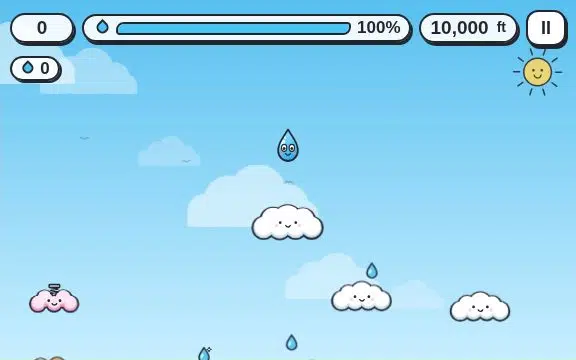 [同款源码网页实截](<https://github.com/jcwebst5/journey-of-a-drop/blob/HEAD/index.html>) | [jcwebst5/journey-of-a-drop](<https://github.com/jcwebst5/journey-of-a-drop>) | 常见根目录许可文件未找到 | 待核 | — | [可达 · 含游戏画布／引擎的网页](<https://jcwebst5.github.io/journey-of-a-drop/>) |
| 1882 | [ ] | [Journey of Misinformation](<https://github.com/gamingnews5/awesome-opus-5.5-games/blob/9a29b570e56bd19f15a3cd6bbac0b8c682f2c48c/games/journey-of-misinformation/readme.md>) | 待补截图 | [Dylanthecoder314/journey-of-misinformation](<https://github.com/Dylanthecoder314/journey-of-misinformation>) | 常见根目录许可文件未找到 | 待核 | — | [可达 · 合集所列网页](<https://dylanthecoder314.github.io/journey-of-misinformation/>) |
| 1883 | [ ] | [Judgment](<https://github.com/gamingnews5/awesome-opus-5.5-games/blob/9a29b570e56bd19f15a3cd6bbac0b8c682f2c48c/games/judgment/readme.md>) |  [同款源码启动画面实截](<https://github.com/Abhyuday2103/judgement/blob/HEAD/docs/index.html>) | [Abhyuday2103/judgement](<https://github.com/Abhyuday2103/judgement>) | 常见根目录许可文件未找到 | 待核 | — | [可达 · 合集所列网页](<https://abhyuday2103.github.io/judgement/>) |
| 1884 | [ ] | [Juice Blammers](<https://github.com/gamingnews5/awesome-opus-5.5-games/blob/9a29b570e56bd19f15a3cd6bbac0b8c682f2c48c/games/juice-blammers/readme.md>) |  [源码运行首页](<https://github.com/CreamsicIe/Juice-Blammers/blob/main/index.html>) | [CreamsicIe/Juice-Blammers](<https://github.com/CreamsicIe/Juice-Blammers>) | 常见根目录许可文件未找到 | 待核 | — | [README · 可达 · 上游 README 所列网页](<https://creamsicie.github.io/Juice-Blammers/>) |
| 1885 | [ ] | [Juju In The Nature](<https://github.com/gamingnews5/awesome-opus-5.5-games/blob/9a29b570e56bd19f15a3cd6bbac0b8c682f2c48c/games/juju-in-the-nature/readme.md>) | 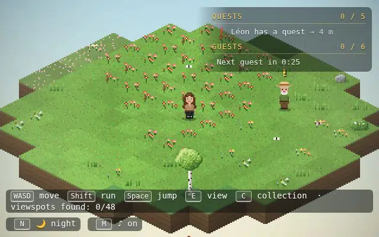 [源码网页实截](<https://github.com/DannyLahcenePro/juju-in-the-nature/blob/main/index.html>) | [DannyLahcenePro/juju-in-the-nature](<https://github.com/DannyLahcenePro/juju-in-the-nature>) | 常见根目录许可文件未找到 | 待核 | — | 未列入口 |
| 1886 | [ ] | [Jump &amp; Run](<https://github.com/gamingnews5/awesome-opus-5.5-games/blob/9a29b570e56bd19f15a3cd6bbac0b8c682f2c48c/games/jump-run/readme.md>) | 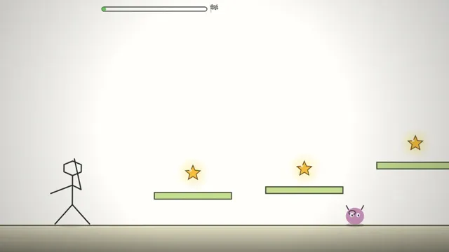 [对应子游戏玩法实截](<https://github.com/gberry747-lab/gabriels-animation-studio/blob/HEAD/index.html>) | [gberry747-lab/gabriels-animation-studio](<https://github.com/gberry747-lab/gabriels-animation-studio>) | 常见根目录许可文件未找到 | 待核 | — | [多游戏仓库入口 · 可达 · 含游戏画布／引擎的网页](<https://gberry747-lab.github.io/gabriels-animation-studio/>) |
| 1887 | [ ] | [Jumping Courses](<https://github.com/gamingnews5/awesome-opus-5.5-games/blob/9a29b570e56bd19f15a3cd6bbac0b8c682f2c48c/games/jumping-courses/readme.md>) |  [试玩首页实截](<https://gitgavin.github.io/jumping-courses/>) | [gitGavin/jumping-courses](<https://github.com/gitGavin/jumping-courses>) | 常见根目录许可文件未找到 | 待核 | — | [可达 · 含游戏画布／引擎的网页](<https://gitgavin.github.io/jumping-courses/>) |
| 1888 | [ ] | [Jungle Tag](<https://github.com/gamingnews5/awesome-opus-5.5-games/blob/9a29b570e56bd19f15a3cd6bbac0b8c682f2c48c/games/jungle-tag/readme.md>) | 待补截图 | [SirKevinTheFirst/jungle-tag](<https://github.com/SirKevinTheFirst/jungle-tag>) | 常见根目录许可文件未找到 | 待核 | — | 未列入口 |
| 1889 | [ ] | [JUNKRUN](<https://github.com/gamingnews5/awesome-opus-5.5-games/blob/9a29b570e56bd19f15a3cd6bbac0b8c682f2c48c/games/junkrun/readme.md>) | 待补截图 | [CoreyTrombley/JunkDrive](<https://github.com/CoreyTrombley/JunkDrive>) | 常见根目录许可文件未找到 | 待核 | — | 未列入口 |
| 1890 | [ ] | [Jury Duty](<https://github.com/gamingnews5/awesome-opus-5.5-games/blob/9a29b570e56bd19f15a3cd6bbac0b8c682f2c48c/games/jury-duty/readme.md>) |  [同款源码启动画面实截](<https://github.com/mdbatey/Jury-duty/blob/HEAD/index.html>) | [mdbatey/Jury-duty](<https://github.com/mdbatey/Jury-duty>) | 常见根目录许可文件未找到 | 待核 | — | [可达 · 合集所列网页](<https://mdbatey.github.io/Jury-duty/>) |
| 1891 | [ ] | [K3 Games](<https://github.com/gamingnews5/awesome-opus-5.5-games/blob/9a29b570e56bd19f15a3cd6bbac0b8c682f2c48c/games/k3-games/readme.md>) |  [源码网页实截](<https://github.com/Sounger/kids-games/blob/main/games/word-wheel/index.html>) | [Sounger/kids-games](<https://github.com/Sounger/kids-games>) | 常见根目录许可文件未找到 | 待核 | — | 未列入口 |
| 1892 | [ ] | [KABOOM](<https://github.com/gamingnews5/awesome-opus-5.5-games/blob/9a29b570e56bd19f15a3cd6bbac0b8c682f2c48c/games/kaboom/readme.md>) | 待补截图 | [jjas00n/KABOOM](<https://github.com/jjas00n/KABOOM>) | 常见根目录许可文件未找到 | 待核 | — | [可达 · 含游戏画布／引擎的网页](<https://jjas00n.github.io/KABOOM/>) |
| 1893 | [ ] | [KABOOZE](<https://github.com/gamingnews5/awesome-opus-5.5-games/blob/9a29b570e56bd19f15a3cd6bbac0b8c682f2c48c/games/kabooze/readme.md>) | 待补截图 | [lendegroote/kabooze](<https://github.com/lendegroote/kabooze>) | 常见根目录许可文件未找到 | 待核 | — | [入口已失效 · 合集所列网页](<https://lendegroote.github.io/kabooze/>) |
| 1894 | [ ] | [Kaiju Park](<https://github.com/gamingnews5/awesome-opus-5.5-games/blob/9a29b570e56bd19f15a3cd6bbac0b8c682f2c48c/games/kaiju-park/readme.md>) | 待补截图 | [DmAoWdID/Kaju](<https://github.com/DmAoWdID/Kaju>) | 常见根目录许可文件未找到 | 待核 | — | 未列入口 |
| 1895 | [ ] | [Kaiju Squeeze Shinjuku](<https://github.com/gamingnews5/awesome-opus-5.5-games/blob/9a29b570e56bd19f15a3cd6bbac0b8c682f2c48c/games/kaiju-squeeze-shinjuku/readme.md>) | 待补截图 | [kinakobooster/kaiju-squeeze-shinjuku](<https://github.com/kinakobooster/kaiju-squeeze-shinjuku>) | 常见根目录许可文件未找到 | 待核 | — | 未列入口 |
| 1896 | [ ] | [Kalabendu](<https://github.com/gamingnews5/awesome-opus-5.5-games/blob/9a29b570e56bd19f15a3cd6bbac0b8c682f2c48c/games/kalabendu/readme.md>) | 待补截图 | [seskiramadhan/Kalabendu](<https://github.com/seskiramadhan/Kalabendu>) | 常见根目录许可文件未找到 | [README 提及](<https://github.com/seskiramadhan/Kalabendu/blob/HEAD/README.md#L61>) | — | [可达 · 含游戏画布／引擎的网页](<https://seskiramadhan.github.io/Kalabendu/>) |
| 1897 | [ ] | [Kalo Taka](<https://github.com/gamingnews5/awesome-opus-5.5-games/blob/9a29b570e56bd19f15a3cd6bbac0b8c682f2c48c/games/kalo-taka/readme.md>) | 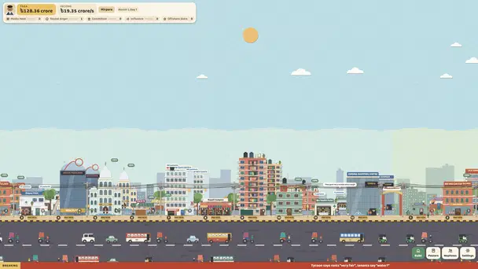 [合集截图](<https://github.com/TanvirHafiz/kalo-taka/blob/main/itch/screenshots/01-city_day_hud.png>) | [TanvirHafiz/kalo-taka](<https://github.com/TanvirHafiz/kalo-taka>) | 常见根目录许可文件未找到 | 待核 | [5.8](<https://github.com/TanvirHafiz/kalo-taka/blob/main/itch/screenshots/01-city_day_hud.png>) | 未列入口 |
| 1898 | [ ] | [Kamote Rider: Highway Escape](<https://github.com/gamingnews5/awesome-opus-5.5-games/blob/9a29b570e56bd19f15a3cd6bbac0b8c682f2c48c/games/kamote-rider-highway-escape/readme.md>) | 待补截图 | [Piolo284/Kamote-Rider-High-way-Escape](<https://github.com/Piolo284/Kamote-Rider-High-way-Escape>) | 常见根目录许可文件未找到 | 待核 | — | 未列入口 |
| 1899 | [ ] | [Kart Race](<https://github.com/gamingnews5/awesome-opus-5.5-games/blob/9a29b570e56bd19f15a3cd6bbac0b8c682f2c48c/games/party-chaos/readme.md>) | 待补截图 | [lawrenceandrewlargo/roblox-extreme-minigames](<https://github.com/lawrenceandrewlargo/roblox-extreme-minigames>) | 常见根目录许可文件未找到 | 待核 | — | 未列入口 |
| 1900 | [ ] | [KART RACER](<https://github.com/gamingnews5/awesome-opus-5.5-games/blob/9a29b570e56bd19f15a3cd6bbac0b8c682f2c48c/games/kart-racer/readme.md>) | 待补截图 | [hungungworld/kart-racer](<https://github.com/hungungworld/kart-racer>) | 常见根目录许可文件未找到 无根LICENSE；不能把KartRider类比或细胞角色当独立授权。 | 待核 | — | [可达 · 含游戏画布／引擎的网页](<https://kart-racer-one.vercel.app>) |
| 1901 | [ ] | [Kart Racer](<https://github.com/gamingnews5/awesome-opus-5.5-games/blob/9a29b570e56bd19f15a3cd6bbac0b8c682f2c48c/games/kart-racer-vm-720-kart-racer/readme.md>) |  [同款源码启动画面实截](<https://github.com/vm-720/kart-racer/blob/HEAD/index.html>) | [vm-720/kart-racer](<https://github.com/vm-720/kart-racer>) | 常见根目录许可文件未找到 | 待核 | — | [可达 · 含游戏画布／引擎的网页](<https://vm-720.github.io/kart-racer/>) |
| 1902 | [ ] | [Kasserine](<https://github.com/gamingnews5/awesome-opus-5.5-games/blob/9a29b570e56bd19f15a3cd6bbac0b8c682f2c48c/games/kasserine/readme.md>) | 待补截图 | [saedarm/Kasserine](<https://github.com/saedarm/Kasserine>) | 常见根目录许可文件未找到 | [README 提及](<https://github.com/saedarm/Kasserine/blob/HEAD/README.md#L69>) | — | 未列入口 |
| 1903 | [ ] | [Katan3D (Hexland)](<https://github.com/gamingnews5/awesome-opus-5.5-games/blob/9a29b570e56bd19f15a3cd6bbac0b8c682f2c48c/games/katan3d-hexland/readme.md>) | 待补截图 | [kimotomura-0101/hexland](<https://github.com/kimotomura-0101/hexland>) | 常见根目录许可文件未找到 | 待核 | — | 未列入口 |
| 1904 | [ ] | [Kebon Kosong](<https://github.com/gamingnews5/awesome-opus-5.5-games/blob/9a29b570e56bd19f15a3cd6bbac0b8c682f2c48c/games/kebon-kosong/readme.md>) | 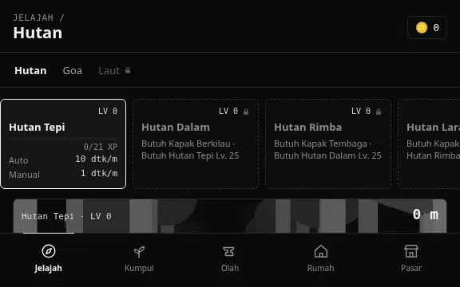 [同款源码网页实截](<https://github.com/xhoboo/KebonKosongv3/blob/HEAD/index.html>) | [xhoboo/KebonKosongv3](<https://github.com/xhoboo/KebonKosongv3>) | 常见根目录许可文件未找到 | 待核 | — | [可达 · 合集所列网页](<https://kebonkosong.vercel.app>) |
| 1905 | [ ] | [Keep Defence](<https://github.com/gamingnews5/awesome-opus-5.5-games/blob/9a29b570e56bd19f15a3cd6bbac0b8c682f2c48c/games/keep-defence/readme.md>) | 待补截图 | [george-m8/towerDefenceGame](<https://github.com/george-m8/towerDefenceGame>) | 常见根目录许可文件未找到 | 待核 | — | 未列入口 |
| 1906 | [ ] | [Keep Left: UK driving practice](<https://github.com/gamingnews5/awesome-opus-5.5-games/blob/9a29b570e56bd19f15a3cd6bbac0b8c682f2c48c/games/keep-left-uk-driving-practice/readme.md>) | 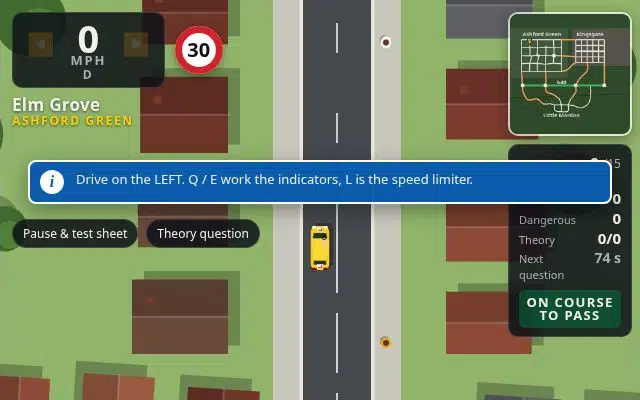 [源码网页实截](<https://github.com/tolga-asa/uk-driving-game/blob/main/index.html>) | [tolga-asa/uk-driving-game](<https://github.com/tolga-asa/uk-driving-game>) | 常见根目录许可文件未找到 | 待核 | — | 未列入口 |
| 1907 | [ ] | [Keeper of the Cold Lights](<https://github.com/gamingnews5/awesome-opus-5.5-games/blob/9a29b570e56bd19f15a3cd6bbac0b8c682f2c48c/games/keeper-of-the-cold-lights/readme.md>) | 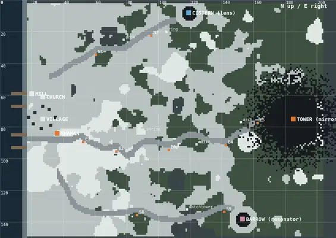 [合集截图](<https://github.com/IONOFIELD/COLD-LIGHTS/blob/main/docs/world-map.png>) | [IONOFIELD/COLD-LIGHTS](<https://github.com/IONOFIELD/COLD-LIGHTS>) | 常见根目录许可文件未找到 | 待核 | [5.0](<https://github.com/IONOFIELD/COLD-LIGHTS/blob/main/docs/world-map.png>) | 未列入口 |
| 1908 | [ ] | [Keeper of the Cycle](<https://github.com/gamingnews5/awesome-opus-5.5-games/blob/9a29b570e56bd19f15a3cd6bbac0b8c682f2c48c/games/keeper-of-the-cycle/readme.md>) | 待补截图 | [bliksa/keeper](<https://github.com/bliksa/keeper>) | 常见根目录许可文件未找到 | [README 提及、源码有输入读取](<https://github.com/bliksa/keeper/blob/claude/lucid-meitner-byi1m0/web-export/index.html#L113>) | — | [可达 · 含游戏画布／引擎的网页](<https://bliksa.github.io/keeper/>) |
| 1909 | [ ] | [Kelime &amp; İşlem](<https://github.com/gamingnews5/awesome-opus-5.5-games/blob/9a29b570e56bd19f15a3cd6bbac0b8c682f2c48c/games/kelime-islem/readme.md>) | 待补截图 | [kitmop/kelime-islem](<https://github.com/kitmop/kelime-islem>) | 常见根目录许可文件未找到 | 待核 | — | 未列入口 |
| 1910 | [ ] | [Kervan](<https://github.com/gamingnews5/awesome-opus-5.5-games/blob/9a29b570e56bd19f15a3cd6bbac0b8c682f2c48c/games/kervan/readme.md>) |  [游戏菜单或界面](<https://github.com/kdrgny-dev/kervan/blob/main/docs/design/stage4/mockups/hero_select.png>) | [kdrgny-dev/kervan](<https://github.com/kdrgny-dev/kervan>) | 常见根目录许可文件未找到 | [README 提及](<https://github.com/kdrgny-dev/kervan/blob/HEAD/README.md#L9>) | [6.5](<https://github.com/kdrgny-dev/kervan/blob/main/docs/design/stage4/mockups/hero_select.png>) | 未列入口 |
| 1911 | [ ] | [Keyboard Idle](<https://github.com/gamingnews5/awesome-opus-5.5-games/blob/9a29b570e56bd19f15a3cd6bbac0b8c682f2c48c/games/keyboard-idle/readme.md>) | 待补截图 | [enricosaito/keyboard-idle](<https://github.com/enricosaito/keyboard-idle>) | 常见根目录许可文件未找到 | 待核 | — | 未列入口 |
| 1912 | [ ] | [Keyhaven](<https://github.com/gamingnews5/awesome-opus-5.5-games/blob/9a29b570e56bd19f15a3cd6bbac0b8c682f2c48c/games/keyhaven/readme.md>) | 待补截图 | [Tbone94/keyhaven](<https://github.com/Tbone94/keyhaven>) | 常见根目录许可文件未找到 | 待核 | — | 未列入口 |
| 1913 | [ ] | [Keypracticer Game](<https://github.com/gamingnews5/awesome-opus-5.5-games/blob/9a29b570e56bd19f15a3cd6bbac0b8c682f2c48c/games/keypracticer-game/readme.md>) | 待补截图 | [bulleric/keypracticer-game](<https://github.com/bulleric/keypracticer-game>) | 常见根目录许可文件未找到 | 待核 | — | 未列入口 |
| 1914 | [ ] | [KeyQuest](<https://github.com/gamingnews5/awesome-opus-5.5-games/blob/9a29b570e56bd19f15a3cd6bbac0b8c682f2c48c/games/keyquest/readme.md>) | 待补截图 | [Bolteus/keyquest](<https://github.com/Bolteus/keyquest>) | 常见根目录许可文件未找到 | 待核 | — | 未列入口 |
| 1915 | [ ] | [Keys Crew](<https://github.com/gamingnews5/awesome-opus-5.5-games/blob/9a29b570e56bd19f15a3cd6bbac0b8c682f2c48c/games/keys-crew/readme.md>) | 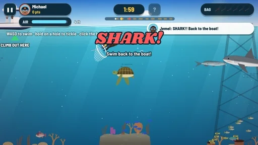 [上游实机演示截帧](<https://github.com/msaco13/keys-lobster-game/blob/HEAD/trailer/keys-crew-trailer.mp4>) | [msaco13/keys-lobster-game](<https://github.com/msaco13/keys-lobster-game>) | 常见根目录许可文件未找到 | 待核 | — | [可达 · 含游戏画布／引擎的网页](<https://msaco13.github.io/keys-lobster-game/>) |
| 1916 | [ ] | [Khrushchev Apartment Renovation](<https://github.com/gamingnews5/awesome-opus-5.5-games/blob/9a29b570e56bd19f15a3cd6bbac0b8c682f2c48c/games/khrushchev-apartment-renovation/readme.md>) | 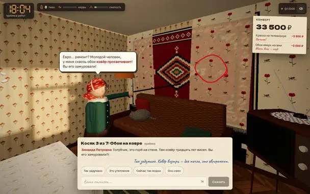 [合集截图](<https://github.com/swan4er/opus-100-projects/blob/main/004-khrushchev-renovation/preview.jpg>) | [swan4er/opus-100-projects](<https://github.com/swan4er/opus-100-projects>) | 常见根目录许可文件未找到 | 待核 | [7.6](<https://github.com/swan4er/opus-100-projects/blob/main/004-khrushchev-renovation/preview.jpg>) | [可达 · 含游戏画布／引擎的网页](<https://swan4er.github.io/opus-100-projects/004-khrushchev-renovation/>) |
| 1917 | [ ] | [Kids Maths](<https://github.com/gamingnews5/awesome-opus-5.5-games/blob/9a29b570e56bd19f15a3cd6bbac0b8c682f2c48c/games/kids-maths/readme.md>) |  [同款源码启动画面实截](<https://github.com/aldrinor/kids_maths/blob/HEAD/index.html>) | [aldrinor/kids\_maths](<https://github.com/aldrinor/kids_maths>) | 常见根目录许可文件未找到 | 待核 | — | [可达 · 合集所列网页](<https://aldrinor.github.io/kids_maths/>) |
| 1918 | [ ] | [kids-games](<https://github.com/gamingnews5/awesome-opus-5.5-games/blob/9a29b570e56bd19f15a3cd6bbac0b8c682f2c48c/games/kids-games/readme.md>) |  [同款源码启动画面实截](<https://github.com/conflagarationman/kids-games/blob/HEAD/index.html>) | [conflagarationman/kids-games](<https://github.com/conflagarationman/kids-games>) | 常见根目录许可文件未找到 | 待核 | — | [可达 · 合集所列网页](<https://conflagarationman.github.io/kids-games/>) |
| 1919 | [ ] | [Kimi K3.1 Pro vs GPT-6 Astra](<https://github.com/gamingnews5/awesome-opus-5.5-games/blob/9a29b570e56bd19f15a3cd6bbac0b8c682f2c48c/games/kimi-k3-1-pro-vs-gpt-6-astra/readme.md>) | 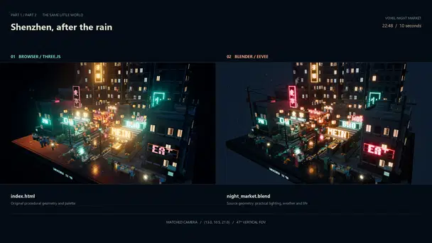 [合集截图](<https://github.com/KostiKoNeuro/kimi-vs-astra/blob/main/media/kimi-browser-vs-blender.png>) | [KostiKoNeuro/kimi-vs-astra](<https://github.com/KostiKoNeuro/kimi-vs-astra>) | 常见根目录许可文件未找到 | 待核 | [5.6](<https://github.com/KostiKoNeuro/kimi-vs-astra/blob/main/media/kimi-browser-vs-blender.png>) | [可达 · 合集所列网页](<https://kostikoneuro.github.io/kimi-vs-astra/>) |
| 1920 | [ ] | [Kinan vs. Mom — Birthday Remaster](<https://github.com/gamingnews5/awesome-opus-5.5-games/blob/9a29b570e56bd19f15a3cd6bbac0b8c682f2c48c/games/kinan-vs-mom-birthday-remaster/readme.md>) |  [上游动图截帧](<https://github.com/AlbertanCoder/kinan-vs-mom#readme>) | [AlbertanCoder/kinan-vs-mom](<https://github.com/AlbertanCoder/kinan-vs-mom>) | 常见根目录许可文件未找到 | [README 提及](<https://github.com/AlbertanCoder/kinan-vs-mom/blob/HEAD/README.md#L65>) | — | [可达 · 合集所列网页](<https://albertancoder.github.io/kinan-vs-mom/>) |
| 1921 | [ ] | [Kindly](<https://github.com/gamingnews5/awesome-opus-5.5-games/blob/9a29b570e56bd19f15a3cd6bbac0b8c682f2c48c/games/kindly/readme.md>) |  [合集截图](<https://github.com/tpcmurray/kindly/blob/main/docs/screenshots/act1-desktop.png>) | [tpcmurray/kindly](<https://github.com/tpcmurray/kindly>) | 常见根目录许可文件未找到 | 待核 | [4.0](<https://github.com/tpcmurray/kindly/blob/main/docs/screenshots/act1-desktop.png>) | 未列入口 |
| 1922 | [ ] | [Kingdom Quest](<https://github.com/gamingnews5/awesome-opus-5.5-games/blob/9a29b570e56bd19f15a3cd6bbac0b8c682f2c48c/games/kingdom-quest/readme.md>) | 待补截图 | [M-turtle/kingdom-quest](<https://github.com/M-turtle/kingdom-quest>) | 常见根目录许可文件未找到 | 待核 | — | 未列入口 |
| 1923 | [ ] | [Kingdom Rising](<https://github.com/gamingnews5/awesome-opus-5.5-games/blob/9a29b570e56bd19f15a3cd6bbac0b8c682f2c48c/games/kingdom-rising/readme.md>) | 待补截图 | [vparzanese88-maker/Kingdom-Rising](<https://github.com/vparzanese88-maker/Kingdom-Rising>) | 常见根目录许可文件未找到 | 待核 | — | 未列入口 |
| 1924 | [ ] | [Kingdom Strategy](<https://github.com/gamingnews5/awesome-opus-5.5-games/blob/9a29b570e56bd19f15a3cd6bbac0b8c682f2c48c/games/kingdom-strategy/readme.md>) | 待补截图 | [mojojo82/kingdom-strategy](<https://github.com/mojojo82/kingdom-strategy>) | 常见根目录许可文件未找到 | 待核 | — | 未列入口 |
| 1925 | [ ] | [Kitchen Table](<https://github.com/gamingnews5/awesome-opus-5.5-games/blob/9a29b570e56bd19f15a3cd6bbac0b8c682f2c48c/games/kitchen-table/readme.md>) | 待补截图 | [Alexdlc5/Kitchen-Table](<https://github.com/Alexdlc5/Kitchen-Table>) | 常见根目录许可文件未找到 | 待核 | — | 未列入口 |
| 1926 | [ ] | [Kitefall](<https://github.com/gamingnews5/awesome-opus-5.5-games/blob/9a29b570e56bd19f15a3cd6bbac0b8c682f2c48c/games/kitefall/readme.md>) | 待补截图 | [Tekrontech/Kitefall](<https://github.com/Tekrontech/Kitefall>) | 常见根目录许可文件未找到 | 待核 | — | 未列入口 |
| 1927 | [ ] | [Kitten Summon Arena](<https://github.com/gamingnews5/awesome-opus-5.5-games/blob/9a29b570e56bd19f15a3cd6bbac0b8c682f2c48c/games/kitten-summon-arena/readme.md>) | 待补截图 | [erroljayalt/kitten-summon-arena](<https://github.com/erroljayalt/kitten-summon-arena>) | 常见根目录许可文件未找到 | 待核 | — | [可达 · 合集所列网页](<https://kitten-summon-arena.vercel.app>) |
| 1928 | [ ] | [Knife Dodge](<https://github.com/gamingnews5/awesome-opus-5.5-games/blob/9a29b570e56bd19f15a3cd6bbac0b8c682f2c48c/games/knife-dodge/readme.md>) | 待补截图 | [Karanvir1729/ninja-knife-dodge](<https://github.com/Karanvir1729/ninja-knife-dodge>) | 常见根目录许可文件未找到 | 待核 | — | 未列入口 |
| 1929 | [ ] | [Kniffel](<https://github.com/gamingnews5/awesome-opus-5.5-games/blob/9a29b570e56bd19f15a3cd6bbac0b8c682f2c48c/games/kniffel/readme.md>) | 待补截图 | [Ranger-Jones/kniffel](<https://github.com/Ranger-Jones/kniffel>) | 常见根目录许可文件未找到 | 待核 | — | [可达 · 合集所列网页](<https://kniffel-sigma.vercel.app>) |
| 1930 | [ ] | [Knockback Arena](<https://github.com/gamingnews5/awesome-opus-5.5-games/blob/9a29b570e56bd19f15a3cd6bbac0b8c682f2c48c/games/party-chaos/readme.md>) | 待补截图 | [lawrenceandrewlargo/roblox-extreme-minigames](<https://github.com/lawrenceandrewlargo/roblox-extreme-minigames>) | 常见根目录许可文件未找到 | 待核 | — | 未列入口 |
| 1931 | [ ] | [KNUCKLEBOUND](<https://github.com/gamingnews5/awesome-opus-5.5-games/blob/9a29b570e56bd19f15a3cd6bbac0b8c682f2c48c/games/knucklebound/readme.md>) | 待补截图 | [ycgNem/knucklebound](<https://github.com/ycgNem/knucklebound>) | 常见根目录许可文件未找到 | [README 提及](<https://github.com/ycgNem/knucklebound/blob/HEAD/README.md#L7>) | — | [可达 · 含游戏画布／引擎的网页](<https://ycgnem.github.io/knucklebound/>) |
| 1932 | [ ] | [KodRobot](<https://github.com/gamingnews5/awesome-opus-5.5-games/blob/9a29b570e56bd19f15a3cd6bbac0b8c682f2c48c/games/kodrobot/readme.md>) | 待补截图 | [isinanyavuz-cmd/codegame](<https://github.com/isinanyavuz-cmd/codegame>) | 常见根目录许可文件未找到 | 待核 | — | 未列入口 |
| 1933 | [ ] | [Kodshim Quest](<https://github.com/gamingnews5/awesome-opus-5.5-games/blob/9a29b570e56bd19f15a3cd6bbac0b8c682f2c48c/games/kodshim-quest/readme.md>) | 待补截图 | [matt-CMDB/kodshim-quest](<https://github.com/matt-CMDB/kodshim-quest>) | 常见根目录许可文件未找到 | 待核 | — | [README · 可达 · 含游戏画布／引擎的网页](<https://jewishai.me/kodshim-quest/>) |
| 1934 | [ ] | [Koketsu: Apex Tag](<https://github.com/gamingnews5/awesome-opus-5.5-games/blob/9a29b570e56bd19f15a3cd6bbac0b8c682f2c48c/games/koketsu-apex-tag/readme.md>) | 待补截图 | [ishi12121/prowl](<https://github.com/ishi12121/prowl>) | 常见根目录许可文件未找到 | 待核 | — | [可达 · 含游戏画布／引擎的网页](<https://koketsu.xyz>) |
| 1935 | [ ] | [Koníčci](<https://github.com/gamingnews5/awesome-opus-5.5-games/blob/9a29b570e56bd19f15a3cd6bbac0b8c682f2c48c/games/konicci/readme.md>) | 待补截图 | [mugsatcz/Konici-hra](<https://github.com/mugsatcz/Konici-hra>) | 常见根目录许可文件未找到 | 待核 | — | 未列入口 |
| 1936 | [ ] | [Koprulu Survivors](<https://github.com/gamingnews5/awesome-opus-5.5-games/blob/9a29b570e56bd19f15a3cd6bbac0b8c682f2c48c/games/koprulu-survivors/readme.md>) | 待补截图 | [okwan/sc2-survivor](<https://github.com/okwan/sc2-survivor>) | 常见根目录许可文件未找到 | 待核 | — | 未列入口 |
| 1937 | [ ] | [Korean Division](<https://github.com/gamingnews5/awesome-opus-5.5-games/blob/9a29b570e56bd19f15a3cd6bbac0b8c682f2c48c/games/korean-division/readme.md>) | 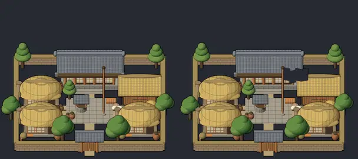 [合集截图](<https://github.com/FailingVillain/gameProject/blob/main/korean-division/assets/themes/kd1920/buildings/village-capture/village-capture.png>) | [FailingVillain/gameProject](<https://github.com/FailingVillain/gameProject>) | 常见根目录许可文件未找到 | 待核 | [5.5](<https://github.com/FailingVillain/gameProject/blob/main/korean-division/assets/themes/kd1920/buildings/village-capture/village-capture.png>) | 未列入口 |
| 1938 | [ ] | [Koroba 006](<https://github.com/gamingnews5/awesome-opus-5.5-games/blob/9a29b570e56bd19f15a3cd6bbac0b8c682f2c48c/games/koroba-006/readme.md>) | 待补截图 | [mrgdata/koroba\_py](<https://github.com/mrgdata/koroba_py>) | 常见根目录许可文件未找到 | 待核 | — | 未列入口 |
| 1939 | [ ] | [Kortspil](<https://github.com/gamingnews5/awesome-opus-5.5-games/blob/9a29b570e56bd19f15a3cd6bbac0b8c682f2c48c/games/kortspil/readme.md>) | 待补截图 | [anannerup/kortspil](<https://github.com/anannerup/kortspil>) | 常见根目录许可文件未找到 | 待核 | — | 未列入口 |
| 1940 | [ ] | [Krillion](<https://github.com/gamingnews5/awesome-opus-5.5-games/blob/9a29b570e56bd19f15a3cd6bbac0b8c682f2c48c/games/krillion/readme.md>) | 待补截图 | [davecthomas/krillion](<https://github.com/davecthomas/krillion>) | 常见根目录许可文件未找到 | 待核 | — | 未列入口 |
| 1941 | [ ] | [Kuhhandel Online](<https://github.com/gamingnews5/awesome-opus-5.5-games/blob/9a29b570e56bd19f15a3cd6bbac0b8c682f2c48c/games/kuhhandel-online/readme.md>) | 待补截图 | [Krist95/kuhhandel](<https://github.com/Krist95/kuhhandel>) | 常见根目录许可文件未找到 | 待核 | — | 未列入口 |
| 1942 | [ ] | [Kulki](<https://github.com/gamingnews5/awesome-opus-5.5-games/blob/9a29b570e56bd19f15a3cd6bbac0b8c682f2c48c/games/kulki/readme.md>) | 待补截图 | [k-chary/kulki](<https://github.com/k-chary/kulki>) | 常见根目录许可文件未找到 | [README 提及](<https://github.com/k-chary/kulki/blob/HEAD/README.md#L92>) | — | 未列入口 |
| 1943 | [ ] | [Kurang Berapa Rakaatku?](<https://github.com/gamingnews5/awesome-opus-5.5-games/blob/9a29b570e56bd19f15a3cd6bbac0b8c682f2c48c/games/kurang-berapa-rakaatku/readme.md>) |  [试玩首页实截](<https://puntadewaitb.github.io/sholatku/>) | [Puntadewaitb/sholatku](<https://github.com/Puntadewaitb/sholatku>) | 常见根目录许可文件未找到 | 待核 | — | [可达 · 含游戏画布／引擎的网页](<https://puntadewaitb.github.io/sholatku/>) |
| 1944 | [ ] | [Kurdistan Monopoly](<https://github.com/gamingnews5/awesome-opus-5.5-games/blob/9a29b570e56bd19f15a3cd6bbac0b8c682f2c48c/games/kurdistan-monopoly/readme.md>) | 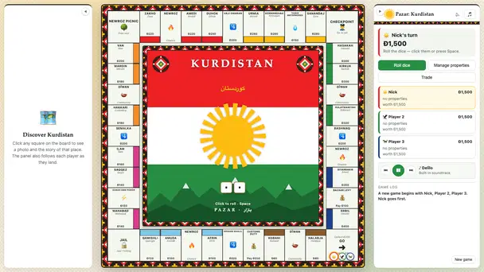 [上游游戏截图](<https://github.com/nbroadbent/kurdistan-monopoly/blob/HEAD/docs/screenshot-kurdistan.png>) | [nbroadbent/kurdistan-monopoly](<https://github.com/nbroadbent/kurdistan-monopoly>) | 常见根目录许可文件未找到 | 待核 | — | 未列入口 |
| 1945 | [ ] | [Kuro's Lakeside Stone Skipping](<https://github.com/gamingnews5/awesome-opus-5.5-games/blob/9a29b570e56bd19f15a3cd6bbac0b8c682f2c48c/games/kuro-s-lakeside-stone-skipping/readme.md>) | 待补截图 | [ShreyashGawas777/kuros-lakeside-stone-skipping](<https://github.com/ShreyashGawas777/kuros-lakeside-stone-skipping>) | 常见根目录许可文件未找到 | 待核 | — | [可达 · 含游戏画布／引擎的网页](<https://shreyashgawas777.github.io/kuros-lakeside-stone-skipping/>) |
| 1946 | [ ] | [Kurukshetra: A Life](<https://github.com/gamingnews5/awesome-opus-5.5-games/blob/9a29b570e56bd19f15a3cd6bbac0b8c682f2c48c/games/kurukshetra-a-life/readme.md>) | 待补截图 | [Apurv706/Mahabharata-game](<https://github.com/Apurv706/Mahabharata-game>) | 常见根目录许可文件未找到 | 待核 | — | 未列入口 |
| 1947 | [ ] | [Kömür and the Plague Rats](<https://github.com/gamingnews5/awesome-opus-5.5-games/blob/9a29b570e56bd19f15a3cd6bbac0b8c682f2c48c/games/komur-and-the-plague-rats/readme.md>) | <a href="https://img.itch.zone/aW1hZ2UvNTE3ODI3OS8zMTAxMzQ3NC5naWY=/original/YNGXsC.gif">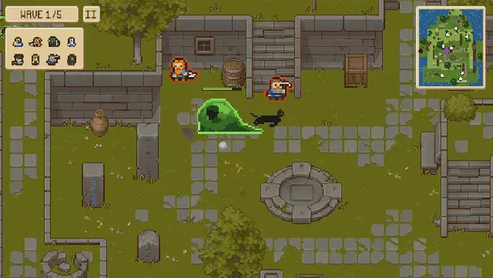</a> [作者发布的游戏截图](<https://acemcakmak.itch.io/komur-and-the-plague-rats>) | [acemcakmak/jci-gamejam-2026](<https://github.com/acemcakmak/jci-gamejam-2026>) | 常见根目录许可文件未找到 | 待核 | — | [可达 · itch.io 内嵌游戏页](<https://acemcakmak.itch.io/komur-and-the-plague-rats>) |
| 1948 | [ ] | [Küchen-Chaos](<https://github.com/gamingnews5/awesome-opus-5.5-games/blob/9a29b570e56bd19f15a3cd6bbac0b8c682f2c48c/games/kuchen-chaos/readme.md>) | 待补截图 | [Ikarus-eth/CangguKitchen](<https://github.com/Ikarus-eth/CangguKitchen>) | 常见根目录许可文件未找到 | 待核 | — | 未列入口 |
| 1949 | [ ] | [Labyrinth of Roots](<https://github.com/gamingnews5/awesome-opus-5.5-games/blob/9a29b570e56bd19f15a3cd6bbac0b8c682f2c48c/games/labyrinth-of-roots/readme.md>) | 待补截图 | [coderblack15/labyrinth-of-roots](<https://github.com/coderblack15/labyrinth-of-roots>) | 常见根目录许可文件未找到 | 待核 | — | [可达 · 合集所列网页](<https://coderblack15.github.io/labyrinth-of-roots/>) |
| 1950 | [ ] | [Laddle](<https://github.com/gamingnews5/awesome-opus-5.5-games/blob/9a29b570e56bd19f15a3cd6bbac0b8c682f2c48c/games/laddle/readme.md>) | 待补截图 | [appiemaster/laddle](<https://github.com/appiemaster/laddle>) | 常见根目录许可文件未找到 | 待核 | — | 未列入口 |
| 1951 | [ ] | [Lamp: Bible Word Puzzle](<https://github.com/gamingnews5/awesome-opus-5.5-games/blob/9a29b570e56bd19f15a3cd6bbac0b8c682f2c48c/games/lamp-bible-word-puzzle/readme.md>) | 待补截图 | [richardjallinson/Lamp](<https://github.com/richardjallinson/Lamp>) | 常见根目录许可文件未找到 | 待核 | [4.6](<https://github.com/richardjallinson/Lamp/blob/main/app/www/img/adv/card-1.webp>) | 未列入口 |
| 1952 | [ ] | [Lamplighter](<https://github.com/gamingnews5/awesome-opus-5.5-games/blob/9a29b570e56bd19f15a3cd6bbac0b8c682f2c48c/games/lamplighter/readme.md>) | <a href="https://raw.githubusercontent.com/riyasah0963/lamplighter/HEAD/docs/screens/moth-approaching.png">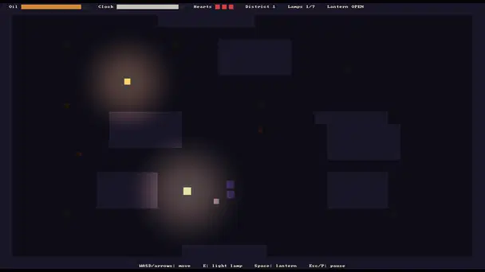</a> [README 游戏截图](<https://github.com/riyasah0963/lamplighter#readme>) | [riyasah0963/lamplighter](<https://github.com/riyasah0963/lamplighter>) | 常见根目录许可文件未找到 | 待核 | — | 未列入口 |
| 1953 | [ ] | [Lampu Merah Jakarta](<https://github.com/gamingnews5/awesome-opus-5.5-games/blob/9a29b570e56bd19f15a3cd6bbac0b8c682f2c48c/games/lampu-merah-jakarta/readme.md>) | 待补截图 | [zakiirfan/Traffic-Game](<https://github.com/zakiirfan/Traffic-Game>) | 常见根目录许可文件未找到 | 待核 | — | [可达 · 合集所列网页](<https://zakiirfan.github.io/Traffic-Game/>) |
| 1954 | [ ] | [LAN Poker](<https://github.com/gamingnews5/awesome-opus-5.5-games/blob/9a29b570e56bd19f15a3cd6bbac0b8c682f2c48c/games/lan-poker/readme.md>) | 待补截图 | [abkgpta/lanpoker](<https://github.com/abkgpta/lanpoker>) | 常见根目录许可文件未找到 | 待核 | — | 未列入口 |
| 1955 | [ ] | [Lancer TTRPG](<https://github.com/gamingnews5/awesome-opus-5.5-games/blob/9a29b570e56bd19f15a3cd6bbac0b8c682f2c48c/games/lancer-ttrpg/readme.md>) | 待补截图 | [Gabensrightnut/lancer-ttrpg](<https://github.com/Gabensrightnut/lancer-ttrpg>) | 常见根目录许可文件未找到 | 待核 | [5.5（原图失效）](<https://github.com/Gabensrightnut/lancer-ttrpg/blob/main/assets/screenshots/customizer_paint_factory.jpg>) | 未列入口 |
| 1956 | [ ] | [Lander](<https://github.com/gamingnews5/awesome-opus-5.5-games/blob/9a29b570e56bd19f15a3cd6bbac0b8c682f2c48c/games/lander/readme.md>) | 待补截图 | [briandgoldberg/Lander](<https://github.com/briandgoldberg/Lander>) | 常见根目录许可文件未找到 | 待核 | — | [HTTP 错误 · 合集所列网页](<https://lander-topaz.vercel.app>) |
| 1957 | [ ] | [Lantern](<https://github.com/gamingnews5/awesome-opus-5.5-games/blob/9a29b570e56bd19f15a3cd6bbac0b8c682f2c48c/games/lantern/readme.md>) | 待补截图 | [ZaneyP/lantern](<https://github.com/ZaneyP/lantern>) | 常见根目录许可文件未找到 | 待核 | — | 未列入口 |
| 1958 | [ ] | [Lantern Hollow](<https://github.com/gamingnews5/awesome-opus-5.5-games/blob/9a29b570e56bd19f15a3cd6bbac0b8c682f2c48c/games/lantern-hollow/readme.md>) | 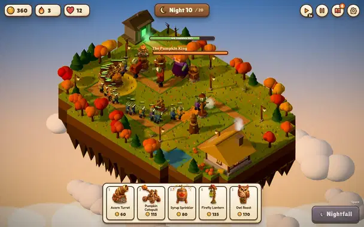 [合集截图](<https://github.com/hazlema/lantern-hollow/blob/main/docs/night-ten.jpg>) | [hazlema/lantern-hollow](<https://github.com/hazlema/lantern-hollow>) | 常见根目录许可文件未找到 | 待核 | [7.6](<https://github.com/hazlema/lantern-hollow/blob/main/docs/night-ten.jpg>) | 未列入口 |
| 1959 | [ ] | [Lantern Moth](<https://github.com/gamingnews5/awesome-opus-5.5-games/blob/9a29b570e56bd19f15a3cd6bbac0b8c682f2c48c/games/lantern-moth/readme.md>) | 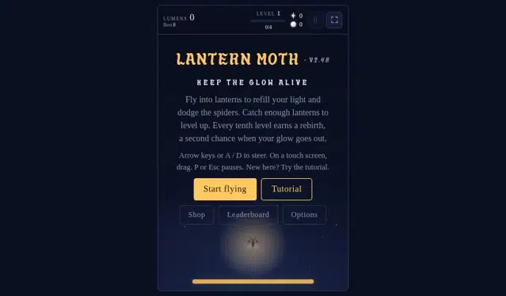 [试玩首页实截](<https://krialtestynedaxt.github.io/lantern-moth/>) | [KrialteStynedaxt/lantern-moth](<https://github.com/KrialteStynedaxt/lantern-moth>) | 常见根目录许可文件未找到 | 待核 | — | [可达 · 含游戏画布／引擎的网页](<https://krialtestynedaxt.github.io/lantern-moth/>) |
| 1960 | [ ] | [Lantern Road](<https://github.com/gamingnews5/awesome-opus-5.5-games/blob/9a29b570e56bd19f15a3cd6bbac0b8c682f2c48c/games/lantern-road/readme.md>) |  [源码网页实截](<https://github.com/Tsquared95/Lantern-road/blob/main/index.html>) | [Tsquared95/Lantern-road](<https://github.com/Tsquared95/Lantern-road>) | 常见根目录许可文件未找到 | 待核 | — | 未列入口 |
| 1961 | [ ] | [LAST BLADE](<https://github.com/gamingnews5/awesome-opus-5.5-games/blob/9a29b570e56bd19f15a3cd6bbac0b8c682f2c48c/games/last-blade/readme.md>) | 待补截图 | [iiviie/sekiro-like](<https://github.com/iiviie/sekiro-like>) | 常见根目录许可文件未找到 | [README 提及](<https://github.com/iiviie/sekiro-like/blob/HEAD/README.md#L113>) | — | 未列入口 |
| 1962 | [ ] | [Last Cans](<https://github.com/gamingnews5/awesome-opus-5.5-games/blob/9a29b570e56bd19f15a3cd6bbac0b8c682f2c48c/games/last-cans/readme.md>) | 待补截图 | [claude-core/last-cans](<https://github.com/claude-core/last-cans>) | 常见根目录许可文件未找到 | 待核 | — | 未列入口 |
| 1963 | [ ] | [Last Card](<https://github.com/gamingnews5/awesome-opus-5.5-games/blob/9a29b570e56bd19f15a3cd6bbac0b8c682f2c48c/games/last-card/readme.md>) | 待补截图 | [dkaminsky100-coder/last-card](<https://github.com/dkaminsky100-coder/last-card>) | 常见根目录许可文件未找到 | 待核 | — | [可达 · 合集所列网页](<https://dkaminsky100-coder.github.io/last-card/>) |
| 1964 | [ ] | [Last Colony](<https://github.com/gamingnews5/awesome-opus-5.5-games/blob/9a29b570e56bd19f15a3cd6bbac0b8c682f2c48c/games/last-colony/readme.md>) | 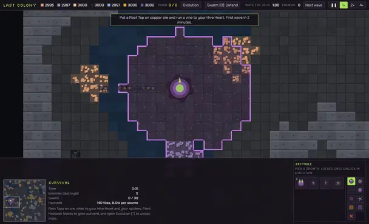 [合集截图](<https://github.com/dechatillioncollection-netizen/Last-Colony-Game/blob/main/docs/screenshots/brood-preview.png>) | [dechatillioncollection-netizen/Last-Colony-Game](<https://github.com/dechatillioncollection-netizen/Last-Colony-Game>) | 常见根目录许可文件未找到 | 待核 | [5.8](<https://github.com/dechatillioncollection-netizen/Last-Colony-Game/blob/main/docs/screenshots/brood-preview.png>) | 未列入口 |
| 1965 | [ ] | [Last Fire](<https://github.com/gamingnews5/awesome-opus-5.5-games/blob/9a29b570e56bd19f15a3cd6bbac0b8c682f2c48c/games/last-fire/readme.md>) | 待补截图 | [IniquitousAi/last-fire](<https://github.com/IniquitousAi/last-fire>) | 常见根目录许可文件未找到 | 待核 | — | [入口已失效 · 合集所列网页](<https://iniquitousai.github.io/last-fire/next/>) |
| 1966 | [ ] | [Last Frontier](<https://github.com/gamingnews5/awesome-opus-5.5-games/blob/9a29b570e56bd19f15a3cd6bbac0b8c682f2c48c/games/last-frontier/readme.md>) | 待补截图 | [pesuuu/Last-Frontier-V1](<https://github.com/pesuuu/Last-Frontier-V1>) | 常见根目录许可文件未找到 | 待核 | — | 未列入口 |
| 1967 | [ ] | [Last Hill](<https://github.com/gamingnews5/awesome-opus-5.5-games/blob/9a29b570e56bd19f15a3cd6bbac0b8c682f2c48c/games/last-hill/readme.md>) | 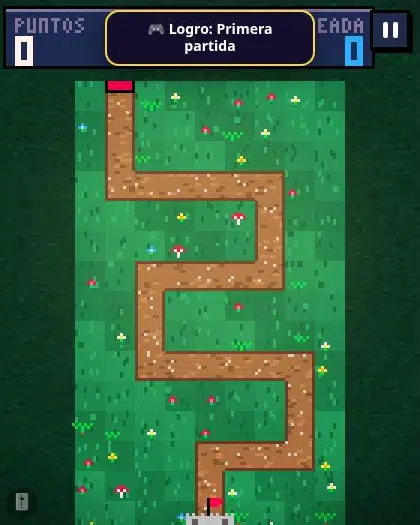 [对应子游戏玩法实截](<https://github.com/kokellara12-maker/apps-k4m9q2/blob/HEAD/lasthill.html>) | [kokellara12-maker/apps-k4m9q2](<https://github.com/kokellara12-maker/apps-k4m9q2>) | 常见根目录许可文件未找到 | 待核 | — | [可达 · 含游戏画布／引擎的网页](<https://kokellara12-maker.github.io/apps-k4m9q2/lasthill.html>) |
| 1968 | [ ] | [Last Kart](<https://github.com/gamingnews5/awesome-opus-5.5-games/blob/9a29b570e56bd19f15a3cd6bbac0b8c682f2c48c/games/party-chaos/readme.md>) | 待补截图 | [lawrenceandrewlargo/roblox-extreme-minigames](<https://github.com/lawrenceandrewlargo/roblox-extreme-minigames>) | 常见根目录许可文件未找到 | 待核 | — | 未列入口 |
| 1969 | [ ] | [Last Keep](<https://github.com/gamingnews5/awesome-opus-5.5-games/blob/9a29b570e56bd19f15a3cd6bbac0b8c682f2c48c/games/last-keep/readme.md>) | 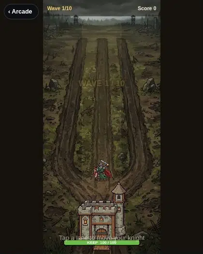 [对应子游戏玩法实截](<https://github.com/pawanp3/renderwolf-fable5-chart-toppers/blob/HEAD/games/kingshot/index.html>) | [pawanp3/renderwolf-fable5-chart-toppers](<https://github.com/pawanp3/renderwolf-fable5-chart-toppers>) | 常见根目录许可文件未找到 | 待核 | — | [多游戏仓库入口 · 可达 · 合集所列网页](<https://pawanp3.github.io/renderwolf-fable5-chart-toppers/>) |
| 1970 | [ ] | [Last Metro](<https://github.com/gamingnews5/awesome-opus-5.5-games/blob/9a29b570e56bd19f15a3cd6bbac0b8c682f2c48c/games/last-metro/readme.md>) | 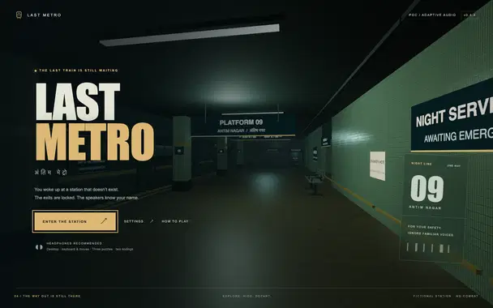 [游戏菜单或界面](<https://github.com/mgoyal98/last-metro/blob/main/docs/media/phase4d-title.png>) | [mgoyal98/last-metro](<https://github.com/mgoyal98/last-metro>) | 常见根目录许可文件未找到 | 待核 | [7.8](<https://github.com/mgoyal98/last-metro/blob/main/docs/media/phase4d-title.png>) | 未列入口 |
| 1971 | [ ] | [Last One](<https://github.com/gamingnews5/awesome-opus-5.5-games/blob/9a29b570e56bd19f15a3cd6bbac0b8c682f2c48c/games/last-one/readme.md>) |  [README 游戏截图](<https://github.com/amandalucymens/last-one#readme>) | [amandalucymens/last-one](<https://github.com/amandalucymens/last-one>) | 常见根目录许可文件未找到 | 待核 | — | 未列入口 |
| 1972 | [ ] | [LASTLIGHT](<https://github.com/gamingnews5/awesome-opus-5.5-games/blob/9a29b570e56bd19f15a3cd6bbac0b8c682f2c48c/games/lastlight/readme.md>) | 待补截图 | [bitofastickler/one-prompt-two-worlds](<https://github.com/bitofastickler/one-prompt-two-worlds>) | 常见根目录许可文件未找到 | 待核 | — | 未列入口 |
| 1973 | [ ] | [Latinha Retro](<https://github.com/gamingnews5/awesome-opus-5.5-games/blob/9a29b570e56bd19f15a3cd6bbac0b8c682f2c48c/games/latinha-retro/readme.md>) | 待补截图 | [Meduse64/latinha-retro-game](<https://github.com/Meduse64/latinha-retro-game>) | 常见根目录许可文件未找到 | 待核 | — | 未列入口 |
| 1974 | [ ] | [Lattice](<https://github.com/gamingnews5/awesome-opus-5.5-games/blob/9a29b570e56bd19f15a3cd6bbac0b8c682f2c48c/games/lattice-akuforge-lattice/readme.md>) | 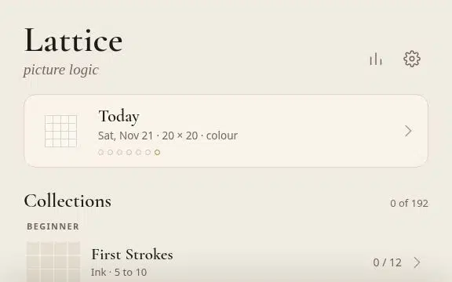 [源码运行首页](<https://github.com/akuforge/lattice/blob/main/index.html>) | [akuforge/lattice](<https://github.com/akuforge/lattice>) | 常见根目录许可文件未找到 | 待核 | — | [README · 可达 · 含游戏画布／引擎的网页](<https://akuforge.com/lattice/>) |
| 1975 | [ ] | [LATTICE](<https://github.com/gamingnews5/awesome-opus-5.5-games/blob/9a29b570e56bd19f15a3cd6bbac0b8c682f2c48c/games/lattice/readme.md>) | 待补截图 | [Malkefjes/newgame](<https://github.com/Malkefjes/newgame>) | 常见根目录许可文件未找到 | 待核 | — | 未列入口 |
| 1976 | [ ] | [Laugh-Labs](<https://github.com/gamingnews5/awesome-opus-5.5-games/blob/9a29b570e56bd19f15a3cd6bbac0b8c682f2c48c/games/laugh-labs/readme.md>) | 待补截图 | [Hephaestus985/Laugh-Labs](<https://github.com/Hephaestus985/Laugh-Labs>) | 常见根目录许可文件未找到 | 待核 | — | 未列入口 |
| 1977 | [ ] | [Launch Week](<https://github.com/gamingnews5/awesome-opus-5.5-games/blob/9a29b570e56bd19f15a3cd6bbac0b8c682f2c48c/games/launch-week/readme.md>) | 待补截图 | [kamaribedwarddev/launch-week](<https://github.com/kamaribedwarddev/launch-week>) | 常见根目录许可文件未找到 | 待核 | [5.6（原图失效）](<https://github.com/kamaribedwarddev/launch-week/blob/main/preview.png>) | [入口已失效 · 合集所列网页](<https://kamaribedwarddev.github.io/launch-week/>) |
| 1978 | [ ] | [Le Cube](<https://github.com/gamingnews5/awesome-opus-5.5-games/blob/9a29b570e56bd19f15a3cd6bbac0b8c682f2c48c/games/le-cube/readme.md>) | 待补截图 | [nbbou81000/le-cube-server](<https://github.com/nbbou81000/le-cube-server>) | 常见根目录许可文件未找到 | 待核 | [4.4（原图失效）](<https://github.com/nbbou81000/le-cube-server/blob/main/docs/mobile.png>) | 未列入口 |
| 1979 | [ ] | [Le Mystère de la Chèvrerie](<https://github.com/gamingnews5/awesome-opus-5.5-games/blob/9a29b570e56bd19f15a3cd6bbac0b8c682f2c48c/games/le-mystere-de-la-chevrerie/readme.md>) | 待补截图 | [VBlackJack/Chevrerie](<https://github.com/VBlackJack/Chevrerie>) | 常见根目录许可文件未找到 | 待核 | — | 未列入口 |
| 1980 | [ ] | [Le Puits des Âmes](<https://github.com/gamingnews5/awesome-opus-5.5-games/blob/9a29b570e56bd19f15a3cd6bbac0b8c682f2c48c/games/le-puits-des-ames/readme.md>) | 待补截图 | [absolutezeroo/mini-rogulike](<https://github.com/absolutezeroo/mini-rogulike>) | 常见根目录许可文件未找到 | [README 提及](<https://github.com/absolutezeroo/mini-rogulike/blob/HEAD/README.md#L8>) | — | [可达 · 素材／第三方资源](<https://pixel-boy.itch.io/ninja-adventure-asset-pack>) |
| 1981 | [ ] | [Le Supermarché invisible](<https://github.com/gamingnews5/awesome-opus-5.5-games/blob/9a29b570e56bd19f15a3cd6bbac0b8c682f2c48c/games/le-supermarche-invisible/readme.md>) | 待补截图 | [Thibaut-L214/hidden-supermarket](<https://github.com/Thibaut-L214/hidden-supermarket>) | 常见根目录许可文件未找到 | 待核 | — | [可达 · 含游戏画布／引擎的网页](<https://thibaut-l214.github.io/hidden-supermarket/>) |
| 1982 | [ ] | [Lee's Business With Your Business](<https://github.com/gamingnews5/awesome-opus-5.5-games/blob/9a29b570e56bd19f15a3cd6bbac0b8c682f2c48c/games/lee-s-business-with-your-business/readme.md>) | 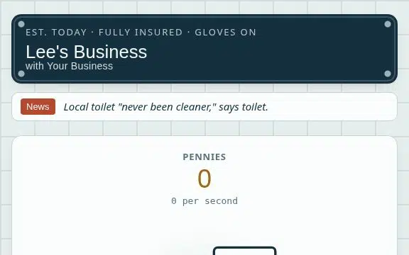 [同款源码网页实截](<https://github.com/Blackclaws/lees-business/blob/HEAD/index.html>) | [Blackclaws/lees-business](<https://github.com/Blackclaws/lees-business>) | 常见根目录许可文件未找到 | 待核 | — | [可达 · 合集所列网页](<https://blackclaws.github.io/lees-business/>) |
| 1983 | [ ] | [LEFTOVER](<https://github.com/gamingnews5/awesome-opus-5.5-games/blob/9a29b570e56bd19f15a3cd6bbac0b8c682f2c48c/games/leftover/readme.md>) | 待补截图 | [ericchantry/leftover](<https://github.com/ericchantry/leftover>) | 常见根目录许可文件未找到 | 待核 | — | 未列入口 |
| 1984 | [ ] | [Legends of Loot](<https://github.com/gamingnews5/awesome-opus-5.5-games/blob/9a29b570e56bd19f15a3cd6bbac0b8c682f2c48c/games/legends-of-loot/readme.md>) | 待补截图 | [teaguehopkins/notif-game](<https://github.com/teaguehopkins/notif-game>) | 常见根目录许可文件未找到 | 待核 | — | [README · 可达 · 上游 README 所列网页](<https://legendsofloot.zenwombat.com>) |
| 1985 | [ ] | [legio](<https://github.com/gamingnews5/awesome-opus-5.5-games/blob/9a29b570e56bd19f15a3cd6bbac0b8c682f2c48c/games/legio/readme.md>) | 待补截图 | [DanteArcese/legio](<https://github.com/DanteArcese/legio>) | 常见根目录许可文件未找到 | [README 提及](<https://github.com/DanteArcese/legio/blob/HEAD/README.md#L3>) | — | 未列入口 |
| 1986 | [ ] | [Leo's Arcade](<https://github.com/gamingnews5/awesome-opus-5.5-games/blob/9a29b570e56bd19f15a3cd6bbac0b8c682f2c48c/games/leo-s-arcade/readme.md>) | 待补截图 | [cmmichael/leoarcade](<https://github.com/cmmichael/leoarcade>) | 常见根目录许可文件未找到 | 待核 | — | 未列入口 |
| 1987 | [ ] | [Leo's Firewall](<https://github.com/gamingnews5/awesome-opus-5.5-games/blob/9a29b570e56bd19f15a3cd6bbac0b8c682f2c48c/games/leo-s-firewall/readme.md>) | 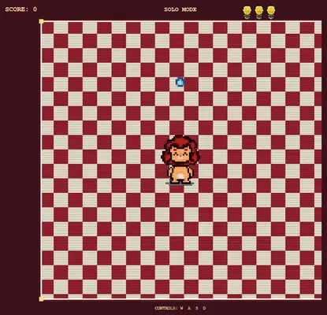 [合集截图](<https://github.com/Mhielikiks/leos-firewall/blob/main/docs/screenshots/solo.png>) | [Mhielikiks/leos-firewall](<https://github.com/Mhielikiks/leos-firewall>) | 常见根目录许可文件未找到 | 待核 | [5.0](<https://github.com/Mhielikiks/leos-firewall/blob/main/docs/screenshots/solo.png>) | 未列入口 |
| 1988 | [ ] | [Leonida](<https://github.com/gamingnews5/awesome-opus-5.5-games/blob/9a29b570e56bd19f15a3cd6bbac0b8c682f2c48c/games/leonida/readme.md>) | 待补截图 | [AlfredBrowser/Leonida-GTA-6-Remake-Fable-5.1](<https://github.com/AlfredBrowser/Leonida-GTA-6-Remake-Fable-5.1>) | 常见根目录许可文件未找到 | 待核 | — | 未列入口 |
| 1989 | [ ] | [Let me cook!](<https://github.com/gamingnews5/awesome-opus-5.5-games/blob/9a29b570e56bd19f15a3cd6bbac0b8c682f2c48c/games/let-me-cook/readme.md>) | 待补截图 | [Nokianyte/letmecook](<https://github.com/Nokianyte/letmecook>) | 常见根目录许可文件未找到 | 待核 | — | [可达 · 含游戏画布／引擎的网页](<https://nokianyte.github.io/letmecook/>) |
| 1990 | [ ] | [Lethal Company: Opus Edition](<https://github.com/gamingnews5/awesome-opus-5.5-games/blob/9a29b570e56bd19f15a3cd6bbac0b8c682f2c48c/games/lethal-company-opus-edition/readme.md>) | 待补截图 | [TESTYEE-09/opus5.5Lethal](<https://github.com/TESTYEE-09/opus5.5Lethal>) | 常见根目录许可文件未找到 | 待核 | — | [可达 · 含游戏画布／引擎的网页](<https://testyee-09.github.io/opus5.5Lethal/>) |
| 1991 | [ ] | [Letter Bay (מפרץ האותיות)](<https://github.com/gamingnews5/awesome-opus-5.5-games/blob/9a29b570e56bd19f15a3cd6bbac0b8c682f2c48c/games/letter-bay/readme.md>) | 待补截图 | [xsprite85-bit/letters-bay](<https://github.com/xsprite85-bit/letters-bay>) | 常见根目录许可文件未找到 | 待核 | — | 未列入口 |
| 1992 | [ ] | [Leuchtturmwaerter](<https://github.com/gamingnews5/awesome-opus-5.5-games/blob/9a29b570e56bd19f15a3cd6bbac0b8c682f2c48c/games/leuchtturmwaerter/readme.md>) | 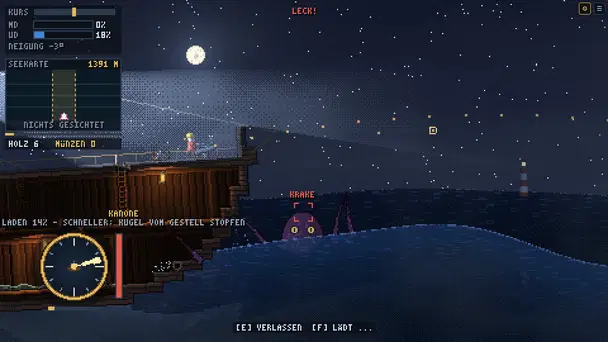 [合集截图](<https://github.com/dtghgthf/BrowserGame/blob/main/screenshots/chromium-14-krake-kanone.png>) | [dtghgthf/BrowserGame](<https://github.com/dtghgthf/BrowserGame>) | 常见根目录许可文件未找到 | 待核 | [7.3](<https://github.com/dtghgthf/BrowserGame/blob/main/screenshots/chromium-14-krake-kanone.png>) | [可达 · 合集所列网页](<https://game.echterhofflabs.me>) |
| 1993 | [ ] | [Life Sim](<https://github.com/gamingnews5/awesome-opus-5.5-games/blob/9a29b570e56bd19f15a3cd6bbac0b8c682f2c48c/games/life-sim/readme.md>) | 待补截图 | [TurboTemple/TwineStory](<https://github.com/TurboTemple/TwineStory>) | 常见根目录许可文件未找到 | 待核 | — | [可达 · 合集所列网页](<https://turbotemple.github.io/TwineStory/>) |
| 1994 | [ ] | [Lifeline](<https://github.com/gamingnews5/awesome-opus-5.5-games/blob/9a29b570e56bd19f15a3cd6bbac0b8c682f2c48c/games/lifeline/readme.md>) | 待补截图 | [treyspoonamore1/mobile-game](<https://github.com/treyspoonamore1/mobile-game>) | 常见根目录许可文件未找到 | 待核 | — | 未列入口 |
| 1995 | [ ] | [Lifelines](<https://github.com/gamingnews5/awesome-opus-5.5-games/blob/9a29b570e56bd19f15a3cd6bbac0b8c682f2c48c/games/lifelines/readme.md>) | 待补截图 | [Kratosxx24/lifelines](<https://github.com/Kratosxx24/lifelines>) | 常见根目录许可文件未找到 | 待核 | — | [可达 · 合集所列网页](<https://lifelines.codexcanon.workers.dev>) |
| 1996 | [ ] | [Lifeofgame](<https://github.com/gamingnews5/awesome-opus-5.5-games/blob/9a29b570e56bd19f15a3cd6bbac0b8c682f2c48c/games/lifeofgame/readme.md>) | 待补截图 | [Sulfaq/lifeofgame](<https://github.com/Sulfaq/lifeofgame>) | 常见根目录许可文件未找到 | 待核 | — | 未列入口 |
| 1997 | [ ] | [Lift Load](<https://github.com/gamingnews5/awesome-opus-5.5-games/blob/9a29b570e56bd19f15a3cd6bbac0b8c682f2c48c/games/lift-load/readme.md>) |  [上游商店截图](<https://github.com/SubhadipGitHub/Lift-Load/blob/HEAD/docs/store/screenshots/03_powers_level_30.png>) | [SubhadipGitHub/Lift-Load](<https://github.com/SubhadipGitHub/Lift-Load>) | 常见根目录许可文件未找到 | 待核 | — | 未列入口 |
| 1998 | [ ] | [Liftoff.py](<https://github.com/gamingnews5/awesome-opus-5.5-games/blob/9a29b570e56bd19f15a3cd6bbac0b8c682f2c48c/games/liftoff-py/readme.md>) | 待补截图 | [Imshad18/liftoff.py](<https://github.com/Imshad18/liftoff.py>) | 常见根目录许可文件未找到 | 待核 | — | 未列入口 |
| 1999 | [ ] | [Lig 4 ao vivo](<https://github.com/gamingnews5/awesome-opus-5.5-games/blob/9a29b570e56bd19f15a3cd6bbac0b8c682f2c48c/games/lig-4-ao-vivo/readme.md>) | 待补截图 | [lipefurlan/lige4](<https://github.com/lipefurlan/lige4>) | 常见根目录许可文件未找到 | 待核 | — | [可达 · 合集所列网页](<https://facamp-ia-demo-pi.vercel.app>) |
| 2000 | [ ] | [Line Battle](<https://github.com/gamingnews5/awesome-opus-5.5-games/blob/9a29b570e56bd19f15a3cd6bbac0b8c682f2c48c/games/line-battle/readme.md>) | 待补截图 | [hoangnguyen92/line-battle](<https://github.com/hoangnguyen92/line-battle>) | 常见根目录许可文件未找到 | 待核 | — | 未列入口 |
| 2001 | [ ] | [LISBON 1944: Kota Para Mata-Mata](<https://github.com/gamingnews5/awesome-opus-5.5-games/blob/9a29b570e56bd19f15a3cd6bbac0b8c682f2c48c/games/lisbon-1944-kota-para-mata-mata/readme.md>) | 待补截图 | [cntr2303diran-design/Game-1.0](<https://github.com/cntr2303diran-design/Game-1.0>) | 常见根目录许可文件未找到 | 待核 | — | 未列入口 |
| 2002 | [ ] | [Little Learners](<https://github.com/gamingnews5/awesome-opus-5.5-games/blob/9a29b570e56bd19f15a3cd6bbac0b8c682f2c48c/games/little-learners/readme.md>) | 待补截图 | [Xorbak/little-learners](<https://github.com/Xorbak/little-learners>) | 常见根目录许可文件未找到 | 待核 | — | 未列入口 |
| 2003 | [ ] | [Little Learners (strokedoc)](<https://github.com/gamingnews5/awesome-opus-5.5-games/blob/9a29b570e56bd19f15a3cd6bbac0b8c682f2c48c/games/little-learners-strokedoc/readme.md>) | 待补截图 | [strokedoc/little-learners](<https://github.com/strokedoc/little-learners>) | 常见根目录许可文件未找到 | 待核 | — | 未列入口 |
| 2004 | [ ] | [Little Medic](<https://github.com/gamingnews5/awesome-opus-5.5-games/blob/9a29b570e56bd19f15a3cd6bbac0b8c682f2c48c/games/little-medic/readme.md>) | 待补截图 | [bapakKau00/little-medic](<https://github.com/bapakKau00/little-medic>) | 常见根目录许可文件未找到 | 待核 | — | 未列入口 |
| 2005 | [ ] | [Little Pizzaiolo](<https://github.com/gamingnews5/awesome-opus-5.5-games/blob/9a29b570e56bd19f15a3cd6bbac0b8c682f2c48c/games/little-pizzaiolo/readme.md>) | 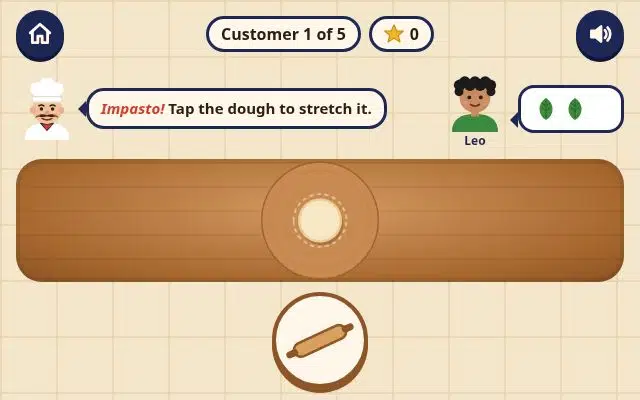 [源码网页实截](<https://github.com/palermomia/little-pizzaiolo/blob/main/index.html>) | [palermomia/little-pizzaiolo](<https://github.com/palermomia/little-pizzaiolo>) | 常见根目录许可文件未找到 | 待核 | — | 未列入口 |
| 2006 | [ ] | [Little Red’s Lessons](<https://github.com/gamingnews5/awesome-opus-5.5-games/blob/9a29b570e56bd19f15a3cd6bbac0b8c682f2c48c/games/little-red-s-lessons/readme.md>) | 待补截图 | [asonichero/redlessons](<https://github.com/asonichero/redlessons>) | 常见根目录许可文件未找到 | 待核 | — | 未列入口 |
| 2007 | [ ] | [Littlemegapeople](<https://github.com/gamingnews5/awesome-opus-5.5-games/blob/9a29b570e56bd19f15a3cd6bbac0b8c682f2c48c/games/littlemegapeople/readme.md>) | 待补截图 | [xlar54/littlemegapeople](<https://github.com/xlar54/littlemegapeople>) | 常见根目录许可文件未找到 | 待核 | — | 未列入口 |
| 2008 | [ ] | [Living Room VR](<https://github.com/gamingnews5/awesome-opus-5.5-games/blob/9a29b570e56bd19f15a3cd6bbac0b8c682f2c48c/games/living-room-vr/readme.md>) | 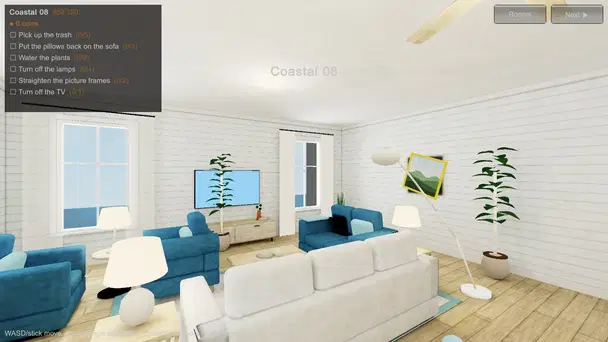 [合集截图](<https://github.com/jaking-studios/living-room-vr/blob/main/docs/screens/unity.jpg>) | [jaineil32624/living-room-vr](<https://github.com/jaineil32624/living-room-vr>) | 常见根目录许可文件未找到 | [README 提及](<https://github.com/jaineil32624/living-room-vr/blob/HEAD/README.md#L149>) | [5.8](<https://github.com/jaking-studios/living-room-vr/blob/main/docs/screens/unity.jpg>) | [可达 · 含游戏画布／引擎的网页](<https://jaking-studios.github.io/living-room-vr/>) |
| 2009 | [ ] | [Lo-Fi Ops](<https://github.com/gamingnews5/awesome-opus-5.5-games/blob/9a29b570e56bd19f15a3cd6bbac0b8c682f2c48c/games/lo-fi-ops/readme.md>) | 待补截图 | [mcgingras/lofi-ops](<https://github.com/mcgingras/lofi-ops>) | 常见根目录许可文件未找到 | 待核 | — | 未列入口 |
| 2010 | [ ] | [Load/Bearing](<https://github.com/gamingnews5/awesome-opus-5.5-games/blob/9a29b570e56bd19f15a3cd6bbac0b8c682f2c48c/games/load-bearing/readme.md>) | 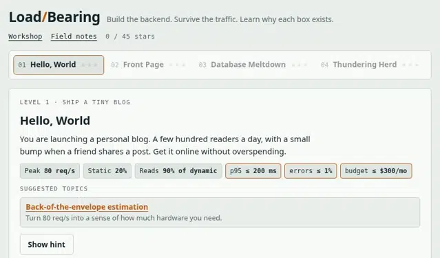 [试玩画面](<https://sd-indol-alpha.vercel.app>) | [siddharth-ranjan/load-bearing](<https://github.com/siddharth-ranjan/load-bearing>) | 常见根目录许可文件未找到 | 待核 | — | [可达 · 含游戏画布／引擎的网页](<https://sd-indol-alpha.vercel.app>) |
| 2011 | [ ] | [LOB, Over](<https://github.com/gamingnews5/awesome-opus-5.5-games/blob/9a29b570e56bd19f15a3cd6bbac0b8c682f2c48c/games/lob-over/readme.md>) | 待补截图 | [tamu-game-lab/lob-over](<https://github.com/tamu-game-lab/lob-over>) | 常见根目录许可文件未找到 | 待核 | — | [可达 · 合集所列网页](<https://tamu-game-lab.github.io/lob-over/>) |
| 2012 | [ ] | [Lodestone](<https://github.com/gamingnews5/awesome-opus-5.5-games/blob/9a29b570e56bd19f15a3cd6bbac0b8c682f2c48c/games/lodestone/readme.md>) | 待补截图 | [BrandonSigil/lodestone](<https://github.com/BrandonSigil/lodestone>) | 常见根目录许可文件未找到 | 待核 | — | 未列入口 |
| 2013 | [ ] | [Logic Lab](<https://github.com/gamingnews5/awesome-opus-5.5-games/blob/9a29b570e56bd19f15a3cd6bbac0b8c682f2c48c/games/logic-lab/readme.md>) | 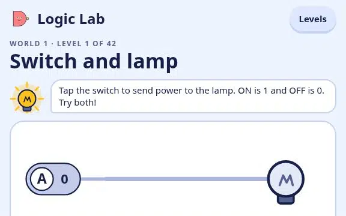 [源码运行画面](<https://github.com/awaisathar/logiclab/blob/main/index.html>) | [awaisathar/logiclab](<https://github.com/awaisathar/logiclab>) | 常见根目录许可文件未找到 | 待核 | — | 未列入口 |
| 2014 | [ ] | [London Hustle](<https://github.com/gamingnews5/awesome-opus-5.5-games/blob/9a29b570e56bd19f15a3cd6bbac0b8c682f2c48c/games/london-hustle/readme.md>) | 待补截图 | [udomiayetony/japa-simulator](<https://github.com/udomiayetony/japa-simulator>) | 常见根目录许可文件未找到 | 待核 | — | 未列入口 |
| 2015 | [ ] | [Long Ký - The Game](<https://github.com/gamingnews5/awesome-opus-5.5-games/blob/9a29b570e56bd19f15a3cd6bbac0b8c682f2c48c/games/long-ky-the-game/readme.md>) | 待补截图 | [binhnt010896/long-ky-card-game](<https://github.com/binhnt010896/long-ky-card-game>) | 常见根目录许可文件未找到 | 待核 | — | 未列入口 |
| 2016 | [ ] | [Long Road](<https://github.com/gamingnews5/awesome-opus-5.5-games/blob/9a29b570e56bd19f15a3cd6bbac0b8c682f2c48c/games/long-road/readme.md>) |  [游戏菜单或界面](<https://github.com/swan4er/opus-100-projects/blob/main/071-long-road/preview.jpg>) | [swan4er/opus-100-projects](<https://github.com/swan4er/opus-100-projects>) | 常见根目录许可文件未找到 | 待核 | [7.9](<https://github.com/swan4er/opus-100-projects/blob/main/071-long-road/preview.jpg>) | [可达 · 含游戏画布／引擎的网页](<https://swan4er.github.io/opus-100-projects/071-long-road/>) |
| 2017 | [ ] | [Long Shot 10 (gkson-lab)](<https://github.com/gamingnews5/awesome-opus-5.5-games/blob/9a29b570e56bd19f15a3cd6bbac0b8c682f2c48c/games/long-shot-10-gkson-lab/readme.md>) | 待补截图 | [gkson-lab/longshot10](<https://github.com/gkson-lab/longshot10>) | 常见根目录许可文件未找到 | 待核 | — | [可达 · 含游戏画布／引擎的网页](<https://gkson-lab.github.io/longshot10/>) |
| 2018 | [ ] | [Loop Clear](<https://github.com/gamingnews5/awesome-opus-5.5-games/blob/9a29b570e56bd19f15a3cd6bbac0b8c682f2c48c/games/loop-clear/readme.md>) | 待补截图 | [jcooksh/loop-clear](<https://github.com/jcooksh/loop-clear>) | 常见根目录许可文件未找到 | 待核 | — | [可达 · 合集所列网页](<https://jcooksh.github.io/loop-clear/>) |
| 2019 | [ ] | [Loop Rebirth](<https://github.com/gamingnews5/awesome-opus-5.5-games/blob/9a29b570e56bd19f15a3cd6bbac0b8c682f2c48c/games/loop-rebirth/readme.md>) | 待补截图 | [johnnysins24/looprebirth](<https://github.com/johnnysins24/looprebirth>) | 常见根目录许可文件未找到 | 待核 | [5.8](<https://github.com/johnnysins24/looprebirth/blob/main/docs/art/mockup_grass.png>) | 未列入口 |
| 2020 | [ ] | [Loopball](<https://github.com/gamingnews5/awesome-opus-5.5-games/blob/9a29b570e56bd19f15a3cd6bbac0b8c682f2c48c/games/loopball/readme.md>) | 待补截图 | [criste1000r/loopball](<https://github.com/criste1000r/loopball>) | 常见根目录许可文件未找到 | 待核 | — | [可达 · 含游戏画布／引擎的网页](<https://loopball.onrender.com>) |
| 2021 | [ ] | [Looping Louie](<https://github.com/gamingnews5/awesome-opus-5.5-games/blob/9a29b570e56bd19f15a3cd6bbac0b8c682f2c48c/games/looping-louie/readme.md>) |  [试玩首页实截](<https://paulbuettner-star.github.io/looping-louie/>) | [paulbuettner-star/looping-louie](<https://github.com/paulbuettner-star/looping-louie>) | 常见根目录许可文件未找到 | 待核 | — | [可达 · 含游戏画布／引擎的网页](<https://paulbuettner-star.github.io/looping-louie/>) |
| 2022 | [ ] | [Loopy](<https://github.com/gamingnews5/awesome-opus-5.5-games/blob/9a29b570e56bd19f15a3cd6bbac0b8c682f2c48c/games/loopy/readme.md>) |  [上游游戏截图](<https://github.com/amalrajvinoth/loopy/blob/HEAD/docs/screenshots/levels-history/card-844-landscape-sunny-after.png>) | [amalrajvinoth/loopy](<https://github.com/amalrajvinoth/loopy>) | 常见根目录许可文件未找到 | 待核 | — | [可达 · 合集所列网页](<https://amalrajvinoth.github.io/loopy>) |
| 2023 | [ ] | [Lootdle](<https://github.com/gamingnews5/awesome-opus-5.5-games/blob/9a29b570e56bd19f15a3cd6bbac0b8c682f2c48c/games/lootdle/readme.md>) | 待补截图 | [FrankSauve/lootdle](<https://github.com/FrankSauve/lootdle>) | 常见根目录许可文件未找到 | 待核 | — | 未列入口 |
| 2024 | [ ] | [Lost in Computation](<https://github.com/gamingnews5/awesome-opus-5.5-games/blob/9a29b570e56bd19f15a3cd6bbac0b8c682f2c48c/games/lost-in-computation/readme.md>) | 待补截图 | [Afrah-Sohail/lostincomputation](<https://github.com/Afrah-Sohail/lostincomputation>) | 常见根目录许可文件未找到 | 待核 | — | [README · 可达 · 上游 README 所列网页](<https://www.lostincomputation.design>) |
| 2025 | [ ] | [Low Effort Strategy Game](<https://github.com/gamingnews5/awesome-opus-5.5-games/blob/9a29b570e56bd19f15a3cd6bbac0b8c682f2c48c/games/low-effort-strategy-game/readme.md>) | 待补截图 | [Barty-Bart/opus-55-effort-comparison](<https://github.com/Barty-Bart/opus-55-effort-comparison>) | 常见根目录许可文件未找到 | 待核 | — | 未列入口 |
| 2026 | [ ] | [LOWLIFE](<https://github.com/gamingnews5/awesome-opus-5.5-games/blob/9a29b570e56bd19f15a3cd6bbac0b8c682f2c48c/games/lowlife/readme.md>) | 待补截图 | [evanstom273/Claude-test-II](<https://github.com/evanstom273/Claude-test-II>) | 常见根目录许可文件未找到 | 待核 | — | 未列入口 |
| 2027 | [ ] | [Lucky Harvest](<https://github.com/gamingnews5/awesome-opus-5.5-games/blob/9a29b570e56bd19f15a3cd6bbac0b8c682f2c48c/games/lucky-harvest/readme.md>) | 待补截图 | [bruno-lombardi/lucky-harvest](<https://github.com/bruno-lombardi/lucky-harvest>) | 常见根目录许可文件未找到 | 待核 | — | 未列入口 |
| 2028 | [ ] | [Lucky Monkey: On-Call in the Jungle](<https://github.com/gamingnews5/awesome-opus-5.5-games/blob/9a29b570e56bd19f15a3cd6bbac0b8c682f2c48c/games/lucky-monkey-on-call-in-the-jungle/readme.md>) | 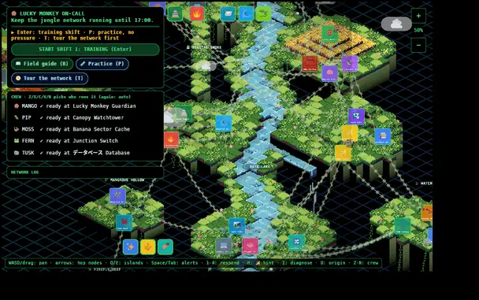 [合集截图](<https://github.com/LuckyMonkey/luckymonkey-game/blob/main/docs/img/oncall-overview.png>) | [LuckyMonkey/luckymonkey-game](<https://github.com/LuckyMonkey/luckymonkey-game>) | 常见根目录许可文件未找到 [Twemoji 须遵守 CC BY 4.0；字体另按各自许可。](<https://github.com/LuckyMonkey/luckymonkey-game/blob/HEAD/README.md#L265-L266>) | 待核 | [6.9](<https://github.com/LuckyMonkey/luckymonkey-game/blob/main/docs/img/oncall-overview.png>) | [可达 · 含游戏画布／引擎的网页](<https://go.fridge.run/luckymonkey>) |
| 2029 | [ ] | [LUMA — The Garden of Light](<https://github.com/gamingnews5/awesome-opus-5.5-games/blob/9a29b570e56bd19f15a3cd6bbac0b8c682f2c48c/games/luma-the-garden-of-light/readme.md>) | 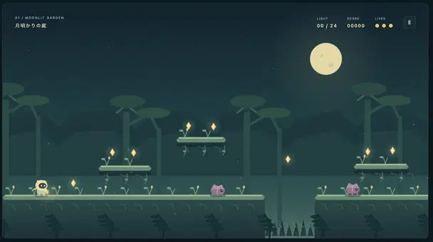 [合集截图](<https://github.com/TetsuakiBaba/2DAction.bench/blob/main/GPT6-Astra/screenshot.png>) | [TetsuakiBaba/2DAction.bench](<https://github.com/TetsuakiBaba/2DAction.bench>) | 常见根目录许可文件未找到 | 待核 | [8.3](<https://github.com/TetsuakiBaba/2DAction.bench/blob/main/GPT6-Astra/screenshot.png>) | 未列入口 |
| 2030 | [ ] | [Lumen](<https://github.com/gamingnews5/awesome-opus-5.5-games/blob/9a29b570e56bd19f15a3cd6bbac0b8c682f2c48c/games/lumen/readme.md>) | 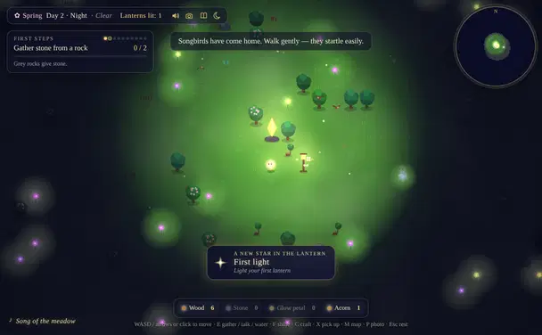 [合集截图](<https://github.com/isac076/evolving-claude/blob/main/tools/screenshots/3-night.png>) | [isac076/evolving-claude](<https://github.com/isac076/evolving-claude>) | 常见根目录许可文件未找到 | 待核 | [5.8](<https://github.com/isac076/evolving-claude/blob/main/tools/screenshots/3-night.png>) | 未列入口 |
| 2031 | [ ] | [Lumencraft](<https://github.com/gamingnews5/awesome-opus-5.5-games/blob/9a29b570e56bd19f15a3cd6bbac0b8c682f2c48c/games/lumencraft/readme.md>) | 待补截图 | [TESTYEE-09/opus5.5Minecraft](<https://github.com/TESTYEE-09/opus5.5Minecraft>) | 常见根目录许可文件未找到 | 待核 | — | [可达 · 含游戏画布／引擎的网页](<https://testyee-09.github.io/opus5.5Minecraft/>) |
| 2032 | [ ] | [Lunachris](<https://github.com/gamingnews5/awesome-opus-5.5-games/blob/9a29b570e56bd19f15a3cd6bbac0b8c682f2c48c/games/lunachris/readme.md>) | 待补截图 | [harrigo/luna\_Chris](<https://github.com/harrigo/luna_Chris>) | 常见根目录许可文件未找到 | 待核 | — | 未列入口 |
| 2033 | [ ] | [lunas-game](<https://github.com/gamingnews5/awesome-opus-5.5-games/blob/9a29b570e56bd19f15a3cd6bbac0b8c682f2c48c/games/lunas-game/readme.md>) | 待补截图 | [dadoctamusic/lunas-game](<https://github.com/dadoctamusic/lunas-game>) | 常见根目录许可文件未找到 | 待核 | — | [可达 · 合集所列网页](<https://lunasrhymetime.vercel.app>) |
| 2034 | [ ] | [Luxcores](<https://github.com/gamingnews5/awesome-opus-5.5-games/blob/9a29b570e56bd19f15a3cd6bbac0b8c682f2c48c/games/luxcores/readme.md>) | 待补截图 | [hamzabenjannet/luxcores](<https://github.com/hamzabenjannet/luxcores>) | 常见根目录许可文件未找到 | 待核 | — | 未列入口 |
| 2035 | [ ] | [Lärrutan](<https://github.com/gamingnews5/awesome-opus-5.5-games/blob/9a29b570e56bd19f15a3cd6bbac0b8c682f2c48c/games/larrutan/readme.md>) | 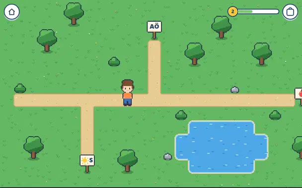 [合集截图](<https://github.com/Slurpas/larrutan/blob/main/docs/art-direction/pixel16-desktop.png>) | [Slurpas/larrutan](<https://github.com/Slurpas/larrutan>) | 常见根目录许可文件未找到 | 待核 | [5.4](<https://github.com/Slurpas/larrutan/blob/main/docs/art-direction/pixel16-desktop.png>) | [可达 · 合集所列网页](<https://slurpas.github.io/larrutan/>) |
| 2036 | [ ] | [Lữ Hành · Làng Thanh Mộc](<https://github.com/gamingnews5/awesome-opus-5.5-games/blob/9a29b570e56bd19f15a3cd6bbac0b8c682f2c48c/games/lu-hanh-lang-thanh-moc/readme.md>) | 待补截图 | [vnthudao-source/lu-hanh](<https://github.com/vnthudao-source/lu-hanh>) | 常见根目录许可文件未找到 | 待核 | — | 未列入口 |
| 2037 | [ ] | [Macaw Sky · Tel Aviv (תוכי בשמי תל אביב)](<https://github.com/gamingnews5/awesome-opus-5.5-games/blob/9a29b570e56bd19f15a3cd6bbac0b8c682f2c48c/games/macaw-sky-tel-aviv/readme.md>) | 待补截图 | [nirnatan/macaw-sky-tel-aviv](<https://github.com/nirnatan/macaw-sky-tel-aviv>) | 常见根目录许可文件未找到 | [README 提及](<https://github.com/nirnatan/macaw-sky-tel-aviv/blob/HEAD/README.md#L7>) | — | 未列入口 |
| 2038 | [ ] | [Mack-a-bee Dreidel](<https://github.com/gamingnews5/awesome-opus-5.5-games/blob/9a29b570e56bd19f15a3cd6bbac0b8c682f2c48c/games/mack-a-bee-dreidel/readme.md>) | 待补截图 | [Y2JCPA/Dreidel](<https://github.com/Y2JCPA/Dreidel>) | 常见根目录许可文件未找到 | 待核 | [4.8](<https://github.com/Y2JCPA/Dreidel/blob/claude/dreidel-game-design-e6have/img/skins/blue.jpg>) | [可达 · 合集所列网页](<https://y2jcpa.github.io/Dreidel/>) |
| 2039 | [ ] | [Mafia](<https://github.com/gamingnews5/awesome-opus-5.5-games/blob/9a29b570e56bd19f15a3cd6bbac0b8c682f2c48c/games/mafia/readme.md>) |  [合集截图](<https://github.com/swan4er/opus-100-projects/blob/main/064-ai-mafia/preview.jpg>) | [swan4er/opus-100-projects](<https://github.com/swan4er/opus-100-projects>) | 常见根目录许可文件未找到 | 待核 | [7.3](<https://github.com/swan4er/opus-100-projects/blob/main/064-ai-mafia/preview.jpg>) | [可达 · 含游戏画布／引擎的网页](<https://swan4er.github.io/opus-100-projects/064-ai-mafia/>) |
| 2040 | [ ] | [Magic Animals &amp; Friends](<https://github.com/gamingnews5/awesome-opus-5.5-games/blob/9a29b570e56bd19f15a3cd6bbac0b8c682f2c48c/games/magic-animals-friends/readme.md>) | 待补截图 | [JacquesHBastien/Dahlia-Animals-Game](<https://github.com/JacquesHBastien/Dahlia-Animals-Game>) | 常见根目录许可文件未找到 | 待核 | — | 未列入口 |
| 2041 | [ ] | [Magic Creatures](<https://github.com/gamingnews5/awesome-opus-5.5-games/blob/9a29b570e56bd19f15a3cd6bbac0b8c682f2c48c/games/magic-creatures/readme.md>) | 待补截图 | [agever46/Mobile-Game](<https://github.com/agever46/Mobile-Game>) | 常见根目录许可文件未找到 | 待核 | — | 未列入口 |
| 2042 | [ ] | [Magic Mirror Monopoly](<https://github.com/gamingnews5/awesome-opus-5.5-games/blob/9a29b570e56bd19f15a3cd6bbac0b8c682f2c48c/games/magic-mirror-monopoly/readme.md>) | 待补截图 | [avishparekh06/magic-monopoly](<https://github.com/avishparekh06/magic-monopoly>) | 常见根目录许可文件未找到 | 待核 | — | 未列入口 |
| 2043 | [ ] | [Magical Pets](<https://github.com/gamingnews5/awesome-opus-5.5-games/blob/9a29b570e56bd19f15a3cd6bbac0b8c682f2c48c/games/magical-pets/readme.md>) |  [源码运行首页](<https://github.com/jeffchavez-dev/magical-pets/blob/main/index.html>) | [jeffchavez-dev/magical-pets](<https://github.com/jeffchavez-dev/magical-pets>) | 常见根目录许可文件未找到 | 待核 | — | 未列入口 |
| 2044 | [ ] | [Magma Climb](<https://github.com/gamingnews5/awesome-opus-5.5-games/blob/9a29b570e56bd19f15a3cd6bbac0b8c682f2c48c/games/magma-climb/readme.md>) | 待补截图 | [49zp2dm2j5-arch/magma-climb-play](<https://github.com/49zp2dm2j5-arch/magma-climb-play>) | 常见根目录许可文件未找到 | 待核 | — | 未列入口 |
| 2045 | [ ] | [mahjong](<https://github.com/gamingnews5/awesome-opus-5.5-games/blob/9a29b570e56bd19f15a3cd6bbac0b8c682f2c48c/games/mahjong-anwealso-mahjong/readme.md>) | 待补截图 | [Anwealso/mahjong](<https://github.com/Anwealso/mahjong>) | 常见根目录许可文件未找到 | 待核 | — | 未列入口 |
| 2046 | [ ] | [MAK'GORA KOMBAT](<https://github.com/gamingnews5/awesome-opus-5.5-games/blob/9a29b570e56bd19f15a3cd6bbac0b8c682f2c48c/games/mak-gora-kombat/readme.md>) | 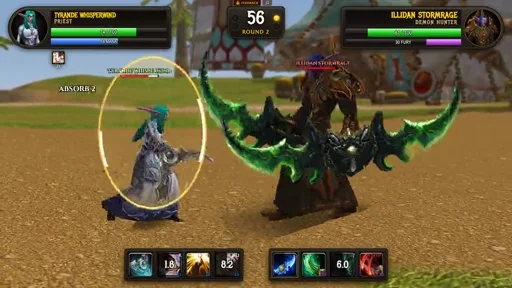 [上游实机演示截帧](<https://github.com/realworldbuilder/makgorakombat/blob/HEAD/public/demo/reel.mp4>) | [realworldbuilder/makgorakombat](<https://github.com/realworldbuilder/makgorakombat>) | 常见根目录许可文件未找到 | [README 提及](<https://github.com/realworldbuilder/makgorakombat/blob/HEAD/README.md#L103>) | [7.2](<https://github.com/realworldbuilder/makgorakombat/blob/main/docs/edition-midnight.png>) | [可达 · 合集所列网页](<https://realworldbuilder.github.io/makgorakombat/>) |
| 2047 | [ ] | [Makhluk Kecil 3D](<https://github.com/gamingnews5/awesome-opus-5.5-games/blob/9a29b570e56bd19f15a3cd6bbac0b8c682f2c48c/games/makhluk-kecil-3d/readme.md>) | 待补截图 | [Irf4n-Muhammad/simul-game](<https://github.com/Irf4n-Muhammad/simul-game>) | 常见根目录许可文件未找到 | 待核 | — | [可达 · 合集所列网页](<https://irf4n-muhammad.github.io/simul-game/>) |
| 2048 | [ ] | [Malandro — Cidade Maravilhosa](<https://github.com/gamingnews5/awesome-opus-5.5-games/blob/9a29b570e56bd19f15a3cd6bbac0b8c682f2c48c/games/malandro-cidade-maravilhosa/readme.md>) | 待补截图 | [herval/gta3-rj-opus5](<https://github.com/herval/gta3-rj-opus5>) | 常见根目录许可文件未找到 | 待核 | — | 未列入口 |
| 2049 | [ ] | [Malaysia-Life-Simulation](<https://github.com/gamingnews5/awesome-opus-5.5-games/blob/9a29b570e56bd19f15a3cd6bbac0b8c682f2c48c/games/malaysia-life-simulation/readme.md>) |  [同款源码启动画面实截](<https://github.com/elitefei1-gif/Malaysia-Life-Simulation/blob/HEAD/index.html>) | [elitefei1-gif/Malaysia-Life-Simulation](<https://github.com/elitefei1-gif/Malaysia-Life-Simulation>) | 常见根目录许可文件未找到 | 待核 | — | [可达 · 合集所列网页](<https://elitefei1-gif.github.io/Malaysia-Life-Simulation/>) |
| 2050 | [ ] | [Mall Action — Model Benchmark](<https://github.com/gamingnews5/awesome-opus-5.5-games/blob/9a29b570e56bd19f15a3cd6bbac0b8c682f2c48c/games/mall-action-model-benchmark/readme.md>) | 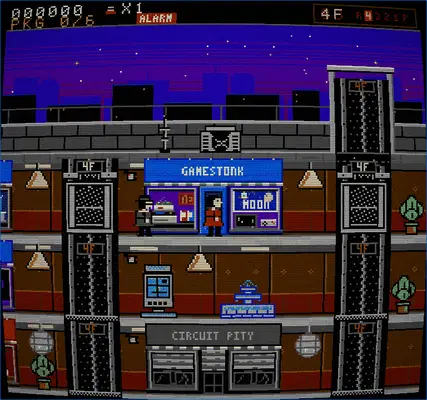 [合集截图](<https://github.com/rlorca/mall-action/blob/sonnet-5-5/docs/mall.png>) | [rlorca/mall-action](<https://github.com/rlorca/mall-action>) | 常见根目录许可文件未找到 | 待核 | [7.7](<https://github.com/rlorca/mall-action/blob/sonnet-5-5/docs/mall.png>) | [可达 · 合集所列网页](<https://rlorca.github.io/mall-action/opus-5.5/>) |
| 2051 | [ ] | [MALLOW / TACTICS (말랑 작전실)](<https://github.com/gamingnews5/awesome-opus-5.5-games/blob/9a29b570e56bd19f15a3cd6bbac0b8c682f2c48c/games/mallow-tactics/readme.md>) |  [源码运行首页](<https://github.com/nomadicsyspure-beep/mallow-tactics/blob/main/index.html>) | [nomadicsyspure-beep/mallow-tactics](<https://github.com/nomadicsyspure-beep/mallow-tactics>) | 常见根目录许可文件未找到 | 待核 | — | 未列入口 |
| 2052 | [ ] | [Mama Duck](<https://github.com/gamingnews5/awesome-opus-5.5-games/blob/9a29b570e56bd19f15a3cd6bbac0b8c682f2c48c/games/mama-duck/readme.md>) | 待补截图 | [Big-Head-Club/mama-gather](<https://github.com/Big-Head-Club/mama-gather>) | 常见根目录许可文件未找到 | 待核 | — | 未列入口 |
| 2053 | [ ] | [Mama Put Rush](<https://github.com/gamingnews5/awesome-opus-5.5-games/blob/9a29b570e56bd19f15a3cd6bbac0b8c682f2c48c/games/mama-put-rush/readme.md>) | 待补截图 | [venson01/mama-put-rush](<https://github.com/venson01/mama-put-rush>) | 常见根目录许可文件未找到 | 待核 | [6.8](<https://github.com/venson01/mama-put-rush/blob/main/public/cover.png>) | 未列入口 |
| 2054 | [ ] | [Mammble](<https://github.com/gamingnews5/awesome-opus-5.5-games/blob/9a29b570e56bd19f15a3cd6bbac0b8c682f2c48c/games/mammble/readme.md>) |  [同款源码启动画面实截](<https://github.com/ShetlandJ/mammble/blob/HEAD/index.html>) | [ShetlandJ/mammble](<https://github.com/ShetlandJ/mammble>) | 常见根目录许可文件未找到 | 待核 | — | [可达 · 合集所列网页](<https://shetlandj.github.io/mammble/>) |
| 2055 | [ ] | [Man Ray](<https://github.com/gamingnews5/awesome-opus-5.5-games/blob/9a29b570e56bd19f15a3cd6bbac0b8c682f2c48c/games/man-ray/readme.md>) | 待补截图 | [samlw89/godofzilla](<https://github.com/samlw89/godofzilla>) | 常见根目录许可文件未找到 | [README 提及](<https://github.com/samlw89/godofzilla/blob/HEAD/README.md#L35>) | — | 未列入口 |
| 2056 | [ ] | [Mana Wars](<https://github.com/gamingnews5/awesome-opus-5.5-games/blob/9a29b570e56bd19f15a3cd6bbac0b8c682f2c48c/games/mana-wars/readme.md>) | 待补截图 | [IHackedKmart/Mana-Wars](<https://github.com/IHackedKmart/Mana-Wars>) | 常见根目录许可文件未找到 | [README 提及](<https://github.com/IHackedKmart/Mana-Wars/blob/HEAD/README.md#L143>) | — | 未列入口 |
| 2057 | [ ] | [ManaPool](<https://github.com/gamingnews5/awesome-opus-5.5-games/blob/9a29b570e56bd19f15a3cd6bbac0b8c682f2c48c/games/manapool/readme.md>) | 待补截图 | [Deracss/Manapool-Hosting](<https://github.com/Deracss/Manapool-Hosting>) | 常见根目录许可文件未找到 | 待核 | — | 未列入口 |
| 2058 | [ ] | [Mango Rush](<https://github.com/gamingnews5/awesome-opus-5.5-games/blob/9a29b570e56bd19f15a3cd6bbac0b8c682f2c48c/games/mango-rush/readme.md>) | 待补截图 | [TwajiesHub/mango-rush-beta](<https://github.com/TwajiesHub/mango-rush-beta>) | 常见根目录许可文件未找到 | 待核 | — | [README · 可达 · 含游戏画布／引擎的网页](<https://mango-rush.start.ng>) |
| 2059 | [ ] | [Mangoidiots Solitaire](<https://github.com/gamingnews5/awesome-opus-5.5-games/blob/9a29b570e56bd19f15a3cd6bbac0b8c682f2c48c/games/mangoidiots-solitaire/readme.md>) | 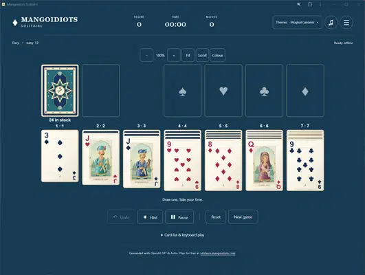 [同款备选截图](<https://github.com/venkatarangan/mangoidiots-solitaire/blob/main/screenshots/mangoidiots-solitaire-105253.png>) | [venkatarangan/mangoidiots-solitaire](<https://github.com/venkatarangan/mangoidiots-solitaire>) | 常见根目录许可文件未找到 | 待核 | [7.2](<https://github.com/venkatarangan/mangoidiots-solitaire/blob/main/screenshots/mangoidiots-solitaire-cover.png>) | [可达 · 合集所列网页](<https://solitaire.mangoidiots.com/>) |
| 2060 | [ ] | [Manhunt](<https://github.com/gamingnews5/awesome-opus-5.5-games/blob/9a29b570e56bd19f15a3cd6bbac0b8c682f2c48c/games/manhunt/readme.md>) | 待补截图 | [dbig-d/manhunt](<https://github.com/dbig-d/manhunt>) | 常见根目录许可文件未找到 | 待核 | — | [可达 · 合集所列网页](<https://dbig-d.github.io/manhunt/>) |
| 2061 | [ ] | [Manhunt (jiras-droid)](<https://github.com/gamingnews5/awesome-opus-5.5-games/blob/9a29b570e56bd19f15a3cd6bbac0b8c682f2c48c/games/manhunt-jiras-droid/readme.md>) | 待补截图 | [jiras-droid/manhunt](<https://github.com/jiras-droid/manhunt>) | 常见根目录许可文件未找到 | 待核 | — | 未列入口 |
| 2062 | [ ] | [Mansion Mystery](<https://github.com/gamingnews5/awesome-opus-5.5-games/blob/9a29b570e56bd19f15a3cd6bbac0b8c682f2c48c/games/mansion-mystery/readme.md>) | 待补截图 | [ccall1212/mansion-mystery](<https://github.com/ccall1212/mansion-mystery>) | 常见根目录许可文件未找到 | 待核 | — | 未列入口 |
| 2063 | [ ] | [Maple Hollow](<https://github.com/gamingnews5/awesome-opus-5.5-games/blob/9a29b570e56bd19f15a3cd6bbac0b8c682f2c48c/games/maple-hollow/readme.md>) | 待补截图 | [collin12121212/2Dgame](<https://github.com/collin12121212/2Dgame>) | 常见根目录许可文件未找到 | 待核 | — | 未列入口 |
| 2064 | [ ] | [Maple Lane Finds](<https://github.com/gamingnews5/awesome-opus-5.5-games/blob/9a29b570e56bd19f15a3cd6bbac0b8c682f2c48c/games/maple-lane-finds/readme.md>) | 待补截图 | [adamglassner/maple-lane-finds](<https://github.com/adamglassner/maple-lane-finds>) | 常见根目录许可文件未找到 | 待核 | — | 未列入口 |
| 2065 | [ ] | [Marble Madness](<https://github.com/gamingnews5/awesome-opus-5.5-games/blob/9a29b570e56bd19f15a3cd6bbac0b8c682f2c48c/games/marble-madness/readme.md>) |  [源码运行首页](<https://github.com/code21acoma/marble-madness/blob/main/index.html>) | [code21acoma/marble-madness](<https://github.com/code21acoma/marble-madness>) | 常见根目录许可文件未找到 | 待核 | — | 未列入口 |
| 2066 | [ ] | [Mari Membaca](<https://github.com/gamingnews5/awesome-opus-5.5-games/blob/9a29b570e56bd19f15a3cd6bbac0b8c682f2c48c/games/mari-membaca/readme.md>) | 待补截图 | [zabidisukuan/mari-membaca](<https://github.com/zabidisukuan/mari-membaca>) | 常见根目录许可文件未找到 | 待核 | — | [可达 · 合集所列网页](<https://zabidisukuan.github.io/mari-membaca/>) |
| 2067 | [ ] | [MARK 201 · Imperium](<https://github.com/gamingnews5/awesome-opus-5.5-games/blob/9a29b570e56bd19f15a3cd6bbac0b8c682f2c48c/games/mark-201-imperium/readme.md>) | 待补截图 | [yycsudbuds-sys/mark201-trainer](<https://github.com/yycsudbuds-sys/mark201-trainer>) | 常见根目录许可文件未找到 | 待核 | — | [可达 · 合集所列网页](<https://yycsudbuds-sys.github.io/mark201-trainer/>) |
| 2068 | [ ] | [Market Krallığı (Corner Shop Empire)](<https://github.com/gamingnews5/awesome-opus-5.5-games/blob/9a29b570e56bd19f15a3cd6bbac0b8c682f2c48c/games/market-krall-g-corner-shop-empire/readme.md>) | 待补截图 | [uyelikposya/MarketGame](<https://github.com/uyelikposya/MarketGame>) | 常见根目录许可文件未找到 | 待核 | — | 未列入口 |
| 2069 | [ ] | [Market Maker](<https://github.com/gamingnews5/awesome-opus-5.5-games/blob/9a29b570e56bd19f15a3cd6bbac0b8c682f2c48c/games/market-maker/readme.md>) |  [同款源码启动画面实截](<https://github.com/Kris-SF/market-maker-game/blob/HEAD/public/how-to-play.html>) | [Kris-SF/market-maker-game](<https://github.com/Kris-SF/market-maker-game>) | 常见根目录许可文件未找到 | 待核 | — | [可达 · 合集所列网页](<https://market-maker-game-one.vercel.app>) |
| 2070 | [ ] | [Market Mayhem](<https://github.com/gamingnews5/awesome-opus-5.5-games/blob/9a29b570e56bd19f15a3cd6bbac0b8c682f2c48c/games/market-mayhem/readme.md>) |  [README 游戏截图](<https://github.com/utkarsh3078/Market_Mayhem#readme>) | [utkarsh3078/Market\_Mayhem](<https://github.com/utkarsh3078/Market_Mayhem>) | 常见根目录许可文件未找到 | 待核 | — | 未列入口 |
| 2071 | [ ] | [Market of Cards](<https://github.com/gamingnews5/awesome-opus-5.5-games/blob/9a29b570e56bd19f15a3cd6bbac0b8c682f2c48c/games/market-of-cards/readme.md>) | 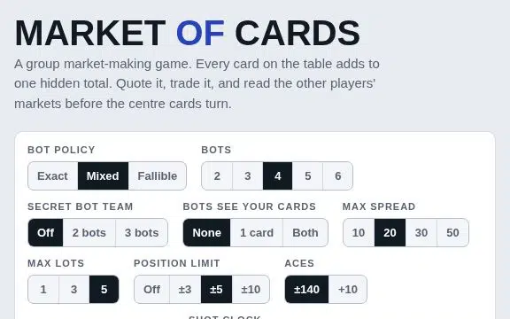 [源码运行画面](<https://github.com/shivaxelquant/market_making_game/blob/main/index.html>) | [shivaxelquant/market\_making\_game](<https://github.com/shivaxelquant/market_making_game>) | 常见根目录许可文件未找到 | 待核 | — | 未列入口 |
| 2072 | [ ] | [Maroon Trivia Night](<https://github.com/gamingnews5/awesome-opus-5.5-games/blob/9a29b570e56bd19f15a3cd6bbac0b8c682f2c48c/games/maroon-trivia-night/readme.md>) | 待补截图 | [dsnehadri/gsab-trivia](<https://github.com/dsnehadri/gsab-trivia>) | 常见根目录许可文件未找到 | 待核 | — | [可达 · 合集所列网页](<https://dsnehadri.github.io/gsab-trivia/>) |
| 2073 | [ ] | [Marscade](<https://github.com/gamingnews5/awesome-opus-5.5-games/blob/9a29b570e56bd19f15a3cd6bbac0b8c682f2c48c/games/marscade/readme.md>) | 待补截图 | [giovlnv/ios\_202610.marscade](<https://github.com/giovlnv/ios_202610.marscade>) | 常见根目录许可文件未找到 | 待核 | — | 未列入口 |
| 2074 | [ ] | [Mashup RPG](<https://github.com/gamingnews5/awesome-opus-5.5-games/blob/9a29b570e56bd19f15a3cd6bbac0b8c682f2c48c/games/mashup-rpg/readme.md>) | 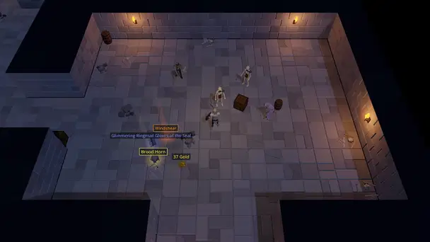 [上游游戏截图](<https://github.com/ggdover/mashuprpg/blob/HEAD/docs/screenshots/player/gameplay.png>) | [ggdover/mashuprpg](<https://github.com/ggdover/mashuprpg>) | 常见根目录许可文件未找到 | 待核 | — | 未列入口 |
| 2075 | [ ] | [Mastery Solo](<https://github.com/gamingnews5/awesome-opus-5.5-games/blob/9a29b570e56bd19f15a3cd6bbac0b8c682f2c48c/games/mastery-solo/readme.md>) | 待补截图 | [DungeonBrewOfficial/Mastery-Solo](<https://github.com/DungeonBrewOfficial/Mastery-Solo>) | 常见根目录许可文件未找到 | 待核 | — | 未列入口 |
| 2076 | [ ] | [Matcha Cafe Empire](<https://github.com/gamingnews5/awesome-opus-5.5-games/blob/9a29b570e56bd19f15a3cd6bbac0b8c682f2c48c/games/matcha-cafe-empire/readme.md>) | 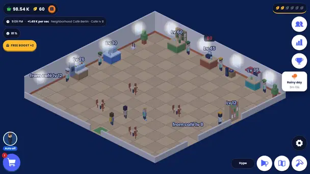 [合集截图](<https://github.com/leesyashin/Tycoon-/blob/main/docs/screenshots/v1/desktop-en.png>) | [leesyashin/Tycoon-](<https://github.com/leesyashin/Tycoon->) | 常见根目录许可文件未找到 | 待核 | [6.4](<https://github.com/leesyashin/Tycoon-/blob/main/docs/screenshots/v1/desktop-en.png>) | 未列入口 |
| 2077 | [ ] | [Matchday](<https://github.com/gamingnews5/awesome-opus-5.5-games/blob/9a29b570e56bd19f15a3cd6bbac0b8c682f2c48c/games/matchday/readme.md>) | 待补截图 | [MagicalUmbrella/futbol](<https://github.com/MagicalUmbrella/futbol>) | 常见根目录许可文件未找到 | 待核 | — | [README · 入口已失效 · 上游 README 所列网页](<https://magicalumbrella.github.io/futbol/>) |
| 2078 | [ ] | [Matetkallemsh!](<https://github.com/gamingnews5/awesome-opus-5.5-games/blob/9a29b570e56bd19f15a3cd6bbac0b8c682f2c48c/games/matetkallemsh/readme.md>) | 待补截图 | [lordza3bola/Matetkallemsh](<https://github.com/lordza3bola/Matetkallemsh>) | 常见根目录许可文件未找到 | 待核 | — | 未列入口 |
| 2079 | [ ] | [Math Glass Bridge](<https://github.com/gamingnews5/awesome-opus-5.5-games/blob/9a29b570e56bd19f15a3cd6bbac0b8c682f2c48c/games/math-glass-bridge/readme.md>) | 待补截图 | [asivixlp44-cmyk/math-glass-bridge](<https://github.com/asivixlp44-cmyk/math-glass-bridge>) | 常见根目录许可文件未找到 | 待核 | — | 未列入口 |
| 2080 | [ ] | [Math Mage](<https://github.com/gamingnews5/awesome-opus-5.5-games/blob/9a29b570e56bd19f15a3cd6bbac0b8c682f2c48c/games/math-mage/readme.md>) | 待补截图 | [Nakamuro-unl/GodotActionGame](<https://github.com/Nakamuro-unl/GodotActionGame>) | 常见根目录许可文件未找到 | 待核 | — | 未列入口 |
| 2081 | [ ] | [Math Mayhem](<https://github.com/gamingnews5/awesome-opus-5.5-games/blob/9a29b570e56bd19f15a3cd6bbac0b8c682f2c48c/games/math-mayhem/readme.md>) | 待补截图 | [wjsmit/math-mayhem](<https://github.com/wjsmit/math-mayhem>) | 常见根目录许可文件未找到 | 待核 | — | [可达 · 合集所列网页](<https://wjsmit.github.io/math-mayhem/>) |
| 2082 | [ ] | [Math Practice Game](<https://github.com/gamingnews5/awesome-opus-5.5-games/blob/9a29b570e56bd19f15a3cd6bbac0b8c682f2c48c/games/math-practice-game/readme.md>) | 待补截图 | [jpetree331/math-game-4-5th-grade](<https://github.com/jpetree331/math-game-4-5th-grade>) | 常见根目录许可文件未找到 | 待核 | — | [可达 · 含游戏画布／引擎的网页](<https://math-game-4-5th-grade.vercel.app>) |
| 2083 | [ ] | [Math Racing](<https://github.com/gamingnews5/awesome-opus-5.5-games/blob/9a29b570e56bd19f15a3cd6bbac0b8c682f2c48c/games/math-racing/readme.md>) |  [同款源码游戏实截](<https://github.com/mundeok/math-arcade-paradise/blob/master/src/games/g03_race.js>) | [mundeok/math-arcade-paradise](<https://github.com/mundeok/math-arcade-paradise>) | 常见根目录许可文件未找到 | 待核 | — | 未列入口 |
| 2084 | [ ] | [Math Shooter](<https://github.com/gamingnews5/awesome-opus-5.5-games/blob/9a29b570e56bd19f15a3cd6bbac0b8c682f2c48c/games/math-shooter/readme.md>) |  [同款源码游戏实截](<https://github.com/mundeok/math-arcade-paradise/blob/master/src/games/g07_shoot.js>) | [mundeok/math-arcade-paradise](<https://github.com/mundeok/math-arcade-paradise>) | 常见根目录许可文件未找到 | 待核 | — | 未列入口 |
| 2085 | [ ] | [Mathe-Genie](<https://github.com/gamingnews5/awesome-opus-5.5-games/blob/9a29b570e56bd19f15a3cd6bbac0b8c682f2c48c/games/mathe-genie/readme.md>) | 待补截图 | [schallo/mathe-genius](<https://github.com/schallo/mathe-genius>) | 常见根目录许可文件未找到 | 待核 | — | [可达 · 合集所列网页](<https://schallo.github.io/mathe-genius/>) |
| 2086 | [ ] | [Maths Quest](<https://github.com/gamingnews5/awesome-opus-5.5-games/blob/9a29b570e56bd19f15a3cd6bbac0b8c682f2c48c/games/maths-quest/readme.md>) | 待补截图 | [rizwin-mohammed/Bubble\_Math\_Quest](<https://github.com/rizwin-mohammed/Bubble_Math_Quest>) | 常见根目录许可文件未找到 | 待核 | — | 未列入口 |
| 2087 | [ ] | [Matter Separation Workshop](<https://github.com/gamingnews5/awesome-opus-5.5-games/blob/9a29b570e56bd19f15a3cd6bbac0b8c682f2c48c/games/matter-separation-workshop/readme.md>) | 待补截图 | [tgtec26/snug-matter-properties-game](<https://github.com/tgtec26/snug-matter-properties-game>) | 常见根目录许可文件未找到 | 待核 | — | 未列入口 |
| 2088 | [ ] | [Max Effort Strategy Game](<https://github.com/gamingnews5/awesome-opus-5.5-games/blob/9a29b570e56bd19f15a3cd6bbac0b8c682f2c48c/games/max-effort-strategy-game/readme.md>) |  [源码运行首页](<https://github.com/Barty-Bart/opus-55-effort-comparison/blob/main/games/max/index.html>) | [Barty-Bart/opus-55-effort-comparison](<https://github.com/Barty-Bart/opus-55-effort-comparison>) | 常见根目录许可文件未找到 | 待核 | — | 未列入口 |
| 2089 | [ ] | [Mayas Restaurant](<https://github.com/gamingnews5/awesome-opus-5.5-games/blob/9a29b570e56bd19f15a3cd6bbac0b8c682f2c48c/games/mayas-restaurant/readme.md>) | 待补截图 | [weasel79/mayas-restaurant](<https://github.com/weasel79/mayas-restaurant>) | 常见根目录许可文件未找到 | 待核 | — | [可达 · 含游戏画布／引擎的网页](<https://weasel79.github.io/mayas-restaurant/>) |
| 2090 | [ ] | [Mayday: Sea Rescue](<https://github.com/gamingnews5/awesome-opus-5.5-games/blob/9a29b570e56bd19f15a3cd6bbac0b8c682f2c48c/games/mayday-sea-rescue/readme.md>) | 待补截图 | [B0gsto/mayday-sea-rescue](<https://github.com/B0gsto/mayday-sea-rescue>) | 常见根目录许可文件未找到 | 待核 | — | 未列入口 |
| 2091 | [ ] | [Maze Tanks](<https://github.com/gamingnews5/awesome-opus-5.5-games/blob/9a29b570e56bd19f15a3cd6bbac0b8c682f2c48c/games/maze-tanks/readme.md>) | 待补截图 | [PolynomialI/maze-tanks](<https://github.com/PolynomialI/maze-tanks>) | 常见根目录许可文件未找到 | 待核 | — | 未列入口 |
| 2092 | [ ] | [Mała Farma](<https://github.com/gamingnews5/awesome-opus-5.5-games/blob/9a29b570e56bd19f15a3cd6bbac0b8c682f2c48c/games/ma-a-farma/readme.md>) | 待补截图 | [kachaj96/Game](<https://github.com/kachaj96/Game>) | 常见根目录许可文件未找到 | 待核 | — | [可达 · 素材／第三方资源](<https://cupnooble.itch.io/sprout-lands-asset-pack>) |
| 2093 | [ ] | [Me RPG](<https://github.com/gamingnews5/awesome-opus-5.5-games/blob/9a29b570e56bd19f15a3cd6bbac0b8c682f2c48c/games/me-rpg/readme.md>) | 待补截图 | [jbogaardt/me\_rpg](<https://github.com/jbogaardt/me_rpg>) | 常见根目录许可文件未找到 | 待核 | — | 未列入口 |
| 2094 | [ ] | [Mech Wars](<https://github.com/gamingnews5/awesome-opus-5.5-games/blob/9a29b570e56bd19f15a3cd6bbac0b8c682f2c48c/games/mech-wars/readme.md>) | 待补截图 | [DianteClark/Mech-Wars](<https://github.com/DianteClark/Mech-Wars>) | 常见根目录许可文件未找到 | 待核 | — | [可达 · 合集所列网页](<https://dianteclark.github.io/Mech-Wars/>) |
| 2095 | [ ] | [Mecha Forge](<https://github.com/gamingnews5/awesome-opus-5.5-games/blob/9a29b570e56bd19f15a3cd6bbac0b8c682f2c48c/games/mecha-forge/readme.md>) | 待补截图 | [michaelenew/kids-games](<https://github.com/michaelenew/kids-games>) | 常见根目录许可文件未找到 无根LICENSE；仅收Mecha Forge独立入口，不把同仓全部游戏归为这一条。 | 待核 | — | [可达 · 合集所列网页](<https://michaelenew.github.io/kids-games/>) |
| 2096 | [ ] | [Mediavida Trigger ⏳: el foro, en 16 bits.](<https://github.com/gamingnews5/awesome-opus-5.5-games/blob/9a29b570e56bd19f15a3cd6bbac0b8c682f2c48c/games/mediavida-trigger-el-foro-en-16-bits/readme.md>) | 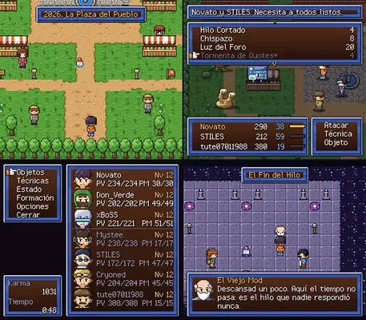 [合集截图](<https://github.com/rechedev9/mediavida-trigger/blob/main/docs/assets/screens.png>) | [rechedev9/mediavida-trigger](<https://github.com/rechedev9/mediavida-trigger>) | 常见根目录许可文件未找到 | 待核 | [6.2](<https://github.com/rechedev9/mediavida-trigger/blob/main/docs/assets/screens.png>) | 未列入口 |
| 2097 | [ ] | [Medieval Open World RPG](<https://github.com/gamingnews5/awesome-opus-5.5-games/blob/9a29b570e56bd19f15a3cd6bbac0b8c682f2c48c/games/medieval-open-world-rpg/readme.md>) | 待补截图 | [MostafaFarouk90/OpenWorld](<https://github.com/MostafaFarouk90/OpenWorld>) | 常见根目录许可文件未找到 | 待核 | — | 未列入口 |
| 2098 | [ ] | [Medium Effort Strategy Game](<https://github.com/gamingnews5/awesome-opus-5.5-games/blob/9a29b570e56bd19f15a3cd6bbac0b8c682f2c48c/games/medium-effort-strategy-game/readme.md>) |  [源码运行首页](<https://github.com/Barty-Bart/opus-55-effort-comparison/blob/main/games/medium/index.html>) | [Barty-Bart/opus-55-effort-comparison](<https://github.com/Barty-Bart/opus-55-effort-comparison>) | 常见根目录许可文件未找到 | 待核 | — | 未列入口 |
| 2099 | [ ] | [Melee](<https://github.com/gamingnews5/awesome-opus-5.5-games/blob/9a29b570e56bd19f15a3cd6bbac0b8c682f2c48c/games/melee/readme.md>) | 待补截图 | [colinwillow/zap](<https://github.com/colinwillow/zap>) | 常见根目录许可文件未找到 | 待核 | [6.3](<https://github.com/colinwillow/zap/blob/main/images/splash_zap_n_clancy.webp>) | [README · 入口已失效 · 上游 README 所列网页](<https://colinwillow.github.io/melee/>) |
| 2100 | [ ] | [Melodia Melusina](<https://github.com/gamingnews5/awesome-opus-5.5-games/blob/9a29b570e56bd19f15a3cd6bbac0b8c682f2c48c/games/melodia-melusina/readme.md>) | 待补截图 | [fromage3900/MelodiaMelusinaV2](<https://github.com/fromage3900/MelodiaMelusinaV2>) | 常见根目录许可文件未找到 | 待核 | — | 未列入口 |
| 2101 | [ ] | [Melon Lab — 瓜体实验室](<https://github.com/gamingnews5/awesome-opus-5.5-games/blob/9a29b570e56bd19f15a3cd6bbac0b8c682f2c48c/games/melon-lab/readme.md>) | 待补截图 | [Ayi1337/gpt6-astra-one-shot-games](<https://github.com/Ayi1337/gpt6-astra-one-shot-games>) | 常见根目录许可文件未找到 | 待核 | — | [可达 · 含游戏画布／引擎的网页](<https://melon-game.jack-514.chatgpt.site/>) |
| 2102 | [ ] | [Melon Realms](<https://github.com/gamingnews5/awesome-opus-5.5-games/blob/9a29b570e56bd19f15a3cd6bbac0b8c682f2c48c/games/melon-realms/readme.md>) | 待补截图 | [bor3867/Realm](<https://github.com/bor3867/Realm>) | 常见根目录许可文件未找到 | 待核 | — | 未列入口 |
| 2103 | [ ] | [Memerush](<https://github.com/gamingnews5/awesome-opus-5.5-games/blob/9a29b570e56bd19f15a3cd6bbac0b8c682f2c48c/games/memerush/readme.md>) | 待补截图 | [sayinel/MemeRush](<https://github.com/sayinel/MemeRush>) | 常见根目录许可文件未找到 | 待核 | [6.0](<https://github.com/sayinel/MemeRush/blob/main/docs/media/banner.png>) | [可达 · 合集所列网页](<https://meme-rush-kappa.vercel.app>) |
| 2104 | [ ] | [Memory](<https://github.com/gamingnews5/awesome-opus-5.5-games/blob/9a29b570e56bd19f15a3cd6bbac0b8c682f2c48c/games/memory/readme.md>) |  [对应子游戏玩法实截](<https://github.com/shironagasu-ai/claude-fable5-games/blob/HEAD/games/memory/index.html>) | [shironagasu-ai/claude-fable5-games](<https://github.com/shironagasu-ai/claude-fable5-games>) | 常见根目录许可文件未找到 | 待核 | — | 未列入口 |
| 2105 | [ ] | [Memory Legends: See See](<https://github.com/gamingnews5/awesome-opus-5.5-games/blob/9a29b570e56bd19f15a3cd6bbac0b8c682f2c48c/games/memory-legends-see-see/readme.md>) | 待补截图 | [syafaatsaat/memory-legends-see-see](<https://github.com/syafaatsaat/memory-legends-see-see>) | 常见根目录许可文件未找到 | 待核 | — | [可达 · 合集所列网页](<https://memory-legends-see-see.vercel.app>) |
| 2106 | [ ] | [Memory Path](<https://github.com/gamingnews5/awesome-opus-5.5-games/blob/9a29b570e56bd19f15a3cd6bbac0b8c682f2c48c/games/party-chaos/readme.md>) | 待补截图 | [lawrenceandrewlargo/roblox-extreme-minigames](<https://github.com/lawrenceandrewlargo/roblox-extreme-minigames>) | 常见根目录许可文件未找到 | 待核 | — | 未列入口 |
| 2107 | [ ] | [Merge Dash](<https://github.com/gamingnews5/awesome-opus-5.5-games/blob/9a29b570e56bd19f15a3cd6bbac0b8c682f2c48c/games/merge-dash/readme.md>) | 待补截图 | [jayamohanan/Merge-Dash](<https://github.com/jayamohanan/Merge-Dash>) | 常见根目录许可文件未找到 | 待核 | — | 未列入口 |
| 2108 | [ ] | [Merge Planets](<https://github.com/gamingnews5/awesome-opus-5.5-games/blob/9a29b570e56bd19f15a3cd6bbac0b8c682f2c48c/games/merge-planets/readme.md>) | 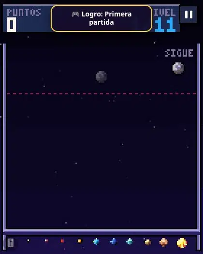 [对应子游戏玩法实截](<https://github.com/kokellara12-maker/apps-k4m9q2/blob/HEAD/planets.html>) | [kokellara12-maker/apps-k4m9q2](<https://github.com/kokellara12-maker/apps-k4m9q2>) | 常见根目录许可文件未找到 | 待核 | — | [可达 · 含游戏画布／引擎的网页](<https://kokellara12-maker.github.io/apps-k4m9q2/planets.html>) |
| 2109 | [ ] | [Meridian](<https://github.com/gamingnews5/awesome-opus-5.5-games/blob/9a29b570e56bd19f15a3cd6bbac0b8c682f2c48c/games/meridian/readme.md>) | 待补截图 | [fmaisel/Meridian](<https://github.com/fmaisel/Meridian>) | 常见根目录许可文件未找到 | 待核 | — | 未列入口 |
| 2110 | [ ] | [Meridian Daily](<https://github.com/gamingnews5/awesome-opus-5.5-games/blob/9a29b570e56bd19f15a3cd6bbac0b8c682f2c48c/games/meridian-daily/readme.md>) | 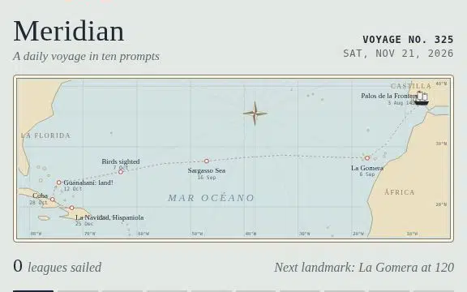 [源码运行画面](<https://github.com/spencerburg/meridian.io/blob/main/index.html>) | [spencerburg/meridian.io](<https://github.com/spencerburg/meridian.io>) | 常见根目录许可文件未找到 | 待核 | — | 未列入口 |
| 2111 | [ ] | [Mermaid Ocean 🧜‍♀️](<https://github.com/gamingnews5/awesome-opus-5.5-games/blob/9a29b570e56bd19f15a3cd6bbac0b8c682f2c48c/games/mermaid-ocean/readme.md>) | <a href="https://raw.githubusercontent.com/AldericCOROIR/mermaid-ocean/HEAD/painted/castle_game_overview_v4.png">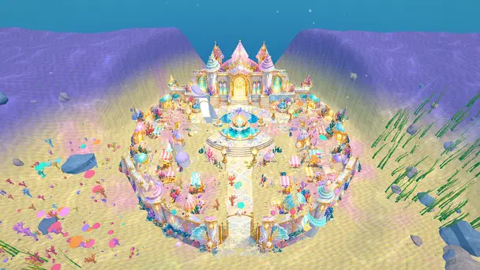</a> [README 游戏截图](<https://github.com/AldericCOROIR/mermaid-ocean#readme>) | [AldericCOROIR/mermaid-ocean](<https://github.com/AldericCOROIR/mermaid-ocean>) | 常见根目录许可文件未找到 | 待核 | — | [可达 · 含游戏画布／引擎的网页](<https://aldericcoroir.github.io/mermaid-ocean/>) |
| 2112 | [ ] | [Metal Assault](<https://github.com/gamingnews5/awesome-opus-5.5-games/blob/9a29b570e56bd19f15a3cd6bbac0b8c682f2c48c/games/metal-assault/readme.md>) | 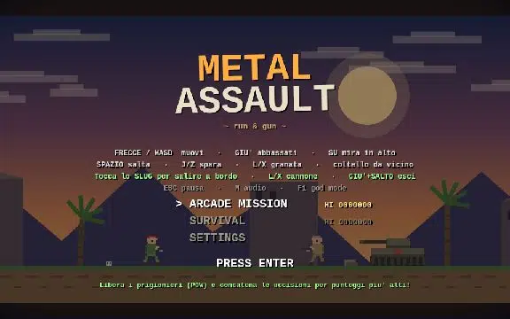 [源码运行首页](<https://github.com/AndreaZero/metal-assault-game-claude-fable/blob/HEAD/index.html>) | [AndreaZero/metal-assault-game-claude-fable](<https://github.com/AndreaZero/metal-assault-game-claude-fable>) | 常见根目录许可文件未找到 | 待核 | — | 未列入口 |
| 2113 | [ ] | [Meteor Dodge](<https://github.com/gamingnews5/awesome-opus-5.5-games/blob/9a29b570e56bd19f15a3cd6bbac0b8c682f2c48c/games/meteor-dodge/readme.md>) |  [对应子游戏玩法实截](<https://github.com/gberry747-lab/gabriels-animation-studio/blob/HEAD/index.html>) | [gberry747-lab/gabriels-animation-studio](<https://github.com/gberry747-lab/gabriels-animation-studio>) | 常见根目录许可文件未找到 | 待核 | — | [多游戏仓库入口 · 可达 · 含游戏画布／引擎的网页](<https://gberry747-lab.github.io/gabriels-animation-studio/>) |
| 2114 | [ ] | [Meteor Shower](<https://github.com/gamingnews5/awesome-opus-5.5-games/blob/9a29b570e56bd19f15a3cd6bbac0b8c682f2c48c/games/party-chaos/readme.md>) | 待补截图 | [lawrenceandrewlargo/roblox-extreme-minigames](<https://github.com/lawrenceandrewlargo/roblox-extreme-minigames>) | 常见根目录许可文件未找到 | 待核 | — | 未列入口 |
| 2115 | [ ] | [MFEC IceBreaker Arena](<https://github.com/gamingnews5/awesome-opus-5.5-games/blob/9a29b570e56bd19f15a3cd6bbac0b8c682f2c48c/games/mfec-icebreaker-arena/readme.md>) | 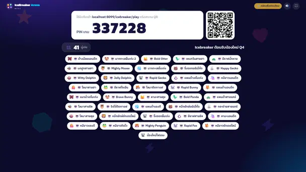 [游戏菜单或界面](<https://github.com/sakanarm/IcebreakerArena/blob/main/docs/screenshots/14-stage-lobby.png>) | [sakanarm/IcebreakerArena](<https://github.com/sakanarm/IcebreakerArena>) | 常见根目录许可文件未找到 | 待核 | [3.8](<https://github.com/sakanarm/IcebreakerArena/blob/main/docs/screenshots/14-stage-lobby.png>) | 未列入口 |
| 2116 | [ ] | [Micklecade](<https://github.com/gamingnews5/awesome-opus-5.5-games/blob/9a29b570e56bd19f15a3cd6bbac0b8c682f2c48c/games/micklecade/readme.md>) | 待补截图 | [mattmkelly/micklecade](<https://github.com/mattmkelly/micklecade>) | 常见根目录许可文件未找到 | 待核 | — | 未列入口 |
| 2117 | [ ] | [Micro Game Jam](<https://github.com/gamingnews5/awesome-opus-5.5-games/blob/9a29b570e56bd19f15a3cd6bbac0b8c682f2c48c/games/micro-game-jam/readme.md>) | 待补截图 | [miromustafa/micro-game-jam](<https://github.com/miromustafa/micro-game-jam>) | 常见根目录许可文件未找到 | 待核 | — | 未列入口 |
| 2118 | [ ] | [MicroscopeCraft](<https://github.com/gamingnews5/awesome-opus-5.5-games/blob/9a29b570e56bd19f15a3cd6bbac0b8c682f2c48c/games/microscopecraft/readme.md>) | 待补截图 | [yijiang1/MicroscopeCraft](<https://github.com/yijiang1/MicroscopeCraft>) | 常见根目录许可文件未找到 | 待核 | [6.2](<https://github.com/yijiang1/MicroscopeCraft/blob/main/docs/thumbnail.png>) | [可达 · 合集所列网页](<https://yijiang1.github.io/MicroscopeCraft/>) |
| 2119 | [ ] | [MICROSTRIDE — Run on Shoes](<https://github.com/gamingnews5/awesome-opus-5.5-games/blob/9a29b570e56bd19f15a3cd6bbac0b8c682f2c48c/games/microstride-run-on-shoes/readme.md>) | 待补截图 | [565353780/run-on-shoes](<https://github.com/565353780/run-on-shoes>) | 常见根目录许可文件未找到 | 待核 | — | [可达 · 合集所列网页](<https://565353780.github.io/run-on-shoes/>) |
| 2120 | [ ] | [Midnight Apex](<https://github.com/gamingnews5/awesome-opus-5.5-games/blob/9a29b570e56bd19f15a3cd6bbac0b8c682f2c48c/games/midnight-apex/readme.md>) | 待补截图 | [zhangzgen/opus-5.5-3d-car](<https://github.com/zhangzgen/opus-5.5-3d-car>) | 常见根目录许可文件未找到 | [README 提及](<https://github.com/zhangzgen/opus-5.5-3d-car/blob/HEAD/README.md#L20>) | — | 未列入口 |
| 2121 | [ ] | [Midnight Crumbs](<https://github.com/gamingnews5/awesome-opus-5.5-games/blob/9a29b570e56bd19f15a3cd6bbac0b8c682f2c48c/games/midnight-crumbs/readme.md>) |  [合集截图](<https://github.com/Mdeskn/midnight-crumbs/blob/main/screenshots/mouse.png>) | [Mdeskn/midnight-crumbs](<https://github.com/Mdeskn/midnight-crumbs>) | 常见根目录许可文件未找到 | 待核 | [4.6](<https://github.com/Mdeskn/midnight-crumbs/blob/main/screenshots/mouse.png>) | [可达 · 合集所列网页](<https://mdeskn.github.io/midnight-crumbs/>) |
| 2122 | [ ] | [Midnight Paws](<https://github.com/gamingnews5/awesome-opus-5.5-games/blob/9a29b570e56bd19f15a3cd6bbac0b8c682f2c48c/games/midnight-paws/readme.md>) | 待补截图 | [vmttri-glitch/midnightpaws](<https://github.com/vmttri-glitch/midnightpaws>) | 常见根目录许可文件未找到 | 待核 | [5.6](<https://github.com/vmttri-glitch/midnightpaws/blob/main/docs/intro-cutscene/references/boss_athlete_cat.png>) | [可达 · 合集所列网页](<https://vmttri-glitch.github.io/midnightpaws/>) |
| 2123 | [ ] | [Midship Drift](<https://github.com/gamingnews5/awesome-opus-5.5-games/blob/9a29b570e56bd19f15a3cd6bbac0b8c682f2c48c/games/midship-drift/readme.md>) | 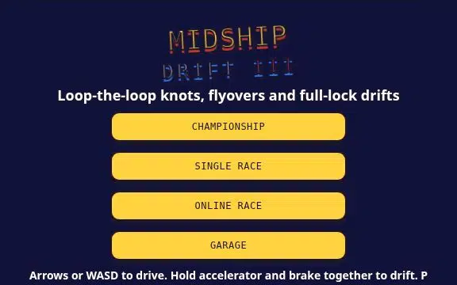 [源码运行首页](<https://github.com/bitcoina/Midship-Drift/blob/main/index.html>) | [bitcoina/Midship-Drift](<https://github.com/bitcoina/Midship-Drift>) | 常见根目录许可文件未找到 | 待核 | — | 未列入口 |
| 2124 | [ ] | [Miesten illanvietto (Men's Night Out)](<https://github.com/gamingnews5/awesome-opus-5.5-games/blob/9a29b570e56bd19f15a3cd6bbac0b8c682f2c48c/games/miesten-illanvietto-men-s-night-out/readme.md>) | 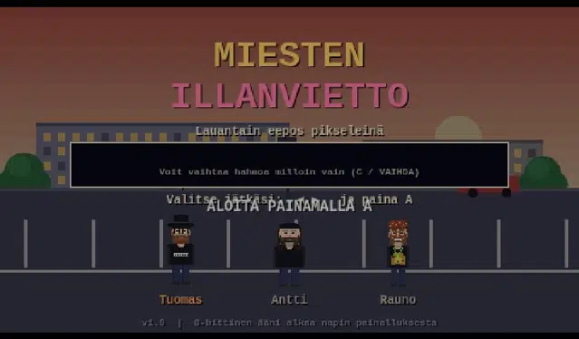 [试玩首页实截](<https://anttiraisala.github.io/miesten-illanvietto/>) | [anttiraisala/miesten-illanvietto](<https://github.com/anttiraisala/miesten-illanvietto>) | 常见根目录许可文件未找到 | 待核 | — | [可达 · 含游戏画布／引擎的网页](<https://anttiraisala.github.io/miesten-illanvietto/>) |
| 2125 | [ ] | [Migdal games](<https://github.com/gamingnews5/awesome-opus-5.5-games/blob/9a29b570e56bd19f15a3cd6bbac0b8c682f2c48c/games/migdal-games/readme.md>) | 待补截图 | [eyals/migdal-games](<https://github.com/eyals/migdal-games>) | 常见根目录许可文件未找到 | 待核 | — | [可达 · 合集所列网页](<https://migdal-quiz.vercel.app>) |
| 2126 | [ ] | [Milady's Knight: Blightfall](<https://github.com/gamingnews5/awesome-opus-5.5-games/blob/9a29b570e56bd19f15a3cd6bbac0b8c682f2c48c/games/milady-s-knight-blightfall/readme.md>) | 待补截图 | [crousty24-bit/Milady-s-Knight-godot](<https://github.com/crousty24-bit/Milady-s-Knight-godot>) | 常见根目录许可文件未找到 | 待核 | — | 未列入口 |
| 2127 | [ ] | [Miles Morales: Brooklyn Nights](<https://github.com/gamingnews5/awesome-opus-5.5-games/blob/9a29b570e56bd19f15a3cd6bbac0b8c682f2c48c/games/miles-morales-brooklyn-nights/readme.md>) | 待补截图 | [guichduh33-arch/Video-game](<https://github.com/guichduh33-arch/Video-game>) | 常见根目录许可文件未找到 | 待核 | — | 未列入口 |
| 2128 | [ ] | [Military Forge](<https://github.com/gamingnews5/awesome-opus-5.5-games/blob/9a29b570e56bd19f15a3cd6bbac0b8c682f2c48c/games/military-forge/readme.md>) | 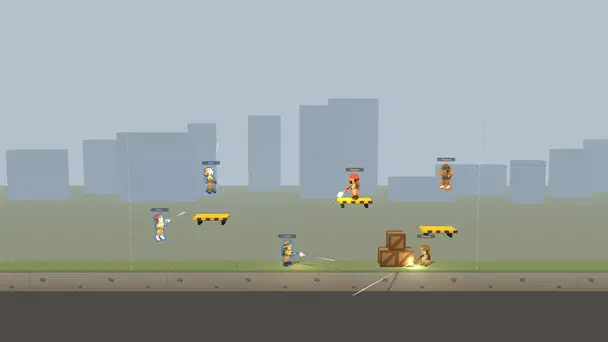 [上游游戏截图](<https://github.com/samie105/military-forge/blob/HEAD/art/screenshots/fx-gameplay-1x.png>) | [samie105/military-forge](<https://github.com/samie105/military-forge>) | 常见根目录许可文件未找到 | 待核 | — | 未列入口 |
| 2129 | [ ] | [Mimic](<https://github.com/gamingnews5/awesome-opus-5.5-games/blob/9a29b570e56bd19f15a3cd6bbac0b8c682f2c48c/games/mimic/readme.md>) | 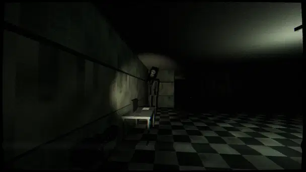 [上游商店截图](<https://github.com/merchantsteam29/mimic/blob/HEAD/store/screenshots/01-hospital.png>) | [merchantsteam29/mimic](<https://github.com/merchantsteam29/mimic>) | 常见根目录许可文件未找到 | [README 提及](<https://github.com/merchantsteam29/mimic/blob/HEAD/README.md#L177>) | — | 未列入口 |
| 2130 | [ ] | [min box](<https://github.com/gamingnews5/awesome-opus-5.5-games/blob/9a29b570e56bd19f15a3cd6bbac0b8c682f2c48c/games/min-box/readme.md>) | 待补截图 | [mitodrummer/min-punchout](<https://github.com/mitodrummer/min-punchout>) | 常见根目录许可文件未找到 | 待核 | — | 未列入口 |
| 2131 | [ ] | [Mind Arena 3D](<https://github.com/gamingnews5/awesome-opus-5.5-games/blob/9a29b570e56bd19f15a3cd6bbac0b8c682f2c48c/games/mind-arena-3d/readme.md>) | 待补截图 | [jbtdc24/Minds3d](<https://github.com/jbtdc24/Minds3d>) | 常见根目录许可文件未找到 | 待核 | — | [可达 · 含游戏画布／引擎的网页](<https://minds3d.vercel.app>) |
| 2132 | [ ] | [Mind The Tower](<https://github.com/gamingnews5/awesome-opus-5.5-games/blob/9a29b570e56bd19f15a3cd6bbac0b8c682f2c48c/games/mind-the-tower/readme.md>) |  [合集截图](<https://github.com/Vineethk08/mind-the-tower-defold/blob/main/screenshots/gameplay.png>) | [Vineethk08/mind-the-tower-defold](<https://github.com/Vineethk08/mind-the-tower-defold>) | 常见根目录许可文件未找到 | 待核 | [4.8](<https://github.com/Vineethk08/mind-the-tower-defold/blob/main/screenshots/gameplay.png>) | 未列入口 |
| 2133 | [ ] | [Mindle](<https://github.com/gamingnews5/awesome-opus-5.5-games/blob/9a29b570e56bd19f15a3cd6bbac0b8c682f2c48c/games/mindle/readme.md>) | 待补截图 | [Mindle-Game/mindle](<https://github.com/Mindle-Game/mindle>) | 常见根目录许可文件未找到 | 待核 | — | 未列入口 |
| 2134 | [ ] | [Mine Clone](<https://github.com/gamingnews5/awesome-opus-5.5-games/blob/9a29b570e56bd19f15a3cd6bbac0b8c682f2c48c/games/mine-clone/readme.md>) | 待补截图 | [Githyot/mine-clone](<https://github.com/Githyot/mine-clone>) | 常见根目录许可文件未找到 | 待核 | [6.2（原图失效）](<https://github.com/Githyot/mine-clone/blob/main/docs/screenshots/demo.png>) | 未列入口 |
| 2135 | [ ] | [Minecraft Clone Fable5](<https://github.com/gamingnews5/awesome-opus-5.5-games/blob/9a29b570e56bd19f15a3cd6bbac0b8c682f2c48c/games/minecraft-clone-fable5/readme.md>) | 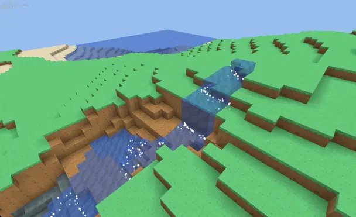 [合集截图](<https://github.com/kengonakajima/mc_clone_fable5/blob/main/docs/eyecatch.png>) | [kengonakajima/mc\_clone\_fable5](<https://github.com/kengonakajima/mc_clone_fable5>) | 常见根目录许可文件未找到 | 待核 | [6.8](<https://github.com/kengonakajima/mc_clone_fable5/blob/main/docs/eyecatch.png>) | 未列入口 |
| 2136 | [ ] | [Minesweeper](<https://github.com/gamingnews5/awesome-opus-5.5-games/blob/9a29b570e56bd19f15a3cd6bbac0b8c682f2c48c/games/minesweeper/readme.md>) | 待补截图 | [Fable-11/minesweeper](<https://github.com/Fable-11/minesweeper>) | 常见根目录许可文件未找到 | 待核 | — | 未列入口 |
| 2137 | [ ] | [Minesweeper (hitmaneac)](<https://github.com/gamingnews5/awesome-opus-5.5-games/blob/9a29b570e56bd19f15a3cd6bbac0b8c682f2c48c/games/minesweeper-hitmaneac/readme.md>) | 待补截图 | [hitmaneac/minesweeper](<https://github.com/hitmaneac/minesweeper>) | 常见根目录许可文件未找到 | 待核 | — | 未列入口 |
| 2138 | [ ] | [Minesweeper (Lenni707)](<https://github.com/gamingnews5/awesome-opus-5.5-games/blob/9a29b570e56bd19f15a3cd6bbac0b8c682f2c48c/games/minesweeper-lenni707/readme.md>) | 待补截图 | [Lenni707/minesweeper-clean](<https://github.com/Lenni707/minesweeper-clean>) | 常见根目录许可文件未找到 | 待核 | — | [可达 · 合集所列网页](<https://lenni707.github.io/minesweeper-clean/>) |
| 2139 | [ ] | [Minesweeper (punchface2000)](<https://github.com/gamingnews5/awesome-opus-5.5-games/blob/9a29b570e56bd19f15a3cd6bbac0b8c682f2c48c/games/minesweeper-punchface2000/readme.md>) | 待补截图 | [punchface2000/minesweeper](<https://github.com/punchface2000/minesweeper>) | 常见根目录许可文件未找到 | 待核 | — | [入口已失效 · 合集所列网页](<https://punchface2000.github.io/minesweeper/>) |
| 2140 | [ ] | [Minesweeper 2026](<https://github.com/gamingnews5/awesome-opus-5.5-games/blob/9a29b570e56bd19f15a3cd6bbac0b8c682f2c48c/games/minesweeper-2026/readme.md>) | 待补截图 | [GuillaumeMunsch/minesweeper-2026](<https://github.com/GuillaumeMunsch/minesweeper-2026>) | 常见根目录许可文件未找到 | 待核 | — | [可达 · 含游戏画布／引擎的网页](<https://guillaumemunsch.github.io/minesweeper-2026/>) |
| 2141 | [ ] | [Minesweeper Without Guessing](<https://github.com/gamingnews5/awesome-opus-5.5-games/blob/9a29b570e56bd19f15a3cd6bbac0b8c682f2c48c/games/minesweeper-without-guessing/readme.md>) | 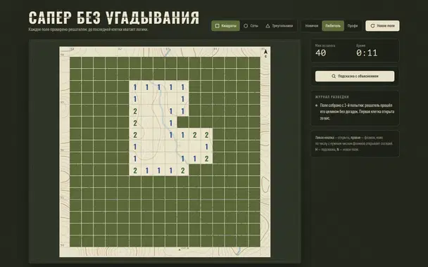 [合集截图](<https://github.com/swan4er/opus-100-projects/blob/main/089-logic-minesweeper/preview.jpg>) | [swan4er/opus-100-projects](<https://github.com/swan4er/opus-100-projects>) | 常见根目录许可文件未找到 | 待核 | [6.8](<https://github.com/swan4er/opus-100-projects/blob/main/089-logic-minesweeper/preview.jpg>) | [可达 · 合集所列网页](<https://swan4er.github.io/opus-100-projects/089-logic-minesweeper/>) |
| 2142 | [ ] | [Minesweeper: Something Moves](<https://github.com/gamingnews5/awesome-opus-5.5-games/blob/9a29b570e56bd19f15a3cd6bbac0b8c682f2c48c/games/minesweeper-something-moves/readme.md>) | 待补截图 | [LuisCa32/minesweeper-something-moves](<https://github.com/LuisCa32/minesweeper-something-moves>) | 常见根目录许可文件未找到 | 待核 | [5.6](<https://github.com/LuisCa32/minesweeper-something-moves/blob/main/preview.png>) | [可达 · 含游戏画布／引擎的网页](<https://luisca32.github.io/minesweeper-something-moves/>) |
| 2143 | [ ] | [Mini 4WD Racer 四驅車大賽](<https://github.com/gamingnews5/awesome-opus-5.5-games/blob/9a29b570e56bd19f15a3cd6bbac0b8c682f2c48c/games/mini-4wd-racer/readme.md>) |  [试玩首页实截](<https://gagatim.github.io/Mini-4WD-Racer/>) | [gagatim/Mini-4WD-Racer](<https://github.com/gagatim/Mini-4WD-Racer>) | 常见根目录许可文件未找到 无根LICENSE。 | 待核 | — | [可达 · 含游戏画布／引擎的网页](<https://gagatim.github.io/Mini-4WD-Racer/>) |
| 2144 | [ ] | [Mini Game Station](<https://github.com/gamingnews5/awesome-opus-5.5-games/blob/9a29b570e56bd19f15a3cd6bbac0b8c682f2c48c/games/mini-game-station/readme.md>) | 待补截图 | [Refjz/Mini-Game-Station](<https://github.com/Refjz/Mini-Game-Station>) | 常见根目录许可文件未找到 | 待核 | — | 未列入口 |
| 2145 | [ ] | [Mini Golf 2](<https://github.com/gamingnews5/awesome-opus-5.5-games/blob/9a29b570e56bd19f15a3cd6bbac0b8c682f2c48c/games/mini-golf-2/readme.md>) |  [作者分享图 · 游戏实景](<https://heidenreich.github.io/mini-golf-2/>) | [heidenreich/mini-golf-2](<https://github.com/heidenreich/mini-golf-2>) | 常见根目录许可文件未找到 | 待核 | — | [可达 · 含游戏画布／引擎的网页](<https://heidenreich.github.io/mini-golf-2/>) |
| 2146 | [ ] | [Mini Juegos](<https://github.com/gamingnews5/awesome-opus-5.5-games/blob/9a29b570e56bd19f15a3cd6bbac0b8c682f2c48c/games/mini-juegos/readme.md>) |  [源码运行首页](<https://github.com/jdmuriel/mini-games/blob/claude/wonderful-wright-aii73t/index.html>) | [jdmuriel/mini-games](<https://github.com/jdmuriel/mini-games>) | 常见根目录许可文件未找到 | 待核 | — | 未列入口 |
| 2147 | [ ] | [Minigame By Claude](<https://github.com/gamingnews5/awesome-opus-5.5-games/blob/9a29b570e56bd19f15a3cd6bbac0b8c682f2c48c/games/minigame-by-claude/readme.md>) | 待补截图 | [daizum4me/minigame\_by\_claude](<https://github.com/daizum4me/minigame_by_claude>) | 常见根目录许可文件未找到 | 待核 | — | 未列入口 |
| 2148 | [ ] | [Minigames](<https://github.com/gamingnews5/awesome-opus-5.5-games/blob/9a29b570e56bd19f15a3cd6bbac0b8c682f2c48c/games/minigames-davidotek-vibegames/readme.md>) | 待补截图 | [DavidoTek/vibegames](<https://github.com/DavidoTek/vibegames>) | 常见根目录许可文件未找到 | 待核 | — | [可达 · 合集所列网页](<https://davidotek.github.io/vibegames/>) |
| 2149 | [ ] | [MiningSim (working title)](<https://github.com/gamingnews5/awesome-opus-5.5-games/blob/9a29b570e56bd19f15a3cd6bbac0b8c682f2c48c/games/miningsim-working-title/readme.md>) | 待补截图 | [Cat32man/MiningSim](<https://github.com/Cat32man/MiningSim>) | 常见根目录许可文件未找到 | 待核 | — | 未列入口 |
| 2150 | [ ] | [Mirage Racer](<https://github.com/gamingnews5/awesome-opus-5.5-games/blob/9a29b570e56bd19f15a3cd6bbac0b8c682f2c48c/games/mirage-racer/readme.md>) | 待补截图 | [nusability/racer](<https://github.com/nusability/racer>) | 常见根目录许可文件未找到 | 待核 | — | 未列入口 |
| 2151 | [ ] | [Mirror Tap](<https://github.com/gamingnews5/awesome-opus-5.5-games/blob/9a29b570e56bd19f15a3cd6bbac0b8c682f2c48c/games/mirror-tap/readme.md>) | 待补截图 | [shironagasu-ai/claude-fable5-games](<https://github.com/shironagasu-ai/claude-fable5-games>) | 常见根目录许可文件未找到 | 待核 | — | 未列入口 |
| 2152 | [ ] | [MirrorForge](<https://github.com/gamingnews5/awesome-opus-5.5-games/blob/9a29b570e56bd19f15a3cd6bbac0b8c682f2c48c/games/mirrorforge/readme.md>) | 待补截图 | [leonvanzyl/claude-fable-5-mirror-game](<https://github.com/leonvanzyl/claude-fable-5-mirror-game>) | 常见根目录许可文件未找到 | 待核 | — | 未列入口 |
| 2153 | [ ] | [Mislook](<https://github.com/gamingnews5/awesome-opus-5.5-games/blob/9a29b570e56bd19f15a3cd6bbac0b8c682f2c48c/games/mislook/readme.md>) | 待补截图 | [Carlock1609/Mislook](<https://github.com/Carlock1609/Mislook>) | 常见根目录许可文件未找到 | 待核 | — | 未列入口 |
| 2154 | [ ] | [Mister Mole](<https://github.com/gamingnews5/awesome-opus-5.5-games/blob/9a29b570e56bd19f15a3cd6bbac0b8c682f2c48c/games/mister-mole/readme.md>) |  [合集截图](<https://github.com/BillYLZ/r3f-mister-mole/blob/main/docs/mister-mole.png>) | [BillYLZ/r3f-mister-mole](<https://github.com/BillYLZ/r3f-mister-mole>) | 常见根目录许可文件未找到 | 待核 | [7.0](<https://github.com/BillYLZ/r3f-mister-mole/blob/main/docs/mister-mole.png>) | 未列入口 |
| 2155 | [ ] | [Mix-Up Magic](<https://github.com/gamingnews5/awesome-opus-5.5-games/blob/9a29b570e56bd19f15a3cd6bbac0b8c682f2c48c/games/mix-up-magic/readme.md>) | 待补截图 | [shyamathreye/devis-lab](<https://github.com/shyamathreye/devis-lab>) | 常见根目录许可文件未找到 | 待核 | — | 未列入口 |
| 2156 | [ ] | [MMO RPG Medieval](<https://github.com/gamingnews5/awesome-opus-5.5-games/blob/9a29b570e56bd19f15a3cd6bbac0b8c682f2c48c/games/mmo-rpg-medieval/readme.md>) | 待补截图 | [nicholasgiudice/mmg-nich](<https://github.com/nicholasgiudice/mmg-nich>) | 常见根目录许可文件未找到 | 待核 | — | 未列入口 |
| 2157 | [ ] | [Mobile Games](<https://github.com/gamingnews5/awesome-opus-5.5-games/blob/9a29b570e56bd19f15a3cd6bbac0b8c682f2c48c/games/mobile-games/readme.md>) | 待补截图 | [sanand0/mobile-games](<https://github.com/sanand0/mobile-games>) | 常见根目录许可文件未找到 | 待核 | — | [可达 · 合集所列网页](<https://sanand0.github.io/mobile-games/>) |
| 2158 | [ ] | [Mobland](<https://github.com/gamingnews5/awesome-opus-5.5-games/blob/9a29b570e56bd19f15a3cd6bbac0b8c682f2c48c/games/mobland/readme.md>) | 待补截图 | [mikaeleli-blip/mobland](<https://github.com/mikaeleli-blip/mobland>) | 常见根目录许可文件未找到 | 待核 | — | 未列入口 |
| 2159 | [ ] | [Mochi Colony](<https://github.com/gamingnews5/awesome-opus-5.5-games/blob/9a29b570e56bd19f15a3cd6bbac0b8c682f2c48c/games/mochi-colony/readme.md>) |  [源码运行首页](<https://github.com/travex-pixel/Colony-Go/blob/ccr-19db92c9-5a5x5t/index.html>) | [travex-pixel/Colony-Go](<https://github.com/travex-pixel/Colony-Go>) | 常见根目录许可文件未找到 | 待核 | — | 未列入口 |
| 2160 | [ ] | [Mochi Roguelike](<https://github.com/gamingnews5/awesome-opus-5.5-games/blob/9a29b570e56bd19f15a3cd6bbac0b8c682f2c48c/games/mochi-roguelike/readme.md>) | 待补截图 | [Dilfadzree98/mochi-roguelike](<https://github.com/Dilfadzree98/mochi-roguelike>) | 常见根目录许可文件未找到 | 待核 | — | 未列入口 |
| 2161 | [ ] | [Modulo Simulator](<https://github.com/gamingnews5/awesome-opus-5.5-games/blob/9a29b570e56bd19f15a3cd6bbac0b8c682f2c48c/games/modulo-simulator/readme.md>) | 待补截图 | [leiffurthersocial-rgb/modulo-simulator](<https://github.com/leiffurthersocial-rgb/modulo-simulator>) | 常见根目录许可文件未找到 | 待核 | — | [可达 · 合集所列网页](<https://modulo-simulator.vercel.app>) |
| 2162 | [ ] | [Moe, Joe &amp; Mr Mews](<https://github.com/gamingnews5/awesome-opus-5.5-games/blob/9a29b570e56bd19f15a3cd6bbac0b8c682f2c48c/games/moe-joe-mr-mews/readme.md>) |  [合集截图](<https://github.com/lambsubstitute/three-cats/blob/main/docs/screenshots/scullery.png>) | [lambsubstitute/three-cats](<https://github.com/lambsubstitute/three-cats>) | 常见根目录许可文件未找到 | 待核 | [7.2](<https://github.com/lambsubstitute/three-cats/blob/main/docs/screenshots/scullery.png>) | [可达 · 含游戏画布／引擎的网页](<https://lambsubstitute.github.io/three-cats/>) |
| 2163 | [ ] | [Moksha Patam · मोक्ष पटम](<https://github.com/gamingnews5/awesome-opus-5.5-games/blob/9a29b570e56bd19f15a3cd6bbac0b8c682f2c48c/games/moksha-patam/readme.md>) | 待补截图 | [bhaskarspace/moksha-patam](<https://github.com/bhaskarspace/moksha-patam>) | 常见根目录许可文件未找到 | 待核 | — | [可达 · 合集所列网页](<https://codebpr.com/moksha-patam/>) |
| 2164 | [ ] | [Momo](<https://github.com/gamingnews5/awesome-opus-5.5-games/blob/9a29b570e56bd19f15a3cd6bbac0b8c682f2c48c/games/momo/readme.md>) | 待补截图 | [aqhenry/momo](<https://github.com/aqhenry/momo>) | 常见根目录许可文件未找到 | 待核 | — | 未列入口 |
| 2165 | [ ] | [Moncloa Game](<https://github.com/gamingnews5/awesome-opus-5.5-games/blob/9a29b570e56bd19f15a3cd6bbac0b8c682f2c48c/games/moncloa-game/readme.md>) | 待补截图 | [MoncloaGame/moncloagame.github.io](<https://github.com/MoncloaGame/moncloagame.github.io>) | 常见根目录许可文件未找到 | 待核 | — | [可达 · 合集所列网页](<https://moncloagame.github.io/>) |
| 2166 | [ ] | [Monkey King: Mountain-Sea Temple](<https://github.com/gamingnews5/awesome-opus-5.5-games/blob/9a29b570e56bd19f15a3cd6bbac0b8c682f2c48c/games/monkey-king-mountain-sea-temple/readme.md>) | 待补截图 | [shonejj/BMW-TEST-GAME](<https://github.com/shonejj/BMW-TEST-GAME>) | 常见根目录许可文件未找到 | [README 提及](<https://github.com/shonejj/BMW-TEST-GAME/blob/HEAD/README.md#L19>) | — | [可达 · 合集所列网页](<https://shonejj.github.io/BMW-TEST-GAME/>) |
| 2167 | [ ] | [Monopoly online](<https://github.com/gamingnews5/awesome-opus-5.5-games/blob/9a29b570e56bd19f15a3cd6bbac0b8c682f2c48c/games/monopoly-online/readme.md>) | 待补截图 | [ekazakov/monopoly-online](<https://github.com/ekazakov/monopoly-online>) | 常见根目录许可文件未找到 | 待核 | — | 未列入口 |
| 2168 | [ ] | [MONSTER MASH: Slingshot Siege](<https://github.com/gamingnews5/awesome-opus-5.5-games/blob/9a29b570e56bd19f15a3cd6bbac0b8c682f2c48c/games/monster-mash-slingshot-siege/readme.md>) |  [合集截图](<https://github.com/gentlewind-alt/Run_ai_game/blob/claude/brave-johnson-j555ql/docs/concepts/weapons/w_omnitrix_dial.png>) | [gentlewind-alt/Run\_ai\_game](<https://github.com/gentlewind-alt/Run_ai_game>) | 常见根目录许可文件未找到 | 待核 | [7.0](<https://github.com/gentlewind-alt/Run_ai_game/blob/claude/brave-johnson-j555ql/docs/concepts/weapons/w_omnitrix_dial.png>) | 未列入口 |
| 2169 | [ ] | [Monster Pop](<https://github.com/gamingnews5/awesome-opus-5.5-games/blob/9a29b570e56bd19f15a3cd6bbac0b8c682f2c48c/games/monster-pop/readme.md>) | 待补截图 | [JoshM33k/match-three](<https://github.com/JoshM33k/match-three>) | 常见根目录许可文件未找到 | 待核 | — | [可达 · 含游戏画布／引擎的网页](<https://joshm33k.github.io/match-three/>) |
| 2170 | [ ] | [monsterquest](<https://github.com/gamingnews5/awesome-opus-5.5-games/blob/9a29b570e56bd19f15a3cd6bbac0b8c682f2c48c/games/monsterquest/readme.md>) | 待补截图 | [bannzai/godotpractice](<https://github.com/bannzai/godotpractice>) | 常见根目录许可文件未找到 | 待核 | — | 未列入口 |
| 2171 | [ ] | [Monte Carlo VIP 3D / WebXR Poker Casino](<https://github.com/gamingnews5/awesome-opus-5.5-games/blob/9a29b570e56bd19f15a3cd6bbac0b8c682f2c48c/games/monte-carlo-vip-3d-webxr-poker-casino/readme.md>) | 待补截图 | [jawsbaek/vr-poker-casino](<https://github.com/jawsbaek/vr-poker-casino>) | 常见根目录许可文件未找到 | 待核 | — | 未列入口 |
| 2172 | [ ] | [Moonblood](<https://github.com/gamingnews5/awesome-opus-5.5-games/blob/9a29b570e56bd19f15a3cd6bbac0b8c682f2c48c/games/moonblood/readme.md>) |  [合集截图](<https://github.com/nikosandris/moonstone-successor/blob/main/docs/screens/duel-strike.jpg>) | [nikosandris/moonstone-successor](<https://github.com/nikosandris/moonstone-successor>) | 常见根目录许可文件未找到 [地形等素材为 CC0，多种建筑、树木和角色模型为 CC BY，署名见 CREDITS。](<https://github.com/nikosandris/moonstone-successor/blob/HEAD/README.md#L29>) | 待核 | [7.2](<https://github.com/nikosandris/moonstone-successor/blob/main/docs/screens/duel-strike.jpg>) | [可达 · 合集所列网页](<https://nikosandris.github.io/moonstone-successor/>) |
| 2173 | [ ] | [Moonpull](<https://github.com/gamingnews5/awesome-opus-5.5-games/blob/9a29b570e56bd19f15a3cd6bbac0b8c682f2c48c/games/moonpull/readme.md>) |  [源码运行首页](<https://github.com/Efkrdnz/opus-game-test-3/blob/c2ac0560aa72ebbba549f73f0f8287de4e4f4803/index.html>) | [Efkrdnz/opus-game-test-3](<https://github.com/Efkrdnz/opus-game-test-3>) | 常见根目录许可文件未找到 | 待核 | — | 未列入口 |
| 2174 | [ ] | [More or Less — Save the Princess](<https://github.com/gamingnews5/awesome-opus-5.5-games/blob/9a29b570e56bd19f15a3cd6bbac0b8c682f2c48c/games/more-or-less-save-the-princess/readme.md>) | 待补截图 | [truonglvpems/more-or-less](<https://github.com/truonglvpems/more-or-less>) | 常见根目录许可文件未找到 | 待核 | — | [可达 · 含游戏画布／引擎的网页](<https://truonglvpems.github.io/more-or-less/>) |
| 2175 | [ ] | [Mortal Clash](<https://github.com/gamingnews5/awesome-opus-5.5-games/blob/9a29b570e56bd19f15a3cd6bbac0b8c682f2c48c/games/mortal-clash/readme.md>) | 待补截图 | [PromptEngineer48/claude-opus-5.5-games](<https://github.com/PromptEngineer48/claude-opus-5.5-games>) | 常见根目录许可文件未找到 [该仓的 Mortal Clash 从外部加载角色模型，各模型有独立许可。](<https://github.com/PromptEngineer48/claude-opus-5.5-games/blob/HEAD/README.md#L89-L90>) | [README 提及（仓库级）、源码有输入读取（仓库级）](<https://github.com/PromptEngineer48/claude-opus-5.5-games/blob/main/neon-siege/index.html#L2302>) | — | [可达 · 含游戏画布／引擎的网页](<https://promptengineer48.github.io/claude-opus-5.5-games/mortal-clash/>) |
| 2176 | [ ] | [Mosswing](<https://github.com/gamingnews5/awesome-opus-5.5-games/blob/9a29b570e56bd19f15a3cd6bbac0b8c682f2c48c/games/mosswing/readme.md>) | 待补截图 | [Ayi1337/gpt6-astra-one-shot-games](<https://github.com/Ayi1337/gpt6-astra-one-shot-games>) | 常见根目录许可文件未找到 | 待核 | — | [可达 · 含游戏画布／引擎的网页](<https://mosswing-quiet-flight.jack-514.chatgpt.site/>) |
| 2177 | [ ] | [Mosswing](<https://github.com/gamingnews5/awesome-opus-5.5-games/blob/9a29b570e56bd19f15a3cd6bbac0b8c682f2c48c/games/mosswing-celia827-game-melon-field-lab/readme.md>) |  [合集截图](<https://github.com/celia827/Game-Melon-Field-Lab/blob/master/mosswing/src/design/play-mobile.png>) | [celia827/Game-Melon-Field-Lab](<https://github.com/celia827/Game-Melon-Field-Lab>) | 常见根目录许可文件未找到 | 待核 | [6.9](<https://github.com/celia827/Game-Melon-Field-Lab/blob/master/mosswing/src/design/play-mobile.png>) | 未列入口 |
| 2178 | [ ] | [Motion Bowling](<https://github.com/gamingnews5/awesome-opus-5.5-games/blob/9a29b570e56bd19f15a3cd6bbac0b8c682f2c48c/games/motion-bowling/readme.md>) | 待补截图 | [tejash111/PLYRO](<https://github.com/tejash111/PLYRO>) | 常见根目录许可文件未找到 | 待核 | — | 未列入口 |
| 2179 | [ ] | [Mountain Mogul](<https://github.com/gamingnews5/awesome-opus-5.5-games/blob/9a29b570e56bd19f15a3cd6bbac0b8c682f2c48c/games/mountain-mogul/readme.md>) | 待补截图 | [phildbs/mountain-mogul](<https://github.com/phildbs/mountain-mogul>) | 常见根目录许可文件未找到 | 待核 | — | [README · 可达 · 上游 README 所列网页](<https://mtmogul.com/>) |
| 2180 | [ ] | [Mountain Run](<https://github.com/gamingnews5/awesome-opus-5.5-games/blob/9a29b570e56bd19f15a3cd6bbac0b8c682f2c48c/games/mountain-run/readme.md>) | 待补截图 | [vfhqi/mountain-run](<https://github.com/vfhqi/mountain-run>) | 常见根目录许可文件未找到 | 待核 | — | [可达 · 含游戏画布／引擎的网页](<https://vfhqi.github.io/mountain-run/>) |
| 2181 | [ ] | [Movecade Kart Racer](<https://github.com/gamingnews5/awesome-opus-5.5-games/blob/9a29b570e56bd19f15a3cd6bbac0b8c682f2c48c/games/movecade-kart-racer/readme.md>) | 待补截图 | [boostings/movecadeUE5](<https://github.com/boostings/movecadeUE5>) | 常见根目录许可文件未找到 | [README 提及](<https://github.com/boostings/movecadeUE5/blob/HEAD/README.md#L16>) | — | 未列入口 |
| 2182 | [ ] | [Movieprox, Musicprox &amp; Geoprox](<https://github.com/gamingnews5/awesome-opus-5.5-games/blob/9a29b570e56bd19f15a3cd6bbac0b8c682f2c48c/games/movieprox-musicprox-geoprox/readme.md>) | 待补截图 | [filipbackstrom/movieprox](<https://github.com/filipbackstrom/movieprox>) | 常见根目录许可文件未找到 | 待核 | — | 未列入口 |
| 2183 | [ ] | [Mow A Lawn](<https://github.com/gamingnews5/awesome-opus-5.5-games/blob/9a29b570e56bd19f15a3cd6bbac0b8c682f2c48c/games/mow-a-lawn/readme.md>) | 待补截图 | [raynine2/Mow-And-Grow](<https://github.com/raynine2/Mow-And-Grow>) | 常见根目录许可文件未找到 | 待核 | — | 未列入口 |
| 2184 | [ ] | [Mr. Eggy](<https://github.com/gamingnews5/awesome-opus-5.5-games/blob/9a29b570e56bd19f15a3cd6bbac0b8c682f2c48c/games/mr-eggy/readme.md>) | 待补截图 | [ducthais/brain-puzzle-game](<https://github.com/ducthais/brain-puzzle-game>) | 常见根目录许可文件未找到 | 待核 | — | 未列入口 |
| 2185 | [ ] | [Mt. Crankmore](<https://github.com/gamingnews5/awesome-opus-5.5-games/blob/9a29b570e56bd19f15a3cd6bbac0b8c682f2c48c/games/mt-crankmore/readme.md>) |  [合集截图](<https://github.com/hermeslohin/mt-crankmore/blob/main/docs/delivery.png>) | [hermeslohin/mt-crankmore](<https://github.com/hermeslohin/mt-crankmore>) | 常见根目录许可文件未找到 | [README 提及](<https://github.com/hermeslohin/mt-crankmore/blob/HEAD/README.md#L101>) | [6.6](<https://github.com/hermeslohin/mt-crankmore/blob/main/docs/delivery.png>) | 未列入口 |
| 2186 | [ ] | [MU Sky](<https://github.com/gamingnews5/awesome-opus-5.5-games/blob/9a29b570e56bd19f15a3cd6bbac0b8c682f2c48c/games/mu-sky/readme.md>) | 待补截图 | [u11028/mu\_sky](<https://github.com/u11028/mu_sky>) | 常见根目录许可文件未找到 | 待核 | — | 未列入口 |
| 2187 | [ ] | [MUGR DEATHMATCH](<https://github.com/gamingnews5/awesome-opus-5.5-games/blob/9a29b570e56bd19f15a3cd6bbac0b8c682f2c48c/games/mugr-deathmatch/readme.md>) | 待补截图 | [mugr-games/mugrdeathmatch](<https://github.com/mugr-games/mugrdeathmatch>) | 常见根目录许可文件未找到 | [README 提及](<https://github.com/mugr-games/mugrdeathmatch/blob/HEAD/README.md#L111>) | — | [可达 · 合集所列网页](<https://mugr-deathmatch.onrender.com>) |
| 2188 | [ ] | [MULTIHERO](<https://github.com/gamingnews5/awesome-opus-5.5-games/blob/9a29b570e56bd19f15a3cd6bbac0b8c682f2c48c/games/multihero/readme.md>) | 待补截图 | [kris-ow/multihero](<https://github.com/kris-ow/multihero>) | 常见根目录许可文件未找到 | 待核 | — | [可达 · 含游戏画布／引擎的网页](<https://kris-ow.github.io/multihero/>) |
| 2189 | [ ] | [Multiplayer Tabletop Games](<https://github.com/gamingnews5/awesome-opus-5.5-games/blob/9a29b570e56bd19f15a3cd6bbac0b8c682f2c48c/games/multiplayer-tabletop-games/readme.md>) |  [上游游戏截图](<https://github.com/Nate314/multiplayer-tabletop-games/blob/HEAD/docs/screenshots/stagerummy-dark.png>) | [Nate314/multiplayer-tabletop-games](<https://github.com/Nate314/multiplayer-tabletop-games>) | 常见根目录许可文件未找到 | 待核 | — | 未列入口 |
| 2190 | [ ] | [Multiplication Chain](<https://github.com/gamingnews5/awesome-opus-5.5-games/blob/9a29b570e56bd19f15a3cd6bbac0b8c682f2c48c/games/multiplication-chain/readme.md>) |  [同款源码游戏实截](<https://github.com/mundeok/math-arcade-paradise/blob/master/src/games/g08_chain.js>) | [mundeok/math-arcade-paradise](<https://github.com/mundeok/math-arcade-paradise>) | 常见根目录许可文件未找到 | 待核 | — | 未列入口 |
| 2191 | [ ] | [Multiplication Farm](<https://github.com/gamingnews5/awesome-opus-5.5-games/blob/9a29b570e56bd19f15a3cd6bbac0b8c682f2c48c/games/multiplication-farm/readme.md>) |  [同款源码游戏实截](<https://github.com/mundeok/math-arcade-paradise/blob/master/src/games/g11_farm.js>) | [mundeok/math-arcade-paradise](<https://github.com/mundeok/math-arcade-paradise>) | 常见根目录许可文件未找到 | 待核 | — | 未列入口 |
| 2192 | [ ] | [MUN Crisis](<https://github.com/gamingnews5/awesome-opus-5.5-games/blob/9a29b570e56bd19f15a3cd6bbac0b8c682f2c48c/games/mun-crisis/readme.md>) | 待补截图 | [Kunal1905/mun](<https://github.com/Kunal1905/mun>) | 常见根目录许可文件未找到 | 待核 | — | 未列入口 |
| 2193 | [ ] | [Murder Squad](<https://github.com/gamingnews5/awesome-opus-5.5-games/blob/9a29b570e56bd19f15a3cd6bbac0b8c682f2c48c/games/murder-squad/readme.md>) |  [上游游戏截图](<https://github.com/dragoonant/murder-squad/blob/HEAD/screenshots/battle-shoot-prompt.png>) | [dragoonant/murder-squad](<https://github.com/dragoonant/murder-squad>) | 常见根目录许可文件未找到 | 待核 | — | 未列入口 |
| 2194 | [ ] | [Murdle · Thám Tử Đấu Trí](<https://github.com/gamingnews5/awesome-opus-5.5-games/blob/9a29b570e56bd19f15a3cd6bbac0b8c682f2c48c/games/murdle-tham-tu-au-tri/readme.md>) | 待补截图 | [TranVietHoang99/murdle](<https://github.com/TranVietHoang99/murdle>) | 常见根目录许可文件未找到 | 待核 | — | [可达 · 合集所列网页](<https://tranviethoang99.github.io/murdle/>) |
| 2195 | [ ] | [Murmur](<https://github.com/gamingnews5/awesome-opus-5.5-games/blob/9a29b570e56bd19f15a3cd6bbac0b8c682f2c48c/games/murmur/readme.md>) | 待补截图 | [pahorema/murmur](<https://github.com/pahorema/murmur>) | 常见根目录许可文件未找到 | 待核 | — | 未列入口 |
| 2196 | [ ] | [Murmuration](<https://github.com/gamingnews5/awesome-opus-5.5-games/blob/9a29b570e56bd19f15a3cd6bbac0b8c682f2c48c/games/murmuration/readme.md>) |  [试玩画面](<https://ezpzme.github.io/murmuration/>) | [EZPZme/murmuration](<https://github.com/EZPZme/murmuration>) | 常见根目录许可文件未找到 | 待核 | — | [可达 · 合集所列网页](<https://ezpzme.github.io/murmuration/>) |
| 2197 | [ ] | [Muros de Jerusalém](<https://github.com/gamingnews5/awesome-opus-5.5-games/blob/9a29b570e56bd19f15a3cd6bbac0b8c682f2c48c/games/muros-de-jerusalem/readme.md>) | 待补截图 | [DaniSacra/muros-de-jerusalem](<https://github.com/DaniSacra/muros-de-jerusalem>) | 常见根目录许可文件未找到 | 待核 | — | 未列入口 |
| 2198 | [ ] | [Mushroom Survivors](<https://github.com/gamingnews5/awesome-opus-5.5-games/blob/9a29b570e56bd19f15a3cd6bbac0b8c682f2c48c/games/mushroom-survivors/readme.md>) |  [源码运行首页](<https://github.com/toutkoush1262/Kevin-claude/blob/claude/vampire-survivor-game-1x3ibj/index.html>) | [toutkoush1262/Kevin-claude](<https://github.com/toutkoush1262/Kevin-claude>) | 常见根目录许可文件未找到 | 待核 | — | 未列入口 |
| 2199 | [ ] | [Music Theory Super Genius](<https://github.com/gamingnews5/awesome-opus-5.5-games/blob/9a29b570e56bd19f15a3cd6bbac0b8c682f2c48c/games/music-theory-super-genius/readme.md>) |  [源码运行首页](<https://github.com/DrKeyzzz/super-genius/blob/main/channels/rhythm-trainer.html>) | [DrKeyzzz/super-genius](<https://github.com/DrKeyzzz/super-genius>) | 常见根目录许可文件未找到 | 待核 | — | 未列入口 |
| 2200 | [ ] | [music\_action\_lab](<https://github.com/gamingnews5/awesome-opus-5.5-games/blob/9a29b570e56bd19f15a3cd6bbac0b8c682f2c48c/games/music-action-lab/readme.md>) | 待补截图 | [pokadokan-boop/music\_action\_lab](<https://github.com/pokadokan-boop/music_action_lab>) | 常见根目录许可文件未找到 | [README 提及](<https://github.com/pokadokan-boop/music_action_lab/blob/HEAD/README.md#L6>) | — | [可达 · 含游戏画布／引擎的网页](<https://pokadokan-boop.github.io/music_action_lab/>) |
| 2201 | [ ] | [MUSTAFA REBORN](<https://github.com/gamingnews5/awesome-opus-5.5-games/blob/9a29b570e56bd19f15a3cd6bbac0b8c682f2c48c/games/mustafa-reborn/readme.md>) | 待补截图 | [litu173/mustafa-reborn](<https://github.com/litu173/mustafa-reborn>) | 常见根目录许可文件未找到 | 待核 | — | [入口已失效 · 合集所列网页](<https://litu173.github.io/mustafa-reborn/>) |
| 2202 | [ ] | [Mutation: Become the Monster](<https://github.com/gamingnews5/awesome-opus-5.5-games/blob/9a29b570e56bd19f15a3cd6bbac0b8c682f2c48c/games/mutation-become-the-monster/readme.md>) | 待补截图 | [phoenix-valentine/mutation](<https://github.com/phoenix-valentine/mutation>) | 常见根目录许可文件未找到 | 待核 | — | [可达 · 含游戏画布／引擎的网页](<https://phoenix-valentine.github.io/mutation/>) |
| 2203 | [ ] | [MUTE](<https://github.com/gamingnews5/awesome-opus-5.5-games/blob/9a29b570e56bd19f15a3cd6bbac0b8c682f2c48c/games/mute/readme.md>) | 待补截图 | [dippy34/Ai-vr-game](<https://github.com/dippy34/Ai-vr-game>) | 常见根目录许可文件未找到 | 待核 | — | 未列入口 |
| 2204 | [ ] | [My Dreamy RPG — concept build](<https://github.com/gamingnews5/awesome-opus-5.5-games/blob/9a29b570e56bd19f15a3cd6bbac0b8c682f2c48c/games/my-dreamy-rpg-concept-build/readme.md>) | 待补截图 | [leandromeiramedeiros/My-dreamy-rpg](<https://github.com/leandromeiramedeiros/My-dreamy-rpg>) | 常见根目录许可文件未找到 | 待核 | [7.3（原图失效）](<https://github.com/leandromeiramedeiros/My-dreamy-rpg/blob/claude/dreamy-rpg-concept/docs/vale.png>) | [入口已失效 · 合集所列网页](<https://leandromeiramedeiros.github.io/My-dreamy-rpg/>) |
| 2205 | [ ] | [My Mini Mart (web build)](<https://github.com/gamingnews5/awesome-opus-5.5-games/blob/9a29b570e56bd19f15a3cd6bbac0b8c682f2c48c/games/my-mini-mart-web-build/readme.md>) | 待补截图 | [poke5121999-art/my-mini-mart-web](<https://github.com/poke5121999-art/my-mini-mart-web>) | 常见根目录许可文件未找到 | 待核 | — | [可达 · 合集所列网页](<https://poke5121999-art.github.io/survivor-web-hub/>) |
| 2206 | [ ] | [My Snowboard](<https://github.com/gamingnews5/awesome-opus-5.5-games/blob/9a29b570e56bd19f15a3cd6bbac0b8c682f2c48c/games/my-snowboard/readme.md>) |  [同款源码启动画面实截](<https://github.com/petersomerville/mysnowboard/blob/HEAD/index.html>) | [petersomerville/mysnowboard](<https://github.com/petersomerville/mysnowboard>) | 常见根目录许可文件未找到 | 待核 | — | [可达 · 含游戏画布／引擎的网页](<https://my-snowboard.vercel.app/>) |
| 2207 | [ ] | [My World in a Box](<https://github.com/gamingnews5/awesome-opus-5.5-games/blob/9a29b570e56bd19f15a3cd6bbac0b8c682f2c48c/games/my-world-in-a-box/readme.md>) | 待补截图 | [happihack/MyWorld](<https://github.com/happihack/MyWorld>) | 常见根目录许可文件未找到 | 待核 | — | 未列入口 |
| 2208 | [ ] | [mycardgame](<https://github.com/gamingnews5/awesome-opus-5.5-games/blob/9a29b570e56bd19f15a3cd6bbac0b8c682f2c48c/games/mycardgame/readme.md>) | 待补截图 | [justty32/mycardgame](<https://github.com/justty32/mycardgame>) | 常见根目录许可文件未找到 | 待核 | — | 未列入口 |
| 2209 | [ ] | [MyCraft](<https://github.com/gamingnews5/awesome-opus-5.5-games/blob/9a29b570e56bd19f15a3cd6bbac0b8c682f2c48c/games/mycraft/readme.md>) |  [源码运行首页](<https://github.com/tasio1/mycraft/blob/main/index.html>) | [tasio1/mycraft](<https://github.com/tasio1/mycraft>) | 常见根目录许可文件未找到 | 待核 | — | 未列入口 |
| 2210 | [ ] | [MyGames](<https://github.com/gamingnews5/awesome-opus-5.5-games/blob/9a29b570e56bd19f15a3cd6bbac0b8c682f2c48c/games/mygames/readme.md>) |  [源码运行首页](<https://github.com/Gur1963/Mygames/blob/main/index.html>) | [Gur1963/Mygames](<https://github.com/Gur1963/Mygames>) | 常见根目录许可文件未找到 | 待核 | — | 未列入口 |
| 2211 | [ ] | [Mystic Onslaught](<https://github.com/gamingnews5/awesome-opus-5.5-games/blob/9a29b570e56bd19f15a3cd6bbac0b8c682f2c48c/games/mystic-onslaught/readme.md>) | 待补截图 | [KAOSN00B/MysticOnslaught](<https://github.com/KAOSN00B/MysticOnslaught>) | 常见根目录许可文件未找到 | [README 提及](<https://github.com/KAOSN00B/MysticOnslaught/blob/HEAD/README.md#L113>) | — | [可达 · itch.io 内嵌游戏页](<https://kaosn00b.itch.io/mystic-onslaught>) |
| 2212 | [ ] | [Mythic War](<https://github.com/gamingnews5/awesome-opus-5.5-games/blob/9a29b570e56bd19f15a3cd6bbac0b8c682f2c48c/games/mythic-war/readme.md>) | 待补截图 | [austinbryanprice-droid/Gods-and-titans](<https://github.com/austinbryanprice-droid/Gods-and-titans>) | 常见根目录许可文件未找到 | 待核 | — | [入口已失效 · 合集所列网页](<https://austinbryanprice-droid.github.io/Gods-and-titans/>) |
| 2213 | [ ] | [Mì Quảng Bách Khoa](<https://github.com/gamingnews5/awesome-opus-5.5-games/blob/9a29b570e56bd19f15a3cd6bbac0b8c682f2c48c/games/mi-quang-bach-khoa/readme.md>) | 待补截图 | [phu759042-source/mi-quang-bach-khoa](<https://github.com/phu759042-source/mi-quang-bach-khoa>) | 常见根目录许可文件未找到 | 待核 | [5.6（原图失效）](<https://github.com/phu759042-source/mi-quang-bach-khoa/blob/main/docs/images/laptop-gameplay.png>) | [入口已失效 · 合集所列网页](<https://phu759042-source.github.io/mi-quang-bach-khoa/>) |

[返回全量目录](README.md)
