# 代码许可尚未确认 · N–R

[全量目录](README.md) · [候选清单](../todo.md) · [Excel 核对表](../game-audit.xlsx)

本页序号 **2,214–2,708**，共 495 款。本次查找未确认覆盖游戏代码的许可证。可先勾选感兴趣的游戏，再查对应仓库或子目录的授权。

编辑清单时可将 `[ ]` 改为 `[x]`，也可以直接回复游戏名和仓库。名称链接通向合集笔记。

| 序号 | 勾选 | 游戏 | 截图
 | 上游仓库 | 许可和素材说明 | 手柄线索 | 截图分 | 试玩或演示入口 |
| ---: | --- | --- | --- | --- | --- | --- | ---: | --- |
| 2214 | [ ] | [Naadan Frenzy](<https://github.com/gamingnews5/awesome-opus-5.5-games/blob/9a29b570e56bd19f15a3cd6bbac0b8c682f2c48c/games/naadan-frenzy/readme.md>) | 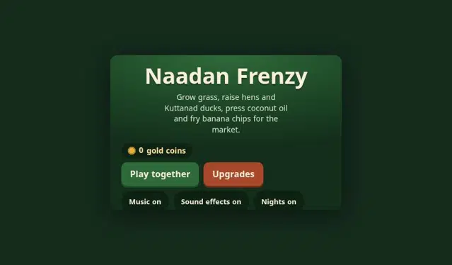 [试玩首页实截](<https://nmathewa.github.io/naadan_frenzy/>) | [nmathewa/naadan\_frenzy](<https://github.com/nmathewa/naadan_frenzy>) | 常见根目录许可文件未找到 | 待核 | — | [可达 · 含游戏画布／引擎的网页](<https://nmathewa.github.io/naadan_frenzy/>) |
| 2215 | [ ] | [Nachtdienst](<https://github.com/gamingnews5/awesome-opus-5.5-games/blob/9a29b570e56bd19f15a3cd6bbac0b8c682f2c48c/games/nachtdienst/readme.md>) | 待补截图 | [fbkarsdorp/nachtdienst](<https://github.com/fbkarsdorp/nachtdienst>) | 常见根目录许可文件未找到 | 待核 | — | 未列入口 |
| 2216 | [ ] | [Nachtdienst (fbkarsdorp)](<https://github.com/gamingnews5/awesome-opus-5.5-games/blob/9a29b570e56bd19f15a3cd6bbac0b8c682f2c48c/games/nachtdienst-fbkarsdorp/readme.md>) | 待补截图 | [fbkarsdorp/nachtdienst-2d](<https://github.com/fbkarsdorp/nachtdienst-2d>) | 常见根目录许可文件未找到 [GeoNames 地名按 CC BY 4.0；字体另用 OFL。](<https://github.com/fbkarsdorp/nachtdienst-2d/blob/HEAD/README.md#L185-L189>) | 待核 | [6.4](<https://github.com/fbkarsdorp/nachtdienst-2d/blob/main/social/github-preview.png>) | 未列入口 |
| 2217 | [ ] | [Nakama TCG](<https://github.com/gamingnews5/awesome-opus-5.5-games/blob/9a29b570e56bd19f15a3cd6bbac0b8c682f2c48c/games/nakama-tcg/readme.md>) | 待补截图 | [Rendsmoncode/Code](<https://github.com/Rendsmoncode/Code>) | 常见根目录许可文件未找到 | 待核 | — | 未列入口 |
| 2218 | [ ] | [Name Your Price! — a haggling simulator in Machane Yehuda](<https://github.com/gamingnews5/awesome-opus-5.5-games/blob/9a29b570e56bd19f15a3cd6bbac0b8c682f2c48c/games/name-your-price-a-haggling-simulator-in-machane-yehuda/readme.md>) | 待补截图 | [rachelmedvedev/shuk-game](<https://github.com/rachelmedvedev/shuk-game>) | 常见根目录许可文件未找到 | 待核 | — | [入口已失效 · 合集所列网页](<https://rachelmedvedev.github.io/shuk-game/>) |
| 2219 | [ ] | [Namioto](<https://github.com/gamingnews5/awesome-opus-5.5-games/blob/9a29b570e56bd19f15a3cd6bbac0b8c682f2c48c/games/namioto/readme.md>) | 待补截图 | [NaoyaNakagawa0124/auto-dev-projects](<https://github.com/NaoyaNakagawa0124/auto-dev-projects>) | 常见根目录许可文件未找到 | 待核 | — | 未列入口 |
| 2220 | [ ] | [NapMap](<https://github.com/gamingnews5/awesome-opus-5.5-games/blob/9a29b570e56bd19f15a3cd6bbac0b8c682f2c48c/games/napmap/readme.md>) | 待补截图 | [brianjbatchelor/NapMap](<https://github.com/brianjbatchelor/NapMap>) | 常见根目录许可文件未找到 | 待核 | — | [可达 · 合集所列网页](<https://brianjbatchelor.github.io/NapMap/>) |
| 2221 | [ ] | [Naughty or Nice](<https://github.com/gamingnews5/awesome-opus-5.5-games/blob/9a29b570e56bd19f15a3cd6bbac0b8c682f2c48c/games/naughty-or-nice/readme.md>) | 待补截图 | [jackwilliamcantwell/naughty-or-nice](<https://github.com/jackwilliamcantwell/naughty-or-nice>) | 常见根目录许可文件未找到 | 待核 | — | [可达 · 合集所列网页](<https://jackwilliamcantwell.github.io/naughty-or-nice/>) |
| 2222 | [ ] | [Navos Ninja](<https://github.com/gamingnews5/awesome-opus-5.5-games/blob/9a29b570e56bd19f15a3cd6bbac0b8c682f2c48c/games/navos-ninja/readme.md>) | 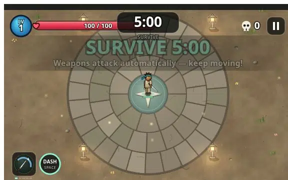 [同款源码网页实截](<https://github.com/aaronseaman/fun/blob/HEAD/index.html>) | [aaronseaman/fun](<https://github.com/aaronseaman/fun>) | 常见根目录许可文件未找到 | 待核 | — | [可达 · 含游戏画布／引擎的网页](<https://aaronseaman.github.io/fun/>) |
| 2223 | [ ] | [NBA Pinpoint](<https://github.com/gamingnews5/awesome-opus-5.5-games/blob/9a29b570e56bd19f15a3cd6bbac0b8c682f2c48c/games/nba-pinpoint/readme.md>) | 待补截图 | [fwdmove/nba-pinpoint](<https://github.com/fwdmove/nba-pinpoint>) | 常见根目录许可文件未找到 | 待核 | [5.5](<https://github.com/fwdmove/nba-pinpoint/blob/main/assets/thumbnail.png>) | [可达 · 合集所列网页](<https://nba-pinpoint.vercel.app>) |
| 2224 | [ ] | [NBA Trivia Games](<https://github.com/gamingnews5/awesome-opus-5.5-games/blob/9a29b570e56bd19f15a3cd6bbac0b8c682f2c48c/games/nba-trivia-games/readme.md>) |  [源码运行首页](<https://github.com/akhil-aswin/nba-trivia-games/blob/main/index.html>) | [akhil-aswin/nba-trivia-games](<https://github.com/akhil-aswin/nba-trivia-games>) | 常见根目录许可文件未找到 | 待核 | — | 未列入口 |
| 2225 | [ ] | [NCAA Two-Minute Drill (ncaa2mindrill.com)](<https://github.com/gamingnews5/awesome-opus-5.5-games/blob/9a29b570e56bd19f15a3cd6bbac0b8c682f2c48c/games/ncaa-two-minute-drill-ncaa2mindrill-com/readme.md>) | 待补截图 | [RickMcIntyre/ncaa2mindrill](<https://github.com/RickMcIntyre/ncaa2mindrill>) | 常见根目录许可文件未找到 | 待核 | — | 未列入口 |
| 2226 | [ ] | [Needle Drop](<https://github.com/gamingnews5/awesome-opus-5.5-games/blob/9a29b570e56bd19f15a3cd6bbac0b8c682f2c48c/games/needle-drop/readme.md>) | 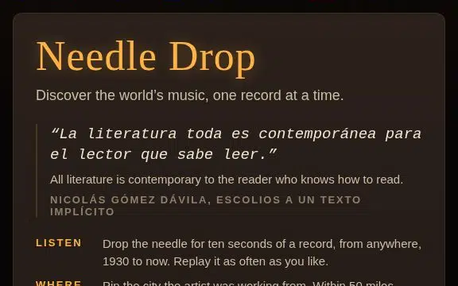 [同款源码网页实截](<https://github.com/lightpollutioncurseforge-a11y/needle-drop/blob/HEAD/index.html>) | [lightpollutioncurseforge-a11y/needle-drop](<https://github.com/lightpollutioncurseforge-a11y/needle-drop>) | 常见根目录许可文件未找到 | 待核 | — | [可达 · 合集所列网页](<https://lightpollutioncurseforge-a11y.github.io/needle-drop/>) |
| 2227 | [ ] | [NeedManyMoney](<https://github.com/gamingnews5/awesome-opus-5.5-games/blob/9a29b570e56bd19f15a3cd6bbac0b8c682f2c48c/games/needmanymoney/readme.md>) |  [合集截图](<https://github.com/BYEONGJUN33/NeedManyMoney/blob/ccr-d57f3fdd-wysyna/blocks/assets/store/screenshot-1.png>) | [BYEONGJUN33/NeedManyMoney](<https://github.com/BYEONGJUN33/NeedManyMoney>) | 常见根目录许可文件未找到 | 待核 | [5.5](<https://github.com/BYEONGJUN33/NeedManyMoney/blob/ccr-d57f3fdd-wysyna/blocks/assets/store/screenshot-1.png>) | 未列入口 |
| 2228 | [ ] | [Neighborhood Heroes (working title)](<https://github.com/gamingnews5/awesome-opus-5.5-games/blob/9a29b570e56bd19f15a3cd6bbac0b8c682f2c48c/games/neighborhood-heroes-working-title/readme.md>) | 待补截图 | [DempKing/Neighborhood\_Heroes](<https://github.com/DempKing/Neighborhood_Heroes>) | 常见根目录许可文件未找到 | [README 提及](<https://github.com/DempKing/Neighborhood_Heroes/blob/HEAD/README.md#L26>) | — | [可达 · 合集所列网页](<https://dempking.github.io/Neighborhood_Heroes/>) |
| 2229 | [ ] | [NeoGroup Crisol](<https://github.com/gamingnews5/awesome-opus-5.5-games/blob/9a29b570e56bd19f15a3cd6bbac0b8c682f2c48c/games/neogroup-crisol/readme.md>) | 待补截图 | [luismanuelamengual/neogroup-crisol](<https://github.com/luismanuelamengual/neogroup-crisol>) | 常见根目录许可文件未找到 | 待核 | — | 未列入口 |
| 2230 | [ ] | [Neon Air Hockey](<https://github.com/gamingnews5/awesome-opus-5.5-games/blob/9a29b570e56bd19f15a3cd6bbac0b8c682f2c48c/games/neon-air-hockey/readme.md>) | 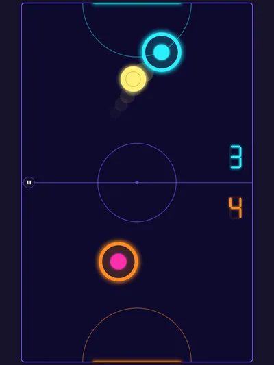 [上游商店截图](<https://github.com/VicArr786/HockeygameApple/blob/HEAD/store/screenshots/ipad-13-2-play.png>) | [VicArr786/HockeygameApple](<https://github.com/VicArr786/HockeygameApple>) | 常见根目录许可文件未找到 | 待核 | — | [可达 · 合集所列网页](<https://hockeygame-one.vercel.app>) |
| 2231 | [ ] | [Neon Arena](<https://github.com/gamingnews5/awesome-opus-5.5-games/blob/9a29b570e56bd19f15a3cd6bbac0b8c682f2c48c/games/neon-arena/readme.md>) | 待补截图 | [B-Blarr/Arena-Game](<https://github.com/B-Blarr/Arena-Game>) | 常见根目录许可文件未找到 | 待核 | — | 未列入口 |
| 2232 | [ ] | [Neon Arena (GopalKrishan2003)](<https://github.com/gamingnews5/awesome-opus-5.5-games/blob/9a29b570e56bd19f15a3cd6bbac0b8c682f2c48c/games/neon-arena-gopalkrishan2003/readme.md>) | 待补截图 | [GopalKrishan2003/neon-arena](<https://github.com/GopalKrishan2003/neon-arena>) | 常见根目录许可文件未找到 | 待核 | — | [可达 · 含游戏画布／引擎的网页](<https://neon-arena-jeej.onrender.com>) |
| 2233 | [ ] | [Neon Brawl](<https://github.com/gamingnews5/awesome-opus-5.5-games/blob/9a29b570e56bd19f15a3cd6bbac0b8c682f2c48c/games/neon-brawl/readme.md>) | 待补截图 | [maxvbuda/fight](<https://github.com/maxvbuda/fight>) | 常见根目录许可文件未找到 | [README 提及、源码有输入读取](<https://github.com/maxvbuda/fight/blob/main/game.js#L1131>) | — | [可达 · 合集所列网页](<https://maxvbuda.github.io/fight/>) |
| 2234 | [ ] | [NEON DAWN // 夜明け前線](<https://github.com/gamingnews5/awesome-opus-5.5-games/blob/9a29b570e56bd19f15a3cd6bbac0b8c682f2c48c/games/neon-dawn/readme.md>) | 待补截图 | [bannzai/godotpractice](<https://github.com/bannzai/godotpractice>) | 常见根目录许可文件未找到 | 待核 | — | 未列入口 |
| 2235 | [ ] | [Neon Drift](<https://github.com/gamingnews5/awesome-opus-5.5-games/blob/9a29b570e56bd19f15a3cd6bbac0b8c682f2c48c/games/neon-drift/readme.md>) | 待补截图 | [codewithdivyasree/neon-drift](<https://github.com/codewithdivyasree/neon-drift>) | 常见根目录许可文件未找到 | 待核 | — | 未列入口 |
| 2236 | [ ] | [Neon Hive Survivors 霓虹虫巢幸存者](<https://github.com/gamingnews5/awesome-opus-5.5-games/blob/9a29b570e56bd19f15a3cd6bbac0b8c682f2c48c/games/neon-hive-survivors/readme.md>) | 待补截图 | [machuiwen/swarm-survivor](<https://github.com/machuiwen/swarm-survivor>) | 常见根目录许可文件未找到 无根LICENSE。 | 待核 | — | [可达 · 含游戏画布／引擎的网页](<https://machuiwen.github.io/swarm-survivor/>) |
| 2237 | [ ] | [Neon Hunter](<https://github.com/gamingnews5/awesome-opus-5.5-games/blob/9a29b570e56bd19f15a3cd6bbac0b8c682f2c48c/games/neon-hunter/readme.md>) | 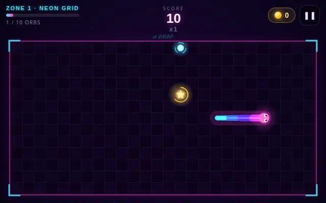 [源码网页实截](<https://github.com/Prashant7380/Neon-Hunter/blob/59a6fcf51531e99d4f354f8f39b7fb5cd9764545/Neon%20Hunter/index.html>) | [Prashant7380/Neon-Hunter](<https://github.com/Prashant7380/Neon-Hunter>) | 常见根目录许可文件未找到 | 待核 | — | 未列入口 |
| 2238 | [ ] | [Neon Overdrive](<https://github.com/gamingnews5/awesome-opus-5.5-games/blob/9a29b570e56bd19f15a3cd6bbac0b8c682f2c48c/games/neon-overdrive/readme.md>) | 待补截图 | [adisagar2003/neon-top-down-shooter](<https://github.com/adisagar2003/neon-top-down-shooter>) | 常见根目录许可文件未找到 | 待核 | — | 未列入口 |
| 2239 | [ ] | [Neon Precinct](<https://github.com/gamingnews5/awesome-opus-5.5-games/blob/9a29b570e56bd19f15a3cd6bbac0b8c682f2c48c/games/neon-precinct/readme.md>) | 待补截图 | [dylanhsieh/neon-precinct](<https://github.com/dylanhsieh/neon-precinct>) | 常见根目录许可文件未找到 | 待核 | — | [可达 · 含游戏画布／引擎的网页](<https://dylanhsieh.github.io/neon-precinct/>) |
| 2240 | [ ] | [Neon Racer](<https://github.com/gamingnews5/awesome-opus-5.5-games/blob/9a29b570e56bd19f15a3cd6bbac0b8c682f2c48c/games/neon-racer/readme.md>) | 待补截图 | [machuiwen/neon-racer](<https://github.com/machuiwen/neon-racer>) | 常见根目录许可文件未找到 无根LICENSE。 | 待核 | — | [可达 · 含游戏画布／引擎的网页](<https://machuiwen.github.io/neon-racer/>) |
| 2241 | [ ] | [NEON RECKONING](<https://github.com/gamingnews5/awesome-opus-5.5-games/blob/9a29b570e56bd19f15a3cd6bbac0b8c682f2c48c/games/neon-reckoning/readme.md>) | 待补截图 | [threepoint7516/neon-reckoning](<https://github.com/threepoint7516/neon-reckoning>) | 常见根目录许可文件未找到 | 待核 | — | [可达 · 含游戏画布／引擎的网页](<https://neon-reckoning.netlify.app>) |
| 2242 | [ ] | [Neon Rush](<https://github.com/gamingnews5/awesome-opus-5.5-games/blob/9a29b570e56bd19f15a3cd6bbac0b8c682f2c48c/games/neon-rush/readme.md>) | 待补截图 | [vedshubham58-crypto/Chalk-Rush](<https://github.com/vedshubham58-crypto/Chalk-Rush>) | 常见根目录许可文件未找到 | 待核 | — | 未列入口 |
| 2243 | [ ] | [Neon Siege](<https://github.com/gamingnews5/awesome-opus-5.5-games/blob/9a29b570e56bd19f15a3cd6bbac0b8c682f2c48c/games/neon-siege/readme.md>) | 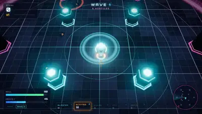 [合集截图](<https://github.com/theolundqvist/frontier-games/blob/main/media/neon-siege/preview.webp>) | [PromptEngineer48/claude-opus-5.5-games](<https://github.com/PromptEngineer48/claude-opus-5.5-games>) | 常见根目录许可文件未找到 [该仓的 Mortal Clash 从外部加载角色模型，各模型有独立许可。](<https://github.com/PromptEngineer48/claude-opus-5.5-games/blob/HEAD/README.md#L89-L90>) | [README 提及、源码有输入读取（仓库级）](<https://github.com/PromptEngineer48/claude-opus-5.5-games/blob/main/neon-siege/index.html#L2302>) | [7.4](<https://github.com/theolundqvist/frontier-games/blob/main/media/neon-siege/preview.webp>) | [可达 · 含游戏画布／引擎的网页](<https://promptengineer48.github.io/claude-opus-5.5-games/neon-siege/>) |
| 2244 | [ ] | [Neon Sky Runner](<https://github.com/gamingnews5/awesome-opus-5.5-games/blob/9a29b570e56bd19f15a3cd6bbac0b8c682f2c48c/games/neon-sky-runner/readme.md>) | 待补截图 | [mirulismat-bit/neon-sky-runner](<https://github.com/mirulismat-bit/neon-sky-runner>) | 常见根目录许可文件未找到 | 待核 | — | [可达 · 含游戏画布／引擎的网页](<https://mirulismat-bit.github.io/neon-sky-runner/>) |
| 2245 | [ ] | [Neon Snake — Fable baseline](<https://github.com/gamingnews5/awesome-opus-5.5-games/blob/9a29b570e56bd19f15a3cd6bbac0b8c682f2c48c/games/neon-snake-fable-baseline/readme.md>) | 待补截图 | [kinncj/neon-snake](<https://github.com/kinncj/neon-snake>) | 常见根目录许可文件未找到 | 待核 | — | [可达 · 含游戏画布／引擎的网页](<https://kinncj.github.io/neon-snake/claude-code-fable/>) |
| 2246 | [ ] | [Neon Survivor](<https://github.com/gamingnews5/awesome-opus-5.5-games/blob/9a29b570e56bd19f15a3cd6bbac0b8c682f2c48c/games/neon-survivor/readme.md>) | 待补截图 | [zlip0/neon-survivor](<https://github.com/zlip0/neon-survivor>) | 常见根目录许可文件未找到 | 待核 | — | 未列入口 |
| 2247 | [ ] | [Neon Vortex](<https://github.com/gamingnews5/awesome-opus-5.5-games/blob/9a29b570e56bd19f15a3cd6bbac0b8c682f2c48c/games/neon-vortex/readme.md>) | 待补截图 | [Marcopolo234231/neonvortex](<https://github.com/Marcopolo234231/neonvortex>) | 常见根目录许可文件未找到 | 待核 | — | [可达 · 含游戏画布／引擎的网页](<https://marcopolo234231.github.io/neonvortex/>) |
| 2248 | [ ] | [NEON WARDEN](<https://github.com/gamingnews5/awesome-opus-5.5-games/blob/9a29b570e56bd19f15a3cd6bbac0b8c682f2c48c/games/neon-warden/readme.md>) | 待补截图 | [Nipale-ai/fable-5-1-one-prompt-game](<https://github.com/Nipale-ai/fable-5-1-one-prompt-game>) | 常见根目录许可文件未找到 | 待核 | — | [可达 · 合集所列网页](<https://nipale-ai.github.io/fable-5-1-one-prompt-game/fable/>) |
| 2249 | [ ] | [Neon Warlords](<https://github.com/gamingnews5/awesome-opus-5.5-games/blob/9a29b570e56bd19f15a3cd6bbac0b8c682f2c48c/games/neon-warlords/readme.md>) | 待补截图 | [ShaunBoughey/neonwarlords](<https://github.com/ShaunBoughey/neonwarlords>) | 常见根目录许可文件未找到 | 待核 | — | 未列入口 |
| 2250 | [ ] | [NeoN+1](<https://github.com/gamingnews5/awesome-opus-5.5-games/blob/9a29b570e56bd19f15a3cd6bbac0b8c682f2c48c/games/neon-1/readme.md>) | 待补截图 | [gschomburg/neon-1](<https://github.com/gschomburg/neon-1>) | 常见根目录许可文件未找到 | 待核 | [5.0](<https://github.com/gschomburg/neon-1/blob/main/dist/preview.png>) | 未列入口 |
| 2251 | [ ] | [Net Cafe Tycoon](<https://github.com/gamingnews5/awesome-opus-5.5-games/blob/9a29b570e56bd19f15a3cd6bbac0b8c682f2c48c/games/net-cafe-tycoon/readme.md>) | 待补截图 | [bilgehandk/internet-cafe-simulator](<https://github.com/bilgehandk/internet-cafe-simulator>) | 常见根目录许可文件未找到 | 待核 | — | [可达 · 含游戏画布／引擎的网页](<https://bilgehandk.github.io/net-cafe-tycoon/>) |
| 2252 | [ ] | [Netmancer](<https://github.com/gamingnews5/awesome-opus-5.5-games/blob/9a29b570e56bd19f15a3cd6bbac0b8c682f2c48c/games/netmancer/readme.md>) | 待补截图 | [cdsweeney2016/netmancer](<https://github.com/cdsweeney2016/netmancer>) | 常见根目录许可文件未找到 | 待核 | — | 未列入口 |
| 2253 | [ ] | [NETRUNNER '86](<https://github.com/gamingnews5/awesome-opus-5.5-games/blob/9a29b570e56bd19f15a3cd6bbac0b8c682f2c48c/games/netrunner-86/readme.md>) | 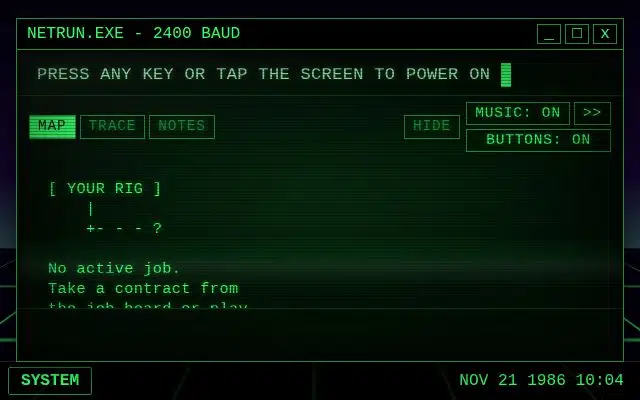 [源码网页实截](<https://github.com/Rikkicmd/NetRunner86/blob/main/web/index.html>) | [Rikkicmd/NetRunner86](<https://github.com/Rikkicmd/NetRunner86>) | 常见根目录许可文件未找到 | 待核 | — | 未列入口 |
| 2254 | [ ] | [NetWorm](<https://github.com/gamingnews5/awesome-opus-5.5-games/blob/9a29b570e56bd19f15a3cd6bbac0b8c682f2c48c/games/networm/readme.md>) | 待补截图 | [IanBedard/networm](<https://github.com/IanBedard/networm>) | 常见根目录许可文件未找到 | 待核 | — | [可达 · 含游戏画布／引擎的网页](<https://ianbedard.github.io/networm/>) |
| 2255 | [ ] | [Neural Sight](<https://github.com/gamingnews5/awesome-opus-5.5-games/blob/9a29b570e56bd19f15a3cd6bbac0b8c682f2c48c/games/neural-sight/readme.md>) | 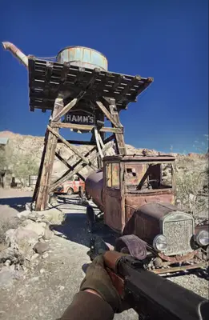 [合集截图](<https://github.com/monstercameron/Neural-Sight/blob/main/docs/images/nelson-ghost-town.jpg>) | [monstercameron/Neural-Sight](<https://github.com/monstercameron/Neural-Sight>) | 常见根目录许可文件未找到 [场景权利归各创作者；Nelson Ghost Town 标明 CC BY 4.0，另两处场景要分别查许可。](<https://github.com/monstercameron/Neural-Sight/blob/HEAD/README.md#L23-L27>) | 待核 | [9.7](<https://github.com/monstercameron/Neural-Sight/blob/main/docs/images/nelson-ghost-town.jpg>) | [可达 · 含游戏画布／引擎的网页](<https://monstercameron.github.io/Neural-Sight/>) |
| 2256 | [ ] | [Neverending Tunnel V: Time Warp](<https://github.com/gamingnews5/awesome-opus-5.5-games/blob/9a29b570e56bd19f15a3cd6bbac0b8c682f2c48c/games/neverending-tunnel-v-time-warp/readme.md>) | 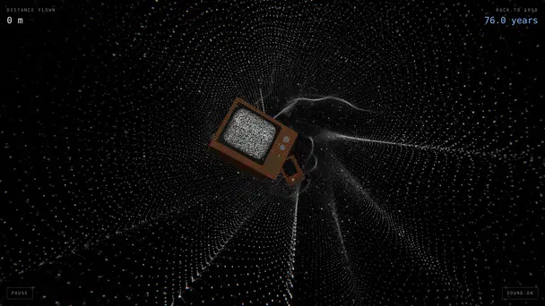 [合集截图](<https://github.com/h1ddenpr0cess20/tunnel-v/blob/main/docs/screenshots/tv.png>) | [h1ddenpr0cess20/tunnel-v](<https://github.com/h1ddenpr0cess20/tunnel-v>) | 常见根目录许可文件未找到 | 待核 | [5.2](<https://github.com/h1ddenpr0cess20/tunnel-v/blob/main/docs/screenshots/tv.png>) | [可达 · 含游戏画布／引擎的网页](<https://tunnel-v.vercel.app>) |
| 2257 | [ ] | [New Plateau](<https://github.com/gamingnews5/awesome-opus-5.5-games/blob/9a29b570e56bd19f15a3cd6bbac0b8c682f2c48c/games/new-plateau/readme.md>) | 待补截图 | [EmmanuelRTM/new-plateu](<https://github.com/EmmanuelRTM/new-plateu>) | 常见根目录许可文件未找到 | 待核 | — | 未列入口 |
| 2258 | [ ] | [Newspaper Tycoon](<https://github.com/gamingnews5/awesome-opus-5.5-games/blob/9a29b570e56bd19f15a3cd6bbac0b8c682f2c48c/games/newspaper-tycoon/readme.md>) | 待补截图 | [dimdimich1255-collab/newspaper-tycoon](<https://github.com/dimdimich1255-collab/newspaper-tycoon>) | 常见根目录许可文件未找到 | 待核 | — | 未列入口 |
| 2259 | [ ] | [NewWorld](<https://github.com/gamingnews5/awesome-opus-5.5-games/blob/9a29b570e56bd19f15a3cd6bbac0b8c682f2c48c/games/newworld/readme.md>) | 待补截图 | [SurachatMa/game-2d-web](<https://github.com/SurachatMa/game-2d-web>) | 常见根目录许可文件未找到 | 待核 | [5.6](<https://github.com/SurachatMa/game-2d-web/blob/main/wiki/media/art-full/job-archer.webp>) | [可达 · 含游戏画布／引擎的网页](<https://surachatma.github.io/game-2d-web/>) |
| 2260 | [ ] | [NEXUS](<https://github.com/gamingnews5/awesome-opus-5.5-games/blob/9a29b570e56bd19f15a3cd6bbac0b8c682f2c48c/games/nexus/readme.md>) | 待补截图 | [noahkoldow/triviagame](<https://github.com/noahkoldow/triviagame>) | 常见根目录许可文件未找到 | 待核 | — | 未列入口 |
| 2261 | [ ] | [NGC-1980](<https://github.com/gamingnews5/awesome-opus-5.5-games/blob/9a29b570e56bd19f15a3cd6bbac0b8c682f2c48c/games/ngc-1980/readme.md>) | 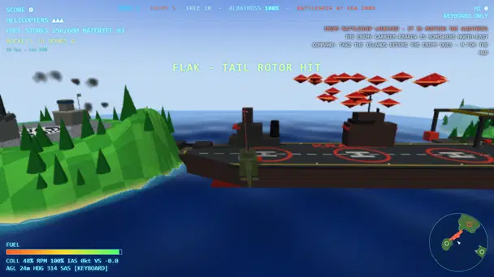 [合集截图](<https://github.com/gnutgnut/NGC-1980/blob/main/docs/screenshot.png>) | [gnutgnut/NGC-1980](<https://github.com/gnutgnut/NGC-1980>) | 常见根目录许可文件未找到 | [README 提及、源码有输入读取](<https://github.com/gnutgnut/NGC-1980/blob/main/game/js/main.js#L157>) | [5.8](<https://github.com/gnutgnut/NGC-1980/blob/main/docs/screenshot.png>) | 未列入口 |
| 2262 | [ ] | [Người Đi Trước](<https://github.com/gamingnews5/awesome-opus-5.5-games/blob/9a29b570e56bd19f15a3cd6bbac0b8c682f2c48c/games/nguoi-i-truoc/readme.md>) | 待补截图 | [glepicsv-cyber/Veteran](<https://github.com/glepicsv-cyber/Veteran>) | 常见根目录许可文件未找到 | 待核 | — | [可达 · 含游戏画布／引擎的网页](<https://veteran-roan.vercel.app>) |
| 2263 | [ ] | [Niagara or Bust!](<https://github.com/gamingnews5/awesome-opus-5.5-games/blob/9a29b570e56bd19f15a3cd6bbac0b8c682f2c48c/games/niagara-or-bust/readme.md>) | 待补截图 | [MikeWeaver-dev/niagara-or-bust](<https://github.com/MikeWeaver-dev/niagara-or-bust>) | 常见根目录许可文件未找到 | 待核 | — | 未列入口 |
| 2264 | [ ] | [Nice Dice](<https://github.com/gamingnews5/awesome-opus-5.5-games/blob/9a29b570e56bd19f15a3cd6bbac0b8c682f2c48c/games/nice-dice/readme.md>) | 待补截图 | [humainasger/nice-dice](<https://github.com/humainasger/nice-dice>) | 常见根目录许可文件未找到 [README 许可段另述素材或第三方内容](<https://raw.githubusercontent.com/humainasger/nice-dice/HEAD/README.md>) | 待核 | — | [可达 · 合集所列网页](<https://humainasger.github.io/nice-dice/>) |
| 2265 | [ ] | [Nick's Arcade](<https://github.com/gamingnews5/awesome-opus-5.5-games/blob/9a29b570e56bd19f15a3cd6bbac0b8c682f2c48c/games/nick-s-arcade/readme.md>) | 待补截图 | [ub1qu1tous-apps/nicks-arcade](<https://github.com/ub1qu1tous-apps/nicks-arcade>) | 常见根目录许可文件未找到 | 待核 | — | [可达 · 含游戏画布／引擎的网页](<https://ub1qu1tous-apps.github.io/nicks-arcade/>) |
| 2266 | [ ] | [Night Duel Baseball](<https://github.com/gamingnews5/awesome-opus-5.5-games/blob/9a29b570e56bd19f15a3cd6bbac0b8c682f2c48c/games/night-duel-baseball/readme.md>) | 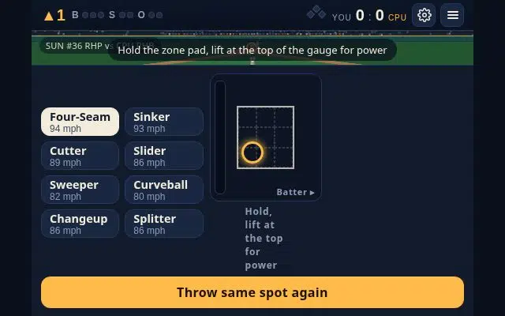 [源码网页实截](<https://github.com/dioaroinc/nightduelbaseball/blob/main/baseball/index.html>) | [dioaroinc/nightduelbaseball](<https://github.com/dioaroinc/nightduelbaseball>) | 常见根目录许可文件未找到 | 待核 | — | 未列入口 |
| 2267 | [ ] | [Night Highway](<https://github.com/gamingnews5/awesome-opus-5.5-games/blob/9a29b570e56bd19f15a3cd6bbac0b8c682f2c48c/games/night-highway/readme.md>) | 待补截图 | [JohannSR28/night-highway](<https://github.com/JohannSR28/night-highway>) | 常见根目录许可文件未找到 | 待核 | — | 未列入口 |
| 2268 | [ ] | [Night Museum](<https://github.com/gamingnews5/awesome-opus-5.5-games/blob/9a29b570e56bd19f15a3cd6bbac0b8c682f2c48c/games/night-museum/readme.md>) | 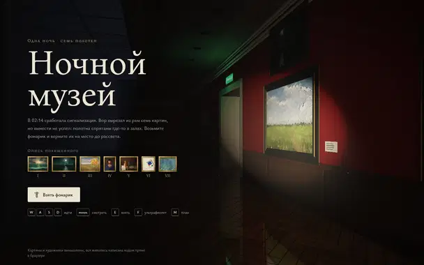 [游戏菜单或界面](<https://github.com/swan4er/opus-100-projects/blob/main/037-night-museum/preview.jpg>) | [swan4er/opus-100-projects](<https://github.com/swan4er/opus-100-projects>) | 常见根目录许可文件未找到 | 待核 | [8.0](<https://github.com/swan4er/opus-100-projects/blob/main/037-night-museum/preview.jpg>) | [可达 · 含游戏画布／引擎的网页](<https://swan4er.github.io/opus-100-projects/037-night-museum/>) |
| 2269 | [ ] | [Night Ops Arena](<https://github.com/gamingnews5/awesome-opus-5.5-games/blob/9a29b570e56bd19f15a3cd6bbac0b8c682f2c48c/games/night-ops-arena/readme.md>) | 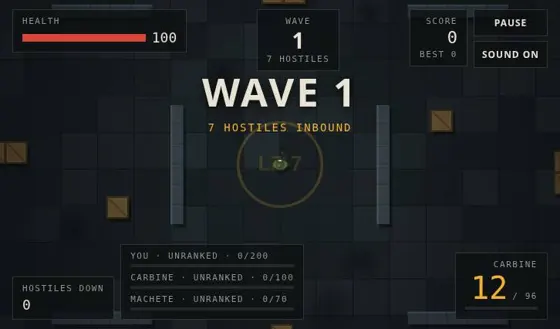 [源码网页实截](<https://github.com/lukeshaw65-alt/night-ops-arena/blob/main/index.html>) | [lukeshaw65-alt/night-ops-arena](<https://github.com/lukeshaw65-alt/night-ops-arena>) | 常见根目录许可文件未找到 | [源码有输入读取](<https://github.com/lukeshaw65-alt/night-ops-arena/blob/main/index.html#L2789>) | — | 未列入口 |
| 2270 | [ ] | [Night Shift Ward 7](<https://github.com/gamingnews5/awesome-opus-5.5-games/blob/9a29b570e56bd19f15a3cd6bbac0b8c682f2c48c/games/night-shift-ward-7/readme.md>) | 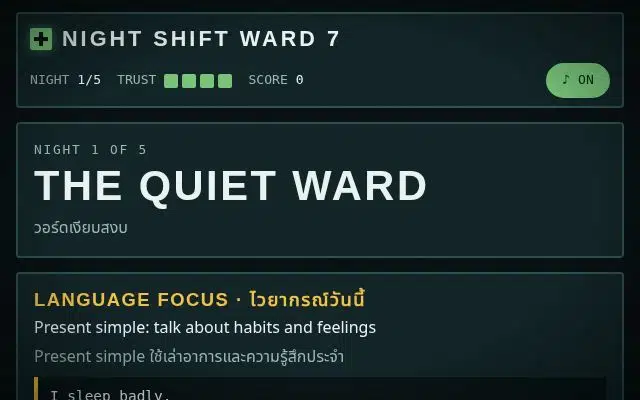 [源码网页实截](<https://github.com/SupasSK/Before-They-Wake-/blob/main/index.html>) | [SupasSK/Before-They-Wake-](<https://github.com/SupasSK/Before-They-Wake->) | 常见根目录许可文件未找到 | 待核 | — | [README · 入口已失效 · 上游 README 所列网页](<https://supassk.github.io/Before-They-Wake-/>) |
| 2271 | [ ] | [NIGHT SURVIVORS — 어둠의 생존자](<https://github.com/gamingnews5/awesome-opus-5.5-games/blob/9a29b570e56bd19f15a3cd6bbac0b8c682f2c48c/games/night-survivors/readme.md>) | 待补截图 | [kkob728/claudeproject](<https://github.com/kkob728/claudeproject>) | 常见根目录许可文件未找到 | 待核 | — | 未列入口 |
| 2272 | [ ] | [Nightfall](<https://github.com/gamingnews5/awesome-opus-5.5-games/blob/9a29b570e56bd19f15a3cd6bbac0b8c682f2c48c/games/nightfall/readme.md>) | 待补截图 | [AlfredBrowser/Nightfall-Call-of-Duty-Remake-Fable-5.1](<https://github.com/AlfredBrowser/Nightfall-Call-of-Duty-Remake-Fable-5.1>) | 常见根目录许可文件未找到 | 待核 | — | 未列入口 |
| 2273 | [ ] | [Nightwatch](<https://github.com/gamingnews5/awesome-opus-5.5-games/blob/9a29b570e56bd19f15a3cd6bbac0b8c682f2c48c/games/nightwatch/readme.md>) | 待补截图 | [kili-skiff/survivor-rpg](<https://github.com/kili-skiff/survivor-rpg>) | 常见根目录许可文件未找到 | 待核 | — | [可达 · 合集所列网页](<https://kili-skiff.github.io/survivor-rpg/>) |
| 2274 | [ ] | [NIJISANJI 7 Colors Card Game Simulator (독립 사이트)](<https://github.com/gamingnews5/awesome-opus-5.5-games/blob/9a29b570e56bd19f15a3cd6bbac0b8c682f2c48c/games/nijisanji-7-colors-card-game-simulator/readme.md>) | 待补截图 | [tnsgh0813/nijinana-simulator](<https://github.com/tnsgh0813/nijinana-simulator>) | 常见根目录许可文件未找到 | 待核 | — | 未列入口 |
| 2275 | [ ] | [Nina the Hippo platformer](<https://github.com/gamingnews5/awesome-opus-5.5-games/blob/9a29b570e56bd19f15a3cd6bbac0b8c682f2c48c/games/nina-the-hippo-platformer/readme.md>) | 待补截图 | [hggruppi94/platformer-1](<https://github.com/hggruppi94/platformer-1>) | 常见根目录许可文件未找到 | 待核 | — | 未列入口 |
| 2276 | [ ] | [nine](<https://github.com/gamingnews5/awesome-opus-5.5-games/blob/9a29b570e56bd19f15a3cd6bbac0b8c682f2c48c/games/nine/readme.md>) | 待补截图 | [JTL928/nine-web](<https://github.com/JTL928/nine-web>) | 常见根目录许可文件未找到 | 待核 | — | 未列入口 |
| 2277 | [ ] | [Ninja Battle](<https://github.com/gamingnews5/awesome-opus-5.5-games/blob/9a29b570e56bd19f15a3cd6bbac0b8c682f2c48c/games/ninja-battle/readme.md>) | 待补截图 | [allanmassonneau-code/NARUTO-CLASH](<https://github.com/allanmassonneau-code/NARUTO-CLASH>) | 常见根目录许可文件未找到 | 待核 | — | 未列入口 |
| 2278 | [ ] | [Ninja Slice](<https://github.com/gamingnews5/awesome-opus-5.5-games/blob/9a29b570e56bd19f15a3cd6bbac0b8c682f2c48c/games/ninja-slice/readme.md>) | 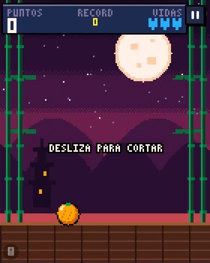 [对应子游戏玩法实截](<https://github.com/kokellara12-maker/apps-k4m9q2/blob/HEAD/ninja.html>) | [kokellara12-maker/apps-k4m9q2](<https://github.com/kokellara12-maker/apps-k4m9q2>) | 常见根目录许可文件未找到 | 待核 | — | [可达 · 含游戏画布／引擎的网页](<https://kokellara12-maker.github.io/apps-k4m9q2/ninja.html>) |
| 2279 | [ ] | [Ninja-Space](<https://github.com/gamingnews5/awesome-opus-5.5-games/blob/9a29b570e56bd19f15a3cd6bbac0b8c682f2c48c/games/ninja-space/readme.md>) | 待补截图 | [Sigurd-41/Ninja-Space](<https://github.com/Sigurd-41/Ninja-Space>) | 常见根目录许可文件未找到 | 待核 | — | [可达 · 合集所列网页](<https://sigurd-41.github.io/Ninja-Space/network-ninja/>) |
| 2280 | [ ] | [NINJAGO RUNNER](<https://github.com/gamingnews5/awesome-opus-5.5-games/blob/9a29b570e56bd19f15a3cd6bbac0b8c682f2c48c/games/ninjago-runner/readme.md>) | 待补截图 | [ffawazz/NinjagoGame](<https://github.com/ffawazz/NinjagoGame>) | 常见根目录许可文件未找到 | 待核 | — | 未列入口 |
| 2281 | [ ] | [NITROVOLT](<https://github.com/gamingnews5/awesome-opus-5.5-games/blob/9a29b570e56bd19f15a3cd6bbac0b8c682f2c48c/games/nitrovolt/readme.md>) | 待补截图 | [Coder-4847/Nitrovolt](<https://github.com/Coder-4847/Nitrovolt>) | 常见根目录许可文件未找到 | [README 提及](<https://github.com/Coder-4847/Nitrovolt/blob/HEAD/README.md#L39>) | — | 未列入口 |
| 2282 | [ ] | [No AI's Sky](<https://github.com/gamingnews5/awesome-opus-5.5-games/blob/9a29b570e56bd19f15a3cd6bbac0b8c682f2c48c/games/no-ai-s-sky/readme.md>) | 待补截图 | [jesuscurreripa/noaissky](<https://github.com/jesuscurreripa/noaissky>) | 常见根目录许可文件未找到 | 待核 | — | [入口已失效 · 合集所列网页](<https://noaissky.vercel.app>) |
| 2283 | [ ] | [NOBODY HOME](<https://github.com/gamingnews5/awesome-opus-5.5-games/blob/9a29b570e56bd19f15a3cd6bbac0b8c682f2c48c/games/nobody-home/readme.md>) | 待补截图 | [openaideveloperai-png/Sourse](<https://github.com/openaideveloperai-png/Sourse>) | 常见根目录许可文件未找到 | 待核 | — | 未列入口 |
| 2284 | [ ] | [Nocimonorcen TD](<https://github.com/gamingnews5/awesome-opus-5.5-games/blob/9a29b570e56bd19f15a3cd6bbac0b8c682f2c48c/games/nocimonorcen-td/readme.md>) | 待补截图 | [SinisterN/Nocimonorcen](<https://github.com/SinisterN/Nocimonorcen>) | 常见根目录许可文件未找到 | 待核 | — | [可达 · 合集所列网页](<https://sinistern.github.io/Nocimonorcen/>) |
| 2285 | [ ] | [Node Wars](<https://github.com/gamingnews5/awesome-opus-5.5-games/blob/9a29b570e56bd19f15a3cd6bbac0b8c682f2c48c/games/node-wars/readme.md>) | 待补截图 | [dlswimmer/node-wars](<https://github.com/dlswimmer/node-wars>) | 常见根目录许可文件未找到 | 待核 | — | 未列入口 |
| 2286 | [x] | [NOIR EXTREME](<https://github.com/gamingnews5/awesome-opus-5.5-games/blob/9a29b570e56bd19f15a3cd6bbac0b8c682f2c48c/games/noir-extreme/readme.md>) |  [合集截图](<https://github.com/evancodez/noircity/blob/main/docs/progress/2026-09-27_phase1b_street.jpg>) | [evancodez/noircity](<https://github.com/evancodez/noircity>) | 常见根目录许可文件未找到 | [README 提及](<https://github.com/evancodez/noircity/blob/HEAD/README.md#L151>) | [6.8](<https://github.com/evancodez/noircity/blob/main/docs/progress/2026-09-27_phase1b_street.jpg>) | 未列入口 · [pureTV 内嵌原版](https://ecojust.github.io/pureTV/games/noir-extreme/tv.html) |
| 2287 | [ ] | [Nolate](<https://github.com/gamingnews5/awesome-opus-5.5-games/blob/9a29b570e56bd19f15a3cd6bbac0b8c682f2c48c/games/nolate/readme.md>) | 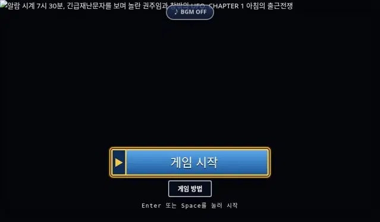 [试玩首页实截](<https://nolate-ashy.vercel.app>) | [rnjagurwn5-max/nolate](<https://github.com/rnjagurwn5-max/nolate>) | 常见根目录许可文件未找到 | 待核 | — | [可达 · 合集所列网页](<https://nolate-ashy.vercel.app>) |
| 2288 | [ ] | [Nolja](<https://github.com/gamingnews5/awesome-opus-5.5-games/blob/9a29b570e56bd19f15a3cd6bbac0b8c682f2c48c/games/nolja/readme.md>) |  [同款源码启动画面实截](<https://github.com/pusam/nolja/blob/HEAD/index.html>) | [pusam/nolja](<https://github.com/pusam/nolja>) | 常见根目录许可文件未找到 | [README 提及、源码有输入读取](<https://github.com/pusam/nolja/blob/main/games/tennis/tennis.js#L893>) | — | [可达 · 合集所列网页](<https://pusam.github.io/nolja/>) |
| 2289 | [ ] | [Noodle Bots](<https://github.com/gamingnews5/awesome-opus-5.5-games/blob/9a29b570e56bd19f15a3cd6bbac0b8c682f2c48c/games/noodle-bots/readme.md>) |  [源码运行首页](<https://github.com/TtGamer15/noodle-bots/blob/main/index.html>) | [TtGamer15/noodle-bots](<https://github.com/TtGamer15/noodle-bots>) | 常见根目录许可文件未找到 | 待核 | — | 未列入口 |
| 2290 | [ ] | [Nook](<https://github.com/gamingnews5/awesome-opus-5.5-games/blob/9a29b570e56bd19f15a3cd6bbac0b8c682f2c48c/games/nook/readme.md>) | 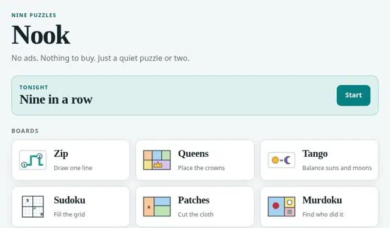 [试玩首页实截](<https://keremozcan.github.io/nook/>) | [keremozcan/nook](<https://github.com/keremozcan/nook>) | 常见根目录许可文件未找到 | 待核 | — | [可达 · 合集所列网页](<https://keremozcan.github.io/nook/>) |
| 2291 | [ ] | [Nosum](<https://github.com/gamingnews5/awesome-opus-5.5-games/blob/9a29b570e56bd19f15a3cd6bbac0b8c682f2c48c/games/nosum/readme.md>) | 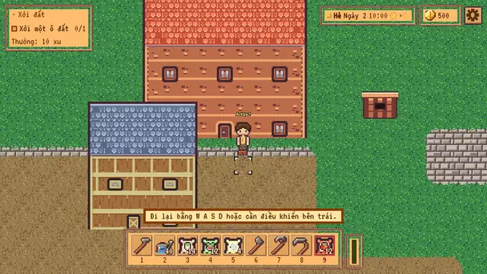 [合集截图](<https://github.com/ppn-systems/nosum/blob/master/docs/qa/art-upgrade-ingame-coop-exterior-1280x720.png>) | [ppn-systems/nosum](<https://github.com/ppn-systems/nosum>) | 常见根目录许可文件未找到 | 待核 | [6.6](<https://github.com/ppn-systems/nosum/blob/master/docs/qa/art-upgrade-ingame-coop-exterior-1280x720.png>) | [可达 · 合集所列网页](<https://farm.ppnsys.com>) |
| 2292 | [ ] | [not-feudalism](<https://github.com/gamingnews5/awesome-opus-5.5-games/blob/9a29b570e56bd19f15a3cd6bbac0b8c682f2c48c/games/not-feudalism/readme.md>) | 待补截图 | [cadep55/not-feudalism](<https://github.com/cadep55/not-feudalism>) | 常见根目录许可文件未找到 | 待核 | — | 未列入口 |
| 2293 | [ ] | [not-kahoot](<https://github.com/gamingnews5/awesome-opus-5.5-games/blob/9a29b570e56bd19f15a3cd6bbac0b8c682f2c48c/games/not-kahoot/readme.md>) | 待补截图 | [inbar-collab/not-kahoot](<https://github.com/inbar-collab/not-kahoot>) | 常见根目录许可文件未找到 | 待核 | — | 未列入口 |
| 2294 | [ ] | [Nouvelle Rive](<https://github.com/gamingnews5/awesome-opus-5.5-games/blob/9a29b570e56bd19f15a3cd6bbac0b8c682f2c48c/games/nouvelle-rive/readme.md>) | 待补截图 | [becorni-dev/inspirationGame](<https://github.com/becorni-dev/inspirationGame>) | 常见根目录许可文件未找到 | 待核 | — | 未列入口 |
| 2295 | [ ] | [Nova Skim](<https://github.com/gamingnews5/awesome-opus-5.5-games/blob/9a29b570e56bd19f15a3cd6bbac0b8c682f2c48c/games/nova-skim/readme.md>) | 待补截图 | [IBassemTarek/nova-skim](<https://github.com/IBassemTarek/nova-skim>) | 常见根目录许可文件未找到 | 待核 | — | 未列入口 |
| 2296 | [ ] | [NPC Panic](<https://github.com/gamingnews5/awesome-opus-5.5-games/blob/9a29b570e56bd19f15a3cd6bbac0b8c682f2c48c/games/party-chaos/readme.md>) | 待补截图 | [lawrenceandrewlargo/roblox-extreme-minigames](<https://github.com/lawrenceandrewlargo/roblox-extreme-minigames>) | 常见根目录许可文件未找到 | 待核 | — | 未列入口 |
| 2297 | [ ] | [NPC Village](<https://github.com/gamingnews5/awesome-opus-5.5-games/blob/9a29b570e56bd19f15a3cd6bbac0b8c682f2c48c/games/npc-village/readme.md>) | 待补截图 | [LJAguil/Npc-Village](<https://github.com/LJAguil/Npc-Village>) | 常见根目录许可文件未找到 | 待核 | — | 未列入口 |
| 2298 | [ ] | [NQ Tetris](<https://github.com/gamingnews5/awesome-opus-5.5-games/blob/9a29b570e56bd19f15a3cd6bbac0b8c682f2c48c/games/nq-tetris/readme.md>) | 待补截图 | [nikniq/nq-tetris](<https://github.com/nikniq/nq-tetris>) | 常见根目录许可文件未找到 | [源码有输入读取](<https://github.com/nikniq/nq-tetris/blob/main/public_html/js/tetris.js#L1569>) | — | 未列入口 |
| 2299 | [ ] | [NQ Towers](<https://github.com/gamingnews5/awesome-opus-5.5-games/blob/9a29b570e56bd19f15a3cd6bbac0b8c682f2c48c/games/nq-towers/readme.md>) | 待补截图 | [nikniq/nq-towers](<https://github.com/nikniq/nq-towers>) | 常见根目录许可文件未找到 | 待核 | — | 未列入口 |
| 2300 | [ ] | [Nuclear Winter](<https://github.com/gamingnews5/awesome-opus-5.5-games/blob/9a29b570e56bd19f15a3cd6bbac0b8c682f2c48c/games/nuclear-winter/readme.md>) | 待补截图 | [soncsec/nuclearwinter](<https://github.com/soncsec/nuclearwinter>) | 常见根目录许可文件未找到 | 待核 | — | [可达 · 合集所列网页](<https://soncsec.github.io/nuclearwinter/>) |
| 2301 | [ ] | [NULL SIGNAL](<https://github.com/gamingnews5/awesome-opus-5.5-games/blob/9a29b570e56bd19f15a3cd6bbac0b8c682f2c48c/games/null-signal/readme.md>) | 待补截图 | [hassanaldajah/null-signal](<https://github.com/hassanaldajah/null-signal>) | 常见根目录许可文件未找到 [Fontsource 字体另循 OFL。](<https://github.com/hassanaldajah/null-signal/blob/HEAD/README.md#L53>) | 待核 | [5.4](<https://github.com/hassanaldajah/null-signal/blob/main/blender/previews/all_characters.png>) | 未列入口 |
| 2302 | [ ] | [NULLSPACE](<https://github.com/gamingnews5/awesome-opus-5.5-games/blob/9a29b570e56bd19f15a3cd6bbac0b8c682f2c48c/games/nullspace/readme.md>) | 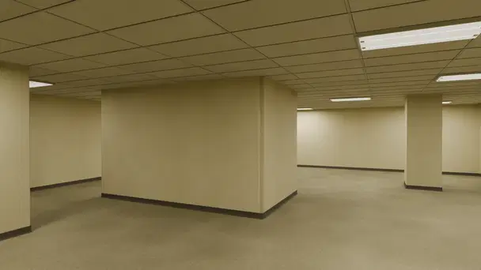 [合集截图](<https://github.com/marius4lui/NULLSPACE/blob/main/docs/images/environment-preview.png>) | [marius4lui/NULLSPACE](<https://github.com/marius4lui/NULLSPACE>) | 常见根目录许可文件未找到 | 待核 | [7.8](<https://github.com/marius4lui/NULLSPACE/blob/main/docs/images/environment-preview.png>) | [可达 · 合集所列网页](<https://github.marius4lui.dev/NULLSPACE/>) |
| 2303 | [ ] | [Number Arcade](<https://github.com/gamingnews5/awesome-opus-5.5-games/blob/9a29b570e56bd19f15a3cd6bbac0b8c682f2c48c/games/number-arcade/readme.md>) | 待补截图 | [Alex883388/number-dash](<https://github.com/Alex883388/number-dash>) | 常见根目录许可文件未找到 | [README 提及](<https://github.com/Alex883388/number-dash/blob/HEAD/README.md#L163>) | — | [可达 · 合集所列网页](<https://alex883388.github.io/number-dash/>) |
| 2304 | [ ] | [Number Match](<https://github.com/gamingnews5/awesome-opus-5.5-games/blob/9a29b570e56bd19f15a3cd6bbac0b8c682f2c48c/games/number-match/readme.md>) |  [同款源码游戏实截](<https://github.com/mundeok/math-arcade-paradise/blob/master/src/games/g05_match.js>) | [mundeok/math-arcade-paradise](<https://github.com/mundeok/math-arcade-paradise>) | 常见根目录许可文件未找到 | 待核 | — | 未列入口 |
| 2305 | [ ] | [Number Sliding Puzzle](<https://github.com/gamingnews5/awesome-opus-5.5-games/blob/9a29b570e56bd19f15a3cd6bbac0b8c682f2c48c/games/number-sliding-puzzle/readme.md>) | 待补截图 | [lofiski/mini-games](<https://github.com/lofiski/mini-games>) | 常见根目录许可文件未找到 | 待核 | — | 未列入口 |
| 2306 | [ ] | [NumGuess](<https://github.com/gamingnews5/awesome-opus-5.5-games/blob/9a29b570e56bd19f15a3cd6bbac0b8c682f2c48c/games/numguess/readme.md>) | 待补截图 | [LP8273787843/numguess](<https://github.com/LP8273787843/numguess>) | 常见根目录许可文件未找到 | 待核 | — | 未列入口 |
| 2307 | [ ] | [numon](<https://github.com/gamingnews5/awesome-opus-5.5-games/blob/9a29b570e56bd19f15a3cd6bbac0b8c682f2c48c/games/numon/readme.md>) |  [试玩首页实截](<https://numon-zeta.vercel.app>) | [ghozian084/numon](<https://github.com/ghozian084/numon>) | 常见根目录许可文件未找到 | 待核 | — | [可达 · 含游戏画布／引擎的网页](<https://numon-zeta.vercel.app>) |
| 2308 | [ ] | [Nutmeg](<https://github.com/gamingnews5/awesome-opus-5.5-games/blob/9a29b570e56bd19f15a3cd6bbac0b8c682f2c48c/games/nutmeg/readme.md>) | 待补截图 | [ivashnyov/nutmeg](<https://github.com/ivashnyov/nutmeg>) | 常见根目录许可文件未找到 | 待核 | — | 未列入口 |
| 2309 | [ ] | [Nycheroes](<https://github.com/gamingnews5/awesome-opus-5.5-games/blob/9a29b570e56bd19f15a3cd6bbac0b8c682f2c48c/games/nycheroes/readme.md>) | 待补截图 | [gmmeyer/nycheroes](<https://github.com/gmmeyer/nycheroes>) | 常见根目录许可文件未找到 | [README 提及](<https://github.com/gmmeyer/nycheroes/blob/HEAD/README.md#L29>) | — | [可达 · 含游戏画布／引擎的网页](<https://nycheroes.party>) |
| 2310 | [ ] | [Nông dân lúa nước – prototype](<https://github.com/gamingnews5/awesome-opus-5.5-games/blob/9a29b570e56bd19f15a3cd6bbac0b8c682f2c48c/games/nong-dan-lua-nuoc-prototype/readme.md>) | 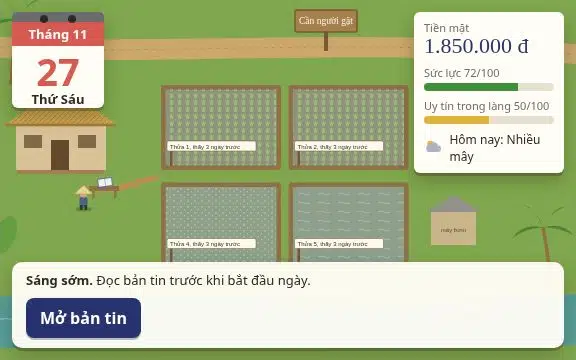 [源码运行画面](<https://github.com/tidev910-svg/trong-lua/blob/main/reference/ui-reference.html>) | [tidev910-svg/trong-lua](<https://github.com/tidev910-svg/trong-lua>) | 常见根目录许可文件未找到 | 待核 | — | 未列入口 |
| 2311 | [ ] | [Obscura — one photograph, seven prompts, one guess](<https://github.com/gamingnews5/awesome-opus-5.5-games/blob/9a29b570e56bd19f15a3cd6bbac0b8c682f2c48c/games/obscura-one-photograph-seven-prompts-one-guess/readme.md>) | 待补截图 | [stoketog/Obscura](<https://github.com/stoketog/Obscura>) | 常见根目录许可文件未找到 | 待核 | — | [入口已失效 · 合集所列网页](<https://obscura-stoke2.vercel.app>) |
| 2312 | [ ] | [Ocean Restorer · Remake](<https://github.com/gamingnews5/awesome-opus-5.5-games/blob/9a29b570e56bd19f15a3cd6bbac0b8c682f2c48c/games/ocean-restorer-remake/readme.md>) | 待补截图 | [davidpobezal-debug/ocean-restorer-remake](<https://github.com/davidpobezal-debug/ocean-restorer-remake>) | 常见根目录许可文件未找到 | 待核 | — | 未列入口 |
| 2313 | [ ] | [OctoCat-Code](<https://github.com/gamingnews5/awesome-opus-5.5-games/blob/9a29b570e56bd19f15a3cd6bbac0b8c682f2c48c/games/octocat-code/readme.md>) | 待补截图 | [INDFORGE-Studio/OctoCat-Code](<https://github.com/INDFORGE-Studio/OctoCat-Code>) | 常见根目录许可文件未找到 | 待核 | — | [可达 · 合集所列网页](<https://squidfunk.github.io/mkdocs-material/>) |
| 2314 | [ ] | [Octrivia](<https://github.com/gamingnews5/awesome-opus-5.5-games/blob/9a29b570e56bd19f15a3cd6bbac0b8c682f2c48c/games/octrivia/readme.md>) | <a href="https://img.itch.zone/aW1hZ2UvNTIwOTM1My8zMTIxMjM4NC5wbmc=/347x500/vn9jik.png">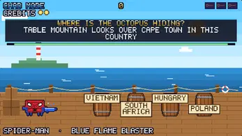</a> [作者发布的游戏截图](<https://malik1o2.itch.io/octrivia>) | [workexperiencedts/octrivia](<https://github.com/workexperiencedts/octrivia>) | 常见根目录许可文件未找到 | 待核 | — | [可达 · 含游戏画布／引擎的网页](<https://workexperiencedts.github.io/octrivia/>) |
| 2315 | [ ] | [Od Sela do Superlige](<https://github.com/gamingnews5/awesome-opus-5.5-games/blob/9a29b570e56bd19f15a3cd6bbac0b8c682f2c48c/games/od-sela-do-superlige/readme.md>) | 待补截图 | [leftym/OdSelaDoSuperligeMobile](<https://github.com/leftym/OdSelaDoSuperligeMobile>) | 常见根目录许可文件未找到 | 待核 | [6.6（原图失效）](<https://github.com/leftym/OdSelaDoSuperligeMobile/blob/main/game/src/img/award-kafana.webp>) | 未列入口 |
| 2316 | [ ] | [Odyssey of the Living Cap](<https://github.com/gamingnews5/awesome-opus-5.5-games/blob/9a29b570e56bd19f15a3cd6bbac0b8c682f2c48c/games/odyssey-of-the-living-cap/readme.md>) | 待补截图 | [SathiyabalanSengodan/autogen-odyssey-game-studio](<https://github.com/SathiyabalanSengodan/autogen-odyssey-game-studio>) | 常见根目录许可文件未找到 | 待核 | — | 未列入口 |
| 2317 | [ ] | [Off Carrom](<https://github.com/gamingnews5/awesome-opus-5.5-games/blob/9a29b570e56bd19f15a3cd6bbac0b8c682f2c48c/games/off-carrom/readme.md>) |  [上游游戏截图](<https://github.com/Lucky6400/off-carrom/blob/HEAD/promo/play-store/screenshot-1-play.png>) | [Lucky6400/off-carrom](<https://github.com/Lucky6400/off-carrom>) | 常见根目录许可文件未找到 | 待核 | — | 未列入口 |
| 2318 | [ ] | [Off the Map](<https://github.com/gamingnews5/awesome-opus-5.5-games/blob/9a29b570e56bd19f15a3cd6bbac0b8c682f2c48c/games/off-the-map/readme.md>) | 待补截图 | [KingstonAD/Off-the-map](<https://github.com/KingstonAD/Off-the-map>) | 常见根目录许可文件未找到 | 待核 | — | 未列入口 |
| 2319 | [ ] | [Off The Table](<https://github.com/gamingnews5/awesome-opus-5.5-games/blob/9a29b570e56bd19f15a3cd6bbac0b8c682f2c48c/games/off-the-table/readme.md>) | 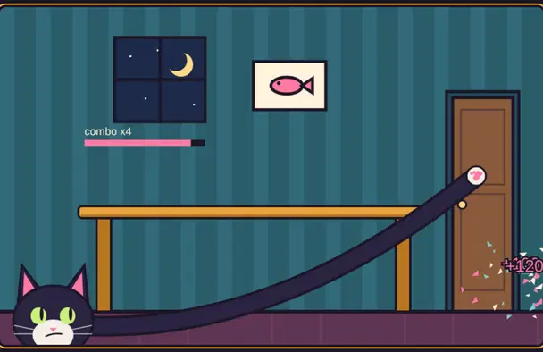 [上游游戏截图](<https://github.com/Marie-6/fun-games/blob/HEAD/off-the-table/presentation/img/gameplay-combo.png>) | [Marie-6/fun-games](<https://github.com/Marie-6/fun-games>) | 常见根目录许可文件未找到 | 待核 | — | [可达 · 合集所列网页](<https://marie-6.github.io/fun-games/>) |
| 2320 | [ ] | [OG Party Pack](<https://github.com/gamingnews5/awesome-opus-5.5-games/blob/9a29b570e56bd19f15a3cd6bbac0b8c682f2c48c/games/og-party-pack/readme.md>) | 待补截图 | [Holajack/og-party-pack](<https://github.com/Holajack/og-party-pack>) | 常见根目录许可文件未找到 | 待核 | — | [可达 · 合集所列网页](<https://og-party-pack.onrender.com>) |
| 2321 | [ ] | [ogame-like-pve](<https://github.com/gamingnews5/awesome-opus-5.5-games/blob/9a29b570e56bd19f15a3cd6bbac0b8c682f2c48c/games/ogame-like-pve/readme.md>) | 待补截图 | [Anras573/ogame-like-pve](<https://github.com/Anras573/ogame-like-pve>) | 常见根目录许可文件未找到 | 待核 | — | 未列入口 |
| 2322 | [ ] | [Oh no! shutdown again?](<https://github.com/gamingnews5/awesome-opus-5.5-games/blob/9a29b570e56bd19f15a3cd6bbac0b8c682f2c48c/games/oh-no-shutdown-again/readme.md>) | 待补截图 | [aaamanite/oh-no-shutdown-again](<https://github.com/aaamanite/oh-no-shutdown-again>) | 常见根目录许可文件未找到 | 待核 | — | [可达 · 合集所列网页](<https://aaamanite.github.io/oh-no-shutdown-again/>) |
| 2323 | [ ] | [Omega's Shawarma](<https://github.com/gamingnews5/awesome-opus-5.5-games/blob/9a29b570e56bd19f15a3cd6bbac0b8c682f2c48c/games/omega-s-shawarma/readme.md>) | 待补截图 | [rachelmakesfunprojects/omegas-shawarma](<https://github.com/rachelmakesfunprojects/omegas-shawarma>) | 常见根目录许可文件未找到 | 待核 | — | [可达 · 合集所列网页](<https://rachelmakesfunprojects.github.io/omegas-shawarma/>) |
| 2324 | [ ] | [On Target](<https://github.com/gamingnews5/awesome-opus-5.5-games/blob/9a29b570e56bd19f15a3cd6bbac0b8c682f2c48c/games/on-target/readme.md>) | 待补截图 | [mhnr73-cell/on-target](<https://github.com/mhnr73-cell/on-target>) | 常见根目录许可文件未找到 | 待核 | — | [README · 可达 · 上游 README 所列网页](<https://ontargetgame.github.io/>) |
| 2325 | [ ] | [On-Call Quest](<https://github.com/gamingnews5/awesome-opus-5.5-games/blob/9a29b570e56bd19f15a3cd6bbac0b8c682f2c48c/games/on-call-quest/readme.md>) | 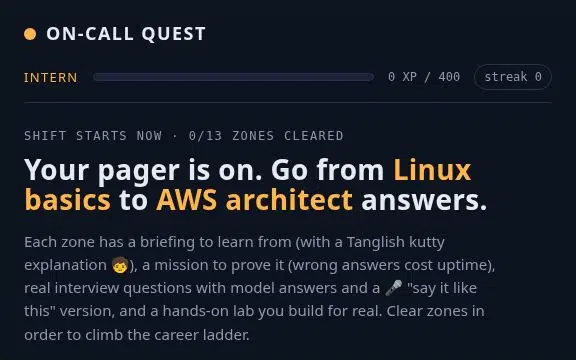 [源码运行首页](<https://github.com/arunak451/devopsgame/blob/main/index.html>) | [arunak451/devopsgame](<https://github.com/arunak451/devopsgame>) | 常见根目录许可文件未找到 | 待核 | — | 未列入口 |
| 2326 | [ ] | [One Cast](<https://github.com/gamingnews5/awesome-opus-5.5-games/blob/9a29b570e56bd19f15a3cd6bbac0b8c682f2c48c/games/one-cast/readme.md>) | 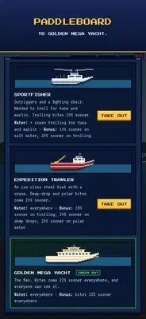 [上游商店截图](<https://github.com/onecast/onecast.github.io/blob/HEAD/app/store/OneCast-screenshot-5.png>) | [onecast/onecast.github.io](<https://github.com/onecast/onecast.github.io>) | 常见根目录许可文件未找到 | 待核 | [5.8](<https://github.com/onecast/onecast.github.io/blob/main/img/map-1024.png>) | [可达 · 含游戏画布／引擎的网页](<https://onecast.github.io/>) |
| 2327 | [ ] | [ONE MORE TIME](<https://github.com/gamingnews5/awesome-opus-5.5-games/blob/9a29b570e56bd19f15a3cd6bbac0b8c682f2c48c/games/one-more-time/readme.md>) | 待补截图 | [Yeda00/ETBilu](<https://github.com/Yeda00/ETBilu>) | 常见根目录许可文件未找到 | 待核 | — | 未列入口 |
| 2328 | [ ] | [One Piece Guesser](<https://github.com/gamingnews5/awesome-opus-5.5-games/blob/9a29b570e56bd19f15a3cd6bbac0b8c682f2c48c/games/one-piece-guesser/readme.md>) | 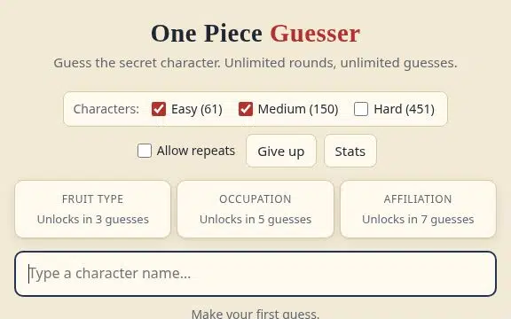 [源码运行画面](<https://github.com/bdog563/one-piece-guesser/blob/main/index.html>) | [bdog563/one-piece-guesser](<https://github.com/bdog563/one-piece-guesser>) | 常见根目录许可文件未找到 | 待核 | — | 未列入口 |
| 2329 | [ ] | [Only Profit](<https://github.com/gamingnews5/awesome-opus-5.5-games/blob/9a29b570e56bd19f15a3cd6bbac0b8c682f2c48c/games/only-profit/readme.md>) | 待补截图 | [71cky5p1t/onlyprofit](<https://github.com/71cky5p1t/onlyprofit>) | 常见根目录许可文件未找到 | 待核 | — | 未列入口 |
| 2330 | [ ] | [Onslaught](<https://github.com/gamingnews5/awesome-opus-5.5-games/blob/9a29b570e56bd19f15a3cd6bbac0b8c682f2c48c/games/onslaught/readme.md>) | 待补截图 | [alesha-pro/bench-portal](<https://github.com/alesha-pro/bench-portal>) | 常见根目录许可文件未找到 | 待核 | — | [可达 · 含游戏画布／引擎的网页](<https://alesha-pro.github.io/bench-portal/games/onslaught-fable-5.1/>) |
| 2331 | [ ] | [Oops, All Cuccos](<https://github.com/gamingnews5/awesome-opus-5.5-games/blob/9a29b570e56bd19f15a3cd6bbac0b8c682f2c48c/games/oops-all-cuccos/readme.md>) | 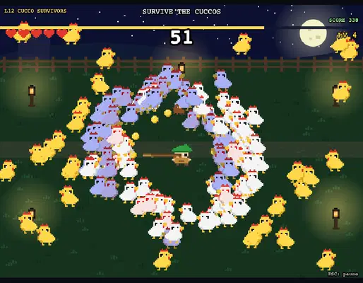 [上游游戏截图](<https://github.com/cadr/oops-all-cuccos/blob/HEAD/tests/screenshots/L12-crowd.png>) | [cadr/oops-all-cuccos](<https://github.com/cadr/oops-all-cuccos>) | 常见根目录许可文件未找到 | 待核 | — | [可达 · 合集所列网页](<https://tonejs.github.io/>) |
| 2332 | [ ] | [Op Simulator](<https://github.com/gamingnews5/awesome-opus-5.5-games/blob/9a29b570e56bd19f15a3cd6bbac0b8c682f2c48c/games/op-simulator/readme.md>) | 待补截图 | [ttechsyd/op-simulator](<https://github.com/ttechsyd/op-simulator>) | 常见根目录许可文件未找到 | 待核 | — | 未列入口 |
| 2333 | [ ] | [open-world](<https://github.com/gamingnews5/awesome-opus-5.5-games/blob/9a29b570e56bd19f15a3cd6bbac0b8c682f2c48c/games/open-world/readme.md>) | 待补截图 | [mamamaki12/open-world](<https://github.com/mamamaki12/open-world>) | 常见根目录许可文件未找到 | 待核 | — | [可达 · 合集所列网页](<https://mamamaki12.github.io/open-world/>) |
| 2334 | [ ] | [OpenArcade (Arzish29)](<https://github.com/gamingnews5/awesome-opus-5.5-games/blob/9a29b570e56bd19f15a3cd6bbac0b8c682f2c48c/games/openarcade-arzish29/readme.md>) | 待补截图 | [Arzish29/open\_arena](<https://github.com/Arzish29/open_arena>) | 常见根目录许可文件未找到 | 待核 | — | 未列入口 |
| 2335 | [ ] | [OpenArcade (ShuraShipai)](<https://github.com/gamingnews5/awesome-opus-5.5-games/blob/9a29b570e56bd19f15a3cd6bbac0b8c682f2c48c/games/openarcade-shurashipai/readme.md>) | 待补截图 | [ShuraShipai/cv\_arcade](<https://github.com/ShuraShipai/cv_arcade>) | 常见根目录许可文件未找到 | 待核 | — | 未列入口 |
| 2336 | [ ] | [OpenChess](<https://github.com/gamingnews5/awesome-opus-5.5-games/blob/9a29b570e56bd19f15a3cd6bbac0b8c682f2c48c/games/openchess/readme.md>) | 待补截图 | [GSM10-3/OpenChess](<https://github.com/GSM10-3/OpenChess>) | 常见根目录许可文件未找到 | 待核 | — | 未列入口 |
| 2337 | [ ] | [Operasyon Depo](<https://github.com/gamingnews5/awesome-opus-5.5-games/blob/9a29b570e56bd19f15a3cd6bbac0b8c682f2c48c/games/operasyon-depo/readme.md>) | 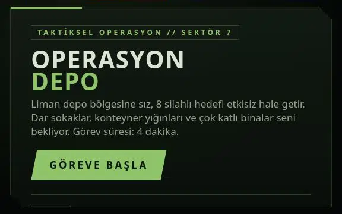 [源码运行首页](<https://github.com/alibaykara1/operasyon_depo/blob/main/operasyon-depo.html>) | [alibaykara1/operasyon\_depo](<https://github.com/alibaykara1/operasyon_depo>) | 常见根目录许可文件未找到 | 待核 | — | 未列入口 |
| 2338 | [ ] | [Operation Blueprint: AI Edition](<https://github.com/gamingnews5/awesome-opus-5.5-games/blob/9a29b570e56bd19f15a3cd6bbac0b8c682f2c48c/games/operation-blueprint-ai-edition/readme.md>) | 待补截图 | [alokomkar/Blue](<https://github.com/alokomkar/Blue>) | 常见根目录许可文件未找到 | 待核 | [6.0（原图失效）](<https://github.com/alokomkar/Blue/blob/main/docs/img/bunker-dark.jpg>) | 未列入口 |
| 2339 | [ ] | [Operation Dino Park](<https://github.com/gamingnews5/awesome-opus-5.5-games/blob/9a29b570e56bd19f15a3cd6bbac0b8c682f2c48c/games/operation-dino-park/readme.md>) | 待补截图 | [stephenfinch/operation-dino-park](<https://github.com/stephenfinch/operation-dino-park>) | 常见根目录许可文件未找到 | 待核 | — | [可达 · 含游戏画布／引擎的网页](<https://stephenfinch.github.io/operation-dino-park/>) |
| 2340 | [ ] | [Operation Long Shadow](<https://github.com/gamingnews5/awesome-opus-5.5-games/blob/9a29b570e56bd19f15a3cd6bbac0b8c682f2c48c/games/operation-long-shadow/readme.md>) | 待补截图 | [GencSaracaydin/operation-long-shadow](<https://github.com/GencSaracaydin/operation-long-shadow>) | 常见根目录许可文件未找到 | 待核 | — | 未列入口 |
| 2341 | [ ] | [Operation Naija](<https://github.com/gamingnews5/awesome-opus-5.5-games/blob/9a29b570e56bd19f15a3cd6bbac0b8c682f2c48c/games/operation-naija/readme.md>) | 待补截图 | [Sommyart/Operation-Naija](<https://github.com/Sommyart/Operation-Naija>) | 常见根目录许可文件未找到 | 待核 | — | [可达 · 合集所列网页](<https://operation-naija.vercel.app>) |
| 2342 | [ ] | [Operation Value Chain](<https://github.com/gamingnews5/awesome-opus-5.5-games/blob/9a29b570e56bd19f15a3cd6bbac0b8c682f2c48c/games/operation-value-chain/readme.md>) | 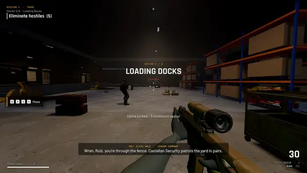 [合集截图](<https://github.com/rabbithuntyt-ai/Marketing-game/blob/main/docs/screens/ingame-loading-docks.jpg>) | [rabbithuntyt-ai/Marketing-game](<https://github.com/rabbithuntyt-ai/Marketing-game>) | 常见根目录许可文件未找到 [音乐、音效、模型和字体许可各异，含 CC BY、CC BY-SA、GPL 和 OFL。](<https://github.com/rabbithuntyt-ai/Marketing-game/blob/HEAD/README.md#L65-L69>) | [README 提及](<https://github.com/rabbithuntyt-ai/Marketing-game/blob/HEAD/README.md#L52>) | [5.4](<https://github.com/rabbithuntyt-ai/Marketing-game/blob/main/docs/screens/ingame-loading-docks.jpg>) | 未列入口 |
| 2343 | [ ] | [Operations Trainer](<https://github.com/gamingnews5/awesome-opus-5.5-games/blob/9a29b570e56bd19f15a3cd6bbac0b8c682f2c48c/games/operations-trainer/readme.md>) | 待补截图 | [francobrida/operations-game](<https://github.com/francobrida/operations-game>) | 常见根目录许可文件未找到 | 待核 | — | [可达 · 合集所列网页](<https://francobrida.github.io/operations-game/>) |
| 2344 | [ ] | [Opus vs Sol](<https://github.com/gamingnews5/awesome-opus-5.5-games/blob/9a29b570e56bd19f15a3cd6bbac0b8c682f2c48c/games/opus-vs-sol/readme.md>) | 待补截图 | [privatekey7/opus-vs-sol](<https://github.com/privatekey7/opus-vs-sol>) | 常见根目录许可文件未找到 | 待核 | — | 未列入口 |
| 2345 | [ ] | [OpusSkate](<https://github.com/gamingnews5/awesome-opus-5.5-games/blob/9a29b570e56bd19f15a3cd6bbac0b8c682f2c48c/games/opusskate/readme.md>) | 待补截图 | [OminousIndustries/OpusSkate](<https://github.com/OminousIndustries/OpusSkate>) | 常见根目录许可文件未找到 代码许可不自动覆盖第三方素材、品牌和在线服务。 | 待核 | — | 未列入口 |
| 2346 | [ ] | [Orbit](<https://github.com/gamingnews5/awesome-opus-5.5-games/blob/9a29b570e56bd19f15a3cd6bbac0b8c682f2c48c/games/orbit/readme.md>) | 待补截图 | [kokellara12-maker/apps-k4m9q2](<https://github.com/kokellara12-maker/apps-k4m9q2>) | 常见根目录许可文件未找到 | 待核 | — | [可达 · 合集所列网页](<https://kokellara12-maker.github.io/apps-k4m9q2/orbit.html>) |
| 2347 | [ ] | [Orbit Rush](<https://github.com/gamingnews5/awesome-opus-5.5-games/blob/9a29b570e56bd19f15a3cd6bbac0b8c682f2c48c/games/orbit-rush/readme.md>) | 待补截图 | [dehanz13/racing-game-orbit-rush](<https://github.com/dehanz13/racing-game-orbit-rush>) | 常见根目录许可文件未找到 | 待核 | — | 未列入口 |
| 2348 | [ ] | [Orbital Descent](<https://github.com/gamingnews5/awesome-opus-5.5-games/blob/9a29b570e56bd19f15a3cd6bbac0b8c682f2c48c/games/orbital-descent/readme.md>) | 待补截图 | [hawnji/OrbitalDecent](<https://github.com/hawnji/OrbitalDecent>) | 常见根目录许可文件未找到 | 待核 | — | 未列入口 |
| 2349 | [ ] | [Orbital Dock](<https://github.com/gamingnews5/awesome-opus-5.5-games/blob/9a29b570e56bd19f15a3cd6bbac0b8c682f2c48c/games/orbital-dock/readme.md>) | 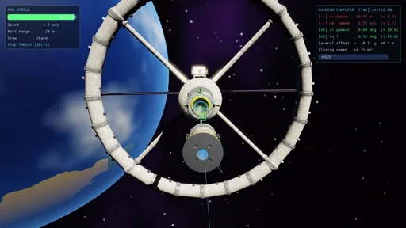 [上游实机演示截帧](<https://github.com/manishtandurkar/orbital-dock/blob/HEAD/media/orbital_dock_demo.mp4>) | [manishtandurkar/orbital-dock](<https://github.com/manishtandurkar/orbital-dock>) | 常见根目录许可文件未找到 | 待核 | — | 未列入口 |
| 2350 | [ ] | [Ore &amp; Order](<https://github.com/gamingnews5/awesome-opus-5.5-games/blob/9a29b570e56bd19f15a3cd6bbac0b8c682f2c48c/games/ore-order/readme.md>) | 待补截图 | [paulbarby/ore-and-order](<https://github.com/paulbarby/ore-and-order>) | 常见根目录许可文件未找到 | 待核 | — | [可达 · 含游戏画布／引擎的网页](<https://paulbarby.github.io/ore-and-order/>) |
| 2351 | [ ] | [Orrery Flight](<https://github.com/gamingnews5/awesome-opus-5.5-games/blob/9a29b570e56bd19f15a3cd6bbac0b8c682f2c48c/games/orrery-flight/readme.md>) | 待补截图 | [ryangeng2/orrery-flight](<https://github.com/ryangeng2/orrery-flight>) | 常见根目录许可文件未找到 | 待核 | — | [可达 · 合集所列网页](<https://ryangeng2.github.io/orrery-flight/>) |
| 2352 | [ ] | [OrthoQuest](<https://github.com/gamingnews5/awesome-opus-5.5-games/blob/9a29b570e56bd19f15a3cd6bbac0b8c682f2c48c/games/orthoquest/readme.md>) | 待补截图 | [salilibrahimckl-ops/orthoquest](<https://github.com/salilibrahimckl-ops/orthoquest>) | 常见根目录许可文件未找到 | 待核 | — | [README · 入口已失效 · 上游 README 所列网页](<https://salilibrahimckl-ops.github.io/orthoquest/>) |
| 2353 | [ ] | [Orvit Timed Tech Quiz](<https://github.com/gamingnews5/awesome-opus-5.5-games/blob/9a29b570e56bd19f15a3cd6bbac0b8c682f2c48c/games/orvit-timed-tech-quiz/readme.md>) | <a href="https://raw.githubusercontent.com/dnd-side-project/dnd-14th-6-frontend/HEAD/docs/images/game.jpg">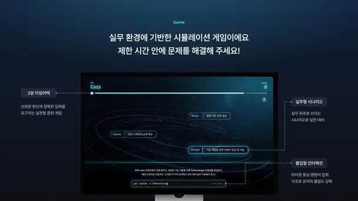</a> [README 游戏截图](<https://github.com/dnd-side-project/dnd-14th-6-frontend#readme>) | [dnd-side-project/dnd-14th-6-frontend](<https://github.com/dnd-side-project/dnd-14th-6-frontend>) | 常见根目录许可文件未找到 | 待核 | — | 未列入口 |
| 2354 | [ ] | [OSRS Tower Defense](<https://github.com/gamingnews5/awesome-opus-5.5-games/blob/9a29b570e56bd19f15a3cd6bbac0b8c682f2c48c/games/osrs-tower-defense/readme.md>) | 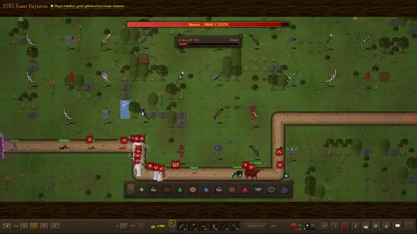 [上游游戏截图](<https://github.com/hamilton-junior/osrs-tower-defense/blob/HEAD/docs/screenshots/board.png>) | [hamilton-junior/osrs-tower-defense](<https://github.com/hamilton-junior/osrs-tower-defense>) | 常见根目录许可文件未找到 | 待核 | — | [可达 · 合集所列网页](<https://hamilton-junior.github.io/osrs-tower-defense/>) |
| 2355 | [ ] | [Ourcade](<https://github.com/gamingnews5/awesome-opus-5.5-games/blob/9a29b570e56bd19f15a3cd6bbac0b8c682f2c48c/games/ourcade/readme.md>) | 待补截图 | [aniche/ourcade-defold](<https://github.com/aniche/ourcade-defold>) | 常见根目录许可文件未找到 | 待核 | — | 未列入口 |
| 2356 | [ ] | [Outbreak](<https://github.com/gamingnews5/awesome-opus-5.5-games/blob/9a29b570e56bd19f15a3cd6bbac0b8c682f2c48c/games/party-chaos/readme.md>) | 待补截图 | [lawrenceandrewlargo/roblox-extreme-minigames](<https://github.com/lawrenceandrewlargo/roblox-extreme-minigames>) | 常见根目录许可文件未找到 | 待核 | — | 未列入口 |
| 2357 | [ ] | [Outing Word Flip](<https://github.com/gamingnews5/awesome-opus-5.5-games/blob/9a29b570e56bd19f15a3cd6bbac0b8c682f2c48c/games/outing-word-flip/readme.md>) | 待补截图 | [Taspol/outing-word-problem](<https://github.com/Taspol/outing-word-problem>) | 常见根目录许可文件未找到 | 待核 | — | 未列入口 |
| 2358 | [ ] | [OutpaceF1](<https://github.com/gamingnews5/awesome-opus-5.5-games/blob/9a29b570e56bd19f15a3cd6bbac0b8c682f2c48c/games/outpacef1/readme.md>) | 待补截图 | [Vedant0667/hacktx26](<https://github.com/Vedant0667/hacktx26>) | 常见根目录许可文件未找到 | 待核 | — | 未列入口 |
| 2359 | [ ] | [OutRun Bangkok — Hidden Stage: Ice Run](<https://github.com/gamingnews5/awesome-opus-5.5-games/blob/9a29b570e56bd19f15a3cd6bbac0b8c682f2c48c/games/outrun-bangkok-hidden-stage-ice-run/readme.md>) |  [合集截图](<https://github.com/donsinp-design/Out/blob/claude/outrun-bangkok-version-dymbxr/dist/screenshot-stage1.png>) | [donsinp-design/Out](<https://github.com/donsinp-design/Out>) | 常见根目录许可文件未找到 | 待核 | [7.6](<https://github.com/donsinp-design/Out/blob/claude/outrun-bangkok-version-dymbxr/dist/screenshot-stage1.png>) | 未列入口 |
| 2360 | [ ] | [Outrun O5](<https://github.com/gamingnews5/awesome-opus-5.5-games/blob/9a29b570e56bd19f15a3cd6bbac0b8c682f2c48c/games/outrun-o5/readme.md>) | 待补截图 | [yonifra/-outrun-o5](<https://github.com/yonifra/-outrun-o5>) | 常见根目录许可文件未找到 | 待核 | — | 未列入口 |
| 2361 | [ ] | [Over the Cape](<https://github.com/gamingnews5/awesome-opus-5.5-games/blob/9a29b570e56bd19f15a3cd6bbac0b8c682f2c48c/games/over-the-cape/readme.md>) | 待补截图 | [reidstephen11/over-the-cape](<https://github.com/reidstephen11/over-the-cape>) | 常见根目录许可文件未找到 | [README 提及](<https://github.com/reidstephen11/over-the-cape/blob/HEAD/README.md#L174>) | — | [可达 · 合集所列网页](<https://reidstephen11.github.io/over-the-cape/>) |
| 2362 | [ ] | [Overclocked](<https://github.com/gamingnews5/awesome-opus-5.5-games/blob/9a29b570e56bd19f15a3cd6bbac0b8c682f2c48c/games/overclocked/readme.md>) | 待补截图 | [danjaekim/overclocked](<https://github.com/danjaekim/overclocked>) | 常见根目录许可文件未找到 | 待核 | — | [可达 · 合集所列网页](<https://danjaekim.github.io/overclocked/>) |
| 2363 | [ ] | [Overdue Arcade](<https://github.com/gamingnews5/awesome-opus-5.5-games/blob/9a29b570e56bd19f15a3cd6bbac0b8c682f2c48c/games/overdue-arcade/readme.md>) | 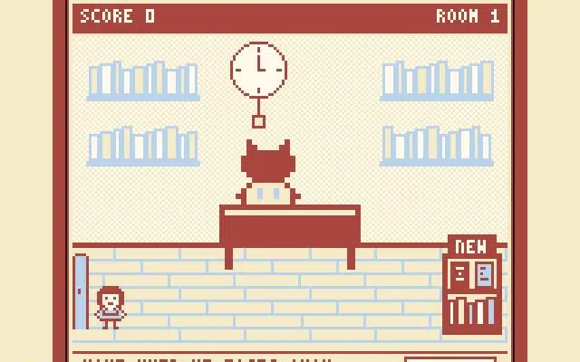 [源码网页实截](<https://github.com/Overdue-yarn/arcade/blob/main/games/quiet-please.html>) | [Overdue-yarn/arcade](<https://github.com/Overdue-yarn/arcade>) | 常见根目录许可文件未找到 | 待核 | — | 未列入口 |
| 2364 | [ ] | [OVERRUN: Dockyard Nine](<https://github.com/gamingnews5/awesome-opus-5.5-games/blob/9a29b570e56bd19f15a3cd6bbac0b8c682f2c48c/games/overrun-dockyard-nine/readme.md>) |  [合集截图](<https://github.com/alesha-pro/bench-portal/blob/main/games/overrun-claude-opus-5.5/cover.webp>) | [alesha-pro/bench-portal](<https://github.com/alesha-pro/bench-portal>) | 常见根目录许可文件未找到 | 待核 | [8.8](<https://github.com/alesha-pro/bench-portal/blob/main/games/overrun-claude-opus-5.5/cover.webp>) | [可达 · 合集所列网页](<https://alesha-pro.github.io/bench-portal/games/overrun-claude-opus-5.5/index.html>) |
| 2365 | [ ] | [OxCity](<https://github.com/gamingnews5/awesome-opus-5.5-games/blob/9a29b570e56bd19f15a3cd6bbac0b8c682f2c48c/games/oxcity/readme.md>) | 待补截图 | [exdal/opus5.5-test](<https://github.com/exdal/opus5.5-test>) | 常见根目录许可文件未找到 | 待核 | — | 未列入口 |
| 2366 | [ ] | [Paahde](<https://github.com/gamingnews5/awesome-opus-5.5-games/blob/9a29b570e56bd19f15a3cd6bbac0b8c682f2c48c/games/paahde/readme.md>) | 待补截图 | [woltsu/paahde](<https://github.com/woltsu/paahde>) | 常见根目录许可文件未找到 | 待核 | — | 未列入口 |
| 2367 | [ ] | [Paati's Recipe](<https://github.com/gamingnews5/awesome-opus-5.5-games/blob/9a29b570e56bd19f15a3cd6bbac0b8c682f2c48c/games/paati-s-recipe/readme.md>) | 待补截图 | [krishanala/paatis-recipe-kitchen](<https://github.com/krishanala/paatis-recipe-kitchen>) | 常见根目录许可文件未找到 | 待核 | — | [可达 · 含游戏画布／引擎的网页](<https://krishanala.github.io/paatis-recipe-kitchen/>) |
| 2368 | [ ] | [Pac Ben](<https://github.com/gamingnews5/awesome-opus-5.5-games/blob/9a29b570e56bd19f15a3cd6bbac0b8c682f2c48c/games/pac-ben/readme.md>) |  [试玩首页实截](<https://chris8christie-boop.github.io/pac-ben/>) | [chris8christie-boop/pac-ben](<https://github.com/chris8christie-boop/pac-ben>) | 常见根目录许可文件未找到 | [README 提及](<https://github.com/chris8christie-boop/pac-ben/blob/HEAD/README.md#L85>) | — | [可达 · 合集所列网页](<https://chris8christie-boop.github.io/pac-ben/>) |
| 2369 | [ ] | [PAC-CLONE](<https://github.com/gamingnews5/awesome-opus-5.5-games/blob/9a29b570e56bd19f15a3cd6bbac0b8c682f2c48c/games/pac-clone/readme.md>) | 待补截图 | [boromisp/pacman-clone](<https://github.com/boromisp/pacman-clone>) | 常见根目录许可文件未找到 | 待核 | — | [可达 · 含游戏画布／引擎的网页](<https://boromisp.github.io/pacman-clone/>) |
| 2370 | [ ] | [Pachinko Builder](<https://github.com/gamingnews5/awesome-opus-5.5-games/blob/9a29b570e56bd19f15a3cd6bbac0b8c682f2c48c/games/pachinko-builder/readme.md>) | 待补截图 | [Johnesco/pinball](<https://github.com/Johnesco/pinball>) | 常见根目录许可文件未找到 | 待核 | — | 未列入口 |
| 2371 | [ ] | [Pack-a-Bus](<https://github.com/gamingnews5/awesome-opus-5.5-games/blob/9a29b570e56bd19f15a3cd6bbac0b8c682f2c48c/games/pack-a-bus/readme.md>) |  [源码运行画面](<https://github.com/f1nch/Pack-a-bus/blob/main/index.html>) | [f1nch/Pack-a-bus](<https://github.com/f1nch/Pack-a-bus>) | 常见根目录许可文件未找到 | 待核 | — | 未列入口 |
| 2372 | [ ] | [Packet Loss](<https://github.com/gamingnews5/awesome-opus-5.5-games/blob/9a29b570e56bd19f15a3cd6bbac0b8c682f2c48c/games/packet-loss/readme.md>) | 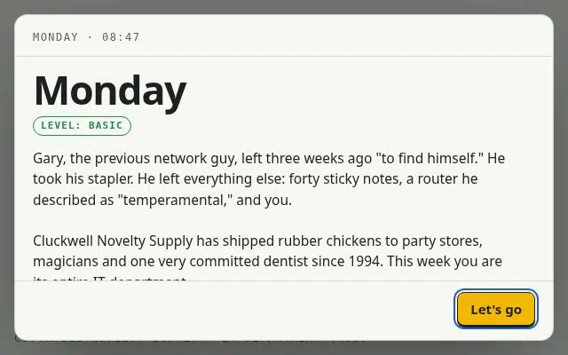 [源码网页实截](<https://github.com/radelong/packet-loss/blob/main/index.html>) | [radelong/packet-loss](<https://github.com/radelong/packet-loss>) | 常见根目录许可文件未找到 | 待核 | — | 未列入口 |
| 2373 | [ ] | [Packet Storm](<https://github.com/gamingnews5/awesome-opus-5.5-games/blob/9a29b570e56bd19f15a3cd6bbac0b8c682f2c48c/games/packet-storm/readme.md>) | 待补截图 | [JakeAve/airgap](<https://github.com/JakeAve/airgap>) | 常见根目录许可文件未找到 | 待核 | — | [多游戏仓库入口 · 可达 · 合集所列网页](<https://jakeave.github.io/airgap/>) |
| 2374 | [ ] | [Padel Legends](<https://github.com/gamingnews5/awesome-opus-5.5-games/blob/9a29b570e56bd19f15a3cd6bbac0b8c682f2c48c/games/padel-legends/readme.md>) |  [试玩首页实截](<https://mesut-outlook.github.io/Padel_Game/>) | [Mesut-Outlook/Padel\_Game](<https://github.com/Mesut-Outlook/Padel_Game>) | 常见根目录许可文件未找到 | [README 提及](<https://github.com/Mesut-Outlook/Padel_Game/blob/HEAD/README.md#L79>) | — | [可达 · 合集所列网页](<https://mesut-outlook.github.io/Padel_Game/>) |
| 2375 | [ ] | [Paisa Crash Test](<https://github.com/gamingnews5/awesome-opus-5.5-games/blob/9a29b570e56bd19f15a3cd6bbac0b8c682f2c48c/games/paisa-crash-test/readme.md>) | 待补截图 | [WinningCloud/PaisaCrash](<https://github.com/WinningCloud/PaisaCrash>) | 常见根目录许可文件未找到 | 待核 | — | 未列入口 |
| 2376 | [ ] | [PakPak](<https://github.com/gamingnews5/awesome-opus-5.5-games/blob/9a29b570e56bd19f15a3cd6bbac0b8c682f2c48c/games/pakpak/readme.md>) | 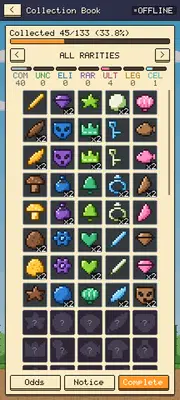 [合集截图](<https://github.com/deguzmanshanmichael/pakpakGame/blob/main/site/img/collection.png>) | [deguzmanshanmichael/pakpakGame](<https://github.com/deguzmanshanmichael/pakpakGame>) | 常见根目录许可文件未找到 | 待核 | [5.0](<https://github.com/deguzmanshanmichael/pakpakGame/blob/main/site/img/collection.png>) | 未列入口 |
| 2377 | [ ] | [Palmera Bay](<https://github.com/gamingnews5/awesome-opus-5.5-games/blob/9a29b570e56bd19f15a3cd6bbac0b8c682f2c48c/games/palmera-bay/readme.md>) | 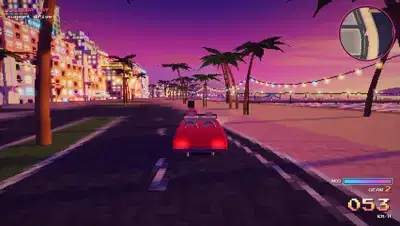 [合集截图](<https://github.com/theolundqvist/frontier-games/blob/main/media/palmera-bay/preview.webp>) | [vcahlik/palmera-bay](<https://github.com/vcahlik/palmera-bay>) | 常见根目录许可文件未找到 | [README 提及、源码有输入读取](<https://github.com/vcahlik/palmera-bay/blob/master/src/main.js#L182>) | [8.0](<https://github.com/theolundqvist/frontier-games/blob/main/media/palmera-bay/preview.webp>) | [可达 · 含游戏画布／引擎的网页](<https://cahlik.net/palmera-bay/>) |
| 2378 | [ ] | [PanBug](<https://github.com/gamingnews5/awesome-opus-5.5-games/blob/9a29b570e56bd19f15a3cd6bbac0b8c682f2c48c/games/panbug/readme.md>) | 待补截图 | [rembednarczyk/PanBug](<https://github.com/rembednarczyk/PanBug>) | 常见根目录许可文件未找到 | 待核 | — | 未列入口 |
| 2379 | [ ] | [Panchigi](<https://github.com/gamingnews5/awesome-opus-5.5-games/blob/9a29b570e56bd19f15a3cd6bbac0b8c682f2c48c/games/panchigi/readme.md>) | 待补截图 | [Baeinsoo/LeagueOfPhysical-Client](<https://github.com/Baeinsoo/LeagueOfPhysical-Client>) | 常见根目录许可文件未找到 | 待核 | — | 未列入口 |
| 2380 | [ ] | [Pangaea](<https://github.com/gamingnews5/awesome-opus-5.5-games/blob/9a29b570e56bd19f15a3cd6bbac0b8c682f2c48c/games/pangaea/readme.md>) | 待补截图 | [jjthillens-oss/pangaea](<https://github.com/jjthillens-oss/pangaea>) | 常见根目录许可文件未找到 | 待核 | — | 未列入口 |
| 2381 | [ ] | [Papa’s Cinnaboneria](<https://github.com/gamingnews5/awesome-opus-5.5-games/blob/9a29b570e56bd19f15a3cd6bbac0b8c682f2c48c/games/papa-s-cinnaboneria/readme.md>) | 待补截图 | [madisonho/rolleria](<https://github.com/madisonho/rolleria>) | 常见根目录许可文件未找到 | 待核 | — | 未列入口 |
| 2382 | [ ] | [Paper Grab](<https://github.com/gamingnews5/awesome-opus-5.5-games/blob/9a29b570e56bd19f15a3cd6bbac0b8c682f2c48c/games/paper-grab/readme.md>) | 待补截图 | [krishnakanthati/paper-grab](<https://github.com/krishnakanthati/paper-grab>) | 常见根目录许可文件未找到 | 待核 | — | [可达 · 含游戏画布／引擎的网页](<https://krishnakanthati.github.io/paper-grab/>) |
| 2383 | [ ] | [Paper Plane](<https://github.com/gamingnews5/awesome-opus-5.5-games/blob/9a29b570e56bd19f15a3cd6bbac0b8c682f2c48c/games/paper-plane/readme.md>) | 待补截图 | [claudioaccolito/paper-plane](<https://github.com/claudioaccolito/paper-plane>) | 常见根目录许可文件未找到 | 待核 | — | [可达 · 含游戏画布／引擎的网页](<https://claudioaccolito.github.io/paper-plane/>) |
| 2384 | [ ] | [paper.irl](<https://github.com/gamingnews5/awesome-opus-5.5-games/blob/9a29b570e56bd19f15a3cd6bbac0b8c682f2c48c/games/paper-irl/readme.md>) | 待补截图 | [edocsprojects/paper.irl](<https://github.com/edocsprojects/paper.irl>) | 常见根目录许可文件未找到 | 待核 | — | 未列入口 |
| 2385 | [ ] | [Para-Ti](<https://github.com/gamingnews5/awesome-opus-5.5-games/blob/9a29b570e56bd19f15a3cd6bbac0b8c682f2c48c/games/para-ti/readme.md>) | 待补截图 | [harlemmariscal/Para-Ti](<https://github.com/harlemmariscal/Para-Ti>) | 常见根目录许可文件未找到 | 待核 | — | 未列入口 |
| 2386 | [ ] | [Parity Blocks](<https://github.com/gamingnews5/awesome-opus-5.5-games/blob/9a29b570e56bd19f15a3cd6bbac0b8c682f2c48c/games/parity-blocks/readme.md>) | 待补截图 | [rmackay0/parity-blocks](<https://github.com/rmackay0/parity-blocks>) | 常见根目录许可文件未找到 | 待核 | — | [可达 · 合集所列网页](<https://parity-blocks.vercel.app>) |
| 2387 | [ ] | [Park Laps](<https://github.com/gamingnews5/awesome-opus-5.5-games/blob/9a29b570e56bd19f15a3cd6bbac0b8c682f2c48c/games/park-laps/readme.md>) | 待补截图 | [SpaseCases/ski-game](<https://github.com/SpaseCases/ski-game>) | 常见根目录许可文件未找到 | 待核 | — | [可达 · 合集所列网页](<https://spasecases.github.io/ski-game/>) |
| 2388 | [ ] | [Parkour Haris](<https://github.com/gamingnews5/awesome-opus-5.5-games/blob/9a29b570e56bd19f15a3cd6bbac0b8c682f2c48c/games/parkour-haris/readme.md>) | 待补截图 | [ikrmachoudry/ParkourHaris](<https://github.com/ikrmachoudry/ParkourHaris>) | 常见根目录许可文件未找到 | 待核 | — | 未列入口 |
| 2389 | [ ] | [Parselands](<https://github.com/gamingnews5/awesome-opus-5.5-games/blob/9a29b570e56bd19f15a3cd6bbac0b8c682f2c48c/games/parselands/readme.md>) | 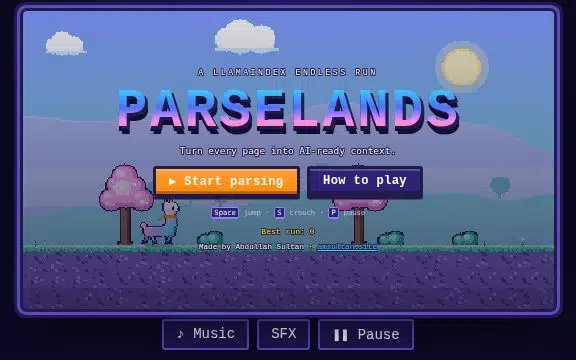 [源码运行首页](<https://github.com/amsultan2010/parselands-game/blob/main/index.html>) | [amsultan2010/parselands-game](<https://github.com/amsultan2010/parselands-game>) | 常见根目录许可文件未找到 | 待核 | — | 未列入口 |
| 2390 | [ ] | [Particle Workshop](<https://github.com/gamingnews5/awesome-opus-5.5-games/blob/9a29b570e56bd19f15a3cd6bbac0b8c682f2c48c/games/particle-workshop/readme.md>) | 待补截图 | [tgtec26/snug-matter-composition-game](<https://github.com/tgtec26/snug-matter-composition-game>) | 常见根目录许可文件未找到 | 待核 | — | [可达 · 合集所列网页](<https://snug-matter-composition-game.vercel.app/>) |
| 2391 | [ ] | [Party Games](<https://github.com/gamingnews5/awesome-opus-5.5-games/blob/9a29b570e56bd19f15a3cd6bbac0b8c682f2c48c/games/party-games/readme.md>) | 待补截图 | [alphacorrections/party-games](<https://github.com/alphacorrections/party-games>) | 常见根目录许可文件未找到 | 待核 | — | 未列入口 |
| 2392 | [ ] | [Party Panic](<https://github.com/gamingnews5/awesome-opus-5.5-games/blob/9a29b570e56bd19f15a3cd6bbac0b8c682f2c48c/games/party-panic/readme.md>) | 待补截图 | [AgentZomboidPPS/Party-Panic](<https://github.com/AgentZomboidPPS/Party-Panic>) | 常见根目录许可文件未找到 | 待核 | — | 未列入口 |
| 2393 | [ ] | [Party Quest](<https://github.com/gamingnews5/awesome-opus-5.5-games/blob/9a29b570e56bd19f15a3cd6bbac0b8c682f2c48c/games/party-quest/readme.md>) | 待补截图 | [Mik0ia/Party-Quest](<https://github.com/Mik0ia/Party-Quest>) | 常见根目录许可文件未找到 | 待核 | — | [可达 · 含游戏画布／引擎的网页](<https://mik0ia.github.io/Party-Quest/>) |
| 2394 | [ ] | [Patang Wars](<https://github.com/gamingnews5/awesome-opus-5.5-games/blob/9a29b570e56bd19f15a3cd6bbac0b8c682f2c48c/games/patang-wars/readme.md>) | 待补截图 | [amaadmirza/patang-wars](<https://github.com/amaadmirza/patang-wars>) | 常见根目录许可文件未找到 | 待核 | [6.0（原图失效）](<https://github.com/amaadmirza/patang-wars/blob/main/screenshots-v6.4/home-online-on-rail.png>) | 未列入口 |
| 2395 | [ ] | [Patch Notes](<https://github.com/gamingnews5/awesome-opus-5.5-games/blob/9a29b570e56bd19f15a3cd6bbac0b8c682f2c48c/games/patch-notes/readme.md>) | 待补截图 | [eslamgenio/AndroidGame](<https://github.com/eslamgenio/AndroidGame>) | 常见根目录许可文件未找到 无根LICENSE；Claude证据是实际代码/离线功能提交，不以.claude技能文件存在作为依据。 | 待核 | — | [可达 · 合集所列网页](<https://eslamgenio.github.io/AndroidGame/>) |
| 2396 | [ ] | [Path of Werdna](<https://github.com/gamingnews5/awesome-opus-5.5-games/blob/9a29b570e56bd19f15a3cd6bbac0b8c682f2c48c/games/path-of-werdna/readme.md>) | 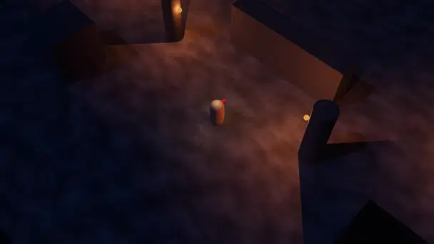 [上游游戏截图](<https://github.com/Werdna1976/PathOfWerdna/blob/HEAD/tests/screenshot_m1.png>) | [Werdna1976/PathOfWerdna](<https://github.com/Werdna1976/PathOfWerdna>) | 常见根目录许可文件未找到 | 待核 | — | 未列入口 |
| 2397 | [ ] | [Path to the Chuppah](<https://github.com/gamingnews5/awesome-opus-5.5-games/blob/9a29b570e56bd19f15a3cd6bbac0b8c682f2c48c/games/path-to-the-chuppah/readme.md>) | 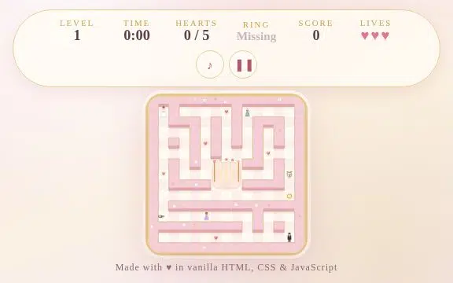 [同款源码网页实截](<https://github.com/basildiana/wedding-maze-game/blob/HEAD/index.html>) | [basildiana/wedding-maze-game](<https://github.com/basildiana/wedding-maze-game>) | 常见根目录许可文件未找到 | 待核 | — | [可达 · 含游戏画布／引擎的网页](<https://basildiana.github.io/wedding-maze-game/>) |
| 2398 | [ ] | [Pathfinder AI](<https://github.com/gamingnews5/awesome-opus-5.5-games/blob/9a29b570e56bd19f15a3cd6bbac0b8c682f2c48c/games/pathfinder-ai/readme.md>) | 待补截图 | [mzeeshanaltaf/pathfinder-ai](<https://github.com/mzeeshanaltaf/pathfinder-ai>) | 常见根目录许可文件未找到 | 待核 | — | 未列入口 |
| 2399 | [ ] | [Paws &amp; Pastures](<https://github.com/gamingnews5/awesome-opus-5.5-games/blob/9a29b570e56bd19f15a3cd6bbac0b8c682f2c48c/games/paws-pastures/readme.md>) | 待补截图 | [barnst1865/ThomasGame](<https://github.com/barnst1865/ThomasGame>) | 常见根目录许可文件未找到 | 待核 | — | 未列入口 |
| 2400 | [ ] | [Pawsphemy](<https://github.com/gamingnews5/awesome-opus-5.5-games/blob/9a29b570e56bd19f15a3cd6bbac0b8c682f2c48c/games/pawsphemy/readme.md>) | 待补截图 | [henriquerochars/pawsphemy](<https://github.com/henriquerochars/pawsphemy>) | 常见根目录许可文件未找到 | 待核 | [5.6（原图失效）](<https://github.com/henriquerochars/pawsphemy/blob/main/docs/gifs/01-hub-dogs.gif>) | 未列入口 |
| 2401 | [ ] | [Pax History](<https://github.com/gamingnews5/awesome-opus-5.5-games/blob/9a29b570e56bd19f15a3cd6bbac0b8c682f2c48c/games/pax-history/readme.md>) | 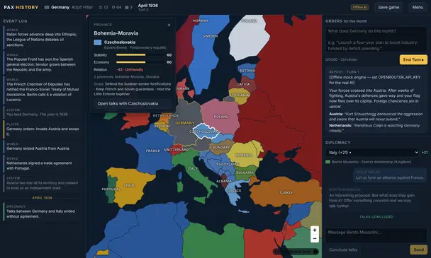 [合集截图](<https://github.com/yahya123467/Pax-history-s-/blob/claude/ai-grand-strategy-game-9i9vgx/docs/screenshot.png>) | [yahya123467/Pax-history-s-](<https://github.com/yahya123467/Pax-history-s->) | 常见根目录许可文件未找到 | 待核 | [6.4](<https://github.com/yahya123467/Pax-history-s-/blob/claude/ai-grand-strategy-game-9i9vgx/docs/screenshot.png>) | 未列入口 |
| 2402 | [ ] | [pD-Day 2026](<https://github.com/gamingnews5/awesome-opus-5.5-games/blob/9a29b570e56bd19f15a3cd6bbac0b8c682f2c48c/games/pd-day-2026/readme.md>) |  [同款源码网页实截](<https://github.com/AISA-AI-web/arcade/blob/HEAD/index.html>) | [AISA-AI-web/arcade](<https://github.com/AISA-AI-web/arcade>) | 常见根目录许可文件未找到 | 待核 | — | [可达 · 合集所列网页](<https://aisa-ai-web.github.io/data-anonymizer/>) |
| 2403 | [ ] | [Peace Treaties 3D · 1919–1923](<https://github.com/gamingnews5/awesome-opus-5.5-games/blob/9a29b570e56bd19f15a3cd6bbac0b8c682f2c48c/games/peace-treaties-3d-1919-1923/readme.md>) | 待补截图 | [mikellidestheo-alt/Treaties-Map-game](<https://github.com/mikellidestheo-alt/Treaties-Map-game>) | 常见根目录许可文件未找到 | 待核 | — | 未列入口 |
| 2404 | [ ] | [Pelican Bike](<https://github.com/gamingnews5/awesome-opus-5.5-games/blob/9a29b570e56bd19f15a3cd6bbac0b8c682f2c48c/games/pelican-bike/readme.md>) |  [作者分享图 · 游戏实景](<https://claude-opus-5-5.riba2534.cn/>) | [riba2534/claude-opus-5-5-demo](<https://github.com/riba2534/claude-opus-5-5-demo>) | 常见根目录许可文件未找到 | 待核 | — | [可达 · 合集所列网页](<https://claude-opus-5-5.riba2534.cn/>) |
| 2405 | [ ] | [Pelican Bike](<https://github.com/gamingnews5/awesome-opus-5.5-games/blob/9a29b570e56bd19f15a3cd6bbac0b8c682f2c48c/games/pelican-bike-xiiyioozzz-opus55-3d-games/readme.md>) | 待补截图 | [xiiyioozzz/opus55-3d-games](<https://github.com/xiiyioozzz/opus55-3d-games>) | 常见根目录许可文件未找到 | 待核 | — | [可达 · 合集所列网页](<https://games.xdullboy.com/pelican/>) |
| 2406 | [ ] | [Pen Fight: Bench Edition (কলম যুদ্ধ)](<https://github.com/gamingnews5/awesome-opus-5.5-games/blob/9a29b570e56bd19f15a3cd6bbac0b8c682f2c48c/games/pen-fight-bench-edition/readme.md>) |  [试玩首页实截](<https://tabil11.github.io/pen-fight/>) | [tabil11/pen-fight](<https://github.com/tabil11/pen-fight>) | 常见根目录许可文件未找到 | 待核 | — | [可达 · 含游戏画布／引擎的网页](<https://tabil11.github.io/pen-fight/>) |
| 2407 | [ ] | [Pen Flick](<https://github.com/gamingnews5/awesome-opus-5.5-games/blob/9a29b570e56bd19f15a3cd6bbac0b8c682f2c48c/games/pen-flick/readme.md>) | 待补截图 | [shahriarahi/pen-flick](<https://github.com/shahriarahi/pen-flick>) | 常见根目录许可文件未找到 | 待核 | — | 未列入口 |
| 2408 | [ ] | [Penalty Shootout](<https://github.com/gamingnews5/awesome-opus-5.5-games/blob/9a29b570e56bd19f15a3cd6bbac0b8c682f2c48c/games/penalty-shootout/readme.md>) |  [试玩首页实截](<https://kendeane1980-cpu.github.io/maths-games/>) | [kendeane1980-cpu/maths-games](<https://github.com/kendeane1980-cpu/maths-games>) | 常见根目录许可文件未找到 | 待核 | — | [可达 · 合集所列网页](<https://kendeane1980-cpu.github.io/maths-games/>) |
| 2409 | [ ] | [Pengloo Party](<https://github.com/gamingnews5/awesome-opus-5.5-games/blob/9a29b570e56bd19f15a3cd6bbac0b8c682f2c48c/games/pengloo-party/readme.md>) | 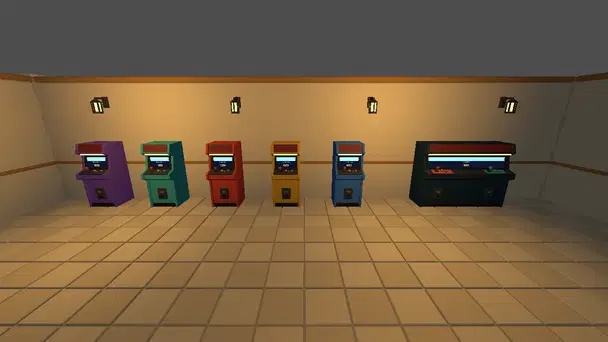 [合集截图](<https://github.com/amadeusk1/mruhacks/blob/main/Renders/Game/arcade_room_screens.png>) | [amadeusk1/mruhacks](<https://github.com/amadeusk1/mruhacks>) | 常见根目录许可文件未找到 | 待核 | [5.6](<https://github.com/amadeusk1/mruhacks/blob/main/Renders/Game/arcade_room_screens.png>) | 未列入口 |
| 2410 | [ ] | [Pengu Ice](<https://github.com/gamingnews5/awesome-opus-5.5-games/blob/9a29b570e56bd19f15a3cd6bbac0b8c682f2c48c/games/pengu-ice/readme.md>) | 待补截图 | [kokellara12-maker/apps-k4m9q2](<https://github.com/kokellara12-maker/apps-k4m9q2>) | 常见根目录许可文件未找到 | 待核 | — | [可达 · 含游戏画布／引擎的网页](<https://kokellara12-maker.github.io/apps-k4m9q2/pengu.html>) |
| 2411 | [ ] | [Penguin: The Gathering](<https://github.com/gamingnews5/awesome-opus-5.5-games/blob/9a29b570e56bd19f15a3cd6bbac0b8c682f2c48c/games/penguin-the-gathering/readme.md>) | 待补截图 | [magickme/penguin-the-gathering](<https://github.com/magickme/penguin-the-gathering>) | 常见根目录许可文件未找到 | 待核 | — | [可达 · 含游戏画布／引擎的网页](<https://penguin-the-gathering.pages.dev>) |
| 2412 | [ ] | [Penny's Big Goal](<https://github.com/gamingnews5/awesome-opus-5.5-games/blob/9a29b570e56bd19f15a3cd6bbac0b8c682f2c48c/games/penny-s-big-goal/readme.md>) |  [源码运行首页](<https://github.com/KIACEedu/pennys-big-goal/blob/main/index.html>) | [KIACEedu/pennys-big-goal](<https://github.com/KIACEedu/pennys-big-goal>) | 常见根目录许可文件未找到 | 待核 | — | 未列入口 |
| 2413 | [ ] | [Pentakosmos](<https://github.com/gamingnews5/awesome-opus-5.5-games/blob/9a29b570e56bd19f15a3cd6bbac0b8c682f2c48c/games/pentakosmos/readme.md>) | 待补截图 | [estatisticomoura/pentakosmos](<https://github.com/estatisticomoura/pentakosmos>) | 常见根目录许可文件未找到 | 待核 | [5.8（原图失效）](<https://github.com/estatisticomoura/pentakosmos/blob/main/docs/images/table.png>) | 未列入口 |
| 2414 | [ ] | [PERCENTO](<https://github.com/gamingnews5/awesome-opus-5.5-games/blob/9a29b570e56bd19f15a3cd6bbac0b8c682f2c48c/games/percento/readme.md>) | 待补截图 | [jacoposta21-ux/Percento](<https://github.com/jacoposta21-ux/Percento>) | 常见根目录许可文件未找到 | 待核 | — | [可达 · 合集所列网页](<https://percento-virid.vercel.app>) |
| 2415 | [ ] | [Perfect Season (NBA + NFL)](<https://github.com/gamingnews5/awesome-opus-5.5-games/blob/9a29b570e56bd19f15a3cd6bbac0b8c682f2c48c/games/perfect-season-nba-nfl/readme.md>) | 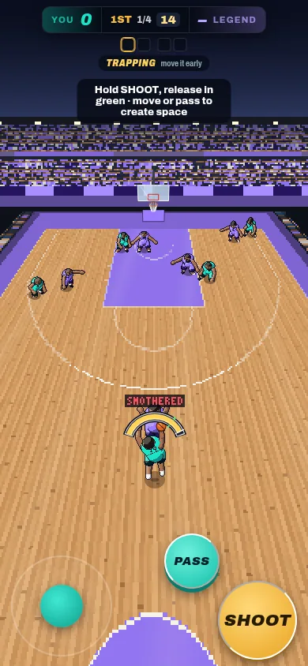 [上游游戏截图](<https://github.com/QemmHD/perfect-season/blob/HEAD/docs/previews/gameplay-nba-release.png>) | [QemmHD/perfect-season](<https://github.com/QemmHD/perfect-season>) | 常见根目录许可文件未找到 | 待核 | — | [可达 · 合集所列网页](<https://qemmhd.github.io/perfect-season/>) |
| 2416 | [ ] | [Perfect Season Draft](<https://github.com/gamingnews5/awesome-opus-5.5-games/blob/9a29b570e56bd19f15a3cd6bbac0b8c682f2c48c/games/perfect-season-draft/readme.md>) |  [对应子游戏玩法实截](<https://github.com/pawanp3/renderwolf-fable5-chart-toppers/blob/HEAD/games/draft-legends/index.html>) | [pawanp3/renderwolf-fable5-chart-toppers](<https://github.com/pawanp3/renderwolf-fable5-chart-toppers>) | 常见根目录许可文件未找到 | 待核 | — | [多游戏仓库入口 · 可达 · 合集所列网页](<https://pawanp3.github.io/renderwolf-fable5-chart-toppers/>) |
| 2417 | [ ] | [Perielio](<https://github.com/gamingnews5/awesome-opus-5.5-games/blob/9a29b570e56bd19f15a3cd6bbac0b8c682f2c48c/games/perielio/readme.md>) | 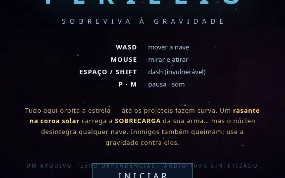 [源码运行首页](<https://github.com/carlosresendeP/perielio-fable5-game/blob/HEAD/index.html>) | [carlosresendeP/perielio-fable5-game](<https://github.com/carlosresendeP/perielio-fable5-game>) | 常见根目录许可文件未找到 | 待核 | — | 未列入口 |
| 2418 | [ ] | [Permainan Tradisional Malaysia](<https://github.com/gamingnews5/awesome-opus-5.5-games/blob/9a29b570e56bd19f15a3cd6bbac0b8c682f2c48c/games/permainan-tradisional-malaysia/readme.md>) | 待补截图 | [biyamin23/permainan-tradisional](<https://github.com/biyamin23/permainan-tradisional>) | 常见根目录许可文件未找到 | 待核 | — | [可达 · 合集所列网页](<https://permainan-tradisional-seven.vercel.app>) |
| 2419 | [ ] | [Perro Ladrón](<https://github.com/gamingnews5/awesome-opus-5.5-games/blob/9a29b570e56bd19f15a3cd6bbac0b8c682f2c48c/games/perro-ladron/readme.md>) | 待补截图 | [kokellara12-maker/apps-k4m9q2](<https://github.com/kokellara12-maker/apps-k4m9q2>) | 常见根目录许可文件未找到 | 待核 | — | [可达 · 合集所列网页](<https://kokellara12-maker.github.io/apps-k4m9q2/hermana.html>) |
| 2420 | [ ] | [Pesu Quest](<https://github.com/gamingnews5/awesome-opus-5.5-games/blob/9a29b570e56bd19f15a3cd6bbac0b8c682f2c48c/games/pesu-quest/readme.md>) |  [同款源码网页实截](<https://github.com/arunak451/engclass/blob/HEAD/index.html>) | [arunak451/engclass](<https://github.com/arunak451/engclass>) | 常见根目录许可文件未找到 | 待核 | — | [可达 · 合集所列网页](<https://engclass-psi.vercel.app>) |
| 2421 | [ ] | [Pet Island](<https://github.com/gamingnews5/awesome-opus-5.5-games/blob/9a29b570e56bd19f15a3cd6bbac0b8c682f2c48c/games/pet-island/readme.md>) | 待补截图 | [tahcin/pet-island](<https://github.com/tahcin/pet-island>) | 常见根目录许可文件未找到 | 待核 | — | [可达 · 合集所列网页](<https://pet-island.vercel.app>) |
| 2422 | [ ] | [Pet Part Hunter](<https://github.com/gamingnews5/awesome-opus-5.5-games/blob/9a29b570e56bd19f15a3cd6bbac0b8c682f2c48c/games/pet-part-hunter/readme.md>) | 待补截图 | [Holmes-Leighton/Pet-Part-Hunter](<https://github.com/Holmes-Leighton/Pet-Part-Hunter>) | 常见根目录许可文件未找到 | 待核 | — | 未列入口 |
| 2423 | [ ] | [Petal Jar](<https://github.com/gamingnews5/awesome-opus-5.5-games/blob/9a29b570e56bd19f15a3cd6bbac0b8c682f2c48c/games/petal-jar/readme.md>) | 待补截图 | [asees543/petal-jar](<https://github.com/asees543/petal-jar>) | 常见根目录许可文件未找到 | 待核 | — | [可达 · 含游戏画布／引擎的网页](<https://asees543.github.io/petal-jar/>) |
| 2424 | [ ] | [Petalport](<https://github.com/gamingnews5/awesome-opus-5.5-games/blob/9a29b570e56bd19f15a3cd6bbac0b8c682f2c48c/games/petalport/readme.md>) | 待补截图 | [katya-alferov/petal-port](<https://github.com/katya-alferov/petal-port>) | 常见根目录许可文件未找到 | 待核 | — | 未列入口 |
| 2425 | [ ] | [Petek Ustası](<https://github.com/gamingnews5/awesome-opus-5.5-games/blob/9a29b570e56bd19f15a3cd6bbac0b8c682f2c48c/games/petek-ustas/readme.md>) | 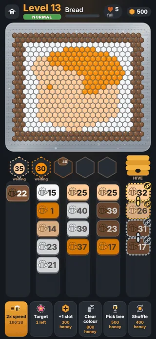 [上游动图截帧](<https://github.com/mehmetustattsc/puzzle-game/blob/main/marketing/gameplay.gif>) | [mehmetustattsc/puzzle-game](<https://github.com/mehmetustattsc/puzzle-game>) | 常见根目录许可文件未找到 | 待核 | [5.4](<https://github.com/mehmetustattsc/puzzle-game/blob/main/marketing/gameplay.gif>) | [可达 · 含游戏画布／引擎的网页](<https://mehmetustattsc.github.io/puzzle-game/>) |
| 2426 | [ ] | [PETOPIA](<https://github.com/gamingnews5/awesome-opus-5.5-games/blob/9a29b570e56bd19f15a3cd6bbac0b8c682f2c48c/games/petopia/readme.md>) | 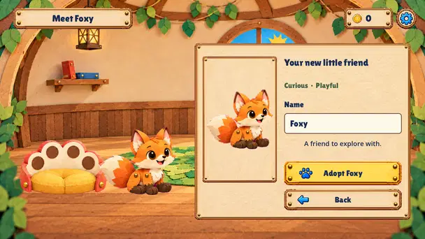 [上游游戏截图](<https://github.com/frenkelsergei-blip/petopia/blob/HEAD/docs/screenshots/adoption-desktop.png>) | [frenkelsergei-blip/petopia](<https://github.com/frenkelsergei-blip/petopia>) | 常见根目录许可文件未找到 | 待核 | — | [可达 · 含游戏画布／引擎的网页](<https://petopia-dqi.pages.dev/>) |
| 2427 | [ ] | [Petualangan Laut Pokémon](<https://github.com/gamingnews5/awesome-opus-5.5-games/blob/9a29b570e56bd19f15a3cd6bbac0b8c682f2c48c/games/petualangan-laut-pokemon/readme.md>) |  [同款源码启动画面实截](<https://github.com/Ghivee/Beben-game/blob/HEAD/index.html>) | [Ghivee/Beben-game](<https://github.com/Ghivee/Beben-game>) | 常见根目录许可文件未找到 | 待核 | — | [可达 · 合集所列网页](<https://ghivee.github.io/Beben-game/>) |
| 2428 | [ ] | [pH Rangers](<https://github.com/gamingnews5/awesome-opus-5.5-games/blob/9a29b570e56bd19f15a3cd6bbac0b8c682f2c48c/games/ph-rangers/readme.md>) | 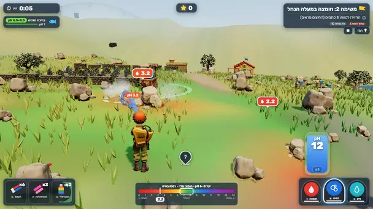 [合集截图](<https://github.com/AceDZN/ph-rangers/blob/main/docs/captures/02-core-spray.png>) | [AceDZN/ph-rangers](<https://github.com/AceDZN/ph-rangers>) | 常见根目录许可文件未找到 | 待核 | [6.2](<https://github.com/AceDZN/ph-rangers/blob/main/docs/captures/02-core-spray.png>) | 未列入口 |
| 2429 | [ ] | [Phatake Bazaar](<https://github.com/gamingnews5/awesome-opus-5.5-games/blob/9a29b570e56bd19f15a3cd6bbac0b8c682f2c48c/games/phatake-bazaar/readme.md>) | 待补截图 | [HassanYosuf/diwali-patakha-bazaar](<https://github.com/HassanYosuf/diwali-patakha-bazaar>) | 常见根目录许可文件未找到 无根LICENSE；虚拟货币没有真钱购买，外部服务/统计需单列。 | 待核 | — | [可达 · 含游戏画布／引擎的网页](<https://diwali-patakha-bazaar.vercel.app>) |
| 2430 | [ ] | [Phoenicians](<https://github.com/gamingnews5/awesome-opus-5.5-games/blob/9a29b570e56bd19f15a3cd6bbac0b8c682f2c48c/games/phoenicians/readme.md>) | 待补截图 | [BoardAtHome/phoenicians](<https://github.com/BoardAtHome/phoenicians>) | 常见根目录许可文件未找到 | 待核 | — | 未列入口 |
| 2431 | [ ] | [Phredd's Card Table, Puzzle Table, Mahjong, Word Search and Marble Challenge](<https://github.com/gamingnews5/awesome-opus-5.5-games/blob/9a29b570e56bd19f15a3cd6bbac0b8c682f2c48c/games/phredd-s-card-table-puzzle-table-mahjong-word-search-and-marble-challenge/readme.md>) | 待补截图 | [aalexander2017/CardGames](<https://github.com/aalexander2017/CardGames>) | 常见根目录许可文件未找到 | 待核 | [5.0（原图失效）](<https://github.com/aalexander2017/CardGames/blob/main/app/src/test/snapshots/images/com.aviscardtable.ui_CardArtSnapshotTest_classicFaces.png>) | 未列入口 |
| 2432 | [ ] | [Physick](<https://github.com/gamingnews5/awesome-opus-5.5-games/blob/9a29b570e56bd19f15a3cd6bbac0b8c682f2c48c/games/physick/readme.md>) | 待补截图 | [SefrenethOfficial/Physick](<https://github.com/SefrenethOfficial/Physick>) | 常见根目录许可文件未找到 | [README 提及](<https://github.com/SefrenethOfficial/Physick/blob/HEAD/README.md#L417>) | — | 未列入口 |
| 2433 | [ ] | [PHYSICS AMERICAN FOOTBALL](<https://github.com/gamingnews5/awesome-opus-5.5-games/blob/9a29b570e56bd19f15a3cd6bbac0b8c682f2c48c/games/physics-american-football/readme.md>) | 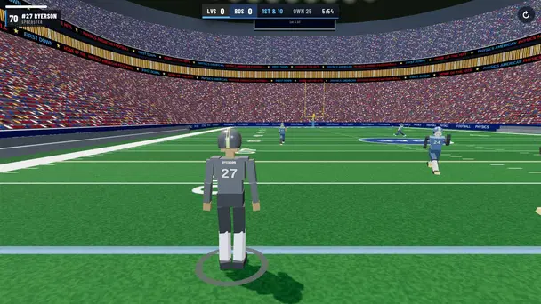 [合集截图](<https://github.com/dashryerson-design/Ragdoll-American-Footbal/blob/main/assets/match.jpg>) | [dashryerson-design/Ragdoll-American-Footbal](<https://github.com/dashryerson-design/Ragdoll-American-Footbal>) | 常见根目录许可文件未找到 | 待核 | [6.8](<https://github.com/dashryerson-design/Ragdoll-American-Footbal/blob/main/assets/match.jpg>) | [可达 · 合集所列网页](<https://dashryerson-design.github.io/Ragdoll-American-Footbal/>) |
| 2434 | [ ] | [Pick Up Boomers](<https://github.com/gamingnews5/awesome-opus-5.5-games/blob/9a29b570e56bd19f15a3cd6bbac0b8c682f2c48c/games/pick-up-boomers/readme.md>) | 待补截图 | [guelowrd/pub](<https://github.com/guelowrd/pub>) | 常见根目录许可文件未找到 | 待核 | — | 未列入口 |
| 2435 | [ ] | [Pickle Pirates](<https://github.com/gamingnews5/awesome-opus-5.5-games/blob/9a29b570e56bd19f15a3cd6bbac0b8c682f2c48c/games/pickle-pirates/readme.md>) | 待补截图 | [ennywnad/pickle-pirates](<https://github.com/ennywnad/pickle-pirates>) | 常见根目录许可文件未找到 | 待核 | — | [入口已失效 · 合集所列网页](<https://ennywnad.github.io/pickle-pirates/>) |
| 2436 | [ ] | [Pickup Trial](<https://github.com/gamingnews5/awesome-opus-5.5-games/blob/9a29b570e56bd19f15a3cd6bbac0b8c682f2c48c/games/pickup-trial/readme.md>) | 待补截图 | [BillJimbo/pickupGame](<https://github.com/BillJimbo/pickupGame>) | 常见根目录许可文件未找到 | 待核 | — | [可达 · 含游戏画布／引擎的网页](<https://billjimbo.github.io/pickupGame/>) |
| 2437 | [ ] | [Picle](<https://github.com/gamingnews5/awesome-opus-5.5-games/blob/9a29b570e56bd19f15a3cd6bbac0b8c682f2c48c/games/picle/readme.md>) | 待补截图 | [nickelstacker/picle](<https://github.com/nickelstacker/picle>) | 常见根目录许可文件未找到 | 待核 | — | [可达 · 合集所列网页](<https://nickelstacker.github.io/picle/?day=2&x=0.65&y=0.87&zoom=16>) |
| 2438 | [ ] | [PicPath](<https://github.com/gamingnews5/awesome-opus-5.5-games/blob/9a29b570e56bd19f15a3cd6bbac0b8c682f2c48c/games/picpath/readme.md>) | 待补截图 | [mahdimohebbi/picpath-web](<https://github.com/mahdimohebbi/picpath-web>) | 常见根目录许可文件未找到 | 待核 | — | [可达 · 合集所列网页](<https://mahdimohebbi.github.io/picpath-web/>) |
| 2439 | [ ] | [Picture Spell](<https://github.com/gamingnews5/awesome-opus-5.5-games/blob/9a29b570e56bd19f15a3cd6bbac0b8c682f2c48c/games/picture-spell/readme.md>) | 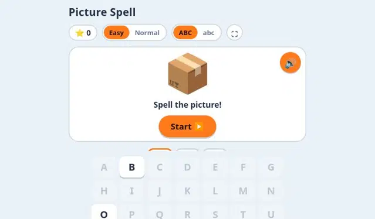 [试玩画面](<https://bcousin93.github.io/word-test/>) | [bcousin93/word-test](<https://github.com/bcousin93/word-test>) | 常见根目录许可文件未找到 | 待核 | — | [可达 · 含游戏画布／引擎的网页](<https://bcousin93.github.io/word-test/>) |
| 2440 | [ ] | [PikoTyper](<https://github.com/gamingnews5/awesome-opus-5.5-games/blob/9a29b570e56bd19f15a3cd6bbac0b8c682f2c48c/games/pikotyper/readme.md>) | 待补截图 | [atiris/pikotyper](<https://github.com/atiris/pikotyper>) | 常见根目录许可文件未找到 | 待核 | [5.8（原图失效）](<https://github.com/atiris/pikotyper/blob/main/docs/meadow.png>) | [入口已失效 · 合集所列网页](<https://atiris.github.io/pikotyper/>) |
| 2441 | [ ] | [Pilgrim Mechanica 2](<https://github.com/gamingnews5/awesome-opus-5.5-games/blob/9a29b570e56bd19f15a3cd6bbac0b8c682f2c48c/games/pilgrim-mechanica-2/readme.md>) | 待补截图 | [KeithThurlow/pilgrim-mechanica-2](<https://github.com/KeithThurlow/pilgrim-mechanica-2>) | 常见根目录许可文件未找到 | 待核 | [6.6](<https://github.com/KeithThurlow/pilgrim-mechanica-2/blob/main/docs/asset-shots/W1/game12_34front.jpg>) | 未列入口 |
| 2442 | [ ] | [Pinehollow Funland](<https://github.com/gamingnews5/awesome-opus-5.5-games/blob/9a29b570e56bd19f15a3cd6bbac0b8c682f2c48c/games/pinehollow-funland/readme.md>) | 待补截图 | [AlfredBrowser/Pinehollow-Funland-Five-Nights-at-Freddys-Remake-Fable-5.1](<https://github.com/AlfredBrowser/Pinehollow-Funland-Five-Nights-at-Freddys-Remake-Fable-5.1>) | 常见根目录许可文件未找到 | 待核 | — | 未列入口 |
| 2443 | [ ] | [PinQuiz](<https://github.com/gamingnews5/awesome-opus-5.5-games/blob/9a29b570e56bd19f15a3cd6bbac0b8c682f2c48c/games/pinquiz/readme.md>) | 待补截图 | [itsbusinessadmin/ce-quiz](<https://github.com/itsbusinessadmin/ce-quiz>) | 常见根目录许可文件未找到 | 待核 | — | [入口已失效 · 合集所列网页](<https://ces--kahoot.web.app>) |
| 2444 | [ ] | [Pintland Tap](<https://github.com/gamingnews5/awesome-opus-5.5-games/blob/9a29b570e56bd19f15a3cd6bbac0b8c682f2c48c/games/pintland-tap/readme.md>) | 待补截图 | [itsjackyboi/base](<https://github.com/itsjackyboi/base>) | 常见根目录许可文件未找到 | 待核 | — | 未列入口 |
| 2445 | [ ] | [Pirate Battle](<https://github.com/gamingnews5/awesome-opus-5.5-games/blob/9a29b570e56bd19f15a3cd6bbac0b8c682f2c48c/games/pirate-battle/readme.md>) | 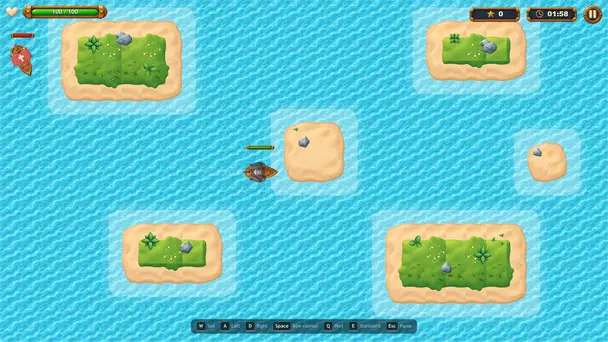 [上游游戏截图](<https://github.com/andrebrandao-dev/game-developer-challenge/blob/HEAD/e2e/__screenshots__/visual.spec.ts/arena-desktop-chromium.png>) | [andrebrandao-dev/game-developer-challenge](<https://github.com/andrebrandao-dev/game-developer-challenge>) | 常见根目录许可文件未找到 无根LICENSE；原测试报告仅作为代码工程线索，不算本次执行结果。 | 待核 | — | [可达 · 合集所列网页](<https://game-developer-challenge-smoky.vercel.app>) |
| 2446 | [ ] | [PirateSeas](<https://github.com/gamingnews5/awesome-opus-5.5-games/blob/9a29b570e56bd19f15a3cd6bbac0b8c682f2c48c/games/pirateseas/readme.md>) | 待补截图 | [AndreiBesliu/PirateSeas](<https://github.com/AndreiBesliu/PirateSeas>) | 常见根目录许可文件未找到 | [README 提及](<https://github.com/AndreiBesliu/PirateSeas/blob/HEAD/README.md#L83>) | [6.0](<https://github.com/AndreiBesliu/PirateSeas/blob/main/Scripts/ship_preview.png>) | 未列入口 |
| 2447 | [ ] | [Pitch Perfect](<https://github.com/gamingnews5/awesome-opus-5.5-games/blob/9a29b570e56bd19f15a3cd6bbac0b8c682f2c48c/games/pitch-perfect/readme.md>) | 待补截图 | [iagllc/pitch-perfect](<https://github.com/iagllc/pitch-perfect>) | 常见根目录许可文件未找到 | 待核 | — | 未列入口 |
| 2448 | [ ] | [Pitfighter](<https://github.com/gamingnews5/awesome-opus-5.5-games/blob/9a29b570e56bd19f15a3cd6bbac0b8c682f2c48c/games/pitfighter/readme.md>) | 待补截图 | [trafgals/pitfighter](<https://github.com/trafgals/pitfighter>) | 常见根目录许可文件未找到 | 待核 | — | [可达 · 含游戏画布／引擎的网页](<https://trafgals.github.io/pitfighter/>) |
| 2449 | [ ] | [Pitwall](<https://github.com/gamingnews5/awesome-opus-5.5-games/blob/9a29b570e56bd19f15a3cd6bbac0b8c682f2c48c/games/pitwall/readme.md>) | 待补截图 | [andrearufo/pitwall](<https://github.com/andrearufo/pitwall>) | 常见根目录许可文件未找到 | 待核 | — | [可达 · 合集所列网页](<https://andrearufo.github.io/pitwall/>) |
| 2450 | [ ] | [Pixel 2D Tu Tiên](<https://github.com/gamingnews5/awesome-opus-5.5-games/blob/9a29b570e56bd19f15a3cd6bbac0b8c682f2c48c/games/pixel-2d-tu-tien/readme.md>) | 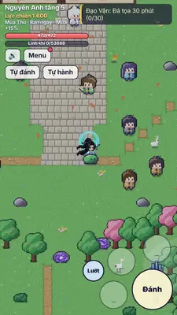 [上游商店截图](<https://github.com/auraloracultivation-dotcom/Pixel-2D-Tu-Tien/blob/HEAD/store/screens/1-thien-kiem-phong.png>) | [auraloracultivation-dotcom/Pixel-2D-Tu-Tien](<https://github.com/auraloracultivation-dotcom/Pixel-2D-Tu-Tien>) | 常见根目录许可文件未找到 | 待核 | — | [可达 · 含游戏画布／引擎的网页](<https://auraloracultivation-dotcom.github.io/Pixel-2D-Tu-Tien/>) |
| 2451 | [ ] | [Pixel Art 3D — Stone Meadow](<https://github.com/gamingnews5/awesome-opus-5.5-games/blob/9a29b570e56bd19f15a3cd6bbac0b8c682f2c48c/games/pixel-art-3d-stone-meadow/readme.md>) | 待补截图 | [AnthonyFl27/pixelart\_3d](<https://github.com/AnthonyFl27/pixelart_3d>) | 常见根目录许可文件未找到 | 待核 | — | 未列入口 |
| 2452 | [ ] | [Pixel Dungeon: The Sixty Stairs](<https://github.com/gamingnews5/awesome-opus-5.5-games/blob/9a29b570e56bd19f15a3cd6bbac0b8c682f2c48c/games/pixel-dungeon-the-sixty-stairs/readme.md>) | 待补截图 | [Jimmy-brimm/sixty-stairs](<https://github.com/Jimmy-brimm/sixty-stairs>) | 常见根目录许可文件未找到 | 待核 | — | 未列入口 |
| 2453 | [ ] | [Pixel Dynasty (arbetsnamn)](<https://github.com/gamingnews5/awesome-opus-5.5-games/blob/9a29b570e56bd19f15a3cd6bbac0b8c682f2c48c/games/pixel-dynasty-arbetsnamn/readme.md>) | 待补截图 | [Hemmetland/pixel-dynasty](<https://github.com/Hemmetland/pixel-dynasty>) | 常见根目录许可文件未找到 | 待核 | — | 未列入口 |
| 2454 | [ ] | [Pixel Fighter](<https://github.com/gamingnews5/awesome-opus-5.5-games/blob/9a29b570e56bd19f15a3cd6bbac0b8c682f2c48c/games/pixel-fighter/readme.md>) | 待补截图 | [vonduzenstudios-create/Pixel-Fighter](<https://github.com/vonduzenstudios-create/Pixel-Fighter>) | 常见根目录许可文件未找到 | [README 提及](<https://github.com/vonduzenstudios-create/Pixel-Fighter/blob/HEAD/README.md#L32>) | — | 未列入口 |
| 2455 | [ ] | [Pixel Hockey](<https://github.com/gamingnews5/awesome-opus-5.5-games/blob/9a29b570e56bd19f15a3cd6bbac0b8c682f2c48c/games/pixel-hockey/readme.md>) | 待补截图 | [ybelov27/pixel-hockey](<https://github.com/ybelov27/pixel-hockey>) | 常见根目录许可文件未找到 | [README 提及](<https://github.com/ybelov27/pixel-hockey/blob/HEAD/README.md#L17>) | — | [可达 · 含游戏画布／引擎的网页](<https://ybelov27.github.io/pixel-hockey/>) |
| 2456 | [ ] | [Pixel Horde](<https://github.com/gamingnews5/awesome-opus-5.5-games/blob/9a29b570e56bd19f15a3cd6bbac0b8c682f2c48c/games/pixel-horde/readme.md>) | 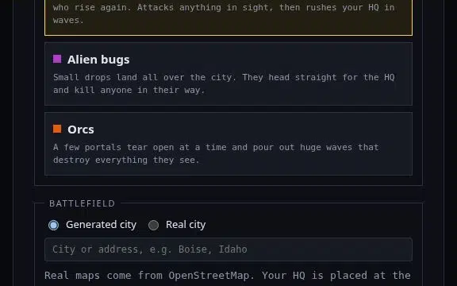 [源码运行画面](<https://github.com/Littlebutta/Horde-defence-game/blob/main/web/index.html>) | [Littlebutta/Horde-defence-game](<https://github.com/Littlebutta/Horde-defence-game>) | 常见根目录许可文件未找到 | 待核 | — | 未列入口 |
| 2457 | [ ] | [Pixel Sort — тест рынка](<https://github.com/gamingnews5/awesome-opus-5.5-games/blob/9a29b570e56bd19f15a3cd6bbac0b8c682f2c48c/games/pixel-sort/readme.md>) |  [试玩画面](<https://caypoh23.github.io/pixel-sort/>) | [Caypoh23/pixel-sort](<https://github.com/Caypoh23/pixel-sort>) | 常见根目录许可文件未找到 | 待核 | — | [可达 · 合集所列网页](<https://caypoh23.github.io/pixel-sort/>) |
| 2458 | [ ] | [Pixel Survivors: Nocturne](<https://github.com/gamingnews5/awesome-opus-5.5-games/blob/9a29b570e56bd19f15a3cd6bbac0b8c682f2c48c/games/pixel-survivors-nocturne/readme.md>) | 待补截图 | [Black2856/pixel\_survivors\_opus5.5test](<https://github.com/Black2856/pixel_survivors_opus5.5test>) | 常见根目录许可文件未找到 | 待核 | — | 未列入口 |
| 2459 | [ ] | [Pixel Tactical Shooter](<https://github.com/gamingnews5/awesome-opus-5.5-games/blob/9a29b570e56bd19f15a3cd6bbac0b8c682f2c48c/games/pixel-tactical-shooter/readme.md>) | 待补截图 | [Vadaski/pixel-tactical-shooter](<https://github.com/Vadaski/pixel-tactical-shooter>) | 常见根目录许可文件未找到 未见根LICENSE。 | 待核 | — | [可达 · 合集所列网页](<https://vadaski.github.io/pixel-tactical-shooter/>) |
| 2460 | [ ] | [Pixel War](<https://github.com/gamingnews5/awesome-opus-5.5-games/blob/9a29b570e56bd19f15a3cd6bbac0b8c682f2c48c/games/pixel-war/readme.md>) |  [同款源码启动画面实截](<https://github.com/bradhunt5/pixel-war/blob/HEAD/index.html>) | [bradhunt5/pixel-war](<https://github.com/bradhunt5/pixel-war>) | 常见根目录许可文件未找到 | 待核 | — | [可达 · 含游戏画布／引擎的网页](<https://bradhunt5.github.io/pixel-war/>) |
| 2461 | [ ] | [Pixelbike](<https://github.com/gamingnews5/awesome-opus-5.5-games/blob/9a29b570e56bd19f15a3cd6bbac0b8c682f2c48c/games/pixelbike/readme.md>) | 待补截图 | [MeckMan2025/pixelbike](<https://github.com/MeckMan2025/pixelbike>) | 常见根目录许可文件未找到 | 待核 | — | [可达 · 含游戏画布／引擎的网页](<https://pixelbike.meckman.org>) |
| 2462 | [ ] | [Pizza Chef](<https://github.com/gamingnews5/awesome-opus-5.5-games/blob/9a29b570e56bd19f15a3cd6bbac0b8c682f2c48c/games/pizza-chef/readme.md>) | 待补截图 | [PizzaDAO/pizza-chef](<https://github.com/PizzaDAO/pizza-chef>) | 常见根目录许可文件未找到 | 待核 | [3.5](<https://github.com/PizzaDAO/pizza-chef/blob/main/public/sprites/pizza-mafia.png>) | 未列入口 |
| 2463 | [ ] | [Pizza Rush — a web-based idle pizzeria](<https://github.com/gamingnews5/awesome-opus-5.5-games/blob/9a29b570e56bd19f15a3cd6bbac0b8c682f2c48c/games/pizza-rush-a-web-based-idle-pizzeria/readme.md>) | 待补截图 | [santolucito/pizzagame](<https://github.com/santolucito/pizzagame>) | 常见根目录许可文件未找到 | 待核 | — | 未列入口 |
| 2464 | [ ] | [PJ's Game](<https://github.com/gamingnews5/awesome-opus-5.5-games/blob/9a29b570e56bd19f15a3cd6bbac0b8c682f2c48c/games/pj-s-game/readme.md>) | 待补截图 | [mbnocode/PJ-s-Game](<https://github.com/mbnocode/PJ-s-Game>) | 常见根目录许可文件未找到 | 待核 | — | [可达 · 合集所列网页](<https://pjs-game.vercel.app>) |
| 2465 | [ ] | [PKSEI](<https://github.com/gamingnews5/awesome-opus-5.5-games/blob/9a29b570e56bd19f15a3cd6bbac0b8c682f2c48c/games/pksei/readme.md>) | 待补截图 | [Freakling/PKSEI](<https://github.com/Freakling/PKSEI>) | 常见根目录许可文件未找到 | 待核 | — | [可达 · itch.io 内嵌游戏页](<https://freakling.itch.io/pksei>) |
| 2466 | [ ] | [Plants vs. Zombies (fan remake)](<https://github.com/gamingnews5/awesome-opus-5.5-games/blob/9a29b570e56bd19f15a3cd6bbac0b8c682f2c48c/games/plants-vs-zombies-fan-remake/readme.md>) | 待补截图 | [dannishen60/plants-vs-zombies](<https://github.com/dannishen60/plants-vs-zombies>) | 常见根目录许可文件未找到 | 待核 | — | [可达 · 合集所列网页](<https://dannishen60.github.io/plants-vs-zombies/>) |
| 2467 | [ ] | [Platform Fighter](<https://github.com/gamingnews5/awesome-opus-5.5-games/blob/9a29b570e56bd19f15a3cd6bbac0b8c682f2c48c/games/platform-fighter/readme.md>) | 待补截图 | [lodevel/platform-fighter](<https://github.com/lodevel/platform-fighter>) | 常见根目录许可文件未找到 | 待核 | — | [入口已失效 · 合集所列网页](<https://lodevel.github.io/platform-fighter/>) |
| 2468 | [ ] | [Platform Zero](<https://github.com/gamingnews5/awesome-opus-5.5-games/blob/9a29b570e56bd19f15a3cd6bbac0b8c682f2c48c/games/platform-zero/readme.md>) |  [源码运行首页](<https://github.com/apratim3490/p-zero/blob/main/index.html>) | [apratim3490/p-zero](<https://github.com/apratim3490/p-zero>) | 常见根目录许可文件未找到 | 待核 | — | 未列入口 |
| 2469 | [ ] | [PlatyJam](<https://github.com/gamingnews5/awesome-opus-5.5-games/blob/9a29b570e56bd19f15a3cd6bbac0b8c682f2c48c/games/platyjam/readme.md>) | 待补截图 | [JeffreyVdb/PlatyJam](<https://github.com/JeffreyVdb/PlatyJam>) | 常见根目录许可文件未找到 | 待核 | — | [可达 · 合集所列网页](<https://jeffreyvdb.github.io/PlatyJam/>) |
| 2470 | [ ] | [Play Corner](<https://github.com/gamingnews5/awesome-opus-5.5-games/blob/9a29b570e56bd19f15a3cd6bbac0b8c682f2c48c/games/play-corner/readme.md>) | 待补截图 | [anthonybong9188-coder/play-corner](<https://github.com/anthonybong9188-coder/play-corner>) | 常见根目录许可文件未找到 | 待核 | — | 未列入口 |
| 2471 | [ ] | [Play More Learn More](<https://github.com/gamingnews5/awesome-opus-5.5-games/blob/9a29b570e56bd19f15a3cd6bbac0b8c682f2c48c/games/play-more-learn-more/readme.md>) | 待补截图 | [Rendorf/play-more-learn-more](<https://github.com/Rendorf/play-more-learn-more>) | 常见根目录许可文件未找到 | 待核 | — | [可达 · 合集所列网页](<https://rendorf.github.io/pmlm-preview/>) |
| 2472 | [ ] | [Play the Chain (kanodia)](<https://github.com/gamingnews5/awesome-opus-5.5-games/blob/9a29b570e56bd19f15a3cd6bbac0b8c682f2c48c/games/play-the-chain-kanodia/readme.md>) | 待补截图 | [kanodia/play-the-chain](<https://github.com/kanodia/play-the-chain>) | 常见根目录许可文件未找到 | 待核 | — | 未列入口 |
| 2473 | [ ] | [PlayGoLite](<https://github.com/gamingnews5/awesome-opus-5.5-games/blob/9a29b570e56bd19f15a3cd6bbac0b8c682f2c48c/games/playgolite/readme.md>) | 待补截图 | [aviec21/playgolite](<https://github.com/aviec21/playgolite>) | 常见根目录许可文件未找到 | 待核 | — | 未列入口 |
| 2474 | [ ] | [PlayNine](<https://github.com/gamingnews5/awesome-opus-5.5-games/blob/9a29b570e56bd19f15a3cd6bbac0b8c682f2c48c/games/playnine/readme.md>) | 待补截图 | [minhnt165/playnine](<https://github.com/minhnt165/playnine>) | 常见根目录许可文件未找到 | 待核 | — | [可达 · 含游戏画布／引擎的网页](<https://minhnt165.github.io/playnine/>) |
| 2475 | [ ] | [PlayTogether](<https://github.com/gamingnews5/awesome-opus-5.5-games/blob/9a29b570e56bd19f15a3cd6bbac0b8c682f2c48c/games/playtogether/readme.md>) | 待补截图 | [nguyensiclc/PlayTogether](<https://github.com/nguyensiclc/PlayTogether>) | 常见根目录许可文件未找到 | 待核 | [6.0](<https://github.com/nguyensiclc/PlayTogether/blob/main/docs/design/co-tuong/mockup-1.jpg>) | 未列入口 |
| 2476 | [ ] | [Plaza Llanera — shooter en Xirivella](<https://github.com/gamingnews5/awesome-opus-5.5-games/blob/9a29b570e56bd19f15a3cd6bbac0b8c682f2c48c/games/plaza-llanera-shooter-en-xirivella/readme.md>) | 待补截图 | [gabidiego072-glitch/Losa-game](<https://github.com/gabidiego072-glitch/Losa-game>) | 常见根目录许可文件未找到 | 待核 | — | [可达 · 含游戏画布／引擎的网页](<https://gabidiego072-glitch.github.io/Losa-game/>) |
| 2477 | [ ] | [Please Take a Number](<https://github.com/gamingnews5/awesome-opus-5.5-games/blob/9a29b570e56bd19f15a3cd6bbac0b8c682f2c48c/games/please-take-a-number/readme.md>) |  [同款源码网页实截](<https://github.com/mikmcelroy1/takeanumberdotgov/blob/HEAD/public/index.html>) | [mikmcelroy1/takeanumberdotgov](<https://github.com/mikmcelroy1/takeanumberdotgov>) | 常见根目录许可文件未找到 | 待核 | — | [可达 · 合集所列网页](<https://takeanumberdotgov.com>) |
| 2478 | [ ] | [PlotWar](<https://github.com/gamingnews5/awesome-opus-5.5-games/blob/9a29b570e56bd19f15a3cd6bbac0b8c682f2c48c/games/plotwar/readme.md>) | 待补截图 | [rafa9263/PlotWar](<https://github.com/rafa9263/PlotWar>) | 常见根目录许可文件未找到 | 待核 | — | 未列入口 |
| 2479 | [ ] | [Plumb](<https://github.com/gamingnews5/awesome-opus-5.5-games/blob/9a29b570e56bd19f15a3cd6bbac0b8c682f2c48c/games/plumb/readme.md>) |  [试玩画面](<https://gatfieldm.github.io/plumb/>) | [gatfieldm/plumb](<https://github.com/gatfieldm/plumb>) | 常见根目录许可文件未找到 | 待核 | — | [可达 · 含游戏画布／引擎的网页](<https://gatfieldm.github.io/plumb/>) |
| 2480 | [ ] | [PM Brawler](<https://github.com/gamingnews5/awesome-opus-5.5-games/blob/9a29b570e56bd19f15a3cd6bbac0b8c682f2c48c/games/pm-brawler/readme.md>) | 待补截图 | [miroslavkrupa/pm-brawler](<https://github.com/miroslavkrupa/pm-brawler>) | 常见根目录许可文件未找到 | 待核 | — | [入口已失效 · 合集所列网页](<https://miroslavkrupa.github.io/pm-brawler/>) |
| 2481 | [ ] | [PMC War Room: a game in progress](<https://github.com/gamingnews5/awesome-opus-5.5-games/blob/9a29b570e56bd19f15a3cd6bbac0b8c682f2c48c/games/pmc-war-room-a-game-in-progress/readme.md>) | 待补截图 | [chadbercea/topo-map](<https://github.com/chadbercea/topo-map>) | 常见根目录许可文件未找到 | 待核 | — | [可达 · 合集所列网页](<https://topo-map-nu.vercel.app>) |
| 2482 | [ ] | [PNF-404 Rush](<https://github.com/gamingnews5/awesome-opus-5.5-games/blob/9a29b570e56bd19f15a3cd6bbac0b8c682f2c48c/games/pnf-404-rush/readme.md>) |  [合集截图](<https://github.com/oscarqht/pikmin-rush-by-gemini-4/blob/main/screenshots/gameplay_battle.png>) | [oscarqht/pikmin-rush-by-gemini-4](<https://github.com/oscarqht/pikmin-rush-by-gemini-4>) | 常见根目录许可文件未找到 | 待核 | [7.3](<https://github.com/oscarqht/pikmin-rush-by-gemini-4/blob/main/screenshots/gameplay_battle.png>) | 未列入口 |
| 2483 | [ ] | [Poca Photocard Club](<https://github.com/gamingnews5/awesome-opus-5.5-games/blob/9a29b570e56bd19f15a3cd6bbac0b8c682f2c48c/games/poca-photocard-club/readme.md>) |  [源码运行画面](<https://github.com/blaze280599/moonflare/blob/main/prototype/moonflare-photocard-club.html>) | [blaze280599/moonflare](<https://github.com/blaze280599/moonflare>) | 常见根目录许可文件未找到 | 待核 | — | 未列入口 |
| 2484 | [ ] | [Pocket Arcade](<https://github.com/gamingnews5/awesome-opus-5.5-games/blob/9a29b570e56bd19f15a3cd6bbac0b8c682f2c48c/games/pocket-arcade/readme.md>) |  [游戏菜单或界面](<https://github.com/grantcharlie1000-tech/Qcc-games-/blob/main/docs/evidence/home-1366.png>) | [grantcharlie1000-tech/Qcc-games-](<https://github.com/grantcharlie1000-tech/Qcc-games->) | 常见根目录许可文件未找到 [本地打包字体保留 OFL 及第三方许可声明。](<https://github.com/grantcharlie1000-tech/Qcc-games-/blob/HEAD/README.md#L67>) | [README 提及](<https://github.com/grantcharlie1000-tech/Qcc-games-/blob/HEAD/README.md#L71>) | [4.0](<https://github.com/grantcharlie1000-tech/Qcc-games-/blob/main/docs/evidence/home-1366.png>) | [入口已失效 · 合集所列网页](<https://mauri-gazette.netlify.app>) |
| 2485 | [ ] | [Pocket Imperium](<https://github.com/gamingnews5/awesome-opus-5.5-games/blob/9a29b570e56bd19f15a3cd6bbac0b8c682f2c48c/games/pocket-imperium/readme.md>) | 待补截图 | [dethialaw/pocket-imperium](<https://github.com/dethialaw/pocket-imperium>) | 常见根目录许可文件未找到 | 待核 | — | 未列入口 |
| 2486 | [ ] | [Pocket RTS](<https://github.com/gamingnews5/awesome-opus-5.5-games/blob/9a29b570e56bd19f15a3cd6bbac0b8c682f2c48c/games/pocket-rts/readme.md>) | 待补截图 | [cavaleirobrancopensante/PocketRTS](<https://github.com/cavaleirobrancopensante/PocketRTS>) | 常见根目录许可文件未找到 | 待核 | — | [README · 可达 · 含游戏画布／引擎的网页](<https://triumviwar.github.io/>) |
| 2487 | [ ] | [Pod](<https://github.com/gamingnews5/awesome-opus-5.5-games/blob/9a29b570e56bd19f15a3cd6bbac0b8c682f2c48c/games/pod/readme.md>) | 待补截图 | [Heiviel/POD](<https://github.com/Heiviel/POD>) | 常见根目录许可文件未找到 | 待核 | — | 未列入口 |
| 2488 | [ ] | [Poke Brawl](<https://github.com/gamingnews5/awesome-opus-5.5-games/blob/9a29b570e56bd19f15a3cd6bbac0b8c682f2c48c/games/poke-brawl/readme.md>) | 待补截图 | [preston93lane/Poke-brawl-](<https://github.com/preston93lane/Poke-brawl->) | 常见根目录许可文件未找到 | 待核 | — | [可达 · 含游戏画布／引擎的网页](<https://preston93lane.github.io/Poke-brawl-/>) |
| 2489 | [ ] | [PokeBrawl](<https://github.com/gamingnews5/awesome-opus-5.5-games/blob/9a29b570e56bd19f15a3cd6bbac0b8c682f2c48c/games/pokebrawl/readme.md>) | 待补截图 | [Jakedapro/Pokemon-Game](<https://github.com/Jakedapro/Pokemon-Game>) | 常见根目录许可文件未找到 | 待核 | — | 未列入口 |
| 2490 | [ ] | [Pokemon Battle Masters (Arena Clash)](<https://github.com/gamingnews5/awesome-opus-5.5-games/blob/9a29b570e56bd19f15a3cd6bbac0b8c682f2c48c/games/pokemon-battle-masters-arena-clash/readme.md>) | 待补截图 | [TxHandles/pokemonarena](<https://github.com/TxHandles/pokemonarena>) | 常见根目录许可文件未找到 | [README 提及、源码有输入读取](<https://github.com/TxHandles/pokemonarena/blob/main/src/screens_story.cpp#L631>) | — | 未列入口 |
| 2491 | [ ] | [Pokerforge](<https://github.com/gamingnews5/awesome-opus-5.5-games/blob/9a29b570e56bd19f15a3cd6bbac0b8c682f2c48c/games/pokerforge/readme.md>) | 待补截图 | [saveriobanchi/Pokerforge](<https://github.com/saveriobanchi/Pokerforge>) | 常见根目录许可文件未找到 | 待核 | — | [可达 · 合集所列网页](<https://saveriobanchi.github.io/Pokerforge/>) |
| 2492 | [ ] | [PokéIdle](<https://github.com/gamingnews5/awesome-opus-5.5-games/blob/9a29b570e56bd19f15a3cd6bbac0b8c682f2c48c/games/pokeidle/readme.md>) |  [同款备选截图](<https://github.com/GustavoMarques06/PokeIdle---Beyond-the-Journey/blob/917aef14ae565c9e5b86d7dfb8e749e291f5c887/screenshots/01-intro.png>) | [GustavoMarques06/PokeIdle---Beyond-the-Journey](<https://github.com/GustavoMarques06/PokeIdle---Beyond-the-Journey>) | 常见根目录许可文件未找到 | 待核 | [6.0（原图失效）](<https://github.com/GustavoMarques06/PokeIdle---Beyond-the-Journey/blob/main/screenshots/01-intro.png>) · [看备用画面](<https://raw.githubusercontent.com/GustavoMarques06/PokeIdle---Beyond-the-Journey/917aef14ae565c9e5b86d7dfb8e749e291f5c887/screenshots/01-intro.png>) | 未列入口 |
| 2493 | [ ] | [Pokémon Claude Red](<https://github.com/gamingnews5/awesome-opus-5.5-games/blob/9a29b570e56bd19f15a3cd6bbac0b8c682f2c48c/games/pokemon-claude-red/readme.md>) |  [README 游戏截图](<https://github.com/levy-street/pokemon-claude-red#readme>) | [levy-street/pokemon-claude-red](<https://github.com/levy-street/pokemon-claude-red>) | 常见根目录许可文件未找到 | [README 提及](<https://github.com/levy-street/pokemon-claude-red/blob/HEAD/README.md#L86>) | — | [可达 · 合集所列网页](<https://claudered.dev/>) |
| 2494 | [ ] | [Pokémon Open World](<https://github.com/gamingnews5/awesome-opus-5.5-games/blob/9a29b570e56bd19f15a3cd6bbac0b8c682f2c48c/games/pokemon-open-world/readme.md>) | 待补截图 | [Thejas0/pokemon-reflex](<https://github.com/Thejas0/pokemon-reflex>) | 常见根目录许可文件未找到 | 待核 | — | [可达 · 含游戏画布／引擎的网页](<https://thejas0.github.io/pokemon-reflex/>) |
| 2495 | [ ] | [Pokémon Pocket Brawl](<https://github.com/gamingnews5/awesome-opus-5.5-games/blob/9a29b570e56bd19f15a3cd6bbac0b8c682f2c48c/games/pokemon-pocket-brawl/readme.md>) | 待补截图 | [SilverBits1001/PokeBattler](<https://github.com/SilverBits1001/PokeBattler>) | 常见根目录许可文件未找到 | [README 提及](<https://github.com/SilverBits1001/PokeBattler/blob/HEAD/README.md#L7>) | — | [可达 · 合集所列网页](<https://silverbits1001.github.io/PokeBattler/>) |
| 2496 | [ ] | [Pokémon Survivor](<https://github.com/gamingnews5/awesome-opus-5.5-games/blob/9a29b570e56bd19f15a3cd6bbac0b8c682f2c48c/games/pokemon-survivor/readme.md>) | 待补截图 | [LucBo-coder/lucbo111](<https://github.com/LucBo-coder/lucbo111>) | 常见根目录许可文件未找到 | 待核 | — | 未列入口 |
| 2497 | [ ] | [Pokémon Survivors](<https://github.com/gamingnews5/awesome-opus-5.5-games/blob/9a29b570e56bd19f15a3cd6bbac0b8c682f2c48c/games/pokemon-survivors/readme.md>) |  [试玩首页实截](<https://catylistic.github.io/pokemon-survivors/>) | [catylistic/pokemon-survivors](<https://github.com/catylistic/pokemon-survivors>) | 常见根目录许可文件未找到 | [源码有输入读取](<https://github.com/catylistic/pokemon-survivors/blob/main/index.html#L1763>) | — | [可达 · 含游戏画布／引擎的网页](<https://catylistic.github.io/pokemon-survivors/>) |
| 2498 | [ ] | [Poly GT](<https://github.com/gamingnews5/awesome-opus-5.5-games/blob/9a29b570e56bd19f15a3cd6bbac0b8c682f2c48c/games/poly-gt/readme.md>) | 待补截图 | [hakanalverson-cyber/polytourismo](<https://github.com/hakanalverson-cyber/polytourismo>) | 常见根目录许可文件未找到 无根LICENSE；车型/品牌和模型包逐项核。 | [源码有输入读取](<https://github.com/hakanalverson-cyber/polytourismo/blob/main/base/Poly-Tourismo-v7.html#L112>) | — | [可达 · 合集所列网页](<https://polytourismo.vercel.app>) |
| 2499 | [ ] | [Pong](<https://github.com/gamingnews5/awesome-opus-5.5-games/blob/9a29b570e56bd19f15a3cd6bbac0b8c682f2c48c/games/pong/readme.md>) | 待补截图 | [nvalencio/teste](<https://github.com/nvalencio/teste>) | 常见根目录许可文件未找到 | 待核 | — | 未列入口 |
| 2500 | [ ] | [Pong Game](<https://github.com/gamingnews5/awesome-opus-5.5-games/blob/9a29b570e56bd19f15a3cd6bbac0b8c682f2c48c/games/pong-game/readme.md>) |  [源码运行首页](<https://github.com/yasi-87/pong-game/blob/main/index.html>) | [yasi-87/pong-game](<https://github.com/yasi-87/pong-game>) | 常见根目录许可文件未找到 | 待核 | — | 未列入口 |
| 2501 | [ ] | [Pooprunner 3D](<https://github.com/gamingnews5/awesome-opus-5.5-games/blob/9a29b570e56bd19f15a3cd6bbac0b8c682f2c48c/games/pooprunner-3d/readme.md>) | 待补截图 | [larsdominic/pooprunner-3d](<https://github.com/larsdominic/pooprunner-3d>) | 常见根目录许可文件未找到 | 待核 | — | [入口已失效 · 合集所列网页](<https://larsdominic.github.io/pooprunner-3d/>) |
| 2502 | [ ] | [Poor Camp: Paradise Lost](<https://github.com/gamingnews5/awesome-opus-5.5-games/blob/9a29b570e56bd19f15a3cd6bbac0b8c682f2c48c/games/poor-camp-paradise-lost/readme.md>) | 待补截图 | [justinward108/paradise-lost](<https://github.com/justinward108/paradise-lost>) | 常见根目录许可文件未找到 | 待核 | — | 未列入口 |
| 2503 | [ ] | [Pop Rush](<https://github.com/gamingnews5/awesome-opus-5.5-games/blob/9a29b570e56bd19f15a3cd6bbac0b8c682f2c48c/games/pop-rush/readme.md>) |  [合集截图](<https://github.com/georrrgess-jpg/Brick-Rng/blob/claude/wonderful-franklin-9nexb9/docs/update-5/prototypes/sheet_hourglass.jpg>) | [georrrgess-jpg/Brick-Rng](<https://github.com/georrrgess-jpg/Brick-Rng>) | 常见根目录许可文件未找到 | 待核 | [5.5](<https://github.com/georrrgess-jpg/Brick-Rng/blob/claude/wonderful-franklin-9nexb9/docs/update-5/prototypes/sheet_hourglass.jpg>) | 未列入口 |
| 2504 | [ ] | [Pop the Chore Balloons](<https://github.com/gamingnews5/awesome-opus-5.5-games/blob/9a29b570e56bd19f15a3cd6bbac0b8c682f2c48c/games/pop-the-chore-balloons/readme.md>) |  [对应子游戏玩法实截](<https://github.com/vitalirasin-web/valeriabirthday/blob/HEAD/index.html>) | [vitalirasin-web/valeriabirthday](<https://github.com/vitalirasin-web/valeriabirthday>) | 常见根目录许可文件未找到 | 待核 | — | [多游戏仓库入口 · 可达 · 合集所列网页](<https://vitalirasin-web.github.io/valeriabirthday/>) |
| 2505 | [ ] | [Portal Clone](<https://github.com/gamingnews5/awesome-opus-5.5-games/blob/9a29b570e56bd19f15a3cd6bbac0b8c682f2c48c/games/portal-clone/readme.md>) | 待补截图 | [matthewcastellano99-creator/portal\_clone](<https://github.com/matthewcastellano99-creator/portal_clone>) | 常见根目录许可文件未找到 | 待核 | — | [可达 · 含游戏画布／引擎的网页](<https://matthewcastellano99-creator.github.io/portal_clone/>) |
| 2506 | [ ] | [PortalShift](<https://github.com/gamingnews5/awesome-opus-5.5-games/blob/9a29b570e56bd19f15a3cd6bbac0b8c682f2c48c/games/portalshift/readme.md>) | 待补截图 | [chvolk/PortalShifter](<https://github.com/chvolk/PortalShifter>) | 常见根目录许可文件未找到 | [README 提及](<https://github.com/chvolk/PortalShifter/blob/HEAD/README.md#L5>) | — | 未列入口 |
| 2507 | [ ] | [Potato Pirate](<https://github.com/gamingnews5/awesome-opus-5.5-games/blob/9a29b570e56bd19f15a3cd6bbac0b8c682f2c48c/games/potato-pirate/readme.md>) | 待补截图 | [rohandang-alpha/potatopirate](<https://github.com/rohandang-alpha/potatopirate>) | 常见根目录许可文件未找到 | 待核 | — | [可达 · 含游戏画布／引擎的网页](<https://rohandang-alpha.github.io/potatopirate/>) |
| 2508 | [ ] | [Potato Quiz](<https://github.com/gamingnews5/awesome-opus-5.5-games/blob/9a29b570e56bd19f15a3cd6bbac0b8c682f2c48c/games/potato-quiz/readme.md>) | 待补截图 | [Chenbisan/Potato-Quiz](<https://github.com/Chenbisan/Potato-Quiz>) | 常见根目录许可文件未找到 | 待核 | — | [可达 · 合集所列网页](<https://chenbisan.github.io/Potato-Quiz/>) |
| 2509 | [ ] | [PotatoBrawl](<https://github.com/gamingnews5/awesome-opus-5.5-games/blob/9a29b570e56bd19f15a3cd6bbac0b8c682f2c48c/games/potatobrawl/readme.md>) | 待补截图 | [guspliffy/potatobrawl](<https://github.com/guspliffy/potatobrawl>) | 常见根目录许可文件未找到 | 待核 | — | 未列入口 |
| 2510 | [ ] | [Potion Shop](<https://github.com/gamingnews5/awesome-opus-5.5-games/blob/9a29b570e56bd19f15a3cd6bbac0b8c682f2c48c/games/potion-shop/readme.md>) | 待补截图 | [lonewolfproduction99-cpu/PotionShop](<https://github.com/lonewolfproduction99-cpu/PotionShop>) | 常见根目录许可文件未找到 | 待核 | — | [可达 · 合集所列网页](<https://lonewolfproduction99-cpu.github.io/PotionShop/>) |
| 2511 | [ ] | [Poulpy](<https://github.com/gamingnews5/awesome-opus-5.5-games/blob/9a29b570e56bd19f15a3cd6bbac0b8c682f2c48c/games/poulpy/readme.md>) | 待补截图 | [jlrigau/poulpy](<https://github.com/jlrigau/poulpy>) | 常见根目录许可文件未找到 | 待核 | — | [可达 · 含游戏画布／引擎的网页](<https://jlrigau.github.io/poulpy/>) |
| 2512 | [ ] | [Powder Hollow](<https://github.com/gamingnews5/awesome-opus-5.5-games/blob/9a29b570e56bd19f15a3cd6bbac0b8c682f2c48c/games/powder-hollow/readme.md>) | 待补截图 | [vibe331212/powder-hollow](<https://github.com/vibe331212/powder-hollow>) | 常见根目录许可文件未找到 | 待核 | — | [可达 · 含游戏画布／引擎的网页](<https://vibe331212.github.io/powder-hollow/>) |
| 2513 | [ ] | [Power Chess](<https://github.com/gamingnews5/awesome-opus-5.5-games/blob/9a29b570e56bd19f15a3cd6bbac0b8c682f2c48c/games/power-chess/readme.md>) | 待补截图 | [ptimleigh/power-chess](<https://github.com/ptimleigh/power-chess>) | 常见根目录许可文件未找到 | 待核 | — | [可达 · 合集所列网页](<https://ptimleigh.github.io/power-chess/>) |
| 2514 | [ ] | [Power Game](<https://github.com/gamingnews5/awesome-opus-5.5-games/blob/9a29b570e56bd19f15a3cd6bbac0b8c682f2c48c/games/power-game/readme.md>) | 待补截图 | [stwdev/power-game](<https://github.com/stwdev/power-game>) | 常见根目录许可文件未找到 | 待核 | — | 未列入口 |
| 2515 | [ ] | [Powerslide](<https://github.com/gamingnews5/awesome-opus-5.5-games/blob/9a29b570e56bd19f15a3cd6bbac0b8c682f2c48c/games/powerslide/readme.md>) | 待补截图 | [andymantell/powerslide](<https://github.com/andymantell/powerslide>) | 常见根目录许可文件未找到 | [README 提及、源码有输入读取](<https://github.com/andymantell/powerslide/blob/main/src/main.js#L899>) | — | 未列入口 |
| 2516 | [ ] | [Ppblackjack](<https://github.com/gamingnews5/awesome-opus-5.5-games/blob/9a29b570e56bd19f15a3cd6bbac0b8c682f2c48c/games/ppblackjack/readme.md>) |  [源码运行首页](<https://github.com/Geodude117/PPBlackJack/blob/main/index.html>) | [Geodude117/PPBlackJack](<https://github.com/Geodude117/PPBlackJack>) | 常见根目录许可文件未找到 | 待核 | — | 未列入口 |
| 2517 | [ ] | [Practice RPG](<https://github.com/gamingnews5/awesome-opus-5.5-games/blob/9a29b570e56bd19f15a3cd6bbac0b8c682f2c48c/games/practice-rpg/readme.md>) | 待补截图 | [crabtoast90-dev/practice-rpg](<https://github.com/crabtoast90-dev/practice-rpg>) | 常见根目录许可文件未找到 | 待核 | — | [可达 · 含游戏画布／引擎的网页](<https://crabtoast90-dev.github.io/practice-rpg/>) |
| 2518 | [ ] | [Predict InceptionV1 neuron 4e:55](<https://github.com/gamingnews5/awesome-opus-5.5-games/blob/9a29b570e56bd19f15a3cd6bbac0b8c682f2c48c/games/predict-inceptionv1-neuron-4e-55/readme.md>) | 待补截图 | [UlisseMini/4e55-game](<https://github.com/UlisseMini/4e55-game>) | 常见根目录许可文件未找到 | 待核 | — | [可达 · 含游戏画布／引擎的网页](<https://ulissemini.github.io/4e55-game/>) |
| 2519 | [ ] | [Prefix D](<https://github.com/gamingnews5/awesome-opus-5.5-games/blob/9a29b570e56bd19f15a3cd6bbac0b8c682f2c48c/games/prefix-d/readme.md>) | 待补截图 | [shuheikomatsuki/car-game](<https://github.com/shuheikomatsuki/car-game>) | 常见根目录许可文件未找到 | [README 提及](<https://github.com/shuheikomatsuki/car-game/blob/HEAD/README.md#L99>) | — | [可达 · 合集所列网页](<https://shuheikomatsuki.github.io/prefix-d/>) |
| 2520 | [ ] | [PrepPath](<https://github.com/gamingnews5/awesome-opus-5.5-games/blob/9a29b570e56bd19f15a3cd6bbac0b8c682f2c48c/games/preppath/readme.md>) | 待补截图 | [Rollie2347/PrepPath](<https://github.com/Rollie2347/PrepPath>) | 常见根目录许可文件未找到 | 待核 | — | 未列入口 |
| 2521 | [ ] | [PRIMA MATERIA](<https://github.com/gamingnews5/awesome-opus-5.5-games/blob/9a29b570e56bd19f15a3cd6bbac0b8c682f2c48c/games/prima-materia/readme.md>) |  [合集截图](<https://github.com/ERIKXVI/aivsai/blob/claude/magical-pasteur-i2eqgq/docs/media/rubedo.jpg>) | [ERIKXVI/aivsai](<https://github.com/ERIKXVI/aivsai>) | 常见根目录许可文件未找到 | [README 提及](<https://github.com/ERIKXVI/aivsai/blob/HEAD/README.md#L48>) | [6.2](<https://github.com/ERIKXVI/aivsai/blob/claude/magical-pasteur-i2eqgq/docs/media/rubedo.jpg>) | 未列入口 |
| 2522 | [ ] | [Prime Split](<https://github.com/gamingnews5/awesome-opus-5.5-games/blob/9a29b570e56bd19f15a3cd6bbac0b8c682f2c48c/games/prime-split/readme.md>) | 待补截图 | [smallnumbersstudio-art/prime-split](<https://github.com/smallnumbersstudio-art/prime-split>) | 常见根目录许可文件未找到 | 待核 | — | [可达 · 合集所列网页](<https://playprimesplit.netlify.app>) |
| 2523 | [ ] | [Prime Trail](<https://github.com/gamingnews5/awesome-opus-5.5-games/blob/9a29b570e56bd19f15a3cd6bbac0b8c682f2c48c/games/prime-trail/readme.md>) | 待补截图 | [jyyan/game-prime-trail](<https://github.com/jyyan/game-prime-trail>) | 常见根目录许可文件未找到 [PDF 字体子集使用 OFL。](<https://github.com/jyyan/game-prime-trail/blob/HEAD/README.md#L120>) | 待核 | [5.0](<https://github.com/jyyan/game-prime-trail/blob/main/docs/design/illustrations/hero.png>) | 未列入口 |
| 2524 | [ ] | [Printshop Tycoon](<https://github.com/gamingnews5/awesome-opus-5.5-games/blob/9a29b570e56bd19f15a3cd6bbac0b8c682f2c48c/games/printshop-tycoon/readme.md>) | 待补截图 | [Reberholt/printshop-tycoon](<https://github.com/Reberholt/printshop-tycoon>) | 常见根目录许可文件未找到 | 待核 | — | 未列入口 |
| 2525 | [ ] | [Prism](<https://github.com/gamingnews5/awesome-opus-5.5-games/blob/9a29b570e56bd19f15a3cd6bbac0b8c682f2c48c/games/prism/readme.md>) |  [合集截图](<https://github.com/swan4er/opus-100-projects/blob/main/021-prism-puzzle/preview.jpg>) | [swan4er/opus-100-projects](<https://github.com/swan4er/opus-100-projects>) | 常见根目录许可文件未找到 | 待核 | [7.2](<https://github.com/swan4er/opus-100-projects/blob/main/021-prism-puzzle/preview.jpg>) | [可达 · 含游戏画布／引擎的网页](<https://swan4er.github.io/opus-100-projects/021-prism-puzzle/>) |
| 2526 | [ ] | [Prism Rush](<https://github.com/gamingnews5/awesome-opus-5.5-games/blob/9a29b570e56bd19f15a3cd6bbac0b8c682f2c48c/games/prism-rush/readme.md>) | 待补截图 | [Moha-df/prism-rush](<https://github.com/Moha-df/prism-rush>) | 常见根目录许可文件未找到 | 待核 | — | 未列入口 |
| 2527 | [ ] | [Privateers 私掠者](<https://github.com/gamingnews5/awesome-opus-5.5-games/blob/9a29b570e56bd19f15a3cd6bbac0b8c682f2c48c/games/privateers/readme.md>) | 待补截图 | [howwmingnew/Privateers](<https://github.com/howwmingnew/Privateers>) | 常见根目录许可文件未找到 | 待核 | — | [可达 · 含游戏画布／引擎的网页](<https://howwmingnew.github.io/Privateers/>) |
| 2528 | [ ] | [Pro Skater: The Warehouse](<https://github.com/gamingnews5/awesome-opus-5.5-games/blob/9a29b570e56bd19f15a3cd6bbac0b8c682f2c48c/games/pro-skater-the-warehouse/readme.md>) |  [上游实机演示截帧](<https://github.com/3D-Stories/skate-game-opus-5-5/blob/HEAD/evidence/two_minute_run.mp4>) | [3D-Stories/skate-game-opus-5-5](<https://github.com/3D-Stories/skate-game-opus-5-5>) | 常见根目录许可文件未找到 | [README 提及](<https://github.com/3D-Stories/skate-game-opus-5-5/blob/HEAD/README.md#L78>) | — | [可达 · 含游戏画布／引擎的网页](<https://skate-game-opus-5-5-blush.vercel.app/>) |
| 2529 | [ ] | [Project 3D Iso Game (working title)](<https://github.com/gamingnews5/awesome-opus-5.5-games/blob/9a29b570e56bd19f15a3cd6bbac0b8c682f2c48c/games/project-3d-iso-game-working-title/readme.md>) |  [合集截图](<https://github.com/kachaj96/Project-3D-iso-game/blob/main/docs/img/m1_camera_corner.png>) | [kachaj96/Project-3D-iso-game](<https://github.com/kachaj96/Project-3D-iso-game>) | 常见根目录许可文件未找到 | 待核 | [5.3](<https://github.com/kachaj96/Project-3D-iso-game/blob/main/docs/img/m1_camera_corner.png>) | 未列入口 |
| 2530 | [ ] | [PROJECT JEZZA: HUNTER VALLEY LEGENDS](<https://github.com/gamingnews5/awesome-opus-5.5-games/blob/9a29b570e56bd19f15a3cd6bbac0b8c682f2c48c/games/project-jezza-hunter-valley-legends/readme.md>) |  [上游游戏截图](<https://github.com/travex-pixel/Jezza-Secret-Mission/blob/HEAD/docs/screenshots/390x844/09-battle-arena.png>) | [travex-pixel/Jezza-Secret-Mission](<https://github.com/travex-pixel/Jezza-Secret-Mission>) | 常见根目录许可文件未找到 | 待核 | [5.0](<https://github.com/travex-pixel/Jezza-Secret-Mission/blob/ccr-660c5996-dtq1zc/docs/social-card.jpg>) | [可达 · 合集所列网页](<https://travex-pixel.github.io/Jezza-Secret-Mission/>) |
| 2531 | [ ] | [Project Praesepe](<https://github.com/gamingnews5/awesome-opus-5.5-games/blob/9a29b570e56bd19f15a3cd6bbac0b8c682f2c48c/games/project-praesepe/readme.md>) | 待补截图 | [ggbillyjoe3526/project-praesepe](<https://github.com/ggbillyjoe3526/project-praesepe>) | 常见根目录许可文件未找到 | 待核 | — | 未列入口 |
| 2532 | [ ] | [Project Rondo hub game](<https://github.com/gamingnews5/awesome-opus-5.5-games/blob/9a29b570e56bd19f15a3cd6bbac0b8c682f2c48c/games/project-rondo-hub-game/readme.md>) | 待补截图 | [YuutaTsubasa/ProjectRondo](<https://github.com/YuutaTsubasa/ProjectRondo>) | 常见根目录许可文件未找到 | 待核 | — | 未列入口 |
| 2533 | [ ] | [Project Valhalla](<https://github.com/gamingnews5/awesome-opus-5.5-games/blob/9a29b570e56bd19f15a3cd6bbac0b8c682f2c48c/games/project-valhalla/readme.md>) |  [试玩首页实截](<https://promilo101.github.io/project-valhalla/>) | [promilo101/project-valhalla](<https://github.com/promilo101/project-valhalla>) | 常见根目录许可文件未找到 | 待核 | — | [可达 · 合集所列网页](<https://promilo101.github.io/project-valhalla/>) |
| 2534 | [ ] | [Projet VR EVA — Escape game sous-marin](<https://github.com/gamingnews5/awesome-opus-5.5-games/blob/9a29b570e56bd19f15a3cd6bbac0b8c682f2c48c/games/projet-vr-eva-escape-game-sous-marin/readme.md>) | 待补截图 | [Lucas-Corrieras-LCS/eva-vr-escape-sousmarin](<https://github.com/Lucas-Corrieras-LCS/eva-vr-escape-sousmarin>) | 常见根目录许可文件未找到 | 待核 | — | 未列入口 |
| 2535 | [ ] | [PromptCraft](<https://github.com/gamingnews5/awesome-opus-5.5-games/blob/9a29b570e56bd19f15a3cd6bbac0b8c682f2c48c/games/promptcraft/readme.md>) | 待补截图 | [NotRithik/edge-city-game-jam-promptcraft](<https://github.com/NotRithik/edge-city-game-jam-promptcraft>) | 常见根目录许可文件未找到 | 待核 | — | [可达 · 合集所列网页](<https://edge-city-mc-univ.vercel.app>) |
| 2536 | [ ] | [Prop Hunt](<https://github.com/gamingnews5/awesome-opus-5.5-games/blob/9a29b570e56bd19f15a3cd6bbac0b8c682f2c48c/games/party-chaos/readme.md>) | 待补截图 | [lawrenceandrewlargo/roblox-extreme-minigames](<https://github.com/lawrenceandrewlargo/roblox-extreme-minigames>) | 常见根目录许可文件未找到 | 待核 | — | 未列入口 |
| 2537 | [ ] | [Prophecy of the Listener: Relicsong Card Game](<https://github.com/gamingnews5/awesome-opus-5.5-games/blob/9a29b570e56bd19f15a3cd6bbac0b8c682f2c48c/games/prophecy-of-the-listener-relicsong-card-game/readme.md>) |  [试玩画面](<https://coderblack15.github.io/listener-game/>) | [coderblack15/listener-game](<https://github.com/coderblack15/listener-game>) | 常见根目录许可文件未找到 | 待核 | — | [可达 · 合集所列网页](<https://coderblack15.github.io/listener-game/>) |
| 2538 | [ ] | [ProtistParty](<https://github.com/gamingnews5/awesome-opus-5.5-games/blob/9a29b570e56bd19f15a3cd6bbac0b8c682f2c48c/games/protistparty/readme.md>) | 待补截图 | [jessicasogge/protistparty](<https://github.com/jessicasogge/protistparty>) | 常见根目录许可文件未找到 | 待核 | — | [入口已失效 · 合集所列网页](<https://jessicasogge.github.io/protistparty/>) |
| 2539 | [ ] | [Proverb](<https://github.com/gamingnews5/awesome-opus-5.5-games/blob/9a29b570e56bd19f15a3cd6bbac0b8c682f2c48c/games/proverb/readme.md>) | 待补截图 | [AbdulMominAlam/proverb-game](<https://github.com/AbdulMominAlam/proverb-game>) | 常见根目录许可文件未找到 | 待核 | — | [可达 · 合集所列网页](<https://proverb-game-nine.vercel.app>) |
| 2540 | [ ] | [Pseudo CEO](<https://github.com/gamingnews5/awesome-opus-5.5-games/blob/9a29b570e56bd19f15a3cd6bbac0b8c682f2c48c/games/pseudo-ceo/readme.md>) | 待补截图 | [Dnaltroc/PSEUDO-CEO](<https://github.com/Dnaltroc/PSEUDO-CEO>) | 常见根目录许可文件未找到 | 待核 | — | [可达 · 合集所列网页](<https://pseudo-ceo.vercel.app>) |
| 2541 | [ ] | [PTTFL Head Coach](<https://github.com/gamingnews5/awesome-opus-5.5-games/blob/9a29b570e56bd19f15a3cd6bbac0b8c682f2c48c/games/pttfl-head-coach/readme.md>) |  [源码运行首页](<https://github.com/PTTFL/pttfl-head-coach/blob/main/multiplayer.html>) | [PTTFL/pttfl-head-coach](<https://github.com/PTTFL/pttfl-head-coach>) | 常见根目录许可文件未找到 | [README 提及、源码有输入读取](<https://github.com/PTTFL/pttfl-head-coach/blob/main/assets/hc-game.js#L3304>) | — | 未列入口 |
| 2542 | [ ] | [Pulse Highway](<https://github.com/gamingnews5/awesome-opus-5.5-games/blob/9a29b570e56bd19f15a3cd6bbac0b8c682f2c48c/games/pulse-highway/readme.md>) | 待补截图 | [bccdon/musicGameUnity](<https://github.com/bccdon/musicGameUnity>) | 常见根目录许可文件未找到 | 待核 | — | 未列入口 |
| 2543 | [ ] | [PULSEBREAK](<https://github.com/gamingnews5/awesome-opus-5.5-games/blob/9a29b570e56bd19f15a3cd6bbac0b8c682f2c48c/games/pulsebreak/readme.md>) |  [合集截图](<https://github.com/xindomusic/pulsebreak/blob/main/docs/images/combat.png>) | [xindomusic/pulsebreak](<https://github.com/xindomusic/pulsebreak>) | 常见根目录许可文件未找到 [作者要求核对素材来源并说明公开源码不等于授权原创游戏内容。](<https://github.com/xindomusic/pulsebreak/blob/HEAD/README.md#L89>) | 待核 | [7.3](<https://github.com/xindomusic/pulsebreak/blob/main/docs/images/combat.png>) | 未列入口 |
| 2544 | [ ] | [Pumpkin Carving Party Game](<https://github.com/gamingnews5/awesome-opus-5.5-games/blob/9a29b570e56bd19f15a3cd6bbac0b8c682f2c48c/games/pumpkin-carving-party-game/readme.md>) |  [合集截图](<https://github.com/jeffcampbell/Pumpkin-Carving-Party-Game/blob/main/docs/images/game-carving.jpg>) | [jeffcampbell/Pumpkin-Carving-Party-Game](<https://github.com/jeffcampbell/Pumpkin-Carving-Party-Game>) | 常见根目录许可文件未找到 | 待核 | [6.8](<https://github.com/jeffcampbell/Pumpkin-Carving-Party-Game/blob/main/docs/images/game-carving.jpg>) | 未列入口 |
| 2545 | [ ] | [Pung](<https://github.com/gamingnews5/awesome-opus-5.5-games/blob/9a29b570e56bd19f15a3cd6bbac0b8c682f2c48c/games/pung/readme.md>) | 待补截图 | [francisphan/pung](<https://github.com/francisphan/pung>) | 常见根目录许可文件未找到 | 待核 | — | [可达 · 合集所列网页](<https://francisphan.github.io/pung/>) |
| 2546 | [ ] | [Purrfect Logic](<https://github.com/gamingnews5/awesome-opus-5.5-games/blob/9a29b570e56bd19f15a3cd6bbac0b8c682f2c48c/games/purrfect-logic/readme.md>) |  [对应子游戏玩法实截](<https://github.com/pawanp3/renderwolf-fable5-chart-toppers/blob/HEAD/games/meowdoku/index.html>) | [pawanp3/renderwolf-fable5-chart-toppers](<https://github.com/pawanp3/renderwolf-fable5-chart-toppers>) | 常见根目录许可文件未找到 | 待核 | — | [多游戏仓库入口 · 可达 · 合集所列网页](<https://pawanp3.github.io/renderwolf-fable5-chart-toppers/>) |
| 2547 | [ ] | [Purrfect Match](<https://github.com/gamingnews5/awesome-opus-5.5-games/blob/9a29b570e56bd19f15a3cd6bbac0b8c682f2c48c/games/purrfect-match/readme.md>) |  [源码运行首页](<https://github.com/zebra-burger/purrfect-match/blob/main/index.html>) | [zebra-burger/purrfect-match](<https://github.com/zebra-burger/purrfect-match>) | 常见根目录许可文件未找到 | 待核 | — | 未列入口 |
| 2548 | [ ] | [Purrfect Pitch](<https://github.com/gamingnews5/awesome-opus-5.5-games/blob/9a29b570e56bd19f15a3cd6bbac0b8c682f2c48c/games/purrfect-pitch/readme.md>) |  [合集截图](<https://github.com/thiagofares-code/purrfect-pitch/blob/main/store/screenshot-1-alley.png>) | [thiagofares-code/purrfect-pitch](<https://github.com/thiagofares-code/purrfect-pitch>) | 常见根目录许可文件未找到 | 待核 | [6.8](<https://github.com/thiagofares-code/purrfect-pitch/blob/main/store/screenshot-1-alley.png>) | 未列入口 |
| 2549 | [ ] | [Purrrfect Crime](<https://github.com/gamingnews5/awesome-opus-5.5-games/blob/9a29b570e56bd19f15a3cd6bbac0b8c682f2c48c/games/purrrfect-crime/readme.md>) |  [上游游戏截图](<https://github.com/DempKing/Purrrfect_Crime/blob/HEAD/steam-images/screenshots/01_intro.png>) | [DempKing/Purrrfect\_Crime](<https://github.com/DempKing/Purrrfect_Crime>) | 常见根目录许可文件未找到 | 待核 | — | [可达 · 合集所列网页](<https://dempking.github.io/Purrrfect_Crime/>) |
| 2550 | [ ] | [Push the Payload](<https://github.com/gamingnews5/awesome-opus-5.5-games/blob/9a29b570e56bd19f15a3cd6bbac0b8c682f2c48c/games/party-chaos/readme.md>) | 待补截图 | [lawrenceandrewlargo/roblox-extreme-minigames](<https://github.com/lawrenceandrewlargo/roblox-extreme-minigames>) | 常见根目录许可文件未找到 | 待核 | — | 未列入口 |
| 2551 | [ ] | [Putt Quest — Adventure Mini Golf](<https://github.com/gamingnews5/awesome-opus-5.5-games/blob/9a29b570e56bd19f15a3cd6bbac0b8c682f2c48c/games/putt-quest-adventure-mini-golf/readme.md>) | 待补截图 | [leonvanzyl/3d-golf-sonnet](<https://github.com/leonvanzyl/3d-golf-sonnet>) | 常见根目录许可文件未找到 | 待核 | — | [可达 · 含游戏画布／引擎的网页](<https://3d-golf-sonnet.vercel.app/>) |
| 2552 | [ ] | [Puzzle Lab](<https://github.com/gamingnews5/awesome-opus-5.5-games/blob/9a29b570e56bd19f15a3cd6bbac0b8c682f2c48c/games/puzzle-lab/readme.md>) | 待补截图 | [ashtarabboud/puzzle-lab](<https://github.com/ashtarabboud/puzzle-lab>) | 常见根目录许可文件未找到 | 待核 | — | 未列入口 |
| 2553 | [ ] | [Puzzle Playroom](<https://github.com/gamingnews5/awesome-opus-5.5-games/blob/9a29b570e56bd19f15a3cd6bbac0b8c682f2c48c/games/puzzle-playroom/readme.md>) |  [源码运行首页](<https://github.com/djg502-svg/puzzle-playroom/blob/main/docs/index.html>) | [djg502-svg/puzzle-playroom](<https://github.com/djg502-svg/puzzle-playroom>) | 常见根目录许可文件未找到 | 待核 | — | 未列入口 |
| 2554 | [ ] | [Puzzles](<https://github.com/gamingnews5/awesome-opus-5.5-games/blob/9a29b570e56bd19f15a3cd6bbac0b8c682f2c48c/games/puzzles/readme.md>) | 待补截图 | [joclegg/puzzles-android](<https://github.com/joclegg/puzzles-android>) | 常见根目录许可文件未找到 | 待核 | — | 未列入口 |
| 2555 | [ ] | [Puzzles (benjaminsirb)](<https://github.com/gamingnews5/awesome-opus-5.5-games/blob/9a29b570e56bd19f15a3cd6bbac0b8c682f2c48c/games/puzzles-benjaminsirb/readme.md>) | 待补截图 | [benjaminsirb/puzzles](<https://github.com/benjaminsirb/puzzles>) | 常见根目录许可文件未找到 | 待核 | — | 未列入口 |
| 2556 | [ ] | [Puzzles (joclegg)](<https://github.com/gamingnews5/awesome-opus-5.5-games/blob/9a29b570e56bd19f15a3cd6bbac0b8c682f2c48c/games/puzzles-joclegg/readme.md>) |  [同款备选截图](<https://github.com/joclegg/puzzles-web/blob/aadfaf9c29f4d8efa92a566f86a4745f4a695544/src/views/FiveLettersGameView/__e2e__/__snapshots__/daily-guess-desktop-darwin.png>) | [joclegg/puzzles-web](<https://github.com/joclegg/puzzles-web>) | 常见根目录许可文件未找到 | 待核 | [4.6（原图失效）](<https://github.com/joclegg/puzzles-web/blob/main/src/views/FiveLettersGameView/__e2e__/__snapshots__/daily-guess-desktop-darwin.png>) · [看备用画面](<https://raw.githubusercontent.com/joclegg/puzzles-web/aadfaf9c29f4d8efa92a566f86a4745f4a695544/src/views/FiveLettersGameView/__e2e__/__snapshots__/daily-guess-desktop-darwin.png>) | [可达 · 合集所列网页](<https://joclegg.github.io/puzzles-web/>) |
| 2557 | [ ] | [PvP Game: Stickman Ruins](<https://github.com/gamingnews5/awesome-opus-5.5-games/blob/9a29b570e56bd19f15a3cd6bbac0b8c682f2c48c/games/pvp-game-stickman-ruins/readme.md>) | 待补截图 | [henriquemedeiros23-dev/pvp](<https://github.com/henriquemedeiros23-dev/pvp>) | 常见根目录许可文件未找到 | 待核 | — | 未列入口 |
| 2558 | [ ] | [PVP Tetris](<https://github.com/gamingnews5/awesome-opus-5.5-games/blob/9a29b570e56bd19f15a3cd6bbac0b8c682f2c48c/games/pvp-tetris/readme.md>) | 待补截图 | [wodud1378/PVP-Tetris](<https://github.com/wodud1378/PVP-Tetris>) | 常见根目录许可文件未找到 | 待核 | — | 未列入口 |
| 2559 | [ ] | [pwagame](<https://github.com/gamingnews5/awesome-opus-5.5-games/blob/9a29b570e56bd19f15a3cd6bbac0b8c682f2c48c/games/pwagame/readme.md>) | 待补截图 | [chief7/pwagame](<https://github.com/chief7/pwagame>) | 常见根目录许可文件未找到 | 待核 | — | [可达 · 含游戏画布／引擎的网页](<https://chief7.github.io/pwagame/>) |
| 2560 | [ ] | [Pygame Chess Bot](<https://github.com/gamingnews5/awesome-opus-5.5-games/blob/9a29b570e56bd19f15a3cd6bbac0b8c682f2c48c/games/pygame-chess-bot/readme.md>) | 待补截图 | [Goodest-ai/chess-bot](<https://github.com/Goodest-ai/chess-bot>) | 常见根目录许可文件未找到 | 待核 | — | 未列入口 |
| 2561 | [ ] | [Quantum Arcade](<https://github.com/gamingnews5/awesome-opus-5.5-games/blob/9a29b570e56bd19f15a3cd6bbac0b8c682f2c48c/games/quantum-arcade/readme.md>) |  [同款源码启动画面实截](<https://github.com/ondrik/quantum-arcade/blob/HEAD/index.html>) | [ondrik/quantum-arcade](<https://github.com/ondrik/quantum-arcade>) | 常见根目录许可文件未找到 | 待核 | — | [README · 可达 · 上游 README 所列网页](<https://quantum.fit.vut.cz/quantum-arcade/>) |
| 2562 | [ ] | [quark](<https://github.com/gamingnews5/awesome-opus-5.5-games/blob/9a29b570e56bd19f15a3cd6bbac0b8c682f2c48c/games/quark/readme.md>) | 待补截图 | [floration/quark](<https://github.com/floration/quark>) | 常见根目录许可文件未找到 | 待核 | — | [可达 · 合集所列网页](<https://floration.github.io/quark>) |
| 2563 | [ ] | [Questionable Journey](<https://github.com/gamingnews5/awesome-opus-5.5-games/blob/9a29b570e56bd19f15a3cd6bbac0b8c682f2c48c/games/questionable-journey/readme.md>) | 待补截图 | [rupertclaw/questionable-journey](<https://github.com/rupertclaw/questionable-journey>) | 常见根目录许可文件未找到 | 待核 | — | 未列入口 |
| 2564 | [ ] | [Quick Draw](<https://github.com/gamingnews5/awesome-opus-5.5-games/blob/9a29b570e56bd19f15a3cd6bbac0b8c682f2c48c/games/quick-draw/readme.md>) | 待补截图 | [Karanvir1729/ninja-knife-dodge](<https://github.com/Karanvir1729/ninja-knife-dodge>) | 常见根目录许可文件未找到 | 待核 | — | 未列入口 |
| 2565 | [ ] | [QuickDuel](<https://github.com/gamingnews5/awesome-opus-5.5-games/blob/9a29b570e56bd19f15a3cd6bbac0b8c682f2c48c/games/quickduel/readme.md>) |  [上游游戏截图](<https://github.com/mindattic/Unity.QuickDuel/blob/HEAD/docs/screenshots/parity-duel.png>) | [mindattic/Unity.QuickDuel](<https://github.com/mindattic/Unity.QuickDuel>) | 常见根目录许可文件未找到 | [README 提及](<https://github.com/mindattic/Unity.QuickDuel/blob/HEAD/README.md#L106>) | — | [入口已失效 · 合集所列网页](<https://mindattic.github.io/Unity.QuickDuel/>) |
| 2566 | [ ] | [QuickKen](<https://github.com/gamingnews5/awesome-opus-5.5-games/blob/9a29b570e56bd19f15a3cd6bbac0b8c682f2c48c/games/quickken/readme.md>) | 待补截图 | [WallHackJack/QuickKen](<https://github.com/WallHackJack/QuickKen>) | 常见根目录许可文件未找到 | 待核 | — | [可达 · 合集所列网页](<https://wallhackjack.github.io/QuickKen/>) |
| 2567 | [ ] | [Quiet Hours](<https://github.com/gamingnews5/awesome-opus-5.5-games/blob/9a29b570e56bd19f15a3cd6bbac0b8c682f2c48c/games/quiet-hours/readme.md>) | 待补截图 | [wellscurrence-a11y/Zombie-game-opus5.5](<https://github.com/wellscurrence-a11y/Zombie-game-opus5.5>) | 常见根目录许可文件未找到 | 待核 | — | 未列入口 |
| 2568 | [ ] | [Quiet Room](<https://github.com/gamingnews5/awesome-opus-5.5-games/blob/9a29b570e56bd19f15a3cd6bbac0b8c682f2c48c/games/quiet-room/readme.md>) | 待补截图 | [olzie/quiet-room](<https://github.com/olzie/quiet-room>) | 常见根目录许可文件未找到 | 待核 | — | [可达 · 合集所列网页](<https://olzie.github.io/quiet-room/>) |
| 2569 | [ ] | [Quillquest](<https://github.com/gamingnews5/awesome-opus-5.5-games/blob/9a29b570e56bd19f15a3cd6bbac0b8c682f2c48c/games/quillquest/readme.md>) | 待补截图 | [CptCliff/quillquest](<https://github.com/CptCliff/quillquest>) | 常见根目录许可文件未找到 | 待核 | — | 未列入口 |
| 2570 | [ ] | [Quipu](<https://github.com/gamingnews5/awesome-opus-5.5-games/blob/9a29b570e56bd19f15a3cd6bbac0b8c682f2c48c/games/quipu/readme.md>) | 待补截图 | [marinajimnz/quipugame](<https://github.com/marinajimnz/quipugame>) | 常见根目录许可文件未找到 | 待核 | — | [可达 · 合集所列网页](<https://quiputhegame.vercel.app>) |
| 2571 | [ ] | [QUIZ KNIGHTS](<https://github.com/gamingnews5/awesome-opus-5.5-games/blob/9a29b570e56bd19f15a3cd6bbac0b8c682f2c48c/games/quiz-knights/readme.md>) |  [游戏菜单或界面](<https://github.com/MiyazakiSora1234/quiz-knights/blob/main/docs/screenshots/04-host-battle.jpg>) | [MiyazakiSora1234/quiz-knights](<https://github.com/MiyazakiSora1234/quiz-knights>) | 常见根目录许可文件未找到 | 待核 | [5.8](<https://github.com/MiyazakiSora1234/quiz-knights/blob/main/docs/screenshots/04-host-battle.jpg>) | 未列入口 |
| 2572 | [ ] | [Quiz Pup](<https://github.com/gamingnews5/awesome-opus-5.5-games/blob/9a29b570e56bd19f15a3cd6bbac0b8c682f2c48c/games/quiz-pup/readme.md>) |  [同款源码启动画面实截](<https://github.com/Dylan78Lange/quiz-pup/blob/HEAD/index.html>) | [Dylan78Lange/quiz-pup](<https://github.com/Dylan78Lange/quiz-pup>) | 常见根目录许可文件未找到 | 待核 | — | [可达 · 合集所列网页](<https://dylan78lange.github.io/quiz-pup/>) |
| 2573 | [ ] | [R'th](<https://github.com/gamingnews5/awesome-opus-5.5-games/blob/9a29b570e56bd19f15a3cd6bbac0b8c682f2c48c/games/r-th/readme.md>) | 待补截图 | [Martifugit/rth](<https://github.com/Martifugit/rth>) | 常见根目录许可文件未找到 | 待核 | — | 未列入口 |
| 2574 | [ ] | [Racing Game Claude](<https://github.com/gamingnews5/awesome-opus-5.5-games/blob/9a29b570e56bd19f15a3cd6bbac0b8c682f2c48c/games/racing-game-claude/readme.md>) | 待补截图 | [srijan-vaddadi/Racing-Game-Claude](<https://github.com/srijan-vaddadi/Racing-Game-Claude>) | 常见根目录许可文件未找到 | 待核 | — | 未列入口 |
| 2575 | [ ] | [Radhija &amp; Rhaenyra](<https://github.com/gamingnews5/awesome-opus-5.5-games/blob/9a29b570e56bd19f15a3cd6bbac0b8c682f2c48c/games/radhija-rhaenyra/readme.md>) | 待补截图 | [raposocampos/radhija-rhaenyra](<https://github.com/raposocampos/radhija-rhaenyra>) | 常见根目录许可文件未找到 | [README 提及](<https://github.com/raposocampos/radhija-rhaenyra/blob/HEAD/README.md#L22>) | — | [可达 · 合集所列网页](<https://raposocampos.github.io/radhija-rhaenyra/>) |
| 2576 | [ ] | [Radikal Riders](<https://github.com/gamingnews5/awesome-opus-5.5-games/blob/9a29b570e56bd19f15a3cd6bbac0b8c682f2c48c/games/radikal-riders/readme.md>) | 待补截图 | [javichur/radikal-bikers](<https://github.com/javichur/radikal-bikers>) | 常见根目录许可文件未找到 | 待核 | — | [可达 · 含游戏画布／引擎的网页](<https://javichur.github.io/radikal-bikers/leoGjAW41OH-fIkg/>) |
| 2577 | [ ] | [Raft](<https://github.com/gamingnews5/awesome-opus-5.5-games/blob/9a29b570e56bd19f15a3cd6bbac0b8c682f2c48c/games/raft/readme.md>) |  [合集截图](<https://github.com/echosoar/raft/blob/main/image.png>) | [echosoar/raft](<https://github.com/echosoar/raft>) | 常见根目录许可文件未找到 | 待核 | [6.9](<https://github.com/echosoar/raft/blob/main/image.png>) | [可达 · 合集所列网页](<http://aiznb.com/raft/>) |
| 2578 | [ ] | [Ragdoll Downhill](<https://github.com/gamingnews5/awesome-opus-5.5-games/blob/9a29b570e56bd19f15a3cd6bbac0b8c682f2c48c/games/party-chaos/readme.md>) | 待补截图 | [lawrenceandrewlargo/roblox-extreme-minigames](<https://github.com/lawrenceandrewlargo/roblox-extreme-minigames>) | 常见根目录许可文件未找到 | 待核 | — | 未列入口 |
| 2579 | [ ] | [Ragdoll Shooters](<https://github.com/gamingnews5/awesome-opus-5.5-games/blob/9a29b570e56bd19f15a3cd6bbac0b8c682f2c48c/games/ragdoll-shooters/readme.md>) | 待补截图 | [dashryerson-design/ragdoll-shooters](<https://github.com/dashryerson-design/ragdoll-shooters>) | 常见根目录许可文件未找到 无根LICENSE；公共MQTT不是离线联网服务，武器/护甲素材来源另核。 | 待核 | — | [可达 · 合集所列网页](<https://dashryerson-design.github.io/ragdoll-shooters/>) |
| 2580 | [ ] | [ragdoll-game](<https://github.com/gamingnews5/awesome-opus-5.5-games/blob/9a29b570e56bd19f15a3cd6bbac0b8c682f2c48c/games/ragdoll-game/readme.md>) | 待补截图 | [ovadiapisga/ragdoll-game](<https://github.com/ovadiapisga/ragdoll-game>) | 常见根目录许可文件未找到 | 待核 | — | [入口已失效 · 合集所列网页](<https://ovadiapisga.github.io/ragdoll-game/>) |
| 2581 | [ ] | [Raid Zero](<https://github.com/gamingnews5/awesome-opus-5.5-games/blob/9a29b570e56bd19f15a3cd6bbac0b8c682f2c48c/games/raid-zero/readme.md>) | 待补截图 | [WillySchu/game](<https://github.com/WillySchu/game>) | 常见根目录许可文件未找到 | 待核 | — | 未列入口 |
| 2582 | [ ] | [Rail Riches](<https://github.com/gamingnews5/awesome-opus-5.5-games/blob/9a29b570e56bd19f15a3cd6bbac0b8c682f2c48c/games/rail-riches/readme.md>) | 待补截图 | [MMX13/ryans-make-money-game](<https://github.com/MMX13/ryans-make-money-game>) | 常见根目录许可文件未找到 | 待核 | — | [可达 · 合集所列网页](<https://mmx13.github.io/ryans-make-money-game/>) |
| 2583 | [ ] | [Rail Rush](<https://github.com/gamingnews5/awesome-opus-5.5-games/blob/9a29b570e56bd19f15a3cd6bbac0b8c682f2c48c/games/rail-rush/readme.md>) | 待补截图 | [sorrycc/fable-arcade](<https://github.com/sorrycc/fable-arcade>) | 常见根目录许可文件未找到 | 待核 | — | [可达 · 合集所列网页](<https://sorrycc.github.io/fable-arcade/games/subway-runner/>) |
| 2584 | [ ] | [Railyard](<https://github.com/gamingnews5/awesome-opus-5.5-games/blob/9a29b570e56bd19f15a3cd6bbac0b8c682f2c48c/games/railyard/readme.md>) | 待补截图 | [dettonijr/ticket-to-ride](<https://github.com/dettonijr/ticket-to-ride>) | 常见根目录许可文件未找到 | 待核 | — | 未列入口 |
| 2585 | [ ] | [Rain Bucket](<https://github.com/gamingnews5/awesome-opus-5.5-games/blob/9a29b570e56bd19f15a3cd6bbac0b8c682f2c48c/games/rain-bucket/readme.md>) | 待补截图 | [Lahrry45/rain-bucket](<https://github.com/Lahrry45/rain-bucket>) | 常见根目录许可文件未找到 | 待核 | [6.0](<https://github.com/Lahrry45/rain-bucket/blob/main/cover.png>) | [可达 · 含游戏画布／引擎的网页](<https://rain-bucket.start.ng>) |
| 2586 | [ ] | [Rajneeti](<https://github.com/gamingnews5/awesome-opus-5.5-games/blob/9a29b570e56bd19f15a3cd6bbac0b8c682f2c48c/games/rajneeti/readme.md>) | 待补截图 | [hharshmakwana-cpu/rajneeti](<https://github.com/hharshmakwana-cpu/rajneeti>) | 常见根目录许可文件未找到 | 待核 | — | [可达 · 合集所列网页](<https://hharshmakwana-cpu.github.io/rajneeti/>) |
| 2587 | [ ] | [Rally Navigator](<https://github.com/gamingnews5/awesome-opus-5.5-games/blob/9a29b570e56bd19f15a3cd6bbac0b8c682f2c48c/games/rally-navigator/readme.md>) |  [合集截图](<https://github.com/swan4er/opus-100-projects/blob/main/038-rally-navigator/preview.jpg>) | [swan4er/opus-100-projects](<https://github.com/swan4er/opus-100-projects>) | 常见根目录许可文件未找到 | 待核 | [8.6](<https://github.com/swan4er/opus-100-projects/blob/main/038-rally-navigator/preview.jpg>) | [可达 · 合集所列网页](<https://swan4er.github.io/opus-100-projects/038-rally-navigator/>) |
| 2588 | [ ] | [Random Route](<https://github.com/gamingnews5/awesome-opus-5.5-games/blob/9a29b570e56bd19f15a3cd6bbac0b8c682f2c48c/games/party-chaos/readme.md>) | 待补截图 | [lawrenceandrewlargo/roblox-extreme-minigames](<https://github.com/lawrenceandrewlargo/roblox-extreme-minigames>) | 常见根目录许可文件未找到 | 待核 | — | 未列入口 |
| 2589 | [ ] | [Ranked: the Countries Game](<https://github.com/gamingnews5/awesome-opus-5.5-games/blob/9a29b570e56bd19f15a3cd6bbac0b8c682f2c48c/games/ranked-the-countries-game/readme.md>) | 待补截图 | [ArmoredPawn/Countries-Game](<https://github.com/ArmoredPawn/Countries-Game>) | 常见根目录许可文件未找到 | 待核 | — | [入口已失效 · 合集所列网页](<https://armoredpawn.github.io/Countries-Game/>) |
| 2590 | [ ] | [RANT](<https://github.com/gamingnews5/awesome-opus-5.5-games/blob/9a29b570e56bd19f15a3cd6bbac0b8c682f2c48c/games/rant/readme.md>) | 待补截图 | [rovacom1/rant](<https://github.com/rovacom1/rant>) | 常见根目录许可文件未找到 | 待核 | — | [可达 · 合集所列网页](<https://rovacom1.github.io/rant/>) |
| 2591 | [ ] | [Rat Race Royale](<https://github.com/gamingnews5/awesome-opus-5.5-games/blob/9a29b570e56bd19f15a3cd6bbac0b8c682f2c48c/games/rat-race-royale/readme.md>) |  [同款源码启动画面实截](<https://github.com/FTalla18/rat-race-royale/blob/HEAD/index.html>) | [FTalla18/rat-race-royale](<https://github.com/FTalla18/rat-race-royale>) | 常见根目录许可文件未找到 | 待核 | — | [可达 · 合集所列网页](<https://ftalla18.github.io/rat-race-royale/>) |
| 2592 | [ ] | [RatIdle](<https://github.com/gamingnews5/awesome-opus-5.5-games/blob/9a29b570e56bd19f15a3cd6bbac0b8c682f2c48c/games/ratidle/readme.md>) | 待补截图 | [ssyuen/RatIdle](<https://github.com/ssyuen/RatIdle>) | 常见根目录许可文件未找到 | 待核 | — | 未列入口 |
| 2593 | [ ] | [Ravan Dahan (Dussehra game)](<https://github.com/gamingnews5/awesome-opus-5.5-games/blob/9a29b570e56bd19f15a3cd6bbac0b8c682f2c48c/games/ravan-dahan-dussehra-game/readme.md>) |  [源码运行画面](<https://github.com/Aryan-1908/Dussehra-Event/blob/main/ravan-dahan.html>) | [Aryan-1908/Dussehra-Event](<https://github.com/Aryan-1908/Dussehra-Event>) | 常见根目录许可文件未找到 | 待核 | — | 未列入口 |
| 2594 | [ ] | [Ravenswood](<https://github.com/gamingnews5/awesome-opus-5.5-games/blob/9a29b570e56bd19f15a3cd6bbac0b8c682f2c48c/games/ravenswood/readme.md>) | 待补截图 | [adcam02/Ravenswood](<https://github.com/adcam02/Ravenswood>) | 常见根目录许可文件未找到 | 待核 | — | 未列入口 |
| 2595 | [ ] | [RAVUNIX](<https://github.com/gamingnews5/awesome-opus-5.5-games/blob/9a29b570e56bd19f15a3cd6bbac0b8c682f2c48c/games/ravunix/readme.md>) |  [源码运行首页](<https://github.com/epicecho992-ctrl/ravunix-game/blob/main/index.html>) | [epicecho992-ctrl/ravunix-game](<https://github.com/epicecho992-ctrl/ravunix-game>) | 常见根目录许可文件未找到 | 待核 | — | 未列入口 |
| 2596 | [ ] | [REA Chess](<https://github.com/gamingnews5/awesome-opus-5.5-games/blob/9a29b570e56bd19f15a3cd6bbac0b8c682f2c48c/games/rea-chess/readme.md>) | 待补截图 | [paulofcmello/rea-chess](<https://github.com/paulofcmello/rea-chess>) | 常见根目录许可文件未找到 | 待核 | — | 未列入口 |
| 2597 | [ ] | [Reablo 2](<https://github.com/gamingnews5/awesome-opus-5.5-games/blob/9a29b570e56bd19f15a3cd6bbac0b8c682f2c48c/games/reablo-2/readme.md>) | 待补截图 | [oeo/reablo-2](<https://github.com/oeo/reablo-2>) | 常见根目录许可文件未找到 | 待核 | — | [可达 · 含游戏画布／引擎的网页](<https://diablo-2-web.fly.dev/>) |
| 2598 | [ ] | [Read the Room](<https://github.com/gamingnews5/awesome-opus-5.5-games/blob/9a29b570e56bd19f15a3cd6bbac0b8c682f2c48c/games/read-the-room/readme.md>) | 待补截图 | [Lalitbhardwaj2002/read-the-room](<https://github.com/Lalitbhardwaj2002/read-the-room>) | 常见根目录许可文件未找到 | 待核 | — | [README · 可达 · 上游 README 所列网页](<https://lalitbhardwaj2002.github.io/mindmela/>) |
| 2599 | [ ] | [ReadRash](<https://github.com/gamingnews5/awesome-opus-5.5-games/blob/9a29b570e56bd19f15a3cd6bbac0b8c682f2c48c/games/readrash/readme.md>) | 待补截图 | [lakshveerrao/readrash](<https://github.com/lakshveerrao/readrash>) | 常见根目录许可文件未找到 | 待核 | — | 未列入口 |
| 2600 | [ ] | [Real Tournament](<https://github.com/gamingnews5/awesome-opus-5.5-games/blob/9a29b570e56bd19f15a3cd6bbac0b8c682f2c48c/games/real-tournament/readme.md>) | 待补截图 | [nurullinm/real-tournament](<https://github.com/nurullinm/real-tournament>) | 常见根目录许可文件未找到 | 待核 | — | 未列入口 |
| 2601 | [ ] | [Realistic Survival](<https://github.com/gamingnews5/awesome-opus-5.5-games/blob/9a29b570e56bd19f15a3cd6bbac0b8c682f2c48c/games/realistic-survival/readme.md>) | 待补截图 | [liuyixuan5678/offline-games](<https://github.com/liuyixuan5678/offline-games>) | 常见根目录许可文件未找到 | 待核 | — | 未列入口 |
| 2602 | [ ] | [Realms of Tyra](<https://github.com/gamingnews5/awesome-opus-5.5-games/blob/9a29b570e56bd19f15a3cd6bbac0b8c682f2c48c/games/realms-of-tyra/readme.md>) | 待补截图 | [manueljcmatos/wasteland-rogue](<https://github.com/manueljcmatos/wasteland-rogue>) | 常见根目录许可文件未找到 | 待核 | — | 未列入口 |
| 2603 | [ ] | [ReBloom](<https://github.com/gamingnews5/awesome-opus-5.5-games/blob/9a29b570e56bd19f15a3cd6bbac0b8c682f2c48c/games/rebloom/readme.md>) |  [上游实机演示截帧](<https://github.com/Mahdi-Develops/rebloom/blob/HEAD/img/demo.mp4>) | [Mahdi-Develops/rebloom](<https://github.com/Mahdi-Develops/rebloom>) | 常见根目录许可文件未找到 | 待核 | — | [可达 · 合集所列网页](<https://rebloom-mu.vercel.app>) |
| 2604 | [ ] | [Recess Sports v1](<https://github.com/gamingnews5/awesome-opus-5.5-games/blob/9a29b570e56bd19f15a3cd6bbac0b8c682f2c48c/games/recess-sports-v1/readme.md>) | 待补截图 | [srgirsky/recess-sports](<https://github.com/srgirsky/recess-sports>) | 常见根目录许可文件未找到 | 待核 | — | [可达 · 含游戏画布／引擎的网页](<https://srgirsky.github.io/recess-sports/>) |
| 2605 | [ ] | [ReCharged](<https://github.com/gamingnews5/awesome-opus-5.5-games/blob/9a29b570e56bd19f15a3cd6bbac0b8c682f2c48c/games/recharged/readme.md>) | 待补截图 | [tulustul/ReCharged](<https://github.com/tulustul/ReCharged>) | 常见根目录许可文件未找到 | 待核 | — | 未列入口 |
| 2606 | [ ] | [Red Horizon](<https://github.com/gamingnews5/awesome-opus-5.5-games/blob/9a29b570e56bd19f15a3cd6bbac0b8c682f2c48c/games/red-horizon/readme.md>) |  [试玩首页实截](<https://red.troinich.fi>) | [HappynessSeller/red-horizon](<https://github.com/HappynessSeller/red-horizon>) | 常见根目录许可文件未找到 | 待核 | — | [可达 · 合集所列网页](<https://red.troinich.fi>) |
| 2607 | [ ] | [Red Light, Green Light](<https://github.com/gamingnews5/awesome-opus-5.5-games/blob/9a29b570e56bd19f15a3cd6bbac0b8c682f2c48c/games/party-chaos/readme.md>) | 待补截图 | [lawrenceandrewlargo/roblox-extreme-minigames](<https://github.com/lawrenceandrewlargo/roblox-extreme-minigames>) | 常见根目录许可文件未找到 | 待核 | — | 未列入口 |
| 2608 | [ ] | [Reel Legends](<https://github.com/gamingnews5/awesome-opus-5.5-games/blob/9a29b570e56bd19f15a3cd6bbac0b8c682f2c48c/games/reel-legends/readme.md>) | 待补截图 | [Pandot-Gamedev/reel-legends](<https://github.com/Pandot-Gamedev/reel-legends>) | 常见根目录许可文件未找到 | [README 提及](<https://github.com/Pandot-Gamedev/reel-legends/blob/HEAD/README.md#L36>) | — | 未列入口 |
| 2609 | [ ] | [Reflex Tap](<https://github.com/gamingnews5/awesome-opus-5.5-games/blob/9a29b570e56bd19f15a3cd6bbac0b8c682f2c48c/games/reflex-tap/readme.md>) | 待补截图 | [shironagasu-ai/claude-fable5-games](<https://github.com/shironagasu-ai/claude-fable5-games>) | 常见根目录许可文件未找到 | 待核 | — | 未列入口 |
| 2610 | [ ] | [Regolith](<https://github.com/gamingnews5/awesome-opus-5.5-games/blob/9a29b570e56bd19f15a3cd6bbac0b8c682f2c48c/games/regolith/readme.md>) | 待补截图 | [mnorrsken/fringeworlds](<https://github.com/mnorrsken/fringeworlds>) | 常见根目录许可文件未找到 | 待核 | — | 未列入口 |
| 2611 | [ ] | [Rei da Areia](<https://github.com/gamingnews5/awesome-opus-5.5-games/blob/9a29b570e56bd19f15a3cd6bbac0b8c682f2c48c/games/rei-da-areia/readme.md>) | 待补截图 | [nivzadik88-ship-it/rei-da-areia](<https://github.com/nivzadik88-ship-it/rei-da-areia>) | 常见根目录许可文件未找到 | 待核 | — | [可达 · 合集所列网页](<https://nivzadik88-ship-it.github.io/rei-da-areia/stats.html>) |
| 2612 | [ ] | [Reigns CEO — GPT 6 Astra Founder](<https://github.com/gamingnews5/awesome-opus-5.5-games/blob/9a29b570e56bd19f15a3cd6bbac0b8c682f2c48c/games/reigns-ceo-gpt-6-astra-founder/readme.md>) |  [试玩首页实截](<https://gaintenemycrabburger.github.io/reigns-ceo/gpt-6-astra/>) | [GaintEnemyCrabBurger/reigns-ceo](<https://github.com/GaintEnemyCrabBurger/reigns-ceo>) | 常见根目录许可文件未找到 | 待核 | — | [可达 · 合集所列网页](<https://gaintenemycrabburger.github.io/reigns-ceo/gpt-6-astra/>) |
| 2613 | [ ] | [Reinos Tycoon](<https://github.com/gamingnews5/awesome-opus-5.5-games/blob/9a29b570e56bd19f15a3cd6bbac0b8c682f2c48c/games/reinos-tycoon/readme.md>) | 待补截图 | [ElProyecto91/reinos-tycoon](<https://github.com/ElProyecto91/reinos-tycoon>) | 常见根目录许可文件未找到 | 待核 | — | 未列入口 |
| 2614 | [ ] | [Rekor Arcade](<https://github.com/gamingnews5/awesome-opus-5.5-games/blob/9a29b570e56bd19f15a3cd6bbac0b8c682f2c48c/games/rekor-arcade/readme.md>) | 待补截图 | [esaterenutas11-cmyk/rekor-arcade](<https://github.com/esaterenutas11-cmyk/rekor-arcade>) | 常见根目录许可文件未找到 | 待核 | — | [可达 · 含游戏画布／引擎的网页](<https://esaterenutas11-cmyk.github.io/rekor-arcade/>) |
| 2615 | [ ] | [Relight](<https://github.com/gamingnews5/awesome-opus-5.5-games/blob/9a29b570e56bd19f15a3cd6bbac0b8c682f2c48c/games/relight/readme.md>) |  [上游游戏截图](<https://github.com/Deedubsy/Relight/blob/HEAD/docs/evidence/gameplay-corrections/core-recovered.png>) | [Deedubsy/Relight](<https://github.com/Deedubsy/Relight>) | 常见根目录许可文件未找到 | 待核 | — | 未列入口 |
| 2616 | [ ] | [Reload Ops](<https://github.com/gamingnews5/awesome-opus-5.5-games/blob/9a29b570e56bd19f15a3cd6bbac0b8c682f2c48c/games/reload-ops/readme.md>) |  [源码运行首页](<https://github.com/rainetech/reload-ops/blob/main/index.html>) | [rainetech/reload-ops](<https://github.com/rainetech/reload-ops>) | 常见根目录许可文件未找到 | 待核 | — | 未列入口 |
| 2617 | [ ] | [Remainder Treasure Hunt](<https://github.com/gamingnews5/awesome-opus-5.5-games/blob/9a29b570e56bd19f15a3cd6bbac0b8c682f2c48c/games/remainder-treasure-hunt/readme.md>) |  [同款源码游戏实截](<https://github.com/mundeok/math-arcade-paradise/blob/master/src/games/g10_treasure.js>) | [mundeok/math-arcade-paradise](<https://github.com/mundeok/math-arcade-paradise>) | 常见根目录许可文件未找到 | 待核 | — | 未列入口 |
| 2618 | [ ] | [Remi's Bubble Club](<https://github.com/gamingnews5/awesome-opus-5.5-games/blob/9a29b570e56bd19f15a3cd6bbac0b8c682f2c48c/games/remi-s-bubble-club/readme.md>) |  [源码运行首页](<https://github.com/DanDanKM/remis-bubble-club/blob/main/index.html>) | [DanDanKM/remis-bubble-club](<https://github.com/DanDanKM/remis-bubble-club>) | 常见根目录许可文件未找到 | 待核 | — | 未列入口 |
| 2619 | [ ] | [Requiem for Ruin](<https://github.com/gamingnews5/awesome-opus-5.5-games/blob/9a29b570e56bd19f15a3cd6bbac0b8c682f2c48c/games/requiem-for-ruin/readme.md>) | 待补截图 | [rydevops/ffvis-](<https://github.com/rydevops/ffvis->) | 常见根目录许可文件未找到 | 待核 | — | 未列入口 |
| 2620 | [ ] | [Respawn Vibgyor](<https://github.com/gamingnews5/awesome-opus-5.5-games/blob/9a29b570e56bd19f15a3cd6bbac0b8c682f2c48c/games/respawn-vibgyor/readme.md>) | 待补截图 | [neha-aj/RESPAWN-VIBGYOR](<https://github.com/neha-aj/RESPAWN-VIBGYOR>) | 常见根目录许可文件未找到 | 待核 | — | 未列入口 |
| 2621 | [ ] | [Retro Arcade](<https://github.com/gamingnews5/awesome-opus-5.5-games/blob/9a29b570e56bd19f15a3cd6bbac0b8c682f2c48c/games/retro-arcade/readme.md>) |  [上游游戏截图](<https://github.com/Novsochetra/fighting-games/blob/HEAD/apps/web/games/naga-eleven/assets/screenshots/world-stadium.png>) | [Novsochetra/fighting-games](<https://github.com/Novsochetra/fighting-games>) | 常见根目录许可文件未找到 | [README 提及](<https://github.com/Novsochetra/fighting-games/blob/HEAD/README.md#L29>) | — | [可达 · 合集所列网页](<https://novsochetra.github.io/fighting-games/>) |
| 2622 | [ ] | [RETRO DEUTSCH A1 BREAKOUT](<https://github.com/gamingnews5/awesome-opus-5.5-games/blob/9a29b570e56bd19f15a3cd6bbac0b8c682f2c48c/games/retro-deutsch-a1-breakout/readme.md>) | 待补截图 | [shueny/german-breakout](<https://github.com/shueny/german-breakout>) | 常见根目录许可文件未找到 | 待核 | — | [可达 · 合集所列网页](<https://german-breakout.vercel.app>) |
| 2623 | [ ] | [Retro Games](<https://github.com/gamingnews5/awesome-opus-5.5-games/blob/9a29b570e56bd19f15a3cd6bbac0b8c682f2c48c/games/retro-games/readme.md>) | 待补截图 | [barneyfin/twisted-retro-fit](<https://github.com/barneyfin/twisted-retro-fit>) | 常见根目录许可文件未找到 | 待核 | — | [可达 · 合集所列网页](<https://barneyfin.github.io/twisted-retro-fit/>) |
| 2624 | [ ] | [RETRO SPORTS](<https://github.com/gamingnews5/awesome-opus-5.5-games/blob/9a29b570e56bd19f15a3cd6bbac0b8c682f2c48c/games/retro-sports/readme.md>) |  [合集截图](<https://github.com/helico-tech/retro-sports/blob/main/docs/screenshots/super-shot.png>) | [helico-tech/retro-sports](<https://github.com/helico-tech/retro-sports>) | 常见根目录许可文件未找到 | 待核 | [7.6](<https://github.com/helico-tech/retro-sports/blob/main/docs/screenshots/super-shot.png>) | [README · 可达 · 含游戏画布／引擎的网页](<https://retro-sports.helico.app>) |
| 2625 | [ ] | [RetroBall](<https://github.com/gamingnews5/awesome-opus-5.5-games/blob/9a29b570e56bd19f15a3cd6bbac0b8c682f2c48c/games/retroball/readme.md>) | 待补截图 | [chudxster/RetroBall](<https://github.com/chudxster/RetroBall>) | 常见根目录许可文件未找到 | 待核 | — | [可达 · 含游戏画布／引擎的网页](<https://chudxster.github.io/RetroBall/>) |
| 2626 | [ ] | [Rettet das Ei](<https://github.com/gamingnews5/awesome-opus-5.5-games/blob/9a29b570e56bd19f15a3cd6bbac0b8c682f2c48c/games/rettet-das-ei/readme.md>) | 待补截图 | [SaftKinn/eigame](<https://github.com/SaftKinn/eigame>) | 常见根目录许可文件未找到 | 待核 | — | 未列入口 |
| 2627 | [ ] | [Reverse Loving — Gnivol](<https://github.com/gamingnews5/awesome-opus-5.5-games/blob/9a29b570e56bd19f15a3cd6bbac0b8c682f2c48c/games/reverse-loving-gnivol/readme.md>) |  [合集截图](<https://github.com/trieuwu/Gnivol/blob/HEAD/imgs/horror.png>) | [trieuwu/Gnivol](<https://github.com/trieuwu/Gnivol>) | 常见根目录许可文件未找到 | 待核 | [7.2](<https://github.com/trieuwu/Gnivol/blob/HEAD/imgs/horror.png>) | 未列入口 |
| 2628 | [ ] | [Revision Escape Rooms](<https://github.com/gamingnews5/awesome-opus-5.5-games/blob/9a29b570e56bd19f15a3cd6bbac0b8c682f2c48c/games/revision-escape-rooms/readme.md>) |  [源码运行首页](<https://github.com/NZVMan/escape-rooms/blob/main/maths/index.html>) | [NZVMan/escape-rooms](<https://github.com/NZVMan/escape-rooms>) | 常见根目录许可文件未找到 | 待核 | — | 未列入口 |
| 2629 | [ ] | [Revlotto](<https://github.com/gamingnews5/awesome-opus-5.5-games/blob/9a29b570e56bd19f15a3cd6bbac0b8c682f2c48c/games/revlotto/readme.md>) | 待补截图 | [dashaunb123/revlotto](<https://github.com/dashaunb123/revlotto>) | 常见根目录许可文件未找到 | 待核 | — | 未列入口 |
| 2630 | [ ] | [Revolution Quest](<https://github.com/gamingnews5/awesome-opus-5.5-games/blob/9a29b570e56bd19f15a3cd6bbac0b8c682f2c48c/games/revolution-quest/readme.md>) |  [源码运行首页](<https://github.com/lydonb/clark-quizzes/blob/main/american-revolution/index.html>) | [lydonb/clark-quizzes](<https://github.com/lydonb/clark-quizzes>) | 常见根目录许可文件未找到 | 待核 | — | 未列入口 |
| 2631 | [ ] | [Ricochet Depths](<https://github.com/gamingnews5/awesome-opus-5.5-games/blob/9a29b570e56bd19f15a3cd6bbac0b8c682f2c48c/games/ricochet-depths/readme.md>) |  [上游动图截帧](<https://github.com/shepherd2047/ricochet-depths#readme>) | [shepherd2047/ricochet-depths](<https://github.com/shepherd2047/ricochet-depths>) | 常见根目录许可文件未找到 | 待核 | — | 未列入口 |
| 2632 | [ ] | [RideIdle](<https://github.com/gamingnews5/awesome-opus-5.5-games/blob/9a29b570e56bd19f15a3cd6bbac0b8c682f2c48c/games/rideidle/readme.md>) |  [README 游戏截图](<https://github.com/KenjiWriter/RideIdle#readme>) | [KenjiWriter/RideIdle](<https://github.com/KenjiWriter/RideIdle>) | 常见根目录许可文件未找到 | 待核 | — | 未列入口 |
| 2633 | [ ] | [Ridge Games](<https://github.com/gamingnews5/awesome-opus-5.5-games/blob/9a29b570e56bd19f15a3cd6bbac0b8c682f2c48c/games/ridge-games/readme.md>) |  [源码运行首页](<https://github.com/Raffimgr/webgame/blob/main/map.html>) | [Raffimgr/webgame](<https://github.com/Raffimgr/webgame>) | 常见根目录许可文件未找到 | 待核 | — | 未列入口 |
| 2634 | [ ] | [Ridge Road](<https://github.com/gamingnews5/awesome-opus-5.5-games/blob/9a29b570e56bd19f15a3cd6bbac0b8c682f2c48c/games/ridge-road/readme.md>) | 待补截图 | [LachlanLindsay/ridge-road](<https://github.com/LachlanLindsay/ridge-road>) | 常见根目录许可文件未找到 | 待核 | — | 未列入口 |
| 2635 | [ ] | [Riftbrand](<https://github.com/gamingnews5/awesome-opus-5.5-games/blob/9a29b570e56bd19f15a3cd6bbac0b8c682f2c48c/games/riftbrand/readme.md>) | 待补截图 | [oe7set/riftbrand](<https://github.com/oe7set/riftbrand>) | 常见根目录许可文件未找到 | [README 提及](<https://github.com/oe7set/riftbrand/blob/HEAD/README.md#L22>) | — | [可达 · 合集所列网页](<https://oe7set.github.io/riftbrand/>) |
| 2636 | [ ] | [Riftcast](<https://github.com/gamingnews5/awesome-opus-5.5-games/blob/9a29b570e56bd19f15a3cd6bbac0b8c682f2c48c/games/riftcast/readme.md>) | 待补截图 | [iamboosted/riftcast](<https://github.com/iamboosted/riftcast>) | 常见根目录许可文件未找到 | 待核 | [7.6（原图失效）](<https://github.com/iamboosted/riftcast/blob/master/screenshots/combat-high.jpg>) | [入口已失效 · 合集所列网页](<https://iamboosted.github.io/riftcast/>) |
| 2637 | [ ] | [Riftrunner](<https://github.com/gamingnews5/awesome-opus-5.5-games/blob/9a29b570e56bd19f15a3cd6bbac0b8c682f2c48c/games/riftrunner/readme.md>) |  [合集截图](<https://github.com/underscoreloG/riftrunner/blob/main/screenshots/gameplay.png>) | [underscoreloG/riftrunner](<https://github.com/underscoreloG/riftrunner>) | 常见根目录许可文件未找到 | [README 提及、源码有输入读取](<https://github.com/underscoreloG/riftrunner/blob/main/riftrunner.html#L910>) | [6.6](<https://github.com/underscoreloG/riftrunner/blob/main/screenshots/gameplay.png>) | [README · 可达 · 上游 README 所列网页](<https://underscorelog.github.io/riftrunner/>) |
| 2638 | [ ] | [Rim3D](<https://github.com/gamingnews5/awesome-opus-5.5-games/blob/9a29b570e56bd19f15a3cd6bbac0b8c682f2c48c/games/rim3d/readme.md>) | 待补截图 | [Sneed-code/Rim3D](<https://github.com/Sneed-code/Rim3D>) | 常见根目录许可文件未找到 | 待核 | — | 未列入口 |
| 2639 | [ ] | [Ring of Fire](<https://github.com/gamingnews5/awesome-opus-5.5-games/blob/9a29b570e56bd19f15a3cd6bbac0b8c682f2c48c/games/ring-of-fire/readme.md>) |  [试玩首页实截](<https://axellofgren-boop.github.io/ring-of-fire/>) | [axellofgren-boop/ring-of-fire](<https://github.com/axellofgren-boop/ring-of-fire>) | 常见根目录许可文件未找到 | 待核 | — | [可达 · 合集所列网页](<https://axellofgren-boop.github.io/ring-of-fire/>) |
| 2640 | [ ] | [Ring Rivals](<https://github.com/gamingnews5/awesome-opus-5.5-games/blob/9a29b570e56bd19f15a3cd6bbac0b8c682f2c48c/games/ring-rivals/readme.md>) |  [源码运行画面](<https://github.com/Srivijayan/WWE/blob/main/index.html>) | [Srivijayan/WWE](<https://github.com/Srivijayan/WWE>) | 常见根目录许可文件未找到 | 待核 | — | 未列入口 |
| 2641 | [ ] | [Ringer 3D](<https://github.com/gamingnews5/awesome-opus-5.5-games/blob/9a29b570e56bd19f15a3cd6bbac0b8c682f2c48c/games/ringer-3d/readme.md>) | 待补截图 | [BorisThoris/ringer3d](<https://github.com/BorisThoris/ringer3d>) | 常见根目录许可文件未找到 | 待核 | — | 未列入口 |
| 2642 | [ ] | [Ringhold](<https://github.com/gamingnews5/awesome-opus-5.5-games/blob/9a29b570e56bd19f15a3cd6bbac0b8c682f2c48c/games/ringhold/readme.md>) |  [源码运行首页](<https://github.com/KaanKaramese/ringhold/blob/main/index.html>) | [KaanKaramese/ringhold](<https://github.com/KaanKaramese/ringhold>) | 常见根目录许可文件未找到 | 待核 | — | 未列入口 |
| 2643 | [ ] | [Rings of Iron](<https://github.com/gamingnews5/awesome-opus-5.5-games/blob/9a29b570e56bd19f15a3cd6bbac0b8c682f2c48c/games/rings-of-iron/readme.md>) | 待补截图 | [hawkwinghasseler/RingsOfIron](<https://github.com/hawkwinghasseler/RingsOfIron>) | 常见根目录许可文件未找到 | 待核 | — | 未列入口 |
| 2644 | [ ] | [Ringshift](<https://github.com/gamingnews5/awesome-opus-5.5-games/blob/9a29b570e56bd19f15a3cd6bbac0b8c682f2c48c/games/ringshift/readme.md>) | 待补截图 | [ultramegaray0-lgtm/ringshift-game](<https://github.com/ultramegaray0-lgtm/ringshift-game>) | 常见根目录许可文件未找到 | 待核 | — | [可达 · 合集所列网页](<https://ultramegaray0-lgtm.github.io/ringshift-game/>) |
| 2645 | [ ] | [Rishon Game Play](<https://github.com/gamingnews5/awesome-opus-5.5-games/blob/9a29b570e56bd19f15a3cd6bbac0b8c682f2c48c/games/rishon-game-play/readme.md>) | 待补截图 | [amim00789-boop/rishon-game-play](<https://github.com/amim00789-boop/rishon-game-play>) | 常见根目录许可文件未找到 | 待核 | — | 未列入口 |
| 2646 | [ ] | [Rising Flood](<https://github.com/gamingnews5/awesome-opus-5.5-games/blob/9a29b570e56bd19f15a3cd6bbac0b8c682f2c48c/games/party-chaos/readme.md>) | 待补截图 | [lawrenceandrewlargo/roblox-extreme-minigames](<https://github.com/lawrenceandrewlargo/roblox-extreme-minigames>) | 常见根目录许可文件未找到 | 待核 | — | 未列入口 |
| 2647 | [ ] | [Rising Strikers: HC2 Football](<https://github.com/gamingnews5/awesome-opus-5.5-games/blob/9a29b570e56bd19f15a3cd6bbac0b8c682f2c48c/games/rising-strikers-hc2-football/readme.md>) |  [上游动图截帧](<https://github.com/risethehague-droid/RisingStrikers/blob/main/docs/previews/pr11-arrows.gif>) | [risethehague-droid/RisingStrikers](<https://github.com/risethehague-droid/RisingStrikers>) | 常见根目录许可文件未找到 | 待核 | [6.0](<https://github.com/risethehague-droid/RisingStrikers/blob/main/docs/previews/pr11-arrows.gif>) | 未列入口 |
| 2648 | [ ] | [Risk — World Conquest](<https://github.com/gamingnews5/awesome-opus-5.5-games/blob/9a29b570e56bd19f15a3cd6bbac0b8c682f2c48c/games/risk-world-conquest/readme.md>) |  [同款源码启动画面实截](<https://github.com/oneiroid/risk-game/blob/HEAD/index.html>) | [oneiroid/risk-game](<https://github.com/oneiroid/risk-game>) | 常见根目录许可文件未找到 | 待核 | — | [可达 · 合集所列网页](<https://oneiroid.github.io/risk-game/>) |
| 2649 | [ ] | [Riyadh Kids Adventures](<https://github.com/gamingnews5/awesome-opus-5.5-games/blob/9a29b570e56bd19f15a3cd6bbac0b8c682f2c48c/games/riyadh-kids-adventures/readme.md>) | 待补截图 | [ffawazz/RiyadhCityGame](<https://github.com/ffawazz/RiyadhCityGame>) | 常见根目录许可文件未找到 | 待核 | — | 未列入口 |
| 2650 | [ ] | [Road Fury](<https://github.com/gamingnews5/awesome-opus-5.5-games/blob/9a29b570e56bd19f15a3cd6bbac0b8c682f2c48c/games/road-fury/readme.md>) |  [同款源码启动画面实截](<https://github.com/ouattaraymichel/Gamescar/blob/HEAD/index.html>) | [ouattaraymichel/Gamescar](<https://github.com/ouattaraymichel/Gamescar>) | 常见根目录许可文件未找到 | 待核 | — | [可达 · 含游戏画布／引擎的网页](<https://gamescar.vercel.app>) |
| 2651 | [ ] | [Road to Life](<https://github.com/gamingnews5/awesome-opus-5.5-games/blob/9a29b570e56bd19f15a3cd6bbac0b8c682f2c48c/games/road-to-life/readme.md>) |  [源码运行首页](<https://github.com/jwmap3/ROADTOLIFE/blob/main/index.html>) | [jwmap3/ROADTOLIFE](<https://github.com/jwmap3/ROADTOLIFE>) | 常见根目录许可文件未找到 | 待核 | — | 未列入口 |
| 2652 | [ ] | [RoadLink](<https://github.com/gamingnews5/awesome-opus-5.5-games/blob/9a29b570e56bd19f15a3cd6bbac0b8c682f2c48c/games/roadlink/readme.md>) | 待补截图 | [golfrs/Roadlink](<https://github.com/golfrs/Roadlink>) | 常见根目录许可文件未找到 | 待核 | — | 未列入口 |
| 2653 | [ ] | [RoadRush LAN](<https://github.com/gamingnews5/awesome-opus-5.5-games/blob/9a29b570e56bd19f15a3cd6bbac0b8c682f2c48c/games/roadrush-lan/readme.md>) | 待补截图 | [Auchit-Sawai/roadrush-lan](<https://github.com/Auchit-Sawai/roadrush-lan>) | 常见根目录许可文件未找到 无根LICENSE；不能把扩展壳/网页已能打开当TV包已适配。 | 待核 | — | [可达 · 含游戏画布／引擎的网页](<https://auchit-sawai.github.io/roadrush-lan/>) |
| 2654 | [ ] | [Roadster](<https://github.com/gamingnews5/awesome-opus-5.5-games/blob/9a29b570e56bd19f15a3cd6bbac0b8c682f2c48c/games/roadster/readme.md>) | 待补截图 | [songrich19-1/roadster](<https://github.com/songrich19-1/roadster>) | 常见根目录许可文件未找到 | 待核 | — | 未列入口 |
| 2655 | [ ] | [Roadster and Beyond](<https://github.com/gamingnews5/awesome-opus-5.5-games/blob/9a29b570e56bd19f15a3cd6bbac0b8c682f2c48c/games/roadster-and-beyond/readme.md>) |  [上游动图截帧](<https://github.com/RockENZO/Roadster-and-Beyond/blob/main/docs/demo.gif>) | [RockENZO/Roadster-and-Beyond](<https://github.com/RockENZO/Roadster-and-Beyond>) | 常见根目录许可文件未找到 | [README 提及](<https://github.com/RockENZO/Roadster-and-Beyond/blob/HEAD/README.md#L86>) | [6.0](<https://github.com/RockENZO/Roadster-and-Beyond/blob/main/docs/demo.gif>) | [可达 · 含游戏画布／引擎的网页](<https://rockenzo.github.io/Roadster-and-Beyond/>) |
| 2656 | [ ] | [Roadster City](<https://github.com/gamingnews5/awesome-opus-5.5-games/blob/9a29b570e56bd19f15a3cd6bbac0b8c682f2c48c/games/roadster-city/readme.md>) | 待补截图 | [0xCodez/roadster-city](<https://github.com/0xCodez/roadster-city>) | 常见根目录许可文件未找到 | [README 提及](<https://github.com/0xCodez/roadster-city/blob/HEAD/README.md#L31>) | — | [可达 · 含游戏画布／引擎的网页](<https://roadster-city.vercel.app>) |
| 2657 | [ ] | [Roadster Drop](<https://github.com/gamingnews5/awesome-opus-5.5-games/blob/9a29b570e56bd19f15a3cd6bbac0b8c682f2c48c/games/roadster-drop/readme.md>) |  [试玩首页实截](<https://michalnawrot.github.io/tesla-roadster-drop/>) | [MichalNawrot/tesla-roadster-drop](<https://github.com/MichalNawrot/tesla-roadster-drop>) | 常见根目录许可文件未找到 | 待核 | — | [可达 · 含游戏画布／引擎的网页](<https://michalnawrot.github.io/tesla-roadster-drop/>) |
| 2658 | [ ] | [Roadster Pursuit](<https://github.com/gamingnews5/awesome-opus-5.5-games/blob/9a29b570e56bd19f15a3cd6bbac0b8c682f2c48c/games/roadster-pursuit/readme.md>) |  [源码运行首页](<https://github.com/KonRichter/roadster-pursuit/blob/main/index.html>) | [KonRichter/roadster-pursuit](<https://github.com/KonRichter/roadster-pursuit>) | 常见根目录许可文件未找到 | 待核 | — | 未列入口 |
| 2659 | [ ] | [Roadster Rush](<https://github.com/gamingnews5/awesome-opus-5.5-games/blob/9a29b570e56bd19f15a3cd6bbac0b8c682f2c48c/games/roadster-rush/readme.md>) | 待补截图 | [asadravian/Tesla-Roadster-Game](<https://github.com/asadravian/Tesla-Roadster-Game>) | 常见根目录许可文件未找到 | [README 提及、源码有输入读取](<https://github.com/asadravian/Tesla-Roadster-Game/blob/claude/dazzling-bell-by8w4s/js/main.js#L650>) | [5.8](<https://github.com/asadravian/Tesla-Roadster-Game/blob/claude/dazzling-bell-by8w4s/assets/og-image.jpg>) | [可达 · 含游戏画布／引擎的网页](<https://asadravian.github.io/Tesla-Roadster-Game/>) |
| 2660 | [ ] | [Roadster Rush (Ngold711)](<https://github.com/gamingnews5/awesome-opus-5.5-games/blob/9a29b570e56bd19f15a3cd6bbac0b8c682f2c48c/games/roadster-rush-ngold711/readme.md>) | 待补截图 | [Ngold711/roadster-rush](<https://github.com/Ngold711/roadster-rush>) | 常见根目录许可文件未找到 | 待核 | — | [可达 · 含游戏画布／引擎的网页](<https://ngold711.github.io/roadster-rush/>) |
| 2661 | [ ] | [Roadster Rush (soham-verma)](<https://github.com/gamingnews5/awesome-opus-5.5-games/blob/9a29b570e56bd19f15a3cd6bbac0b8c682f2c48c/games/roadster-rush-soham-verma/readme.md>) |  [源码运行首页](<https://github.com/soham-verma/roadster-rush/blob/main/index.html>) | [soham-verma/roadster-rush](<https://github.com/soham-verma/roadster-rush>) | 常见根目录许可文件未找到 | 待核 | — | 未列入口 |
| 2662 | [ ] | [Roadster: flying car playground](<https://github.com/gamingnews5/awesome-opus-5.5-games/blob/9a29b570e56bd19f15a3cd6bbac0b8c682f2c48c/games/roadster-flying-car-playground/readme.md>) | 待补截图 | [Bodila51/roadster\_tesla\_GTAVI](<https://github.com/Bodila51/roadster_tesla_GTAVI>) | 常见根目录许可文件未找到 | 待核 | — | [可达 · 含游戏画布／引擎的网页](<https://roadster-tesla-gtavi.vercel.app>) |
| 2663 | [ ] | [ROADVANTA](<https://github.com/gamingnews5/awesome-opus-5.5-games/blob/9a29b570e56bd19f15a3cd6bbac0b8c682f2c48c/games/roadvanta/readme.md>) | 待补截图 | [osigwechibuike43-ux/ROADVANTA](<https://github.com/osigwechibuike43-ux/ROADVANTA>) | 常见根目录许可文件未找到 | [README 提及](<https://github.com/osigwechibuike43-ux/ROADVANTA/blob/HEAD/README.md#L30>) | — | [可达 · 合集所列网页](<https://roadvanta.vercel.app>) |
| 2664 | [ ] | [Roar League](<https://github.com/gamingnews5/awesome-opus-5.5-games/blob/9a29b570e56bd19f15a3cd6bbac0b8c682f2c48c/games/roar-league/readme.md>) | 待补截图 | [sebahmah/RoarLeague-Game](<https://github.com/sebahmah/RoarLeague-Game>) | 常见根目录许可文件未找到 | 待核 | — | [可达 · 合集所列网页](<https://sebahmah.github.io/RoarLeague-Game/>) |
| 2665 | [ ] | [Roast &amp; Toast](<https://github.com/gamingnews5/awesome-opus-5.5-games/blob/9a29b570e56bd19f15a3cd6bbac0b8c682f2c48c/games/roast-toast/readme.md>) | 待补截图 | [arulster17/roast-n-toast](<https://github.com/arulster17/roast-n-toast>) | 常见根目录许可文件未找到 | 待核 | — | 未列入口 |
| 2666 | [ ] | [Robo Cross](<https://github.com/gamingnews5/awesome-opus-5.5-games/blob/9a29b570e56bd19f15a3cd6bbac0b8c682f2c48c/games/robo-cross/readme.md>) | 待补截图 | [klangcrowngh/ROBOCROSS](<https://github.com/klangcrowngh/ROBOCROSS>) | 常见根目录许可文件未找到 | 待核 | — | 未列入口 |
| 2667 | [ ] | [Robo Open](<https://github.com/gamingnews5/awesome-opus-5.5-games/blob/9a29b570e56bd19f15a3cd6bbac0b8c682f2c48c/games/robo-open/readme.md>) |  [合集截图](<https://github.com/az9713/gpt-6-astra-tennis-game/blob/main/docs/media/v2/main-menu.png>) | [az9713/gpt-6-astra-tennis-game](<https://github.com/az9713/gpt-6-astra-tennis-game>) | 常见根目录许可文件未找到 | 待核 | [5.8](<https://github.com/az9713/gpt-6-astra-tennis-game/blob/main/docs/media/v2/main-menu.png>) | 未列入口 |
| 2668 | [ ] | [Robo Rally](<https://github.com/gamingnews5/awesome-opus-5.5-games/blob/9a29b570e56bd19f15a3cd6bbac0b8c682f2c48c/games/robo-rally/readme.md>) | 待补截图 | [IanHovander/RoboRally](<https://github.com/IanHovander/RoboRally>) | 常见根目录许可文件未找到 | 待核 | [5.0](<https://github.com/IanHovander/RoboRally/blob/main/looks/one/games/robo-rally/img/bot-0.webp>) | [可达 · 合集所列网页](<https://ianhovander.github.io/RoboRally/host.html>) |
| 2669 | [ ] | [Robo Strike 机器人大作战](<https://github.com/gamingnews5/awesome-opus-5.5-games/blob/9a29b570e56bd19f15a3cd6bbac0b8c682f2c48c/games/robo-strike/readme.md>) | 待补截图 | [machuiwen/robo-strike](<https://github.com/machuiwen/robo-strike>) | 常见根目录许可文件未找到 | 待核 | — | [可达 · 含游戏画布／引擎的网页](<https://machuiwen.github.io/robo-strike/>) |
| 2670 | [ ] | [Robo Tennis](<https://github.com/gamingnews5/awesome-opus-5.5-games/blob/9a29b570e56bd19f15a3cd6bbac0b8c682f2c48c/games/robo-tennis/readme.md>) | 待补截图 | [sorrycc/fable-arcade](<https://github.com/sorrycc/fable-arcade>) | 常见根目录许可文件未找到 | 待核 | — | [可达 · 合集所列网页](<https://sorrycc.github.io/fable-arcade/games/robot-tennis/>) |
| 2671 | [ ] | [Robot Rescue](<https://github.com/gamingnews5/awesome-opus-5.5-games/blob/9a29b570e56bd19f15a3cd6bbac0b8c682f2c48c/games/robot-rescue/readme.md>) | 待补截图 | [HaarisahHussain/Spin-The-Wheel-](<https://github.com/HaarisahHussain/Spin-The-Wheel->) | 常见根目录许可文件未找到 | 待核 | — | 未列入口 |
| 2672 | [ ] | [Robot Steps](<https://github.com/gamingnews5/awesome-opus-5.5-games/blob/9a29b570e56bd19f15a3cd6bbac0b8c682f2c48c/games/robot-steps/readme.md>) |  [合集截图](<https://github.com/plwg/robot-steps/blob/master/docs/level.png>) | [plwg/robot-steps](<https://github.com/plwg/robot-steps>) | 常见根目录许可文件未找到 | 待核 | [6.0](<https://github.com/plwg/robot-steps/blob/master/docs/level.png>) | [可达 · 含游戏画布／引擎的网页](<https://plwg.github.io/robot-steps/>) |
| 2673 | [ ] | [ROCK // PAPER // SCISSORS — hacker HUD edition](<https://github.com/gamingnews5/awesome-opus-5.5-games/blob/9a29b570e56bd19f15a3cd6bbac0b8c682f2c48c/games/rock-paper-scissors-hacker-hud-edition/readme.md>) |  [游戏菜单或界面](<https://github.com/RafTan10/rock-paper-scissors-visualized-cyber-version-/blob/main/docs/screenshot.png>) | [RafTan10/rock-paper-scissors-visualized-cyber-version-](<https://github.com/RafTan10/rock-paper-scissors-visualized-cyber-version->) | 常见根目录许可文件未找到 | 待核 | [4.6](<https://github.com/RafTan10/rock-paper-scissors-visualized-cyber-version-/blob/main/docs/screenshot.png>) | [可达 · 含游戏画布／引擎的网页](<https://raftan10.github.io/rock-paper-scissors-visualized-cyber-version-/>) |
| 2674 | [ ] | [Rocket Arena](<https://github.com/gamingnews5/awesome-opus-5.5-games/blob/9a29b570e56bd19f15a3cd6bbac0b8c682f2c48c/games/rocket-arena/readme.md>) |  [源码运行首页](<https://github.com/AlfredBrowser/Rocket-Arena-Rocket-League-Remake-Fable-5.1/blob/HEAD/index.html>) | [AlfredBrowser/Rocket-Arena-Rocket-League-Remake-Fable-5.1](<https://github.com/AlfredBrowser/Rocket-Arena-Rocket-League-Remake-Fable-5.1>) | 常见根目录许可文件未找到 | [README 提及](<https://github.com/AlfredBrowser/Rocket-Arena-Rocket-League-Remake-Fable-5.1/blob/HEAD/README.md#L9>) | — | 未列入口 |
| 2675 | [ ] | [Roguelike](<https://github.com/gamingnews5/awesome-opus-5.5-games/blob/9a29b570e56bd19f15a3cd6bbac0b8c682f2c48c/games/roguelike/readme.md>) | 待补截图 | [beppep/roguelike](<https://github.com/beppep/roguelike>) | 常见根目录许可文件未找到 | 待核 | — | 未列入口 |
| 2676 | [ ] | [ROLL IT OUT](<https://github.com/gamingnews5/awesome-opus-5.5-games/blob/9a29b570e56bd19f15a3cd6bbac0b8c682f2c48c/games/roll-it-out/readme.md>) | 待补截图 | [braianperezrd-ship-it/ROLLITOUT](<https://github.com/braianperezrd-ship-it/ROLLITOUT>) | 常见根目录许可文件未找到 | [README 提及](<https://github.com/braianperezrd-ship-it/ROLLITOUT/blob/HEAD/README.md#L46>) | — | 未列入口 |
| 2677 | [ ] | [Roll of Honour](<https://github.com/gamingnews5/awesome-opus-5.5-games/blob/9a29b570e56bd19f15a3cd6bbac0b8c682f2c48c/games/roll-of-honour/readme.md>) | 待补截图 | [cuongluu8/tenable](<https://github.com/cuongluu8/tenable>) | 常见根目录许可文件未找到 | 待核 | — | [多游戏仓库入口 · 可达 · 合集所列网页](<https://top-10-tension.cuong-luu.workers.dev>) |
| 2678 | [ ] | [Rolling Topik Mobil](<https://github.com/gamingnews5/awesome-opus-5.5-games/blob/9a29b570e56bd19f15a3cd6bbac0b8c682f2c48c/games/rolling-topik-mobil/readme.md>) |  [试玩首页实截](<https://chronomark29.github.io/rolling-topik-mobil/>) | [chronomark29/rolling-topik-mobil](<https://github.com/chronomark29/rolling-topik-mobil>) | 常见根目录许可文件未找到 | 待核 | — | [可达 · 合集所列网页](<https://chronomark29.github.io/rolling-topik-mobil/>) |
| 2679 | [ ] | [Romanian Draughts](<https://github.com/gamingnews5/awesome-opus-5.5-games/blob/9a29b570e56bd19f15a3cd6bbac0b8c682f2c48c/games/romanian-draughts/readme.md>) | 待补截图 | [magicobject/RomanianDraughts](<https://github.com/magicobject/RomanianDraughts>) | 常见根目录许可文件未找到 | 待核 | — | 未列入口 |
| 2680 | [ ] | [RonriRoom](<https://github.com/gamingnews5/awesome-opus-5.5-games/blob/9a29b570e56bd19f15a3cd6bbac0b8c682f2c48c/games/ronriroom/readme.md>) | 待补截图 | [NaoyaNakagawa0124/auto-dev-projects](<https://github.com/NaoyaNakagawa0124/auto-dev-projects>) | 常见根目录许可文件未找到 | 待核 | — | 未列入口 |
| 2681 | [ ] | [Rooftop Roulette](<https://github.com/gamingnews5/awesome-opus-5.5-games/blob/9a29b570e56bd19f15a3cd6bbac0b8c682f2c48c/games/rooftop-roulette/readme.md>) | 待补截图 | [lennify44/rooftop-roulette](<https://github.com/lennify44/rooftop-roulette>) | 常见根目录许可文件未找到 | 待核 | — | [可达 · 含游戏画布／引擎的网页](<https://lennify44.github.io/rooftop-roulette/>) |
| 2682 | [ ] | [Rooftop Sniper: Last Light](<https://github.com/gamingnews5/awesome-opus-5.5-games/blob/9a29b570e56bd19f15a3cd6bbac0b8c682f2c48c/games/rooftop-sniper-last-light/readme.md>) |  [合集截图](<https://github.com/theolundqvist/frontier-games/blob/main/media/rooftop-sniper-last-light/preview.webp>) | [PromptEngineer48/claude-opus-5.5-games](<https://github.com/PromptEngineer48/claude-opus-5.5-games>) | 常见根目录许可文件未找到 [该仓的 Mortal Clash 从外部加载角色模型，各模型有独立许可。](<https://github.com/PromptEngineer48/claude-opus-5.5-games/blob/HEAD/README.md#L89-L90>) | [源码有输入读取（仓库级）](<https://github.com/PromptEngineer48/claude-opus-5.5-games/blob/main/neon-siege/index.html#L2302>) | [7.6](<https://github.com/theolundqvist/frontier-games/blob/main/media/rooftop-sniper-last-light/preview.webp>) | [可达 · 合集所列网页](<https://promptengineer48.github.io/claude-opus-5.5-games/rooftop-sniper/offline/index.html>) |
| 2683 | [ ] | [Room Saber](<https://github.com/gamingnews5/awesome-opus-5.5-games/blob/9a29b570e56bd19f15a3cd6bbac0b8c682f2c48c/games/room-saber/readme.md>) | 待补截图 | [thisisonebit/devinhacks](<https://github.com/thisisonebit/devinhacks>) | 常见根目录许可文件未找到 | 待核 | — | 未列入口 |
| 2684 | [ ] | [RoomShift](<https://github.com/gamingnews5/awesome-opus-5.5-games/blob/9a29b570e56bd19f15a3cd6bbac0b8c682f2c48c/games/roomshift/readme.md>) | 待补截图 | [Jenil005/roomshift](<https://github.com/Jenil005/roomshift>) | 常见根目录许可文件未找到 | 待核 | — | 未列入口 |
| 2685 | [ ] | [Root Access — design bench](<https://github.com/gamingnews5/awesome-opus-5.5-games/blob/9a29b570e56bd19f15a3cd6bbac0b8c682f2c48c/games/root-access-design-bench/readme.md>) | 待补截图 | [ugurkc/root-access](<https://github.com/ugurkc/root-access>) | 常见根目录许可文件未找到 | 待核 | — | [可达 · 含游戏画布／引擎的网页](<https://ugurkc.github.io/root-access>) |
| 2686 | [ ] | [Rootflow](<https://github.com/gamingnews5/awesome-opus-5.5-games/blob/9a29b570e56bd19f15a3cd6bbac0b8c682f2c48c/games/rootflow/readme.md>) | 待补截图 | [capnseaaa/rootflow](<https://github.com/capnseaaa/rootflow>) | 常见根目录许可文件未找到 | 待核 | — | 未列入口 |
| 2687 | [ ] | [Roshambo 26](<https://github.com/gamingnews5/awesome-opus-5.5-games/blob/9a29b570e56bd19f15a3cd6bbac0b8c682f2c48c/games/roshambo-26/readme.md>) | 待补截图 | [jonlabrie/roshambo\_26](<https://github.com/jonlabrie/roshambo_26>) | 常见根目录许可文件未找到 | 待核 | — | [可达 · 合集所列网页](<https://playroshambo.com>) |
| 2688 | [ ] | [Rota Kocluk Oyunu](<https://github.com/gamingnews5/awesome-opus-5.5-games/blob/9a29b570e56bd19f15a3cd6bbac0b8c682f2c48c/games/rota-kocluk-oyunu/readme.md>) | 待补截图 | [ykuvat/rota-kocluk-oyunu](<https://github.com/ykuvat/rota-kocluk-oyunu>) | 常见根目录许可文件未找到 | 待核 | — | 未列入口 |
| 2689 | [ ] | [RotMania 2048](<https://github.com/gamingnews5/awesome-opus-5.5-games/blob/9a29b570e56bd19f15a3cd6bbac0b8c682f2c48c/games/rotmania-2048/readme.md>) |  [同款源码启动画面实截](<https://github.com/burakdon/RotMania/blob/HEAD/legacy/rotmania-v03-table.html>) | [burakdon/RotMania](<https://github.com/burakdon/RotMania>) | 常见根目录许可文件未找到 | 待核 | — | [可达 · 合集所列网页](<https://burakdon.github.io/RotMania/>) |
| 2690 | [ ] | [Rotten Apples](<https://github.com/gamingnews5/awesome-opus-5.5-games/blob/9a29b570e56bd19f15a3cd6bbac0b8c682f2c48c/games/rotten-apples/readme.md>) |  [源码运行首页](<https://github.com/WhatsUpInTheSky37/rotten-apples/blob/main/index.html>) | [WhatsUpInTheSky37/rotten-apples](<https://github.com/WhatsUpInTheSky37/rotten-apples>) | 常见根目录许可文件未找到 | 待核 | — | 未列入口 |
| 2691 | [ ] | [Rouairwen](<https://github.com/gamingnews5/awesome-opus-5.5-games/blob/9a29b570e56bd19f15a3cd6bbac0b8c682f2c48c/games/rouairwen/readme.md>) | 待补截图 | [Thyestee/Rouairwen](<https://github.com/Thyestee/Rouairwen>) | 常见根目录许可文件未找到 | 待核 | — | 未列入口 |
| 2692 | [ ] | [Royal Exceptions](<https://github.com/gamingnews5/awesome-opus-5.5-games/blob/9a29b570e56bd19f15a3cd6bbac0b8c682f2c48c/games/royal-exceptions/readme.md>) |  [合集截图](<https://github.com/Hurdamert/Royal-Dating-Sim/blob/main/docs/screenshots/desktop-1280x850-hub-home.webp>) | [Hurdamert/Royal-Dating-Sim](<https://github.com/Hurdamert/Royal-Dating-Sim>) | [README 许可段声明保留权利、限制使用或尚未授权](<https://github.com/Hurdamert/Royal-Dating-Sim/blob/HEAD/README.md>) [原创代码尚未选择许可，剧情美术另有声明；字体为 OFL。](<https://github.com/Hurdamert/Royal-Dating-Sim/blob/HEAD/README.md#L71>) | 待核 | [5.6](<https://github.com/Hurdamert/Royal-Dating-Sim/blob/main/docs/screenshots/desktop-1280x850-hub-home.webp>) | 未列入口 |
| 2693 | [ ] | [Royale Island](<https://github.com/gamingnews5/awesome-opus-5.5-games/blob/9a29b570e56bd19f15a3cd6bbac0b8c682f2c48c/games/royale-island/readme.md>) | 待补截图 | [kokellara12-maker/apps-k4m9q2](<https://github.com/kokellara12-maker/apps-k4m9q2>) | 常见根目录许可文件未找到 | 待核 | — | [可达 · 合集所列网页](<https://kokellara12-maker.github.io/apps-k4m9q2/royale.html>) |
| 2694 | [ ] | [RPG гра](<https://github.com/gamingnews5/awesome-opus-5.5-games/blob/9a29b570e56bd19f15a3cd6bbac0b8c682f2c48c/games/rpg/readme.md>) |  [源码运行首页](<https://github.com/MykolaHavrilov/RPG-game_v2/blob/main/index.html>) | [MykolaHavrilov/RPG-game\_v2](<https://github.com/MykolaHavrilov/RPG-game_v2>) | 常见根目录许可文件未找到 | 待核 | — | 未列入口 |
| 2695 | [ ] | [RTS](<https://github.com/gamingnews5/awesome-opus-5.5-games/blob/9a29b570e56bd19f15a3cd6bbac0b8c682f2c48c/games/rts/readme.md>) | 待补截图 | [Smoketsu/RTSGame](<https://github.com/Smoketsu/RTSGame>) | 常见根目录许可文件未找到 | 待核 | — | 未列入口 |
| 2696 | [ ] | [Rudras Farm](<https://github.com/gamingnews5/awesome-opus-5.5-games/blob/9a29b570e56bd19f15a3cd6bbac0b8c682f2c48c/games/rudras-farm/readme.md>) | 待补截图 | [anshrockz91/rudras-farm](<https://github.com/anshrockz91/rudras-farm>) | 常见根目录许可文件未找到 | 待核 | — | 未列入口 |
| 2697 | [ ] | [Ruhaan's Puzzle Box](<https://github.com/gamingnews5/awesome-opus-5.5-games/blob/9a29b570e56bd19f15a3cd6bbac0b8c682f2c48c/games/ruhaan-s-puzzle-box/readme.md>) | 待补截图 | [Zetaq-LogiQ/ruhans-puzzle-box](<https://github.com/Zetaq-LogiQ/ruhans-puzzle-box>) | 常见根目录许可文件未找到 | 待核 | — | [入口已失效 · 合集所列网页](<https://zetaq-logiq.github.io/ruhans-puzzle-box/>) |
| 2698 | [ ] | [RUIN ASCENT](<https://github.com/gamingnews5/awesome-opus-5.5-games/blob/9a29b570e56bd19f15a3cd6bbac0b8c682f2c48c/games/ruin-ascent/readme.md>) |  [游戏菜单或界面](<https://github.com/kdt26aie40004-crypto/my-game/blob/main/images/title.png>) | [kdt26aie40004-crypto/my-game](<https://github.com/kdt26aie40004-crypto/my-game>) | 常见根目录许可文件未找到 | 待核 | [6.0](<https://github.com/kdt26aie40004-crypto/my-game/blob/main/images/title.png>) | [可达 · 含游戏画布／引擎的网页](<https://kdt26aie40004-crypto.github.io/my-game/>) |
| 2699 | [ ] | [Ruinstead (working title)](<https://github.com/gamingnews5/awesome-opus-5.5-games/blob/9a29b570e56bd19f15a3cd6bbac0b8c682f2c48c/games/ruinstead-working-title/readme.md>) |  [上游游戏截图](<https://github.com/Kinheadpump/PCS/blob/HEAD/assets/sprites/preview.png>) | [Kinheadpump/PCS](<https://github.com/Kinheadpump/PCS>) | [README 许可段声明保留权利、限制使用或尚未授权](<https://github.com/Kinheadpump/PCS/blob/HEAD/README.md>) | 待核 | — | 未列入口 |
| 2700 | [ ] | [Rule Road](<https://github.com/gamingnews5/awesome-opus-5.5-games/blob/9a29b570e56bd19f15a3cd6bbac0b8c682f2c48c/games/rule-road/readme.md>) | 待补截图 | [abisubedi/street-anomaly-rule-road](<https://github.com/abisubedi/street-anomaly-rule-road>) | 常见根目录许可文件未找到 | 待核 | — | [入口已失效 · 合集所列网页](<https://streetanomaly.netlify.app>) |
| 2701 | [ ] | [Rummy 500](<https://github.com/gamingnews5/awesome-opus-5.5-games/blob/9a29b570e56bd19f15a3cd6bbac0b8c682f2c48c/games/rummy-500/readme.md>) | 待补截图 | [SkipSupreme/rummy-500](<https://github.com/SkipSupreme/rummy-500>) | 常见根目录许可文件未找到 | 待核 | — | 未列入口 |
| 2702 | [ ] | [Run Out](<https://github.com/gamingnews5/awesome-opus-5.5-games/blob/9a29b570e56bd19f15a3cd6bbac0b8c682f2c48c/games/run-out/readme.md>) |  [试玩首页实截](<https://pool.whittleadams.com>) | [NiceWorkLad/pool-game](<https://github.com/NiceWorkLad/pool-game>) | 常见根目录许可文件未找到 | 待核 | — | [可达 · 合集所列网页](<https://pool.whittleadams.com>) |
| 2703 | [ ] | [Runner (working title)](<https://github.com/gamingnews5/awesome-opus-5.5-games/blob/9a29b570e56bd19f15a3cd6bbac0b8c682f2c48c/games/runner-working-title/readme.md>) | 待补截图 | [DDDavid-Works/run-charlie](<https://github.com/DDDavid-Works/run-charlie>) | 常见根目录许可文件未找到 | 待核 | — | 未列入口 |
| 2704 | [ ] | [Rush Line (2junewoo)](<https://github.com/gamingnews5/awesome-opus-5.5-games/blob/9a29b570e56bd19f15a3cd6bbac0b8c682f2c48c/games/rush-line-2junewoo/readme.md>) |  [试玩首页实截](<https://2junewoo.github.io/project_ax/>) | [2junewoo/project\_ax](<https://github.com/2junewoo/project_ax>) | 常见根目录许可文件未找到 | 待核 | — | [可达 · 含游戏画布／引擎的网页](<https://2junewoo.github.io/project_ax/>) |
| 2705 | [ ] | [rust-racer](<https://github.com/gamingnews5/awesome-opus-5.5-games/blob/9a29b570e56bd19f15a3cd6bbac0b8c682f2c48c/games/rust-racer/readme.md>) | 待补截图 | [nicolas-found42/rust-racer](<https://github.com/nicolas-found42/rust-racer>) | 常见根目录许可文件未找到 | [README 提及](<https://github.com/nicolas-found42/rust-racer/blob/HEAD/README.md#L35>) | — | 未列入口 |
| 2706 | [ ] | [Rustbound](<https://github.com/gamingnews5/awesome-opus-5.5-games/blob/9a29b570e56bd19f15a3cd6bbac0b8c682f2c48c/games/rustbound/readme.md>) | 待补截图 | [nickypeakin/ejnickgameoftheyear](<https://github.com/nickypeakin/ejnickgameoftheyear>) | 常见根目录许可文件未找到 | 待核 | — | 未列入口 |
| 2707 | [ ] | [Rustbucket Royale](<https://github.com/gamingnews5/awesome-opus-5.5-games/blob/9a29b570e56bd19f15a3cd6bbac0b8c682f2c48c/games/rustbucket-royale/readme.md>) | 待补截图 | [joealfonso/RustbucketRoyale](<https://github.com/joealfonso/RustbucketRoyale>) | 常见根目录许可文件未找到 | 待核 | — | 未列入口 |
| 2708 | [ ] | [Rừng Săn Hồn Online](<https://github.com/gamingnews5/awesome-opus-5.5-games/blob/9a29b570e56bd19f15a3cd6bbac0b8c682f2c48c/games/rung-san-hon-online/readme.md>) | 待补截图 | [nguyenbinhanltv/soul-land-mmo](<https://github.com/nguyenbinhanltv/soul-land-mmo>) | 常见根目录许可文件未找到 | 待核 | — | 未列入口 |

[返回全量目录](README.md)
