# 代码许可尚未确认 · 数字、符号及其他文字

[全量目录](README.md) · [候选清单](../todo.md) · [Excel 核对表](../game-audit.xlsx)

本页序号 **3,423–3,591**，共 169 款。本次查找未确认覆盖游戏代码的许可证。可先勾选感兴趣的游戏，再查对应仓库或子目录的授权。

编辑清单时可将 `[ ]` 改为 `[x]`，也可以直接回复游戏名和仓库。名称链接通向合集笔记。

| 序号 | 勾选 | 游戏 | 截图
 | 上游仓库 | 许可和素材说明 | 手柄线索 | 截图分 | 试玩或演示入口 |
| ---: | --- | --- | --- | --- | --- | --- | ---: | --- |
| 3423 | [ ] | [04:00 — THE FORGOTTEN (ตีสี่...คนที่ถูกลืม)](<https://github.com/gamingnews5/awesome-opus-5.5-games/blob/9a29b570e56bd19f15a3cd6bbac0b8c682f2c48c/games/04-00-the-forgotten/readme.md>) | 待补截图 | [Hengdiv/game](<https://github.com/Hengdiv/game>) | 常见根目录许可文件未找到 | 待核 | — | 未列入口 |
| 3424 | [ ] | [1 Off 1 File Games](<https://github.com/gamingnews5/awesome-opus-5.5-games/blob/9a29b570e56bd19f15a3cd6bbac0b8c682f2c48c/games/1-off-1-file-games/readme.md>) | 待补截图 | [dougm1966/1off-1file-games](<https://github.com/dougm1966/1off-1file-games>) | 常见根目录许可文件未找到 | 待核 | — | [可达 · 合集所列网页](<https://dougm1966.github.io/1off-1file-games/>) |
| 3425 | [ ] | [120 Dispatch Desk](<https://github.com/gamingnews5/awesome-opus-5.5-games/blob/9a29b570e56bd19f15a3cd6bbac0b8c682f2c48c/games/120-dispatch-desk/readme.md>) | 待补截图 | [1989-12-13/BuddyGame](<https://github.com/1989-12-13/BuddyGame>) | 常见根目录许可文件未找到 | 待核 | — | 未列入口 |
| 3426 | [ ] | [1930s Racing Manager](<https://github.com/gamingnews5/awesome-opus-5.5-games/blob/9a29b570e56bd19f15a3cd6bbac0b8c682f2c48c/games/1930s-racing-manager/readme.md>) | 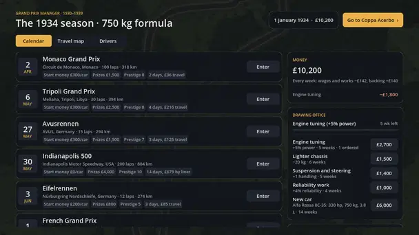 [游戏菜单或界面](<https://github.com/comeonfloyd/1930s-racing/blob/main/docs/screenshots/calendar.png>) | [comeonfloyd/1930s-racing](<https://github.com/comeonfloyd/1930s-racing>) | 常见根目录许可文件未找到 | 待核 | [4.4](<https://github.com/comeonfloyd/1930s-racing/blob/main/docs/screenshots/calendar.png>) | 未列入口 |
| 3427 | [ ] | [2048](<https://github.com/gamingnews5/awesome-opus-5.5-games/blob/9a29b570e56bd19f15a3cd6bbac0b8c682f2c48c/games/2048-alanwengyh-art-2048/readme.md>) | 待补截图 | [alanwengyh-art/2048](<https://github.com/alanwengyh-art/2048>) | 常见根目录许可文件未找到 | 待核 | — | 未列入口 |
| 3428 | [ ] | [2048](<https://github.com/gamingnews5/awesome-opus-5.5-games/blob/9a29b570e56bd19f15a3cd6bbac0b8c682f2c48c/games/2048/readme.md>) | 待补截图 | [lofiski/mini-games](<https://github.com/lofiski/mini-games>) | 常见根目录许可文件未找到 | 待核 | — | 未列入口 |
| 3429 | [ ] | [2048 Siege (prototype fork)](<https://github.com/gamingnews5/awesome-opus-5.5-games/blob/9a29b570e56bd19f15a3cd6bbac0b8c682f2c48c/games/2048-siege-prototype-fork/readme.md>) | 待补截图 | [jun0e/2048-siege](<https://github.com/jun0e/2048-siege>) | 常见根目录许可文件未找到 | 待核 | — | [可达 · 合集所列网页](<https://jun0e.github.io/2048-siege/>) |
| 3430 | [ ] | [21 點](<https://github.com/gamingnews5/awesome-opus-5.5-games/blob/9a29b570e56bd19f15a3cd6bbac0b8c682f2c48c/games/21/readme.md>) |  [合集截图](<https://github.com/SodaCK87/Game---Blackjack/blob/main/docs/img/play.png>) | [SodaCK87/Game---Blackjack](<https://github.com/SodaCK87/Game---Blackjack>) | 常见根目录许可文件未找到 | 待核 | [6.2](<https://github.com/SodaCK87/Game---Blackjack/blob/main/docs/img/play.png>) | [可达 · 含游戏画布／引擎的网页](<https://sodack87.github.io/Game---Blackjack/>) |
| 3431 | [ ] | [360shooter](<https://github.com/gamingnews5/awesome-opus-5.5-games/blob/9a29b570e56bd19f15a3cd6bbac0b8c682f2c48c/games/360shooter/readme.md>) |  [上游游戏截图](<https://github.com/CemDCoding/360shooter/blob/HEAD/docs/design/screenshots/lagerplatz-und-boss-desktop.png>) | [CemDCoding/360shooter](<https://github.com/CemDCoding/360shooter>) | 常见根目录许可文件未找到 | 待核 | — | 未列入口 |
| 3432 | [ ] | [3D Arcade Racer](<https://github.com/gamingnews5/awesome-opus-5.5-games/blob/9a29b570e56bd19f15a3cd6bbac0b8c682f2c48c/games/3d-arcade-racer/readme.md>) | 待补截图 | [letawskylyndon-cloud/Claude-Driving-Racing-gAme](<https://github.com/letawskylyndon-cloud/Claude-Driving-Racing-gAme>) | 常见根目录许可文件未找到 | 待核 | — | 未列入口 |
| 3433 | [ ] | [3D Chess Live](<https://github.com/gamingnews5/awesome-opus-5.5-games/blob/9a29b570e56bd19f15a3cd6bbac0b8c682f2c48c/games/3d-chess-live/readme.md>) | 待补截图 | [roblisagrossman-hue/Chess3d-live](<https://github.com/roblisagrossman-hue/Chess3d-live>) | 常见根目录许可文件未找到 | 待核 | — | 未列入口 |
| 3434 | [ ] | [3D Game Vision Benchmark](<https://github.com/gamingnews5/awesome-opus-5.5-games/blob/9a29b570e56bd19f15a3cd6bbac0b8c682f2c48c/games/3d-game-vision-benchmark/readme.md>) | 待补截图 | [Yaxyobek0877/ai-model-benchmark-3d-game-vision](<https://github.com/Yaxyobek0877/ai-model-benchmark-3d-game-vision>) | 常见根目录许可文件未找到 | 待核 | — | 未列入口 |
| 3435 | [ ] | [3D Minesweeper](<https://github.com/gamingnews5/awesome-opus-5.5-games/blob/9a29b570e56bd19f15a3cd6bbac0b8c682f2c48c/games/3d-minesweeper/readme.md>) | 待补截图 | [xoau79/3D-Minesweeper-Game-by-Fable-5](<https://github.com/xoau79/3D-Minesweeper-Game-by-Fable-5>) | 常见根目录许可文件未找到 | 待核 | — | 未列入口 |
| 3436 | [ ] | [3D Space Shooter](<https://github.com/gamingnews5/awesome-opus-5.5-games/blob/9a29b570e56bd19f15a3cd6bbac0b8c682f2c48c/games/3d-space-shooter/readme.md>) | 待补截图 | [mihaibulic2/test-game-claude-4.7](<https://github.com/mihaibulic2/test-game-claude-4.7>) | 常见根目录许可文件未找到 | 待核 | — | 未列入口 |
| 3437 | [ ] | [3D Toy Box + Render Studio](<https://github.com/gamingnews5/awesome-opus-5.5-games/blob/9a29b570e56bd19f15a3cd6bbac0b8c682f2c48c/games/3d-toy-box-render-studio/readme.md>) | 待补截图 | [tedwin-Main/3D-toys-random](<https://github.com/tedwin-Main/3D-toys-random>) | 常见根目录许可文件未找到 | 待核 | [6.5（原图失效）](<https://github.com/tedwin-Main/3D-toys-random/blob/main/render-studio/frontend/demos/animated-svg-landscape.png>) | 未列入口 |
| 3438 | [ ] | [3DFPS](<https://github.com/gamingnews5/awesome-opus-5.5-games/blob/9a29b570e56bd19f15a3cd6bbac0b8c682f2c48c/games/3dfps/readme.md>) | 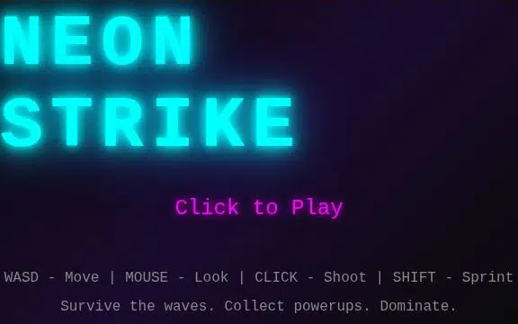 [源码运行首页](<https://github.com/wiswis01/3DFPS/blob/HEAD/index.html>) | [wiswis01/3DFPS](<https://github.com/wiswis01/3DFPS>) | 常见根目录许可文件未找到 | 待核 | — | 未列入口 |
| 3439 | [ ] | [4th and Pixels](<https://github.com/gamingnews5/awesome-opus-5.5-games/blob/9a29b570e56bd19f15a3cd6bbac0b8c682f2c48c/games/4th-and-pixels/readme.md>) | 待补截图 | [singiadvik9-sudo/gridiron-draft](<https://github.com/singiadvik9-sudo/gridiron-draft>) | 常见根目录许可文件未找到 | 待核 | — | 未列入口 |
| 3440 | [ ] | [5 Minutes At The Fusion Reactor](<https://github.com/gamingnews5/awesome-opus-5.5-games/blob/9a29b570e56bd19f15a3cd6bbac0b8c682f2c48c/games/5-minutes-at-the-fusion-reactor/readme.md>) | 待补截图 | [estybano211/5-minutes-at-the-fusion-reactor](<https://github.com/estybano211/5-minutes-at-the-fusion-reactor>) | 常见根目录许可文件未找到 | 待核 | — | 未列入口 |
| 3441 | [ ] | [5-Out Hoops](<https://github.com/gamingnews5/awesome-opus-5.5-games/blob/9a29b570e56bd19f15a3cd6bbac0b8c682f2c48c/games/5-out-hoops/readme.md>) | 待补截图 | [crouchclifton/five-out-hoops](<https://github.com/crouchclifton/five-out-hoops>) | 常见根目录许可文件未找到 | 待核 | — | [可达 · 含游戏画布／引擎的网页](<https://crouchclifton.github.io/five-out-hoops/>) |
| 3442 | [ ] | [99 Nights in the Pines](<https://github.com/gamingnews5/awesome-opus-5.5-games/blob/9a29b570e56bd19f15a3cd6bbac0b8c682f2c48c/games/99-nights-in-the-pines/readme.md>) | 待补截图 | [JOSHIONCLAUDE/99-nights-in-the-pines](<https://github.com/JOSHIONCLAUDE/99-nights-in-the-pines>) | 常见根目录许可文件未找到 | 待核 | — | [可达 · 合集所列网页](<https://joshionclaude.github.io/99-nights-in-the-pines/>) |
| 3443 | [ ] | [İmza](<https://github.com/gamingnews5/awesome-opus-5.5-games/blob/9a29b570e56bd19f15a3cd6bbac0b8c682f2c48c/games/imza/readme.md>) | 待补截图 | [tarikhokka/GameJam2026TOOADEVS](<https://github.com/tarikhokka/GameJam2026TOOADEVS>) | 常见根目录许可文件未找到 | 待核 | — | 未列入口 |
| 3444 | [ ] | [¡Que viene mamá!](<https://github.com/gamingnews5/awesome-opus-5.5-games/blob/9a29b570e56bd19f15a3cd6bbac0b8c682f2c48c/games/que-viene-mama/readme.md>) | 待补截图 | [kokellara12-maker/apps-k4m9q2](<https://github.com/kokellara12-maker/apps-k4m9q2>) | 常见根目录许可文件未找到 | 待核 | — | [可达 · 合集所列网页](<https://kokellara12-maker.github.io/apps-k4m9q2/cuarto.html>) |
| 3445 | [ ] | [Çay Ocağı · Tea House Rush (Godot 4)](<https://github.com/gamingnews5/awesome-opus-5.5-games/blob/9a29b570e56bd19f15a3cd6bbac0b8c682f2c48c/games/cay-ocag-tea-house-rush-godot-4/readme.md>) | 待补截图 | [Furkiozknn/cay-ocagi-godot](<https://github.com/Furkiozknn/cay-ocagi-godot>) | 常见根目录许可文件未找到 | 待核 | [7.1（原图失效）](<https://github.com/Furkiozknn/cay-ocagi-godot/blob/main/docs/rush.png>) | [入口已失效 · 合集所列网页](<https://furkiozknn.github.io/cay-ocagi-godot/>) |
| 3446 | [ ] | [Çini Ustası · Iznik Tile Puzzle (Godot 4)](<https://github.com/gamingnews5/awesome-opus-5.5-games/blob/9a29b570e56bd19f15a3cd6bbac0b8c682f2c48c/games/cini-ustas-iznik-tile-puzzle-godot-4/readme.md>) | 待补截图 | [Furkiozknn/cini-ustasi-godot](<https://github.com/Furkiozknn/cini-ustasi-godot>) | 常见根目录许可文件未找到 | 待核 | [7.0（原图失效）](<https://github.com/Furkiozknn/cini-ustasi-godot/blob/main/docs/board.png>) | [入口已失效 · 合集所列网页](<https://furkiozknn.github.io/cini-ustasi-godot/>) |
| 3447 | [ ] | [Đường Kẻ Một Nét (One Line)](<https://github.com/gamingnews5/awesome-opus-5.5-games/blob/9a29b570e56bd19f15a3cd6bbac0b8c682f2c48c/games/uong-ke-mot-net-one-line/readme.md>) |  [源码运行首页](<https://github.com/lupin2498/game-oneline/blob/main/index.html>) | [lupin2498/game-oneline](<https://github.com/lupin2498/game-oneline>) | 常见根目录许可文件未找到 | 待核 | — | 未列入口 |
| 3448 | [ ] | [Đại Việt Hiệp Khách](<https://github.com/gamingnews5/awesome-opus-5.5-games/blob/9a29b570e56bd19f15a3cd6bbac0b8c682f2c48c/games/ai-viet-hiep-khach/readme.md>) |  [源码运行首页](<https://github.com/saigoneseecoffee/daiviet-/blob/main/index.html>) | [saigoneseecoffee/daiviet-](<https://github.com/saigoneseecoffee/daiviet->) | 常见根目录许可文件未找到 | 待核 | — | 未列入口 |
| 3449 | [ ] | [Đột Biến – Bắn súng góc nhìn thứ ba (đấu bot)](<https://github.com/gamingnews5/awesome-opus-5.5-games/blob/9a29b570e56bd19f15a3cd6bbac0b8c682f2c48c/games/ot-bien-ban-sung-goc-nhin-thu-ba-au-bot/readme.md>) | 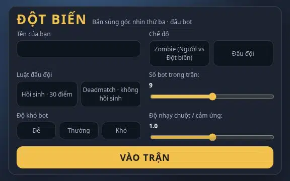 [源码运行首页](<https://github.com/mrgiangleai/dot-bien-game/blob/main/index.html>) | [mrgiangleai/dot-bien-game](<https://github.com/mrgiangleai/dot-bien-game>) | 常见根目录许可文件未找到 | 待核 | — | 未列入口 |
| 3450 | [ ] | [Белка](<https://github.com/gamingnews5/awesome-opus-5.5-games/blob/9a29b570e56bd19f15a3cd6bbac0b8c682f2c48c/games/game-denvis1090-a11y-belka/readme.md>) | 待补截图 | [denvis1090-a11y/belka](<https://github.com/denvis1090-a11y/belka>) | 常见根目录许可文件未找到 | 待核 | — | 未列入口 |
| 3451 | [ ] | [Био-Выживание 2D](<https://github.com/gamingnews5/awesome-opus-5.5-games/blob/9a29b570e56bd19f15a3cd6bbac0b8c682f2c48c/games/2d/readme.md>) | 待补截图 | [frerra-wq/bio-survival](<https://github.com/frerra-wq/bio-survival>) | 常见根目录许可文件未找到 | 待核 | — | [可达 · 含游戏画布／引擎的网页](<https://frerra-wq.github.io/bio-survival/>) |
| 3452 | [ ] | [Генератор миров (Godot)](<https://github.com/gamingnews5/awesome-opus-5.5-games/blob/9a29b570e56bd19f15a3cd6bbac0b8c682f2c48c/games/godot/readme.md>) | 待补截图 | [Guardorvd/world-generator-godot](<https://github.com/Guardorvd/world-generator-godot>) | 常见根目录许可文件未找到 | [README 提及](<https://github.com/Guardorvd/world-generator-godot/blob/HEAD/README.md#L916>) | — | 未列入口 |
| 3453 | [ ] | [Герои](<https://github.com/gamingnews5/awesome-opus-5.5-games/blob/9a29b570e56bd19f15a3cd6bbac0b8c682f2c48c/games/game-shubbeleontij-heroes/readme.md>) | 待补截图 | [ShubbeLeontij/heroes](<https://github.com/ShubbeLeontij/heroes>) | 常见根目录许可文件未找到 | 待核 | [5.4](<https://github.com/ShubbeLeontij/heroes/blob/master/docs/boards/elementals.png>) | 未列入口 |
| 3454 | [ ] | [Игра на умножение для детей](<https://github.com/gamingnews5/awesome-opus-5.5-games/blob/9a29b570e56bd19f15a3cd6bbac0b8c682f2c48c/games/game-zworking1-svg-play-and-math/readme.md>) | 待补截图 | [zworking1-svg/play-and-math](<https://github.com/zworking1-svg/play-and-math>) | 常见根目录许可文件未找到 | 待核 | — | [可达 · 合集所列网页](<https://zworking1-svg.github.io/play-and-math/>) |
| 3455 | [ ] | [Игры для Telegram](<https://github.com/gamingnews5/awesome-opus-5.5-games/blob/9a29b570e56bd19f15a3cd6bbac0b8c682f2c48c/games/telegram/readme.md>) | 待补截图 | [abaykopenov/tower-defense](<https://github.com/abaykopenov/tower-defense>) | 常见根目录许可文件未找到 | 待核 | — | [入口已失效 · 合集所列网页](<https://abaykopenov.github.io/tower-defense/>) |
| 3456 | [ ] | [Кибер Арена](<https://github.com/gamingnews5/awesome-opus-5.5-games/blob/9a29b570e56bd19f15a3cd6bbac0b8c682f2c48c/games/game-n1k1tz1993-cyberarena/readme.md>) | 待补截图 | [n1k1tz1993/CyberArena](<https://github.com/n1k1tz1993/CyberArena>) | 常见根目录许可文件未找到 | 待核 | — | 未列入口 |
| 3457 | [ ] | [МЁРТВЫЙ КВАРТАЛ](<https://github.com/gamingnews5/awesome-opus-5.5-games/blob/9a29b570e56bd19f15a3cd6bbac0b8c682f2c48c/games/game-katiol123-newgamezombies/readme.md>) | 待补截图 | [katiol123/newgamezombies](<https://github.com/katiol123/newgamezombies>) | 常见根目录许可文件未找到 | 待核 | — | 未列入口 |
| 3458 | [ ] | [Нефритовый стержень](<https://github.com/gamingnews5/awesome-opus-5.5-games/blob/9a29b570e56bd19f15a3cd6bbac0b8c682f2c48c/games/game-fapivnytsia-jaderod/readme.md>) | 待补截图 | [fapivnytsia/JadeRod](<https://github.com/fapivnytsia/JadeRod>) | 常见根目录许可文件未找到 | 待核 | — | 未列入口 |
| 3459 | [ ] | [Ночной ритуал](<https://github.com/gamingnews5/awesome-opus-5.5-games/blob/9a29b570e56bd19f15a3cd6bbac0b8c682f2c48c/games/game-kirchik95-diablo-like-game/readme.md>) | 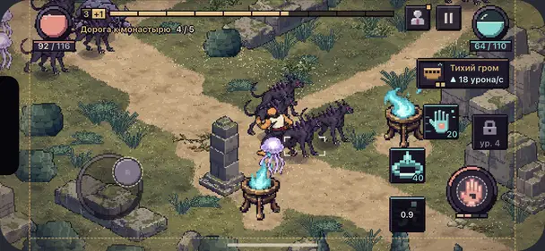 [合集截图](<https://github.com/kirchik95/diablo-like-game/blob/main/assets/concepts/systems-01/mobile/frames/screen-01-844x390-combat%402x.png>) | [kirchik95/diablo-like-game](<https://github.com/kirchik95/diablo-like-game>) | 常见根目录许可文件未找到 | [README 提及](<https://github.com/kirchik95/diablo-like-game/blob/HEAD/README.md#L232>) | [6.6](<https://github.com/kirchik95/diablo-like-game/blob/main/assets/concepts/systems-01/mobile/frames/screen-01-844x390-combat%402x.png>) | 未列入口 |
| 3460 | [ ] | [Пиратские сокровища](<https://github.com/gamingnews5/awesome-opus-5.5-games/blob/9a29b570e56bd19f15a3cd6bbac0b8c682f2c48c/games/game-tixzeo-pirate-treasures/readme.md>) | 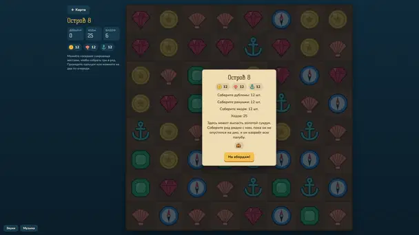 [合集截图](<https://github.com/tixzeo/pirate-treasures/blob/main/promo/screenshots/2-zadanie.png>) | [tixzeo/pirate-treasures](<https://github.com/tixzeo/pirate-treasures>) | 常见根目录许可文件未找到 | 待核 | [5.6](<https://github.com/tixzeo/pirate-treasures/blob/main/promo/screenshots/2-zadanie.png>) | 未列入口 |
| 3461 | [ ] | [Под крыльями свободы](<https://github.com/gamingnews5/awesome-opus-5.5-games/blob/9a29b570e56bd19f15a3cd6bbac0b8c682f2c48c/games/game-fobeza-attacktitensvn/readme.md>) | 待补截图 | [Fobeza/AttackTitensVN](<https://github.com/Fobeza/AttackTitensVN>) | 常见根目录许可文件未找到 | 待核 | — | 未列入口 |
| 3462 | [ ] | [После тишины](<https://github.com/gamingnews5/awesome-opus-5.5-games/blob/9a29b570e56bd19f15a3cd6bbac0b8c682f2c48c/games/game-alifirex96-game/readme.md>) | 待补截图 | [alifirex96/Game](<https://github.com/alifirex96/Game>) | 常见根目录许可文件未找到 | 待核 | — | 未列入口 |
| 3463 | [ ] | [Рыбалка Desktop](<https://github.com/gamingnews5/awesome-opus-5.5-games/blob/9a29b570e56bd19f15a3cd6bbac0b8c682f2c48c/games/desktop/readme.md>) | 待补截图 | [PeacexF/Rybalka-Desktop](<https://github.com/PeacexF/Rybalka-Desktop>) | 常见根目录许可文件未找到 | 待核 | — | 未列入口 |
| 3464 | [ ] | [Рыцарь: Пленница дракона](<https://github.com/gamingnews5/awesome-opus-5.5-games/blob/9a29b570e56bd19f15a3cd6bbac0b8c682f2c48c/games/game-acul1a-knightdragon/readme.md>) | 待补截图 | [acul1a/knightdragon](<https://github.com/acul1a/knightdragon>) | 常见根目录许可文件未找到 | 待核 | — | [可达 · 合集所列网页](<https://acul1a.github.io/knightdragon/>) |
| 3465 | [ ] | [Сумеречный шабаш — квиз с кнопками](<https://github.com/gamingnews5/awesome-opus-5.5-games/blob/9a29b570e56bd19f15a3cd6bbac0b8c682f2c48c/games/game-nafanyan-halloween-app/readme.md>) | 待补截图 | [Nafanyan/halloween\_app](<https://github.com/Nafanyan/halloween_app>) | 常见根目录许可文件未找到 | 待核 | — | 未列入口 |
| 3466 | [ ] | [Тачки](<https://github.com/gamingnews5/awesome-opus-5.5-games/blob/9a29b570e56bd19f15a3cd6bbac0b8c682f2c48c/games/game-freyllar-cars/readme.md>) |  [源码运行首页](<https://github.com/FreyllaR/cars/blob/main/index.html>) | [FreyllaR/cars](<https://github.com/FreyllaR/cars>) | 常见根目录许可文件未找到 | [README 提及、源码有输入读取](<https://github.com/FreyllaR/cars/blob/main/index.html#L2081>) | — | 未列入口 |
| 3467 | [ ] | [Червяки Online](<https://github.com/gamingnews5/awesome-opus-5.5-games/blob/9a29b570e56bd19f15a3cd6bbac0b8c682f2c48c/games/online-west891-worms-game/readme.md>) | 待补截图 | [West891/worms-game](<https://github.com/West891/worms-game>) | 常见根目录许可文件未找到 | 待核 | — | [可达 · 含游戏画布／引擎的网页](<https://west891.github.io/worms-game/>) |
| 3468 | [ ] | [Шахматы с новыми режимами](<https://github.com/gamingnews5/awesome-opus-5.5-games/blob/9a29b570e56bd19f15a3cd6bbac0b8c682f2c48c/games/game-denden69175-sys-chess/readme.md>) | 待补截图 | [denden69175-sys/chess](<https://github.com/denden69175-sys/chess>) | 常见根目录许可文件未找到 | 待核 | — | 未列入口 |
| 3469 | [ ] | [אותיות בסדר](<https://github.com/gamingnews5/awesome-opus-5.5-games/blob/9a29b570e56bd19f15a3cd6bbac0b8c682f2c48c/games/game-yahavedo-lestoro/readme.md>) | 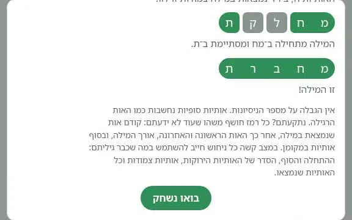 [源码运行首页](<https://github.com/yahavedo/lestoro/blob/main/index.html>) | [yahavedo/lestoro](<https://github.com/yahavedo/lestoro>) | 常见根目录许可文件未找到 | 待核 | — | 未列入口 |
| 3470 | [ ] | [דובב (Simon)](<https://github.com/gamingnews5/awesome-opus-5.5-games/blob/9a29b570e56bd19f15a3cd6bbac0b8c682f2c48c/games/simon/readme.md>) | 待补截图 | [dovevgit/simon-game](<https://github.com/dovevgit/simon-game>) | 常见根目录许可文件未找到 | 待核 | — | [可达 · 合集所列网页](<https://dovevgit.github.io/simon-game/>) |
| 3471 | [ ] | [הדרך ל־61](<https://github.com/gamingnews5/awesome-opus-5.5-games/blob/9a29b570e56bd19f15a3cd6bbac0b8c682f2c48c/games/61/readme.md>) | 待补截图 | [orgonen1999-arch/New-Game](<https://github.com/orgonen1999-arch/New-Game>) | 常见根目录许可文件未找到 | 待核 | — | 未列入口 |
| 3472 | [ ] | [חתולת הממתקים · Candy Cat Run](<https://github.com/gamingnews5/awesome-opus-5.5-games/blob/9a29b570e56bd19f15a3cd6bbac0b8c682f2c48c/games/candy-cat-run/readme.md>) | 待补截图 | [matanbe20/candy-cat-run](<https://github.com/matanbe20/candy-cat-run>) | 常见根目录许可文件未找到 | 待核 | — | [可达 · 含游戏画布／引擎的网页](<https://matanbe20.github.io/candy-cat-run/>) |
| 3473 | [ ] | [מלך האיזמל](<https://github.com/gamingnews5/awesome-opus-5.5-games/blob/9a29b570e56bd19f15a3cd6bbac0b8c682f2c48c/games/game-optimisticlucio-untitled-game-jam-game/readme.md>) | 待补截图 | [optimisticlucio/untitled-game-jam-game](<https://github.com/optimisticlucio/untitled-game-jam-game>) | 常见根目录许可文件未找到 | 待核 | — | [可达 · 合集所列网页](<https://medicalgamejam.pages.dev/problems/or-tool-recognition-training>) |
| 3474 | [ ] | [أسماء على الدائري](<https://github.com/gamingnews5/awesome-opus-5.5-games/blob/9a29b570e56bd19f15a3cd6bbac0b8c682f2c48c/games/game-jrotarek-asmaa-ring-road/readme.md>) |  [源码运行首页](<https://github.com/jrotarek/asmaa-ring-road/blob/main/index.html>) | [jrotarek/asmaa-ring-road](<https://github.com/jrotarek/asmaa-ring-road>) | 常见根目录许可文件未找到 | 待核 | — | 未列入口 |
| 3475 | [ ] | [ألعاب الشلة 🎲](<https://github.com/gamingnews5/awesome-opus-5.5-games/blob/9a29b570e56bd19f15a3cd6bbac0b8c682f2c48c/games/game-haditag7-games/readme.md>) | 待补截图 | [HadiTAG7/Games](<https://github.com/HadiTAG7/Games>) | 常见根目录许可文件未找到 | 待核 | — | [可达 · 合集所列网页](<https://herd-game-hf2y.onrender.com>) |
| 3476 | [ ] | [ألعاب لغتي](<https://github.com/gamingnews5/awesome-opus-5.5-games/blob/9a29b570e56bd19f15a3cd6bbac0b8c682f2c48c/games/game-tooofa77ksa-hue-nadeen-yasin-games/readme.md>) | 待补截图 | [tooofa77ksa-hue/nadeen-yasin-games](<https://github.com/tooofa77ksa-hue/nadeen-yasin-games>) | 常见根目录许可文件未找到 | 待核 | [5.2](<https://github.com/tooofa77ksa-hue/nadeen-yasin-games/blob/main/shared/img/apple.webp>) | 未列入口 |
| 3477 | [ ] | [اكتشف حالك في دقيقة](<https://github.com/gamingnews5/awesome-opus-5.5-games/blob/9a29b570e56bd19f15a3cd6bbac0b8c682f2c48c/games/game-hanihalsulami-my-game/readme.md>) | 待补截图 | [HaniHAlsulami/My-game](<https://github.com/HaniHAlsulami/My-game>) | 常见根目录许可文件未找到 | 待核 | — | [入口已失效 · 合集所列网页](<https://hanihalsulami.github.io/My-game/>) |
| 3478 | [ ] | [دكان فاطمة وسماء · Fatima &amp; Sama's Shop](<https://github.com/gamingnews5/awesome-opus-5.5-games/blob/9a29b570e56bd19f15a3cd6bbac0b8c682f2c48c/games/fatima-sama-s-shop/readme.md>) | 待补截图 | [totofroto/dukkan](<https://github.com/totofroto/dukkan>) | 常见根目录许可文件未找到 | 待核 | — | 未列入口 |
| 3479 | [ ] | [دوبلاج](<https://github.com/gamingnews5/awesome-opus-5.5-games/blob/9a29b570e56bd19f15a3cd6bbac0b8c682f2c48c/games/game-awsdaman-dub/readme.md>) | 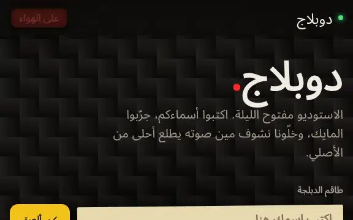 [同款源码启动画面实截](<https://github.com/Awsdaman/Dub/blob/HEAD/index.html>) | [Awsdaman/Dub](<https://github.com/Awsdaman/Dub>) | 常见根目录许可文件未找到 | 待核 | — | [可达 · 合集所列网页](<https://dub-ashen-ten.vercel.app>) |
| 3480 | [ ] | [سرقفلی (نسخه‌ی نمایشی)](<https://github.com/gamingnews5/awesome-opus-5.5-games/blob/9a29b570e56bd19f15a3cd6bbac0b8c682f2c48c/games/game-mohammadjranjbar-sarqofli/readme.md>) | 待补截图 | [MohammadJRanjbar/sarqofli](<https://github.com/MohammadJRanjbar/sarqofli>) | 常见根目录许可文件未找到 | 待核 | — | 未列入口 |
| 3481 | [ ] | [سين جيم القرآن](<https://github.com/gamingnews5/awesome-opus-5.5-games/blob/9a29b570e56bd19f15a3cd6bbac0b8c682f2c48c/games/game-alkait-seen-jeem-alquran/readme.md>) | 待补截图 | [alkait/seen-jeem-alquran](<https://github.com/alkait/seen-jeem-alquran>) | 常见根目录许可文件未找到 | 待核 | — | 未列入口 |
| 3482 | [ ] | [فِطنة](<https://github.com/gamingnews5/awesome-opus-5.5-games/blob/9a29b570e56bd19f15a3cd6bbac0b8c682f2c48c/games/game-almoussaabdullah-fitna/readme.md>) | 待补截图 | [almoussaabdullah/Fitna](<https://github.com/almoussaabdullah/Fitna>) | 常见根目录许可文件未找到 | 待核 | — | 未列入口 |
| 3483 | [ ] | [مجلس الخونة](<https://github.com/gamingnews5/awesome-opus-5.5-games/blob/9a29b570e56bd19f15a3cd6bbac0b8c682f2c48c/games/game-hussainfaisalaljaser-lang-majlis-game/readme.md>) | 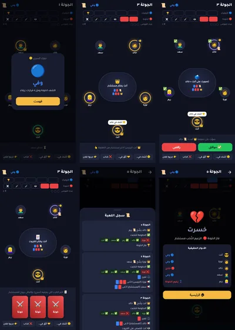 [合集截图](<https://github.com/hussainfaisalaljaser-lang/majlis-game/blob/main/docs/mockups/05-game-table.png>) | [hussainfaisalaljaser-lang/majlis-game](<https://github.com/hussainfaisalaljaser-lang/majlis-game>) | 常见根目录许可文件未找到 | 待核 | [4.4](<https://github.com/hussainfaisalaljaser-lang/majlis-game/blob/main/docs/mockups/05-game-table.png>) | 未列入口 |
| 3484 | [ ] | [منصة دحوم v2 — ألف نقطة + خلية الحروف](<https://github.com/gamingnews5/awesome-opus-5.5-games/blob/9a29b570e56bd19f15a3cd6bbac0b8c682f2c48c/games/v2/readme.md>) |  [同款源码启动画面实截](<https://github.com/ldo2x/dahoom/blob/HEAD/index.html>) | [ldo2x/dahoom](<https://github.com/ldo2x/dahoom>) | 常见根目录许可文件未找到 | 待核 | — | [可达 · 合集所列网页](<https://ldo2x.github.io/dahoom/>) |
| 3485 | [ ] | [द जंतर मंतर रन — The Jantar Mantar Run](<https://github.com/gamingnews5/awesome-opus-5.5-games/blob/9a29b570e56bd19f15a3cd6bbac0b8c682f2c48c/games/the-jantar-mantar-run/readme.md>) | 待补截图 | [pratik-j-mahajan/The-Jantar-Mantar-Run](<https://github.com/pratik-j-mahajan/The-Jantar-Mantar-Run>) | 常见根目录许可文件未找到 | 待核 | — | [可达 · 含游戏画布／引擎的网页](<https://the-jantar-mantar-run.vercel.app>) |
| 3486 | [ ] | [राम बाण · RAM BAAN](<https://github.com/gamingnews5/awesome-opus-5.5-games/blob/9a29b570e56bd19f15a3cd6bbac0b8c682f2c48c/games/ram-baan/readme.md>) |  [合集截图](<https://github.com/ozesince02/ram-baan/blob/main/docs/screenshots/01-ravan-dahan.png>) | [ozesince02/ram-baan](<https://github.com/ozesince02/ram-baan>) | 常见根目录许可文件未找到 | 待核 | [7.0](<https://github.com/ozesince02/ram-baan/blob/main/docs/screenshots/01-ravan-dahan.png>) | [可达 · 含游戏画布／引擎的网页](<https://ozesince02.github.io/ram-baan/>) |
| 3487 | [ ] | [साँप-सीढ़ी: भारत ज्ञान यात्रा](<https://github.com/gamingnews5/awesome-opus-5.5-games/blob/9a29b570e56bd19f15a3cd6bbac0b8c682f2c48c/games/game-anushka102030-saanp-seedhi/readme.md>) | 待补截图 | [anushka102030/saanp-seedhi](<https://github.com/anushka102030/saanp-seedhi>) | 常见根目录许可文件未找到 | 待核 | — | 未列入口 |
| 3488 | [ ] | [গুটি · Guti](<https://github.com/gamingnews5/awesome-opus-5.5-games/blob/9a29b570e56bd19f15a3cd6bbac0b8c682f2c48c/games/guti/readme.md>) | 待补截图 | [shahriarsharif406/guti-vr](<https://github.com/shahriarsharif406/guti-vr>) | 常见根目录许可文件未找到 | 待核 | — | [可达 · 合集所列网页](<https://shahriarsharif406.github.io/guti-vr/>) |
| 3489 | [ ] | [ขุนพลสามก๊ก](<https://github.com/gamingnews5/awesome-opus-5.5-games/blob/9a29b570e56bd19f15a3cd6bbac0b8c682f2c48c/games/game-niasmin-samkok/readme.md>) | 待补截图 | [niasmin/samkok](<https://github.com/niasmin/samkok>) | 常见根目录许可文件未找到 | 待核 | — | [可达 · 合集所列网页](<https://niasmin.github.io/samkok/>) |
| 3490 | [ ] | [ธรรมะ อธรรม Online](<https://github.com/gamingnews5/awesome-opus-5.5-games/blob/9a29b570e56bd19f15a3cd6bbac0b8c682f2c48c/games/online/readme.md>) | 待补截图 | [bigbossa/Game\_Dev](<https://github.com/bigbossa/Game_Dev>) | 常见根目录许可文件未找到 | 待核 | [4.0](<https://github.com/bigbossa/Game_Dev/blob/main/class-art/demon-models/archer-long-source.png>) | [HTTP 错误 · 合集所列网页](<https://itmore.vercel.app>) |
| 3491 | [ ] | [ฟังแป๊บ — เกมทายเพลงไทย (MVP)](<https://github.com/gamingnews5/awesome-opus-5.5-games/blob/9a29b570e56bd19f15a3cd6bbac0b8c682f2c48c/games/mvp/readme.md>) | 待补截图 | [PuviwatS/fang-paep](<https://github.com/PuviwatS/fang-paep>) | 常见根目录许可文件未找到 | 待核 | — | [可达 · 合集所列网页](<https://fang-paep.vercel.app>) |
| 3492 | [ ] | [หมู่เกาะเฌอแตม](<https://github.com/gamingnews5/awesome-opus-5.5-games/blob/9a29b570e56bd19f15a3cd6bbac0b8c682f2c48c/games/game-alisa085-alisa085-github-io/readme.md>) | 待补截图 | [alisa085/alisa085.github.io](<https://github.com/alisa085/alisa085.github.io>) | 常见根目录许可文件未找到 | 待核 | [5.6（原图失效）](<https://github.com/alisa085/alisa085.github.io/blob/main/docs/english.png>) | [入口已失效 · 合集所列网页](<https://alisa085.github.io>) |
| 3493 | [ ] | [อโยธยา Idle](<https://github.com/gamingnews5/awesome-opus-5.5-games/blob/9a29b570e56bd19f15a3cd6bbac0b8c682f2c48c/games/idle/readme.md>) | 待补截图 | [ppaocharoen/ayothaya-idle](<https://github.com/ppaocharoen/ayothaya-idle>) | 常见根目录许可文件未找到 | 待核 | — | 未列入口 |
| 3494 | [ ] | [አኩኩሉ (Akukulu)](<https://github.com/gamingnews5/awesome-opus-5.5-games/blob/9a29b570e56bd19f15a3cd6bbac0b8c682f2c48c/games/akukulu/readme.md>) | 待补截图 | [VanillaGetachew/akukulu](<https://github.com/VanillaGetachew/akukulu>) | 常见根目录许可文件未找到 | 待核 | — | 未列入口 |
| 3495 | [ ] | [《熄燈號之後》AFTER TAPS](<https://github.com/gamingnews5/awesome-opus-5.5-games/blob/9a29b570e56bd19f15a3cd6bbac0b8c682f2c48c/games/after-taps/readme.md>) | 待补截图 | [York260/DOOM](<https://github.com/York260/DOOM>) | 常见根目录许可文件未找到 | 待核 | — | [可达 · 合集所列网页](<https://york260.github.io/DOOM/play/>) |
| 3496 | [ ] | [おしりまでがイモムシです（仮）](<https://github.com/gamingnews5/awesome-opus-5.5-games/blob/9a29b570e56bd19f15a3cd6bbac0b8c682f2c48c/games/game-555734-slither/readme.md>) | 待补截图 | [555734/Slither](<https://github.com/555734/Slither>) | 常见根目录许可文件未找到 | 待核 | — | 未列入口 |
| 3497 | [ ] | [こもれび回収隊](<https://github.com/gamingnews5/awesome-opus-5.5-games/blob/9a29b570e56bd19f15a3cd6bbac0b8c682f2c48c/games/game-bannzai-godotpractice-game-game-game-game-game/readme.md>) | 待补截图 | [bannzai/godotpractice](<https://github.com/bannzai/godotpractice>) | 常见根目录许可文件未找到 | 待核 | — | 未列入口 |
| 3498 | [ ] | [ころころ工房](<https://github.com/gamingnews5/awesome-opus-5.5-games/blob/9a29b570e56bd19f15a3cd6bbac0b8c682f2c48c/games/game-bannzai-godotpractice-game-game-game-game/readme.md>) | 待补截图 | [bannzai/godotpractice](<https://github.com/bannzai/godotpractice>) | 常见根目录许可文件未找到 | 待核 | — | 未列入口 |
| 3499 | [ ] | [そらいろ便](<https://github.com/gamingnews5/awesome-opus-5.5-games/blob/9a29b570e56bd19f15a3cd6bbac0b8c682f2c48c/games/game/readme.md>) | 待补截图 | [bannzai/godotpractice](<https://github.com/bannzai/godotpractice>) | 常见根目录许可文件未找到 | 待核 | — | 未列入口 |
| 3500 | [ ] | [ふわもりディフェンス（Puffwood Defense）](<https://github.com/gamingnews5/awesome-opus-5.5-games/blob/9a29b570e56bd19f15a3cd6bbac0b8c682f2c48c/games/puffwood-defense/readme.md>) | 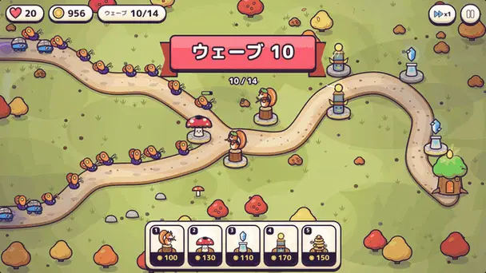 [上游动图截帧](<https://github.com/onego15/bloons-claude/blob/main/screenshots/gameplay.gif>) | [onego15/bloons-claude](<https://github.com/onego15/bloons-claude>) | 常见根目录许可文件未找到 [打包的日文字体子集按 OFL。](<https://github.com/onego15/bloons-claude/blob/HEAD/README.md#L100>) | 待核 | [7.0](<https://github.com/onego15/bloons-claude/blob/main/screenshots/gameplay.gif>) | [README · 可达 · 含游戏画布／引擎的网页](<https://onego15.github.io/bloons-claude/>) |
| 3501 | [ ] | [むなかた虫とり日記](<https://github.com/gamingnews5/awesome-opus-5.5-games/blob/9a29b570e56bd19f15a3cd6bbac0b8c682f2c48c/games/game-tani0920-mushitori-rpg/readme.md>) | 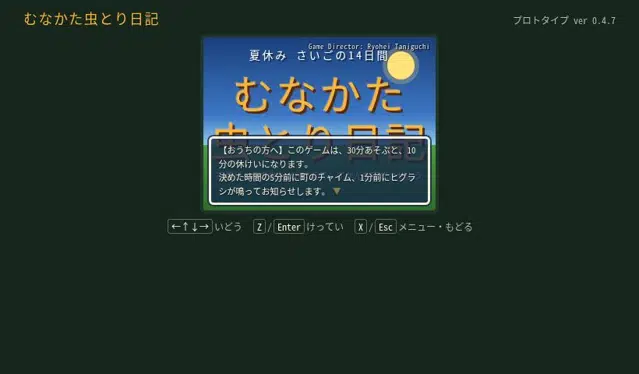 [试玩首页实截](<https://tani0920.github.io/mushitori-rpg/>) | [tani0920/mushitori-rpg](<https://github.com/tani0920/mushitori-rpg>) | 常见根目录许可文件未找到 | 待核 | — | [可达 · 合集所列网页](<https://tani0920.github.io/mushitori-rpg/>) |
| 3502 | [ ] | [ゆびあそび](<https://github.com/gamingnews5/awesome-opus-5.5-games/blob/9a29b570e56bd19f15a3cd6bbac0b8c682f2c48c/games/game-harutonatu-game-no1/readme.md>) |  [同款源码启动画面实截](<https://github.com/harutonatu/game-no1/blob/HEAD/index.html>) | [harutonatu/game-no1](<https://github.com/harutonatu/game-no1>) | 常见根目录许可文件未找到 | 待核 | — | [可达 · 合集所列网页](<https://harutonatu.github.io/game-no1/>) |
| 3503 | [ ] | [わたあめメーカー](<https://github.com/gamingnews5/awesome-opus-5.5-games/blob/9a29b570e56bd19f15a3cd6bbac0b8c682f2c48c/games/game-ksan260307-wataame/readme.md>) | 待补截图 | [Ksan260307/wataame](<https://github.com/Ksan260307/wataame>) | 常见根目录许可文件未找到 | 待核 | — | 未列入口 |
| 3504 | [ ] | [サイゼ注文番号 ノーヒント](<https://github.com/gamingnews5/awesome-opus-5.5-games/blob/9a29b570e56bd19f15a3cd6bbac0b8c682f2c48c/games/game-wattai-saizeriya-blind-order-game/readme.md>) | 待补截图 | [wattai/saizeriya-blind-order-game](<https://github.com/wattai/saizeriya-blind-order-game>) | 常见根目录许可文件未找到 | 待核 | — | [可达 · 含游戏画布／引擎的网页](<https://wattai.github.io/saizeriya-blind-order-game/>) |
| 3505 | [ ] | [トトと魔物たち](<https://github.com/gamingnews5/awesome-opus-5.5-games/blob/9a29b570e56bd19f15a3cd6bbac0b8c682f2c48c/games/game-fukka0409-png-toto-monsters/readme.md>) | 待补截图 | [fukka0409-png/Toto-monsters](<https://github.com/fukka0409-png/Toto-monsters>) | 常见根目录许可文件未找到 | 待核 | — | [可达 · 合集所列网页](<https://fukka0409-png.github.io/Toto-monsters/>) |
| 3506 | [ ] | [ナイター対決](<https://github.com/gamingnews5/awesome-opus-5.5-games/blob/9a29b570e56bd19f15a3cd6bbac0b8c682f2c48c/games/game-hojo0729-baseball/readme.md>) | 待补截图 | [hojo0729/baseball](<https://github.com/hojo0729/baseball>) | 常见根目录许可文件未找到 | 待核 | — | [入口已失效 · 合集所列网页](<https://hojo0729.github.io/baseball/>) |
| 3507 | [ ] | [ピコーン・クエスト2](<https://github.com/gamingnews5/awesome-opus-5.5-games/blob/9a29b570e56bd19f15a3cd6bbac0b8c682f2c48c/games/2/readme.md>) | <a href="https://raw.githubusercontent.com/u1908inter/pikon-quest2/HEAD/assets/boss.jpg">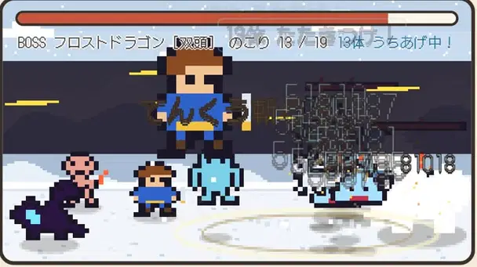</a> [作者视频封面 · 游戏实景](<https://u1908inter.github.io/pikon-quest2/>) | [u1908inter/pikon-quest2](<https://github.com/u1908inter/pikon-quest2>) | 常见根目录许可文件未找到 | 待核 | — | [可达 · 合集所列网页](<https://u1908inter.github.io/pikon-quest2/>) |
| 3508 | [ ] | [レトロゲーム集](<https://github.com/gamingnews5/awesome-opus-5.5-games/blob/9a29b570e56bd19f15a3cd6bbac0b8c682f2c48c/games/game-mo-kazuya-mygame/readme.md>) | 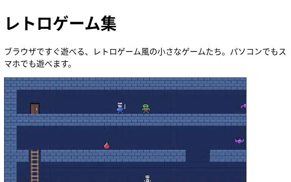 [同款源码启动画面实截](<https://github.com/mo-kazuya/MyGame/blob/HEAD/index.html>) | [mo-kazuya/MyGame](<https://github.com/mo-kazuya/MyGame>) | 常见根目录许可文件未找到 | 待核 | — | [可达 · 合集所列网页](<https://mo-kazuya.github.io/MyGame/>) |
| 3509 | [ ] | [レポート作成ミニゲーム / Report Writing Mini Game](<https://github.com/gamingnews5/awesome-opus-5.5-games/blob/9a29b570e56bd19f15a3cd6bbac0b8c682f2c48c/games/report-writing-mini-game/readme.md>) | 待补截图 | [Chenredfish/2026\_ReportMiniGame\_for\_MCPClub](<https://github.com/Chenredfish/2026_ReportMiniGame_for_MCPClub>) | 常见根目录许可文件未找到 | 待核 | — | 未列入口 |
| 3510 | [ ] | [三國殺重製版](<https://github.com/gamingnews5/awesome-opus-5.5-games/blob/9a29b570e56bd19f15a3cd6bbac0b8c682f2c48c/games/game-jkemusic-threekingdoms/readme.md>) | 待补截图 | [jkemusic/Threekingdoms](<https://github.com/jkemusic/Threekingdoms>) | 常见根目录许可文件未找到 | 待核 | — | 未列入口 |
| 3511 | [ ] | [中世紀模擬（Medieval Simulator）](<https://github.com/gamingnews5/awesome-opus-5.5-games/blob/9a29b570e56bd19f15a3cd6bbac0b8c682f2c48c/games/medieval-simulator/readme.md>) | 待补截图 | [Zhengxian-Liu/medieval-simulator](<https://github.com/Zhengxian-Liu/medieval-simulator>) | 常见根目录许可文件未找到 | 待核 | — | 未列入口 |
| 3512 | [ ] | [五年三班大隊接力](<https://github.com/gamingnews5/awesome-opus-5.5-games/blob/9a29b570e56bd19f15a3cd6bbac0b8c682f2c48c/games/game-isaacyoung2100-anti-bullying-game/readme.md>) | 待补截图 | [isaacyoung2100/anti-bullying-game](<https://github.com/isaacyoung2100/anti-bullying-game>) | 常见根目录许可文件未找到 | 待核 | — | [可达 · 含游戏画布／引擎的网页](<https://isaacyoung2100.github.io/anti-bullying-game/?lang=en>) |
| 3513 | [ ] | [五行师 · 网页版](<https://github.com/gamingnews5/awesome-opus-5.5-games/blob/9a29b570e56bd19f15a3cd6bbac0b8c682f2c48c/games/game-zoom1314-game/readme.md>) | 待补截图 | [zoom1314/Game](<https://github.com/zoom1314/Game>) | 常见根目录许可文件未找到 | 待核 | — | 未列入口 |
| 3514 | [ ] | [六族遠征](<https://github.com/gamingnews5/awesome-opus-5.5-games/blob/9a29b570e56bd19f15a3cd6bbac0b8c682f2c48c/games/game-devil10421-source-chess/readme.md>) | 待补截图 | [devil10421-source/chess](<https://github.com/devil10421-source/chess>) | 常见根目录许可文件未找到 | 待核 | — | [可达 · 含游戏画布／引擎的网页](<https://devil10421-source.github.io/chess/>) |
| 3515 | [ ] | [冒險公證人 · The Loss Adjuster](<https://github.com/gamingnews5/awesome-opus-5.5-games/blob/9a29b570e56bd19f15a3cd6bbac0b8c682f2c48c/games/the-loss-adjuster/readme.md>) | 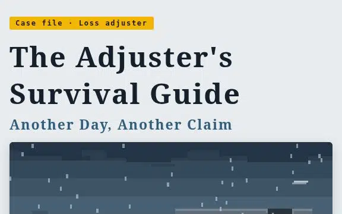 [源码运行首页](<https://github.com/gamnia2002-maker/Adjuster-game/blob/main/en.html>) | [gamnia2002-maker/Adjuster-game](<https://github.com/gamnia2002-maker/Adjuster-game>) | 常见根目录许可文件未找到 | 待核 | — | 未列入口 |
| 3516 | [ ] | [午夜來斬妖](<https://github.com/gamingnews5/awesome-opus-5.5-games/blob/9a29b570e56bd19f15a3cd6bbac0b8c682f2c48c/games/game-fyradio-zen-space/readme.md>) | 待补截图 | [fyradio/zen-space](<https://github.com/fyradio/zen-space>) | 常见根目录许可文件未找到 | 待核 | — | [可达 · 合集所列网页](<https://fyradio.github.io/zen-space/>) |
| 3517 | [ ] | [台灣人生模擬（暫名）](<https://github.com/gamingnews5/awesome-opus-5.5-games/blob/9a29b570e56bd19f15a3cd6bbac0b8c682f2c48c/games/game-lieroliu-taiwanese-simulator/readme.md>) | 待补截图 | [lieroliu/taiwanese-simulator](<https://github.com/lieroliu/taiwanese-simulator>) | 常见根目录许可文件未找到 | 待核 | — | [入口已失效 · 合集所列网页](<https://lieroliu.github.io/taiwanese-simulator/>) |
| 3518 | [ ] | [坦克大战 2D · Tank Battle](<https://github.com/gamingnews5/awesome-opus-5.5-games/blob/9a29b570e56bd19f15a3cd6bbac0b8c682f2c48c/games/2d-tank-battle/readme.md>) | 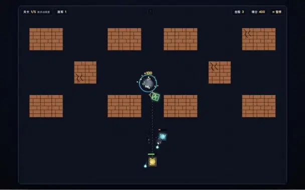 [合集截图](<https://github.com/Jalensuggs/tankplay/blob/main/screenshots/gameplay.jpg>) | [Jalensuggs/tankplay](<https://github.com/Jalensuggs/tankplay>) | 常见根目录许可文件未找到 | 待核 | [4.5](<https://github.com/Jalensuggs/tankplay/blob/main/screenshots/gameplay.jpg>) | [可达 · 含游戏画布／引擎的网页](<https://tankplay.vercel.app>) |
| 3519 | [ ] | [坦克大战 · Tank Battle](<https://github.com/gamingnews5/awesome-opus-5.5-games/blob/9a29b570e56bd19f15a3cd6bbac0b8c682f2c48c/games/tank-battle-crazy129290-tank-battle-game/readme.md>) | 待补截图 | [CRAZY129290/tank-battle-game](<https://github.com/CRAZY129290/tank-battle-game>) | 常见根目录许可文件未找到 | 待核 | — | [可达 · 含游戏画布／引擎的网页](<https://crazy129290.github.io/tank-battle-game/>) |
| 3520 | [ ] | [坦克大战 · Tank Battle (PXT687)](<https://github.com/gamingnews5/awesome-opus-5.5-games/blob/9a29b570e56bd19f15a3cd6bbac0b8c682f2c48c/games/tank-battle-pxt687/readme.md>) | 待补截图 | [PXT687/tank-battle](<https://github.com/PXT687/tank-battle>) | 常见根目录许可文件未找到 | 待核 | — | [可达 · 含游戏画布／引擎的网页](<https://pxt687.github.io/tank-battle/>) |
| 3521 | [ ] | [安省路考练习场](<https://github.com/gamingnews5/awesome-opus-5.5-games/blob/9a29b570e56bd19f15a3cd6bbac0b8c682f2c48c/games/game-hugoyin663-road-test-game/readme.md>) | 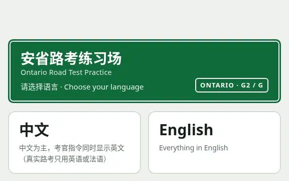 [同款源码启动画面实截](<https://github.com/HugoYin663/road-test-game/blob/HEAD/index.html>) | [HugoYin663/road-test-game](<https://github.com/HugoYin663/road-test-game>) | 常见根目录许可文件未找到 | 待核 | — | [可达 · 合集所列网页](<https://hugoyin663.github.io/road-test-game/>) |
| 3522 | [ ] | [宾果 Bingo Đồ ăn](<https://github.com/gamingnews5/awesome-opus-5.5-games/blob/9a29b570e56bd19f15a3cd6bbac0b8c682f2c48c/games/bingo-o-an/readme.md>) |  [源码网页实截](<https://github.com/Anhquan123k3/bingo-do-an/blob/main/index.html>) | [Anhquan123k3/bingo-do-an](<https://github.com/Anhquan123k3/bingo-do-an>) | 常见根目录许可文件未找到 | 待核 | — | 未列入口 |
| 3523 | [ ] | [小遊戲樂園 Mini Game Park](<https://github.com/gamingnews5/awesome-opus-5.5-games/blob/9a29b570e56bd19f15a3cd6bbac0b8c682f2c48c/games/mini-game-park/readme.md>) | 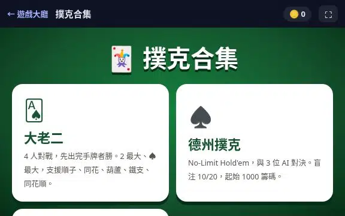 [源码运行首页](<https://github.com/CFM0918/mini-game-park/blob/main/poker/index.html>) | [CFM0918/mini-game-park](<https://github.com/CFM0918/mini-game-park>) | 常见根目录许可文件未找到 | 待核 | — | 未列入口 |
| 3524 | [ ] | [小露換裝秀 Dewy's Runway](<https://github.com/gamingnews5/awesome-opus-5.5-games/blob/9a29b570e56bd19f15a3cd6bbac0b8c682f2c48c/games/dewy-s-runway/readme.md>) | 待补截图 | [ywchen0711/dewy-runway](<https://github.com/ywchen0711/dewy-runway>) | 常见根目录许可文件未找到 | 待核 | — | [可达 · 合集所列网页](<https://ywchen0711.github.io/dewy-runway/>) |
| 3525 | [ ] | [岩瀬酒造 蔵元カードゲーム（仮）](<https://github.com/gamingnews5/awesome-opus-5.5-games/blob/9a29b570e56bd19f15a3cd6bbac0b8c682f2c48c/games/game-kenchasonakai-iwanoi-card-game/readme.md>) | 待补截图 | [kenchasonakai/iwanoi-card-game](<https://github.com/kenchasonakai/iwanoi-card-game>) | 常见根目录许可文件未找到 | 待核 | — | [可达 · 合集所列网页](<https://kenchasonakai.github.io/iwanoi-card-game/>) |
| 3526 | [ ] | [廢棄醫院 · 殭屍生存 (FPS)](<https://github.com/gamingnews5/awesome-opus-5.5-games/blob/9a29b570e56bd19f15a3cd6bbac0b8c682f2c48c/games/fps/readme.md>) | 待补截图 | [Ming874/zombies](<https://github.com/Ming874/zombies>) | 常见根目录许可文件未找到 | 待核 | — | 未列入口 |
| 3527 | [ ] | [建国サクセス（プロトタイプ）](<https://github.com/gamingnews5/awesome-opus-5.5-games/blob/9a29b570e56bd19f15a3cd6bbac0b8c682f2c48c/games/game-joemizumoto2-newgame/readme.md>) |  [源码网页实截](<https://github.com/joemizumoto2/newgame/blob/main/index.html>) | [joemizumoto2/newgame](<https://github.com/joemizumoto2/newgame>) | 常见根目录许可文件未找到 | 待核 | — | 未列入口 |
| 3528 | [ ] | [打地鼠大作戰 Whack-a-Mole](<https://github.com/gamingnews5/awesome-opus-5.5-games/blob/9a29b570e56bd19f15a3cd6bbac0b8c682f2c48c/games/whack-a-mole/readme.md>) |  [试玩画面](<https://arthur031221.github.io/whack-a-mole/>) | [Arthur031221/whack-a-mole](<https://github.com/Arthur031221/whack-a-mole>) | 常见根目录许可文件未找到 | 待核 | — | [可达 · 含游戏画布／引擎的网页](<https://arthur031221.github.io/whack-a-mole/>) |
| 3529 | [ ] | [擠痘木頭人](<https://github.com/gamingnews5/awesome-opus-5.5-games/blob/9a29b570e56bd19f15a3cd6bbac0b8c682f2c48c/games/game-eugenia9797-acne-game/readme.md>) |  [源码运行首页](<https://github.com/eugenia9797/Acne_game/blob/main/index.html>) | [eugenia9797/Acne\_game](<https://github.com/eugenia9797/Acne_game>) | 常见根目录许可文件未找到 | 待核 | — | 未列入口 |
| 3530 | [ ] | [星くずキャッチ (Stardust Catch)](<https://github.com/gamingnews5/awesome-opus-5.5-games/blob/9a29b570e56bd19f15a3cd6bbac0b8c682f2c48c/games/stardust-catch/readme.md>) | 待补截图 | [GigaOwO/game\_test](<https://github.com/GigaOwO/game_test>) | 常见根目录许可文件未找到 | 待核 | — | [可达 · 合集所列网页](<https://game-test-lilac.vercel.app>) |
| 3531 | [ ] | [星喰いの遺物 · Hoshikui no Ibutsu](<https://github.com/gamingnews5/awesome-opus-5.5-games/blob/9a29b570e56bd19f15a3cd6bbac0b8c682f2c48c/games/hoshikui-no-ibutsu/readme.md>) | 待补截图 | [inoxixi7/hoshikui](<https://github.com/inoxixi7/hoshikui>) | 常见根目录许可文件未找到 | 待核 | — | 未列入口 |
| 3532 | [ ] | [星環の決闘](<https://github.com/gamingnews5/awesome-opus-5.5-games/blob/9a29b570e56bd19f15a3cd6bbac0b8c682f2c48c/games/game-bannzai-godotpractice-game-game-game/readme.md>) | 待补截图 | [bannzai/godotpractice](<https://github.com/bannzai/godotpractice>) | 常见根目录许可文件未找到 | 待核 | — | 未列入口 |
| 3533 | [ ] | [星環防衛線](<https://github.com/gamingnews5/awesome-opus-5.5-games/blob/9a29b570e56bd19f15a3cd6bbac0b8c682f2c48c/games/game-bannzai-godotpractice-game/readme.md>) | 待补截图 | [bannzai/godotpractice](<https://github.com/bannzai/godotpractice>) | 常见根目录许可文件未找到 | 待核 | — | 未列入口 |
| 3534 | [ ] | [月夜狼人殺](<https://github.com/gamingnews5/awesome-opus-5.5-games/blob/9a29b570e56bd19f15a3cd6bbac0b8c682f2c48c/games/game-mkhwong-moonlit-werewolf/readme.md>) | 待补截图 | [mkhwong/moonlit-werewolf](<https://github.com/mkhwong/moonlit-werewolf>) | 常见根目录许可文件未找到 | 待核 | [6.0](<https://github.com/mkhwong/moonlit-werewolf/blob/main/public/characters/demon-hunter.webp>) | 未列入口 |
| 3535 | [ ] | [楓嶺 · 回音鐘 Maple Ridge](<https://github.com/gamingnews5/awesome-opus-5.5-games/blob/9a29b570e56bd19f15a3cd6bbac0b8c682f2c48c/games/maple-ridge/readme.md>) | 待补截图 | [austin410203/3d\_wordpuzzle](<https://github.com/austin410203/3d_wordpuzzle>) | 常见根目录许可文件未找到 | 待核 | — | [HTTP 错误 · 合集所列网页](<https://3dwordpuzzle.vercel.app>) |
| 3536 | [ ] | [江戶大亂鬥](<https://github.com/gamingnews5/awesome-opus-5.5-games/blob/9a29b570e56bd19f15a3cd6bbac0b8c682f2c48c/games/game-sanunaishunter-downtownspecial/readme.md>) | 待补截图 | [Sanunaishunter/DowntownSpecial](<https://github.com/Sanunaishunter/DowntownSpecial>) | 常见根目录许可文件未找到 | 待核 | — | 未列入口 |
| 3537 | [ ] | [決戰（Kessen）— MVP](<https://github.com/gamingnews5/awesome-opus-5.5-games/blob/9a29b570e56bd19f15a3cd6bbac0b8c682f2c48c/games/kessen-mvp/readme.md>) | 待补截图 | [kuanhuasu-source/kessen](<https://github.com/kuanhuasu-source/kessen>) | 常见根目录许可文件未找到 | 待核 | — | [可达 · 合集所列网页](<https://kuanhuasu-source.github.io/kessen/>) |
| 3538 | [ ] | [沒有名字的病 · The Unnamed Disease](<https://github.com/gamingnews5/awesome-opus-5.5-games/blob/9a29b570e56bd19f15a3cd6bbac0b8c682f2c48c/games/the-unnamed-disease/readme.md>) | 待补截图 | [nurockplayer/unnamed-disease](<https://github.com/nurockplayer/unnamed-disease>) | 常见根目录许可文件未找到 | 待核 | — | [可达 · 合集所列网页](<https://nurockplayer.github.io/unnamed-disease/>) |
| 3539 | [ ] | [泰熙爾札娜 珠寶切磨工坊](<https://github.com/gamingnews5/awesome-opus-5.5-games/blob/9a29b570e56bd19f15a3cd6bbac0b8c682f2c48c/games/game-vitokok-lab-gemstudio/readme.md>) | 待补截图 | [VitoKOK-lab/gemstudio](<https://github.com/VitoKOK-lab/gemstudio>) | 常见根目录许可文件未找到 | 待核 | [5.4（原图失效）](<https://github.com/VitoKOK-lab/gemstudio/blob/main/dist/images/cuts/advanced-asscher.webp>) · [看备用画面](<https://raw.githubusercontent.com/VitoKOK-lab/gemstudio/c70bcdd265d3123169045f4b0ae7191e799704a7/dist/images/cuts/advanced-asscher.webp>) | [可达 · 合集所列网页](<https://vitokok-lab.github.io/gemstudio/>) |
| 3540 | [ ] | [浮生录](<https://github.com/gamingnews5/awesome-opus-5.5-games/blob/9a29b570e56bd19f15a3cd6bbac0b8c682f2c48c/games/game-shkchan-life-sim/readme.md>) |  [源码运行首页](<https://github.com/SHKChan/life-sim/blob/main/index.html>) | [SHKChan/life-sim](<https://github.com/SHKChan/life-sim>) | 常见根目录许可文件未找到 | 待核 | — | 未列入口 |
| 3541 | [ ] | [海大漫遊 NTOU Walk](<https://github.com/gamingnews5/awesome-opus-5.5-games/blob/9a29b570e56bd19f15a3cd6bbac0b8c682f2c48c/games/ntou-walk/readme.md>) | 待补截图 | [pork0817/ntou-walk](<https://github.com/pork0817/ntou-walk>) | 常见根目录许可文件未找到 | 待核 | [5.0](<https://github.com/pork0817/ntou-walk/blob/main/docs/ntou-game-map.png>) | 未列入口 |
| 3542 | [ ] | [浸水村 · Flooded Village](<https://github.com/gamingnews5/awesome-opus-5.5-games/blob/9a29b570e56bd19f15a3cd6bbac0b8c682f2c48c/games/flooded-village/readme.md>) | 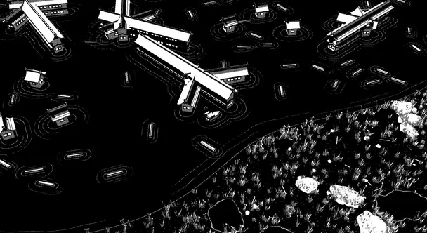 [合集截图](<https://github.com/DariyXYZ/flooded-village/blob/main/docs/preview.png>) | [DariyXYZ/flooded-village](<https://github.com/DariyXYZ/flooded-village>) | 常见根目录许可文件未找到 | 待核 | [6.2](<https://github.com/DariyXYZ/flooded-village/blob/main/docs/preview.png>) | [可达 · 含游戏画布／引擎的网页](<https://dariyxyz.github.io/flooded-village/>) |
| 3543 | [ ] | [港味手藝挑戰](<https://github.com/gamingnews5/awesome-opus-5.5-games/blob/9a29b570e56bd19f15a3cd6bbac0b8c682f2c48c/games/game-gordontam616-comm3400-mini-game/readme.md>) | 待补截图 | [gordontam616/COMM3400-mini-game](<https://github.com/gordontam616/COMM3400-mini-game>) | 常见根目录许可文件未找到 | 待核 | — | 未列入口 |
| 3544 | [ ] | [燈火の巡礼](<https://github.com/gamingnews5/awesome-opus-5.5-games/blob/9a29b570e56bd19f15a3cd6bbac0b8c682f2c48c/games/game-bannzai-godotpractice-game-game/readme.md>) | 待补截图 | [bannzai/godotpractice](<https://github.com/bannzai/godotpractice>) | 常见根目录许可文件未找到 | 待核 | — | 未列入口 |
| 3545 | [ ] | [燈環闘技](<https://github.com/gamingnews5/awesome-opus-5.5-games/blob/9a29b570e56bd19f15a3cd6bbac0b8c682f2c48c/games/game-bannzai-godotpractice/readme.md>) | 待补截图 | [bannzai/godotpractice](<https://github.com/bannzai/godotpractice>) | 常见根目录许可文件未找到 | 待核 | — | 未列入口 |
| 3546 | [ ] | [王冠弓兵團 Crown Archers](<https://github.com/gamingnews5/awesome-opus-5.5-games/blob/9a29b570e56bd19f15a3cd6bbac0b8c682f2c48c/games/crown-archers/readme.md>) | 待补截图 | [ryder1018/crown-archer](<https://github.com/ryder1018/crown-archer>) | 常见根目录许可文件未找到 | 待核 | — | [可达 · 合集所列网页](<https://crown-archers.beloved-sucai.workers.dev/>) |
| 3547 | [ ] | [瓜体实验室 (Melon Lab)](<https://github.com/gamingnews5/awesome-opus-5.5-games/blob/9a29b570e56bd19f15a3cd6bbac0b8c682f2c48c/games/melon-lab-celia827-game-melon-field-lab/readme.md>) | 待补截图 | [celia827/Game-Melon-Field-Lab](<https://github.com/celia827/Game-Melon-Field-Lab>) | 常见根目录许可文件未找到 | 待核 | — | 未列入口 |
| 3548 | [ ] | [痛扁小老頭](<https://github.com/gamingnews5/awesome-opus-5.5-games/blob/9a29b570e56bd19f15a3cd6bbac0b8c682f2c48c/games/game-a112070044-ton-ben-shou-lao-tall/readme.md>) | 待补截图 | [a112070044/ton-ben-shou-lao-tall](<https://github.com/a112070044/ton-ben-shou-lao-tall>) | 常见根目录许可文件未找到 | 待核 | — | [可达 · 合集所列网页](<https://a112070044.github.io/ton-ben-shou-lao-tall/>) |
| 3549 | [ ] | [眼動控制遊戲集錦](<https://github.com/gamingnews5/awesome-opus-5.5-games/blob/9a29b570e56bd19f15a3cd6bbac0b8c682f2c48c/games/game-jinliang0123-eyegame/readme.md>) | 待补截图 | [jinliang0123/Eyegame](<https://github.com/jinliang0123/Eyegame>) | 常见根目录许可文件未找到 | 待核 | — | 未列入口 |
| 3550 | [ ] | [綻放 BLOOM：產後 180 天](<https://github.com/gamingnews5/awesome-opus-5.5-games/blob/9a29b570e56bd19f15a3cd6bbac0b8c682f2c48c/games/bloom-180/readme.md>) | 待补截图 | [iampatella20016080-prog/bloom-game](<https://github.com/iampatella20016080-prog/bloom-game>) | 常见根目录许可文件未找到 | 待核 | — | [可达 · 合集所列网页](<https://bloom-game-eta.vercel.app>) |
| 3551 | [ ] | [英語バトル](<https://github.com/gamingnews5/awesome-opus-5.5-games/blob/9a29b570e56bd19f15a3cd6bbac0b8c682f2c48c/games/game-gangidenset-english-game-app/readme.md>) |  [合集截图](<https://github.com/gangidenset/english-game-app/blob/main/store/screenshots/ipad-2048x2732-2-battle.png>) | [gangidenset/english-game-app](<https://github.com/gangidenset/english-game-app>) | 常见根目录许可文件未找到 | 待核 | [4.5](<https://github.com/gangidenset/english-game-app/blob/main/store/screenshots/ipad-2048x2732-2-battle.png>) | [可达 · 合集所列网页](<https://gangidenset.github.io/english-game-app/>) |
| 3552 | [ ] | [虛擬排球王](<https://github.com/gamingnews5/awesome-opus-5.5-games/blob/9a29b570e56bd19f15a3cd6bbac0b8c682f2c48c/games/game-yuutatsubasa-virtualvolleyball/readme.md>) | 待补截图 | [YuutaTsubasa/VirtualVolleyball](<https://github.com/YuutaTsubasa/VirtualVolleyball>) | 常见根目录许可文件未找到 | [README 提及](<https://github.com/YuutaTsubasa/VirtualVolleyball/blob/HEAD/README.md#L77>) | — | [可达 · 合集所列网页](<https://yuuta-tsubasa.studio/VirtualVolleyball/>) |
| 3553 | [ ] | [虛擬跑跑樂 Virtual Runners](<https://github.com/gamingnews5/awesome-opus-5.5-games/blob/9a29b570e56bd19f15a3cd6bbac0b8c682f2c48c/games/virtual-runners/readme.md>) | 待补截图 | [YuutaTsubasa/VirtualRunners](<https://github.com/YuutaTsubasa/VirtualRunners>) | 常见根目录许可文件未找到 | [README 提及](<https://github.com/YuutaTsubasa/VirtualRunners/blob/HEAD/README.md#L27>) | — | 未列入口 |
| 3554 | [ ] | [虛擬闖天下 Virtual Quest](<https://github.com/gamingnews5/awesome-opus-5.5-games/blob/9a29b570e56bd19f15a3cd6bbac0b8c682f2c48c/games/virtual-quest/readme.md>) | 待补截图 | [YuutaTsubasa/VirtualQuest](<https://github.com/YuutaTsubasa/VirtualQuest>) | 常见根目录许可文件未找到 | [README 提及](<https://github.com/YuutaTsubasa/VirtualQuest/blob/HEAD/README.md#L120>) | — | 未列入口 |
| 3555 | [ ] | [虛擬音鬥樂 Virtual Beat Battle](<https://github.com/gamingnews5/awesome-opus-5.5-games/blob/9a29b570e56bd19f15a3cd6bbac0b8c682f2c48c/games/virtual-beat-battle/readme.md>) | 待补截图 | [YuutaTsubasa/VirtualBeatBattle](<https://github.com/YuutaTsubasa/VirtualBeatBattle>) | 常见根目录许可文件未找到 | [README 提及](<https://github.com/YuutaTsubasa/VirtualBeatBattle/blob/HEAD/README.md#L134>) | — | 未列入口 |
| 3556 | [ ] | [虹彩六號 戰術桌遊](<https://github.com/gamingnews5/awesome-opus-5.5-games/blob/9a29b570e56bd19f15a3cd6bbac0b8c682f2c48c/games/game-aesopfilmedit-svg-r6-siege-the-board-game/readme.md>) | 待补截图 | [aesopfilmedit-svg/R6-siege-The-board-game](<https://github.com/aesopfilmedit-svg/R6-siege-The-board-game>) | 常见根目录许可文件未找到 | 待核 | — | [可达 · 合集所列网页](<https://aesopfilmedit-svg.github.io/R6-siege-The-board-game/>) |
| 3557 | [ ] | [蜂巢兵棋 · Hexwar](<https://github.com/gamingnews5/awesome-opus-5.5-games/blob/9a29b570e56bd19f15a3cd6bbac0b8c682f2c48c/games/hexwar/readme.md>) | 待补截图 | [pphy96826-coder/hexwar](<https://github.com/pphy96826-coder/hexwar>) | 常见根目录许可文件未找到 | 待核 | — | [可达 · 含游戏画布／引擎的网页](<https://pphy96826-coder.github.io/hexwar/>) |
| 3558 | [ ] | [贪吃蛇 · Neon Snake](<https://github.com/gamingnews5/awesome-opus-5.5-games/blob/9a29b570e56bd19f15a3cd6bbac0b8c682f2c48c/games/neon-snake-murkcode-gluttonoussnake/readme.md>) | 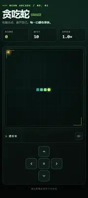 [合集截图](<https://github.com/Murkcode/GluttonousSnake/blob/main/assets/mobile.png>) | [Murkcode/GluttonousSnake](<https://github.com/Murkcode/GluttonousSnake>) | 常见根目录许可文件未找到 | 待核 | [4.8](<https://github.com/Murkcode/GluttonousSnake/blob/main/assets/mobile.png>) | [可达 · 含游戏画布／引擎的网页](<https://murkcode.github.io/GluttonousSnake/>) |
| 3559 | [ ] | [酒場の語り部 (tavern-tales)](<https://github.com/gamingnews5/awesome-opus-5.5-games/blob/9a29b570e56bd19f15a3cd6bbac0b8c682f2c48c/games/tavern-tales/readme.md>) | 待补截图 | [jiantailangdasen6-rgb/tavern-tales](<https://github.com/jiantailangdasen6-rgb/tavern-tales>) | 常见根目录许可文件未找到 | 待核 | — | 未列入口 |
| 3560 | [ ] | [钩锁突袭 · Grapple Raid](<https://github.com/gamingnews5/awesome-opus-5.5-games/blob/9a29b570e56bd19f15a3cd6bbac0b8c682f2c48c/games/grapple-raid/readme.md>) | 待补截图 | [HarrisonZeng/grapple-game](<https://github.com/HarrisonZeng/grapple-game>) | 常见根目录许可文件未找到 | 待核 | — | [README · 入口已失效 · 上游 README 所列网页](<https://harrisonzeng.github.io/grapple-game/>) |
| 3561 | [ ] | [随身游乐场](<https://github.com/gamingnews5/awesome-opus-5.5-games/blob/9a29b570e56bd19f15a3cd6bbac0b8c682f2c48c/games/game-fffreddiee3-mobile-playground/readme.md>) | 待补截图 | [FFFreddiee3/mobile-playground](<https://github.com/FFFreddiee3/mobile-playground>) | 常见根目录许可文件未找到 | 待核 | — | [可达 · 合集所列网页](<https://fffreddiee3.github.io/mobile-playground/>) |
| 3562 | [ ] | [静园苗圃](<https://github.com/gamingnews5/awesome-opus-5.5-games/blob/9a29b570e56bd19f15a3cd6bbac0b8c682f2c48c/games/game-yiyayoh-jymp-game/readme.md>) | 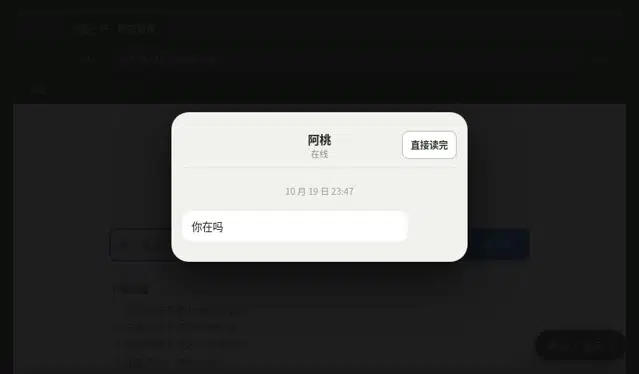 [试玩画面](<https://yiyayoh.github.io/jymp-game/>) | [yiyayoh/jymp-game](<https://github.com/yiyayoh/jymp-game>) | 常见根目录许可文件未找到 | 待核 | — | [可达 · 合集所列网页](<https://yiyayoh.github.io/jymp-game/>) |
| 3563 | [ ] | [鮭鮭熊](<https://github.com/gamingnews5/awesome-opus-5.5-games/blob/9a29b570e56bd19f15a3cd6bbac0b8c682f2c48c/games/game-aftl0904-coder-game-salmon-bear/readme.md>) |  [合集截图](<https://github.com/aftl0904-coder/Game-Salmon-Bear-/blob/main/art-src/story/c6-screen.png>) | [aftl0904-coder/Game-Salmon-Bear-](<https://github.com/aftl0904-coder/Game-Salmon-Bear->) | 常见根目录许可文件未找到 | 待核 | [5.2](<https://github.com/aftl0904-coder/Game-Salmon-Bear-/blob/main/art-src/story/c6-screen.png>) | [可达 · 合集所列网页](<https://racing-cedar-h2u1ks9-al-an5.vercel.app>) |
| 3564 | [ ] | [龟龟超人](<https://github.com/gamingnews5/awesome-opus-5.5-games/blob/9a29b570e56bd19f15a3cd6bbac0b8c682f2c48c/games/game-alvin010202-guigui-superman/readme.md>) |  [源码网页实截](<https://github.com/Alvin010202/guigui-superman/blob/main/index.html>) | [Alvin010202/guigui-superman](<https://github.com/Alvin010202/guigui-superman>) | 常见根目录许可文件未找到 | 待核 | — | 未列入口 |
| 3565 | [ ] | [가요 타임머신 퀴즈](<https://github.com/gamingnews5/awesome-opus-5.5-games/blob/9a29b570e56bd19f15a3cd6bbac0b8c682f2c48c/games/game-crystalmoon74-mygame/readme.md>) |  [试玩首页实截](<https://crystalmoon74.github.io/MyGame/>) | [crystalmoon74/MyGame](<https://github.com/crystalmoon74/MyGame>) | 常见根目录许可文件未找到 | 待核 | — | [可达 · 合集所列网页](<https://crystalmoon74.github.io/MyGame/>) |
| 3566 | [ ] | [가제) 텍스트 로그라이트 RPG](<https://github.com/gamingnews5/awesome-opus-5.5-games/blob/9a29b570e56bd19f15a3cd6bbac0b8c682f2c48c/games/rpg-wvmlqsxyz-legend/readme.md>) | 待补截图 | [wvmlqsxyz/Legend](<https://github.com/wvmlqsxyz/Legend>) | 常见根目录许可文件未找到 | 待核 | — | [入口已失效 · 合集所列网页](<https://wvmlqsxyz.github.io/Legend/>) |
| 3567 | [ ] | [같은 하루, 다른 칸 (가제)](<https://github.com/gamingnews5/awesome-opus-5.5-games/blob/9a29b570e56bd19f15a3cd6bbac0b8c682f2c48c/games/game-juwon3733-game2/readme.md>) | 待补截图 | [juwon3733/game2](<https://github.com/juwon3733/game2>) | 常见根目录许可文件未找到 | 待核 | — | [入口已失效 · 合集所列网页](<https://juwon3733.github.io/game2/>) |
| 3568 | [ ] | [거인의 인체 탐험 - 세포 발전소를 가동하라](<https://github.com/gamingnews5/awesome-opus-5.5-games/blob/9a29b570e56bd19f15a3cd6bbac0b8c682f2c48c/games/game-samsunk25-hue-a260828ani-e/readme.md>) | 待补截图 | [samsunk25-hue/a260828ani\_e](<https://github.com/samsunk25-hue/a260828ani_e>) | 常见根目录许可文件未找到 | 待核 | — | 未列入口 |
| 3569 | [ ] | [경영정보학과2022026037조민지 — 두더지 잡기 게임](<https://github.com/gamingnews5/awesome-opus-5.5-games/blob/9a29b570e56bd19f15a3cd6bbac0b8c682f2c48c/games/2022026037/readme.md>) | 待补截图 | [wawalswl-ship-it/mole\_game](<https://github.com/wawalswl-ship-it/mole_game>) | 常见根目录许可文件未找到 | 待核 | — | [可达 · 合集所列网页](<https://mole-game-pied.vercel.app>) |
| 3570 | [ ] | [대전도시과학고 학과 탐방 게임 (공개용)](<https://github.com/gamingnews5/awesome-opus-5.5-games/blob/9a29b570e56bd19f15a3cd6bbac0b8c682f2c48c/games/game-kcmjj371-art-dush-game-site/readme.md>) |  [源码运行首页](<https://github.com/kcmjj371-art/dush-game-site/blob/main/index.html>) | [kcmjj371-art/dush-game-site](<https://github.com/kcmjj371-art/dush-game-site>) | 常见根目录许可文件未找到 | 待核 | — | 未列入口 |
| 3571 | [ ] | [던전 어드벤처 (Dungeon Game)](<https://github.com/gamingnews5/awesome-opus-5.5-games/blob/9a29b570e56bd19f15a3cd6bbac0b8c682f2c48c/games/dungeon-game/readme.md>) | 待补截图 | [paik1434-cpu/dungeon-game](<https://github.com/paik1434-cpu/dungeon-game>) | 常见根目录许可文件未找到 | 待核 | — | 未列入口 |
| 3572 | [ ] | [던전 크롤러 ⚔](<https://github.com/gamingnews5/awesome-opus-5.5-games/blob/9a29b570e56bd19f15a3cd6bbac0b8c682f2c48c/games/game-hucksoon-dungeon-crawler/readme.md>) | 待补截图 | [hucksoon/dungeon-crawler](<https://github.com/hucksoon/dungeon-crawler>) | 常见根目录许可文件未找到 | 待核 | — | 未列入口 |
| 3573 | [ ] | [데드라인 생존일지](<https://github.com/gamingnews5/awesome-opus-5.5-games/blob/9a29b570e56bd19f15a3cd6bbac0b8c682f2c48c/games/game-plantskang-hash-dead-line/readme.md>) | 待补截图 | [plantskang-hash/dead--line](<https://github.com/plantskang-hash/dead--line>) | 常见根目录许可文件未找到 | 待核 | — | 未列入口 |
| 3574 | [ ] | [동물기록 복구작전 · 하루와 모리의 자연 탐험 (0.4.0)](<https://github.com/gamingnews5/awesome-opus-5.5-games/blob/9a29b570e56bd19f15a3cd6bbac0b8c682f2c48c/games/0-4-0/readme.md>) | 待补截图 | [yelmovie/animal-record-recovery](<https://github.com/yelmovie/animal-record-recovery>) | 常见根目录许可文件未找到 | 待核 | — | [可达 · 合集所列网页](<https://animal-record-recovery.vercel.app>) |
| 3575 | [ ] | [딥홀드](<https://github.com/gamingnews5/awesome-opus-5.5-games/blob/9a29b570e56bd19f15a3cd6bbac0b8c682f2c48c/games/game-starmink-deephold/readme.md>) | 待补截图 | [starMinK/deephold](<https://github.com/starMinK/deephold>) | 常见根目录许可文件未找到 | 待核 | — | 未列入口 |
| 3576 | [ ] | [모의 주식투자 게임 (Stock Simulator)](<https://github.com/gamingnews5/awesome-opus-5.5-games/blob/9a29b570e56bd19f15a3cd6bbac0b8c682f2c48c/games/stock-simulator/readme.md>) | 待补截图 | [Liam9363/Stovk-simulator](<https://github.com/Liam9363/Stovk-simulator>) | 常见根目录许可文件未找到 | 待核 | — | 未列入口 |
| 3577 | [ ] | [불이야! 탈출 대작전](<https://github.com/gamingnews5/awesome-opus-5.5-games/blob/9a29b570e56bd19f15a3cd6bbac0b8c682f2c48c/games/game-khw03097-hash-fire-drill-game/readme.md>) | 待补截图 | [khw03097-hash/fire-drill-game](<https://github.com/khw03097-hash/fire-drill-game>) | 常见根目录许可文件未找到 | 待核 | — | [可达 · 合集所列网页](<https://khw03097-hash.github.io/fire-drill-game/>) |
| 3578 | [ ] | [쇼크 히어로: 몬스터 브레이커](<https://github.com/gamingnews5/awesome-opus-5.5-games/blob/9a29b570e56bd19f15a3cd6bbac0b8c682f2c48c/games/game-ppakku-shock-hero/readme.md>) | 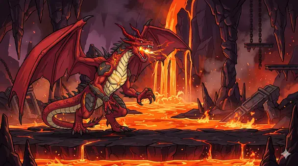 [合集截图](<https://github.com/ppakku/shock-hero/blob/main/docs/astranova_scene.png>) | [ppakku/shock-hero](<https://github.com/ppakku/shock-hero>) | 常见根目录许可文件未找到 | 待核 | [6.4](<https://github.com/ppakku/shock-hero/blob/main/docs/astranova_scene.png>) | 未列入口 |
| 3579 | [ ] | [스피드 게임](<https://github.com/gamingnews5/awesome-opus-5.5-games/blob/9a29b570e56bd19f15a3cd6bbac0b8c682f2c48c/games/game-rmjunho-speed-game/readme.md>) | 待补截图 | [rmjunho/speed-game](<https://github.com/rmjunho/speed-game>) | 常见根目录许可文件未找到 | 待核 | — | [可达 · 合集所列网页](<https://rmjunho.github.io/speed-game/>) |
| 3580 | [ ] | [심연속으로](<https://github.com/gamingnews5/awesome-opus-5.5-games/blob/9a29b570e56bd19f15a3cd6bbac0b8c682f2c48c/games/game-soonyeolkim-cmd-abyss/readme.md>) | 待补截图 | [soonyeolkim-cmd/abyss](<https://github.com/soonyeolkim-cmd/abyss>) | 常见根目录许可文件未找到 | 待核 | — | [可达 · 素材／第三方资源](<https://0x72.itch.io/dungeontileset-ii>) |
| 3581 | [ ] | [오르카 런 (Orca Run)](<https://github.com/gamingnews5/awesome-opus-5.5-games/blob/9a29b570e56bd19f15a3cd6bbac0b8c682f2c48c/games/orca-run/readme.md>) | 待补截图 | [isinjia/LAO\_Run](<https://github.com/isinjia/LAO_Run>) | 常见根目录许可文件未找到 | 待核 | — | 未列入口 |
| 3582 | [ ] | [인생게임 웹](<https://github.com/gamingnews5/awesome-opus-5.5-games/blob/9a29b570e56bd19f15a3cd6bbac0b8c682f2c48c/games/game-selfer08-life-game/readme.md>) | 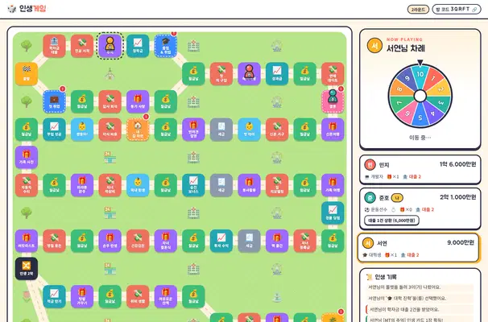 [合集截图](<https://github.com/selfer08/life-game/blob/main/docs/screenshots/3-game.png>) | [selfer08/life-game](<https://github.com/selfer08/life-game>) | 常见根目录许可文件未找到 | 待核 | [5.4](<https://github.com/selfer08/life-game/blob/main/docs/screenshots/3-game.png>) | 未列入口 |
| 3583 | [ ] | [장기 (Janggi)](<https://github.com/gamingnews5/awesome-opus-5.5-games/blob/9a29b570e56bd19f15a3cd6bbac0b8c682f2c48c/games/janggi/readme.md>) | 待补截图 | [orinalgga/janggigame](<https://github.com/orinalgga/janggigame>) | 常见根目录许可文件未找到 | 待核 | — | 未列入口 |
| 3584 | [ ] | [축구 공략 (Goal Rush)](<https://github.com/gamingnews5/awesome-opus-5.5-games/blob/9a29b570e56bd19f15a3cd6bbac0b8c682f2c48c/games/goal-rush/readme.md>) | 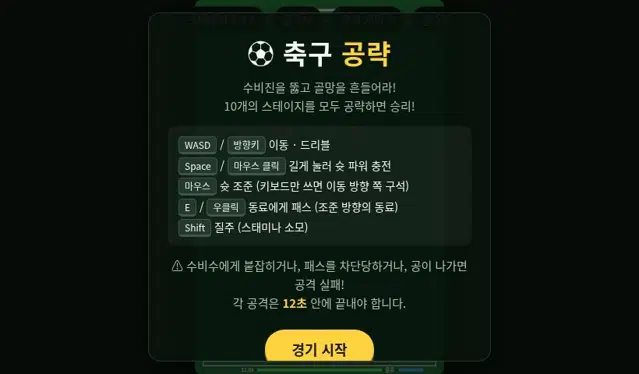 [试玩首页实截](<https://worksenddl2-source.github.io/soccer-strategy-game/>) | [worksenddl2-source/soccer-strategy-game](<https://github.com/worksenddl2-source/soccer-strategy-game>) | 常见根目录许可文件未找到 | 待核 | — | [可达 · 含游戏画布／引擎的网页](<https://worksenddl2-source.github.io/soccer-strategy-game/>) |
| 3585 | [ ] | [큐브 왕국 건축가](<https://github.com/gamingnews5/awesome-opus-5.5-games/blob/9a29b570e56bd19f15a3cd6bbac0b8c682f2c48c/games/game-989-alt-space-puzzle/readme.md>) | 待补截图 | [989-alt/space-puzzle](<https://github.com/989-alt/space-puzzle>) | 常见根目录许可文件未找到 | 待核 | — | 未列入口 |
| 3586 | [ ] | [토너먼트 아레나](<https://github.com/gamingnews5/awesome-opus-5.5-games/blob/9a29b570e56bd19f15a3cd6bbac0b8c682f2c48c/games/game-leejh5004-arena-game/readme.md>) |  [源码运行首页](<https://github.com/leejh5004/arena-game/blob/main/index.html>) | [leejh5004/arena-game](<https://github.com/leejh5004/arena-game>) | 常见根目录许可文件未找到 | 待核 | — | 未列入口 |
| 3587 | [ ] | [트레일 오브 더 비숍 (Trail of the Bishop)](<https://github.com/gamingnews5/awesome-opus-5.5-games/blob/9a29b570e56bd19f15a3cd6bbac0b8c682f2c48c/games/trail-of-the-bishop/readme.md>) | 待补截图 | [BumjinGwak/trail-of-the-bishop](<https://github.com/BumjinGwak/trail-of-the-bishop>) | 常见根目录许可文件未找到 | 待核 | — | [可达 · 含游戏画布／引擎的网页](<https://bumjingwak.github.io/trail-of-the-bishop/>) |
| 3588 | [ ] | [폐병원 : 그녀](<https://github.com/gamingnews5/awesome-opus-5.5-games/blob/9a29b570e56bd19f15a3cd6bbac0b8c682f2c48c/games/game-jkspawn-ghostgirlinhospital/readme.md>) | 待补截图 | [jkspawn/ghostgirlinhospital](<https://github.com/jkspawn/ghostgirlinhospital>) | 常见根目录许可文件未找到 | 待核 | — | [入口已失效 · 合集所列网页](<https://jkspawn.github.io/ghostgirlinhospital/>) |
| 3589 | [ ] | [행성 지키기 (Planet Saving Game)](<https://github.com/gamingnews5/awesome-opus-5.5-games/blob/9a29b570e56bd19f15a3cd6bbac0b8c682f2c48c/games/planet-saving-game/readme.md>) | 待补截图 | [JMH-Chem/Planet-Saving-Game](<https://github.com/JMH-Chem/Planet-Saving-Game>) | 常见根目录许可文件未找到 | 待核 | — | 未列入口 |
| 3590 | [ ] | [화학 섬 이야기](<https://github.com/gamingnews5/awesome-opus-5.5-games/blob/9a29b570e56bd19f15a3cd6bbac0b8c682f2c48c/games/game-bldoijoa01-lab-chem-island/readme.md>) |  [源码运行首页](<https://github.com/bldoijoa01-lab/chem-island/blob/main/index.html>) | [bldoijoa01-lab/chem-island](<https://github.com/bldoijoa01-lab/chem-island>) | 常见根目录许可文件未找到 | 待核 | — | 未列入口 |
| 3591 | [ ] | [황동의 생애](<https://github.com/gamingnews5/awesome-opus-5.5-games/blob/9a29b570e56bd19f15a3cd6bbac0b8c682f2c48c/games/game-dniwndk-gamecode/readme.md>) | 待补截图 | [dniwndk/gamecode](<https://github.com/dniwndk/gamecode>) | 常见根目录许可文件未找到 | 待核 | — | [可达 · 含游戏画布／引擎的网页](<https://dniwndk.github.io/gamecode/>) |

[返回全量目录](README.md)
