# 代码许可尚未确认 · S

[全量目录](README.md) · [候选清单](../todo.md) · [Excel 核对表](../game-audit.xlsx)

本页序号 **2,709–3,018**，共 310 款。本次查找未确认覆盖游戏代码的许可证。可先勾选感兴趣的游戏，再查对应仓库或子目录的授权。

编辑清单时可将 `[ ]` 改为 `[x]`，也可以直接回复游戏名和仓库。名称链接通向合集笔记。

| 序号 | 勾选 | 游戏 | 截图
 | 上游仓库 | 许可和素材说明 | 手柄线索 | 截图分 | 试玩或演示入口 |
| ---: | --- | --- | --- | --- | --- | --- | ---: | --- |
| 2709 | [ ] | [Sadak Surge](<https://github.com/gamingnews5/awesome-opus-5.5-games/blob/9a29b570e56bd19f15a3cd6bbac0b8c682f2c48c/games/sadak-surge/readme.md>) | 待补截图 | [mahakrishan21/Game](<https://github.com/mahakrishan21/Game>) | 常见根目录许可文件未找到 | 待核 | — | 未列入口 |
| 2710 | [ ] | [Safa's Letter Trainer](<https://github.com/gamingnews5/awesome-opus-5.5-games/blob/9a29b570e56bd19f15a3cd6bbac0b8c682f2c48c/games/safa-s-letter-trainer/readme.md>) | 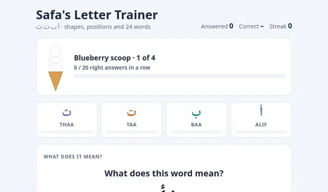 [试玩画面](<https://safa-letter-trainer.stockywhacky.workers.dev>) | [mshaws/safa-letter-trainer](<https://github.com/mshaws/safa-letter-trainer>) | 常见根目录许可文件未找到 | 待核 | — | [可达 · 含游戏画布／引擎的网页](<https://safa-letter-trainer.stockywhacky.workers.dev>) |
| 2711 | [ ] | [Safe Door](<https://github.com/gamingnews5/awesome-opus-5.5-games/blob/9a29b570e56bd19f15a3cd6bbac0b8c682f2c48c/games/party-chaos/readme.md>) | 待补截图 | [lawrenceandrewlargo/roblox-extreme-minigames](<https://github.com/lawrenceandrewlargo/roblox-extreme-minigames>) | 常见根目录许可文件未找到 | 待核 | — | 未列入口 |
| 2712 | [ ] | [Safe Zone Tag](<https://github.com/gamingnews5/awesome-opus-5.5-games/blob/9a29b570e56bd19f15a3cd6bbac0b8c682f2c48c/games/party-chaos/readme.md>) | 待补截图 | [lawrenceandrewlargo/roblox-extreme-minigames](<https://github.com/lawrenceandrewlargo/roblox-extreme-minigames>) | 常见根目录许可文件未找到 | 待核 | — | 未列入口 |
| 2713 | [ ] | [SaintMia's World](<https://github.com/gamingnews5/awesome-opus-5.5-games/blob/9a29b570e56bd19f15a3cd6bbac0b8c682f2c48c/games/saintmia-s-world/readme.md>) | 待补截图 | [OhMySaint/chua-troi](<https://github.com/OhMySaint/chua-troi>) | 常见根目录许可文件未找到 | 待核 | — | [可达 · 合集所列网页](<https://ohmysaint.github.io/chua-troi/>) |
| 2714 | [ ] | [Salpakan Tactics!](<https://github.com/gamingnews5/awesome-opus-5.5-games/blob/9a29b570e56bd19f15a3cd6bbac0b8c682f2c48c/games/salpakan-tactics/readme.md>) | 待补截图 | [wehelpdigital/games-of-the-generals](<https://github.com/wehelpdigital/games-of-the-generals>) | 常见根目录许可文件未找到 | 待核 | — | 未列入口 |
| 2715 | [ ] | [Salt Shack Shapes](<https://github.com/gamingnews5/awesome-opus-5.5-games/blob/9a29b570e56bd19f15a3cd6bbac0b8c682f2c48c/games/salt-shack-shapes/readme.md>) | 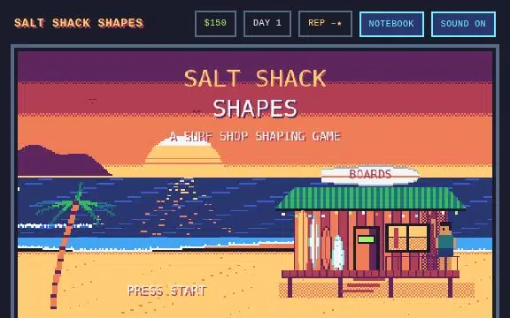 [源码运行首页](<https://github.com/ErnestRes/salt-shack-shapes/blob/main/index.html>) | [ErnestRes/salt-shack-shapes](<https://github.com/ErnestRes/salt-shack-shapes>) | 常见根目录许可文件未找到 | 待核 | — | 未列入口 |
| 2716 | [ ] | [Saltarín](<https://github.com/gamingnews5/awesome-opus-5.5-games/blob/9a29b570e56bd19f15a3cd6bbac0b8c682f2c48c/games/saltarin/readme.md>) | 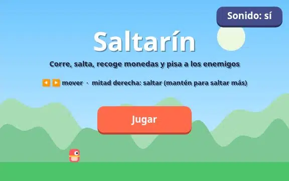 [源码运行首页](<https://github.com/ll7813971-art/Skill/blob/ccr-45251e39-dk0w6b/saltarin.html>) | [ll7813971-art/Skill](<https://github.com/ll7813971-art/Skill>) | 常见根目录许可文件未找到 | 待核 | — | 未列入口 |
| 2717 | [ ] | [Saltmarrow Deep](<https://github.com/gamingnews5/awesome-opus-5.5-games/blob/9a29b570e56bd19f15a3cd6bbac0b8c682f2c48c/games/saltmarrow-deep/readme.md>) | 待补截图 | [alemeno-00/Saltmarrow](<https://github.com/alemeno-00/Saltmarrow>) | 常见根目录许可文件未找到 | 待核 | — | [README · 入口已失效 · 上游 README 所列网页](<https://alemeno-00.github.io/saltmarrow/>) |
| 2718 | [ ] | [Salvo Sums](<https://github.com/gamingnews5/awesome-opus-5.5-games/blob/9a29b570e56bd19f15a3cd6bbac0b8c682f2c48c/games/salvo-sums/readme.md>) | 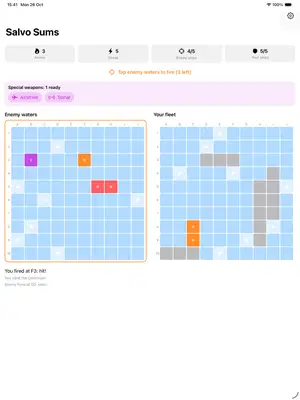 [合集截图](<https://github.com/Geodude117/BattleShips/blob/main/docs/screenshots/ipad-13/1-battle.png>) | [Geodude117/BattleShips](<https://github.com/Geodude117/BattleShips>) | 常见根目录许可文件未找到 | 待核 | [4.4](<https://github.com/Geodude117/BattleShips/blob/main/docs/screenshots/ipad-13/1-battle.png>) | 未列入口 |
| 2719 | [ ] | [Samgukji RPG](<https://github.com/gamingnews5/awesome-opus-5.5-games/blob/9a29b570e56bd19f15a3cd6bbac0b8c682f2c48c/games/samgukji-rpg/readme.md>) | 待补截图 | [moonhyungjin/samgukji-rpg](<https://github.com/moonhyungjin/samgukji-rpg>) | 常见根目录许可文件未找到 | 待核 | — | 未列入口 |
| 2720 | [ ] | [Samurai Ledger](<https://github.com/gamingnews5/awesome-opus-5.5-games/blob/9a29b570e56bd19f15a3cd6bbac0b8c682f2c48c/games/samurai-ledger/readme.md>) | 待补截图 | [Zahra3789/ACCA-Study-Buddy](<https://github.com/Zahra3789/ACCA-Study-Buddy>) | 常见根目录许可文件未找到 | 待核 | — | 未列入口 |
| 2721 | [ ] | [Sanctum remake](<https://github.com/gamingnews5/awesome-opus-5.5-games/blob/9a29b570e56bd19f15a3cd6bbac0b8c682f2c48c/games/sanctum-remake/readme.md>) | 待补截图 | [Nate-the-Ace/nds-sanctum](<https://github.com/Nate-the-Ace/nds-sanctum>) | 常见根目录许可文件未找到 | 待核 | — | 未列入口 |
| 2722 | [ ] | [Sand Spike](<https://github.com/gamingnews5/awesome-opus-5.5-games/blob/9a29b570e56bd19f15a3cd6bbac0b8c682f2c48c/games/sand-spike/readme.md>) | 待补截图 | [MuhammadaliMS/sand-spike](<https://github.com/MuhammadaliMS/sand-spike>) | 常见根目录许可文件未找到 | 待核 | — | [可达 · 含游戏画布／引擎的网页](<https://muhammadalims.github.io/sand-spike/>) |
| 2723 | [ ] | [Sandfall](<https://github.com/gamingnews5/awesome-opus-5.5-games/blob/9a29b570e56bd19f15a3cd6bbac0b8c682f2c48c/games/sandfall/readme.md>) | 待补截图 | [Adrianshch/sandfall](<https://github.com/Adrianshch/sandfall>) | 常见根目录许可文件未找到 | 待核 | — | 未列入口 |
| 2724 | [ ] | [SAP Architect Bridge](<https://github.com/gamingnews5/awesome-opus-5.5-games/blob/9a29b570e56bd19f15a3cd6bbac0b8c682f2c48c/games/sap-architect-bridge/readme.md>) | 待补截图 | [raulit-eng/sap-architect-bridge](<https://github.com/raulit-eng/sap-architect-bridge>) | 常见根目录许可文件未找到 | 待核 | — | 未列入口 |
| 2725 | [ ] | [Sarno Legends](<https://github.com/gamingnews5/awesome-opus-5.5-games/blob/9a29b570e56bd19f15a3cd6bbac0b8c682f2c48c/games/sarno-legends/readme.md>) | 待补截图 | [Marcsarno/Sarno-Legends](<https://github.com/Marcsarno/Sarno-Legends>) | 常见根目录许可文件未找到 | 待核 | [4.6](<https://github.com/Marcsarno/Sarno-Legends/blob/main/public/assets/baked/cards/adrenaline_shot.webp>) | [可达 · 含游戏画布／引擎的网页](<https://sarno-legends.vercel.app>) |
| 2726 | [ ] | [Satisfy: Pagma's Descendant (Prototype)](<https://github.com/gamingnews5/awesome-opus-5.5-games/blob/9a29b570e56bd19f15a3cd6bbac0b8c682f2c48c/games/satisfy-pagma-s-descendant-prototype/readme.md>) | 待补截图 | [twisterdaark/Satisfy](<https://github.com/twisterdaark/Satisfy>) | 常见根目录许可文件未找到 | 待核 | — | [可达 · 合集所列网页](<https://twisterdaark.github.io/Satisfy/>) |
| 2727 | [ ] | [Satzschmiede](<https://github.com/gamingnews5/awesome-opus-5.5-games/blob/9a29b570e56bd19f15a3cd6bbac0b8c682f2c48c/games/satzschmiede/readme.md>) | 待补截图 | [GBM-Gulai/satzschmiede](<https://github.com/GBM-Gulai/satzschmiede>) | 常见根目录许可文件未找到 | 待核 | [6.4](<https://github.com/GBM-Gulai/satzschmiede/blob/main/docs/assets/bg/a1-2-wide.jpg>) | [可达 · 合集所列网页](<https://gbm-gulai.github.io/satzschmiede/>) |
| 2728 | [ ] | [Saudi Surfers](<https://github.com/gamingnews5/awesome-opus-5.5-games/blob/9a29b570e56bd19f15a3cd6bbac0b8c682f2c48c/games/saudi-surfers/readme.md>) | 待补截图 | [amsultan2010/saudi-surfers](<https://github.com/amsultan2010/saudi-surfers>) | 常见根目录许可文件未找到 | 待核 | — | 未列入口 |
| 2729 | [ ] | [Save the Balloons](<https://github.com/gamingnews5/awesome-opus-5.5-games/blob/9a29b570e56bd19f15a3cd6bbac0b8c682f2c48c/games/save-the-balloons/readme.md>) | 待补截图 | [shyamathreye/devis-lab](<https://github.com/shyamathreye/devis-lab>) | 常见根目录许可文件未找到 | 待核 | — | 未列入口 |
| 2730 | [ ] | [Save the Dodo](<https://github.com/gamingnews5/awesome-opus-5.5-games/blob/9a29b570e56bd19f15a3cd6bbac0b8c682f2c48c/games/save-the-dodo/readme.md>) |  [源码运行首页](<https://github.com/AZ-build/Save-the-Dodo/blob/main/index.html>) | [AZ-build/Save-the-Dodo](<https://github.com/AZ-build/Save-the-Dodo>) | 常见根目录许可文件未找到 | 待核 | — | 未列入口 |
| 2731 | [ ] | [Say It Again](<https://github.com/gamingnews5/awesome-opus-5.5-games/blob/9a29b570e56bd19f15a3cd6bbac0b8c682f2c48c/games/say-it-again/readme.md>) | 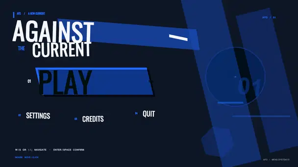 [合集截图](<https://github.com/Nate1506/AFO/blob/main/design/screenshots/baseline_1920x1080.png>) | [Nate1506/AFO](<https://github.com/Nate1506/AFO>) | 常见根目录许可文件未找到 [美术和声音素材按上游 CC0/OFL 清单使用。](<https://github.com/Nate1506/AFO/blob/HEAD/README.md#L72>) | 待核 | [5.6](<https://github.com/Nate1506/AFO/blob/main/design/screenshots/baseline_1920x1080.png>) | 未列入口 |
| 2732 | [ ] | [Say It! Words](<https://github.com/gamingnews5/awesome-opus-5.5-games/blob/9a29b570e56bd19f15a3cd6bbac0b8c682f2c48c/games/say-it-words/readme.md>) | 待补截图 | [sammyshamailov/say-it](<https://github.com/sammyshamailov/say-it>) | 常见根目录许可文件未找到 | 待核 | — | [可达 · 合集所列网页](<https://say-it-words.netlify.app/>) |
| 2733 | [ ] | [Scabbage](<https://github.com/gamingnews5/awesome-opus-5.5-games/blob/9a29b570e56bd19f15a3cd6bbac0b8c682f2c48c/games/scabbage/readme.md>) | 待补截图 | [jmeekerdev/scabbage](<https://github.com/jmeekerdev/scabbage>) | 常见根目录许可文件未找到 | 待核 | [5.5（原图失效）](<https://github.com/jmeekerdev/scabbage/blob/main/docs/screenshots/blocks.jpg>) | 未列入口 |
| 2734 | [ ] | [SCAMBOY Arcade](<https://github.com/gamingnews5/awesome-opus-5.5-games/blob/9a29b570e56bd19f15a3cd6bbac0b8c682f2c48c/games/scamboy-arcade/readme.md>) | 待补截图 | [skljoc/scamboy-arcade](<https://github.com/skljoc/scamboy-arcade>) | 常见根目录许可文件未找到 | 待核 | — | [可达 · 合集所列网页](<https://scamboy-arcade.vercel.app>) |
| 2735 | [ ] | [Scamper](<https://github.com/gamingnews5/awesome-opus-5.5-games/blob/9a29b570e56bd19f15a3cd6bbac0b8c682f2c48c/games/scamper/readme.md>) | 待补截图 | [Grosess/scamper](<https://github.com/Grosess/scamper>) | 常见根目录许可文件未找到 | 待核 | — | [入口已失效 · 合集所列网页](<https://grosess.github.io/scamper/>) |
| 2736 | [ ] | [Schwarzerpeter](<https://github.com/gamingnews5/awesome-opus-5.5-games/blob/9a29b570e56bd19f15a3cd6bbac0b8c682f2c48c/games/schwarzerpeter/readme.md>) | 待补截图 | [GrowingRui/SchwarzerPeter](<https://github.com/GrowingRui/SchwarzerPeter>) | 常见根目录许可文件未找到 | 待核 | [5.8](<https://github.com/GrowingRui/SchwarzerPeter/blob/main/docs/images/alpine-deck.png>) | [可达 · 合集所列网页](<https://schwarzerpeter.vercel.app>) |
| 2737 | [ ] | [Schwarzwasser](<https://github.com/gamingnews5/awesome-opus-5.5-games/blob/9a29b570e56bd19f15a3cd6bbac0b8c682f2c48c/games/schwarzwasser/readme.md>) | 待补截图 | [eXtro181/PirateGame](<https://github.com/eXtro181/PirateGame>) | 常见根目录许可文件未找到 | 待核 | — | [可达 · 含游戏画布／引擎的网页](<https://extro181.github.io/PirateGame/>) |
| 2738 | [ ] | [Science Mayhem](<https://github.com/gamingnews5/awesome-opus-5.5-games/blob/9a29b570e56bd19f15a3cd6bbac0b8c682f2c48c/games/science-mayhem/readme.md>) |  [源码运行首页](<https://github.com/wjsmit/science-mayhem/blob/main/index.html>) | [wjsmit/science-mayhem](<https://github.com/wjsmit/science-mayhem>) | 常见根目录许可文件未找到 | 待核 | — | 未列入口 |
| 2739 | [ ] | [Science Utopia](<https://github.com/gamingnews5/awesome-opus-5.5-games/blob/9a29b570e56bd19f15a3cd6bbac0b8c682f2c48c/games/science-utopia/readme.md>) | 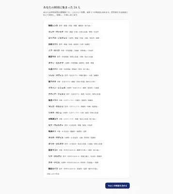 [游戏菜单或界面](<https://github.com/lovemachine893/science-utopia-game/blob/main/screenshots/02-personas.png>) | [lovemachine893/science-utopia-game](<https://github.com/lovemachine893/science-utopia-game>) | 常见根目录许可文件未找到 | 待核 | [3.8](<https://github.com/lovemachine893/science-utopia-game/blob/main/screenshots/02-personas.png>) | [可达 · 合集所列网页](<https://science-utopia-game.vercel.app>) |
| 2740 | [ ] | [SciTabletop](<https://github.com/gamingnews5/awesome-opus-5.5-games/blob/9a29b570e56bd19f15a3cd6bbac0b8c682f2c48c/games/scitabletop/readme.md>) | 待补截图 | [mmisbaah/scitabletop-arcade](<https://github.com/mmisbaah/scitabletop-arcade>) | 常见根目录许可文件未找到 | 待核 | — | 未列入口 |
| 2741 | [ ] | [Scope Creep](<https://github.com/gamingnews5/awesome-opus-5.5-games/blob/9a29b570e56bd19f15a3cd6bbac0b8c682f2c48c/games/scope-creep/readme.md>) | 待补截图 | [inetslop/scope-creep](<https://github.com/inetslop/scope-creep>) | 常见根目录许可文件未找到 | 待核 | — | 未列入口 |
| 2742 | [ ] | [Scorcher](<https://github.com/gamingnews5/awesome-opus-5.5-games/blob/9a29b570e56bd19f15a3cd6bbac0b8c682f2c48c/games/scorcher/readme.md>) | 待补截图 | [WillCherryy/wiki](<https://github.com/WillCherryy/wiki>) | 常见根目录许可文件未找到 | 待核 | — | 未列入口 |
| 2743 | [ ] | [Scrapyard Holdout](<https://github.com/gamingnews5/awesome-opus-5.5-games/blob/9a29b570e56bd19f15a3cd6bbac0b8c682f2c48c/games/scrapyard-holdout/readme.md>) | 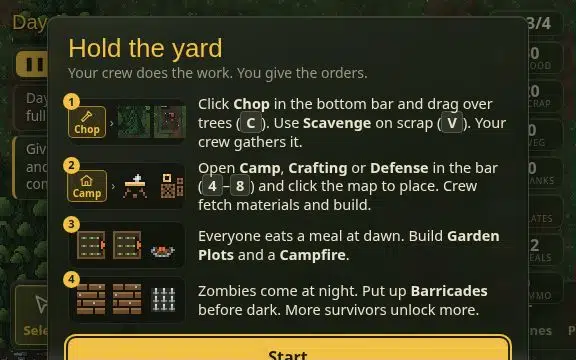 [源码运行首页](<https://github.com/ben-griffiths/scrapyard-holdout/blob/main/index.html>) | [ben-griffiths/scrapyard-holdout](<https://github.com/ben-griffiths/scrapyard-holdout>) | 常见根目录许可文件未找到 | 待核 | — | 未列入口 |
| 2744 | [ ] | [Scrawl](<https://github.com/gamingnews5/awesome-opus-5.5-games/blob/9a29b570e56bd19f15a3cd6bbac0b8c682f2c48c/games/scrawl/readme.md>) | 待补截图 | [HarshGaba1196/scrawl](<https://github.com/HarshGaba1196/scrawl>) | 常见根目录许可文件未找到 | 待核 | — | [可达 · 含游戏画布／引擎的网页](<https://harshgaba1196.github.io/scrawl/>) |
| 2745 | [ ] | [Scribble Room](<https://github.com/gamingnews5/awesome-opus-5.5-games/blob/9a29b570e56bd19f15a3cd6bbac0b8c682f2c48c/games/scribble-room/readme.md>) | 待补截图 | [open-game-system/scribble-room](<https://github.com/open-game-system/scribble-room>) | 常见根目录许可文件未找到 | 待核 | — | 未列入口 |
| 2746 | [ ] | [Scribble: Impostor](<https://github.com/gamingnews5/awesome-opus-5.5-games/blob/9a29b570e56bd19f15a3cd6bbac0b8c682f2c48c/games/scribble-impostor/readme.md>) | 待补截图 | [Anshul1336/scribble-impostor](<https://github.com/Anshul1336/scribble-impostor>) | 常见根目录许可文件未找到 | 待核 | — | [可达 · 含游戏画布／引擎的网页](<https://scribble-impostor.onrender.com/>) |
| 2747 | [ ] | [scroller](<https://github.com/gamingnews5/awesome-opus-5.5-games/blob/9a29b570e56bd19f15a3cd6bbac0b8c682f2c48c/games/scroller/readme.md>) | 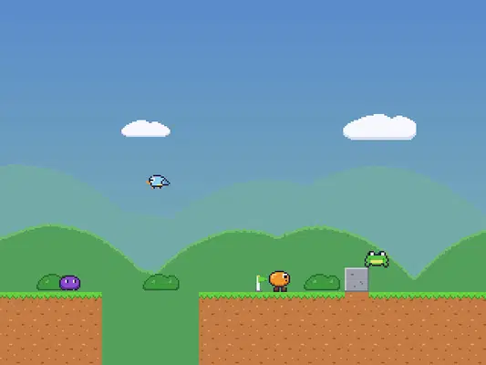 [合集截图](<https://github.com/binfpmr/scroller/blob/main/docs/screenshots/level3.png>) | [binfpmr/scroller](<https://github.com/binfpmr/scroller>) | 常见根目录许可文件未找到 | 待核 | [5.0](<https://github.com/binfpmr/scroller/blob/main/docs/screenshots/level3.png>) | 未列入口 |
| 2748 | [ ] | [Scrum Master on Duty](<https://github.com/gamingnews5/awesome-opus-5.5-games/blob/9a29b570e56bd19f15a3cd6bbac0b8c682f2c48c/games/scrum-master-on-duty/readme.md>) | 待补截图 | [trais92/scrum-study](<https://github.com/trais92/scrum-study>) | 常见根目录许可文件未找到 | 待核 | — | [可达 · 合集所列网页](<https://trais92.github.io/scrum-study/>) |
| 2749 | [ ] | [SCUMM Game](<https://github.com/gamingnews5/awesome-opus-5.5-games/blob/9a29b570e56bd19f15a3cd6bbac0b8c682f2c48c/games/scumm-game/readme.md>) | 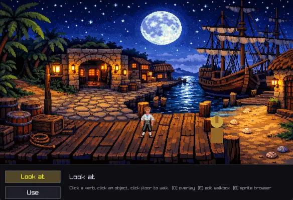 [合集截图](<https://github.com/binRick/scumm-game/blob/main/docs/screenshot.png>) | [binRick/scumm-game](<https://github.com/binRick/scumm-game>) | 常见根目录许可文件未找到 | 待核 | [7.8](<https://github.com/binRick/scumm-game/blob/main/docs/screenshot.png>) | 未列入口 |
| 2750 | [ ] | [Sea of Bullets (S.O.B.)](<https://github.com/gamingnews5/awesome-opus-5.5-games/blob/9a29b570e56bd19f15a3cd6bbac0b8c682f2c48c/games/sea-of-bullets-s-o-b/readme.md>) | <a href="https://img.itch.zone/aW1hZ2UvNTE4MzEyNC8zMTA0MjU2NS5wbmc=/347x500/H3w5RY.png">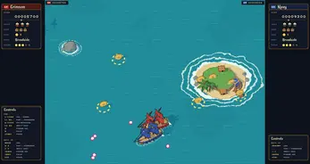</a> [作者发布的游戏截图](<https://ubern0ob.itch.io/sea-of-bullets>) | [substreight/sea-of-bullets](<https://github.com/substreight/sea-of-bullets>) | 常见根目录许可文件未找到 | 待核 | [6.9（原图失效）](<https://github.com/substreight/sea-of-bullets/blob/main/docs/itch/s2_0880.png>) | [可达 · itch.io 内嵌游戏页](<https://ubern0ob.itch.io/sea-of-bullets>) |
| 2751 | [ ] | [SEABRIGHT — A Coastal City Builder](<https://github.com/gamingnews5/awesome-opus-5.5-games/blob/9a29b570e56bd19f15a3cd6bbac0b8c682f2c48c/games/seabright-a-coastal-city-builder/readme.md>) | 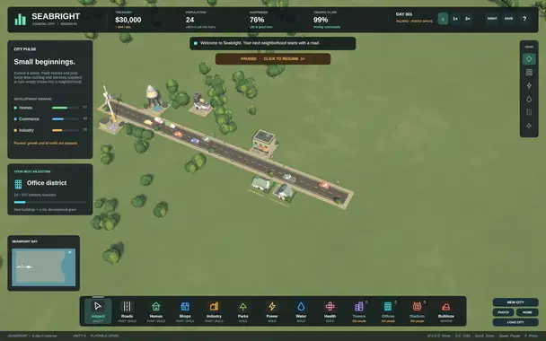 [合集截图](<https://github.com/codersusu/game-city-skylines/blob/main/Artifacts/01-starter-settlement.png>) | [codersusu/game-city-skylines](<https://github.com/codersusu/game-city-skylines>) | 常见根目录许可文件未找到 | 待核 | [7.8](<https://github.com/codersusu/game-city-skylines/blob/main/Artifacts/01-starter-settlement.png>) | [可达 · 含游戏画布／引擎的网页](<https://codersusu.github.io/game-city-skylines/>) |
| 2752 | [ ] | [Search For The Egg](<https://github.com/gamingnews5/awesome-opus-5.5-games/blob/9a29b570e56bd19f15a3cd6bbac0b8c682f2c48c/games/search-for-the-egg/readme.md>) | 待补截图 | [khaielwork6-stack/Search-For-The-Egg](<https://github.com/khaielwork6-stack/Search-For-The-Egg>) | 常见根目录许可文件未找到 | 待核 | [3.5](<https://github.com/khaielwork6-stack/Search-For-The-Egg/blob/main/Search_For_The_Egg_Claude_Code_Build_Pack/classes.png>) | 未列入口 |
| 2753 | [ ] | [Search Party](<https://github.com/gamingnews5/awesome-opus-5.5-games/blob/9a29b570e56bd19f15a3cd6bbac0b8c682f2c48c/games/search-party/readme.md>) | 待补截图 | [applebloom3413-creator/kidnapper](<https://github.com/applebloom3413-creator/kidnapper>) | 常见根目录许可文件未找到 | 待核 | — | 未列入口 |
| 2754 | [ ] | [Seaside Scoop](<https://github.com/gamingnews5/awesome-opus-5.5-games/blob/9a29b570e56bd19f15a3cd6bbac0b8c682f2c48c/games/seaside-scoop/readme.md>) | 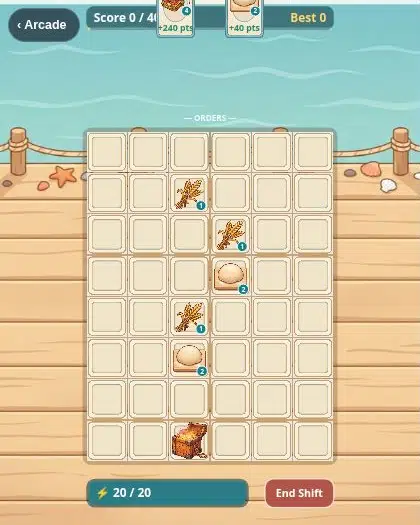 [对应子游戏玩法实截](<https://github.com/pawanp3/renderwolf-fable5-chart-toppers/blob/HEAD/games/gossip-harbor/index.html>) | [pawanp3/renderwolf-fable5-chart-toppers](<https://github.com/pawanp3/renderwolf-fable5-chart-toppers>) | 常见根目录许可文件未找到 | 待核 | — | [多游戏仓库入口 · 可达 · 合集所列网页](<https://pawanp3.github.io/renderwolf-fable5-chart-toppers/>) |
| 2755 | [ ] | [Seasons of War · Proving Grounds](<https://github.com/gamingnews5/awesome-opus-5.5-games/blob/9a29b570e56bd19f15a3cd6bbac0b8c682f2c48c/games/seasons-of-war-proving-grounds/readme.md>) | 待补截图 | [Lupin857/Seasons-of-War-Proving-Grounds](<https://github.com/Lupin857/Seasons-of-War-Proving-Grounds>) | 常见根目录许可文件未找到 | 待核 | — | [可达 · 合集所列网页](<https://lupin857.github.io/Seasons-of-War-Proving-Grounds/>) |
| 2756 | [ ] | [SellingSelling](<https://github.com/gamingnews5/awesome-opus-5.5-games/blob/9a29b570e56bd19f15a3cd6bbac0b8c682f2c48c/games/sellingselling/readme.md>) | 待补截图 | [cvcool-eng/sellingselling](<https://github.com/cvcool-eng/sellingselling>) | 常见根目录许可文件未找到 | 待核 | — | 未列入口 |
| 2757 | [ ] | [Sensei Says](<https://github.com/gamingnews5/awesome-opus-5.5-games/blob/9a29b570e56bd19f15a3cd6bbac0b8c682f2c48c/games/sensei-says/readme.md>) | 待补截图 | [Karanvir1729/ninja-knife-dodge](<https://github.com/Karanvir1729/ninja-knife-dodge>) | 常见根目录许可文件未找到 | 待核 | — | 未列入口 |
| 2758 | [ ] | [Sensory Town](<https://github.com/gamingnews5/awesome-opus-5.5-games/blob/9a29b570e56bd19f15a3cd6bbac0b8c682f2c48c/games/sensory-town/readme.md>) | 待补截图 | [darthreckoner/sensory-town](<https://github.com/darthreckoner/sensory-town>) | 常见根目录许可文件未找到 | 待核 | — | [可达 · 含游戏画布／引擎的网页](<https://darthreckoner.github.io/sensory-town/>) |
| 2759 | [ ] | [Sentence Bonanza](<https://github.com/gamingnews5/awesome-opus-5.5-games/blob/9a29b570e56bd19f15a3cd6bbac0b8c682f2c48c/games/sentence-bonanza/readme.md>) | 待补截图 | [talcom/sentence-bonanza](<https://github.com/talcom/sentence-bonanza>) | 常见根目录许可文件未找到 | 待核 | — | [可达 · 合集所列网页](<https://talcom.github.io/sentence-bonanza/>) |
| 2760 | [ ] | [Separation Golf](<https://github.com/gamingnews5/awesome-opus-5.5-games/blob/9a29b570e56bd19f15a3cd6bbac0b8c682f2c48c/games/separation-golf/readme.md>) | 待补截图 | [dompescamedia/separation-golf](<https://github.com/dompescamedia/separation-golf>) | 常见根目录许可文件未找到 | 待核 | — | [可达 · 合集所列网页](<https://dompescamedia.github.io/separation-golf/>) |
| 2761 | [ ] | [Settling Up](<https://github.com/gamingnews5/awesome-opus-5.5-games/blob/9a29b570e56bd19f15a3cd6bbac0b8c682f2c48c/games/settling-up/readme.md>) | 待补截图 | [ethomasclass/sharecropper](<https://github.com/ethomasclass/sharecropper>) | 常见根目录许可文件未找到 | 待核 | — | 未列入口 |
| 2762 | [ ] | [Settry](<https://github.com/gamingnews5/awesome-opus-5.5-games/blob/9a29b570e56bd19f15a3cd6bbac0b8c682f2c48c/games/settry/readme.md>) | 待补截图 | [benurquhart1/settry](<https://github.com/benurquhart1/settry>) | 常见根目录许可文件未找到 | 待核 | — | 未列入口 |
| 2763 | [ ] | [SFoEv1](<https://github.com/gamingnews5/awesome-opus-5.5-games/blob/9a29b570e56bd19f15a3cd6bbac0b8c682f2c48c/games/sfoev1/readme.md>) | 待补截图 | [glacilaria/SFoEv1](<https://github.com/glacilaria/SFoEv1>) | 常见根目录许可文件未找到 | 待核 | — | [可达 · 含游戏画布／引擎的网页](<https://sfoev1.vercel.app>) |
| 2764 | [ ] | [Shade (khalil-gamedistrict)](<https://github.com/gamingnews5/awesome-opus-5.5-games/blob/9a29b570e56bd19f15a3cd6bbac0b8c682f2c48c/games/shade-khalil-gamedistrict/readme.md>) | 待补截图 | [khalil-gamedistrict/shade](<https://github.com/khalil-gamedistrict/shade>) | 常见根目录许可文件未找到 | 待核 | — | 未列入口 |
| 2765 | [ ] | [Shadow Ledger](<https://github.com/gamingnews5/awesome-opus-5.5-games/blob/9a29b570e56bd19f15a3cd6bbac0b8c682f2c48c/games/shadow-ledger/readme.md>) | 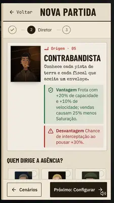 [上游游戏截图](<https://github.com/Gstxxx/shadow-ledger/blob/HEAD/public/screenshots/retrato-diretor.webp>) | [Gstxxx/shadow-ledger](<https://github.com/Gstxxx/shadow-ledger>) | 常见根目录许可文件未找到 | 待核 | — | [可达 · 合集所列网页](<https://shadow-ledger-delta.vercel.app>) |
| 2766 | [ ] | [Shadow Ninjas](<https://github.com/gamingnews5/awesome-opus-5.5-games/blob/9a29b570e56bd19f15a3cd6bbac0b8c682f2c48c/games/shadow-ninjas/readme.md>) | 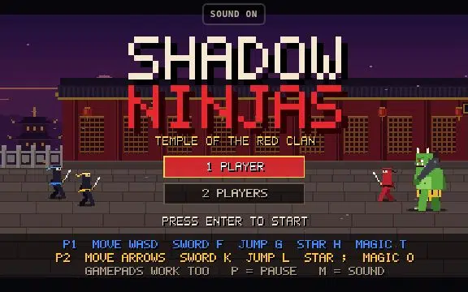 [同款源码启动画面实截](<https://github.com/ppeach/shadow-ninjas/blob/HEAD/index.html>) | [ppeach/shadow-ninjas](<https://github.com/ppeach/shadow-ninjas>) | 常见根目录许可文件未找到 | [README 提及](<https://github.com/ppeach/shadow-ninjas/blob/HEAD/README.md#L23>) | — | [可达 · 含游戏画布／引擎的网页](<https://ppeach.github.io/shadow-ninjas/>) |
| 2767 | [ ] | [Shadow Qi](<https://github.com/gamingnews5/awesome-opus-5.5-games/blob/9a29b570e56bd19f15a3cd6bbac0b8c682f2c48c/games/shadow-qi/readme.md>) |  [合集截图](<https://github.com/cn-eveer/shadow-qi/blob/main/assets/shot-super.jpg>) | [cn-eveer/shadow-qi](<https://github.com/cn-eveer/shadow-qi>) | 常见根目录许可文件未找到 | 待核 | [6.4](<https://github.com/cn-eveer/shadow-qi/blob/main/assets/shot-super.jpg>) | [可达 · 含游戏画布／引擎的网页](<https://cn-eveer.github.io/shadow-qi/>) |
| 2768 | [ ] | [Shake Slider](<https://github.com/gamingnews5/awesome-opus-5.5-games/blob/9a29b570e56bd19f15a3cd6bbac0b8c682f2c48c/games/shake-slider/readme.md>) |  [源码运行首页](<https://github.com/ccdmdevelopment-bit/Shake-game/blob/claude/soda-slinger/index.html>) | [ccdmdevelopment-bit/Shake-game](<https://github.com/ccdmdevelopment-bit/Shake-game>) | 常见根目录许可文件未找到 | 待核 | — | 未列入口 |
| 2769 | [ ] | [Shallow Steel](<https://github.com/gamingnews5/awesome-opus-5.5-games/blob/9a29b570e56bd19f15a3cd6bbac0b8c682f2c48c/games/shallow-steel/readme.md>) | 待补截图 | [adamholter/shallow-steel](<https://github.com/adamholter/shallow-steel>) | 常见根目录许可文件未找到 | 待核 | — | 未列入口 |
| 2770 | [ ] | [Shape Inventory](<https://github.com/gamingnews5/awesome-opus-5.5-games/blob/9a29b570e56bd19f15a3cd6bbac0b8c682f2c48c/games/shape-inventory/readme.md>) | 待补截图 | [DaniilCoolUkraine/minijam\_222](<https://github.com/DaniilCoolUkraine/minijam_222>) | 常见根目录许可文件未找到 | 待核 | — | 未列入口 |
| 2771 | [ ] | [Shape Reveal](<https://github.com/gamingnews5/awesome-opus-5.5-games/blob/9a29b570e56bd19f15a3cd6bbac0b8c682f2c48c/games/shape-reveal/readme.md>) | 待补截图 | [Arsmi-17/arsmigames-tetris-picture-puzzle-web-game](<https://github.com/Arsmi-17/arsmigames-tetris-picture-puzzle-web-game>) | 常见根目录许可文件未找到 | 待核 | — | 未列入口 |
| 2772 | [ ] | [Shape Tower](<https://github.com/gamingnews5/awesome-opus-5.5-games/blob/9a29b570e56bd19f15a3cd6bbac0b8c682f2c48c/games/shape-tower/readme.md>) | 待补截图 | [BlakePixHil/shape\_tower](<https://github.com/BlakePixHil/shape_tower>) | 常见根目录许可文件未找到 | 待核 | — | 未列入口 |
| 2773 | [ ] | [Shardbound Arena](<https://github.com/gamingnews5/awesome-opus-5.5-games/blob/9a29b570e56bd19f15a3cd6bbac0b8c682f2c48c/games/shardbound-arena/readme.md>) | 待补截图 | [DrFIllMore/Shardbound-Arena](<https://github.com/DrFIllMore/Shardbound-Arena>) | 常见根目录许可文件未找到 | 待核 | — | [可达 · 合集所列网页](<https://drfillmore.github.io/Shardbound-Arena/>) |
| 2774 | [ ] | [Shardbreaker (roguelike)](<https://github.com/gamingnews5/awesome-opus-5.5-games/blob/9a29b570e56bd19f15a3cd6bbac0b8c682f2c48c/games/shardbreaker-roguelike/readme.md>) | 待补截图 | [JakeA-UKSBS/Shardbreaker](<https://github.com/JakeA-UKSBS/Shardbreaker>) | 常见根目录许可文件未找到 | 待核 | — | [入口已失效 · 合集所列网页](<https://jakea-uksbs.github.io/Shardbreaker/>) |
| 2775 | [ ] | [Shardkin: Eight Realms](<https://github.com/gamingnews5/awesome-opus-5.5-games/blob/9a29b570e56bd19f15a3cd6bbac0b8c682f2c48c/games/shardkin-eight-realms/readme.md>) | 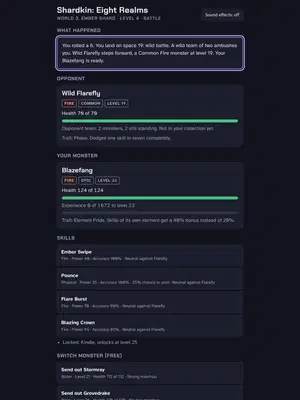 [上游游戏截图](<https://github.com/christopherabel3000-creator/Shardkin-Eight-Realms/blob/HEAD/appstore/screenshots/ipad-01-battle.png>) | [christopherabel3000-creator/Shardkin-Eight-Realms](<https://github.com/christopherabel3000-creator/Shardkin-Eight-Realms>) | 常见根目录许可文件未找到 | 待核 | — | [可达 · 合集所列网页](<https://christopherabel3000-creator.github.io/Shardkin-Eight-Realms/>) |
| 2776 | [ ] | [Shattered Reef](<https://github.com/gamingnews5/awesome-opus-5.5-games/blob/9a29b570e56bd19f15a3cd6bbac0b8c682f2c48c/games/shattered-reef/readme.md>) | 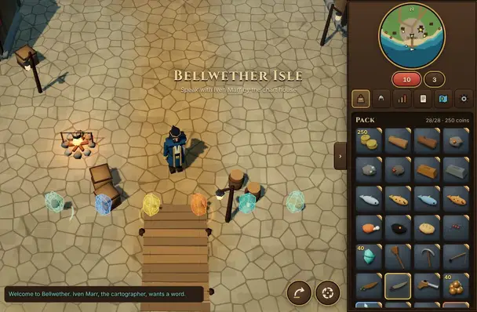 [合集截图](<https://github.com/f2456hhchv-bit/shattered-reef/blob/main/docs/art-pass-1-items.jpg>) | [f2456hhchv-bit/shattered-reef](<https://github.com/f2456hhchv-bit/shattered-reef>) | 常见根目录许可文件未找到 | 待核 | [6.4](<https://github.com/f2456hhchv-bit/shattered-reef/blob/main/docs/art-pass-1-items.jpg>) | 未列入口 |
| 2777 | [ ] | [Shattered Rifts](<https://github.com/gamingnews5/awesome-opus-5.5-games/blob/9a29b570e56bd19f15a3cd6bbac0b8c682f2c48c/games/shattered-rifts/readme.md>) | 待补截图 | [rnimmo13/shattered-rifts](<https://github.com/rnimmo13/shattered-rifts>) | 常见根目录许可文件未找到 | 待核 | — | 未列入口 |
| 2778 | [ ] | [Shatterfield](<https://github.com/gamingnews5/awesome-opus-5.5-games/blob/9a29b570e56bd19f15a3cd6bbac0b8c682f2c48c/games/shatterfield/readme.md>) | 待补截图 | [real-shafe/shatterfield](<https://github.com/real-shafe/shatterfield>) | 常见根目录许可文件未找到 | 待核 | — | [可达 · 含游戏画布／引擎的网页](<https://shatterfield.shafe.dev>) |
| 2779 | [ ] | [Shift](<https://github.com/gamingnews5/awesome-opus-5.5-games/blob/9a29b570e56bd19f15a3cd6bbac0b8c682f2c48c/games/shift-ariele-marcellino-shift/readme.md>) | 待补截图 | [ariele-marcellino/shift](<https://github.com/ariele-marcellino/shift>) | 常见根目录许可文件未找到 | 待核 | — | 未列入口 |
| 2780 | [ ] | [Shikaku (jbexten89)](<https://github.com/gamingnews5/awesome-opus-5.5-games/blob/9a29b570e56bd19f15a3cd6bbac0b8c682f2c48c/games/shikaku-jbexten89/readme.md>) | 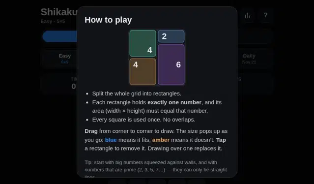 [试玩首页实截](<https://jbexten89.github.io/Shikaku/>) | [jbexten89/Shikaku](<https://github.com/jbexten89/Shikaku>) | 常见根目录许可文件未找到 | 待核 | — | [可达 · 合集所列网页](<https://jbexten89.github.io/Shikaku/>) |
| 2781 | [ ] | [Shinobi Incremental](<https://github.com/gamingnews5/awesome-opus-5.5-games/blob/9a29b570e56bd19f15a3cd6bbac0b8c682f2c48c/games/shinobi-incremental/readme.md>) | 待补截图 | [BrentDeGeest/BrentDeGeest.github.io](<https://github.com/BrentDeGeest/BrentDeGeest.github.io>) | 常见根目录许可文件未找到 | 待核 | — | [可达 · 含游戏画布／引擎的网页](<https://brentdegeest.github.io>) |
| 2782 | [ ] | [SHINOBI RUSH: Ninja Battle Endless Runner](<https://github.com/gamingnews5/awesome-opus-5.5-games/blob/9a29b570e56bd19f15a3cd6bbac0b8c682f2c48c/games/shinobi-rush-ninja-battle-endless-runner/readme.md>) | 待补截图 | [rehanraza0063-sudo/ninja-run-battle-game](<https://github.com/rehanraza0063-sudo/ninja-run-battle-game>) | 常见根目录许可文件未找到 | 待核 | — | 未列入口 |
| 2783 | [ ] | [Ship It](<https://github.com/gamingnews5/awesome-opus-5.5-games/blob/9a29b570e56bd19f15a3cd6bbac0b8c682f2c48c/games/ship-it/readme.md>) | 待补截图 | [appleapplegaming/pr-review-game](<https://github.com/appleapplegaming/pr-review-game>) | 常见根目录许可文件未找到 | 待核 | — | 未列入口 |
| 2784 | [ ] | [Ship It (AdarshKhera)](<https://github.com/gamingnews5/awesome-opus-5.5-games/blob/9a29b570e56bd19f15a3cd6bbac0b8c682f2c48c/games/ship-it-adarshkhera/readme.md>) |  [合集截图](<https://github.com/AdarshKhera/ship-it-play/blob/main/img/boss-1280.webp>) | [AdarshKhera/ship-it-play](<https://github.com/AdarshKhera/ship-it-play>) | 常见根目录许可文件未找到 | 待核 | [6.5](<https://github.com/AdarshKhera/ship-it-play/blob/main/img/boss-1280.webp>) | 未列入口 |
| 2785 | [ ] | [Ship Week](<https://github.com/gamingnews5/awesome-opus-5.5-games/blob/9a29b570e56bd19f15a3cd6bbac0b8c682f2c48c/games/ship-week/readme.md>) | 待补截图 | [neothebyte/ship-week](<https://github.com/neothebyte/ship-week>) | 常见根目录许可文件未找到 | 待核 | — | 未列入口 |
| 2786 | [ ] | [Shipped](<https://github.com/gamingnews5/awesome-opus-5.5-games/blob/9a29b570e56bd19f15a3cd6bbac0b8c682f2c48c/games/shipped/readme.md>) | 待补截图 | [madebynova/Shipped](<https://github.com/madebynova/Shipped>) | 常见根目录许可文件未找到 | 待核 | — | 未列入口 |
| 2787 | [ ] | [Shithead](<https://github.com/gamingnews5/awesome-opus-5.5-games/blob/9a29b570e56bd19f15a3cd6bbac0b8c682f2c48c/games/shithead/readme.md>) | 待补截图 | [spmarm/shithead](<https://github.com/spmarm/shithead>) | 常见根目录许可文件未找到 | 待核 | — | 未列入口 |
| 2788 | [ ] | [Shivanag](<https://github.com/gamingnews5/awesome-opus-5.5-games/blob/9a29b570e56bd19f15a3cd6bbac0b8c682f2c48c/games/shivanag/readme.md>) | 待补截图 | [achallakiran/shivanag](<https://github.com/achallakiran/shivanag>) | 常见根目录许可文件未找到 | 待核 | — | 未列入口 |
| 2789 | [ ] | [Shoot Lines](<https://github.com/gamingnews5/awesome-opus-5.5-games/blob/9a29b570e56bd19f15a3cd6bbac0b8c682f2c48c/games/shoot-lines/readme.md>) |  [同款源码启动画面实截](<https://github.com/matheuscrafiting-netizen/Shoot-lines/blob/HEAD/index.html>) | [matheuscrafiting-netizen/Shoot-lines](<https://github.com/matheuscrafiting-netizen/Shoot-lines>) | 常见根目录许可文件未找到 | 待核 | — | [可达 · 含游戏画布／引擎的网页](<https://matheuscrafiting-netizen.github.io/Shoot-lines/>) |
| 2790 | [ ] | [Shoreline](<https://github.com/gamingnews5/awesome-opus-5.5-games/blob/9a29b570e56bd19f15a3cd6bbac0b8c682f2c48c/games/shoreline/readme.md>) | 待补截图 | [mylesbrandon/shoreline](<https://github.com/mylesbrandon/shoreline>) | 常见根目录许可文件未找到 | 待核 | — | [可达 · 合集所列网页](<https://stormline-kohl.vercel.app>) |
| 2791 | [ ] | [Short Circuit](<https://github.com/gamingnews5/awesome-opus-5.5-games/blob/9a29b570e56bd19f15a3cd6bbac0b8c682f2c48c/games/short-circuit/readme.md>) | 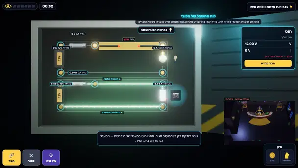 [合集截图](<https://github.com/AceDZN/short-circuit/blob/main/docs/captures/actual-02b-panel-closeup.png>) | [AceDZN/short-circuit](<https://github.com/AceDZN/short-circuit>) | 常见根目录许可文件未找到 | 待核 | [5.8](<https://github.com/AceDZN/short-circuit/blob/main/docs/captures/actual-02b-panel-closeup.png>) | 未列入口 |
| 2792 | [ ] | [Shout](<https://github.com/gamingnews5/awesome-opus-5.5-games/blob/9a29b570e56bd19f15a3cd6bbac0b8c682f2c48c/games/shout/readme.md>) | 待补截图 | [jonahallibone/clue-ladder](<https://github.com/jonahallibone/clue-ladder>) | 常见根目录许可文件未找到 | 待核 | — | [可达 · 合集所列网页](<https://clue-ladder-nine.vercel.app>) |
| 2793 | [ ] | [SHOVE](<https://github.com/gamingnews5/awesome-opus-5.5-games/blob/9a29b570e56bd19f15a3cd6bbac0b8c682f2c48c/games/shove/readme.md>) | 待补截图 | [robss2020/claude-fable-5-having-fun](<https://github.com/robss2020/claude-fable-5-having-fun>) | 常见根目录许可文件未找到 | 待核 | — | 未列入口 |
| 2794 | [ ] | [Shredline](<https://github.com/gamingnews5/awesome-opus-5.5-games/blob/9a29b570e56bd19f15a3cd6bbac0b8c682f2c48c/games/shredline/readme.md>) | 待补截图 | [reidwcoleman/alpenglow](<https://github.com/reidwcoleman/alpenglow>) | 常见根目录许可文件未找到 | [README 提及](<https://github.com/reidwcoleman/alpenglow/blob/HEAD/README.md#L81>) | — | [可达 · 合集所列网页](<https://reidwcoleman.github.io/alpenglow/>) |
| 2795 | [ ] | [Shuck Shack](<https://github.com/gamingnews5/awesome-opus-5.5-games/blob/9a29b570e56bd19f15a3cd6bbac0b8c682f2c48c/games/shuck-shack/readme.md>) | 待补截图 | [Stephen-Petronis/shuck-shack](<https://github.com/Stephen-Petronis/shuck-shack>) | 常见根目录许可文件未找到 | 待核 | — | 未列入口 |
| 2796 | [ ] | [Shuriken Match](<https://github.com/gamingnews5/awesome-opus-5.5-games/blob/9a29b570e56bd19f15a3cd6bbac0b8c682f2c48c/games/shuriken-match/readme.md>) | 待补截图 | [Karanvir1729/ninja-knife-dodge](<https://github.com/Karanvir1729/ninja-knife-dodge>) | 常见根目录许可文件未找到 | 待核 | — | 未列入口 |
| 2797 | [ ] | [Side Hustle (formerly Duel Arena)](<https://github.com/gamingnews5/awesome-opus-5.5-games/blob/9a29b570e56bd19f15a3cd6bbac0b8c682f2c48c/games/side-hustle-formerly-duel-arena/readme.md>) | 待补截图 | [CorbinPlayz/Side-hustle](<https://github.com/CorbinPlayz/Side-hustle>) | 常见根目录许可文件未找到 | 待核 | — | 未列入口 |
| 2798 | [ ] | [Side Quest Republic — Same Day Again](<https://github.com/gamingnews5/awesome-opus-5.5-games/blob/9a29b570e56bd19f15a3cd6bbac0b8c682f2c48c/games/side-quest-republic-same-day-again/readme.md>) | 待补截图 | [vulbsti/Side-Quest-Republic](<https://github.com/vulbsti/Side-Quest-Republic>) | 常见根目录许可文件未找到 | 待核 | — | 未列入口 |
| 2799 | [ ] | [Side-Scroll Arcade](<https://github.com/gamingnews5/awesome-opus-5.5-games/blob/9a29b570e56bd19f15a3cd6bbac0b8c682f2c48c/games/side-scroll-arcade/readme.md>) | 待补截图 | [krosaen/tbone-sidescroll](<https://github.com/krosaen/tbone-sidescroll>) | 常见根目录许可文件未找到 | 待核 | — | 未列入口 |
| 2800 | [ ] | [Sideways](<https://github.com/gamingnews5/awesome-opus-5.5-games/blob/9a29b570e56bd19f15a3cd6bbac0b8c682f2c48c/games/sideways/readme.md>) | 待补截图 | [joepio/sideways](<https://github.com/joepio/sideways>) | 常见根目录许可文件未找到 | [源码有输入读取](<https://github.com/joepio/sideways/blob/main/main.gd#L955>) | — | 未列入口 |
| 2801 | [ ] | [Siege Engineers](<https://github.com/gamingnews5/awesome-opus-5.5-games/blob/9a29b570e56bd19f15a3cd6bbac0b8c682f2c48c/games/siege-engineers/readme.md>) | 待补截图 | [dubiouspotions/LD60-Old-Tech](<https://github.com/dubiouspotions/LD60-Old-Tech>) | 常见根目录许可文件未找到 | 待核 | — | 未列入口 |
| 2802 | [ ] | [Sigil](<https://github.com/gamingnews5/awesome-opus-5.5-games/blob/9a29b570e56bd19f15a3cd6bbac0b8c682f2c48c/games/sigil/readme.md>) |  [合集截图](<https://github.com/hokita/mouse2/blob/main/docs/screenshots/sigil-battle.png>) | [hokita/mouse2](<https://github.com/hokita/mouse2>) | 常见根目录许可文件未找到 | 待核 | [6.8](<https://github.com/hokita/mouse2/blob/main/docs/screenshots/sigil-battle.png>) | [多游戏仓库入口 · 可达 · 合集所列网页](<https://mouse2-0357d0.web.app/>) |
| 2803 | [ ] | [SIGNAL / NOISE](<https://github.com/gamingnews5/awesome-opus-5.5-games/blob/9a29b570e56bd19f15a3cd6bbac0b8c682f2c48c/games/signal-noise/readme.md>) | 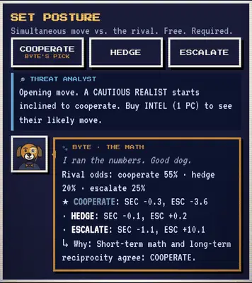 [合集截图](<https://github.com/700799/ai-war-game/blob/main/how-posture.png>) | [700799/ai-war-game](<https://github.com/700799/ai-war-game>) | 常见根目录许可文件未找到 | 待核 | [4.5](<https://github.com/700799/ai-war-game/blob/main/how-posture.png>) | [可达 · 合集所列网页](<https://ai-war-game-phi.vercel.app>) |
| 2804 | [ ] | [SIGNAL 5](<https://github.com/gamingnews5/awesome-opus-5.5-games/blob/9a29b570e56bd19f15a3cd6bbac0b8c682f2c48c/games/signal-5/readme.md>) | 待补截图 | [kristoph7/signal5](<https://github.com/kristoph7/signal5>) | 常见根目录许可文件未找到 | 待核 | — | 未列入口 |
| 2805 | [ ] | [Signal Drive](<https://github.com/gamingnews5/awesome-opus-5.5-games/blob/9a29b570e56bd19f15a3cd6bbac0b8c682f2c48c/games/signal-drive/readme.md>) | 待补截图 | [shironagasu-ai/claude-fable5-games](<https://github.com/shironagasu-ai/claude-fable5-games>) | 常见根目录许可文件未找到 | 待核 | — | 未列入口 |
| 2806 | [ ] | [Signal Shift](<https://github.com/gamingnews5/awesome-opus-5.5-games/blob/9a29b570e56bd19f15a3cd6bbac0b8c682f2c48c/games/signal-shift/readme.md>) |  [上游游戏截图](<https://github.com/sohaibaslam127/signal-shift/blob/HEAD/docs/store/screenshots/appstore/02_mid_solve.png>) | [sohaibaslam127/signal-shift](<https://github.com/sohaibaslam127/signal-shift>) | 常见根目录许可文件未找到 | 待核 | — | 未列入口 |
| 2807 | [ ] | [Sikku Kolam Tetris](<https://github.com/gamingnews5/awesome-opus-5.5-games/blob/9a29b570e56bd19f15a3cd6bbac0b8c682f2c48c/games/sikku-kolam-tetris/readme.md>) | 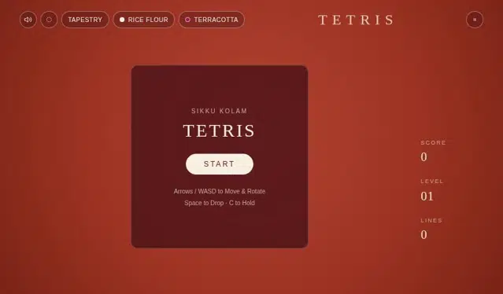 [试玩首页实截](<https://kolam-tetris.vercel.app>) | [NChandrasekharR/sikku-kolam-tetris](<https://github.com/NChandrasekharR/sikku-kolam-tetris>) | 常见根目录许可文件未找到 | 待核 | — | [可达 · 合集所列网页](<https://kolam-tetris.vercel.app>) |
| 2808 | [ ] | [Silly Point](<https://github.com/gamingnews5/awesome-opus-5.5-games/blob/9a29b570e56bd19f15a3cd6bbac0b8c682f2c48c/games/silly-point/readme.md>) | 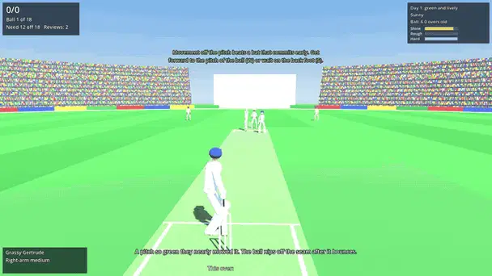 [上游动图截帧](<https://github.com/ahab94/silly-point/blob/main/docs/media/cover-drive.gif>) | [ahab94/silly-point](<https://github.com/ahab94/silly-point>) | 常见根目录许可文件未找到 | 待核 | [6.0](<https://github.com/ahab94/silly-point/blob/main/docs/media/cover-drive.gif>) | [可达 · 含游戏画布／引擎的网页](<https://ahab94.github.io/silly-point/>) |
| 2809 | [ ] | [SimCity (Bevy)](<https://github.com/gamingnews5/awesome-opus-5.5-games/blob/9a29b570e56bd19f15a3cd6bbac0b8c682f2c48c/games/simcity-bevy/readme.md>) | 待补截图 | [grgrwlkr/SimCity](<https://github.com/grgrwlkr/SimCity>) | 常见根目录许可文件未找到 | 待核 | — | 未列入口 |
| 2810 | [ ] | [Simon Says](<https://github.com/gamingnews5/awesome-opus-5.5-games/blob/9a29b570e56bd19f15a3cd6bbac0b8c682f2c48c/games/party-chaos/readme.md>) | 待补截图 | [lawrenceandrewlargo/roblox-extreme-minigames](<https://github.com/lawrenceandrewlargo/roblox-extreme-minigames>) | 常见根目录许可文件未找到 | 待核 | — | 未列入口 |
| 2811 | [ ] | [Single-Page Games](<https://github.com/gamingnews5/awesome-opus-5.5-games/blob/9a29b570e56bd19f15a3cd6bbac0b8c682f2c48c/games/single-page-games/readme.md>) | 待补截图 | [andiveloper/single-page-games](<https://github.com/andiveloper/single-page-games>) | 常见根目录许可文件未找到 | 待核 | — | [可达 · 合集所列网页](<https://andiveloper.github.io/single-page-games/>) |
| 2812 | [ ] | [SINGULARIDADE](<https://github.com/gamingnews5/awesome-opus-5.5-games/blob/9a29b570e56bd19f15a3cd6bbac0b8c682f2c48c/games/singularidade/readme.md>) | 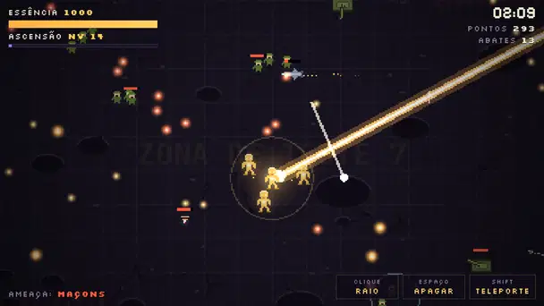 [合集截图](<https://github.com/Le-Jr/singularidade/blob/main/docs/img/beam.png>) | [Le-Jr/singularidade](<https://github.com/Le-Jr/singularidade>) | 常见根目录许可文件未找到 | 待核 | [6.6](<https://github.com/Le-Jr/singularidade/blob/main/docs/img/beam.png>) | [可达 · 含游戏画布／引擎的网页](<https://singularidade-nine.vercel.app>) |
| 2813 | [ ] | [Sir Noodle's Snack Quest](<https://github.com/gamingnews5/awesome-opus-5.5-games/blob/9a29b570e56bd19f15a3cd6bbac0b8c682f2c48c/games/sir-noodle-s-snack-quest/readme.md>) | 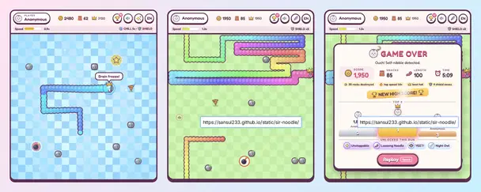 [合集截图](<https://github.com/Sansui233/sir-noodle-snack-quest/blob/main/docs/img/gallery.png>) | [Sansui233/sir-noodle-snack-quest](<https://github.com/Sansui233/sir-noodle-snack-quest>) | 常见根目录许可文件未找到 [Fredoka 字体为 OFL。](<https://github.com/Sansui233/sir-noodle-snack-quest/blob/HEAD/README.md#L57>) | 待核 | [5.4](<https://github.com/Sansui233/sir-noodle-snack-quest/blob/main/docs/img/gallery.png>) | [可达 · 含游戏画布／引擎的网页](<https://sansui233.github.io/static/sir-noodle/>) |
| 2814 | [ ] | [SirLocked](<https://github.com/gamingnews5/awesome-opus-5.5-games/blob/9a29b570e56bd19f15a3cd6bbac0b8c682f2c48c/games/sirlocked/readme.md>) | 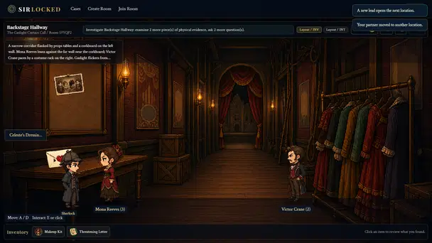 [上游游戏截图](<https://github.com/duongtuankiet-se/SirLocked/blob/HEAD/analysis/position-audit/screenshots/02-scene-backstage-hallway.png>) | [duongtuankiet-se/SirLocked](<https://github.com/duongtuankiet-se/SirLocked>) | 常见根目录许可文件未找到 | 待核 | — | 未列入口 |
| 2815 | [ ] | [Six Seconds of Sun](<https://github.com/gamingnews5/awesome-opus-5.5-games/blob/9a29b570e56bd19f15a3cd6bbac0b8c682f2c48c/games/six-seconds-of-sun/readme.md>) | 待补截图 | [adil-infosec/SIX-SECONDS-OF-SUN](<https://github.com/adil-infosec/SIX-SECONDS-OF-SUN>) | 常见根目录许可文件未找到 | 待核 | — | [可达 · 合集所列网页](<https://adil-infosec.github.io/SIX-SECONDS-OF-SUN/>) |
| 2816 | [ ] | [Skerry Light](<https://github.com/gamingnews5/awesome-opus-5.5-games/blob/9a29b570e56bd19f15a3cd6bbac0b8c682f2c48c/games/skerry-light/readme.md>) | 待补截图 | [OotBoot/skerry-light](<https://github.com/OotBoot/skerry-light>) | 常见根目录许可文件未找到 | [README 提及](<https://github.com/OotBoot/skerry-light/blob/HEAD/README.md#L37>) | — | 未列入口 |
| 2817 | [ ] | [SKIRM: modern tactical skirmish (proof of concept)](<https://github.com/gamingnews5/awesome-opus-5.5-games/blob/9a29b570e56bd19f15a3cd6bbac0b8c682f2c48c/games/skirm-modern-tactical-skirmish-proof-of-concept/readme.md>) | 待补截图 | [smiley-GPU/SKIRM](<https://github.com/smiley-GPU/SKIRM>) | 常见根目录许可文件未找到 | 待核 | — | [可达 · 合集所列网页](<https://smiley-gpu.github.io/SKIRM/>) |
| 2818 | [ ] | [Sky Dodge](<https://github.com/gamingnews5/awesome-opus-5.5-games/blob/9a29b570e56bd19f15a3cd6bbac0b8c682f2c48c/games/sky-dodge/readme.md>) | 待补截图 | [Hotshotted/sky-dodge](<https://github.com/Hotshotted/sky-dodge>) | 常见根目录许可文件未找到 | 待核 | — | 未列入口 |
| 2819 | [ ] | [Sky Flap](<https://github.com/gamingnews5/awesome-opus-5.5-games/blob/9a29b570e56bd19f15a3cd6bbac0b8c682f2c48c/games/sky-flap/readme.md>) |  [对应子游戏玩法实截](<https://github.com/gberry747-lab/gabriels-animation-studio/blob/HEAD/index.html>) | [gberry747-lab/gabriels-animation-studio](<https://github.com/gberry747-lab/gabriels-animation-studio>) | 常见根目录许可文件未找到 | 待核 | — | [多游戏仓库入口 · 可达 · 含游戏画布／引擎的网页](<https://gberry747-lab.github.io/gabriels-animation-studio/>) |
| 2820 | [ ] | [Sky Rings](<https://github.com/gamingnews5/awesome-opus-5.5-games/blob/9a29b570e56bd19f15a3cd6bbac0b8c682f2c48c/games/sky-rings/readme.md>) | 待补截图 | [hirosichen/ai-sky-rings-game](<https://github.com/hirosichen/ai-sky-rings-game>) | 常见根目录许可文件未找到 MIT代码，README另标three示例waternormals贴图MIT，仍保留原文件出处。 | 待核 | — | [可达 · 含游戏画布／引擎的网页](<https://vibe-sky-rings.pages.dev>) |
| 2821 | [ ] | [Sky Roadster](<https://github.com/gamingnews5/awesome-opus-5.5-games/blob/9a29b570e56bd19f15a3cd6bbac0b8c682f2c48c/games/sky-roadster/readme.md>) | 待补截图 | [xwaveglobal/xrush](<https://github.com/xwaveglobal/xrush>) | 常见根目录许可文件未找到 | 待核 | [6.8（原图失效）](<https://github.com/xwaveglobal/xrush/blob/main/assets-src/step03-2-vfx-references/XWAVE_Step03_2_VFX_Reference_Kit/03_camera/09_gameplay_balanced_camera.png>) | 未列入口 |
| 2822 | [ ] | [Sky Runner (prototip)](<https://github.com/gamingnews5/awesome-opus-5.5-games/blob/9a29b570e56bd19f15a3cd6bbac0b8c682f2c48c/games/sky-runner-prototip/readme.md>) | 待补截图 | [basarbellisan/Runny](<https://github.com/basarbellisan/Runny>) | 常见根目录许可文件未找到 | 待核 | — | [可达 · 含游戏画布／引擎的网页](<https://basarbellisan.github.io/Runny/>) |
| 2823 | [ ] | [Skybreak](<https://github.com/gamingnews5/awesome-opus-5.5-games/blob/9a29b570e56bd19f15a3cd6bbac0b8c682f2c48c/games/skybreak/readme.md>) | 待补截图 | [MikeSantonastaso/Skybreak](<https://github.com/MikeSantonastaso/Skybreak>) | 常见根目录许可文件未找到 | [README 提及、源码有输入读取](<https://github.com/MikeSantonastaso/Skybreak/blob/main/index.html#L2274>) | — | 未列入口 |
| 2824 | [ ] | [Skydive](<https://github.com/gamingnews5/awesome-opus-5.5-games/blob/9a29b570e56bd19f15a3cd6bbac0b8c682f2c48c/games/skydive/readme.md>) | 待补截图 | [Baeinsoo/LeagueOfPhysical-Client](<https://github.com/Baeinsoo/LeagueOfPhysical-Client>) | 常见根目录许可文件未找到 | 待核 | — | 未列入口 |
| 2825 | [ ] | [Skylance](<https://github.com/gamingnews5/awesome-opus-5.5-games/blob/9a29b570e56bd19f15a3cd6bbac0b8c682f2c48c/games/skylance/readme.md>) | 待补截图 | [sefner/skylance](<https://github.com/sefner/skylance>) | 常见根目录许可文件未找到 | 待核 | — | 未列入口 |
| 2826 | [ ] | [Skylark Run](<https://github.com/gamingnews5/awesome-opus-5.5-games/blob/9a29b570e56bd19f15a3cd6bbac0b8c682f2c48c/games/skylark-run/readme.md>) | 待补截图 | [jackpepper-vibe/SkylarkRun](<https://github.com/jackpepper-vibe/SkylarkRun>) | 常见根目录许可文件未找到 | 待核 | — | [可达 · 含游戏画布／引擎的网页](<https://skylark-run.vercel.app>) |
| 2827 | [ ] | [Skyward Aces](<https://github.com/gamingnews5/awesome-opus-5.5-games/blob/9a29b570e56bd19f15a3cd6bbac0b8c682f2c48c/games/skyward-aces/readme.md>) |  [源码运行首页](<https://github.com/xanderjt23-prog/Skyward-Aces/blob/main/index.html>) | [xanderjt23-prog/Skyward-Aces](<https://github.com/xanderjt23-prog/Skyward-Aces>) | 常见根目录许可文件未找到 | 待核 | — | 未列入口 |
| 2828 | [ ] | [slasher-1](<https://github.com/gamingnews5/awesome-opus-5.5-games/blob/9a29b570e56bd19f15a3cd6bbac0b8c682f2c48c/games/slasher-1/readme.md>) | 待补截图 | [trentteinert/slasher-1](<https://github.com/trentteinert/slasher-1>) | 常见根目录许可文件未找到 | 待核 | — | 未列入口 |
| 2829 | [ ] | [Slide &amp; Exit](<https://github.com/gamingnews5/awesome-opus-5.5-games/blob/9a29b570e56bd19f15a3cd6bbac0b8c682f2c48c/games/slide-exit/readme.md>) |  [对应子游戏玩法实截](<https://github.com/pawanp3/renderwolf-fable5-chart-toppers/blob/HEAD/games/block-out/index.html>) | [pawanp3/renderwolf-fable5-chart-toppers](<https://github.com/pawanp3/renderwolf-fable5-chart-toppers>) | 常见根目录许可文件未找到 | 待核 | — | [多游戏仓库入口 · 可达 · 合集所列网页](<https://pawanp3.github.io/renderwolf-fable5-chart-toppers/>) |
| 2830 | [ ] | [Slide Ice](<https://github.com/gamingnews5/awesome-opus-5.5-games/blob/9a29b570e56bd19f15a3cd6bbac0b8c682f2c48c/games/slide-ice/readme.md>) | 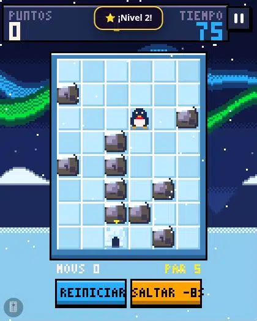 [对应子游戏玩法实截](<https://github.com/kokellara12-maker/apps-k4m9q2/blob/HEAD/slideice.html>) | [kokellara12-maker/apps-k4m9q2](<https://github.com/kokellara12-maker/apps-k4m9q2>) | 常见根目录许可文件未找到 | 待核 | — | [可达 · 含游戏画布／引擎的网页](<https://kokellara12-maker.github.io/apps-k4m9q2/slideice.html>) |
| 2831 | [ ] | [Slide Jigsaw](<https://github.com/gamingnews5/awesome-opus-5.5-games/blob/9a29b570e56bd19f15a3cd6bbac0b8c682f2c48c/games/slide-jigsaw/readme.md>) | 待补截图 | [Jinchaosss/slide-jigsaw](<https://github.com/Jinchaosss/slide-jigsaw>) | 常见根目录许可文件未找到 | 待核 | — | 未列入口 |
| 2832 | [ ] | [Slide Maze](<https://github.com/gamingnews5/awesome-opus-5.5-games/blob/9a29b570e56bd19f15a3cd6bbac0b8c682f2c48c/games/slide-maze/readme.md>) | 待补截图 | [dcl-regenesislabs/Slide-Maze](<https://github.com/dcl-regenesislabs/Slide-Maze>) | 常见根目录许可文件未找到 | 待核 | [6.0](<https://github.com/dcl-regenesislabs/Slide-Maze/blob/main/assets/images/SlideMazeeTHumbnail.png>) | 未列入口 |
| 2833 | [ ] | [Slide Rush](<https://github.com/gamingnews5/awesome-opus-5.5-games/blob/9a29b570e56bd19f15a3cd6bbac0b8c682f2c48c/games/slide-rush/readme.md>) | 待补截图 | [KJLKurt/waterslide-game-opus-5.5](<https://github.com/KJLKurt/waterslide-game-opus-5.5>) | 常见根目录许可文件未找到 已查当前源码树，未发现根许可证文件，不视为可自由再分发 | [README 提及](<https://github.com/KJLKurt/waterslide-game-opus-5.5/blob/HEAD/README.md#L11>) | — | [可达 · 含游戏画布／引擎的网页](<https://kjlkurt.github.io/waterslide-game-opus-5.5/>) |
| 2834 | [ ] | [Slime Heist: Steal and Merge](<https://github.com/gamingnews5/awesome-opus-5.5-games/blob/9a29b570e56bd19f15a3cd6bbac0b8c682f2c48c/games/slime-heist-steal-and-merge/readme.md>) | 待补截图 | [Matthew-Uhlar/Roblox-Test](<https://github.com/Matthew-Uhlar/Roblox-Test>) | 常见根目录许可文件未找到 | 待核 | — | 未列入口 |
| 2835 | [ ] | [Slime Push](<https://github.com/gamingnews5/awesome-opus-5.5-games/blob/9a29b570e56bd19f15a3cd6bbac0b8c682f2c48c/games/slime-push/readme.md>) | 待补截图 | [shrieeiee/Slime-push](<https://github.com/shrieeiee/Slime-push>) | 常见根目录许可文件未找到 | [README 提及](<https://github.com/shrieeiee/Slime-push/blob/HEAD/README.md#L72>) | — | [可达 · 素材／第三方资源](<https://not-jam.itch.io/not-jam-music-pack-2>) |
| 2836 | [ ] | [SlimeMania](<https://github.com/gamingnews5/awesome-opus-5.5-games/blob/9a29b570e56bd19f15a3cd6bbac0b8c682f2c48c/games/slimemania/readme.md>) | 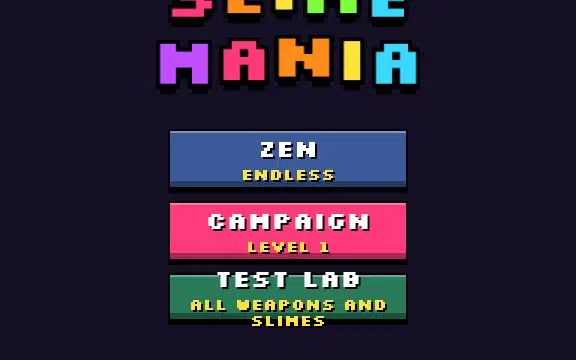 [源码运行首页](<https://github.com/graphoflife/SlimeMania/blob/main/index.html>) | [graphoflife/SlimeMania](<https://github.com/graphoflife/SlimeMania>) | 常见根目录许可文件未找到 | 待核 | — | 未列入口 |
| 2837 | [ ] | [Slipstream](<https://github.com/gamingnews5/awesome-opus-5.5-games/blob/9a29b570e56bd19f15a3cd6bbac0b8c682f2c48c/games/slipstream/readme.md>) | 待补截图 | [KJLKurt/waterslide-game-gpt-6.1-sol](<https://github.com/KJLKurt/waterslide-game-gpt-6.1-sol>) | 常见根目录许可文件未找到 | 待核 | — | [可达 · 含游戏画布／引擎的网页](<https://kjlkurt.github.io/waterslide-game-gpt-6.1-sol/>) |
| 2838 | [ ] | [Slipstream (cckhaw)](<https://github.com/gamingnews5/awesome-opus-5.5-games/blob/9a29b570e56bd19f15a3cd6bbac0b8c682f2c48c/games/slipstream-cckhaw/readme.md>) | 待补截图 | [cckhaw/slipstream](<https://github.com/cckhaw/slipstream>) | 常见根目录许可文件未找到 | 待核 | — | [可达 · 合集所列网页](<https://slipstream-theta-seven.vercel.app>) |
| 2839 | [ ] | [Smack](<https://github.com/gamingnews5/awesome-opus-5.5-games/blob/9a29b570e56bd19f15a3cd6bbac0b8c682f2c48c/games/smack/readme.md>) | 待补截图 | [NIGHT-Official/Spider-Smack](<https://github.com/NIGHT-Official/Spider-Smack>) | 常见根目录许可文件未找到 | 待核 | — | 未列入口 |
| 2840 | [ ] | [Small Games](<https://github.com/gamingnews5/awesome-opus-5.5-games/blob/9a29b570e56bd19f15a3cd6bbac0b8c682f2c48c/games/small-games/readme.md>) | 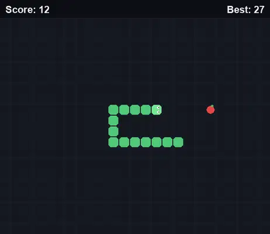 [合集截图](<https://github.com/ghostinmachinefr/small-games/blob/main/site/images/snake.png>) | [ghostinmachinefr/small-games](<https://github.com/ghostinmachinefr/small-games>) | 常见根目录许可文件未找到 | 待核 | [4.4](<https://github.com/ghostinmachinefr/small-games/blob/main/site/images/snake.png>) | [可达 · 合集所列网页](<https://gandalfgames.netlify.app>) |
| 2841 | [ ] | [Small Plates](<https://github.com/gamingnews5/awesome-opus-5.5-games/blob/9a29b570e56bd19f15a3cd6bbac0b8c682f2c48c/games/small-plates/readme.md>) | 待补截图 | [DotAwkward/small-plates](<https://github.com/DotAwkward/small-plates>) | 常见根目录许可文件未找到 | 待核 | — | 未列入口 |
| 2842 | [ ] | [Smallest Thing](<https://github.com/gamingnews5/awesome-opus-5.5-games/blob/9a29b570e56bd19f15a3cd6bbac0b8c682f2c48c/games/smallest-thing/readme.md>) | 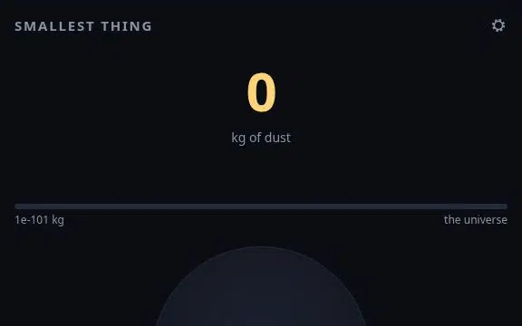 [同款源码网页实截](<https://github.com/jackkav/tiny-idle/blob/HEAD/index.html>) | [jackkav/tiny-idle](<https://github.com/jackkav/tiny-idle>) | 常见根目录许可文件未找到 | 待核 | — | [可达 · 合集所列网页](<https://jackkav.github.io/tiny-idle/>) |
| 2843 | [ ] | [Smallscale](<https://github.com/gamingnews5/awesome-opus-5.5-games/blob/9a29b570e56bd19f15a3cd6bbac0b8c682f2c48c/games/smallscale/readme.md>) | 待补截图 | [DHex1401/SmallScale](<https://github.com/DHex1401/SmallScale>) | 常见根目录许可文件未找到 | 待核 | — | 未列入口 |
| 2844 | [ ] | [Smash](<https://github.com/gamingnews5/awesome-opus-5.5-games/blob/9a29b570e56bd19f15a3cd6bbac0b8c682f2c48c/games/smash/readme.md>) | 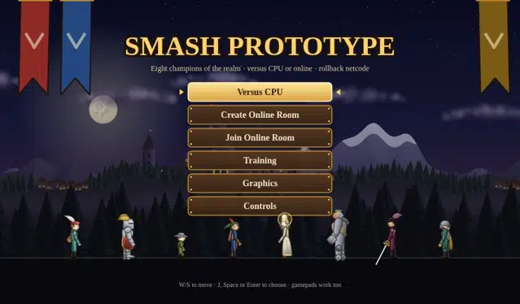 [试玩首页实截](<https://vaprin32.github.io/smash/>) | [Vaprin32/smash](<https://github.com/Vaprin32/smash>) | 常见根目录许可文件未找到 | [README 提及](<https://github.com/Vaprin32/smash/blob/HEAD/README.md#L122>) | — | [可达 · 含游戏画布／引擎的网页](<https://vaprin32.github.io/smash/>) |
| 2845 | [ ] | [Smash Karts Arena](<https://github.com/gamingnews5/awesome-opus-5.5-games/blob/9a29b570e56bd19f15a3cd6bbac0b8c682f2c48c/games/smash-karts-arena/readme.md>) | 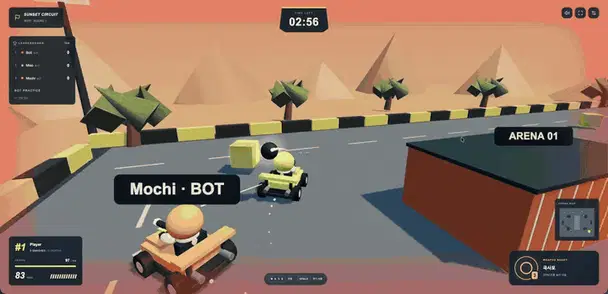 [上游动图截帧](<https://github.com/amsminn/gpt-6-astra-smash-karts/blob/main/docs/media/gameplay.gif>) | [amsminn/gpt-6-astra-smash-karts](<https://github.com/amsminn/gpt-6-astra-smash-karts>) | 常见根目录许可文件未找到 | 待核 | [7.5](<https://github.com/amsminn/gpt-6-astra-smash-karts/blob/main/docs/media/gameplay.gif>) | 未列入口 |
| 2846 | [ ] | [Smoke's Big Adventure](<https://github.com/gamingnews5/awesome-opus-5.5-games/blob/9a29b570e56bd19f15a3cd6bbac0b8c682f2c48c/games/smoke-s-big-adventure/readme.md>) | 待补截图 | [followanton/smokes-big-adventure](<https://github.com/followanton/smokes-big-adventure>) | 常见根目录许可文件未找到 | 待核 | — | [可达 · 含游戏画布／引擎的网页](<https://smokes-grote-avontuur.onrender.com>) |
| 2847 | [ ] | [SMOKESTACK](<https://github.com/gamingnews5/awesome-opus-5.5-games/blob/9a29b570e56bd19f15a3cd6bbac0b8c682f2c48c/games/smokestack/readme.md>) | 待补截图 | [pf1991/smokestack](<https://github.com/pf1991/smokestack>) | 常见根目录许可文件未找到 | 待核 | — | [可达 · 含游戏画布／引擎的网页](<https://pf1991.github.io/smokestack/>) |
| 2848 | [ ] | [Snack Attack](<https://github.com/gamingnews5/awesome-opus-5.5-games/blob/9a29b570e56bd19f15a3cd6bbac0b8c682f2c48c/games/snack-attack/readme.md>) | 待补截图 | [mirrash7/Games](<https://github.com/mirrash7/Games>) | 常见根目录许可文件未找到 | 待核 | — | 未列入口 |
| 2849 | [ ] | [Snake](<https://github.com/gamingnews5/awesome-opus-5.5-games/blob/9a29b570e56bd19f15a3cd6bbac0b8c682f2c48c/games/snake/readme.md>) | 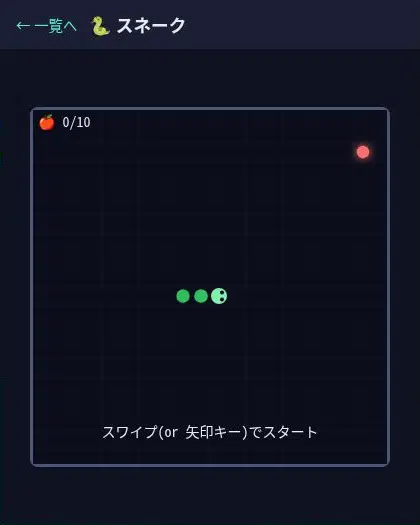 [对应子游戏玩法实截](<https://github.com/shironagasu-ai/claude-fable5-games/blob/HEAD/games/snake/index.html>) | [shironagasu-ai/claude-fable5-games](<https://github.com/shironagasu-ai/claude-fable5-games>) | 常见根目录许可文件未找到 | 待核 | — | 未列入口 |
| 2850 | [ ] | [Snake (multiplayer)](<https://github.com/gamingnews5/awesome-opus-5.5-games/blob/9a29b570e56bd19f15a3cd6bbac0b8c682f2c48c/games/snake-multiplayer/readme.md>) | <a href="https://raw.githubusercontent.com/gyuha/snake/HEAD/docs/images/status-running.png">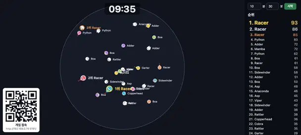</a> [README 游戏截图](<https://github.com/gyuha/snake#readme>) | [gyuha/snake](<https://github.com/gyuha/snake>) | 常见根目录许可文件未找到 | 待核 | — | 未列入口 |
| 2851 | [ ] | [Snake for the Picocomputer 6502](<https://github.com/gamingnews5/awesome-opus-5.5-games/blob/9a29b570e56bd19f15a3cd6bbac0b8c682f2c48c/games/snake-for-the-picocomputer-6502/readme.md>) | 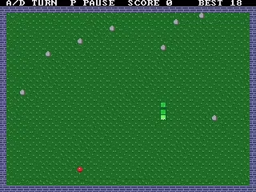 [合集截图](<https://github.com/ulften/snake6502/blob/main/docs/screenshot.png>) | [ulften/snake6502](<https://github.com/ulften/snake6502>) | 常见根目录许可文件未找到 | 待核 | [4.0](<https://github.com/ulften/snake6502/blob/main/docs/screenshot.png>) | [可达 · 合集所列网页](<https://picocomputer.github.io/>) |
| 2852 | [ ] | [Snake Slither](<https://github.com/gamingnews5/awesome-opus-5.5-games/blob/9a29b570e56bd19f15a3cd6bbac0b8c682f2c48c/games/snake-slither/readme.md>) | 待补截图 | [Marcus101RR/snake-slither](<https://github.com/Marcus101RR/snake-slither>) | 常见根目录许可文件未找到 | 待核 | — | 未列入口 |
| 2853 | [ ] | [SNAKE'D](<https://github.com/gamingnews5/awesome-opus-5.5-games/blob/9a29b570e56bd19f15a3cd6bbac0b8c682f2c48c/games/snake-d/readme.md>) | 待补截图 | [natemiller39/Snake-D](<https://github.com/natemiller39/Snake-D>) | 常见根目录许可文件未找到 | 待核 | — | [可达 · 合集所列网页](<https://natemiller39.github.io/Snake-D/>) |
| 2854 | [ ] | [Snake3D](<https://github.com/gamingnews5/awesome-opus-5.5-games/blob/9a29b570e56bd19f15a3cd6bbac0b8c682f2c48c/games/snake3d/readme.md>) | 待补截图 | [yJulian/snake3d](<https://github.com/yJulian/snake3d>) | 常见根目录许可文件未找到 | [README 提及](<https://github.com/yJulian/snake3d/blob/HEAD/README.md#L21>) | — | [可达 · 合集所列网页](<https://yjulian.github.io/snake3d/>) |
| 2855 | [ ] | [Snakes &amp; Liquor 🐍🥃](<https://github.com/gamingnews5/awesome-opus-5.5-games/blob/9a29b570e56bd19f15a3cd6bbac0b8c682f2c48c/games/snakes-liquor/readme.md>) | 待补截图 | [bilbiall/SNL](<https://github.com/bilbiall/SNL>) | 常见根目录许可文件未找到 | 待核 | — | 未列入口 |
| 2856 | [ ] | [Snakes and Ladders](<https://github.com/gamingnews5/awesome-opus-5.5-games/blob/9a29b570e56bd19f15a3cd6bbac0b8c682f2c48c/games/snakes-and-ladders/readme.md>) | 待补截图 | [eyal12345/Snakes-and-Ladders](<https://github.com/eyal12345/Snakes-and-Ladders>) | 常见根目录许可文件未找到 | 待核 | — | 未列入口 |
| 2857 | [ ] | [Snaketris](<https://github.com/gamingnews5/awesome-opus-5.5-games/blob/9a29b570e56bd19f15a3cd6bbac0b8c682f2c48c/games/snaketris/readme.md>) | 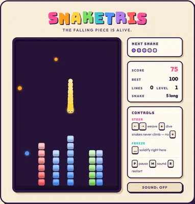 [合集截图](<https://github.com/markstent/snaketris/blob/main/screenshot.png>) | [markstent/snaketris](<https://github.com/markstent/snaketris>) | 常见根目录许可文件未找到 | 待核 | [6.7](<https://github.com/markstent/snaketris/blob/main/screenshot.png>) | [可达 · 含游戏画布／引擎的网页](<https://markstent.github.io/snaketris/>) |
| 2858 | [ ] | [SNAP IQ](<https://github.com/gamingnews5/awesome-opus-5.5-games/blob/9a29b570e56bd19f15a3cd6bbac0b8c682f2c48c/games/snap-iq/readme.md>) | 待补截图 | [gevagit/snap-iq](<https://github.com/gevagit/snap-iq>) | 常见根目录许可文件未找到 | 待核 | [4.4](<https://github.com/gevagit/snap-iq/blob/main/shots/mesh-c2-a.png>) | 未列入口 |
| 2859 | [ ] | [SnapShoot Classic](<https://github.com/gamingnews5/awesome-opus-5.5-games/blob/9a29b570e56bd19f15a3cd6bbac0b8c682f2c48c/games/snapshoot-classic/readme.md>) |  [上游游戏截图](<https://github.com/inticoy/snapshoot-classic/blob/HEAD/docs/screenshots/back-closeup.png>) | [inticoy/snapshoot-classic](<https://github.com/inticoy/snapshoot-classic>) | 常见根目录许可文件未找到 | [README 提及](<https://github.com/inticoy/snapshoot-classic/blob/HEAD/README.md#L104>) | — | [可达 · 含游戏画布／引擎的网页](<https://inticoy.github.io/snapshoot-classic/>) |
| 2860 | [ ] | [Sneaky Kryptid's Spooky Claw](<https://github.com/gamingnews5/awesome-opus-5.5-games/blob/9a29b570e56bd19f15a3cd6bbac0b8c682f2c48c/games/sneaky-kryptid-s-spooky-claw/readme.md>) |  [合集截图](<https://github.com/Ant-DeGeorge/sneaky-kryptids-spooky-claw/blob/main/docs/media/worlds.png>) | [Ant-DeGeorge/sneaky-kryptids-spooky-claw](<https://github.com/Ant-DeGeorge/sneaky-kryptids-spooky-claw>) | 常见根目录许可文件未找到 | 待核 | [5.5](<https://github.com/Ant-DeGeorge/sneaky-kryptids-spooky-claw/blob/main/docs/media/worlds.png>) | [可达 · 含游戏画布／引擎的网页](<https://ant-degeorge.github.io/sneaky-kryptids-spooky-claw/>) |
| 2861 | [ ] | [snek](<https://github.com/gamingnews5/awesome-opus-5.5-games/blob/9a29b570e56bd19f15a3cd6bbac0b8c682f2c48c/games/snek/readme.md>) | 待补截图 | [scottmccarrison/snek](<https://github.com/scottmccarrison/snek>) | 常见根目录许可文件未找到 | 待核 | — | [可达 · 合集所列网页](<https://mccarrison.me/snek/>) |
| 2862 | [ ] | [Sniped](<https://github.com/gamingnews5/awesome-opus-5.5-games/blob/9a29b570e56bd19f15a3cd6bbac0b8c682f2c48c/games/sniped/readme.md>) | 待补截图 | [NotStud/PsuHackathon](<https://github.com/NotStud/PsuHackathon>) | 常见根目录许可文件未找到 | 待核 | — | 未列入口 |
| 2863 | [ ] | [Snowball Effect](<https://github.com/gamingnews5/awesome-opus-5.5-games/blob/9a29b570e56bd19f15a3cd6bbac0b8c682f2c48c/games/snowball-effect/readme.md>) | 待补截图 | [bpachniewsk1/snowball-effect](<https://github.com/bpachniewsk1/snowball-effect>) | 常见根目录许可文件未找到 | 待核 | — | 未列入口 |
| 2864 | [ ] | [Snowshooter](<https://github.com/gamingnews5/awesome-opus-5.5-games/blob/9a29b570e56bd19f15a3cd6bbac0b8c682f2c48c/games/snowshooter/readme.md>) | 待补截图 | [jussirantala/snowshooter](<https://github.com/jussirantala/snowshooter>) | 常见根目录许可文件未找到 | 待核 | — | 未列入口 |
| 2865 | [ ] | [Social Ace](<https://github.com/gamingnews5/awesome-opus-5.5-games/blob/9a29b570e56bd19f15a3cd6bbac0b8c682f2c48c/games/social-ace/readme.md>) | 待补截图 | [cjs1218/Social-ace](<https://github.com/cjs1218/Social-ace>) | 常见根目录许可文件未找到 | 待核 | — | 未列入口 |
| 2866 | [ ] | [Sock Run](<https://github.com/gamingnews5/awesome-opus-5.5-games/blob/9a29b570e56bd19f15a3cd6bbac0b8c682f2c48c/games/sock-run/readme.md>) | 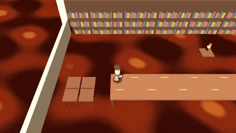 [上游动图截帧](<https://github.com/ahab94/sock-run/blob/main/docs/media/sock-run.gif>) | [ahab94/sock-run](<https://github.com/ahab94/sock-run>) | 常见根目录许可文件未找到 | 待核 | [5.0](<https://github.com/ahab94/sock-run/blob/main/docs/media/sock-run.gif>) | [可达 · 含游戏画布／引擎的网页](<https://ahab94.github.io/sock-run/>) |
| 2867 | [ ] | [Solar Salesman](<https://github.com/gamingnews5/awesome-opus-5.5-games/blob/9a29b570e56bd19f15a3cd6bbac0b8c682f2c48c/games/solar-salesman/readme.md>) |  [源码运行首页](<https://github.com/LTSAndrew/solar-salesman/blob/main/index.html>) | [LTSAndrew/solar-salesman](<https://github.com/LTSAndrew/solar-salesman>) | 常见根目录许可文件未找到 | 待核 | — | [README · 入口已失效 · 上游 README 所列网页](<https://ltsandrew.github.io/solar-salesman/>) |
| 2868 | [ ] | [Solar System Scavenger Hunt](<https://github.com/gamingnews5/awesome-opus-5.5-games/blob/9a29b570e56bd19f15a3cd6bbac0b8c682f2c48c/games/solar-system-scavenger-hunt/readme.md>) |  [源码运行首页](<https://github.com/mmisbaah/solar-system-scavenger-hunt/blob/main/index.html>) | [mmisbaah/solar-system-scavenger-hunt](<https://github.com/mmisbaah/solar-system-scavenger-hunt>) | 常见根目录许可文件未找到 | 待核 | — | 未列入口 |
| 2869 | [ ] | [Soldat Remake](<https://github.com/gamingnews5/awesome-opus-5.5-games/blob/9a29b570e56bd19f15a3cd6bbac0b8c682f2c48c/games/soldat-remake/readme.md>) | 待补截图 | [leonardo-merlo/soldat-remake](<https://github.com/leonardo-merlo/soldat-remake>) | 常见根目录许可文件未找到 | 待核 | — | [可达 · 含游戏画布／引擎的网页](<https://soldat-remake.vercel.app>) |
| 2870 | [ ] | [solitaire n' chill](<https://github.com/gamingnews5/awesome-opus-5.5-games/blob/9a29b570e56bd19f15a3cd6bbac0b8c682f2c48c/games/solitaire-n-chill/readme.md>) | 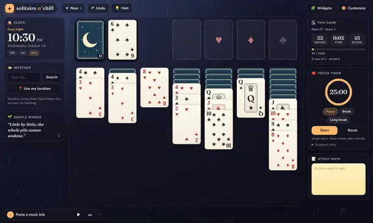 [上游游戏截图](<https://github.com/mjramos86/solitaire-n-chill/blob/HEAD/docs/screenshot.png>) | [mjramos86/solitaire-n-chill](<https://github.com/mjramos86/solitaire-n-chill>) | 常见根目录许可文件未找到 | [README 提及](<https://github.com/mjramos86/solitaire-n-chill/blob/HEAD/README.md#L63>) | — | 未列入口 |
| 2871 | [ ] | [Soliter](<https://github.com/gamingnews5/awesome-opus-5.5-games/blob/9a29b570e56bd19f15a3cd6bbac0b8c682f2c48c/games/soliter/readme.md>) | 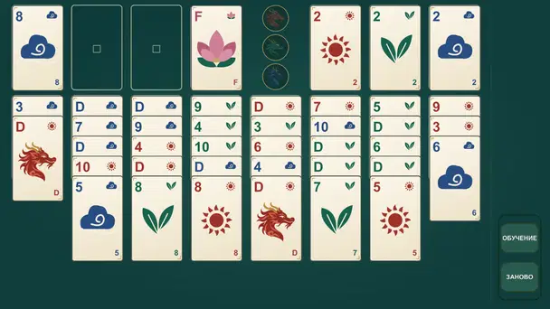 [上游游戏截图](<https://github.com/ErrorSoul/soliter/blob/HEAD/design/yandex-jade-1103/upload/screenshots/desktop/02-move.png>) | [ErrorSoul/soliter](<https://github.com/ErrorSoul/soliter>) | 常见根目录许可文件未找到 | 待核 | — | 未列入口 |
| 2872 | [ ] | [Somefish](<https://github.com/gamingnews5/awesome-opus-5.5-games/blob/9a29b570e56bd19f15a3cd6bbac0b8c682f2c48c/games/somefish/readme.md>) | 待补截图 | [thesigns/Somefish](<https://github.com/thesigns/Somefish>) | 常见根目录许可文件未找到 | 待核 | — | [可达 · 含游戏画布／引擎的网页](<https://thesigns.github.io/Somefish/>) |
| 2873 | [ ] | [something-cool](<https://github.com/gamingnews5/awesome-opus-5.5-games/blob/9a29b570e56bd19f15a3cd6bbac0b8c682f2c48c/games/something-cool/readme.md>) | 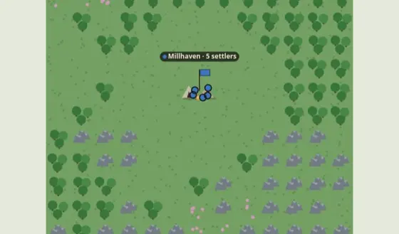 [源码网页实截](<https://github.com/jordanlee124/something-cool/blob/main/ember-vale.html>) | [jordanlee124/something-cool](<https://github.com/jordanlee124/something-cool>) | 常见根目录许可文件未找到 | 待核 | — | 未列入口 |
| 2874 | [ ] | [Sonar Maze](<https://github.com/gamingnews5/awesome-opus-5.5-games/blob/9a29b570e56bd19f15a3cd6bbac0b8c682f2c48c/games/sonar-maze/readme.md>) | 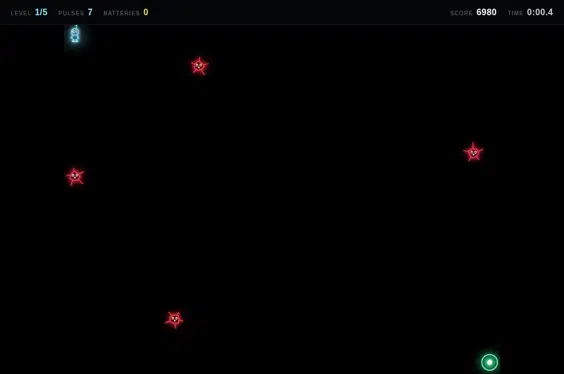 [试玩画面](<https://endurovojta173.github.io/Sonar_Maze_Profiq_Contest/>) | [endurovojta173/Sonar\_Maze\_Profiq\_Contest](<https://github.com/endurovojta173/Sonar_Maze_Profiq_Contest>) | 常见根目录许可文件未找到 | 待核 | — | [可达 · 含游戏画布／引擎的网页](<https://endurovojta173.github.io/Sonar_Maze_Profiq_Contest/>) |
| 2875 | [ ] | [Sonnet 5.5 Chess](<https://github.com/gamingnews5/awesome-opus-5.5-games/blob/9a29b570e56bd19f15a3cd6bbac0b8c682f2c48c/games/sonnet-5-5-chess/readme.md>) | 待补截图 | [stevemaughan/sonnet-5.5-chess-24hrs](<https://github.com/stevemaughan/sonnet-5.5-chess-24hrs>) | 常见根目录许可文件未找到 | 待核 | — | 未列入口 |
| 2876 | [ ] | [Sorcerer's Maze PC port](<https://github.com/gamingnews5/awesome-opus-5.5-games/blob/9a29b570e56bd19f15a3cd6bbac0b8c682f2c48c/games/sorcerer-s-maze-pc-port/readme.md>) | <a href="https://raw.githubusercontent.com/Bitsandbreakpoints/sorcerers-maze-psx-pc-recomp/HEAD/images/puzzle.png">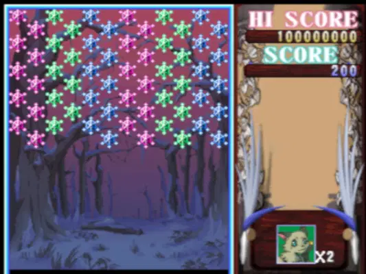</a> [README 游戏截图](<https://github.com/Bitsandbreakpoints/sorcerers-maze-psx-pc-recomp#readme>) | [Bitsandbreakpoints/sorcerers-maze-psx-pc-recomp](<https://github.com/Bitsandbreakpoints/sorcerers-maze-psx-pc-recomp>) | 常见根目录许可文件未找到 | [README 提及](<https://github.com/Bitsandbreakpoints/sorcerers-maze-psx-pc-recomp/blob/HEAD/README.md#L94>) | — | 未列入口 |
| 2877 | [ ] | [Sorry! — The Game](<https://github.com/gamingnews5/awesome-opus-5.5-games/blob/9a29b570e56bd19f15a3cd6bbac0b8c682f2c48c/games/sorry-the-game/readme.md>) | 待补截图 | [DrTBaylor/tempquizzes](<https://github.com/DrTBaylor/tempquizzes>) | 常见根目录许可文件未找到 | 待核 | — | [可达 · 合集所列网页](<https://drtbaylor.github.io/tempquizzes/infographics/sorry-simulation.html>) |
| 2878 | [ ] | [Soul Monster](<https://github.com/gamingnews5/awesome-opus-5.5-games/blob/9a29b570e56bd19f15a3cd6bbac0b8c682f2c48c/games/soul-monster/readme.md>) | 待补截图 | [rikiprimus/Soul-Kingdom](<https://github.com/rikiprimus/Soul-Kingdom>) | 常见根目录许可文件未找到 | 待核 | — | 未列入口 |
| 2879 | [ ] | [Sound Maze](<https://github.com/gamingnews5/awesome-opus-5.5-games/blob/9a29b570e56bd19f15a3cd6bbac0b8c682f2c48c/games/sound-maze/readme.md>) | 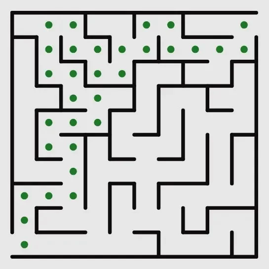 [实玩第四关后揭晓的迷宫和行动轨迹](<https://github.com/Swayam89/sound-maze/blob/main/play/index.html>) | [Swayam89/sound-maze](<https://github.com/Swayam89/sound-maze>) | 常见根目录许可文件未找到 | 待核 | — | 未列入口 |
| 2880 | [ ] | [Sound Rocket](<https://github.com/gamingnews5/awesome-opus-5.5-games/blob/9a29b570e56bd19f15a3cd6bbac0b8c682f2c48c/games/sound-rocket/readme.md>) | 待补截图 | [rgupta42-del/Sound-rocket](<https://github.com/rgupta42-del/Sound-rocket>) | 常见根目录许可文件未找到 | 待核 | — | [可达 · 含游戏画布／引擎的网页](<https://rgupta42-del.github.io/Sound-rocket/>) |
| 2881 | [ ] | [Soundlings](<https://github.com/gamingnews5/awesome-opus-5.5-games/blob/9a29b570e56bd19f15a3cd6bbac0b8c682f2c48c/games/soundlings/readme.md>) | 待补截图 | [brendanreid-droid/phonics-game](<https://github.com/brendanreid-droid/phonics-game>) | 常见根目录许可文件未找到 | 待核 | — | 未列入口 |
| 2882 | [ ] | [Space Attack](<https://github.com/gamingnews5/awesome-opus-5.5-games/blob/9a29b570e56bd19f15a3cd6bbac0b8c682f2c48c/games/space-attack/readme.md>) | 待补截图 | [vannorman/space\_attack](<https://github.com/vannorman/space_attack>) | 常见根目录许可文件未找到 | 待核 | — | [入口已失效 · 合集所列网页](<https://vannorman.github.io/space_attack/>) |
| 2883 | [ ] | [Space Crates](<https://github.com/gamingnews5/awesome-opus-5.5-games/blob/9a29b570e56bd19f15a3cd6bbac0b8c682f2c48c/games/space-crates/readme.md>) | 待补截图 | [whomason/space-case](<https://github.com/whomason/space-case>) | 常见根目录许可文件未找到 | 待核 | — | [README · 可达 · 含游戏画布／引擎的网页](<https://spacecrates.net/>) |
| 2884 | [ ] | [Space Impact](<https://github.com/gamingnews5/awesome-opus-5.5-games/blob/9a29b570e56bd19f15a3cd6bbac0b8c682f2c48c/games/space-impact/readme.md>) | 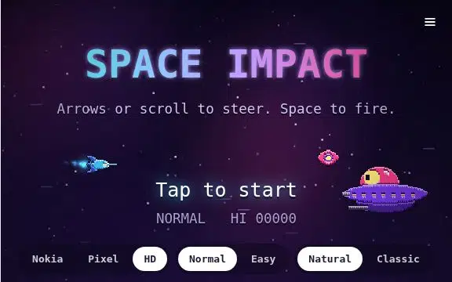 [源码运行首页](<https://github.com/JannikArndt/spaceimpact/blob/main/public/index.html>) | [JannikArndt/spaceimpact](<https://github.com/JannikArndt/spaceimpact>) | 常见根目录许可文件未找到 | 待核 | — | 未列入口 |
| 2885 | [ ] | [Space Invader Rougelike](<https://github.com/gamingnews5/awesome-opus-5.5-games/blob/9a29b570e56bd19f15a3cd6bbac0b8c682f2c48c/games/space-invader-rougelike/readme.md>) | 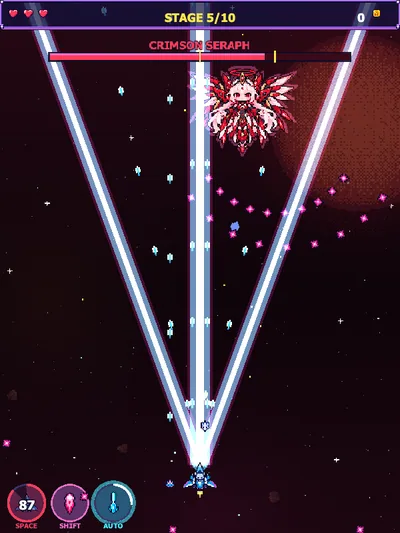 [上游游戏截图](<https://github.com/ToEzBit/space-invader-rougelike/blob/HEAD/docs/screenshots/boss.png>) | [ToEzBit/space-invader-rougelike](<https://github.com/ToEzBit/space-invader-rougelike>) | 常见根目录许可文件未找到 | 待核 | — | [README · 可达 · 上游 README 所列网页](<https://space-invader-rougelike.netlify.app/>) |
| 2886 | [ ] | [Space Shooter](<https://github.com/gamingnews5/awesome-opus-5.5-games/blob/9a29b570e56bd19f15a3cd6bbac0b8c682f2c48c/games/space-shooter/readme.md>) |  [源码运行首页](<https://github.com/jansmakr/space-shooter-web/blob/main/index.html>) | [jansmakr/space-shooter-web](<https://github.com/jansmakr/space-shooter-web>) | 常见根目录许可文件未找到 | 待核 | — | 未列入口 |
| 2887 | [ ] | [Space Shooter X](<https://github.com/gamingnews5/awesome-opus-5.5-games/blob/9a29b570e56bd19f15a3cd6bbac0b8c682f2c48c/games/space-shooter-x/readme.md>) | 待补截图 | [guetgr/SpaceShooterX](<https://github.com/guetgr/SpaceShooterX>) | 常见根目录许可文件未找到 | 待核 | — | [可达 · 含游戏画布／引擎的网页](<https://spaceshooterx-swart.vercel.app>) |
| 2888 | [ ] | [Space Showdown](<https://github.com/gamingnews5/awesome-opus-5.5-games/blob/9a29b570e56bd19f15a3cd6bbac0b8c682f2c48c/games/space-showdown/readme.md>) | 待补截图 | [GeorgeCottrell/SpaceShowdown](<https://github.com/GeorgeCottrell/SpaceShowdown>) | 常见根目录许可文件未找到 | 待核 | — | 未列入口 |
| 2889 | [ ] | [Spaceblast](<https://github.com/gamingnews5/awesome-opus-5.5-games/blob/9a29b570e56bd19f15a3cd6bbac0b8c682f2c48c/games/spaceblast/readme.md>) | 待补截图 | [refinkurn/Spaceblast](<https://github.com/refinkurn/Spaceblast>) | 常见根目录许可文件未找到 | 待核 | — | [README · 可达 · 含游戏画布／引擎的网页](<https://spaceblast.vercel.app>) |
| 2890 | [ ] | [Spaceships](<https://github.com/gamingnews5/awesome-opus-5.5-games/blob/9a29b570e56bd19f15a3cd6bbac0b8c682f2c48c/games/spaceships/readme.md>) | 待补截图 | [JakeAve/airgap](<https://github.com/JakeAve/airgap>) | 常见根目录许可文件未找到 | 待核 | — | [多游戏仓库入口 · 可达 · 合集所列网页](<https://jakeave.github.io/airgap/>) |
| 2891 | [ ] | [Spade Haven — online Spades (Vite + React + TypeScript)](<https://github.com/gamingnews5/awesome-opus-5.5-games/blob/9a29b570e56bd19f15a3cd6bbac0b8c682f2c48c/games/spade-haven-online-spades-vite-react-typescript/readme.md>) | 待补截图 | [savio786/spade-royale](<https://github.com/savio786/spade-royale>) | 常见根目录许可文件未找到 | 待核 | — | [可达 · 项目说明／规则页](<https://spade-haven.onrender.com/#privacy>) |
| 2892 | [ ] | [Speak Up Express](<https://github.com/gamingnews5/awesome-opus-5.5-games/blob/9a29b570e56bd19f15a3cd6bbac0b8c682f2c48c/games/speak-up-express/readme.md>) | 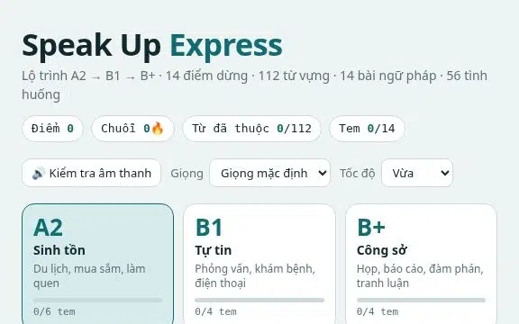 [源码运行首页](<https://github.com/huynhthikimtho1310-cmd/speak-up/blob/main/index.html>) | [huynhthikimtho1310-cmd/speak-up](<https://github.com/huynhthikimtho1310-cmd/speak-up>) | 常见根目录许可文件未找到 | 待核 | — | 未列入口 |
| 2893 | [ ] | [Special Prompt Strategy Game](<https://github.com/gamingnews5/awesome-opus-5.5-games/blob/9a29b570e56bd19f15a3cd6bbac0b8c682f2c48c/games/special-prompt-strategy-game/readme.md>) |  [源码运行首页](<https://github.com/Barty-Bart/opus-55-effort-comparison/blob/main/games/special/index.html>) | [Barty-Bart/opus-55-effort-comparison](<https://github.com/Barty-Bart/opus-55-effort-comparison>) | 常见根目录许可文件未找到 | 待核 | — | 未列入口 |
| 2894 | [ ] | [Speckle](<https://github.com/gamingnews5/awesome-opus-5.5-games/blob/9a29b570e56bd19f15a3cd6bbac0b8c682f2c48c/games/speckle/readme.md>) | 待补截图 | [joe-sdc/speckle](<https://github.com/joe-sdc/speckle>) | 常见根目录许可文件未找到 | 待核 | — | 未列入口 |
| 2895 | [ ] | [Spectrum](<https://github.com/gamingnews5/awesome-opus-5.5-games/blob/9a29b570e56bd19f15a3cd6bbac0b8c682f2c48c/games/spectrum/readme.md>) | 待补截图 | [henri-cmd/spectrum](<https://github.com/henri-cmd/spectrum>) | 常见根目录许可文件未找到 | 待核 | — | [可达 · 合集所列网页](<https://henri-cmd.github.io/spectrum/>) |
| 2896 | [ ] | [Speed Run](<https://github.com/gamingnews5/awesome-opus-5.5-games/blob/9a29b570e56bd19f15a3cd6bbac0b8c682f2c48c/games/party-chaos/readme.md>) | 待补截图 | [lawrenceandrewlargo/roblox-extreme-minigames](<https://github.com/lawrenceandrewlargo/roblox-extreme-minigames>) | 常见根目录许可文件未找到 | 待核 | — | 未列入口 |
| 2897 | [ ] | [SPEEDHELL](<https://github.com/gamingnews5/awesome-opus-5.5-games/blob/9a29b570e56bd19f15a3cd6bbac0b8c682f2c48c/games/speedhell/readme.md>) | 待补截图 | [jacobv25/speedhell](<https://github.com/jacobv25/speedhell>) | 常见根目录许可文件未找到 | [README 提及](<https://github.com/jacobv25/speedhell/blob/HEAD/README.md#L22>) | — | 未列入口 |
| 2898 | [ ] | [Spellbound](<https://github.com/gamingnews5/awesome-opus-5.5-games/blob/9a29b570e56bd19f15a3cd6bbac0b8c682f2c48c/games/spellbound/readme.md>) | 待补截图 | [bisforboman/Spellbound](<https://github.com/bisforboman/Spellbound>) | 常见根目录许可文件未找到 | 待核 | — | 未列入口 |
| 2899 | [ ] | [Spelling Dive](<https://github.com/gamingnews5/awesome-opus-5.5-games/blob/9a29b570e56bd19f15a3cd6bbac0b8c682f2c48c/games/spelling-dive/readme.md>) | 待补截图 | [didinaprodan/spelling-dive](<https://github.com/didinaprodan/spelling-dive>) | 常见根目录许可文件未找到 | 待核 | — | [可达 · 合集所列网页](<https://didinaprodan.github.io/spelling-dive/>) |
| 2900 | [ ] | [Spelling Galaxy – Game học từ vựng tiếng Anh](<https://github.com/gamingnews5/awesome-opus-5.5-games/blob/9a29b570e56bd19f15a3cd6bbac0b8c682f2c48c/games/spelling-galaxy-game-hoc-tu-vung-tieng-anh/readme.md>) | 待补截图 | [CapiZerbino/EnglishGame](<https://github.com/CapiZerbino/EnglishGame>) | 常见根目录许可文件未找到 | 待核 | — | [可达 · 含游戏画布／引擎的网页](<https://capizerbino.github.io/EnglishGame/>) |
| 2901 | [ ] | [Spelling Games](<https://github.com/gamingnews5/awesome-opus-5.5-games/blob/9a29b570e56bd19f15a3cd6bbac0b8c682f2c48c/games/spelling-games/readme.md>) |  [源码运行首页](<https://github.com/jessecollins62/spelling-games/blob/main/index.html>) | [jessecollins62/spelling-games](<https://github.com/jessecollins62/spelling-games>) | 常见根目录许可文件未找到 | 待核 | — | 未列入口 |
| 2902 | [ ] | [Spellivery 魔法外送](<https://github.com/gamingnews5/awesome-opus-5.5-games/blob/9a29b570e56bd19f15a3cd6bbac0b8c682f2c48c/games/spellivery/readme.md>) | 待补截图 | [RolanthHuang/spellivery](<https://github.com/RolanthHuang/spellivery>) | 常见根目录许可文件未找到 | [源码有输入读取](<https://github.com/RolanthHuang/spellivery/blob/main/index.html#L3730>) | — | [可达 · 含游戏画布／引擎的网页](<https://rolanthhuang.github.io/spellivery/>) |
| 2903 | [ ] | [SpellSpoken](<https://github.com/gamingnews5/awesome-opus-5.5-games/blob/9a29b570e56bd19f15a3cd6bbac0b8c682f2c48c/games/spellspoken/readme.md>) | 待补截图 | [nottec/SpellSpoken](<https://github.com/nottec/SpellSpoken>) | 常见根目录许可文件未找到 | 待核 | — | [可达 · 合集所列网页](<https://spellspoken.vercel.app>) |
| 2904 | [ ] | [Spike Legends](<https://github.com/gamingnews5/awesome-opus-5.5-games/blob/9a29b570e56bd19f15a3cd6bbac0b8c682f2c48c/games/spike-legends/readme.md>) | 待补截图 | [Enlightendseisai/spike-legends](<https://github.com/Enlightendseisai/spike-legends>) | 常见根目录许可文件未找到 | 待核 | — | [可达 · 合集所列网页](<https://enlightendseisai.github.io/spike-legends/>) |
| 2905 | [ ] | [Spin Cycle](<https://github.com/gamingnews5/awesome-opus-5.5-games/blob/9a29b570e56bd19f15a3cd6bbac0b8c682f2c48c/games/party-chaos/readme.md>) | 待补截图 | [lawrenceandrewlargo/roblox-extreme-minigames](<https://github.com/lawrenceandrewlargo/roblox-extreme-minigames>) | 常见根目录许可文件未找到 | 待核 | — | 未列入口 |
| 2906 | [ ] | [Spirit Battle (Roblox)](<https://github.com/gamingnews5/awesome-opus-5.5-games/blob/9a29b570e56bd19f15a3cd6bbac0b8c682f2c48c/games/spirit-battle-roblox/readme.md>) | 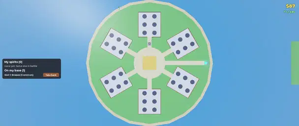 [合集截图](<https://github.com/skyler-lab/spirit-battle/blob/main/docs/img/base-island-top.jpg>) | [skyler-lab/spirit-battle](<https://github.com/skyler-lab/spirit-battle>) | 常见根目录许可文件未找到 | 待核 | [5.0](<https://github.com/skyler-lab/spirit-battle/blob/main/docs/img/base-island-top.jpg>) | 未列入口 |
| 2907 | [ ] | [Splash Rush](<https://github.com/gamingnews5/awesome-opus-5.5-games/blob/9a29b570e56bd19f15a3cd6bbac0b8c682f2c48c/games/splash-rush/readme.md>) | 待补截图 | [KJLKurt/waterslide-game-sonnet-5.5](<https://github.com/KJLKurt/waterslide-game-sonnet-5.5>) | 常见根目录许可文件未找到 | 待核 | — | [可达 · 含游戏画布／引擎的网页](<https://kjlkurt.github.io/waterslide-game-sonnet-5.5/>) |
| 2908 | [ ] | [Splash Wash](<https://github.com/gamingnews5/awesome-opus-5.5-games/blob/9a29b570e56bd19f15a3cd6bbac0b8c682f2c48c/games/splash-wash/readme.md>) | 待补截图 | [andaniC/bubble-wash](<https://github.com/andaniC/bubble-wash>) | 常见根目录许可文件未找到 | 待核 | — | [可达 · 含游戏画布／引擎的网页](<https://andanic.github.io/bubble-wash/>) |
| 2909 | [ ] | [Splendor — the gem merchants](<https://github.com/gamingnews5/awesome-opus-5.5-games/blob/9a29b570e56bd19f15a3cd6bbac0b8c682f2c48c/games/splendor-the-gem-merchants/readme.md>) | 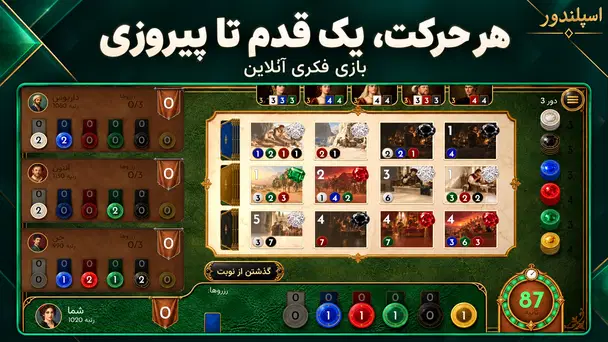 [上游商店截图](<https://github.com/Ehsanpooor/kahroba/blob/HEAD/store/campaign-fa-v1/01-gameplay-frame.png>) | [Ehsanpooor/kahroba](<https://github.com/Ehsanpooor/kahroba>) | 常见根目录许可文件未找到 | 待核 | — | 未列入口 |
| 2910 | [ ] | [Spline Rider: Dead Road 🧟🚗](<https://github.com/gamingnews5/awesome-opus-5.5-games/blob/9a29b570e56bd19f15a3cd6bbac0b8c682f2c48c/games/spline-rider-dead-road/readme.md>) | 待补截图 | [DaniDiazTech/spline-rider](<https://github.com/DaniDiazTech/spline-rider>) | 常见根目录许可文件未找到 | 待核 | — | [可达 · 合集所列网页](<https://danidiaztech.github.io/spline-rider/>) |
| 2911 | [ ] | [Sportball](<https://github.com/gamingnews5/awesome-opus-5.5-games/blob/9a29b570e56bd19f15a3cd6bbac0b8c682f2c48c/games/sportball/readme.md>) | 待补截图 | [Dsoto1/sportball](<https://github.com/Dsoto1/sportball>) | 常见根目录许可文件未找到 | [README 提及](<https://github.com/Dsoto1/sportball/blob/HEAD/README.md#L142>) | — | 未列入口 |
| 2912 | [ ] | [sports-team-trumps](<https://github.com/gamingnews5/awesome-opus-5.5-games/blob/9a29b570e56bd19f15a3cd6bbac0b8c682f2c48c/games/sports-team-trumps/readme.md>) | 待补截图 | [mwridgway/sports-team-trumps](<https://github.com/mwridgway/sports-team-trumps>) | 常见根目录许可文件未找到 | 待核 | — | 未列入口 |
| 2913 | [ ] | [Spot On Daily](<https://github.com/gamingnews5/awesome-opus-5.5-games/blob/9a29b570e56bd19f15a3cd6bbac0b8c682f2c48c/games/spot-on-daily/readme.md>) |  [源码运行首页](<https://github.com/tylergardner10/spot-on-daily/blob/main/game/index.html>) | [tylergardner10/spot-on-daily](<https://github.com/tylergardner10/spot-on-daily>) | 常见根目录许可文件未找到 | 待核 | — | 未列入口 |
| 2914 | [ ] | [Spot the AI Bug](<https://github.com/gamingnews5/awesome-opus-5.5-games/blob/9a29b570e56bd19f15a3cd6bbac0b8c682f2c48c/games/spot-the-ai-bug/readme.md>) | 待补截图 | [satyamdhamne/ai\_dev\_game](<https://github.com/satyamdhamne/ai_dev_game>) | 常见根目录许可文件未找到 | 待核 | — | 未列入口 |
| 2915 | [ ] | [Spot the Change](<https://github.com/gamingnews5/awesome-opus-5.5-games/blob/9a29b570e56bd19f15a3cd6bbac0b8c682f2c48c/games/party-chaos/readme.md>) | 待补截图 | [lawrenceandrewlargo/roblox-extreme-minigames](<https://github.com/lawrenceandrewlargo/roblox-extreme-minigames>) | 常见根目录许可文件未找到 | 待核 | — | 未列入口 |
| 2916 | [ ] | [Sprig Infinite Land](<https://github.com/gamingnews5/awesome-opus-5.5-games/blob/9a29b570e56bd19f15a3cd6bbac0b8c682f2c48c/games/sprig-infinite-land/readme.md>) | 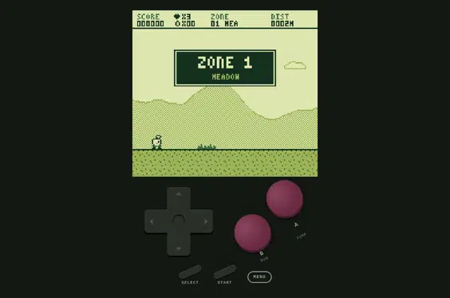 [试玩画面](<https://dk-nexthop.github.io/sprig-infinite-land/>) | [dk-nexthop/sprig-infinite-land](<https://github.com/dk-nexthop/sprig-infinite-land>) | 常见根目录许可文件未找到 | [README 提及、源码有输入读取](<https://github.com/dk-nexthop/sprig-infinite-land/blob/main/docs/index.html#L958>) | — | [可达 · 含游戏画布／引擎的网页](<https://dk-nexthop.github.io/sprig-infinite-land/>) |
| 2917 | [ ] | [Sprint Slam](<https://github.com/gamingnews5/awesome-opus-5.5-games/blob/9a29b570e56bd19f15a3cd6bbac0b8c682f2c48c/games/sprint-slam/readme.md>) | 待补截图 | [uRlOcAlNeWsPaPeR/sprint\_slam](<https://github.com/uRlOcAlNeWsPaPeR/sprint_slam>) | 常见根目录许可文件未找到 | [README 提及](<https://github.com/uRlOcAlNeWsPaPeR/sprint_slam/blob/HEAD/README.md#L75>) | — | 未列入口 |
| 2918 | [ ] | [SQL Boss Battle Game](<https://github.com/gamingnews5/awesome-opus-5.5-games/blob/9a29b570e56bd19f15a3cd6bbac0b8c682f2c48c/games/sql-boss-battle-game/readme.md>) |  [游戏菜单或界面](<https://github.com/user-attachments/assets/f1986481-3d0b-4d7f-9240-9a5be77148d9>) | [raishaldhawan23/SQL-Boss-Battle-Game-](<https://github.com/raishaldhawan23/SQL-Boss-Battle-Game->) | 常见根目录许可文件未找到 | 待核 | [6.2](<https://github.com/user-attachments/assets/f1986481-3d0b-4d7f-9240-9a5be77148d9>) | [可达 · 含游戏画布／引擎的网页](<https://raishaldhawan23.github.io/SQL-Boss-Battle-Game-/>) |
| 2919 | [ ] | [SQL: The Missing Influencer](<https://github.com/gamingnews5/awesome-opus-5.5-games/blob/9a29b570e56bd19f15a3cd6bbac0b8c682f2c48c/games/sql-the-missing-influencer/readme.md>) |  [游戏菜单或界面](<https://github.com/ChanakyaNxtWave/sql-missing-influencer/blob/main/docs/screenshots/after/01-home.png>) | [ChanakyaNxtWave/sql-missing-influencer](<https://github.com/ChanakyaNxtWave/sql-missing-influencer>) | 常见根目录许可文件未找到 | 待核 | [5.0](<https://github.com/ChanakyaNxtWave/sql-missing-influencer/blob/main/docs/screenshots/after/01-home.png>) | 未列入口 |
| 2920 | [ ] | [Squad Draft](<https://github.com/gamingnews5/awesome-opus-5.5-games/blob/9a29b570e56bd19f15a3cd6bbac0b8c682f2c48c/games/squad-draft/readme.md>) | 待补截图 | [charleskowou1/squad-draft](<https://github.com/charleskowou1/squad-draft>) | 常见根目录许可文件未找到 | 待核 | — | [可达 · 合集所列网页](<https://charleskowou1.github.io/squad-draft/>) |
| 2921 | [ ] | [Squad Test](<https://github.com/gamingnews5/awesome-opus-5.5-games/blob/9a29b570e56bd19f15a3cd6bbac0b8c682f2c48c/games/squad-test/readme.md>) | 待补截图 | [Kmad666/Squad-test](<https://github.com/Kmad666/Squad-test>) | 常见根目录许可文件未找到 | 待核 | — | [可达 · 含游戏画布／引擎的网页](<https://kmad666.github.io/Squad-test/>) |
| 2922 | [ ] | [Squid Dare](<https://github.com/gamingnews5/awesome-opus-5.5-games/blob/9a29b570e56bd19f15a3cd6bbac0b8c682f2c48c/games/squid-dare/readme.md>) | 待补截图 | [yaddycomponents/hallowfin](<https://github.com/yaddycomponents/hallowfin>) | 常见根目录许可文件未找到 | 待核 | — | [可达 · 合集所列网页](<https://hallowfin.vercel.app>) |
| 2923 | [ ] | [Squid Game: Phone Edition](<https://github.com/gamingnews5/awesome-opus-5.5-games/blob/9a29b570e56bd19f15a3cd6bbac0b8c682f2c48c/games/squid-game-phone-edition/readme.md>) | 待补截图 | [Harshagarwal06/hackpsu](<https://github.com/Harshagarwal06/hackpsu>) | 常见根目录许可文件未找到 | 待核 | — | 未列入口 |
| 2924 | [ ] | [Squiggle](<https://github.com/gamingnews5/awesome-opus-5.5-games/blob/9a29b570e56bd19f15a3cd6bbac0b8c682f2c48c/games/squiggle/readme.md>) |  [上游游戏截图](<https://github.com/jarredksmith/squiggle/blob/HEAD/brand/preview.png>) | [jarredksmith/squiggle](<https://github.com/jarredksmith/squiggle>) | 常见根目录许可文件未找到 | 待核 | — | [可达 · 合集所列网页](<https://jarredksmith.github.io/squiggle/>) |
| 2925 | [ ] | [Squirmish](<https://github.com/gamingnews5/awesome-opus-5.5-games/blob/9a29b570e56bd19f15a3cd6bbac0b8c682f2c48c/games/squirmish/readme.md>) | 待补截图 | [DomantasMk/wormsWeb](<https://github.com/DomantasMk/wormsWeb>) | 常见根目录许可文件未找到 | 待核 | — | 未列入口 |
| 2926 | [ ] | [Squirrel Game](<https://github.com/gamingnews5/awesome-opus-5.5-games/blob/9a29b570e56bd19f15a3cd6bbac0b8c682f2c48c/games/squirrel-game/readme.md>) | 待补截图 | [KyleleeSea/squirrel-simulator](<https://github.com/KyleleeSea/squirrel-simulator>) | 常见根目录许可文件未找到 | 待核 | — | 未列入口 |
| 2927 | [ ] | [Squirrel Ranger](<https://github.com/gamingnews5/awesome-opus-5.5-games/blob/9a29b570e56bd19f15a3cd6bbac0b8c682f2c48c/games/squirrel-ranger/readme.md>) | 待补截图 | [afaucher/Squirrel-Racer](<https://github.com/afaucher/Squirrel-Racer>) | 常见根目录许可文件未找到 | [源码有输入读取](<https://github.com/afaucher/Squirrel-Racer/blob/main/index.html#L1420>) | — | 未列入口 |
| 2928 | [ ] | [St. Aldric: Night Shift Never Ended](<https://github.com/gamingnews5/awesome-opus-5.5-games/blob/9a29b570e56bd19f15a3cd6bbac0b8c682f2c48c/games/st-aldric-night-shift-never-ended/readme.md>) | 待补截图 | [crazy0codes/hospital-escape](<https://github.com/crazy0codes/hospital-escape>) | 常见根目录许可文件未找到 | 待核 | — | 未列入口 |
| 2929 | [ ] | [Stack Builder](<https://github.com/gamingnews5/awesome-opus-5.5-games/blob/9a29b570e56bd19f15a3cd6bbac0b8c682f2c48c/games/stack-builder/readme.md>) |  [同款源码游戏实截](<https://github.com/mundeok/math-arcade-paradise/blob/master/src/games/g06_stack.js>) | [mundeok/math-arcade-paradise](<https://github.com/mundeok/math-arcade-paradise>) | 常见根目录许可文件未找到 | 待核 | — | 未列入口 |
| 2930 | [ ] | [Stack to Orbit](<https://github.com/gamingnews5/awesome-opus-5.5-games/blob/9a29b570e56bd19f15a3cd6bbac0b8c682f2c48c/games/stack-to-orbit/readme.md>) | 待补截图 | [boidbit/stack-tower](<https://github.com/boidbit/stack-tower>) | 常见根目录许可文件未找到 | 待核 | — | [可达 · 项目说明／规则页](<https://boidbit.github.io/stack-tower/privacy.html>) |
| 2931 | [ ] | [Stack!](<https://github.com/gamingnews5/awesome-opus-5.5-games/blob/9a29b570e56bd19f15a3cd6bbac0b8c682f2c48c/games/stack/readme.md>) | 待补截图 | [kevicency/KumoWare](<https://github.com/kevicency/KumoWare>) | 常见根目录许可文件未找到 | 待核 | — | 未列入口 |
| 2932 | [ ] | [StackClimb](<https://github.com/gamingnews5/awesome-opus-5.5-games/blob/9a29b570e56bd19f15a3cd6bbac0b8c682f2c48c/games/stackclimb/readme.md>) | 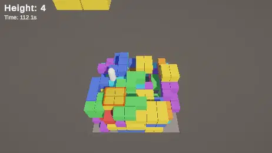 [合集截图](<https://github.com/GaaamJ/StackClimb/blob/main/docs/images/09-climbed-height.png>) | [GaaamJ/StackClimb](<https://github.com/GaaamJ/StackClimb>) | 常见根目录许可文件未找到 | 待核 | [5.0](<https://github.com/GaaamJ/StackClimb/blob/main/docs/images/09-climbed-height.png>) | [可达 · 含游戏画布／引擎的网页](<https://gaaamj.github.io/StackClimb/>) |
| 2933 | [ ] | [Stacktics](<https://github.com/gamingnews5/awesome-opus-5.5-games/blob/9a29b570e56bd19f15a3cd6bbac0b8c682f2c48c/games/stacktics/readme.md>) |  [同款源码启动画面实截](<https://github.com/verdeyen-k/stacktics/blob/HEAD/index.html>) | [verdeyen-k/stacktics](<https://github.com/verdeyen-k/stacktics>) | 常见根目录许可文件未找到 | 待核 | — | [可达 · 含游戏画布／引擎的网页](<https://verdeyen-k.github.io/stacktics/>) |
| 2934 | [ ] | [Star Catch](<https://github.com/gamingnews5/awesome-opus-5.5-games/blob/9a29b570e56bd19f15a3cd6bbac0b8c682f2c48c/games/star-catch/readme.md>) |  [对应子游戏玩法实截](<https://github.com/gberry747-lab/gabriels-animation-studio/blob/HEAD/index.html>) | [gberry747-lab/gabriels-animation-studio](<https://github.com/gberry747-lab/gabriels-animation-studio>) | 常见根目录许可文件未找到 | 待核 | — | [多游戏仓库入口 · 可达 · 含游戏画布／引擎的网页](<https://gberry747-lab.github.io/gabriels-animation-studio/>) |
| 2935 | [ ] | [Star Cricket](<https://github.com/gamingnews5/awesome-opus-5.5-games/blob/9a29b570e56bd19f15a3cd6bbac0b8c682f2c48c/games/star-cricket/readme.md>) | 待补截图 | [Karanvir1729/ninja-knife-dodge](<https://github.com/Karanvir1729/ninja-knife-dodge>) | 常见根目录许可文件未找到 | 待核 | — | 未列入口 |
| 2936 | [ ] | [Star Destroyer](<https://github.com/gamingnews5/awesome-opus-5.5-games/blob/9a29b570e56bd19f15a3cd6bbac0b8c682f2c48c/games/star-destroyer/readme.md>) | 待补截图 | [soncsec/star-destroyer](<https://github.com/soncsec/star-destroyer>) | 常见根目录许可文件未找到 | 待核 | — | 未列入口 |
| 2937 | [ ] | [Star Gulp](<https://github.com/gamingnews5/awesome-opus-5.5-games/blob/9a29b570e56bd19f15a3cd6bbac0b8c682f2c48c/games/star-gulp/readme.md>) |  [对应子游戏玩法实截](<https://github.com/pawanp3/renderwolf-fable5-chart-toppers/blob/HEAD/games/hole-stars/index.html>) | [pawanp3/renderwolf-fable5-chart-toppers](<https://github.com/pawanp3/renderwolf-fable5-chart-toppers>) | 常见根目录许可文件未找到 | 待核 | — | [多游戏仓库入口 · 可达 · 合集所列网页](<https://pawanp3.github.io/renderwolf-fable5-chart-toppers/>) |
| 2938 | [ ] | [Star Jump](<https://github.com/gamingnews5/awesome-opus-5.5-games/blob/9a29b570e56bd19f15a3cd6bbac0b8c682f2c48c/games/star-jump/readme.md>) | 待补截图 | [abo-code-1/JumpHooper](<https://github.com/abo-code-1/JumpHooper>) | 常见根目录许可文件未找到 | 待核 | [4.2](<https://github.com/abo-code-1/JumpHooper/blob/main/assets/astronaut.png>) | 未列入口 |
| 2939 | [ ] | [Star Runner](<https://github.com/gamingnews5/awesome-opus-5.5-games/blob/9a29b570e56bd19f15a3cd6bbac0b8c682f2c48c/games/star-runner/readme.md>) | 待补截图 | [shironagasu-ai/claude-fable5-3D-games](<https://github.com/shironagasu-ai/claude-fable5-3D-games>) | 常见根目录许可文件未找到 | 待核 | — | [可达 · 合集所列网页](<https://shironagasu-ai.github.io/claude-fable5-3D-games/games/star-runner/>) |
| 2940 | [ ] | [Star Trek StarFleet Command 3D](<https://github.com/gamingnews5/awesome-opus-5.5-games/blob/9a29b570e56bd19f15a3cd6bbac0b8c682f2c48c/games/star-trek-starfleet-command-3d/readme.md>) | 待补截图 | [testingyoubob/Star-Trek-StarFleet-Command-game-](<https://github.com/testingyoubob/Star-Trek-StarFleet-Command-game->) | 常见根目录许可文件未找到 | 待核 | — | 未列入口 |
| 2941 | [ ] | [Star Vector](<https://github.com/gamingnews5/awesome-opus-5.5-games/blob/9a29b570e56bd19f15a3cd6bbac0b8c682f2c48c/games/star-vector/readme.md>) | 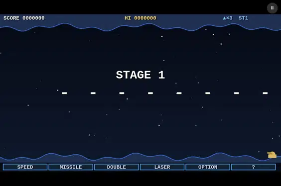 [试玩画面](<https://johnson-codes.github.io/star-vector/>) | [johnson-codes/star-vector](<https://github.com/johnson-codes/star-vector>) | 常见根目录许可文件未找到 | 待核 | — | [可达 · 含游戏画布／引擎的网页](<https://johnson-codes.github.io/star-vector/>) |
| 2942 | [ ] | [STARBUCKS CUP CATCHER](<https://github.com/gamingnews5/awesome-opus-5.5-games/blob/9a29b570e56bd19f15a3cd6bbac0b8c682f2c48c/games/starbucks-cup-catcher/readme.md>) | 待补截图 | [zeusmess/zeusstudio](<https://github.com/zeusmess/zeusstudio>) | 常见根目录许可文件未找到 | 待核 | — | 未列入口 |
| 2943 | [ ] | [Stardust Empire](<https://github.com/gamingnews5/awesome-opus-5.5-games/blob/9a29b570e56bd19f15a3cd6bbac0b8c682f2c48c/games/stardust-empire/readme.md>) | 待补截图 | [BringOutTheRainn/space-app](<https://github.com/BringOutTheRainn/space-app>) | 常见根目录许可文件未找到 | 待核 | — | 未列入口 |
| 2944 | [ ] | [STARFALL](<https://github.com/gamingnews5/awesome-opus-5.5-games/blob/9a29b570e56bd19f15a3cd6bbac0b8c682f2c48c/games/starfall-hiradbaba-starfall/readme.md>) | 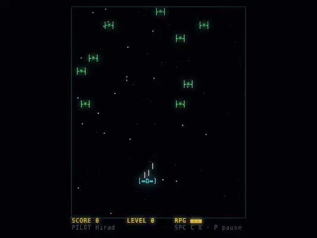 [上游动图截帧](<https://github.com/hiradbaba/starfall/blob/main/docs/media/gameplay.gif>) | [hiradbaba/starfall](<https://github.com/hiradbaba/starfall>) | 常见根目录许可文件未找到 | 待核 | [3.8](<https://github.com/hiradbaba/starfall/blob/main/docs/media/gameplay.gif>) | [可达 · 含游戏画布／引擎的网页](<https://hiradbaba.github.io/starfall/>) |
| 2945 | [ ] | [Starfuse](<https://github.com/gamingnews5/awesome-opus-5.5-games/blob/9a29b570e56bd19f15a3cd6bbac0b8c682f2c48c/games/starfuse/readme.md>) | 待补截图 | [rragoo/starfuse](<https://github.com/rragoo/starfuse>) | 常见根目录许可文件未找到 | 待核 | — | [可达 · 含游戏画布／引擎的网页](<https://rragoo.github.io/starfuse/>) |
| 2946 | [ ] | [Starlight Peaks](<https://github.com/gamingnews5/awesome-opus-5.5-games/blob/9a29b570e56bd19f15a3cd6bbac0b8c682f2c48c/games/starlight-peaks/readme.md>) |  [对应子游戏玩法实截](<https://github.com/pawanp3/renderwolf-fable5-chart-toppers/blob/HEAD/games/disney-solitaire/index.html>) | [pawanp3/renderwolf-fable5-chart-toppers](<https://github.com/pawanp3/renderwolf-fable5-chart-toppers>) | 常见根目录许可文件未找到 | 待核 | — | [多游戏仓库入口 · 可达 · 合集所列网页](<https://pawanp3.github.io/renderwolf-fable5-chart-toppers/>) |
| 2947 | [ ] | [Starline（星线）](<https://github.com/gamingnews5/awesome-opus-5.5-games/blob/9a29b570e56bd19f15a3cd6bbac0b8c682f2c48c/games/starline/readme.md>) | 待补截图 | [xuleiknave/XFramework](<https://github.com/xuleiknave/XFramework>) | 常见根目录许可文件未找到 | 待核 | — | 未列入口 |
| 2948 | [ ] | [StarResonance（星鸣律动）](<https://github.com/gamingnews5/awesome-opus-5.5-games/blob/9a29b570e56bd19f15a3cd6bbac0b8c682f2c48c/games/starresonance/readme.md>) |  [游戏菜单或界面](<https://github.com/y70647361-hub/StarResonance-Demo/blob/main/screenshots/menu.png>) | [y70647361-hub/StarResonance-Demo](<https://github.com/y70647361-hub/StarResonance-Demo>) | 常见根目录许可文件未找到 [多款 Unity 第三方素材和插件按各自许可使用。](<https://github.com/y70647361-hub/StarResonance-Demo/blob/HEAD/README.md#L74>) | 待核 | [5.6](<https://github.com/y70647361-hub/StarResonance-Demo/blob/main/screenshots/menu.png>) | [可达 · 含游戏画布／引擎的网页](<https://y70647361-hub.github.io/StarResonance-Demo/>) |
| 2949 | [ ] | [Starward](<https://github.com/gamingnews5/awesome-opus-5.5-games/blob/9a29b570e56bd19f15a3cd6bbac0b8c682f2c48c/games/starward/readme.md>) | 待补截图 | [NiklasRenner/claude-browser-game](<https://github.com/NiklasRenner/claude-browser-game>) | 常见根目录许可文件未找到 | 待核 | — | 未列入口 |
| 2950 | [ ] | [Starwing](<https://github.com/gamingnews5/awesome-opus-5.5-games/blob/9a29b570e56bd19f15a3cd6bbac0b8c682f2c48c/games/starwing/readme.md>) | 待补截图 | [RedRoosterMobile/BevyStarwing](<https://github.com/RedRoosterMobile/BevyStarwing>) | 常见根目录许可文件未找到 | 待核 | — | 未列入口 |
| 2951 | [ ] | [State Your Case](<https://github.com/gamingnews5/awesome-opus-5.5-games/blob/9a29b570e56bd19f15a3cd6bbac0b8c682f2c48c/games/state-your-case/readme.md>) | 待补截图 | [GiantMushy/StateYourCase](<https://github.com/GiantMushy/StateYourCase>) | 常见根目录许可文件未找到 | 待核 | — | 未列入口 |
| 2952 | [ ] | [Static Outskirts](<https://github.com/gamingnews5/awesome-opus-5.5-games/blob/9a29b570e56bd19f15a3cd6bbac0b8c682f2c48c/games/static-outskirts/readme.md>) |  [合集截图](<https://github.com/wicash/static-outskirts/blob/main/docs/street.png>) | [wicash/static-outskirts](<https://github.com/wicash/static-outskirts>) | 常见根目录许可文件未找到 | 待核 | [4.0](<https://github.com/wicash/static-outskirts/blob/main/docs/street.png>) | 未列入口 |
| 2953 | [ ] | [Station Blackout](<https://github.com/gamingnews5/awesome-opus-5.5-games/blob/9a29b570e56bd19f15a3cd6bbac0b8c682f2c48c/games/station-blackout/readme.md>) |  [合集截图](<https://github.com/hardwaremack-prog/station-blackout/blob/main/screenshots/1-tsunami.png>) | [hardwaremack-prog/station-blackout](<https://github.com/hardwaremack-prog/station-blackout>) | 常见根目录许可文件未找到 | 待核 | [5.0](<https://github.com/hardwaremack-prog/station-blackout/blob/main/screenshots/1-tsunami.png>) | 未列入口 |
| 2954 | [ ] | [Stav med Dino (Spell with Dino)](<https://github.com/gamingnews5/awesome-opus-5.5-games/blob/9a29b570e56bd19f15a3cd6bbac0b8c682f2c48c/games/stav-med-dino-spell-with-dino/readme.md>) | 待补截图 | [MikkelAJ92/rolige-laerespil](<https://github.com/MikkelAJ92/rolige-laerespil>) | 常见根目录许可文件未找到 | 待核 | — | 未列入口 |
| 2955 | [ ] | [Steal a Brainrot](<https://github.com/gamingnews5/awesome-opus-5.5-games/blob/9a29b570e56bd19f15a3cd6bbac0b8c682f2c48c/games/steal-a-brainrot/readme.md>) | 待补截图 | [kokellara12-maker/apps-k4m9q2](<https://github.com/kokellara12-maker/apps-k4m9q2>) | 常见根目录许可文件未找到 | 待核 | — | [可达 · 合集所列网页](<https://kokellara12-maker.github.io/apps-k4m9q2/stealbrainrot.html>) |
| 2956 | [ ] | [Steal a Critter](<https://github.com/gamingnews5/awesome-opus-5.5-games/blob/9a29b570e56bd19f15a3cd6bbac0b8c682f2c48c/games/steal-a-critter/readme.md>) | 待补截图 | [Erste-Hilfe-Hero/steal-a-critter](<https://github.com/Erste-Hilfe-Hero/steal-a-critter>) | 常见根目录许可文件未找到 | 待核 | — | 未列入口 |
| 2957 | [ ] | [Steal a Slime! — движок «фабрики плейсов»](<https://github.com/gamingnews5/awesome-opus-5.5-games/blob/9a29b570e56bd19f15a3cd6bbac0b8c682f2c48c/games/steal-a-slime/readme.md>) | 待补截图 | [ddepqwee/steal-a-slime](<https://github.com/ddepqwee/steal-a-slime>) | 常见根目录许可文件未找到 | 待核 | — | 未列入口 |
| 2958 | [ ] | [Steamed Hams: The Game](<https://github.com/gamingnews5/awesome-opus-5.5-games/blob/9a29b570e56bd19f15a3cd6bbac0b8c682f2c48c/games/steamed-hams-the-game/readme.md>) |  [合集截图](<https://github.com/Ran4/steamed_hams_the_game_claude_opus_4_6/blob/develop/screenshots/gameplay.png>) | [Ran4/steamed\_hams\_the\_game\_claude\_opus\_4\_6](<https://github.com/Ran4/steamed_hams_the_game_claude_opus_4_6>) | 常见根目录许可文件未找到 | 待核 | [6.8](<https://github.com/Ran4/steamed_hams_the_game_claude_opus_4_6/blob/develop/screenshots/gameplay.png>) | 未列入口 |
| 2959 | [ ] | [Steel &amp; Signal](<https://github.com/gamingnews5/awesome-opus-5.5-games/blob/9a29b570e56bd19f15a3cd6bbac0b8c682f2c48c/games/steel-signal/readme.md>) | 待补截图 | [tcw4wn9r95-jpg/game-new](<https://github.com/tcw4wn9r95-jpg/game-new>) | 常见根目录许可文件未找到 | 待核 | — | 未列入口 |
| 2960 | [ ] | [Steel Accord](<https://github.com/gamingnews5/awesome-opus-5.5-games/blob/9a29b570e56bd19f15a3cd6bbac0b8c682f2c48c/games/steel-accord/readme.md>) | 待补截图 | [EzioDEVio/Steel-Accord](<https://github.com/EzioDEVio/Steel-Accord>) | 常见根目录许可文件未找到 | 待核 | — | 未列入口 |
| 2961 | [ ] | [STEP Onboarding — Red Light, Green Light](<https://github.com/gamingnews5/awesome-opus-5.5-games/blob/9a29b570e56bd19f15a3cd6bbac0b8c682f2c48c/games/step-onboarding-red-light-green-light/readme.md>) | 待补截图 | [chanyowll/step-redlight](<https://github.com/chanyowll/step-redlight>) | 常见根目录许可文件未找到 | 待核 | — | 未列入口 |
| 2962 | [ ] | [STEX: Rifle Squad](<https://github.com/gamingnews5/awesome-opus-5.5-games/blob/9a29b570e56bd19f15a3cd6bbac0b8c682f2c48c/games/stex-rifle-squad/readme.md>) |  [源码运行首页](<https://github.com/davideverettreed/stex-rifle-squad/blob/main/docs/index.html>) | [davideverettreed/stex-rifle-squad](<https://github.com/davideverettreed/stex-rifle-squad>) | 常见根目录许可文件未找到 | 待核 | — | 未列入口 |
| 2963 | [ ] | [Stick Drift (AyanASaiyed)](<https://github.com/gamingnews5/awesome-opus-5.5-games/blob/9a29b570e56bd19f15a3cd6bbac0b8c682f2c48c/games/stick-drift-ayanasaiyed/readme.md>) | 待补截图 | [AyanASaiyed/StickDrift](<https://github.com/AyanASaiyed/StickDrift>) | 常见根目录许可文件未找到 | [README 提及](<https://github.com/AyanASaiyed/StickDrift/blob/HEAD/README.md#L46>) | — | 未列入口 |
| 2964 | [ ] | [Stick Drift (bryanlaiwei)](<https://github.com/gamingnews5/awesome-opus-5.5-games/blob/9a29b570e56bd19f15a3cd6bbac0b8c682f2c48c/games/stick-drift-bryanlaiwei/readme.md>) | 待补截图 | [bryanlaiwei/StickDrift](<https://github.com/bryanlaiwei/StickDrift>) | 常见根目录许可文件未找到 | [README 提及](<https://github.com/bryanlaiwei/StickDrift/blob/HEAD/README.md#L130>) | — | 未列入口 |
| 2965 | [ ] | [Stick Soldiers](<https://github.com/gamingnews5/awesome-opus-5.5-games/blob/9a29b570e56bd19f15a3cd6bbac0b8c682f2c48c/games/stick-soldiers/readme.md>) |  [同款源码启动画面实截](<https://github.com/Dec3ptor/StickFighters/blob/HEAD/web/index.html>) | [Dec3ptor/StickFighters](<https://github.com/Dec3ptor/StickFighters>) | 常见根目录许可文件未找到 | [README 提及](<https://github.com/Dec3ptor/StickFighters/blob/HEAD/README.md#L95>) | — | [可达 · 含游戏画布／引擎的网页](<https://dec3ptor.github.io/StickFighters/>) |
| 2966 | [ ] | [Stickstorm](<https://github.com/gamingnews5/awesome-opus-5.5-games/blob/9a29b570e56bd19f15a3cd6bbac0b8c682f2c48c/games/stickstorm/readme.md>) |  [源码运行首页](<https://github.com/bilalerrahil-cpu/stickstorm/blob/main/index.html>) | [bilalerrahil-cpu/stickstorm](<https://github.com/bilalerrahil-cpu/stickstorm>) | 常见根目录许可文件未找到 | 待核 | — | 未列入口 |
| 2967 | [ ] | [STING](<https://github.com/gamingnews5/awesome-opus-5.5-games/blob/9a29b570e56bd19f15a3cd6bbac0b8c682f2c48c/games/sting/readme.md>) | 待补截图 | [palamudin/stiNG](<https://github.com/palamudin/stiNG>) | 常见根目录许可文件未找到 | 待核 | — | 未列入口 |
| 2968 | [ ] | [STM32F7 Discovery GAME BOX](<https://github.com/gamingnews5/awesome-opus-5.5-games/blob/9a29b570e56bd19f15a3cd6bbac0b8c682f2c48c/games/stm32f7-discovery-game-box/readme.md>) |  [游戏菜单或界面](<https://github.com/onurkepenek/stm32f7disco_gamebox/blob/main/docs/menu.png>) | [onurkepenek/stm32f7disco\_gamebox](<https://github.com/onurkepenek/stm32f7disco_gamebox>) | 常见根目录许可文件未找到 | 待核 | [5.8](<https://github.com/onurkepenek/stm32f7disco_gamebox/blob/main/docs/menu.png>) | 未列入口 |
| 2969 | [ ] | [Stolen Names](<https://github.com/gamingnews5/awesome-opus-5.5-games/blob/9a29b570e56bd19f15a3cd6bbac0b8c682f2c48c/games/stolen-names/readme.md>) | 待补截图 | [Beebopcat/stolen-names](<https://github.com/Beebopcat/stolen-names>) | 常见根目录许可文件未找到 | 待核 | [5.0（原图失效）](<https://github.com/Beebopcat/stolen-names/blob/main/docs/media/01.webp>) | [入口已失效 · 合集所列网页](<https://beebopcat.github.io/stolen-names/>) |
| 2970 | [ ] | [Store24](<https://github.com/gamingnews5/awesome-opus-5.5-games/blob/9a29b570e56bd19f15a3cd6bbac0b8c682f2c48c/games/store24/readme.md>) |  [源码运行首页](<https://github.com/Namy0124/Store24/blob/main/index.html>) | [Namy0124/Store24](<https://github.com/Namy0124/Store24>) | 常见根目录许可文件未找到 | 待核 | — | 未列入口 |
| 2971 | [ ] | [STORMCAM](<https://github.com/gamingnews5/awesome-opus-5.5-games/blob/9a29b570e56bd19f15a3cd6bbac0b8c682f2c48c/games/stormcam/readme.md>) | 待补截图 | [Beeem33/STORMCAM-play](<https://github.com/Beeem33/STORMCAM-play>) | 常见根目录许可文件未找到 | 待核 | — | [可达 · 含游戏画布／引擎的网页](<https://beeem33.github.io/STORMCAM-play/>) |
| 2972 | [ ] | [Storybound](<https://github.com/gamingnews5/awesome-opus-5.5-games/blob/9a29b570e56bd19f15a3cd6bbac0b8c682f2c48c/games/storybound/readme.md>) | 待补截图 | [trungle42/Storybound](<https://github.com/trungle42/Storybound>) | 常见根目录许可文件未找到 | 待核 | [6.2](<https://github.com/trungle42/Storybound/blob/main/docs/images/avatars-before-after.jpg>) | 未列入口 |
| 2973 | [ ] | [Straight Outta Hormuz](<https://github.com/gamingnews5/awesome-opus-5.5-games/blob/9a29b570e56bd19f15a3cd6bbac0b8c682f2c48c/games/straight-outta-hormuz/readme.md>) | 待补截图 | [condog101/Hormuz](<https://github.com/condog101/Hormuz>) | 常见根目录许可文件未找到 | [README 提及](<https://github.com/condog101/Hormuz/blob/HEAD/README.md#L46>) | — | 未列入口 |
| 2974 | [ ] | [Strain Packs](<https://github.com/gamingnews5/awesome-opus-5.5-games/blob/9a29b570e56bd19f15a3cd6bbac0b8c682f2c48c/games/strain-packs/readme.md>) |  [源码运行画面](<https://github.com/harleyloft47-king/weed-game-/blob/main/docs/index.html>) | [harleyloft47-king/weed-game-](<https://github.com/harleyloft47-king/weed-game->) | 常见根目录许可文件未找到 | 待核 | — | 未列入口 |
| 2975 | [ ] | [StratoshiVibes Blockspace](<https://github.com/gamingnews5/awesome-opus-5.5-games/blob/9a29b570e56bd19f15a3cd6bbac0b8c682f2c48c/games/stratoshivibes-blockspace/readme.md>) |  [源码运行首页](<https://github.com/stratanen/stratoshivibes-blocks/blob/main/index.html>) | [stratanen/stratoshivibes-blocks](<https://github.com/stratanen/stratoshivibes-blocks>) | 常见根目录许可文件未找到 | 待核 | — | 未列入口 |
| 2976 | [ ] | [Street Quest](<https://github.com/gamingnews5/awesome-opus-5.5-games/blob/9a29b570e56bd19f15a3cd6bbac0b8c682f2c48c/games/street-quest/readme.md>) |  [源码网页实截](<https://github.com/cchesk/claudedraw/blob/main/docs/prototype.html>) | [cchesk/claudedraw](<https://github.com/cchesk/claudedraw>) | 常见根目录许可文件未找到 | 待核 | — | 未列入口 |
| 2977 | [ ] | [Stride 'n Conquer](<https://github.com/gamingnews5/awesome-opus-5.5-games/blob/9a29b570e56bd19f15a3cd6bbac0b8c682f2c48c/games/stride-n-conquer/readme.md>) | 待补截图 | [aalicia1208/stride-n-conquer](<https://github.com/aalicia1208/stride-n-conquer>) | 常见根目录许可文件未找到 | 待核 | — | 未列入口 |
| 2978 | [ ] | [Strike Brawl](<https://github.com/gamingnews5/awesome-opus-5.5-games/blob/9a29b570e56bd19f15a3cd6bbac0b8c682f2c48c/games/strike-brawl/readme.md>) |  [源码运行首页](<https://github.com/ahmed-okkio/strikebrawl/blob/main/index.html>) | [ahmed-okkio/strikebrawl](<https://github.com/ahmed-okkio/strikebrawl>) | 常见根目录许可文件未找到 | 待核 | — | 未列入口 |
| 2979 | [ ] | [Strike Zone](<https://github.com/gamingnews5/awesome-opus-5.5-games/blob/9a29b570e56bd19f15a3cd6bbac0b8c682f2c48c/games/strike-zone/readme.md>) | 待补截图 | [tuanden0/strike-zone](<https://github.com/tuanden0/strike-zone>) | 常见根目录许可文件未找到 | [README 提及](<https://github.com/tuanden0/strike-zone/blob/HEAD/README.md#L118>) | — | 未列入口 |
| 2980 | [x] | [Struggle Bus](<https://github.com/gamingnews5/awesome-opus-5.5-games/blob/9a29b570e56bd19f15a3cd6bbac0b8c682f2c48c/games/struggle-bus/readme.md>) |  [合集截图](<https://github.com/patrickscaptainslog/Struggle-Bus-World/blob/main/shots/altitude/downtown-030m.png>) | [patrickscaptainslog/Struggle-Bus-World](<https://github.com/patrickscaptainslog/Struggle-Bus-World>) | 常见根目录许可文件未找到 [树木覆盖数据为 CC BY 4.0，烘焙的地图数据受 ODbL 约束。](<https://github.com/patrickscaptainslog/Struggle-Bus-World/blob/HEAD/README.md#L160-L162>) | 待核 | [4.8](<https://github.com/patrickscaptainslog/Struggle-Bus-World/blob/main/shots/altitude/downtown-030m.png>) | [可达 · 含游戏画布／引擎的网页](<https://struggle-bus-world.vercel.app>) · [pureTV 内嵌原版](https://ecojust.github.io/pureTV/games/struggle-bus/tv.html) |
| 2981 | [ ] | [Stuck In Me (Remake)](<https://github.com/gamingnews5/awesome-opus-5.5-games/blob/9a29b570e56bd19f15a3cd6bbac0b8c682f2c48c/games/stuck-in-me-remake/readme.md>) |  [合集截图](<https://github.com/ashifReza/StuckInMe-remake/blob/main/docs/screenshots/03-whispering-woods.jpg>) | [ashifReza/StuckInMe-remake](<https://github.com/ashifReza/StuckInMe-remake>) | 常见根目录许可文件未找到 | 待核 | [6.2](<https://github.com/ashifReza/StuckInMe-remake/blob/main/docs/screenshots/03-whispering-woods.jpg>) | [可达 · 含游戏画布／引擎的网页](<https://ashifreza.github.io/StuckInMe-remake/>) |
| 2982 | [ ] | [Studio Arcade](<https://github.com/gamingnews5/awesome-opus-5.5-games/blob/9a29b570e56bd19f15a3cd6bbac0b8c682f2c48c/games/studio-arcade/readme.md>) |  [源码运行首页](<https://github.com/titusmith/studio-arcade/blob/main/games/lock-unfortunate-teller/index.html>) | [titusmith/studio-arcade](<https://github.com/titusmith/studio-arcade>) | 常见根目录许可文件未找到 | 待核 | — | 未列入口 |
| 2983 | [ ] | [Study Game Zone](<https://github.com/gamingnews5/awesome-opus-5.5-games/blob/9a29b570e56bd19f15a3cd6bbac0b8c682f2c48c/games/study-game-zone/readme.md>) | 待补截图 | [mcaashish28/study-game-zone](<https://github.com/mcaashish28/study-game-zone>) | 常见根目录许可文件未找到 | 待核 | — | [可达 · 含游戏画布／引擎的网页](<https://mcaashish28.github.io/study-game-zone/>) |
| 2984 | [ ] | [Stumps Ahead](<https://github.com/gamingnews5/awesome-opus-5.5-games/blob/9a29b570e56bd19f15a3cd6bbac0b8c682f2c48c/games/stumps-ahead/readme.md>) | 待补截图 | [Ptalati015/Stumps\_Ahead](<https://github.com/Ptalati015/Stumps_Ahead>) | 常见根目录许可文件未找到 | 待核 | — | [入口已失效 · 合集所列网页](<https://ptalati015.github.io/Stumps_Ahead/>) |
| 2985 | [ ] | [Suburban Turismo](<https://github.com/gamingnews5/awesome-opus-5.5-games/blob/9a29b570e56bd19f15a3cd6bbac0b8c682f2c48c/games/suburban-turismo/readme.md>) |  [合集截图](<https://github.com/mtd-public/suburban-turismo/blob/main/docs/art-test/01-culdesac.jpg>) | [mtd-public/suburban-turismo](<https://github.com/mtd-public/suburban-turismo>) | 常见根目录许可文件未找到 无根LICENSE；README称竞速已可玩，行人布娃娃/追逐仍计划中，不能计已实现。 | [README 提及](<https://github.com/mtd-public/suburban-turismo/blob/HEAD/README.md#L100>) | [6.8](<https://github.com/mtd-public/suburban-turismo/blob/main/docs/art-test/01-culdesac.jpg>) | [可达 · 含游戏画布／引擎的网页](<https://mtd-public.github.io/suburban-turismo/>) |
| 2986 | [ ] | [Sudden Death Strikers](<https://github.com/gamingnews5/awesome-opus-5.5-games/blob/9a29b570e56bd19f15a3cd6bbac0b8c682f2c48c/games/sudden-death-strikers/readme.md>) |  [对应子游戏玩法实截](<https://github.com/pawanp3/renderwolf-fable5-chart-toppers/blob/HEAD/games/ea-fc-mobile/index.html>) | [pawanp3/renderwolf-fable5-chart-toppers](<https://github.com/pawanp3/renderwolf-fable5-chart-toppers>) | 常见根目录许可文件未找到 | 待核 | — | [多游戏仓库入口 · 可达 · 合集所列网页](<https://pawanp3.github.io/renderwolf-fable5-chart-toppers/>) |
| 2987 | [ ] | [Sudoku](<https://github.com/gamingnews5/awesome-opus-5.5-games/blob/9a29b570e56bd19f15a3cd6bbac0b8c682f2c48c/games/sudoku/readme.md>) | 待补截图 | [antoniosubasic/sudoku](<https://github.com/antoniosubasic/sudoku>) | 常见根目录许可文件未找到 | 待核 | — | 未列入口 |
| 2988 | [ ] | [Sudoku Vibes](<https://github.com/gamingnews5/awesome-opus-5.5-games/blob/9a29b570e56bd19f15a3cd6bbac0b8c682f2c48c/games/sudoku-vibes/readme.md>) | 待补截图 | [cneijenhuis/sudoku-vibes](<https://github.com/cneijenhuis/sudoku-vibes>) | 常见根目录许可文件未找到 | 待核 | — | 未列入口 |
| 2989 | [ ] | [Sudokuverkstan](<https://github.com/gamingnews5/awesome-opus-5.5-games/blob/9a29b570e56bd19f15a3cd6bbac0b8c682f2c48c/games/sudokuverkstan/readme.md>) | 待补截图 | [isac076/sudokuverkstan](<https://github.com/isac076/sudokuverkstan>) | 常见根目录许可文件未找到 | 待核 | — | [可达 · 合集所列网页](<https://isac076.github.io/sudokuverkstan/>) |
| 2990 | [ ] | [Summoner: Hellbound Grimoire](<https://github.com/gamingnews5/awesome-opus-5.5-games/blob/9a29b570e56bd19f15a3cd6bbac0b8c682f2c48c/games/summoner-hellbound-grimoire/readme.md>) | 待补截图 | [00-MJ-Built-with-AI/summoner-hellbound](<https://github.com/00-MJ-Built-with-AI/summoner-hellbound>) | 常见根目录许可文件未找到 | 待核 | — | [入口已失效 · 项目辅助页面／资源](<https://00-mj-built-with-ai.github.io/summoner-hellbound/tests/>) |
| 2991 | [ ] | [Sun Devil Sip-Off](<https://github.com/gamingnews5/awesome-opus-5.5-games/blob/9a29b570e56bd19f15a3cd6bbac0b8c682f2c48c/games/sun-devil-sip-off/readme.md>) | 待补截图 | [paulanthony-alt/beer](<https://github.com/paulanthony-alt/beer>) | 常见根目录许可文件未找到 | 待核 | — | 未列入口 |
| 2992 | [ ] | [SUNBREAK — Downhill Club](<https://github.com/gamingnews5/awesome-opus-5.5-games/blob/9a29b570e56bd19f15a3cd6bbac0b8c682f2c48c/games/sunbreak-downhill-club/readme.md>) |  [合集截图](<https://github.com/Imirushik/sunbreak-downhill-3D-game/blob/main/media/SUNBREAK-showcase-poster.jpg>) | [Imirushik/sunbreak-downhill-3D-game](<https://github.com/Imirushik/sunbreak-downhill-3D-game>) | 常见根目录许可文件未找到 | 待核 | [8.9](<https://github.com/Imirushik/sunbreak-downhill-3D-game/blob/main/media/SUNBREAK-showcase-poster.jpg>) | [可达 · 代码仓库／说明](<https://github.com/Imirushik/sunbreak-downhill-3D-game>) |
| 2993 | [ ] | [Sunny Acres](<https://github.com/gamingnews5/awesome-opus-5.5-games/blob/9a29b570e56bd19f15a3cd6bbac0b8c682f2c48c/games/sunny-acres/readme.md>) |  [合集截图](<https://github.com/selevia-mod/harvestville-sunny-acres/blob/main/shot.png>) | [selevia-mod/harvestville-sunny-acres](<https://github.com/selevia-mod/harvestville-sunny-acres>) | 常见根目录许可文件未找到 | 待核 | [5.4](<https://github.com/selevia-mod/harvestville-sunny-acres/blob/main/shot.png>) | 未列入口 |
| 2994 | [ ] | [Sunset Courts](<https://github.com/gamingnews5/awesome-opus-5.5-games/blob/9a29b570e56bd19f15a3cd6bbac0b8c682f2c48c/games/sunset-courts/readme.md>) |  [上游动图截帧](<https://github.com/jasonmayg/sunset-courts/blob/main/media/preview.gif>) | [jasonmayg/sunset-courts](<https://github.com/jasonmayg/sunset-courts>) | 常见根目录许可文件未找到 | 待核 | [6.8](<https://github.com/jasonmayg/sunset-courts/blob/main/media/preview.gif>) | [README · 可达 · 含游戏画布／引擎的网页](<https://jasonmayg.github.io/sunset-courts/>) |
| 2995 | [ ] | [Sunset Flap](<https://github.com/gamingnews5/awesome-opus-5.5-games/blob/9a29b570e56bd19f15a3cd6bbac0b8c682f2c48c/games/sunset-flap/readme.md>) | 待补截图 | [5kahoisaac/sunset-flap](<https://github.com/5kahoisaac/sunset-flap>) | 常见根目录许可文件未找到 | 待核 | — | 未列入口 |
| 2996 | [ ] | [Super Adventure](<https://github.com/gamingnews5/awesome-opus-5.5-games/blob/9a29b570e56bd19f15a3cd6bbac0b8c682f2c48c/games/super-adventure/readme.md>) |  [源码网页实截](<https://github.com/GoldiAI/super-adventure/blob/main/index.html>) | [GoldiAI/super-adventure](<https://github.com/GoldiAI/super-adventure>) | 常见根目录许可文件未找到 | 待核 | — | 未列入口 |
| 2997 | [ ] | [Super Haaland Quest](<https://github.com/gamingnews5/awesome-opus-5.5-games/blob/9a29b570e56bd19f15a3cd6bbac0b8c682f2c48c/games/super-haaland-quest/readme.md>) | 待补截图 | [houssemeddinelassoued/haaland-quest-game](<https://github.com/houssemeddinelassoued/haaland-quest-game>) | 常见根目录许可文件未找到 | 待核 | — | 未列入口 |
| 2998 | [ ] | [Super Mario Hellbound](<https://github.com/gamingnews5/awesome-opus-5.5-games/blob/9a29b570e56bd19f15a3cd6bbac0b8c682f2c48c/games/super-mario-hellbound/readme.md>) | 待补截图 | [Dreamweaver-Studios/Super-Mario-Hellbound](<https://github.com/Dreamweaver-Studios/Super-Mario-Hellbound>) | 常见根目录许可文件未找到 | 待核 | [5.2（原图失效）](<https://github.com/Dreamweaver-Studios/Super-Mario-Hellbound/blob/main/img/hellbound.jpg>) | 未列入口 |
| 2999 | [ ] | [Super Pip Bros.](<https://github.com/gamingnews5/awesome-opus-5.5-games/blob/9a29b570e56bd19f15a3cd6bbac0b8c682f2c48c/games/super-pip-bros/readme.md>) | 待补截图 | [TheAmoungMcer/super-pip-bros](<https://github.com/TheAmoungMcer/super-pip-bros>) | 常见根目录许可文件未找到 | 待核 | — | [入口已失效 · 合集所列网页](<https://theamoungmcer.github.io/super-pip-bros/>) |
| 3000 | [ ] | [Super Snake](<https://github.com/gamingnews5/awesome-opus-5.5-games/blob/9a29b570e56bd19f15a3cd6bbac0b8c682f2c48c/games/super-snake/readme.md>) |  [源码运行画面](<https://github.com/mattbothell/Super-Snake/blob/main/Snake.html>) | [mattbothell/Super-Snake](<https://github.com/mattbothell/Super-Snake>) | 常见根目录许可文件未找到 | 待核 | — | 未列入口 |
| 3001 | [ ] | [Super Sortie](<https://github.com/gamingnews5/awesome-opus-5.5-games/blob/9a29b570e56bd19f15a3cd6bbac0b8c682f2c48c/games/super-sortie/readme.md>) |  [源码运行首页](<https://github.com/etrem0920/supersortie/blob/main/public/index.html>) | [etrem0920/supersortie](<https://github.com/etrem0920/supersortie>) | 常见根目录许可文件未找到 | [源码有输入读取](<https://github.com/etrem0920/supersortie/blob/main/game.html#L4121>) | — | 未列入口 |
| 3002 | [ ] | [Superball 27](<https://github.com/gamingnews5/awesome-opus-5.5-games/blob/9a29b570e56bd19f15a3cd6bbac0b8c682f2c48c/games/superball-27/readme.md>) | 待补截图 | [0rderless/superball27](<https://github.com/0rderless/superball27>) | 常见根目录许可文件未找到 | 待核 | — | [可达 · 含游戏画布／引擎的网页](<https://0rderless.github.io/superball27/>) |
| 3003 | [ ] | [Surgery Jeopardy](<https://github.com/gamingnews5/awesome-opus-5.5-games/blob/9a29b570e56bd19f15a3cd6bbac0b8c682f2c48c/games/surgery-jeopardy/readme.md>) |  [源码运行画面](<https://github.com/avanbussum/surgery-jeopardy/blob/main/index.html>) | [avanbussum/surgery-jeopardy](<https://github.com/avanbussum/surgery-jeopardy>) | 常见根目录许可文件未找到 | 待核 | — | 未列入口 |
| 3004 | [ ] | [Survival Game](<https://github.com/gamingnews5/awesome-opus-5.5-games/blob/9a29b570e56bd19f15a3cd6bbac0b8c682f2c48c/games/survival-game/readme.md>) | 待补截图 | [taylputn-pixel/Survival-game](<https://github.com/taylputn-pixel/Survival-game>) | 常见根目录许可文件未找到 | 待核 | — | 未列入口 |
| 3005 | [ ] | [SURVIVE THE NIGHT: THE SMILING STRANGER](<https://github.com/gamingnews5/awesome-opus-5.5-games/blob/9a29b570e56bd19f15a3cd6bbac0b8c682f2c48c/games/survive-the-night-the-smiling-stranger/readme.md>) | 待补截图 | [luxeropDev/RobloxVerity](<https://github.com/luxeropDev/RobloxVerity>) | 常见根目录许可文件未找到 | 待核 | — | 未列入口 |
| 3006 | [ ] | [Survive the Tide](<https://github.com/gamingnews5/awesome-opus-5.5-games/blob/9a29b570e56bd19f15a3cd6bbac0b8c682f2c48c/games/survive-the-tide/readme.md>) |  [源码运行首页](<https://github.com/KarlMcB/survive-the-tide/blob/main/index.html>) | [KarlMcB/survive-the-tide](<https://github.com/KarlMcB/survive-the-tide>) | 常见根目录许可文件未找到 | 待核 | — | 未列入口 |
| 3007 | [ ] | [Survivors](<https://github.com/gamingnews5/awesome-opus-5.5-games/blob/9a29b570e56bd19f15a3cd6bbac0b8c682f2c48c/games/survivors/readme.md>) |  [对应子游戏玩法实截](<https://github.com/kokellara12-maker/apps-k4m9q2/blob/HEAD/survivors.html>) | [kokellara12-maker/apps-k4m9q2](<https://github.com/kokellara12-maker/apps-k4m9q2>) | 常见根目录许可文件未找到 | 待核 | — | [可达 · 含游戏画布／引擎的网页](<https://kokellara12-maker.github.io/apps-k4m9q2/survivors.html>) |
| 3008 | [ ] | [Sus at TBS](<https://github.com/gamingnews5/awesome-opus-5.5-games/blob/9a29b570e56bd19f15a3cd6bbac0b8c682f2c48c/games/sus-at-tbs/readme.md>) | 待补截图 | [pauligur/pauligur.github.io](<https://github.com/pauligur/pauligur.github.io>) | 常见根目录许可文件未找到 | 待核 | — | 未列入口 |
| 3009 | [ ] | [Sus Shot](<https://github.com/gamingnews5/awesome-opus-5.5-games/blob/9a29b570e56bd19f15a3cd6bbac0b8c682f2c48c/games/sus-shot/readme.md>) | 待补截图 | [WHovo2008/whovo](<https://github.com/WHovo2008/whovo>) | 常见根目录许可文件未找到 | 待核 | [4.6](<https://github.com/WHovo2008/whovo/blob/main/cover.png>) | 未列入口 |
| 3010 | [ ] | [Sushi Match](<https://github.com/gamingnews5/awesome-opus-5.5-games/blob/9a29b570e56bd19f15a3cd6bbac0b8c682f2c48c/games/sushi-match/readme.md>) | 待补截图 | [timpyorke/sushi-match](<https://github.com/timpyorke/sushi-match>) | 常见根目录许可文件未找到 | 待核 | — | 未列入口 |
| 3011 | [ ] | [Swarm](<https://github.com/gamingnews5/awesome-opus-5.5-games/blob/9a29b570e56bd19f15a3cd6bbac0b8c682f2c48c/games/swarm-jakeave-airgap/readme.md>) | 待补截图 | [JakeAve/airgap](<https://github.com/JakeAve/airgap>) | 常见根目录许可文件未找到 | 待核 | — | [多游戏仓库入口 · 可达 · 合集所列网页](<https://jakeave.github.io/airgap/>) |
| 3012 | [ ] | [Swarm](<https://github.com/gamingnews5/awesome-opus-5.5-games/blob/9a29b570e56bd19f15a3cd6bbac0b8c682f2c48c/games/swarm/readme.md>) | 待补截图 | [shironagasu-ai/claude-fable5-3D-games](<https://github.com/shironagasu-ai/claude-fable5-3D-games>) | 常见根目录许可文件未找到 | 待核 | — | [可达 · 合集所列网页](<https://shironagasu-ai.github.io/claude-fable5-3D-games/games/swarm/>) |
| 3013 | [ ] | [Switch](<https://github.com/gamingnews5/awesome-opus-5.5-games/blob/9a29b570e56bd19f15a3cd6bbac0b8c682f2c48c/games/switch/readme.md>) | 待补截图 | [aaronchongsl-del/switch-game](<https://github.com/aaronchongsl-del/switch-game>) | 常见根目录许可文件未找到 | 待核 | — | [可达 · 合集所列网页](<https://switch-game-jet.vercel.app>) |
| 3014 | [ ] | [Swoop](<https://github.com/gamingnews5/awesome-opus-5.5-games/blob/9a29b570e56bd19f15a3cd6bbac0b8c682f2c48c/games/swoop/readme.md>) | 待补截图 | [pravegm/swoop](<https://github.com/pravegm/swoop>) | 常见根目录许可文件未找到 | 待核 | — | 未列入口 |
| 3015 | [ ] | [Swooping Simulator](<https://github.com/gamingnews5/awesome-opus-5.5-games/blob/9a29b570e56bd19f15a3cd6bbac0b8c682f2c48c/games/swooping-simulator/readme.md>) |  [合集截图](<https://github.com/wizzard262/swooping-simulator/blob/main/screenshots/01-first-build.png>) | [wizzard262/swooping-simulator](<https://github.com/wizzard262/swooping-simulator>) | 常见根目录许可文件未找到 | [README 提及](<https://github.com/wizzard262/swooping-simulator/blob/HEAD/README.md#L39>) | [5.5](<https://github.com/wizzard262/swooping-simulator/blob/main/screenshots/01-first-build.png>) | [可达 · 含游戏画布／引擎的网页](<https://wizzard262.github.io/swooping-simulator/>) |
| 3016 | [ ] | [Sync or Solo](<https://github.com/gamingnews5/awesome-opus-5.5-games/blob/9a29b570e56bd19f15a3cd6bbac0b8c682f2c48c/games/sync-or-solo/readme.md>) | 待补截图 | [LHarsha/Sync-or-Solo](<https://github.com/LHarsha/Sync-or-Solo>) | 常见根目录许可文件未找到 | 待核 | — | [可达 · 合集所列网页](<https://sync-or-solo.harshalolewar002.workers.dev>) |
| 3017 | [ ] | [System Design Quest](<https://github.com/gamingnews5/awesome-opus-5.5-games/blob/9a29b570e56bd19f15a3cd6bbac0b8c682f2c48c/games/system-design-quest/readme.md>) | 待补截图 | [congluat/300-bai-design-thieunhi](<https://github.com/congluat/300-bai-design-thieunhi>) | 常见根目录许可文件未找到 | 待核 | — | 未列入口 |
| 3018 | [ ] | [Sæt viserne (Set the Hands)](<https://github.com/gamingnews5/awesome-opus-5.5-games/blob/9a29b570e56bd19f15a3cd6bbac0b8c682f2c48c/games/s-t-viserne-set-the-hands/readme.md>) | 待补截图 | [MikkelAJ92/rolige-laerespil](<https://github.com/MikkelAJ92/rolige-laerespil>) | 常见根目录许可文件未找到 | 待核 | — | 未列入口 |

[返回全量目录](README.md)

第 2,942 项 STARBUCKS CUP CATCHER 的游戏入口位于仓库根目录。上游合集引用的 `career/` 路径属于同仓的另一款游戏。[Cup Catcher 入口源码](https://github.com/zeusmess/zeusstudio/blob/ccr-3d3a4c94-e98yc1/index.html)
