# pureTV 已发布及同源记录

[全量目录](README.md) · [候选清单](../todo.md) · [Excel 核对表](../game-audit.xlsx)

本页序号 **3,868–3,888**，共 21 款。点击 pureTV 名称可查看相应版本。

| 序号 | 对照 | 游戏 | 截图
 | 上游仓库 | 与 pureTV 的关系 | pureTV 版本 | 试玩或演示入口 |
| ---: | --- | --- | --- | --- | --- | --- | --- |
| 3868 | 对照 | [CF Transport Ship](<https://github.com/gamingnews5/awesome-opus-5.5-games/blob/9a29b570e56bd19f15a3cd6bbac0b8c682f2c48c/games/cf-transport-ship/readme.md>) | 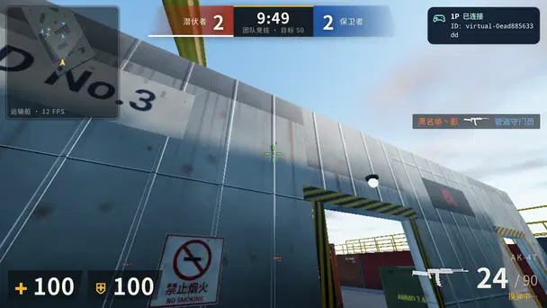 [pureTV 移植版画面](<https://github.com/ecojust/pureTV/blob/415a8083bcac06532b21a35c03399da23570f20e/joystick-games/cf-transport-ship/docs/releases/0.1.0/android/runtime-normal/playing.png>) | [riba2534/claude-opus-5-5-demo](<https://github.com/riba2534/claude-opus-5-5-demo>) | pureTV 已发布 | [运输船 CF](<https://github.com/ecojust/pureTV/blob/415a8083bcac06532b21a35c03399da23570f20e/joystick-games/cf-transport-ship/README.md>) | [可达 · 含游戏画布／引擎的网页](<https://claude-opus-5-5-cf-transport-ship.pages.dev/>) |
| 3869 | 对照 | [CF Transport Ship](<https://github.com/gamingnews5/awesome-opus-5.5-games/blob/9a29b570e56bd19f15a3cd6bbac0b8c682f2c48c/games/cf-transport-ship-xiiyioozzz-opus55-3d-games/readme.md>) | 待补截图 | [xiiyioozzz/opus55-3d-games](<https://github.com/xiiyioozzz/opus55-3d-games>) | 已发布版本的同源副本 | [运输船 CF](<https://github.com/ecojust/pureTV/blob/415a8083bcac06532b21a35c03399da23570f20e/joystick-games/cf-transport-ship/README.md>) | [可达 · 含游戏画布／引擎的网页](<https://games.xdullboy.com/transport-ship/>) |
| 3870 | 对照 | [Clawd Pop 3D](<https://github.com/gamingnews5/awesome-opus-5.5-games/blob/9a29b570e56bd19f15a3cd6bbac0b8c682f2c48c/games/clawd-pop-3d/readme.md>) | 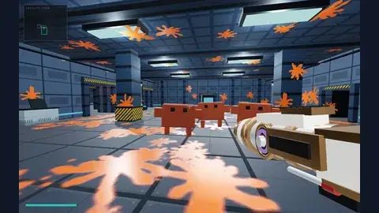 [合集截图](<https://github.com/gamingnews5/awesome-opus-5.5-games/blob/9a29b570e56bd19f15a3cd6bbac0b8c682f2c48c/assets/screenshot-gallery/6863d9b6c3fc888ee518.webp>) | [VibezZzCoder/clawd-pop](<https://github.com/VibezZzCoder/clawd-pop>) | pureTV 已发布 | [爆裂实验室](<https://github.com/ecojust/pureTV/blob/415a8083bcac06532b21a35c03399da23570f20e/joystick-games/clawd-pop/README.md>) | [可达 · 合集所列网页](<https://vibezzzcoder.github.io/clawd-pop/>) |
| 3871 | 对照 | [GLUP — Nila y el pez gato](<https://github.com/gamingnews5/awesome-opus-5.5-games/blob/9a29b570e56bd19f15a3cd6bbac0b8c682f2c48c/games/glup-nila-y-el-pez-gato/readme.md>) |  [pureTV 移植版画面](<https://github.com/ecojust/pureTV/blob/415a8083bcac06532b21a35c03399da23570f20e/joystick-games/glup/docs/browser-attempt-8-1280/playing-1280.png>) | [gavilanbe/glup](<https://github.com/gavilanbe/glup>) | pureTV 已发布 | [GLUP · 沼泽猫鱼](<https://github.com/ecojust/pureTV/blob/415a8083bcac06532b21a35c03399da23570f20e/joystick-games/glup/README.md>) | [可达 · 含游戏画布／引擎的网页](<https://gavilanbe.github.io/glup/>) |
| 3872 | 对照 | [Kart Royale](<https://github.com/gamingnews5/awesome-opus-5.5-games/blob/9a29b570e56bd19f15a3cd6bbac0b8c682f2c48c/games/kart-royale/readme.md>) |  [合集截图](<https://github.com/ryancampbell/kart-royale/blob/main/docs/hero-drift.png>) | [ryancampbell/kart-royale](<https://github.com/ryancampbell/kart-royale>) | pureTV 已发布 | [Kart Royale](<https://github.com/ecojust/pureTV/blob/415a8083bcac06532b21a35c03399da23570f20e/joystick-games/kart-royale/README.md>) | [README · 可达 · 上游 README 所列网页](<https://racing.ryancampbell.com>) |
| 3873 | 对照 | [KINDLE](<https://github.com/gamingnews5/awesome-opus-5.5-games/blob/9a29b570e56bd19f15a3cd6bbac0b8c682f2c48c/games/kindle/readme.md>) | 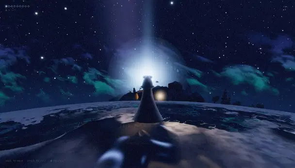 [合集截图](<https://github.com/TonyDowney/kindle/blob/HEAD/docs/shots/06-call.jpg>) | [TonyDowney/kindle](<https://github.com/TonyDowney/kindle>) | pureTV 已发布 | [星球点灯人](<https://github.com/ecojust/pureTV/blob/415a8083bcac06532b21a35c03399da23570f20e/joystick-games/kindle/README.md>) | [可达 · 含游戏画布／引擎的网页](<https://tonydowney.github.io/kindle/>) |
| 3874 | 对照 | [Last Track](<https://github.com/gamingnews5/awesome-opus-5.5-games/blob/9a29b570e56bd19f15a3cd6bbac0b8c682f2c48c/games/last-track/readme.md>) | 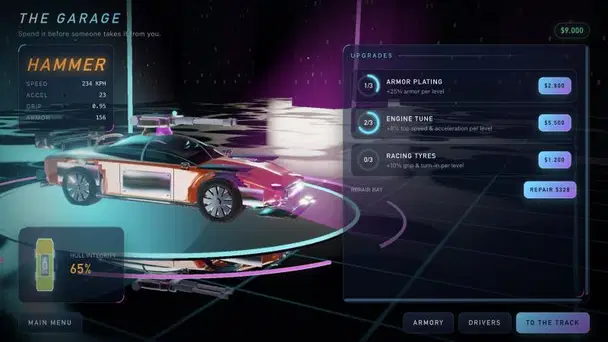 [游戏菜单或界面](<https://github.com/alexander-uspenskiy/LastTrack/blob/main/docs/images/garage.jpg>) | [alexander-uspenskiy/LastTrack](<https://github.com/alexander-uspenskiy/LastTrack>) | pureTV 已发布 | [Last Track](<https://github.com/ecojust/pureTV/blob/415a8083bcac06532b21a35c03399da23570f20e/joystick-games/last-track/README.md>) | [可达 · 含游戏画布／引擎的网页](<https://alexander-uspenskiy.github.io/lastrack/>) |
| 3875 | 对照 | [LUMENRIFT](<https://github.com/gamingnews5/awesome-opus-5.5-games/blob/9a29b570e56bd19f15a3cd6bbac0b8c682f2c48c/games/lumenrift/readme.md>) | 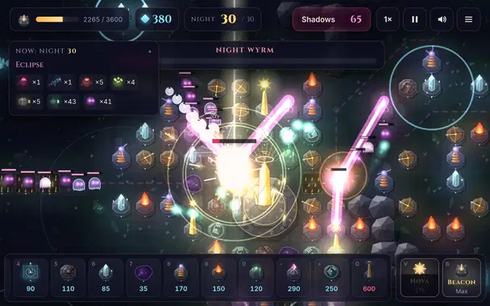 [合集截图](<https://github.com/WhiteBlackGoose/Lumenrift/blob/56517f60a44d49ef14e0e51b5df93d933b1a4f20/docs/img/hero.jpg>) | [WhiteBlackGoose/Lumenrift](<https://github.com/WhiteBlackGoose/Lumenrift>) | pureTV 已发布 | [光隙守望](<https://github.com/ecojust/pureTV/blob/415a8083bcac06532b21a35c03399da23570f20e/joystick-games/lumenrift/README.md>) | [可达 · 含游戏画布／引擎的网页](<https://lumenrift.wbg.gg/>) |
| 3876 | 对照 | [Night Racer](<https://github.com/gamingnews5/awesome-opus-5.5-games/blob/9a29b570e56bd19f15a3cd6bbac0b8c682f2c48c/games/night-racer/readme.md>) | 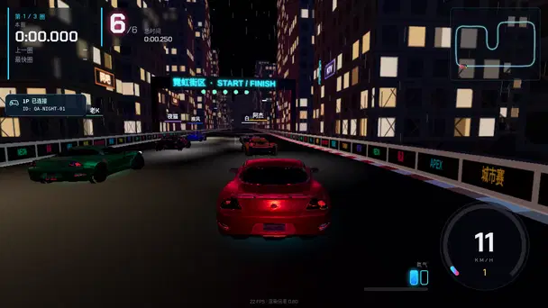 [pureTV 移植版画面](<https://github.com/ecojust/pureTV/blob/415a8083bcac06532b21a35c03399da23570f20e/joystick-games/night-racer/docs/browser-attempt-3/driving-1280.png>) | [zhuqipaopao-maker/night-racer-public](<https://github.com/zhuqipaopao-maker/night-racer-public>) | pureTV 已发布 | [Night Racer](<https://github.com/ecojust/pureTV/blob/415a8083bcac06532b21a35c03399da23570f20e/joystick-games/night-racer/README.md>) | [可达 · 含游戏画布／引擎的网页](<https://night-racer.pages.dev>) |
| 3877 | 对照 | [Nova Lancer](<https://github.com/gamingnews5/awesome-opus-5.5-games/blob/9a29b570e56bd19f15a3cd6bbac0b8c682f2c48c/games/nova-lancer/readme.md>) | 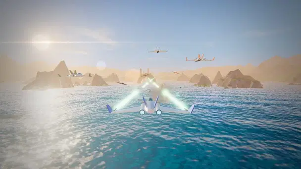 [合集截图](<https://github.com/tanuu5/nova-lancer/blob/main/docs/screenshots/ocean.jpg>) | [tanuu5/nova-lancer](<https://github.com/tanuu5/nova-lancer>) | pureTV 已发布 | [Nova Lancer · 新星枪骑兵](<https://github.com/ecojust/pureTV/blob/415a8083bcac06532b21a35c03399da23570f20e/joystick-games/nova-lancer/README.md>) | [可达 · 合集所列网页](<https://tanuu5.github.io/nova-lancer/>) |
| 3878 | 对照 | [Operation Ironhold](<https://github.com/gamingnews5/awesome-opus-5.5-games/blob/9a29b570e56bd19f15a3cd6bbac0b8c682f2c48c/games/operation-ironhold/readme.md>) | 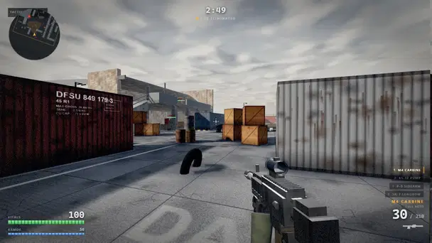 [合集截图](<https://github.com/StarKnightt/operation-ironhold/blob/main/screenshots/gameplay.jpg>) | [StarKnightt/operation-ironhold](<https://github.com/StarKnightt/operation-ironhold>) | pureTV 已发布 | [铁垒行动](<https://github.com/ecojust/pureTV/blob/415a8083bcac06532b21a35c03399da23570f20e/joystick-games/operation-ironhold/README.md>) | [可达 · 含游戏画布／引擎的网页](<https://starknightt.github.io/operation-ironhold/>) |
| 3879 | 对照 | [Penguintrack](<https://github.com/gamingnews5/awesome-opus-5.5-games/blob/9a29b570e56bd19f15a3cd6bbac0b8c682f2c48c/games/penguintrack/readme.md>) | 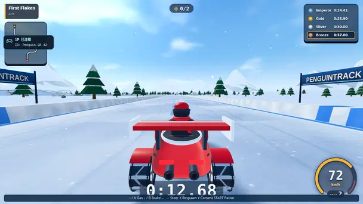 [pureTV 移植版画面](<https://github.com/ecojust/pureTV/blob/415a8083bcac06532b21a35c03399da23570f20e/joystick-games/penguintrack/docs/browser-attempt-5/playing-1280.png>) | [SilverNinja71/Penguin-Track](<https://github.com/SilverNinja71/Penguin-Track>) | pureTV 已发布 | [Penguintrack](<https://github.com/ecojust/pureTV/blob/415a8083bcac06532b21a35c03399da23570f20e/joystick-games/penguintrack/README.md>) | [可达 · 含游戏画布／引擎的网页](<https://silverninja71.github.io/Penguin-Track/>) |
| 3880 | 对照 | [Ponpoko Kart](<https://github.com/gamingnews5/awesome-opus-5.5-games/blob/9a29b570e56bd19f15a3cd6bbac0b8c682f2c48c/games/ponpoko-kart/readme.md>) |  [pureTV 移植版画面](<https://github.com/ecojust/pureTV/blob/415a8083bcac06532b21a35c03399da23570f20e/joystick-games/ponpoko-kart/src/upstream/docs/screenshots/race.jpg>) | [tanuu5/ponpoko-kart](<https://github.com/tanuu5/ponpoko-kart>) | pureTV 已发布 | [Ponpoko Kart](<https://github.com/ecojust/pureTV/blob/415a8083bcac06532b21a35c03399da23570f20e/joystick-games/ponpoko-kart/README.md>) | [可达 · 合集所列网页](<https://tanuu5.github.io/ponpoko-kart/>) |
| 3881 | 对照 | [QQ Speed](<https://github.com/gamingnews5/awesome-opus-5.5-games/blob/9a29b570e56bd19f15a3cd6bbac0b8c682f2c48c/games/qq-speed/readme.md>) | 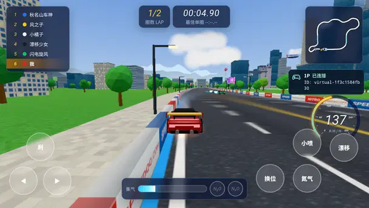 [pureTV 移植版画面](<https://github.com/ecojust/pureTV/blob/415a8083bcac06532b21a35c03399da23570f20e/joystick-games/qq-speed/docs/releases/0.1.0/android/runtime-normal/playing.png>) | [riba2534/claude-opus-5-5-demo](<https://github.com/riba2534/claude-opus-5-5-demo>) | pureTV 已发布 | [QQ 飞车](<https://github.com/ecojust/pureTV/blob/415a8083bcac06532b21a35c03399da23570f20e/joystick-games/qq-speed/README.md>) | [可达 · 含游戏画布／引擎的网页](<https://claude-opus-5-5-qqfeiche3d.pages.dev/>) |
| 3882 | 对照 | [QQ Speed](<https://github.com/gamingnews5/awesome-opus-5.5-games/blob/9a29b570e56bd19f15a3cd6bbac0b8c682f2c48c/games/qq-speed-xiiyioozzz-opus55-3d-games/readme.md>) | 待补截图 | [xiiyioozzz/opus55-3d-games](<https://github.com/xiiyioozzz/opus55-3d-games>) | 已发布版本的同源副本 | [QQ 飞车](<https://github.com/ecojust/pureTV/blob/415a8083bcac06532b21a35c03399da23570f20e/joystick-games/qq-speed/README.md>) | [可达 · 含游戏画布／引擎的网页](<https://games.xdullboy.com/qq-speed/>) |
| 3883 | 对照 | [Saber / Descent](<https://github.com/gamingnews5/awesome-opus-5.5-games/blob/9a29b570e56bd19f15a3cd6bbac0b8c682f2c48c/games/saber-descent/readme.md>) | 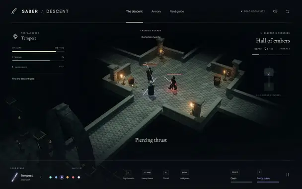 [合集截图](<https://github.com/Vheissu/saber-battle/blob/main/screenshots/03-saber-descent-combat.png>) | [Vheissu/saber-battle](<https://github.com/Vheissu/saber-battle>) | pureTV 已发布 | [光刃魔塔](<https://github.com/ecojust/pureTV/blob/415a8083bcac06532b21a35c03399da23570f20e/joystick-games/saber-magic-tower/README.md>) | [可达 · 合集所列网页](<https://vheissu.github.io/saber-battle/>) |
| 3884 | 对照 | [Silent Meridian](<https://github.com/gamingnews5/awesome-opus-5.5-games/blob/9a29b570e56bd19f15a3cd6bbac0b8c682f2c48c/games/silent-meridian/readme.md>) | 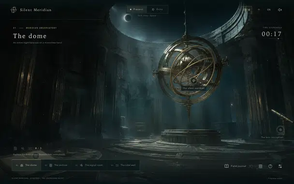 [合集截图](<https://github.com/stackloomdev/silent-meridian/blob/main/docs/screenshots/depth-observatory.png>) | [stackloomdev/silent-meridian](<https://github.com/stackloomdev/silent-meridian>) | pureTV 已发布 | [静默子午线](<https://github.com/ecojust/pureTV/blob/415a8083bcac06532b21a35c03399da23570f20e/joystick-games/silent-meridian/README.md>) | [HTTP 错误 · 合集所列网页](<https://silent-meridian.stackloom.org/>) |
| 3885 | 对照 | [Turbo Kart Rally](<https://github.com/gamingnews5/awesome-opus-5.5-games/blob/9a29b570e56bd19f15a3cd6bbac0b8c682f2c48c/games/turbo-kart-rally/readme.md>) | 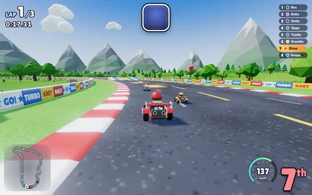 [合集截图](<https://github.com/bridge-mind/turbo-kart-rally/blob/main/docs/screenshots/race.jpg>) | [bridge-mind/turbo-kart-rally](<https://github.com/bridge-mind/turbo-kart-rally>) | pureTV 已发布 | [涡轮卡丁拉力赛](<https://github.com/ecojust/pureTV/blob/415a8083bcac06532b21a35c03399da23570f20e/joystick-games/turbo-kart-rally/README.md>) | [可达 · 含游戏画布／引擎的网页](<https://bridge-mind.github.io/turbo-kart-rally/>) |
| 3886 | 对照 | [Turbo Kart Rally](<https://github.com/gamingnews5/awesome-opus-5.5-games/blob/9a29b570e56bd19f15a3cd6bbac0b8c682f2c48c/games/turbo-kart-rally-exclusiveabhi-turbo-kart-rally-game/readme.md>) | 待补截图 | [exclusiveabhi/turbo-kart-rally-game](<https://github.com/exclusiveabhi/turbo-kart-rally-game>) | 已发布版本的同源副本 | [涡轮卡丁拉力赛](<https://github.com/ecojust/pureTV/blob/415a8083bcac06532b21a35c03399da23570f20e/joystick-games/turbo-kart-rally/README.md>) | 未列入口 |
| 3887 | 对照 | [Turbo Kart Rush](<https://github.com/gamingnews5/awesome-opus-5.5-games/blob/9a29b570e56bd19f15a3cd6bbac0b8c682f2c48c/games/turbo-kart-rush/readme.md>) | 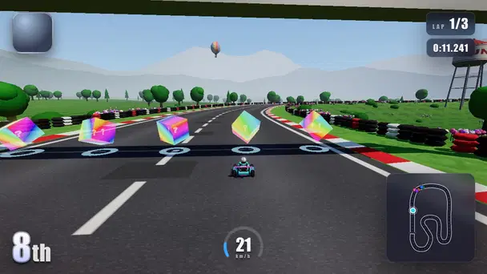 [合集截图](<https://github.com/bridge-mind/turbo-kart-rush/blob/main/docs/screenshots/race.jpg>) | [bridge-mind/turbo-kart-rush](<https://github.com/bridge-mind/turbo-kart-rush>) | pureTV 已发布 | [Turbo Kart Rush](<https://github.com/ecojust/pureTV/blob/415a8083bcac06532b21a35c03399da23570f20e/joystick-games/turbo-kart-rush/README.md>) | [可达 · 合集所列网页](<https://bridge-mind.github.io/turbo-kart-rush/>) |
| 3888 | 对照 | [Turbo Kart Rush](<https://github.com/gamingnews5/awesome-opus-5.5-games/blob/9a29b570e56bd19f15a3cd6bbac0b8c682f2c48c/games/turbo-kart-rush-claudio41cg-max-rio-rush-cross/readme.md>) |  [合集截图](<https://github.com/claudio41cg-max/rio-rush-cross/blob/HEAD/docs/screenshots/track-select.jpg>) | [claudio41cg-max/rio-rush-cross](<https://github.com/claudio41cg-max/rio-rush-cross>) | 已发布版本的同源改版 | [Turbo Kart Rush](<https://github.com/ecojust/pureTV/blob/415a8083bcac06532b21a35c03399da23570f20e/joystick-games/turbo-kart-rush/README.md>) | [README · 可达 · 合集所列网页](<https://bridge-mind.github.io/turbo-kart-rush/>) |

[返回全量目录](README.md)
