# 有明确授权限制，待核对使用范围

[全量目录](README.md) · [候选清单](../todo.md) · [Excel 核对表](../game-audit.xlsx)

本页序号 **3,765–3,867**，共 103 款。项目或部分内容涉及非商业条款、原作素材或保留权利。可勾选请求复核，具体限制按行查看。

编辑清单时可将 `[ ]` 改为 `[x]`，也可以直接回复游戏名和仓库。名称链接通向合集笔记。

| 序号 | 勾选 | 游戏 | 截图
 | 上游仓库 | 许可和素材说明 | 手柄线索 | 截图分 | 试玩或演示入口 |
| ---: | --- | --- | --- | --- | --- | --- | ---: | --- |
| 3765 | [ ] | [A Personal Apocalypse — roguelike built from OpenStreetMap](<https://github.com/gamingnews5/awesome-opus-5.5-games/blob/9a29b570e56bd19f15a3cd6bbac0b8c682f2c48c/games/a-personal-apocalypse-roguelike-built-from-openstreetmap/readme.md>) | 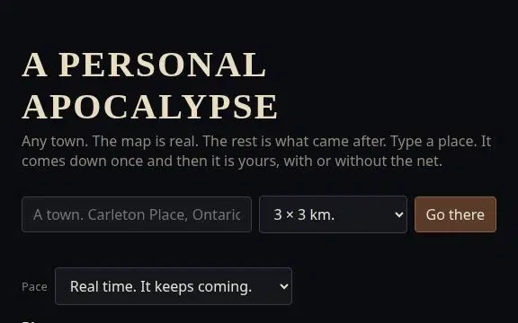 [同款源码启动画面实截](<https://github.com/jordanlong121/a-personal-apocalypse/blob/HEAD/index.html>) | [jordanlong121/a-personal-apocalypse](<https://github.com/jordanlong121/a-personal-apocalypse>) | [许可正文明确限制再利用，详见原文](<https://github.com/jordanlong121/a-personal-apocalypse/blob/HEAD/LICENSE>) | 待核 | — | [可达 · 含游戏画布／引擎的网页](<https://jordanlong121.github.io/a-personal-apocalypse/>) |
| 3766 | [ ] | [Absorb Roguelike](<https://github.com/gamingnews5/awesome-opus-5.5-games/blob/9a29b570e56bd19f15a3cd6bbac0b8c682f2c48c/games/absorb-roguelike/readme.md>) | 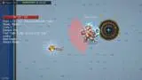 [合集截图](<https://media.githubusercontent.com/media/Leenamgi20/Absorb-Roguelike/main/Art_Source/itch/shot_3_boss.png>) | [Leenamgi20/Absorb-Roguelike](<https://github.com/Leenamgi20/Absorb-Roguelike>) | [根文件含 MIT 正文并另述素材范围，须逐项复核](<https://github.com/Leenamgi20/Absorb-Roguelike/blob/HEAD/LICENSE>) [美术、声音、场景与关卡数据保留权利，复用须获得许可。](<https://github.com/Leenamgi20/Absorb-Roguelike/blob/HEAD/README.md#L66-L68>) | 待核 | [6.0（原图失效）](<https://github.com/Leenamgi20/Absorb-Roguelike/blob/main/Art_Source/itch/shot_3_boss.png>) · [原图存档](<https://media.githubusercontent.com/media/Leenamgi20/Absorb-Roguelike/main/Art_Source/itch/shot_3_boss.png>) | [可达 · itch.io 内嵌游戏页](<https://somojeok.itch.io/absorbroguelike>) |
| 3767 | [ ] | [Advanced Daisenryaku PC](<https://github.com/gamingnews5/awesome-opus-5.5-games/blob/9a29b570e56bd19f15a3cd6bbac0b8c682f2c48c/games/advanced-daisenryaku-pc/readme.md>) | 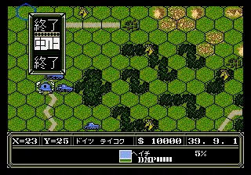 [合集截图](<https://github.com/eric-wen-dev-it/AdvancedDaisenryaku/blob/main/docs/original_preview.png>) | [eric-wen-dev-it/AdvancedDaisenryaku](<https://github.com/eric-wen-dev-it/AdvancedDaisenryaku>) | 常见根目录许可文件未找到 [运行需自备匹配的世嘉 MD 版原作 ROM，仓库也未随附提取音效。](<https://github.com/eric-wen-dev-it/AdvancedDaisenryaku/blob/HEAD/README.md#L34-L39>) | [README 提及](<https://github.com/eric-wen-dev-it/AdvancedDaisenryaku/blob/HEAD/README.md#L45>) | [6.0](<https://github.com/eric-wen-dev-it/AdvancedDaisenryaku/blob/main/docs/original_preview.png>) | 未列入口 |
| 3768 | [ ] | [Atom Trap](<https://github.com/gamingnews5/awesome-opus-5.5-games/blob/9a29b570e56bd19f15a3cd6bbac0b8c682f2c48c/games/atom-trap/readme.md>) | 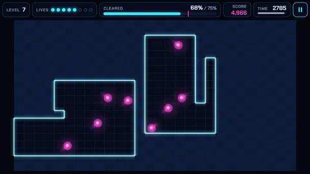 [上游游戏截图](<https://github.com/Todilo/atom-trap/blob/HEAD/store/screenshots/02-classic.png>) | [Todilo/atom-trap](<https://github.com/Todilo/atom-trap>) | [许可正文明确限制再利用，详见原文](<https://github.com/Todilo/atom-trap/blob/HEAD/LICENSE>) | 待核 | — | [可达 · 合集所列网页](<https://todilo.github.io/atom-trap/>) |
| 3769 | [ ] | [AZRAGON](<https://github.com/gamingnews5/awesome-opus-5.5-games/blob/9a29b570e56bd19f15a3cd6bbac0b8c682f2c48c/games/azragon/readme.md>) | 待补截图 | [ericvaladas/azragon](<https://github.com/ericvaladas/azragon>) | [根文件声明保留所有权利](<https://github.com/ericvaladas/azragon/blob/HEAD/LICENSE.txt>) | 待核 | — | [可达 · 合集所列网页](<https://run.world/decaf/azragon>) |
| 3770 | [ ] | [Backgammon PWA](<https://github.com/gamingnews5/awesome-opus-5.5-games/blob/9a29b570e56bd19f15a3cd6bbac0b8c682f2c48c/games/backgammon-pwa/readme.md>) | 待补截图 | [HoseinEmrani/backgammonPWA](<https://github.com/HoseinEmrani/backgammonPWA>) | [许可正文含非商业使用条款](<https://github.com/HoseinEmrani/backgammonPWA/blob/HEAD/LICENSE>) | 待核 | — | [可达 · 合集所列网页](<https://hoseinemrani.github.io/backgammonPWA/>) |
| 3771 | [ ] | [Balance Astronaut](<https://github.com/gamingnews5/awesome-opus-5.5-games/blob/9a29b570e56bd19f15a3cd6bbac0b8c682f2c48c/games/balance-astronaut/readme.md>) | 待补截图 | [asmoyou/toy2game](<https://github.com/asmoyou/toy2game>) | [许可正文含非商业使用条款](<https://github.com/asmoyou/toy2game/blob/HEAD/LICENSE>) | 待核 | — | 未列入口 |
| 3772 | [ ] | [Battle Through the Heavens 2.5D](<https://github.com/gamingnews5/awesome-opus-5.5-games/blob/9a29b570e56bd19f15a3cd6bbac0b8c682f2c48c/games/battle-through-the-heavens-2-5d/readme.md>) | 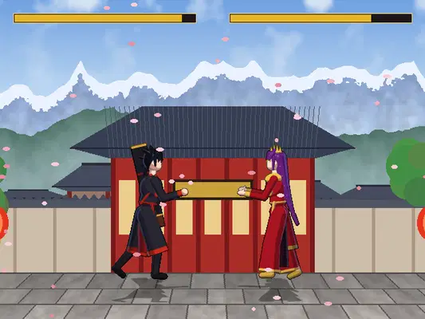 [合集截图](<https://github.com/deenodadon/BTTH2dG/blob/claude/festive-tesla-js0nez/docs/scene_xiaoclan.png>) | [deenodadon/BTTH2dG](<https://github.com/deenodadon/BTTH2dG>) | 常见根目录许可文件未找到 [作者标注为基于《斗破苍穹》的非商业同人游戏。](<https://github.com/deenodadon/BTTH2dG/blob/HEAD/README.md#L3-L4>) | [README 提及](<https://github.com/deenodadon/BTTH2dG/blob/HEAD/README.md#L33>) | [6.2](<https://github.com/deenodadon/BTTH2dG/blob/claude/festive-tesla-js0nez/docs/scene_xiaoclan.png>) | 未列入口 |
| 3773 | [ ] | [Blue Light](<https://github.com/gamingnews5/awesome-opus-5.5-games/blob/9a29b570e56bd19f15a3cd6bbac0b8c682f2c48c/games/blue-light/readme.md>) | 待补截图 | [datadrowner/BlueLight](<https://github.com/datadrowner/BlueLight>) | [许可正文明确限制再利用，详见原文](<https://github.com/datadrowner/BlueLight/blob/HEAD/LICENSE>) [README 许可段另述素材或第三方内容](<https://raw.githubusercontent.com/datadrowner/BlueLight/HEAD/README.md>) | 待核 | — | [可达 · 合集所列网页](<https://projectbluelight.eu>) |
| 3774 | [ ] | [Boing Up: Sky Tower](<https://github.com/gamingnews5/awesome-opus-5.5-games/blob/9a29b570e56bd19f15a3cd6bbac0b8c682f2c48c/games/boing-up-sky-tower/readme.md>) | 待补截图 | [jpdash-creator/boing-up-sky-tower](<https://github.com/jpdash-creator/boing-up-sky-tower>) | [许可正文明确限制再利用，详见原文](<https://github.com/jpdash-creator/boing-up-sky-tower/blob/HEAD/LICENSE>) | 待核 | — | 未列入口 |
| 3775 | [ ] | [California Drive](<https://github.com/gamingnews5/awesome-opus-5.5-games/blob/9a29b570e56bd19f15a3cd6bbac0b8c682f2c48c/games/california-drive/readme.md>) | 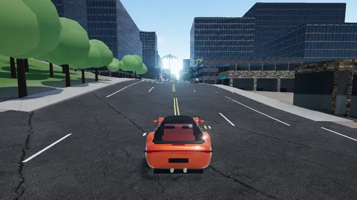 [合集截图](<https://github.com/roszhan2684/california-drive/blob/main/docs/media/la-day-clear.jpg>) | [roszhan2684/california-drive](<https://github.com/roszhan2684/california-drive>) | 常见根目录许可文件未找到 [BMW 车型仅限个人非商业使用；作者为公开发布提供无品牌车型。](<https://github.com/roszhan2684/california-drive/blob/HEAD/README.md#L9>) | [README 提及](<https://github.com/roszhan2684/california-drive/blob/HEAD/README.md#L39>) | [6.8](<https://github.com/roszhan2684/california-drive/blob/main/docs/media/la-day-clear.jpg>) | [可达 · 含游戏画布／引擎的网页](<https://roszhan2684.github.io/california-drive/>) |
| 3776 | [ ] | [Can I Pet That Dog?](<https://github.com/gamingnews5/awesome-opus-5.5-games/blob/9a29b570e56bd19f15a3cd6bbac0b8c682f2c48c/games/can-i-pet-that-dog/readme.md>) | 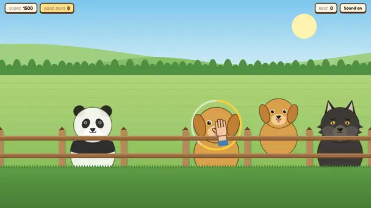 [合集截图](<https://github.com/tjdoolittle/can-i-pet-that-dog/blob/main/screenshots/gameplay.png>) | [tjdoolittle/can-i-pet-that-dog](<https://github.com/tjdoolittle/can-i-pet-that-dog>) | 常见根目录许可文件未找到 [开场音频属原创作者，原项目仅声明在非商业同人游戏内使用。](<https://github.com/tjdoolittle/can-i-pet-that-dog/blob/HEAD/README.md#L42>) | 待核 | [6.0](<https://github.com/tjdoolittle/can-i-pet-that-dog/blob/main/screenshots/gameplay.png>) | [可达 · 含游戏画布／引擎的网页](<https://tjdoolittle.github.io/can-i-pet-that-dog/>) |
| 3777 | [ ] | [Chains of Hera](<https://github.com/gamingnews5/awesome-opus-5.5-games/blob/9a29b570e56bd19f15a3cd6bbac0b8c682f2c48c/games/chains-of-hera/readme.md>) | 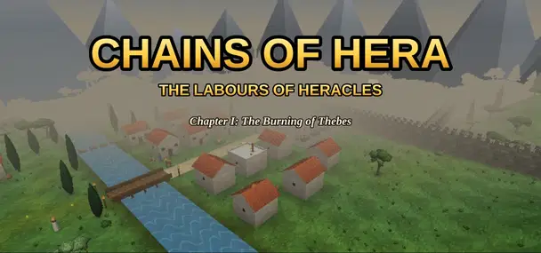 [游戏菜单或界面](<https://github.com/BMKoscak/Chains-of-Hera/blob/main/docs/screenshots/title.jpg>) | [BMKoscak/Chains-of-Hera](<https://github.com/BMKoscak/Chains-of-Hera>) | [ISC（package.json 声明）](<https://github.com/BMKoscak/Chains-of-Hera/blob/HEAD/package.json>) [README 明确声明包管理器的 ISC 是占位符，未授权复用。](<https://github.com/BMKoscak/Chains-of-Hera/blob/HEAD/README.md#L318>) | [README 提及、源码有输入读取](<https://github.com/BMKoscak/Chains-of-Hera/blob/main/index_7_1.html#L112>) | [6.2](<https://github.com/BMKoscak/Chains-of-Hera/blob/main/docs/screenshots/title.jpg>) | [可达 · 合集所列网页](<https://thebenn.me/Chains-of-Hera/>) |
| 3778 | [ ] | [Chefmarketw.Github.Io](<https://github.com/gamingnews5/awesome-opus-5.5-games/blob/9a29b570e56bd19f15a3cd6bbac0b8c682f2c48c/games/chefmarketw-github-io/readme.md>) | 待补截图 | [Chefmarketw/chefmarketw.github.io](<https://github.com/Chefmarketw/chefmarketw.github.io>) | [许可正文明确限制再利用，详见原文](<https://github.com/Chefmarketw/chefmarketw.github.io/blob/HEAD/LICENSE>) [项目声明保留全部权利，详见 LICENSE。](<https://github.com/Chefmarketw/chefmarketw.github.io/blob/HEAD/README.md#L40>) | 待核 | [5.4](<https://github.com/Chefmarketw/chefmarketw.github.io/blob/main/card.jpg>) | [可达 · 合集所列网页](<https://chefmarketw.github.io/>) |
| 3779 | [ ] | [ChemQuest Upstate, Version 2](<https://github.com/gamingnews5/awesome-opus-5.5-games/blob/9a29b570e56bd19f15a3cd6bbac0b8c682f2c48c/games/chemquest-upstate-version-2/readme.md>) | 待补截图 | [Kashee12345/chemquest-upstate-v2](<https://github.com/Kashee12345/chemquest-upstate-v2>) | [许可正文含非商业使用条款](<https://github.com/Kashee12345/chemquest-upstate-v2/blob/HEAD/LICENSE>) [README 许可段另述素材或第三方内容](<https://raw.githubusercontent.com/Kashee12345/chemquest-upstate-v2/HEAD/README.md>) | 待核 | — | [可达 · 合集所列网页](<https://kashee12345.github.io/chemquest-upstate-v2/>) |
| 3780 | [ ] | [Chess Game](<https://github.com/gamingnews5/awesome-opus-5.5-games/blob/9a29b570e56bd19f15a3cd6bbac0b8c682f2c48c/games/chess-game/readme.md>) | 待补截图 | [rochano/chess](<https://github.com/rochano/chess>) | [许可正文明确限制再利用，详见原文](<https://github.com/rochano/chess/blob/HEAD/LICENSE>) | 待核 | — | [可达 · 合集所列网页](<https://rochano.github.io/chess/>) |
| 3781 | [ ] | [Color Minefield](<https://github.com/gamingnews5/awesome-opus-5.5-games/blob/9a29b570e56bd19f15a3cd6bbac0b8c682f2c48c/games/color-minefield/readme.md>) | 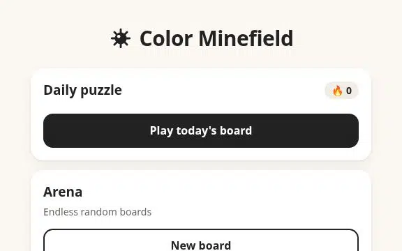 [同款源码启动画面实截](<https://github.com/federicoemartinez/color_minewseeper/blob/HEAD/index.html>) | [federicoemartinez/color\_minewseeper](<https://github.com/federicoemartinez/color_minewseeper>) | [许可正文含非商业使用条款](<https://github.com/federicoemartinez/color_minewseeper/blob/HEAD/LICENSE.md>) | 待核 | — | [可达 · 合集所列网页](<https://federicoemartinez.github.io/color_minewseeper/>) |
| 3782 | [ ] | [Constellations](<https://github.com/gamingnews5/awesome-opus-5.5-games/blob/9a29b570e56bd19f15a3cd6bbac0b8c682f2c48c/games/constellations/readme.md>) | 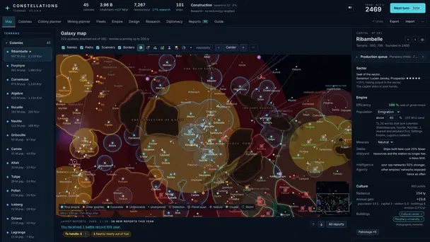 [合集截图](<https://github.com/IntelligentRebel/constellations/blob/main/docs/screenshots/en/map.png>) | [IntelligentRebel/constellations](<https://github.com/IntelligentRebel/constellations>) | 常见根目录许可文件未找到 [作者暂不授予使用许可，仅开放游玩和阅读代码。](<https://github.com/IntelligentRebel/constellations/blob/HEAD/README.md#L160-L163>) | 待核 | [6.6](<https://github.com/IntelligentRebel/constellations/blob/main/docs/screenshots/en/map.png>) | [可达 · 合集所列网页](<https://intelligentrebel.github.io/constellations/>) |
| 3783 | [ ] | [Crosshatch](<https://github.com/gamingnews5/awesome-opus-5.5-games/blob/9a29b570e56bd19f15a3cd6bbac0b8c682f2c48c/games/crosshatch/readme.md>) | 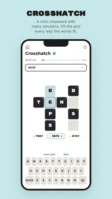 [合集截图](<https://github.com/rickymetz/wordgirl/blob/main/public/teasers/crosshatch.png>) | [rickymetz/wordgirl](<https://github.com/rickymetz/wordgirl>) | [许可正文含非商业使用条款](<https://github.com/rickymetz/wordgirl/blob/HEAD/LICENSE.md>) [源码采用 PolyForm Noncommercial 1.0.0。](<https://github.com/rickymetz/wordgirl/blob/HEAD/README.md#L283-L286>) | 待核 | [6.5](<https://github.com/rickymetz/wordgirl/blob/main/public/teasers/crosshatch.png>) | 未列入口 |
| 3784 | [ ] | [Curse of the Dungeon Engine](<https://github.com/gamingnews5/awesome-opus-5.5-games/blob/9a29b570e56bd19f15a3cd6bbac0b8c682f2c48c/games/curse-of-the-dungeon-engine/readme.md>) | 待补截图 | [edrethardo/game](<https://github.com/edrethardo/game>) | [许可正文含非商业使用条款](<https://github.com/edrethardo/game/blob/HEAD/LICENSE>) [README 许可段另述素材或第三方内容](<https://raw.githubusercontent.com/edrethardo/game/HEAD/README.md>) | [README 提及](<https://github.com/edrethardo/game/blob/HEAD/README.md#L118>) | — | 未列入口 |
| 3785 | [ ] | [Doublet](<https://github.com/gamingnews5/awesome-opus-5.5-games/blob/9a29b570e56bd19f15a3cd6bbac0b8c682f2c48c/games/doublet/readme.md>) | 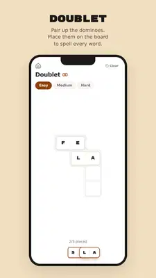 [合集截图](<https://github.com/rickymetz/wordgirl/blob/main/public/teasers/doublet.png>) | [rickymetz/wordgirl](<https://github.com/rickymetz/wordgirl>) | [许可正文含非商业使用条款](<https://github.com/rickymetz/wordgirl/blob/HEAD/LICENSE.md>) [源码采用 PolyForm Noncommercial 1.0.0。](<https://github.com/rickymetz/wordgirl/blob/HEAD/README.md#L283-L286>) | 待核 | [6.4](<https://github.com/rickymetz/wordgirl/blob/main/public/teasers/doublet.png>) | 未列入口 |
| 3786 | [ ] | [Dragon Books](<https://github.com/gamingnews5/awesome-opus-5.5-games/blob/9a29b570e56bd19f15a3cd6bbac0b8c682f2c48c/games/dragon-books/readme.md>) | 待补截图 | [marcussmeeth/Dragon-Books](<https://github.com/marcussmeeth/Dragon-Books>) | [许可正文明确限制再利用，详见原文](<https://github.com/marcussmeeth/Dragon-Books/blob/HEAD/LICENSE>) | 待核 | — | 未列入口 |
| 3787 | [ ] | [Dream Garden](<https://github.com/gamingnews5/awesome-opus-5.5-games/blob/9a29b570e56bd19f15a3cd6bbac0b8c682f2c48c/games/dream-garden/readme.md>) | 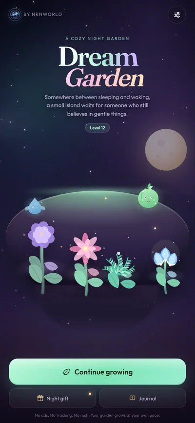 [游戏菜单或界面](<https://github.com/nRn-World/DreamGarden/blob/main/store/screenshots/01-title.png>) | [nRn-World/DreamGarden](<https://github.com/nRn-World/DreamGarden>) | [许可正文明确限制再利用，详见原文](<https://github.com/nRn-World/DreamGarden/blob/HEAD/LICENSE>) [仅限非商业教育使用；商用、销售、含广告再利用须书面许可。](<https://github.com/nRn-World/DreamGarden/blob/HEAD/README.md#L101-L104>) | 待核 | [5.4](<https://github.com/nRn-World/DreamGarden/blob/main/store/screenshots/01-title.png>) | 未列入口 |
| 3788 | [ ] | [English Quest](<https://github.com/gamingnews5/awesome-opus-5.5-games/blob/9a29b570e56bd19f15a3cd6bbac0b8c682f2c48c/games/english-quest/readme.md>) | 待补截图 | [rasulovnazim-design/English-Quest](<https://github.com/rasulovnazim-design/English-Quest>) | [许可正文明确限制再利用，详见原文](<https://github.com/rasulovnazim-design/English-Quest/blob/HEAD/LICENSE>) | 待核 | — | [可达 · 合集所列网页](<https://rasulovnazim-design.github.io/English-Quest/>) |
| 3789 | [ ] | [EUC Lean Too Much](<https://github.com/gamingnews5/awesome-opus-5.5-games/blob/9a29b570e56bd19f15a3cd6bbac0b8c682f2c48c/games/euc-lean-too-much/readme.md>) | 待补截图 | [crcknaka/euc-lean-too-much](<https://github.com/crcknaka/euc-lean-too-much>) | [许可正文明确限制再利用，详见原文](<https://github.com/crcknaka/euc-lean-too-much/blob/HEAD/LICENSE>) | 待核 | — | 未列入口 |
| 3790 | [ ] | [Flip Match](<https://github.com/gamingnews5/awesome-opus-5.5-games/blob/9a29b570e56bd19f15a3cd6bbac0b8c682f2c48c/games/flip-match/readme.md>) | 待补截图 | [asmoyou/toy2game](<https://github.com/asmoyou/toy2game>) | [许可正文含非商业使用条款](<https://github.com/asmoyou/toy2game/blob/HEAD/LICENSE>) | 待核 | — | 未列入口 |
| 3791 | [ ] | [Frog Feast](<https://github.com/gamingnews5/awesome-opus-5.5-games/blob/9a29b570e56bd19f15a3cd6bbac0b8c682f2c48c/games/frog-feast/readme.md>) | 待补截图 | [asmoyou/toy2game](<https://github.com/asmoyou/toy2game>) | [许可正文含非商业使用条款](<https://github.com/asmoyou/toy2game/blob/HEAD/LICENSE>) | 待核 | — | 未列入口 |
| 3792 | [ ] | [Frog Hopper](<https://github.com/gamingnews5/awesome-opus-5.5-games/blob/9a29b570e56bd19f15a3cd6bbac0b8c682f2c48c/games/frog-hopper/readme.md>) | 待补截图 | [Stephenson-Software/Frog-Hopper-2D](<https://github.com/Stephenson-Software/Frog-Hopper-2D>) | [许可正文含非商业使用条款](<https://github.com/Stephenson-Software/Frog-Hopper-2D/blob/HEAD/LICENSE>) | 待核 | — | [README · 可达 · 上游 README 所列网页](<https://danielstephenson.dev/play/frog-hopper-2d>) |
| 3793 | [ ] | [Frostvale](<https://github.com/gamingnews5/awesome-opus-5.5-games/blob/9a29b570e56bd19f15a3cd6bbac0b8c682f2c48c/games/frostvale/readme.md>) | 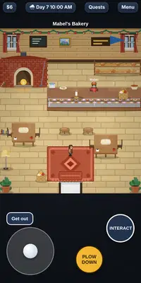 [合集截图](<https://github.com/LoungeLizrd/Frostvale/blob/main/media/bakery.png>) | [LoungeLizrd/Frostvale](<https://github.com/LoungeLizrd/Frostvale>) | [许可正文明确限制再利用，详见原文](<https://github.com/LoungeLizrd/Frostvale/blob/HEAD/LICENSE>) [作者声明保留全部权利。](<https://github.com/LoungeLizrd/Frostvale/blob/HEAD/README.md#L91>) | 待核 | [5.0](<https://github.com/LoungeLizrd/Frostvale/blob/main/media/bakery.png>) | [可达 · 含游戏画布／引擎的网页](<https://loungelizrd.github.io/Frostvale/>) |
| 3794 | [ ] | [Geomingo](<https://github.com/gamingnews5/awesome-opus-5.5-games/blob/9a29b570e56bd19f15a3cd6bbac0b8c682f2c48c/games/geomingo/readme.md>) | 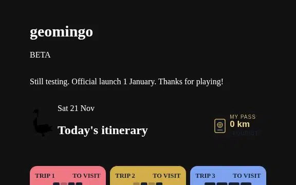 [同款源码启动画面实截](<https://github.com/hectorei19/geomingo/blob/HEAD/index.html>) | [hectorei19/geomingo](<https://github.com/hectorei19/geomingo>) | [许可正文明确限制再利用，详见原文](<https://github.com/hectorei19/geomingo/blob/HEAD/LICENSE>) | 待核 | — | [可达 · 合集所列网页](<https://geomingo.com/>) |
| 3795 | [ ] | [GoGo Arabic](<https://github.com/gamingnews5/awesome-opus-5.5-games/blob/9a29b570e56bd19f15a3cd6bbac0b8c682f2c48c/games/gogo-arabic/readme.md>) | 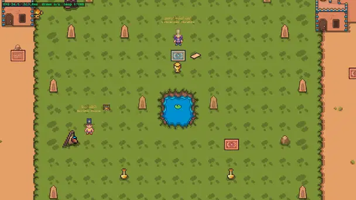 [合集截图](<https://github.com/theshumba/gogo-arabic/blob/fb12686f27611212e4f9e3604d313bb81907adf0/docs/world-shots/ancient_library.png>) | [theshumba/gogo-arabic](<https://github.com/theshumba/gogo-arabic>) | [README 许可段声明保留权利、限制使用或尚未授权](<https://github.com/theshumba/gogo-arabic/blob/HEAD/README.md>) [项目保留全部权利。](<https://github.com/theshumba/gogo-arabic/blob/HEAD/README.md#L89>) | 待核 | [6.5](<https://github.com/theshumba/gogo-arabic/blob/fb12686f27611212e4f9e3604d313bb81907adf0/docs/world-shots/ancient_library.png>) | 未列入口 |
| 3796 | [ ] | [granvald](<https://github.com/gamingnews5/awesome-opus-5.5-games/blob/9a29b570e56bd19f15a3cd6bbac0b8c682f2c48c/games/granvald/readme.md>) | 待补截图 | [toro0621-arch/granvald](<https://github.com/toro0621-arch/granvald>) | [根文件含 MIT 正文并另述素材范围，须逐项复核](<https://github.com/toro0621-arch/granvald/blob/HEAD/LICENSE>) [图片、故事与角色禁止未经许可转载；背景音乐另循 OpenTracks 条款。](<https://github.com/toro0621-arch/granvald/blob/HEAD/README.md#L23-L25>) | 待核 | [5.6](<https://github.com/toro0621-arch/granvald/blob/main/docs/ref/setting-sheet.png>) | 未列入口 |
| 3797 | [ ] | [Gridline](<https://github.com/gamingnews5/awesome-opus-5.5-games/blob/9a29b570e56bd19f15a3cd6bbac0b8c682f2c48c/games/gridline/readme.md>) | 待补截图 | [i-am-blake/gridline](<https://github.com/i-am-blake/gridline>) | [许可正文明确限制再利用，详见原文](<https://github.com/i-am-blake/gridline/blob/HEAD/LICENSE>) | 待核 | — | [可达 · 合集所列网页](<https://i-am-blake.github.io/gridline/>) |
| 3798 | [ ] | [Hardwood 1v1](<https://github.com/gamingnews5/awesome-opus-5.5-games/blob/9a29b570e56bd19f15a3cd6bbac0b8c682f2c48c/games/hardwood-1v1/readme.md>) | 待补截图 | [camcamk0328-ui/hardwood-1v1](<https://github.com/camcamk0328-ui/hardwood-1v1>) | [许可正文明确限制再利用，详见原文](<https://github.com/camcamk0328-ui/hardwood-1v1/blob/HEAD/LICENSE>) | 待核 | — | 未列入口 |
| 3799 | [ ] | [Hex Balance](<https://github.com/gamingnews5/awesome-opus-5.5-games/blob/9a29b570e56bd19f15a3cd6bbac0b8c682f2c48c/games/hex-balance/readme.md>) | 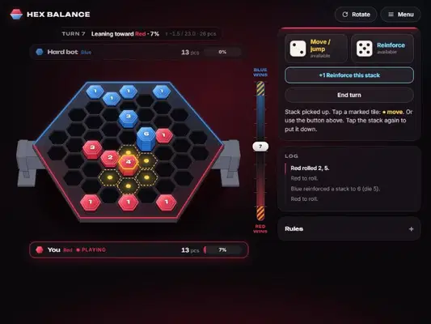 [合集截图](<https://github.com/Zach-Shirley/hex-balance/blob/main/docs/screenshot.jpg>) | [Zach-Shirley/hex-balance](<https://github.com/Zach-Shirley/hex-balance>) | [README 许可段声明保留权利、限制使用或尚未授权](<https://github.com/Zach-Shirley/hex-balance/blob/HEAD/README.md>) [作者声明保留全部权利，仅公开源码供阅读。](<https://github.com/Zach-Shirley/hex-balance/blob/HEAD/README.md#L196>) | 待核 | [5.8](<https://github.com/Zach-Shirley/hex-balance/blob/main/docs/screenshot.jpg>) | [可达 · 合集所列网页](<https://hex-balance.vercel.app>) |
| 3800 | [ ] | [Highway 1](<https://github.com/gamingnews5/awesome-opus-5.5-games/blob/9a29b570e56bd19f15a3cd6bbac0b8c682f2c48c/games/highway-1/readme.md>) | 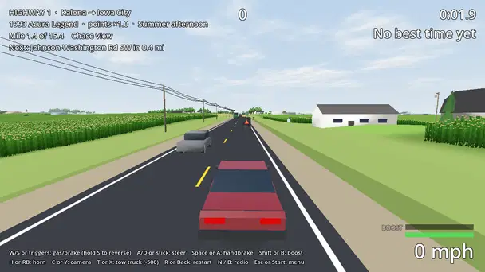 [合集截图](<https://github.com/DBYoder/Driving-Game/blob/claude/clever-turing-v4fp3y/docs/screenshots/mile-1-traffic.png>) | [DBYoder/Driving-Game](<https://github.com/DBYoder/Driving-Game>) | 常见根目录许可文件未找到 [作者明确写明该项目不供销售。](<https://github.com/DBYoder/Driving-Game/blob/HEAD/README.md#L6>) | 待核 | [6.3](<https://github.com/DBYoder/Driving-Game/blob/claude/clever-turing-v4fp3y/docs/screenshots/mile-1-traffic.png>) | 未列入口 |
| 3801 | [ ] | [Hnahsin Games](<https://github.com/gamingnews5/awesome-opus-5.5-games/blob/9a29b570e56bd19f15a3cd6bbac0b8c682f2c48c/games/hnahsin-games/readme.md>) | 待补截图 | [thadomaloma/hnahsin-play](<https://github.com/thadomaloma/hnahsin-play>) | 常见根目录许可文件未找到 [作者声明保留全部权利。](<https://github.com/thadomaloma/hnahsin-play/blob/HEAD/README.md#L96>) | 待核 | [4.8](<https://github.com/thadomaloma/hnahsin-play/blob/main/og.jpg>) | [可达 · 合集所列网页](<https://thadomaloma.github.io/hnahsin-play/>) |
| 3802 | [ ] | [Hop Hop Runner](<https://github.com/gamingnews5/awesome-opus-5.5-games/blob/9a29b570e56bd19f15a3cd6bbac0b8c682f2c48c/games/hop-hop-runner/readme.md>) | 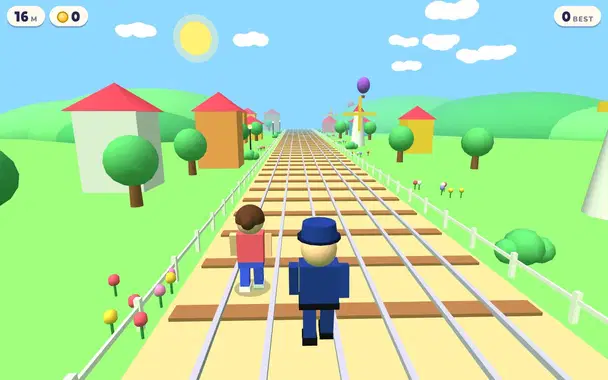 [合集截图](<https://github.com/johnnyhawk02/hop-hop-runner/blob/main/img/hop-runner.jpg>) | [johnnyhawk02/hop-hop-runner](<https://github.com/johnnyhawk02/hop-hop-runner>) | 常见根目录许可文件未找到 [木屋模型采用 CC BY-NC 4.0。](<https://github.com/johnnyhawk02/hop-hop-runner/blob/HEAD/README.md#L48>) | 待核 | [6.0](<https://github.com/johnnyhawk02/hop-hop-runner/blob/main/img/hop-runner.jpg>) | 未列入口 |
| 3803 | [ ] | [Life of Colors](<https://github.com/gamingnews5/awesome-opus-5.5-games/blob/9a29b570e56bd19f15a3cd6bbac0b8c682f2c48c/games/life-of-colors/readme.md>) | 待补截图 | [PalinkasAljoscha/LifeOfColors\_game](<https://github.com/PalinkasAljoscha/LifeOfColors_game>) | [许可正文含非商业使用条款](<https://github.com/PalinkasAljoscha/LifeOfColors_game/blob/HEAD/LICENSE>) | 待核 | — | [可达 · 合集所列网页](<https://palinkasaljoscha.github.io/LifeOfColors_game/>) |
| 3804 | [ ] | [Luxel](<https://github.com/gamingnews5/awesome-opus-5.5-games/blob/9a29b570e56bd19f15a3cd6bbac0b8c682f2c48c/games/luxel/readme.md>) | 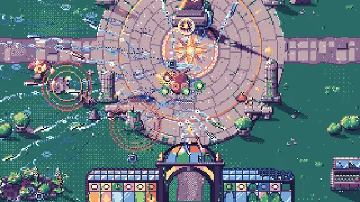 [合集截图](<https://github.com/MarwanMoh11/luxel/blob/main/.github/media/shot-fight.png>) | [MarwanMoh11/luxel](<https://github.com/MarwanMoh11/luxel>) | [许可正文明确限制再利用，详见原文](<https://github.com/MarwanMoh11/luxel/blob/HEAD/LICENSE>) [项目声明保留全部权利，另有第三方素材清单。](<https://github.com/MarwanMoh11/luxel/blob/HEAD/README.md#L157>) | 待核 | [7.0](<https://github.com/MarwanMoh11/luxel/blob/main/.github/media/shot-fight.png>) | [可达 · 含游戏画布／引擎的网页](<https://marwanmoh11.github.io/luxel/>) |
| 3805 | [ ] | [Mainspring](<https://github.com/gamingnews5/awesome-opus-5.5-games/blob/9a29b570e56bd19f15a3cd6bbac0b8c682f2c48c/games/mainspring/readme.md>) | 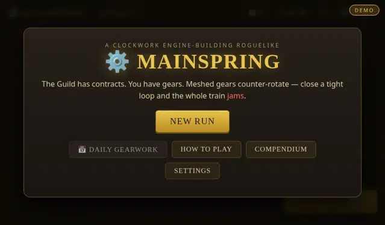 [试玩首页实截](<https://kelevera.github.io/mainspring/>) | [Kelevera/mainspring](<https://github.com/Kelevera/mainspring>) | [许可正文含非商业使用条款](<https://github.com/Kelevera/mainspring/blob/HEAD/LICENSE.md>) | 待核 | — | [可达 · 合集所列网页](<https://kelevera.github.io/mainspring/>) |
| 3806 | [ ] | [Mexica Chess](<https://github.com/gamingnews5/awesome-opus-5.5-games/blob/9a29b570e56bd19f15a3cd6bbac0b8c682f2c48c/games/mexica-chess/readme.md>) | 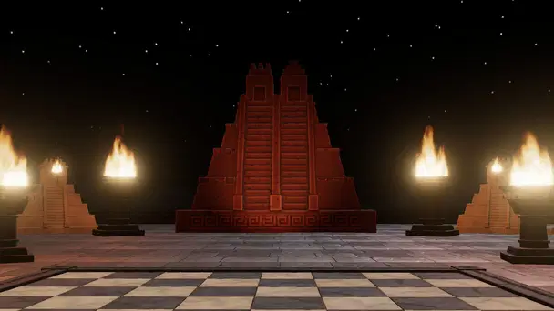 [合集截图](<https://github.com/alrc21/mexica-chess/blob/main/public/stills/templo-mayor.jpg>) | [alrc21/mexica-chess](<https://github.com/alrc21/mexica-chess>) | [根文件含 MIT 正文并另述素材范围，须逐项复核](<https://github.com/alrc21/mexica-chess/blob/HEAD/LICENSE>) [模型、烘焙纹理与图像为 CC BY-NC 4.0，须与 MIT 代码分开处理。](<https://github.com/alrc21/mexica-chess/blob/HEAD/README.md#L47-L51>) | 待核 | [6.5](<https://github.com/alrc21/mexica-chess/blob/main/public/stills/templo-mayor.jpg>) | [可达 · 合集所列网页](<https://mexica-chess.vercel.app>) |
| 3807 | [ ] | [miniVIC Games: 65C02 Arcade Collection](<https://github.com/gamingnews5/awesome-opus-5.5-games/blob/9a29b570e56bd19f15a3cd6bbac0b8c682f2c48c/games/minivic-games-65c02-arcade-collection/readme.md>) | 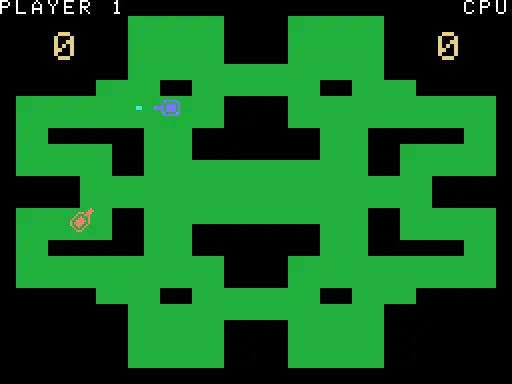 [合集截图](<https://github.com/Boogs77/miniVIC_games/blob/main/screenshots/tank_game.png>) | [Boogs77/miniVIC\_games](<https://github.com/Boogs77/miniVIC_games>) | 常见根目录许可文件未找到 [上游标注为非商业教学演示用同人作品。](<https://github.com/Boogs77/miniVIC_games/blob/HEAD/README.md#L459-L461>) | 待核 | [4.6](<https://github.com/Boogs77/miniVIC_games/blob/main/screenshots/tank_game.png>) | 未列入口 |
| 3808 | [ ] | [Norma Survival](<https://github.com/gamingnews5/awesome-opus-5.5-games/blob/9a29b570e56bd19f15a3cd6bbac0b8c682f2c48c/games/norma-survival/readme.md>) | 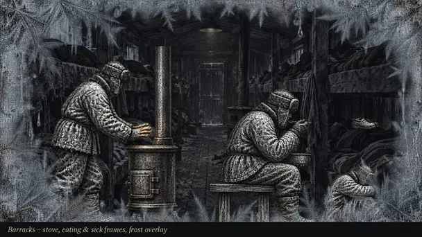 [合集截图](<https://github.com/EvgeniBondarev/norma-survival/blob/main/itch-release/upload/shot_barracks.jpg>) | [EvgeniBondarev/norma-survival](<https://github.com/EvgeniBondarev/norma-survival>) | 常见根目录许可文件未找到 [素材禁止再分发或转售，详见素材包许可。](<https://github.com/EvgeniBondarev/norma-survival/blob/HEAD/README.md#L54>) | 待核 | [5.8](<https://github.com/EvgeniBondarev/norma-survival/blob/main/itch-release/upload/shot_barracks.jpg>) | [可达 · 含游戏画布／引擎的网页](<https://evgenibondarev.github.io/norma-survival/game/>) |
| 3809 | [ ] | [Nozvi](<https://github.com/gamingnews5/awesome-opus-5.5-games/blob/9a29b570e56bd19f15a3cd6bbac0b8c682f2c48c/games/nozvi/readme.md>) | 待补截图 | [nozvi-studio/NOZVI-GAME-01](<https://github.com/nozvi-studio/NOZVI-GAME-01>) | [许可正文明确限制再利用，详见原文](<https://github.com/nozvi-studio/NOZVI-GAME-01/blob/HEAD/LICENSE>) | 待核 | — | 未列入口 |
| 3810 | [ ] | [Ombres](<https://github.com/gamingnews5/awesome-opus-5.5-games/blob/9a29b570e56bd19f15a3cd6bbac0b8c682f2c48c/games/ombres/readme.md>) | <a href="https://raw.githubusercontent.com/briossant/ombres/HEAD/docs/screenshots/3-heure-doree.jpg">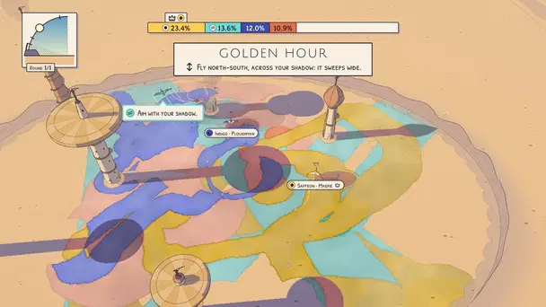</a> [README 游戏截图](<https://github.com/briossant/ombres#readme>) | [briossant/ombres](<https://github.com/briossant/ombres>) | [许可正文含非商业使用条款](<https://github.com/briossant/ombres/blob/HEAD/LICENSE.md>) [README 许可段另述素材或第三方内容](<https://raw.githubusercontent.com/briossant/ombres/HEAD/README.md>) | [README 提及](<https://github.com/briossant/ombres/blob/HEAD/README.md#L41>) | — | [可达 · 合集所列网页](<https://ombres.deploy.breizhware.com/>) |
| 3811 | [ ] | [OpenCiv1++](<https://github.com/gamingnews5/awesome-opus-5.5-games/blob/9a29b570e56bd19f15a3cd6bbac0b8c682f2c48c/games/openciv1/readme.md>) | 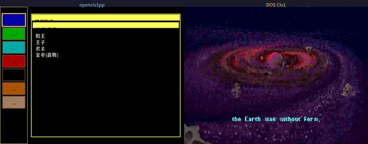 [游戏菜单或界面](<https://github.com/wicanr2/civ1_cht/blob/HEAD/openciv1pp/docs/screenshots/r5/04_WIZARD_DIFFICULTY_pair.png>) | [wicanr2/civ1\_cht](<https://github.com/wicanr2/civ1_cht>) | [根文件含 MIT 正文并另述素材范围，须逐项复核](<https://github.com/wicanr2/civ1_cht/blob/HEAD/LICENSE>) [中文翻译为 CC BY-SA 4.0；需自备《文明》合法副本。](<https://github.com/wicanr2/civ1_cht/blob/HEAD/README.md#L243-L249>) | 待核 | [4.8](<https://github.com/wicanr2/civ1_cht/blob/HEAD/openciv1pp/docs/screenshots/r5/04_WIZARD_DIFFICULTY_pair.png>) | 未列入口 |
| 3812 | [ ] | [Overmaster](<https://github.com/gamingnews5/awesome-opus-5.5-games/blob/9a29b570e56bd19f15a3cd6bbac0b8c682f2c48c/games/overmaster/readme.md>) | 待补截图 | [larente/overmaster](<https://github.com/larente/overmaster>) | 常见根目录许可文件未找到 [作者声明保留全部权利。](<https://github.com/larente/overmaster/blob/HEAD/README.md#L9>) | 待核 | [5.6](<https://github.com/larente/overmaster/blob/main/art/objects/obj-tower-demon.webp>) | 未列入口 |
| 3813 | [ ] | [Parking Escape](<https://github.com/gamingnews5/awesome-opus-5.5-games/blob/9a29b570e56bd19f15a3cd6bbac0b8c682f2c48c/games/parking-escape/readme.md>) | 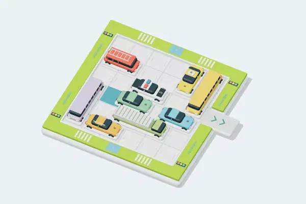 [上游动图截帧](<https://github.com/asmoyou/toy2game/blob/HEAD/docs/images/parking-escape-gameplay.gif>) | [asmoyou/toy2game](<https://github.com/asmoyou/toy2game>) | [许可正文含非商业使用条款](<https://github.com/asmoyou/toy2game/blob/HEAD/LICENSE>) | 待核 | — | 未列入口 |
| 3814 | [ ] | [Pastel Nuketown](<https://github.com/gamingnews5/awesome-opus-5.5-games/blob/9a29b570e56bd19f15a3cd6bbac0b8c682f2c48c/games/pastel-nuketown/readme.md>) | 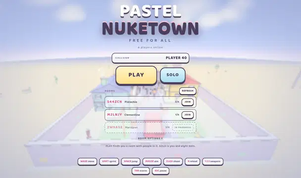 [游戏菜单或界面](<https://github.com/luckeyfaraday/pastel-nuketown/blob/main/shots/title.png>) | [luckeyfaraday/pastel-nuketown](<https://github.com/luckeyfaraday/pastel-nuketown>) | [README 许可段声明保留权利、限制使用或尚未授权](<https://github.com/luckeyfaraday/pastel-nuketown/blob/HEAD/README.md>) [作者声明保留全部权利。](<https://github.com/luckeyfaraday/pastel-nuketown/blob/HEAD/README.md#L209>) | 待核 | [6.5](<https://github.com/luckeyfaraday/pastel-nuketown/blob/main/shots/title.png>) | 未列入口 |
| 3815 | [ ] | [Penguin Ice](<https://github.com/gamingnews5/awesome-opus-5.5-games/blob/9a29b570e56bd19f15a3cd6bbac0b8c682f2c48c/games/penguin-ice/readme.md>) | 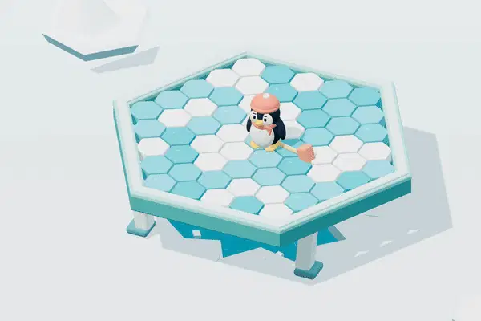 [上游动图截帧](<https://github.com/asmoyou/toy2game/blob/HEAD/docs/images/penguin-ice-gameplay.gif>) | [asmoyou/toy2game](<https://github.com/asmoyou/toy2game>) | [许可正文含非商业使用条款](<https://github.com/asmoyou/toy2game/blob/HEAD/LICENSE>) | 待核 | — | 未列入口 |
| 3816 | [ ] | [PescanoLago](<https://github.com/gamingnews5/awesome-opus-5.5-games/blob/9a29b570e56bd19f15a3cd6bbac0b8c682f2c48c/games/pescanolago/readme.md>) |  [合集截图](<https://media.githubusercontent.com/media/Joaofernandes-DEV/PescanoLago/main/docs/media/fase5_peixe_pego.png>) | [Joaofernandes-DEV/PescanoLago](<https://github.com/Joaofernandes-DEV/PescanoLago>) | [根文件含 MIT 正文并另述素材范围，须逐项复核](<https://github.com/Joaofernandes-DEV/PescanoLago/blob/HEAD/LICENSE>) [美术和游戏文字按 CC BY-NC 4.0，代码按 MIT。](<https://github.com/Joaofernandes-DEV/PescanoLago/blob/HEAD/README.md#L200>) | 待核 | [6.0（原图失效）](<https://github.com/Joaofernandes-DEV/PescanoLago/blob/main/docs/media/fase5_peixe_pego.png>) · [原图存档](<https://media.githubusercontent.com/media/Joaofernandes-DEV/PescanoLago/main/docs/media/fase5_peixe_pego.png>) | 未列入口 |
| 3817 | [ ] | [Pest Panic Defense](<https://github.com/gamingnews5/awesome-opus-5.5-games/blob/9a29b570e56bd19f15a3cd6bbac0b8c682f2c48c/games/pest-panic-defense/readme.md>) | 待补截图 | [ilovefree1s/pest-panic-TD](<https://github.com/ilovefree1s/pest-panic-TD>) | [许可正文明确限制再利用，详见原文](<https://github.com/ilovefree1s/pest-panic-TD/blob/HEAD/LICENSE>) | 待核 | — | [README · 入口已失效 · 上游 README 所列网页](<https://ilovefree1s.github.io/pest-panic-td/>) |
| 3818 | [ ] | [Pierglass](<https://github.com/gamingnews5/awesome-opus-5.5-games/blob/9a29b570e56bd19f15a3cd6bbac0b8c682f2c48c/games/pierglass/readme.md>) | 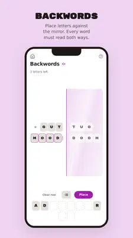 [合集截图](<https://github.com/rickymetz/wordgirl/blob/main/public/teasers/pierglass.png>) | [rickymetz/wordgirl](<https://github.com/rickymetz/wordgirl>) | [许可正文含非商业使用条款](<https://github.com/rickymetz/wordgirl/blob/HEAD/LICENSE.md>) [源码采用 PolyForm Noncommercial 1.0.0。](<https://github.com/rickymetz/wordgirl/blob/HEAD/README.md#L283-L286>) | 待核 | [6.3](<https://github.com/rickymetz/wordgirl/blob/main/public/teasers/pierglass.png>) | 未列入口 |
| 3819 | [ ] | [Planet Pulse](<https://github.com/gamingnews5/awesome-opus-5.5-games/blob/9a29b570e56bd19f15a3cd6bbac0b8c682f2c48c/games/planet-pulse/readme.md>) | 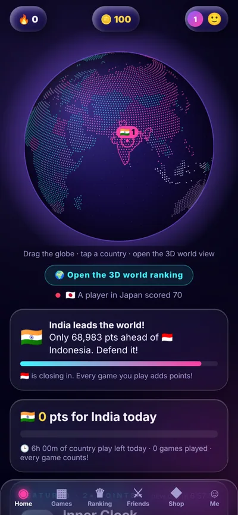 [合集截图](<https://github.com/sauravh-ledger/planet-pulse/blob/main/docs/home.png>) | [sauravh-ledger/planet-pulse](<https://github.com/sauravh-ledger/planet-pulse>) | [README 许可段声明保留权利、限制使用或尚未授权](<https://github.com/sauravh-ledger/planet-pulse/blob/HEAD/README.md>) [作者声明保留全部权利。](<https://github.com/sauravh-ledger/planet-pulse/blob/HEAD/README.md#L80>) | 待核 | [4.0](<https://github.com/sauravh-ledger/planet-pulse/blob/main/docs/home.png>) | 未列入口 |
| 3820 | [ ] | [PokéChill](<https://github.com/gamingnews5/awesome-opus-5.5-games/blob/9a29b570e56bd19f15a3cd6bbac0b8c682f2c48c/games/pokechill/readme.md>) | 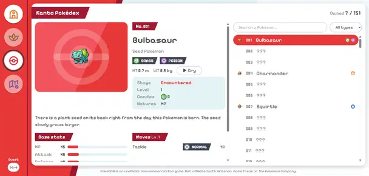 [合集截图](<https://github.com/BradSavary/pokechill/blob/main/docs/images/pokedex.png>) | [BradSavary/pokechill](<https://github.com/BradSavary/pokechill>) | 常见根目录许可文件未找到 [上游明示为《宝可梦》非商业同人项目。](<https://github.com/BradSavary/pokechill/blob/HEAD/README.md#L23>) | 待核 | [5.0](<https://github.com/BradSavary/pokechill/blob/main/docs/images/pokedex.png>) | [可达 · 合集所列网页](<https://pokechill-three.vercel.app>) |
| 3821 | [ ] | [PokéGo · Mystery Dungeon](<https://github.com/gamingnews5/awesome-opus-5.5-games/blob/9a29b570e56bd19f15a3cd6bbac0b8c682f2c48c/games/pokego-mystery-dungeon/readme.md>) | 待补截图 | [KaonHew02/PokeGo](<https://github.com/KaonHew02/PokeGo>) | [许可正文含非商业使用条款](<https://github.com/KaonHew02/PokeGo/blob/HEAD/LICENSE>) [README 许可段另述素材或第三方内容](<https://raw.githubusercontent.com/KaonHew02/PokeGo/HEAD/README.md>) | 待核 | — | [可达 · 含游戏画布／引擎的网页](<https://kaonhew02.github.io/PokeGo/>) |
| 3822 | [ ] | [Polygram](<https://github.com/gamingnews5/awesome-opus-5.5-games/blob/9a29b570e56bd19f15a3cd6bbac0b8c682f2c48c/games/polygram/readme.md>) | 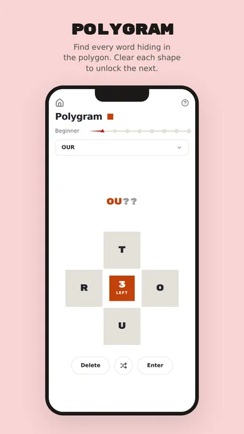 [合集截图](<https://github.com/rickymetz/wordgirl/blob/main/public/teasers/polygram.png>) | [rickymetz/wordgirl](<https://github.com/rickymetz/wordgirl>) | [许可正文含非商业使用条款](<https://github.com/rickymetz/wordgirl/blob/HEAD/LICENSE.md>) [源码采用 PolyForm Noncommercial 1.0.0。](<https://github.com/rickymetz/wordgirl/blob/HEAD/README.md#L283-L286>) | 待核 | [6.2](<https://github.com/rickymetz/wordgirl/blob/main/public/teasers/polygram.png>) | 未列入口 |
| 3823 | [ ] | [Potato Team Games – Free Browser Games](<https://github.com/gamingnews5/awesome-opus-5.5-games/blob/9a29b570e56bd19f15a3cd6bbac0b8c682f2c48c/games/potato-team-games-free-browser-games/readme.md>) | 待补截图 | [potatoteamgames/games](<https://github.com/potatoteamgames/games>) | [许可正文明确限制再利用，详见原文](<https://github.com/potatoteamgames/games/blob/HEAD/LICENSE>) | 待核 | — | [入口已失效 · 合集所列网页](<https://potatoteamgames.github.io/games/>) |
| 3824 | [ ] | [Puppet Fight CPC](<https://github.com/gamingnews5/awesome-opus-5.5-games/blob/9a29b570e56bd19f15a3cd6bbac0b8c682f2c48c/games/puppet-fight-cpc/readme.md>) | 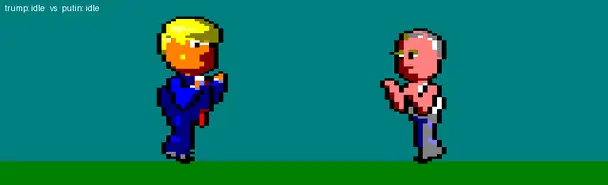 [上游动图截帧](<https://github.com/vaspervnp/PuppetFightCPC/blob/main/docs/preview_versus.gif>) | [vaspervnp/PuppetFightCPC](<https://github.com/vaspervnp/PuppetFightCPC>) | 常见根目录许可文件未找到 [作者明示为非商业同人游戏。](<https://github.com/vaspervnp/PuppetFightCPC/blob/HEAD/README.md#L107-L108>) | 待核 | [4.6](<https://github.com/vaspervnp/PuppetFightCPC/blob/main/docs/preview_versus.gif>) | 未列入口 |
| 3825 | [ ] | [Puzzlegrad](<https://github.com/gamingnews5/awesome-opus-5.5-games/blob/9a29b570e56bd19f15a3cd6bbac0b8c682f2c48c/games/puzzlegrad/readme.md>) | 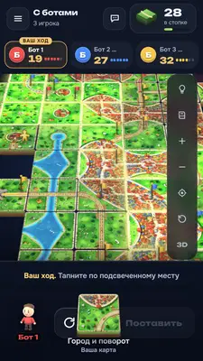 [合集截图](<https://github.com/crownfall90-dot/play/blob/main/store/screenshots/2-game.png>) | [crownfall90-dot/play](<https://github.com/crownfall90-dot/play>) | [许可正文明确限制再利用，详见原文](<https://github.com/crownfall90-dot/play/blob/HEAD/LICENSE>) | 待核 | [5.6](<https://github.com/crownfall90-dot/play/blob/main/store/screenshots/2-game.png>) | 未列入口 |
| 3826 | [ ] | [R6S: TEMU](<https://github.com/gamingnews5/awesome-opus-5.5-games/blob/9a29b570e56bd19f15a3cd6bbac0b8c682f2c48c/games/r6s-temu/readme.md>) | 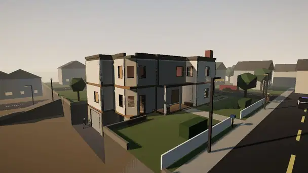 [合集截图](<https://github.com/Toddoward/lowbudget-r6s/blob/main/docs/screenshots/hero_day.jpg>) | [Toddoward/lowbudget-r6s](<https://github.com/Toddoward/lowbudget-r6s>) | 常见根目录许可文件未找到 [发布方标注为非商业同人游戏。](<https://github.com/Toddoward/lowbudget-r6s/blob/HEAD/README.md#L24>) | 待核 | [6.2](<https://github.com/Toddoward/lowbudget-r6s/blob/main/docs/screenshots/hero_day.jpg>) | [可达 · 含游戏画布／引擎的网页](<https://r6s-temu.pages.dev/?room=R6-8492&nick=MyAgent&agent=1>) |
| 3827 | [ ] | [Rabbit Trap](<https://github.com/gamingnews5/awesome-opus-5.5-games/blob/9a29b570e56bd19f15a3cd6bbac0b8c682f2c48c/games/rabbit-trap/readme.md>) | 待补截图 | [asmoyou/toy2game](<https://github.com/asmoyou/toy2game>) | [许可正文含非商业使用条款](<https://github.com/asmoyou/toy2game/blob/HEAD/LICENSE>) | 待核 | — | 未列入口 |
| 3828 | [ ] | [Ratland Defense](<https://github.com/gamingnews5/awesome-opus-5.5-games/blob/9a29b570e56bd19f15a3cd6bbac0b8c682f2c48c/games/ratland-defense/readme.md>) | 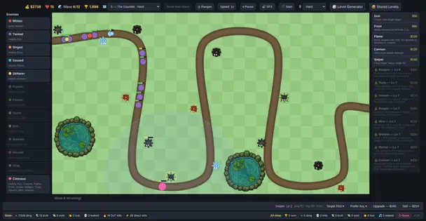 [合集截图](<https://github.com/MisterRat/Ratland-Defense/blob/main/screenshots/gameplay.png>) | [MisterRat/Ratland-Defense](<https://github.com/MisterRat/Ratland-Defense>) | [许可正文含非商业使用条款](<https://github.com/MisterRat/Ratland-Defense/blob/HEAD/LICENSE>) [采用 PolyForm Noncommercial 1.0.0，商用须书面许可。](<https://github.com/MisterRat/Ratland-Defense/blob/main/README.MD#L157>) | 待核 | [5.4](<https://github.com/MisterRat/Ratland-Defense/blob/main/screenshots/gameplay.png>) | 未列入口 |
| 3829 | [ ] | [Reel Time](<https://github.com/gamingnews5/awesome-opus-5.5-games/blob/9a29b570e56bd19f15a3cd6bbac0b8c682f2c48c/games/reel-time/readme.md>) | 待补截图 | [mebessusn/reel-time-game](<https://github.com/mebessusn/reel-time-game>) | [许可正文含非商业使用条款](<https://github.com/mebessusn/reel-time-game/blob/HEAD/LICENSE>) | 待核 | — | 未列入口 |
| 3830 | [ ] | [Riftbound: Meridian Trial](<https://github.com/gamingnews5/awesome-opus-5.5-games/blob/9a29b570e56bd19f15a3cd6bbac0b8c682f2c48c/games/riftbound-meridian-trial/readme.md>) | 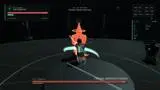 [合集截图](<https://media.githubusercontent.com/media/TheXUMU9/TheXUMU9-Game_with-Gauntlet_Loop/main/public/evidence/r7-contact-frames-take5/frame-0004.png>) | [TheXUMU9/TheXUMU9-Game\_with-Gauntlet\_Loop](<https://github.com/TheXUMU9/TheXUMU9-Game_with-Gauntlet_Loop>) | [许可正文明确限制再利用，详见原文](<https://github.com/TheXUMU9/TheXUMU9-Game_with-Gauntlet_Loop/blob/HEAD/LICENSE>) [许可仅允许查看、评估和个人测试。](<https://github.com/TheXUMU9/TheXUMU9-Game_with-Gauntlet_Loop/blob/HEAD/README.md#L99>) | [README 提及](<https://github.com/TheXUMU9/TheXUMU9-Game_with-Gauntlet_Loop/blob/HEAD/README.md#L12>) | [7.5（原图失效）](<https://github.com/TheXUMU9/TheXUMU9-Game_with-Gauntlet_Loop/blob/main/public/evidence/r7-contact-frames-take5/frame-0004.png>) · [原图存档](<https://media.githubusercontent.com/media/TheXUMU9/TheXUMU9-Game_with-Gauntlet_Loop/main/public/evidence/r7-contact-frames-take5/frame-0004.png>) | 未列入口 |
| 3831 | [ ] | [SATWAR](<https://github.com/gamingnews5/awesome-opus-5.5-games/blob/9a29b570e56bd19f15a3cd6bbac0b8c682f2c48c/games/satwar/readme.md>) | 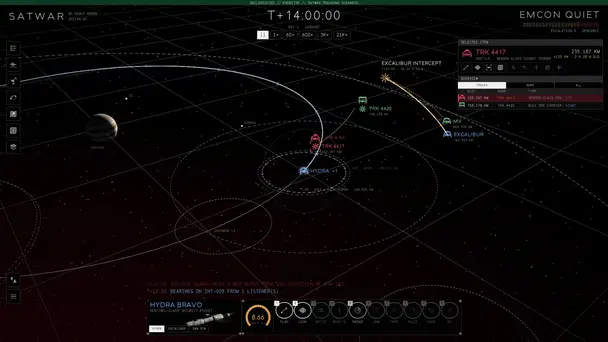 [合集截图](<https://github.com/KW-Wargame/satwar-releases-playtest/blob/main/images/g-space.jpg>) | [KW-Wargame/satwar-releases-playtest](<https://github.com/KW-Wargame/satwar-releases-playtest>) | [许可文件需人工判读](<https://github.com/KW-Wargame/satwar-releases-playtest/blob/HEAD/LICENSE>) [Apache-2.0 适用于 xGEO Core；游戏成品、美术和手册等保留权利。](<https://github.com/KW-Wargame/satwar-releases-playtest/blob/HEAD/README.md#L18-L19>) | 待核 | [5.6](<https://github.com/KW-Wargame/satwar-releases-playtest/blob/main/images/g-space.jpg>) | 未列入口 |
| 3832 | [ ] | [SECTOR](<https://github.com/gamingnews5/awesome-opus-5.5-games/blob/9a29b570e56bd19f15a3cd6bbac0b8c682f2c48c/games/sector/readme.md>) | 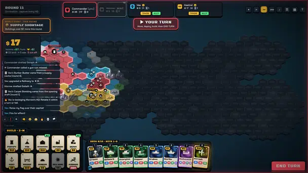 [合集截图](<https://github.com/Blacksheep909/sector/blob/main/docs/img/board.png>) | [Blacksheep909/sector](<https://github.com/Blacksheep909/sector>) | [许可正文含非商业使用条款](<https://github.com/Blacksheep909/sector/blob/HEAD/LICENSE>) [非商业用途采用 PolyForm，商用须书面许可。](<https://github.com/Blacksheep909/sector/blob/HEAD/README.md#L137>) | 待核 | [6.6](<https://github.com/Blacksheep909/sector/blob/main/docs/img/board.png>) | [可达 · 发行下载页](<https://github.com/Blacksheep909/sector/releases/latest>) |
| 3833 | [ ] | [Seraph Breaker](<https://github.com/gamingnews5/awesome-opus-5.5-games/blob/9a29b570e56bd19f15a3cd6bbac0b8c682f2c48c/games/seraph-breaker/readme.md>) | <a href="https://raw.githubusercontent.com/selameddin00/seraph-breaker/HEAD/test-shots/pr/choice-centered-desktop.jpg">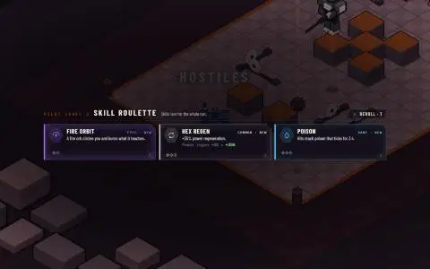</a> [README 游戏截图](<https://github.com/selameddin00/seraph-breaker#readme>) | [selameddin00/seraph-breaker](<https://github.com/selameddin00/seraph-breaker>) | [许可正文明确限制再利用，详见原文](<https://github.com/selameddin00/seraph-breaker/blob/HEAD/LICENSE>) | 待核 | — | [可达 · 含游戏画布／引擎的网页](<https://selameddin00.github.io/seraph-breaker/>) |
| 3834 | [ ] | [Serpentine](<https://github.com/gamingnews5/awesome-opus-5.5-games/blob/9a29b570e56bd19f15a3cd6bbac0b8c682f2c48c/games/serpentine/readme.md>) | 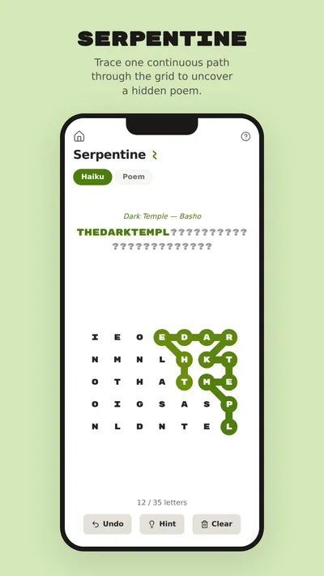 [合集截图](<https://github.com/rickymetz/wordgirl/blob/main/public/teasers/serpentine.png>) | [rickymetz/wordgirl](<https://github.com/rickymetz/wordgirl>) | [许可正文含非商业使用条款](<https://github.com/rickymetz/wordgirl/blob/HEAD/LICENSE.md>) [源码采用 PolyForm Noncommercial 1.0.0。](<https://github.com/rickymetz/wordgirl/blob/HEAD/README.md#L283-L286>) | 待核 | [6.6](<https://github.com/rickymetz/wordgirl/blob/main/public/teasers/serpentine.png>) | 未列入口 |
| 3835 | [ ] | [SEVEN DAYS](<https://github.com/gamingnews5/awesome-opus-5.5-games/blob/9a29b570e56bd19f15a3cd6bbac0b8c682f2c48c/games/seven-days/readme.md>) | 待补截图 | [hungryshmorez/Seven-days](<https://github.com/hungryshmorez/Seven-days>) | [根文件声明保留所有权利](<https://github.com/hungryshmorez/Seven-days/blob/HEAD/LICENSE.txt>) | 待核 | — | 未列入口 |
| 3836 | [ ] | [Sigle in Fila 🎵📼](<https://github.com/gamingnews5/awesome-opus-5.5-games/blob/9a29b570e56bd19f15a3cd6bbac0b8c682f2c48c/games/sigle-in-fila/readme.md>) |  [合集截图](<https://github.com/FlamingFury00/Cartoon-Hitster/blob/main/docs/screenshots/listen.webp>) | [FlamingFury00/Cartoon-Hitster](<https://github.com/FlamingFury00/Cartoon-Hitster>) | 常见根目录许可文件未找到 [作者标注仅供家人朋友私下非商业游玩。](<https://github.com/FlamingFury00/Cartoon-Hitster/blob/HEAD/README.md#L137>) | 待核 | [5.4](<https://github.com/FlamingFury00/Cartoon-Hitster/blob/main/docs/screenshots/listen.webp>) | 未列入口 |
| 3837 | [ ] | [Singapore Heritage Games](<https://github.com/gamingnews5/awesome-opus-5.5-games/blob/9a29b570e56bd19f15a3cd6bbac0b8c682f2c48c/games/singapore-heritage-games/readme.md>) | 待补截图 | [tzuchi-singapore/Singapore-Heritage-Games](<https://github.com/tzuchi-singapore/Singapore-Heritage-Games>) | [许可正文明确限制再利用，详见原文](<https://github.com/tzuchi-singapore/Singapore-Heritage-Games/blob/HEAD/LICENSE>) [README 许可段另述素材或第三方内容](<https://raw.githubusercontent.com/tzuchi-singapore/Singapore-Heritage-Games/HEAD/README.md>) | 待核 | — | [README · 可达 · 上游 README 所列网页](<https://tzuchi-singapore.github.io/Singapore-Heritage-Games/>) |
| 3838 | [ ] | [Speaker Trainer](<https://github.com/gamingnews5/awesome-opus-5.5-games/blob/9a29b570e56bd19f15a3cd6bbac0b8c682f2c48c/games/speaker-trainer/readme.md>) | 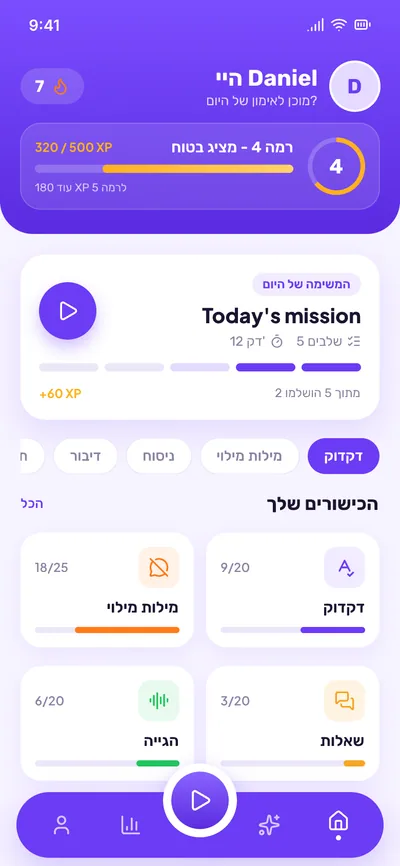 [游戏菜单或界面](<https://github.com/danielmazh/speaker-trainer/blob/main/docs/design/02-home.png>) | [danielmazh/speaker-trainer](<https://github.com/danielmazh/speaker-trainer>) | [许可正文明确限制再利用，详见原文](<https://github.com/danielmazh/speaker-trainer/blob/HEAD/LICENSE>) [作者保留全部权利。](<https://github.com/danielmazh/speaker-trainer/blob/HEAD/README.md#L49>) | 待核 | [4.5](<https://github.com/danielmazh/speaker-trainer/blob/main/docs/design/02-home.png>) | [可达 · 合集所列网页](<https://danielmazh.github.io/speaker-trainer/>) |
| 3839 | [ ] | [Spinwright](<https://github.com/gamingnews5/awesome-opus-5.5-games/blob/9a29b570e56bd19f15a3cd6bbac0b8c682f2c48c/games/spinwright/readme.md>) | 待补截图 | [DavidNyholm/spinwright](<https://github.com/DavidNyholm/spinwright>) | [许可正文明确限制再利用，详见原文](<https://github.com/DavidNyholm/spinwright/blob/HEAD/LICENSE>) | 待核 | — | 未列入口 |
| 3840 | [ ] | [Star Quarry](<https://github.com/gamingnews5/awesome-opus-5.5-games/blob/9a29b570e56bd19f15a3cd6bbac0b8c682f2c48c/games/star-quarry/readme.md>) | 待补截图 | [namewastaken-creator/star-quarry](<https://github.com/namewastaken-creator/star-quarry>) | [许可正文明确限制再利用，详见原文](<https://github.com/namewastaken-creator/star-quarry/blob/HEAD/LICENSE>) | 待核 | — | [可达 · 含游戏画布／引擎的网页](<https://namewastaken-creator.github.io/star-quarry/>) |
| 3841 | [ ] | [Startup Simulator](<https://github.com/gamingnews5/awesome-opus-5.5-games/blob/9a29b570e56bd19f15a3cd6bbac0b8c682f2c48c/games/startup-simulator/readme.md>) | 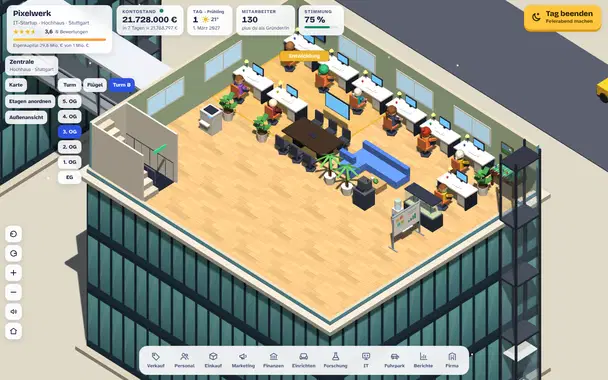 [合集截图](<https://github.com/nicks2d/Startup-Simulator-/blob/main/screenshots/office.png>) | [nicks2d/Startup-Simulator-](<https://github.com/nicks2d/Startup-Simulator->) | [许可正文明确限制再利用，详见原文](<https://github.com/nicks2d/Startup-Simulator-/blob/HEAD/LICENSE>) [作者仅开放展示；复制、修改或再分发代码须书面许可。](<https://github.com/nicks2d/Startup-Simulator-/blob/HEAD/README.md#L134-L136>) | 待核 | [6.5](<https://github.com/nicks2d/Startup-Simulator-/blob/main/screenshots/office.png>) | [可达 · 合集所列网页](<https://nicks2d.github.io/Startup-Simulator-/>) |
| 3842 | [ ] | [Starwake (working title)](<https://github.com/gamingnews5/awesome-opus-5.5-games/blob/9a29b570e56bd19f15a3cd6bbac0b8c682f2c48c/games/starwake-working-title/readme.md>) | 待补截图 | [jbman03/starwake](<https://github.com/jbman03/starwake>) | [根文件声明保留所有权利](<https://github.com/jbman03/starwake/blob/HEAD/LICENSE>) | 待核 | — | [可达 · 合集所列网页](<https://jbman03.github.io/starwake/>) |
| 3843 | [ ] | [StickBrawl](<https://github.com/gamingnews5/awesome-opus-5.5-games/blob/9a29b570e56bd19f15a3cd6bbac0b8c682f2c48c/games/stickbrawl/readme.md>) | 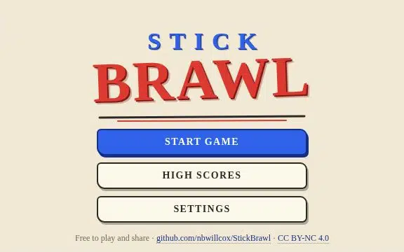 [源码运行首页](<https://github.com/nbwillcox/StickBrawl/blob/main/index.html>) | [nbwillcox/StickBrawl](<https://github.com/nbwillcox/StickBrawl>) | [许可正文含非商业使用条款](<https://github.com/nbwillcox/StickBrawl/blob/HEAD/LICENSE>) | [README 提及](<https://github.com/nbwillcox/StickBrawl/blob/HEAD/README.md#L24>) | — | 未列入口 |
| 3844 | [ ] | [Suasoria](<https://github.com/gamingnews5/awesome-opus-5.5-games/blob/9a29b570e56bd19f15a3cd6bbac0b8c682f2c48c/games/suasoria/readme.md>) | 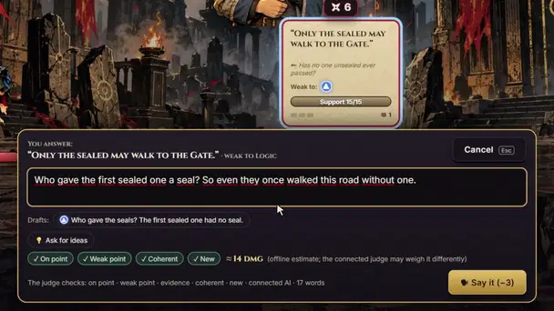 [合集截图](<https://github.com/tuncertimur/suasoria/blob/main/docs/media/TRAILER_M1_EN_poster.webp>) | [tuncertimur/suasoria](<https://github.com/tuncertimur/suasoria>) | [许可文件需人工判读](<https://github.com/tuncertimur/suasoria/blob/HEAD/LICENSE.md>) [游戏源码未包含，文字、图像和视频受使用限制；基准数据为 CC BY 4.0。](<https://github.com/tuncertimur/suasoria/blob/HEAD/README.md#L120>) | 待核 | [6.4](<https://github.com/tuncertimur/suasoria/blob/main/docs/media/TRAILER_M1_EN_poster.webp>) | [可达 · 合集所列网页](<https://tuncertimur.github.io/suasoria/>) |
| 3845 | [ ] | [Sunset Hollow](<https://github.com/gamingnews5/awesome-opus-5.5-games/blob/9a29b570e56bd19f15a3cd6bbac0b8c682f2c48c/games/sunset-hollow/readme.md>) | 待补截图 | [sajalrajhans1/Sunset-Down](<https://github.com/sajalrajhans1/Sunset-Down>) | [许可正文明确限制再利用，详见原文](<https://github.com/sajalrajhans1/Sunset-Down/blob/HEAD/LICENSE>) | 待核 | — | [可达 · 含游戏画布／引擎的网页](<https://sunset-down.vercel.app/>) |
| 3846 | [ ] | [Super Fable Bros. — World 1-1](<https://github.com/gamingnews5/awesome-opus-5.5-games/blob/9a29b570e56bd19f15a3cd6bbac0b8c682f2c48c/games/super-fable-bros-world-1-1/readme.md>) | 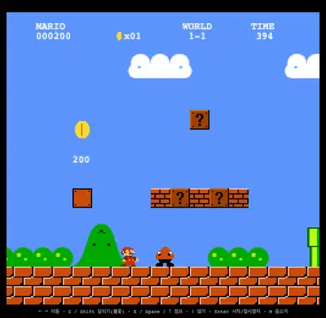 [同款备选截图](<https://github.com/INONONO66/fable-5.1-mario/blob/main/docs/gameplay.png>) | [INONONO66/fable-5.1-mario](<https://github.com/INONONO66/fable-5.1-mario>) | [README 许可段涉及非商业使用，须核对适用范围](<https://github.com/INONONO66/fable-5.1-mario/blob/HEAD/README.md>) [作者标注为非商业同人重制；Mario 名称属 Nintendo，MIT 适用于原创代码。](<https://github.com/INONONO66/fable-5.1-mario/blob/HEAD/README.md#L103-L104>) | 待核 | [7.1](<https://github.com/INONONO66/fable-5.1-mario/blob/main/docs/title.png>) | [可达 · 含游戏画布／引擎的网页](<https://inonono66.github.io/fable-5.1-mario/>) |
| 3847 | [ ] | [Surviving Lagos Island: Street Level](<https://github.com/gamingnews5/awesome-opus-5.5-games/blob/9a29b570e56bd19f15a3cd6bbac0b8c682f2c48c/games/surviving-lagos-island-street-level/readme.md>) | 待补截图 | [alternatefact/surviving-lagos-island](<https://github.com/alternatefact/surviving-lagos-island>) | [许可正文明确限制再利用，详见原文](<https://github.com/alternatefact/surviving-lagos-island/blob/HEAD/LICENSE>) | 待核 | — | [可达 · 含游戏画布／引擎的网页](<https://alternatefact.github.io/surviving-lagos-island/>) |
| 3848 | [ ] | [Tag Team Terror](<https://github.com/gamingnews5/awesome-opus-5.5-games/blob/9a29b570e56bd19f15a3cd6bbac0b8c682f2c48c/games/tag-team-terror/readme.md>) | 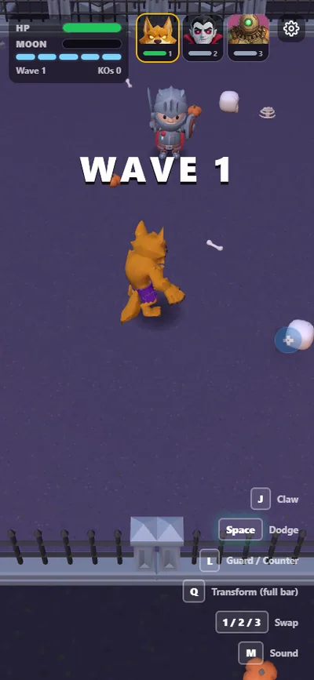 [游戏菜单或界面](<https://github.com/buhamzok/game-jam/blob/main/docs/screenshots/shot-hud.png>) | [buhamzok/game-jam](<https://github.com/buhamzok/game-jam>) | [根文件声明保留所有权利](<https://github.com/buhamzok/game-jam/blob/HEAD/LICENSE.txt>) | 待核 | [4.5](<https://github.com/buhamzok/game-jam/blob/main/docs/screenshots/shot-hud.png>) | 未列入口 |
| 3849 | [ ] | [Takeoff: Middle Power](<https://github.com/gamingnews5/awesome-opus-5.5-games/blob/9a29b570e56bd19f15a3cd6bbac0b8c682f2c48c/games/takeoff-middle-power/readme.md>) | 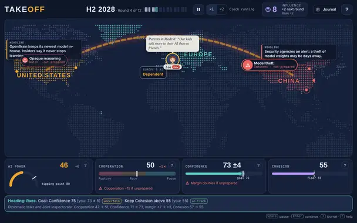 [同款备选截图](<https://github.com/damienlethiec/takeoff-middle-power/blob/HEAD/docs/screenshots/v3/desktop-main-threats.png>) | [damienlethiec/takeoff-middle-power](<https://github.com/damienlethiec/takeoff-middle-power>) | [许可正文明确限制再利用，详见原文](<https://github.com/damienlethiec/takeoff-middle-power/blob/HEAD/LICENSE>) [可阅读和游玩；复制、修改、复用须作者书面许可。](<https://github.com/damienlethiec/takeoff-middle-power/blob/HEAD/README.md#L39>) | 待核 | [5.2（原图失效）](<https://github.com/damienlethiec/takeoff-middle-power/blob/main/docs/screenshots/05-main-running.png>) · [看备用画面](<https://raw.githubusercontent.com/damienlethiec/takeoff-middle-power/HEAD/docs/screenshots/v3/desktop-main-threats.png>) | [README · 可达 · 上游 README 所列网页](<https://aitakeoff.eu/>) |
| 3850 | [ ] | [The Fantastical Logic Grid: browser and desktop app](<https://github.com/gamingnews5/awesome-opus-5.5-games/blob/9a29b570e56bd19f15a3cd6bbac0b8c682f2c48c/games/the-fantastical-logic-grid-browser-and-desktop-app/readme.md>) | 待补截图 | [bltaylorjr/fantastical-logic-grid](<https://github.com/bltaylorjr/fantastical-logic-grid>) | [许可正文明确限制再利用，详见原文](<https://github.com/bltaylorjr/fantastical-logic-grid/blob/HEAD/LICENSE>) [作者声明为专有软件，保留全部权利。](<https://github.com/bltaylorjr/fantastical-logic-grid/blob/HEAD/README.md#L17-L19>) | 待核 | [4.6](<https://github.com/bltaylorjr/fantastical-logic-grid/blob/main/media/promo/the-fantastical-logic-grid-promo-16x9-thumbnail.png>) | 未列入口 |
| 3851 | [ ] | [The Last Apostate](<https://github.com/gamingnews5/awesome-opus-5.5-games/blob/9a29b570e56bd19f15a3cd6bbac0b8c682f2c48c/games/the-last-apostate/readme.md>) | 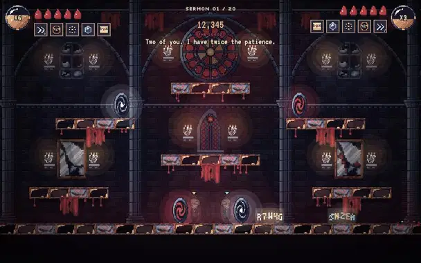 [合集截图](<https://github.com/kelvinman/the-last-apostate/blob/main/docs/coop.jpg>) | [kelvinman/the-last-apostate](<https://github.com/kelvinman/the-last-apostate>) | 常见根目录许可文件未找到 [部分角色美术仅授权非商业使用；另有整体权利保留声明。](<https://github.com/kelvinman/the-last-apostate/blob/HEAD/README.md#L141-L146>) | [README 提及](<https://github.com/kelvinman/the-last-apostate/blob/HEAD/README.md#L103>) | [6.2](<https://github.com/kelvinman/the-last-apostate/blob/main/docs/coop.jpg>) | [可达 · 合集所列网页](<https://kelvinman.github.io/the-last-apostate/>) |
| 3852 | [ ] | [The Legend of Valence](<https://github.com/gamingnews5/awesome-opus-5.5-games/blob/9a29b570e56bd19f15a3cd6bbac0b8c682f2c48c/games/the-legend-of-valence/readme.md>) | 待补截图 | [zlisto/legend-of-valence](<https://github.com/zlisto/legend-of-valence>) | 常见根目录许可文件未找到 [游戏内容取自 CC BY-NC-SA 4.0 教材，其改编同样限非商业用途。](<https://github.com/zlisto/legend-of-valence/blob/HEAD/README.md#L36>) | [README 提及](<https://github.com/zlisto/legend-of-valence/blob/HEAD/README.md#L23>) | [5.4](<https://github.com/zlisto/legend-of-valence/blob/main/docs/art/cover.png>) | [可达 · 合集所列网页](<https://zlisto.github.io/legend-of-valence/>) |
| 3853 | [ ] | [The Simpsons: Hit &amp; Run — Browser Reconstruction](<https://github.com/gamingnews5/awesome-opus-5.5-games/blob/9a29b570e56bd19f15a3cd6bbac0b8c682f2c48c/games/the-simpsons-hit-run-browser-reconstruction/readme.md>) |  [合集截图](<https://github.com/Vheissu/hit-and-run-web/blob/main/docs/media/homer-and-marge.jpg>) | [Vheissu/hit-and-run-web](<https://github.com/Vheissu/hit-and-run-web>) | [根文件含 MIT 正文并另述素材范围，须逐项复核](<https://github.com/Vheissu/hit-and-run-web/blob/HEAD/LICENSE>) [原作及其素材不在本项目 MIT 许可范围内。](<https://github.com/Vheissu/hit-and-run-web/blob/HEAD/README.md#L131>) | [README 提及](<https://github.com/Vheissu/hit-and-run-web/blob/HEAD/README.md#L45>) | [7.7](<https://github.com/Vheissu/hit-and-run-web/blob/main/docs/media/homer-and-marge.jpg>) | [可达 · 含游戏画布／引擎的网页](<https://vheissu.github.io/hit-and-run-web/>) |
| 3854 | [ ] | [The Wandering Inn RPG](<https://github.com/gamingnews5/awesome-opus-5.5-games/blob/9a29b570e56bd19f15a3cd6bbac0b8c682f2c48c/games/the-wandering-inn-rpg/readme.md>) |  [合集截图](<https://github.com/GabrielGLevine/wandering-inn-rpg/blob/main/docs/steam/screenshots/01_inn.png>) | [GabrielGLevine/wandering-inn-rpg](<https://github.com/GabrielGLevine/wandering-inn-rpg>) | [根文件含 MIT 正文并另述素材范围，须逐项复核](<https://github.com/GabrielGLevine/wandering-inn-rpg/blob/HEAD/LICENSE>) [作者按原作同人政策制作，限非商业用途。](<https://github.com/GabrielGLevine/wandering-inn-rpg/blob/HEAD/README.md#L73-L76>) | 待核 | [7.0](<https://github.com/GabrielGLevine/wandering-inn-rpg/blob/main/docs/steam/screenshots/01_inn.png>) | [可达 · 含游戏画布／引擎的网页](<https://gabrielglevine.github.io/wandering-inn-rpg/>) |
| 3855 | [ ] | [Tilty Martinis](<https://github.com/gamingnews5/awesome-opus-5.5-games/blob/9a29b570e56bd19f15a3cd6bbac0b8c682f2c48c/games/tilty-martinis/readme.md>) |  [合集截图](<https://github.com/nikolaneutiens/tilty-martinis/blob/main/blender/preview.png>) | [nikolaneutiens/tilty-martinis](<https://github.com/nikolaneutiens/tilty-martinis>) | 常见根目录许可文件未找到 [采用的 Shadertoy 着色器默认 CC BY-NC-SA 3.0，作者另有声明的除外。](<https://github.com/nikolaneutiens/tilty-martinis/blob/HEAD/README.md#L37>) | 待核 | [6.0](<https://github.com/nikolaneutiens/tilty-martinis/blob/main/blender/preview.png>) | [可达 · 含游戏画布／引擎的网页](<https://nikolaneutiens.github.io/tilty-martinis/>) |
| 3856 | [ ] | [Torn Arcade](<https://github.com/gamingnews5/awesome-opus-5.5-games/blob/9a29b570e56bd19f15a3cd6bbac0b8c682f2c48c/games/torn-arcade/readme.md>) |  [合集截图](<https://github.com/Eaglewing91/Torn-Arcade.user.js/blob/main/screenshots/tornies-route.png>) | [Eaglewing91/Torn-Arcade.user.js](<https://github.com/Eaglewing91/Torn-Arcade.user.js>) | [许可正文明确限制再利用，详见原文](<https://github.com/Eaglewing91/Torn-Arcade.user.js/blob/HEAD/LICENSE>) [保留全部权利，限在 Torn 中使用。](<https://github.com/Eaglewing91/Torn-Arcade.user.js/blob/HEAD/README.md#L279>) | 待核 | [5.6](<https://github.com/Eaglewing91/Torn-Arcade.user.js/blob/main/screenshots/tornies-route.png>) | 未列入口 |
| 3857 | [ ] | [Ultima V: Warriors of Destiny — Traditional Chinese Remake](<https://github.com/gamingnews5/awesome-opus-5.5-games/blob/9a29b570e56bd19f15a3cd6bbac0b8c682f2c48c/games/ultima-v-warriors-of-destiny-traditional-chinese-remake/readme.md>) |  [合集截图](<https://github.com/wicanr2/u5-cht/blob/HEAD/docs/screenshots/04-shop.png>) | [wicanr2/u5-cht](<https://github.com/wicanr2/u5-cht>) | [根文件含 MIT 正文及额外说明，须复核适用范围](<https://github.com/wicanr2/u5-cht/blob/HEAD/LICENSE>) [原版《创世纪 V》美术、音乐和数据不随移植引擎分发，玩家须自备合法副本。](<https://github.com/wicanr2/u5-cht/blob/HEAD/README.md#L301-L306>) | 待核 | [6.2](<https://github.com/wicanr2/u5-cht/blob/HEAD/docs/screenshots/04-shop.png>) | 未列入口 |
| 3858 | [ ] | [Unfit for Print](<https://github.com/gamingnews5/awesome-opus-5.5-games/blob/9a29b570e56bd19f15a3cd6bbac0b8c682f2c48c/games/unfit-for-print/readme.md>) |  [合集截图](<https://github.com/PPO-GG/unfit-for-print/blob/main/.github/assets/ingame.webp>) | [PPO-GG/unfit-for-print](<https://github.com/PPO-GG/unfit-for-print>) | [许可正文含非商业使用条款](<https://github.com/PPO-GG/unfit-for-print/blob/HEAD/LICENSE>) [项目采用 CC BY-NC-SA 4.0。](<https://github.com/PPO-GG/unfit-for-print/blob/HEAD/README.md#L174>) | 待核 | [7.8](<https://github.com/PPO-GG/unfit-for-print/blob/main/.github/assets/ingame.webp>) | [可达 · 合集所列网页](<https://unfit.cards>) |
| 3859 | [ ] | [Wheel of Fortune](<https://github.com/gamingnews5/awesome-opus-5.5-games/blob/9a29b570e56bd19f15a3cd6bbac0b8c682f2c48c/games/wheel-of-fortune/readme.md>) |  [游戏菜单或界面](<https://github.com/JustShipItToday/wheel-of-fortune/blob/main/tools/screens/image20.png>) | [JustShipItToday/wheel-of-fortune](<https://github.com/JustShipItToday/wheel-of-fortune>) | [许可正文含非商业使用条款](<https://github.com/JustShipItToday/wheel-of-fortune/blob/HEAD/LICENSE>) [CC BY-NC-SA 4.0，仅可非商业改编；Wheel of Fortune 属注册商标。](<https://github.com/JustShipItToday/wheel-of-fortune/blob/HEAD/README.md#L58-L60>) | 待核 | [5.8](<https://github.com/JustShipItToday/wheel-of-fortune/blob/main/tools/screens/image20.png>) | [可达 · 合集所列网页](<https://justshipittoday.github.io/wheel-of-fortune/>) |
| 3860 | [ ] | [YugaVerse Kids](<https://github.com/gamingnews5/awesome-opus-5.5-games/blob/9a29b570e56bd19f15a3cd6bbac0b8c682f2c48c/games/yugaverse-kids/readme.md>) | 待补截图 | [mayurj476/yugaverse-kids](<https://github.com/mayurj476/yugaverse-kids>) | [许可正文明确限制再利用，详见原文](<https://github.com/mayurj476/yugaverse-kids/blob/HEAD/LICENSE>) [README 许可段另述素材或第三方内容](<https://raw.githubusercontent.com/mayurj476/yugaverse-kids/HEAD/README.md>) | 待核 | — | [可达 · 含游戏画布／引擎的网页](<https://mayurj476.github.io/yugaverse-kids/>) |
| 3861 | [ ] | [Zombie Horde Survivors](<https://github.com/gamingnews5/awesome-opus-5.5-games/blob/9a29b570e56bd19f15a3cd6bbac0b8c682f2c48c/games/zombie-horde-survivors/readme.md>) | 待补截图 | [agustindiazcano/zombie-horde-survivors](<https://github.com/agustindiazcano/zombie-horde-survivors>) | [许可正文明确限制再利用，详见原文](<https://github.com/agustindiazcano/zombie-horde-survivors/blob/HEAD/LICENSE>) [README 许可段另述素材或第三方内容](<https://raw.githubusercontent.com/agustindiazcano/zombie-horde-survivors/HEAD/README.md>) | 待核 | — | [可达 · 合集所列网页](<https://agustindiazcano.github.io/zombie-horde-survivors/>) |
| 3862 | [ ] | [โคราชโรสเตอร์ · Korat Roadster](<https://github.com/gamingnews5/awesome-opus-5.5-games/blob/9a29b570e56bd19f15a3cd6bbac0b8c682f2c48c/games/korat-roadster/readme.md>) |  [上游动图截帧](<https://github.com/tlejay/145-korat-cyberpunk/blob/main/docs/readme/demo.gif>) | [tlejay/145-korat-cyberpunk](<https://github.com/tlejay/145-korat-cyberpunk>) | [README 许可段声明保留权利、限制使用或尚未授权](<https://github.com/tlejay/145-korat-cyberpunk/blob/HEAD/README.md>) [播报配音来自 ElevenLabs 非商业免费方案，另有代码保留权利的声明。](<https://github.com/tlejay/145-korat-cyberpunk/blob/HEAD/README.md#L152-L157>) | 待核 | [6.4](<https://github.com/tlejay/145-korat-cyberpunk/blob/main/docs/readme/demo.gif>) | [入口已失效 · 合集所列网页](<https://madebytle.com/koratrocketcar>) |
| 3863 | [ ] | [コーナーキック (Corner Kick)](<https://github.com/gamingnews5/awesome-opus-5.5-games/blob/9a29b570e56bd19f15a3cd6bbac0b8c682f2c48c/games/corner-kick/readme.md>) |  [游戏菜单或界面](<https://github.com/techgymjp/corner-kick/blob/claude/cool-archimedes-ckvrl0/docs/store/en-1-title.png>) | [techgymjp/corner-kick](<https://github.com/techgymjp/corner-kick>) | [许可正文明确限制再利用，详见原文](<https://github.com/techgymjp/corner-kick/blob/HEAD/LICENSE>) [原作者禁止未经许可复制、修改和再分发；仅给学员特定教学例外。](<https://github.com/techgymjp/corner-kick/blob/HEAD/README.md#L138-L139>) | 待核 | [5.4](<https://github.com/techgymjp/corner-kick/blob/claude/cool-archimedes-ckvrl0/docs/store/en-1-title.png>) | [可达 · 含游戏画布／引擎的网页](<https://corner-kick-orcin.vercel.app>) |
| 3864 | [ ] | [不要說今天很閒](<https://github.com/gamingnews5/awesome-opus-5.5-games/blob/9a29b570e56bd19f15a3cd6bbac0b8c682f2c48c/games/game-janice880624-pt-clinic-game/readme.md>) |  [试玩首页实截](<https://pt-clinic-game.vercel.app>) | [janice880624/pt-clinic-game](<https://github.com/janice880624/pt-clinic-game>) | [许可正文含非商业使用条款](<https://github.com/janice880624/pt-clinic-game/blob/HEAD/LICENSE>) | 待核 | — | [可达 · 合集所列网页](<https://pt-clinic-game.vercel.app>) |
| 3865 | [ ] | [山海问道 · Shan Hai Wen Dao](<https://github.com/gamingnews5/awesome-opus-5.5-games/blob/9a29b570e56bd19f15a3cd6bbac0b8c682f2c48c/games/shan-hai-wen-dao/readme.md>) | 待补截图 | [qingxu-rowlet/shanhai-wendao](<https://github.com/qingxu-rowlet/shanhai-wendao>) | [许可正文含非商业使用条款](<https://github.com/qingxu-rowlet/shanhai-wendao/blob/HEAD/LICENSE>) | 待核 | — | [可达 · 合集所列网页](<https://qingxu-rowlet.github.io/shanhai-wendao/>) |
| 3866 | [ ] | [晶圓之路 Wafer Road](<https://github.com/gamingnews5/awesome-opus-5.5-games/blob/9a29b570e56bd19f15a3cd6bbac0b8c682f2c48c/games/wafer-road/readme.md>) |  [合集截图](<https://github.com/boenchen1112/wafer-road/blob/main/docs/screenshot.png>) | [boenchen1112/wafer-road](<https://github.com/boenchen1112/wafer-road>) | [根文件含 MIT 正文并另述素材范围，须逐项复核](<https://github.com/boenchen1112/wafer-road/blob/HEAD/LICENSE>) [卡牌美术、Lam Research 标志和品牌由权利人授权给原项目；未包含在 MIT 中。](<https://github.com/boenchen1112/wafer-road/blob/HEAD/README.md#L133>) | 待核 | [5.2](<https://github.com/boenchen1112/wafer-road/blob/main/docs/screenshot.png>) | [可达 · 合集所列网页](<https://boenchen1112.github.io/wafer-road/>) |
| 3867 | [ ] | [李氏力場 · Mr. Li's Force Field](<https://github.com/gamingnews5/awesome-opus-5.5-games/blob/9a29b570e56bd19f15a3cd6bbac0b8c682f2c48c/games/mr-li-s-force-field/readme.md>) |  [合集截图](<https://github.com/michaellee8/typhoon/blob/main/docs/gameplay.jpg>) | [michaellee8/typhoon](<https://github.com/michaellee8/typhoon>) | 常见根目录许可文件未找到 [源码供阅读、学习和游玩，未授复制、修改、再分发许可。](<https://github.com/michaellee8/typhoon/blob/HEAD/README.md#L119-L121>) | 待核 | [4.4](<https://github.com/michaellee8/typhoon/blob/main/docs/gameplay.jpg>) | [可达 · 含游戏画布／引擎的网页](<https://typhoon.learnmer.com>) |

[返回全量目录](README.md)
