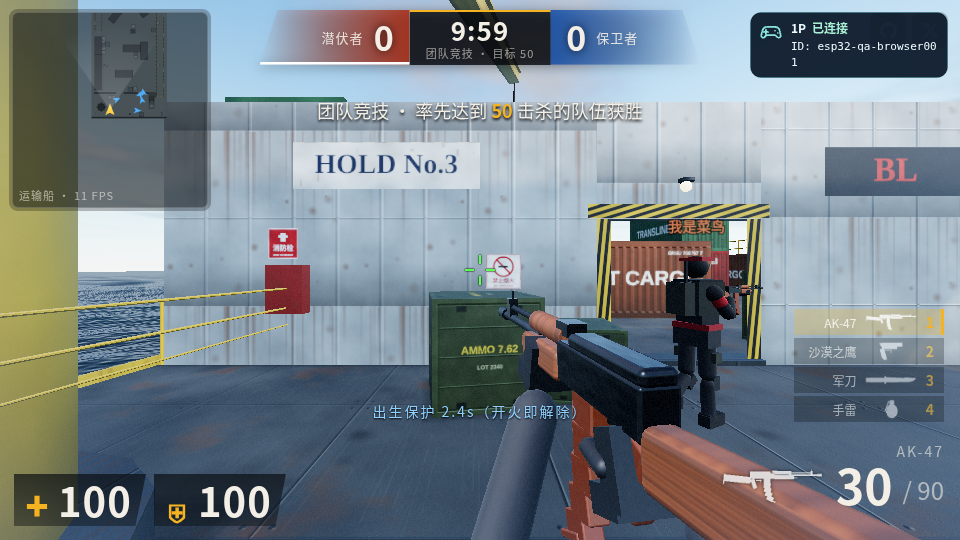

# 运输船 CF · pureTV 手柄适配

基于 [riba2534/claude-opus-5-5-demo](https://github.com/riba2534/claude-opus-5-5-demo/tree/54adc1fb64155f9dd7c1c90ecae7b8185ac540b8/cf-transport-ship) 的运输船团队竞技演示，保留地图、机器人、四种主武器、手枪、军刀、手雷和程序生成音效。是非官方演示适配，源码出处与许可状态见 [NOTICE](NOTICE.md)。

## 安装包

**0.1.0** 安装包与验证记录已随本目录提供。

| 平台 | 安装包 | 系统要求 |
| --- | --- | --- |
| Android TV | [cf-transport-ship-0.1.0.apk](cf-transport-ship-0.1.0.apk) | Android 8.0+，系统 WebView 与 GPU 必须支持 WebGL 2 |
| macOS | [CFTransportShip-0.1.0-macos-universal.dmg](macos/CFTransportShip-0.1.0-macos-universal.dmg) · [ZIP](macos/CFTransportShip-0.1.0-macos-universal.zip) | macOS 11+，WebKit 与 GPU 必须支持 WebGL 2；通用包，包含 Apple Silicon／Intel 版本 |

Mac 包使用 ad-hoc 签名，未做 Apple 公证。若首次打开被系统拦截，可在「系统设置 → 隐私与安全性」中选择「仍要打开」。系统版本达到下限不保证旧 GPU 或虚拟机可运行；实体电视、手机及 ESP32 手柄尚未联调。

Android 正式包来源见 [android-release.json](android-release.json)；Mac 文件和原生验收记录见 [macos/](macos/)。两平台均验证实际 SDK 控制、断线重连和端口占用回退；Mac 的 Apple Silicon 原生与 Rosetta 图形检查通过，Intel 托管运行机因 WebGL 上下文丢失只通过协议检查。完整范围见[统一验证说明](../README.md#验证记录)，本目录文件校验见 [SHA256SUMS.txt](SHA256SUMS.txt)。



预览为实际浏览器渲染、合成手柄输入夹具的原图，直接按字节复制；不是原生安装包或实体设备截图。[原图来源与目视记录](docs/preview-provenance.json)。

Android TV 与 macOS 使用同一份离线页面资产，通过各自原生宿主提供 TCP 63485 与 `_puretv._tcp` 发现。电视／Mac 和手柄连同一个局域网，GPIO 23 搜索后用 START 开始。菜单可用方向键选择、A 确认；无需鼠标锁定。当前为单人对机器人，每个游戏同时接受一只 Wi-Fi 手柄，连接卡显示其真实 ID；第二只连接会被拒绝，不会抢占已有连接。

| 手柄按键 | 对局操作 |
| --- | --- |
| ↑ / ↓ | 前进 / 后退 |
| ← / → | 向左 / 向右转向 |
| A | 按住射击 |
| X | 换弹 |
| Y | 跳跃 |
| B + ↑ / ↓ | 抬头 / 低头精细瞄准 |
| B + ← / → | 慢速转向瞄准 |
| B + X | 循环切换主武器、手枪、刀、手雷 |
| B + Y | 狙击开镜 / 刀重击 |
| START | 开始、暂停、继续；换装页返回 |

A 可以和 B + 方向同时按住，边瞄准边射击。暂停页可以切换蹲姿（配合 Y 蹲跳）、更换主武器，以及把左右键切换为横向平移；平移模式下 B + 左右仍用于转向。换装页和暂停页的 B 可返回。

失焦、进入后台或操作手柄断线会清空输入并暂停，恢复连接不会自动继续。键鼠原操作保留：WASD 移动、鼠标瞄准、左键射击、右键开镜、Shift 静步、空格跳、C 蹲、1–4 切武器、R 换弹、B 换装、Esc 暂停。触屏按钮保留，并补全松开／取消释放处理。

默认流畅画质。页面使用 Three.js 0.186.0，需要 **WebGL 2**；Android／macOS 宿主版本满足最低要求仍不代表旧显卡、旧 WebView 或虚拟机一定支持。加载失败会显示错误；不把无 WebGL 的机器计为玩法通过。

## 源码与构建

```sh
npm ci --ignore-scripts
npm test
npm run build
npm run build:check
```

`src/` 是编辑源。`dist/tv.html` 为可离线运行的单页，`dist/THIRD-PARTY-NOTICES.txt` 随安装包分发。`build:check` 在内存重建并逐字节对照当前 dist，源码变化后应先 build 再检查。运行网页预览可在 dist 目录启动本地 HTTP 服务；Wi-Fi 手柄输入依赖原生安装版。

游戏每个动画帧只调用一次共享 `createController.poll()`，UI 和只读 `JoystickGameQA.snapshot()` 仅查看缓存，不额外消费短按。已移除上游全局 `__game` 和快进调试入口。测试不写入模型或改游戏时间；专项报告和正式平台验证由交付记录区分。

原始源码 SHA 清单见 [upstream-manifest.json](docs/upstream-manifest.json)。单测覆盖方向、细瞄组合、独立 X/Y、取消、无 Wi-Fi 的原生遥控、平移与帧间隔上限；这是输入映射验证，不能替代真实设备或完整对局验收。
