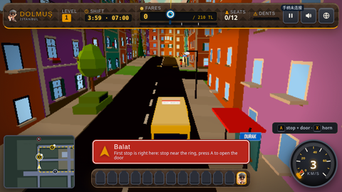

# 多尔穆什 · 伊斯坦布尔小巴

驾驶黄色的土耳其合乘小巴，按线路载客、选停靠点并赚取车费和小费。顺着小地图找到车站，减速靠边后开门，让乘客上下车。游戏包含八个班次、每日挑战和无尽模式；交通灯、电车和雨天都会改变驾驶条件。

## 手柄

| 操作 | 驾驶时 | 菜单中 |
| --- | --- | --- |
| 左 / 右或左摇杆 | 转向 | 移动焦点，左右调节滑杆 |
| 上 / 下 | 加速 / 制动 | 移动焦点 |
| A | 靠边停车后开关车门 | 确认当前选项 |
| B | 制动 | 返回 |
| X | 按住鸣笛 | |
| Y | 切换小地图朝向 | |
| START | 暂停或继续 | 标题画面快速出车，其他菜单确认主操作 |

要自选线路，标题菜单用 A 确认“Play”，选择三个站点或保留经典线路，再发车。支持 pureTV Wi-Fi 手柄、房间内的手机手柄、标准 USB / 蓝牙游戏手柄和键盘。键盘方向键对应方向，Z/X/C/V 依次对应 A/B/X/Y，P 对应 START。游戏失去焦点或活动手柄断开时会暂停。在三端应用的标题菜单按 B 可请求退出。

## 本地构建

在本目录运行 `npm ci && npm run build`。将静态服务器指向 `dist/`，打开 `tv.html` 即可离线游玩，需支持 WebGL 2。运行 `npm run build:check` 会重新构建并逐文件核对已提交的发行内容。三端使用同一套 `dist/` 资源。代码、贴图、声音和 3D 模型位于 `src/`；建模脚本位于 `src/assets/src/`。原作提供英语和土耳其语。

原作者为 Furkiozknn。固定提交、代码许可及 Poly Haven、Kenney 等 CC0 素材的逐项来源见 [NOTICE](NOTICE.md)、[CREDITS](CREDITS.md) 和[素材说明](docs/assets.md)。
