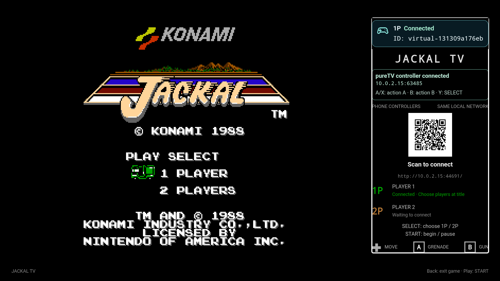
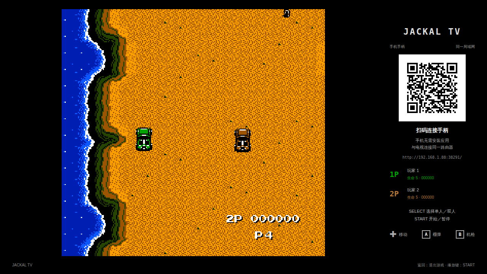
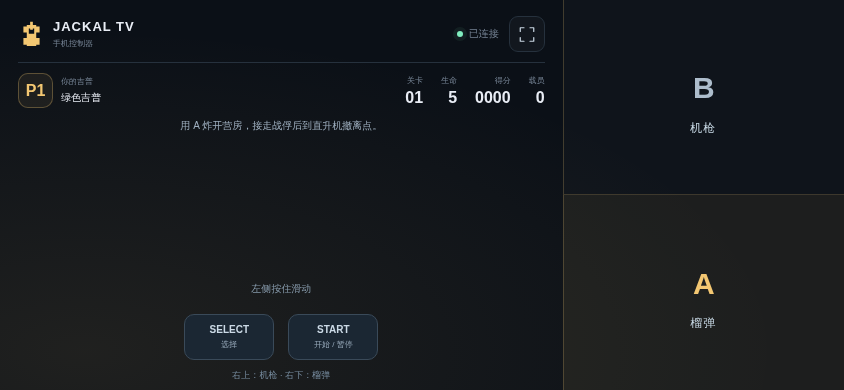
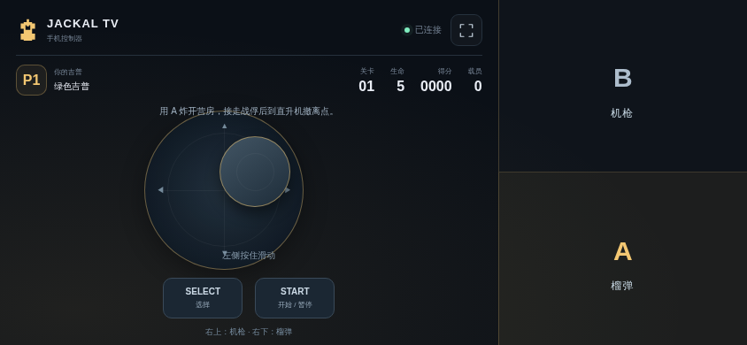

# Jackal TV · 赤色要塞

<!-- apk-resource:start -->
[Android TV 0.5.9 · APK](jackal-0.5.9.apk?raw=1) · [macOS · DMG](https://github.com/ecojust/pureTV/releases/download/games-zh-cn-2026.11.25/jackal-macos.dmg) · [Windows x64 · 安装程序](https://github.com/ecojust/pureTV/releases/download/games-zh-cn-2026.11.25/jackal-windows-x64-setup.exe)
<!-- apk-resource:end -->

历史安装包（Android 0.5.8） · [Android 0.5.8 APK](jackal-0.5.8.apk?raw=1) · [Windows x64](https://github.com/ecojust/pureTV/releases/download/gameplay-icons-2026.11.21/jackal-windows-x64-setup.exe) · [macOS](https://github.com/ecojust/pureTV/releases/download/gameplay-icons-2026.11.21/jackal-macos.dmg) · [图标与安装验证](docs/releases/0.5.8/android-icon-receipt.json) · [文件校验](SHA256SUMS.txt) · [0.5.7 实玩录像](docs/releases/0.5.7/gameplay.mp4?raw=1)

## 历史 Android 版本 0.5.7 · 手柄与手机连接

[下载签名 APK](jackal-0.5.7.apk?raw=1) · [校验值](SHA256SUMS.txt) · [安装包与源码](resource.json)

首帧绘制失败后，手机仍可连接并看到房间状态。在 720 × 480 电视上，二维码和两个玩家席位都能完整显示。可用键盘、pureTV Wi-Fi 手柄，或用同一局域网内的手机扫描电视房间二维码。连接标识区分玩家，连接与断开时保留游戏画布尺寸。[连接手柄指南](../../docs/guide/README.md#安装游戏与连接手柄)

此签名 APK 已在 Android TV 模拟器上从 0.5.6 成功覆盖安装，验证记录可追溯至已发布的 0.5.4。原版手柄 SDK 通过 9 项检查，实际发出的 97 条消息全部收到同序号确认。[游戏截图](docs/releases/0.5.7/gameplay.png) · [Android 玩法录像](docs/releases/0.5.7/gameplay.mp4?raw=1) · [验证记录与测试范围](docs/releases/0.5.7/verification.json)

[中文](README.md) · [English](README.en.md)

<!-- controller-client-status:start -->
## 历史版本 0.5.4 · 手柄连接标识

<!-- previous-apk-resource:start -->
[下载签名 APK](jackal-0.5.4.apk?raw=1) · [校验值](SHA256SUMS.txt) · [签名与来源](resource.json) · [源码](src/) · [图标](logo.svg)
<!-- previous-apk-resource:end -->

Android **0.5.4 / versionCode 8**：手柄连接后，侧边显示手柄图标、玩家席位（按游戏人数显示 1P/2P）和设备完整连接 ID；断开后隐藏。默认 TCP 端口仍为 **63485**。当前手柄固件未上报 RSSI，因此不显示信号强弱。

[连接截图](docs/releases/0.5.4/connected.png) · [连接状态专项录像](docs/releases/0.5.4/controller-status.mp4?raw=1) · [版本验证](docs/releases/0.5.4/verification.json) · [20 款更新记录](../../docs/controller-client-status/README.md)

安装包沿用原发布证书。本轮在 Android TV 模拟器中验证连接身份、断开／重连状态及同证书覆盖安装；截图和录像记录菜单中的连接状态专项，没有重做完整玩法验收。未改规则模型按精确哈希复用历史依据，旧版报告继续保留。尚未验证实体电视、手机、ESP32 或带已有存档的升级与数据保留。


<!-- controller-client-status:end -->

Jackal TV 独立重写红白机 NES 版《赤色要塞》的六关玩法：吉普车驾驶、营救战俘、直升机撤离、武器升级和六种首领战。电视显示游戏和房间二维码，手机扫码后使用左侧摇杆、右侧 A/B 与 START/SELECT 控制，支持 1–2 人局域网合作。

当前版本为 **0.5.8**。安装后即可游玩，无须导入 ROM；包名保持不变。此版本包含六关重写内容，AI、部分碰撞、动画时序与音色尚有差异，尚未完成电视实机及逐帧对照验证。

<!-- visual-release:start -->
## 历史：0.5.2 视觉更新与验证

以下保留 **0.5.2** 发布时的视觉更新、源码和验收记录；这些旧版结果不代表本轮 pureTV 手柄更新已经通过验收。当时沿用 0.5.0／0.5.1 的 pureTV 发布证书。逐款改动、检查范围和实机验证状态见[0.5.2 视觉更新记录](../../docs/game-visuals-0.5.2.md)。

该次视觉更新只读核对 NES 美版《Jackal》的视觉对应关系，保留已有像素关卡；没有修改 Jackal 渲染器。

具体还原范围见[参考说明](docs/reference.md)。

<!-- final-verification -->
当时冻结源码 0752b658aecbb1322cb7294e3176500639db1b54 已通过 Android CI 40843467072：280 项模型／渲染行为回归、36 个兼容场景、131 个手柄场景及 18 个双语集成场景；Cozy Island 输入运行时 9／9、两款 WebGL 1 渲染脚本及 Coast Kart 道具攻防专项也通过。Android 构建、lint、体积和 staging 成功，15 个模块实际执行 JUnit 任务（含全部 9 款游戏），不推断未输出的 JUnit 用例数。签名运行 40846148068 已核验九款 APK 的源码资源、签名与资源目录。Chrome 61 语法和现代 Chromium 旧 API 模拟不等于真实旧 WebView 验收；该历史版本当时未测试真实电视／手机、设备 FPS、覆盖安装和数据保留。
<!-- visual-release:end -->

## 历史：0.5.1 还原度升级

修复第 3 关两段激光长度和预警端点，按实际地图切换长、短光束。

沿用 0.5.0 证书，可直接覆盖更新；0.5.1 的核对结果与剩余差距见[还原度复核](../../docs/game-fidelity-0.5.1.md)。

## 安装与签名

历史 0.5.3 已沿用 0.5.0／0.5.1／0.5.2 的 pureTV 统一发布证书；当时已在 Android TV 模拟器成功从 0.5.2 执行 `adb install -r` 覆盖安装。该检查未预置存档，不代表已验证升级后存档或用户数据保留。使用旧证书的 0.4.x 及更早安装不能直接覆盖，请先备份可导出的数据再卸载；卸载会清除本机存档和记录，本项目没有跨证书自动迁移工具。

## 浮动摇杆与兼容性

修复旧版电视 WebView 的启动黑屏与玩家状态不显示。房间状态独立于游戏绘制更新，启动或绘制失败时会显示可读提示。手机手柄改为浮动摇杆：默认隐藏，在左侧操作区任意位置按下确定本次中心，拖动驾驶，松手立即停止并隐藏。移动与 A/B 支持多指同时操作；触控中断、切后台或断线时清空输入。A 仍为榴弹／火箭，B 仍为机枪。

## APK
适用于 Android 8.0 及以上电视，包名 `com.ecojust.jackaltv`。本目录 APK 版本为 `0.5.4`，签名、覆盖安装和运行验收见[本次版本验证](docs/releases/0.5.4/verification.json)。

## 历史：0.5.0 手柄升级

手机右侧三分之一屏幕为无空隙的动作区，上半区为机枪（B），下半区为榴弹／火箭（A）。左侧保留浮动摇杆，START、SELECT 在左侧底部独立放置。支持多指同时操作，触控取消、失焦或断线均释放输入；整页抑制文字选择、拖拽和长按菜单。

## 操作

1. 将手机与电视连接到同一局域网；电视可以使用网线。
2. 打开应用，扫描电视上的房间二维码。第一部手机控制绿色 P1，第二部控制棕色 P2。
3. 在标题画面用 **SELECT** 选择一人或两人模式，按 **START** 开始。第二部手机连接房间不会自行改变已选的单人模式。

| 控件 | 功能 |
| --- | --- |
| 左侧触控区 | 按下确定浮动摇杆中心，拖动八方向驾驶，松手停止并隐藏 |
| A | 沿当前方向投掷手雷或发射火箭；每次按下发射一次 |
| B | 向画面上方发射机枪；按住连续射击 |
| START | 开始游戏、暂停/继续、确认 Continue 选项 |
| SELECT | 标题画面选择人数，Continue 画面切换选项 |
| A + B | 双人模式中，已失去全部生命的玩家向仍有至少两条生命的队友借一条生命 |
| 电视返回键 | 显示退出确认 |

游戏使用 256×240 原生画面，在宽 512 像素的六关地图中横向及纵向卷动。每人初始五条生命；机枪始终朝北，主武器依次升级为手雷、火箭、横向爆风火箭、十字爆风火箭。

不同囚室释放两人、四人或一名闪烁的升级战俘；有些建筑实际是坦克库。战俘依次走出，靠近后上车，没有旧版的八人载客限制。停机坪按顺序卸载，累计送达 4、9、15 人时升级主武器。战俘完成走向直升机的动作后获得对应分数，关卡结算另按已送达人数计算奖励；仍在车上的战俘进入下一关。具体常量、来源和验证范围见[参考与实现说明](docs/reference.md)。

## 房间与退出

手机浏览器无需安装控制器应用。房间 HTTP/WebSocket 服务只在电视局域网内工作，端口在启动时分配，二维码包含本次房间的随机令牌；最多两名玩家，不经过云端中转。

手机切到后台、锁屏或断线时会释放所有按键，重新连接后尝试恢复原玩家位置。全部控制器断开时自动暂停。按 Home 离开应用会关闭房间；确认退出会断开手机连接、关闭监听端口和服务线程、销毁游戏页面并结束应用进程。再次启动会创建新房间。

无法扫码连接时，检查设备是否位于同一局域网，以及路由器是否启用了访客网络或 AP 隔离。

## 开发构建与素材

以下命令是可复现的检查入口，不表示本轮已经全部执行通过；本轮实际执行结果见上方验收记录。

逻辑是新写的 JavaScript 状态机，不包含 ROM 加载器、CPU 模拟器或第三方游戏程序实现。六关地图、事件、图像和音符参考数据保留来源记录。本 APK 包含运行所需的参考素材；原作图像、音乐和设计的版权仍属于 Konami，应用代码的 MIT 许可不构成对这些内容的再授权。实现没有直接运行原作程序，但使用了提取和转录的参考资料。

渲染器需要关卡图块/精灵图集、HUD 字体、精灵元数据、首领背景补丁、演出时间线和音符数据。安装此目录内 APK 无须另行准备；从源码构建时，应按[构建说明](docs/local-preview-build.md)提供完整素材目录，并通过 `-PjackalArtworkDir` 指定。数据来源、署名和仍待对照的细节见[参考与实现说明](docs/reference.md)、[音频说明](docs/reference-audio.md)及[敌人与首领说明](docs/reference-enemies.md)。

从仓库根目录验证逻辑与数据：

```sh
node joystick-games/jackal/tools/build-levels.cjs --check
node --test joystick-games/jackal/tests/game.test.cjs joystick-games/jackal/tests/enemies.test.cjs joystick-games/jackal/tests/scenes.test.cjs
```

准备好所需素材后构建 Android：

```sh
cd resource/launcher/puretv
./gradlew :jackal:assembleDebug :jackal:testDebugUnitTest :jackal:lintDebug \
  -PjackalArtworkDir=/absolute/path/to/artwork
```

APK 输出在 `joystick-games/jackal/build/outputs/apk/`。局域网协议、服务关闭和进程退出由 Android 测试验证；游戏规则由 Node 测试验证。浏览器测试和截图只能说明页面行为，不能代表电视性能、手机网络时延或全部原作一致性。发布资源的维护流程见[资源维护说明](../../docs/resource-maintenance.md)。

## 历史画面（0.5.2）

以下图片来自实际游戏页面在 Chromium 中的运行，使用模拟房间连接；不是电视实机截图。





按住拖动时，摇杆出现在本次触点位置：



## pureTV Wi-Fi 手柄

电视和手柄加入同一局域网，打开游戏后按手柄搜索键（GPIO 23）。电视界面显示实际 TCP 地址和发现状态，默认端口 **63485**；仅启动时被占用才选择备用端口，一次运行期间保持不变。同网存在多个游戏服务时，请先关闭其他服务再搜索。

方向键驾驶；**A/X** 每次按下投掷手雷／发射火箭，**B** 按住向画面上方连续机枪射击。**Y（SELECT）** 在标题切换人数、Continue 画面切换选项。**START** 开始、暂停／继续。支持两只 Wi-Fi 手柄分别占据两个玩家席位。扫码手机手柄和电视遥控器仍可使用。

断线或切换控制来源会暂停游戏，松开按键后重新按 START 继续；重连同步和原先按住的键不会自动触发动作。临时失焦时隔离输入并保留监听服务；按 Home 或切换应用仍会按原有流程退出游戏并关闭服务。

<!-- controller-client-status-history:start -->
<details>
<summary>历史 0.5.3 安装包与验收记录</summary>

以下为旧版发布记录，其测试与画面不代表本次连接 ID 界面验收。[原提交中的完整说明](https://github.com/ecojust/pureTV/blob/9af9f197855eb7a0ce7174c0e6295c8974b3250d/resource/apps/jackal/README.md)。

[下载 APK](jackal-0.5.3.apk?raw=1) · [校验值](docs/controller-status-baseline/0.5.3/SHA256SUMS.txt) · [签名及构建来源](docs/controller-status-baseline/0.5.3/resource.json) · [源码](src/) · [64×64 SVG 图标](logo.svg)

该历史版本 APK 已使用原 pureTV 发布证书正式签名，并通过从上一版本覆盖安装的验证；当时 Android 手柄验收结果见下方更新说明。若设备中存在使用旧证书的同包应用，Android 无法直接覆盖安装；需先备份数据并卸载旧包。

## 0.5.3 pureTV 手柄更新

历史版本为 **0.5.3 / versionCode 7**，新增 pureTV Wi-Fi 手柄输入，默认 TCP 端口 **63485**，保留扫码手机手柄和电视遥控器。正式签名 APK 已在 Android TV 模拟器完成 9/9 项手柄验收，并通过从上一版本执行 `adb install -r` 覆盖安装。未做带存档升级或数据保留验证。

实际结果和限制见[当时 20 款游戏验收记录](../../docs/readme-controller-support/README.md)及[发布进度](../../docs/readme-controller-support/rollout.json)。下文保留的旧版 CI、录像和截图均为历史依据。

该历史版本验收资源：[菜单截图](docs/releases/0.5.3/menu.png) · [实际 APK 运行录像](docs/releases/0.5.3/gameplay.mp4?raw=1) · [验证记录](docs/releases/0.5.3/verification.json)。截图和录像来自 Android TV 模拟器，未做实体电视测试。验收范围和具体结果见验证记录；模拟器结果不代表实体电视或带存档升级验证。

</details>
<!-- controller-client-status-history:end -->
