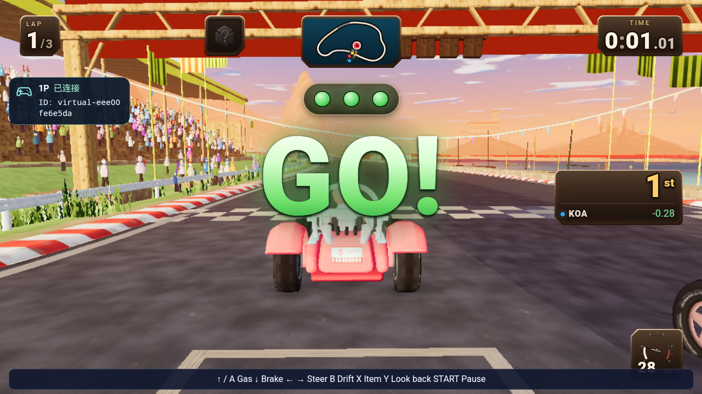
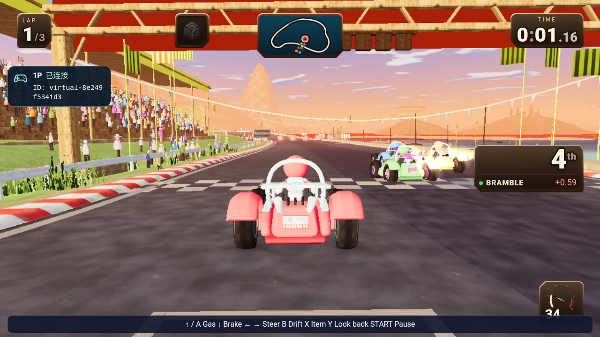

# Kart Royale 0.1.3 · Android TV 手柄验收

这份安装包保留 Sunset Bay Circuit、原卡丁车、AI 对手与原轮胎物理。Android TV 模拟器通过原 pureTV TCP SDK 在真实安装的应用中操作标题、车手选择、起跑、加速、转向、漂移、道具、暂停、断线和重新连接。[签名 APK](../../kart-royale-0.1.3.apk) · [逐项核验记录](verification.json) · [原签名收据](signing-receipt.json)

| 场景 | TCP 端口 | 通过项 | 接受的 SDK 消息 / 唯一匹配 ACK | 实际油门速度 | 原始报告 |
| --- | ---: | ---: | ---: | ---: | --- |
| 默认端口 | 63485 | 58 | 959 / 959 | 7.642 | [原报告](https://github.com/ecojust/pureTV/blob/06a989e1485fd8cc903b58354dc1c0bc5a8f2999/evidence/joystick-android-runtime-kart-royale/kart-royale-normal/report.json) |
| 默认端口已占用 | 34137 | 58 | 860 / 860 | 9.092 | [原报告](https://github.com/ecojust/pureTV/blob/e26766b346009537383d785463ee2c0b44f193ed/evidence/joystick-android-runtime-kart-royale/kart-royale-occupied/report.json) |

从启动前建立观察端口到读取到可操作菜单，默认场景用时 109.5 秒，端口占用场景用时 88.6 秒。这是此 Android TV 14 软件渲染模拟器上的实测。

两份报告的游戏 APK 均为 SHA-256 `d227411ef53690fa780a42ea580197e607018f6e00f06e00f1e5a382e3199494`，包名 `com.ecojust.joystick.kartroyale`，1,225,991 字节。签名证书 SHA-256 为 `eb31978a5bd768fe3cedf483530c51df1e901cf00da5c822d3a7e98fc492cf23`。两个场景的输入均经原 SDK 发送。逐步记录包含九键、无重复 ACK 的核对、油门后的真实位置变化和暂停后的新按键恢复。[冻结构建源](https://github.com/ecojust/pureTV/commit/5636ee87703fc764d72ce8389dda965a538588fe) · [签名构建](https://github.com/ecojust/pureTV/actions/runs/44689811645)

## Android 原始行驶画面

默认端口画面大小为 1280 × 720，端口占用画面大小为 1280 × 720。两张原图中均可见红白玩家卡丁车、沥青赛道、起跑线和观众。默认端口画面显示绿色 GO 与第一名，占用端口画面显示前方其他车手与第四名。下方文件保留原始 PNG 字节。[默认场景原图](https://raw.githubusercontent.com/ecojust/pureTV/06a989e1485fd8cc903b58354dc1c0bc5a8f2999/evidence/joystick-android-runtime-kart-royale/kart-royale-normal/driving-checkpoint.png) · [端口占用原图](https://raw.githubusercontent.com/ecojust/pureTV/e26766b346009537383d785463ee2c0b44f193ed/evidence/joystick-android-runtime-kart-royale/kart-royale-occupied/driving-checkpoint.png)

本次覆盖 Android TV 模拟器及原 TCP SDK。实体电视、实体 ESP32 手柄和完整生涯通关仍待实测。软件渲染器的冷启动可能较长，各版本实际环境与测量见[Android TV 实测记录](../android-tv-20261120.md)。
