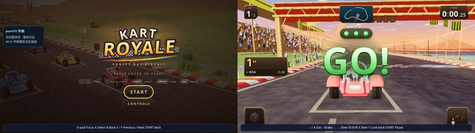
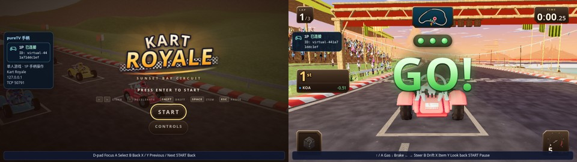

# Kart Royale 的 Android TV 运行记录（2026-11-20）

这些检查针对 Android TV 模拟器，使用实际签名 APK、配套只读 Observer 和 pureTV TCP SDK。每个运行的普通模式使用 63485 端口，占用模式验证端口回退。

| 版本与运行 | 普通模式 | 默认端口已占用 |
| --- | --- | --- |
| [0.1.0 原包 / 44679330171](https://github.com/ecojust/pureTV/actions/runs/44679330171) | WebGL2 已启动。在 “drawing the hud” 阶段保留的最后快照为 0 帧，随后观察连接中断，初始菜单超时。 | 等待 ADB 设备 45 秒后超时。 |
| [0.1.1 原构建 / 44680268953](https://github.com/ecojust/pureTV/actions/runs/44680268953) | 构建、签名和输入验证通过。在 “tuning the engines” 阶段保留的最后快照为 0 帧，随后观察连接中断，初始菜单超时。 | 等待 ADB 设备 45 秒后超时。 |
| [0.1.1 原包，guest lavapipe / 44681943317](https://github.com/ecojust/pureTV/actions/runs/44681943317) | 端口 63485。150 秒时最后快照为 “tuning the engines”，0 帧。 | 端口回退至 33457。150 秒时最后快照为 “balancing the frame”，0 帧。 |

0.1.0 使用已审阅的三个菜单 QA 文件以及首次签名的 APK。61 次宿主采样记录到模拟器进程消失，未取得退出状态；前后内核记录都未报告 OOM 或模拟器故障，无法据此判定退出原因。[原包和签名记录](https://github.com/ecojust/pureTV/tree/5fe9ceda41c134619c613ac352ac8f22ed5d96bb/packages/kart-royale) · [两个模式的原始报告与采样](https://github.com/ecojust/pureTV/tree/b40f9e7009fdba9531ef80a1f9b297e7640cf70d/evidence/joystick-android-runtime-kart-royale)

0.1.1（versionCode 2）在明确识别出软件渲染器时默认使用原有 Low 画质。包名为 `com.ecojust.joystick.kartroyale`，大小 1,221,895 字节，SHA256 为 `ad971bba4d30383dfca7c5ea7c50e4b5b9e3d176a0b80af7d6855b1f15fdd117`。完整下载后复核了固定证书、包内十项资源哈希以及五项游戏 dist 文件的原始字节。正常端口及占用端口的报告均绑定同一 APK。[冻结源码](https://github.com/ecojust/pureTV/commit/9dff011992528e61506607b918776a1c99de49d6) · [签名收据](https://github.com/ecojust/pureTV/blob/b97e3c3dd6dbd8a679f29bbf71836749aa45a001/packages/kart-royale/signing-receipt.json) · [原始运行报告](https://github.com/ecojust/pureTV/tree/b97e3c3dd6dbd8a679f29bbf71836749aa45a001/reports/joystick-android-report-runtime-kart-royale)

首次 Mesa 对照通过原产物来源验证，随后在模拟器参数回归检查失败，未启动 AVD。第二次对照分别断言 Pon 的原参数和 Kart Royale 的 Mesa 参数，使用同一份签名 APK。电视镜像为 API 36、x86_64，模拟器为 37.3.10（16970787），内存 3072 MiB。[首次对照](https://github.com/ecojust/pureTV/actions/runs/44681216593) · [第二次对照](https://github.com/ecojust/pureTV/actions/runs/44681943317)

0.1.1 的 guest lavapipe 对照在两个模式都保留了 ADB、真实目标进程和 Android 日志，GLES 后端实际为 SwANGLE / SwiftShader 5。两份日志均记录了 Chromium 的瓦片内存限额告警。另一次 Xvfb / host 对照让模拟器选择了 Mesa llvmpipe，但独立 WebView 探针在启动游戏前退出，包含 ColorBuffer 绑定失败日志。这次没有取得游戏画面或控制器结果。[guest 原始证据](https://github.com/ecojust/pureTV/tree/1babbdb955046dc6f9c4cf4f8fc1539137901431/evidence/joystick-android-runtime-kart-royale) · [host 对照](https://github.com/ecojust/pureTV/actions/runs/44682838889)

## 0.1.2 的软件渲染启动与驾驶

0.1.2（versionCode 3）在确认为软件 GPU 且画质为 Low 时，直接把原场景渲染到画布，按镜头实际需要编译材质。其余设备沿用先前的画质选择。真实 WebGL2 上下文现在直接报告驱动名称。冻结包构建与签名均通过。[源码](https://github.com/ecojust/pureTV/commit/620fa8829d0b273ebcb6ec1539b97461c283c45c) · [签名和原生检查](https://github.com/ecojust/pureTV/actions/runs/44684303462)

该 APK 大小 1,221,895 字节，SHA256 为 `5bf29aa9b13c66f2520e1ac9cdfbaf5d6f371582bec34d18df6db67b295ec294`。完整下载后复核了签名收据、十项资源及五项 dist 的冻结字节。默认模拟器的普通模式在端口 63485 报告驱动为 Android Emulator OpenGL ES Translator (Google SwiftShader)，Low、WebGL2、“balancing the frame”与 0 帧，随后初始菜单超时。占用模式等待 ADB 设备 45 秒超时。[原始 APK](https://raw.githubusercontent.com/ecojust/pureTV/89b8e5d9c97cc123009b1642674d55751946701c/packages/kart-royale/kart-royale-0.1.2.apk) · [签名收据](https://github.com/ecojust/pureTV/blob/89b8e5d9c97cc123009b1642674d55751946701c/packages/kart-royale/signing-receipt.json) · [双模式原始报告](https://github.com/ecojust/pureTV/tree/89b8e5d9c97cc123009b1642674d55751946701c/reports/joystick-android-report-runtime-kart-royale)

在共享双核配额的 Linux x86_64 环境，用 Chromium 156、ANGLE / Mesa llvmpipe（LLVM 19.1.7、OpenGL ES 3.2）、960 × 540 视口检查了该渲染改动。此轮网页构建的渲染逻辑与冻结包相同，当时尚未加入最终的只读驱动名字段。首次观察到原游戏帧需 191 秒，第 2 帧在 199 秒显示 Start，第 8 帧在 213 秒报告就绪。在该环境中启动需要三分钟以上。用原游戏输入打开角色选择并开始比赛，第 18 帧进入倒计时，第 106 帧进入 racing，按住加速键后第 109 帧速度达到 1.49，坐标改变。标题和比赛截图均可辨认赛道和车辆。这些时间包含同机其他任务负载。该轮为桌面浏览器测量，Android TV 的原生结果使用下方独立任务。[实测标题和加速画面](software-renderer-20261120.jpg)

另用相同浏览器和视口对冻结的 0.1.2 bundle 做了冷启动 CPU 采样，10 毫秒采样一次，同时记录原页面的启动文字。该轮采样窗口为 315.46 秒。文字切换之间包含浏览器调度和系统初始化，CPU 栈时长还包含同步等待图形驱动的时间。

| 冻结版本的阶段 | 本次观察 |
| --- | --- |
| 天空与环境光 | “raising the sun” 到 “mixing materials” 用时 3.21 秒。天空环境生成时首次使用 WebGL 程序的栈约 1.97 秒。 |
| 赛道与场景装饰 | “laying the circuit” 到 “dressing the bay” 用时 11.85 秒；后者到 “rolling out the grid” 用时 35.81 秒。装饰阶段包含建筑、看台、植被与程序化纹理。 |
| 原场景首批画面 | 95.94 秒时启动文字已显示 “ready”。在实际绘制的调用链中，three.js 的 WebGLProgram.onFirstUse 约占 190.38 秒，包含查询程序状态、Uniforms 和 Attributes。窗口结束前已观察到第 3 帧、标题页与 Start 焦点。 |

解压后可在 Chrome DevTools 的 Performance 面板载入原始 CPU 采样。环境含两核 CPU 配额及并发任务，采样本身也产生开销。[CPU 采样文件](software-startup-0.1.2.cpuprofile.gz)

在 0.1.2 的两次原生对照中，观察器只在游戏标识、软件驱动、WebGL2 和控制器端口均可核实时续等，且必须看到原启动步骤或原倒计时帧增加。每一段总上限为 300 秒，验收仍需真实渲染和相同的 SDK 操作。两次均输入原签名产物 14606610194。[host Mesa](https://github.com/ecojust/pureTV/actions/runs/44685089257) · [guest lavapipe](https://github.com/ecojust/pureTV/actions/runs/44685153445)

首次 host 对照在启动 AVD 前停于监督器的测试项，测试 ELF 在采样前退出。重试让同一真实测试进程等到监督器写出其 exec 身份才退出，保留原身份和退出码断言。测试项已本地通过 22/22。[首次运行的原始记录](https://github.com/ecojust/pureTV/tree/4254b8bba985beaa6acfb6cdad4c3d68396f3ef9/evidence/joystick-android-runtime-kart-royale) · [host 游戏运行重试](https://github.com/ecojust/pureTV/actions/runs/44685883221)

0.1.2 的 guest lavapipe 普通端口 63485、回退端口 42335 均真实启动 WebGL2，游戏识别到 SwiftShader 5 和 Low。普通与占用模式分别在 48.74 秒和 37.78 秒最后观察到 “tuning the engines”，其后没有新游戏快照，等候上限分别到 198.74 秒、187.78 秒时仍为 0 帧。两个原始 ADB 日志均包含 Chromium 瓦片内存限额告警。[普通报告](https://github.com/ecojust/pureTV/blob/a29fb65bf0adb04c1801dd034a9dd502be6edde7/evidence/joystick-android-runtime-kart-royale/kart-royale-normal/report.json) · [回退报告](https://github.com/ecojust/pureTV/blob/a29fb65bf0adb04c1801dd034a9dd502be6edde7/evidence/joystick-android-runtime-kart-royale/kart-royale-occupied/report.json)

host 重试的两个模式都完成游戏安装和初始化前清数据，150 秒内均未取得一份可解析的游戏快照。Android 输入分发器在两种端口模式下均记录 MainActivity 等待焦点事件 60 秒后触发 ANR。宿主 OpenGL 可由独立日志确认，游戏内的驱动及画面未能核实。[host 报告和原始诊断](https://github.com/ecojust/pureTV/tree/70bc862ef63d656e8ef6e446b46bbc1cef47cec3/evidence/joystick-android-runtime-kart-royale)

## 0.1.3 的赛道画面与软件 GPU 测量

0.1.3（versionCode 4）使用 minSdk 26 和 targetSdk 35。侦测到软件 GPU 且采用 Low 画质时，游戏以顶点光照绘制原赛车、路面和建筑的基础色、纹理与顶点颜色。原作的距离 LOD、风动、摇船、旗帜和观众动画沿用同一组顶点变换。窗板、阳台和观众的装饰网格减少了细分。静态镜头下对这三类改动做单项对照，原始第 2 帧提交了 1,467,423 个三角形，调整后为 1,301,525，两者都是 93 次绘制。硬件 GPU 使用原来的材质与网格。[冻结源码](https://github.com/ecojust/pureTV/commit/5636ee87703fc764d72ce8389dda965a538588fe)

本地复核使用 Chromium 156、Mesa llvmpipe（LLVM 19.1.7）、960 × 540 和两核共享 CPU 配额。冻结版本 在该次并发测试中用 275.97 秒绘出第 1 帧，329.66 秒时可操作标题页。经游戏控制桥依次确认 Start 和 Start race，原倒计时运行到第 106 帧进入 racing，第 109 帧速度达到 1.4877，车辆的世界坐标同时改变。画面可见赛道路缘、观众、灯号和实际赛车。桌面软件渲染器的高启动延迟及低帧率仍然影响操作体验。

0.1.3 的 Android TV API 36、1080p 对照中，普通端口取得真实 SwiftShader / WebGL2 和 Low 画质，最后一份快照的启动阶段为 “lighting the effects”、0 帧。默认端口占用对照等待 ADB 设备 45 秒后超时。该轮没有通过原生驾驶验收。签名 APK 为 1,225,991 字节，SHA-256 为 `d227411ef53690fa780a42ea580197e607018f6e00f06e00f1e5a382e3199494`。[冻结签名包](https://raw.githubusercontent.com/ecojust/pureTV/b20d28788b5a6dd3ebf4960e2d2eefefca72949f/packages/kart-royale/kart-royale-0.1.3.apk) · [双端口原生报告](https://github.com/ecojust/pureTV/tree/b20d28788b5a6dd3ebf4960e2d2eefefca72949f/reports/joystick-android-report-runtime-kart-royale)

## 0.1.4 的分帧载入

0.1.4（versionCode 5）在软件 Low 模式先显示原赛道、起跑格和八名车手。首屏可操作后，游戏按原先的随机种子和顺序生成海湾装饰，每帧最多显示三批新物件。距离较远的木制与石制道具采用较小空间分组进行视锥剔除，赞助商图案保留原 2048 × 2048 基础色图。硬件 GPU 仍在首次绘制前完整生成原场景。控制器快照按实际 WebGL 上下文缓存版本和驱动型号，每次丢失或恢复上下文都会清除缓存。[冻结源码](https://github.com/ecojust/pureTV/commit/a10c8c82b204faf151001beaeed7d3aa85a751e0)

使用 Chromium 156、Mesa llvmpipe 和 960 × 540 视口进行相同的两次冷启动对照。每次启动使用新的 Mesa 着色器缓存目录，并关闭 Chromium 的磁盘着色器缓存。两次都读到原比赛系统中的八辆赛车。

| 冻结版本 | 第 1 帧用时 | 第 8 帧标题 Start 用时 | 第 1 帧绘制调用、三角形、着色程序 |
| --- | ---: | ---: | --- |
| 0.1.3 | 52.19 秒 | 64.79 秒 | 87 次、1,306,605 个、32 个 |
| 0.1.4 | 40.00 秒 | 51.13 秒 | 39 次、277,365 个、14 个 |

表中时间来自桌面软件渲染器，Android TV 的安装、端口回退和驾驶结果单独记录。上述测试与先前 0.1.3 桌面驾驶记录在不同的共享负载下进行。

另一轮在同一份 0.1.4 分发文件上使用仓库原 Python SDK，通过真实本机 TCP 连接输入，测试宿主把连接状态交给浏览器。倒计时第 18 帧关闭连接后，游戏进入 Paused。到第 21 帧，比赛时钟保持 0，可见装饰由 6 批增到 9 批。重新连接时游戏维持暂停，单独按下 START 恢复倒计时。第 108 帧有八名车手，141 个场景批次均已显示。第 111 帧按下油门后，速度达到 1.4877，赛车的世界坐标发生变化。截图可见原赛道、赛车、路缘、看台观众和海湾背景。[桌面 SDK 观察记录及配对冷启原始数据](software-streaming-0.1.4.json)

0.1.4 的签名 APK 是 1,225,991 字节，SHA-256 为 `4783d3117050c20e6f56c7117c358f7ed2dba8049c7642aa8660dc7df950fb70`。在 API 36、1080p 的默认 SwiftShader 环境中，普通端口记录了真实 WebGL2，最后一份是 “mounting the camera”、0 帧。默认端口占用场景等待 ADB 设备 45 秒后超时。[冻结签名 APK](https://raw.githubusercontent.com/ecojust/pureTV/ce4f13b8cb8430a7ee7c4ab207cb8ffedac677a8/packages/kart-royale/kart-royale-0.1.4.apk) · [原始端口报告](https://github.com/ecojust/pureTV/tree/ce4f13b8cb8430a7ee7c4ab207cb8ffedac677a8/reports/joystick-android-report-runtime-kart-royale)

0.1.4 在 Android TV 14（API 34、1280 × 720、3 GiB 客体内存）的首次同包对照中，默认端口已被占用时通过 58 项检查，回退端口为 35045。WebView 报告 WebGL 2 与 SwiftShader 5，第 362 帧观察到真实油门输入、速度 8.128 和世界坐标变化。849 条 SDK 消息分别取得唯一匹配 ACK。加速后截取的原图可辨认红白玩家车辆、两台对手、赛道路缘、观众与第一圈 HUD。同轮首次使用默认端口时，启动停在 “dressing the bay”、0 帧，初始菜单超时。[默认端口原始报告](https://github.com/ecojust/pureTV/blob/f42bad392bf2444cfe4573653805d83f2f8a6a90/evidence/joystick-android-runtime-kart-royale/kart-royale-normal/report.json) · [端口占用原始报告](https://github.com/ecojust/pureTV/blob/f42bad392bf2444cfe4573653805d83f2f8a6a90/evidence/joystick-android-runtime-kart-royale/kart-royale-occupied/report.json) · [Android TV 原始行驶画面](https://raw.githubusercontent.com/ecojust/pureTV/f42bad392bf2444cfe4573653805d83f2f8a6a90/evidence/joystick-android-runtime-kart-royale/kart-royale-occupied/driving-checkpoint.png)
