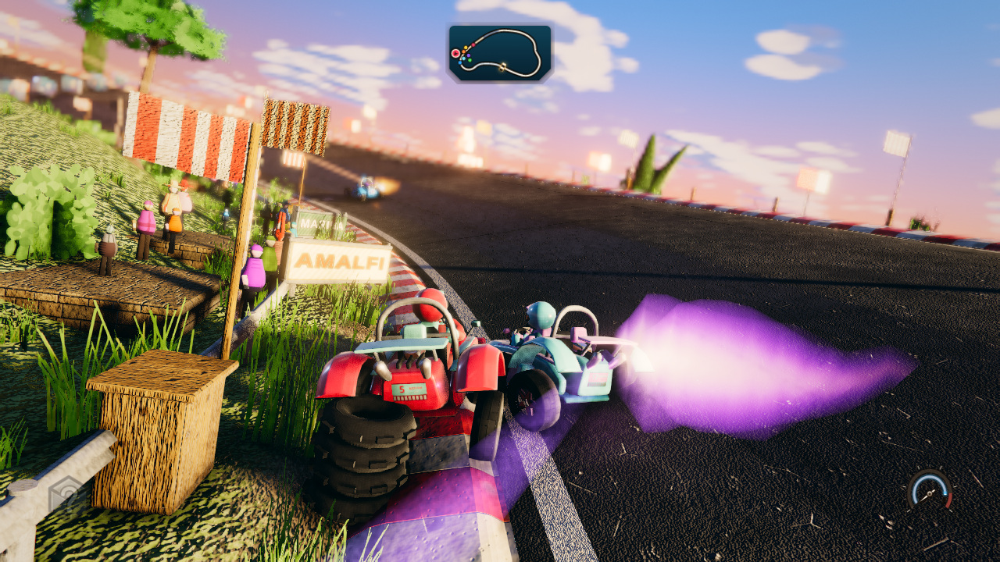
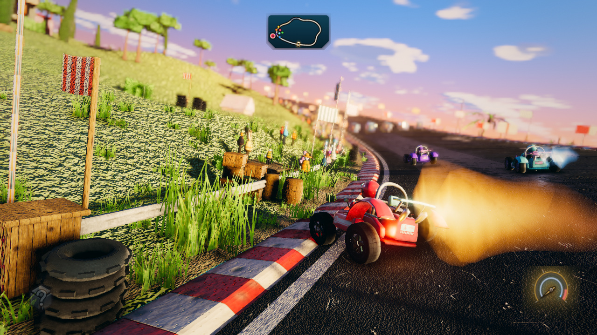
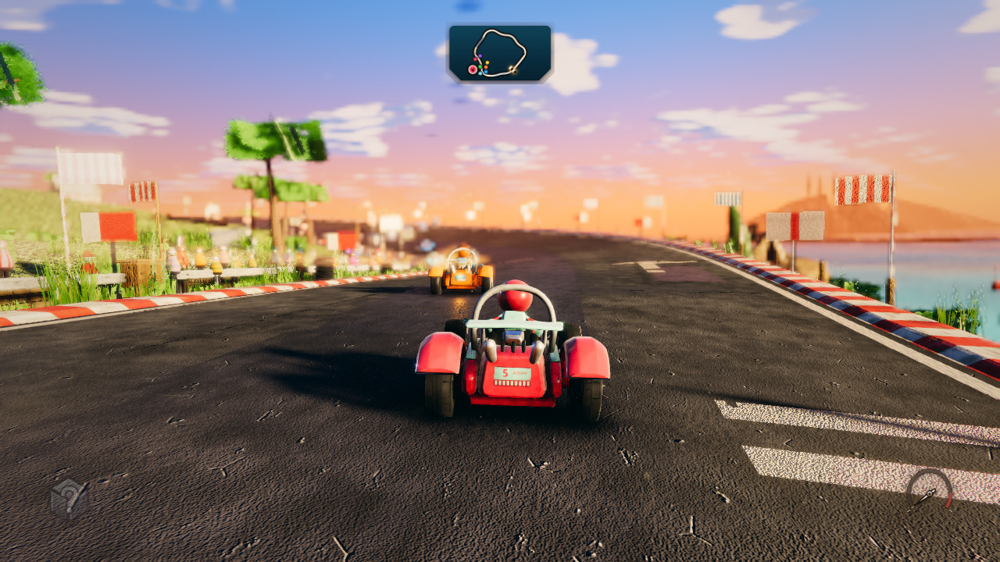

# Kart Royale 0.1.6 赛道验证

日落湾、海岬之冠和游艇港连弯使用同一套赛道网格生成器。三者按 0.5 米间距采样中心线，复用路肩、路缘石、拱顶隧道、桥梁、海水、房屋与植被材质。新路线分别定义曲率、坡度、倾角、宽度和加速带。[内置日落湾原图](../../src/docs/hero-coast.png) · [赛道配置](../../src/src/world/Circuits.ts)

## 赛道中段画面对照

三张预览使用 0.1.6 签名 APK 内同一版本的游戏资源，均为原追车镜头、High 画质、1280×720、1.0 渲染比例。可以放大比较入弯时的路面纹理、路缘石、光照和赛道两侧的布景。

| 日落湾（内置） | 海岬之冠 | 游艇港连弯 |
| --- | --- | --- |
| [](sunset-bay-midcourse.jpg) | [](cape-crown-midcourse.jpg) | [](marina-esses-midcourse.jpg) |
| 第一圈 74.6%，距起点 1,198 米 | 第一圈 77.0%，距起点 1,484 米 | 第一圈 74.5%，距起点 1,255 米 |

赛前启用游戏自带的 AI 驾驶，从发车格沿实际赛道推进。采集脚本按每步 1/30 秒更新赛车物理和追车镜头，到达标记位置后定格，交给原渲染器绘制。截取时收起倒计时、菜单等网页文字，小地图和仪表等画布仍然显示。原始画面直接编码为 JPEG。下节记录了键盘发车的独立实玩结果。

在游戏目录安装 Python Playwright 与 Pillow，运行以下命令即可重拍。Linux 实际采集环境为 Chromium 156 和 Mesa llvmpipe 的 EGL 后端。可用 `--chromium` 指向已安装的 Chromium，或运行 `python -m playwright install chromium` 安装默认浏览器。车辆或粒子的位置随 AI 局势变化。

```sh
python docs/circuits/capture-midcourse.py --output /tmp/kart-midcourse
```

## 浏览器选赛道与发车

Chromium 在 Linux 上用 Mesa llvmpipe 的 WebGL 2 软件渲染。测试从标题页按方向键选赛道，按 Enter 进入选车并开赛，绿灯后按住上方向键加速。测试使用软件 Low 档和 0.55 渲染比例，在倒计时和低速起步时减少了绘制次数。输入、计时和物理持续更新，达到 5 m/s 后恢复正常绘制并截取画面。这组截图记录发车场景，不能用于估计实体电视帧率。[浏览器测试脚本](../../src/tools/puretv-circuits.mjs)

| 路线 | 按油门后采样速度 | 画面 |
| --- | --- | --- |
| 海岬之冠 | 5.73 m/s | [960×540 发车画面](cape-crown.jpg) |
| 游艇港连弯 | 6.21 m/s | [1280×720 发车画面](marina-esses.jpg) |

两条路线都在第一圈开赛后 0.40 秒采样。海岬之冠截图裁去了浏览器在 960×540 游戏区域外留下的黑边。此次构建的 JavaScript SHA-256 为 `13b9bcf43b6824f2fc459ca4fb7e6f18b627b5446d1b7323e96e2bc99cfbb830`。

## 完整圈数与路线结构

AI 回归以每秒 30 步运行正式 Race、Kart、Track 和 AI。八辆车都从发车位出发，通过常规物理和检查点完成各自的三圈，模拟中未投放道具。海岬之冠含高差全长 1926.25 米，游艇港连弯全长 1684.08 米。单元测试另行检查赛道首尾相接、八个发车位、全部检查点、加速带碰撞面、AI 线路宽度和电视宿主选赛道地址。[完整圈数脚本](../../tests/ai-circuit-laps.mjs) · [赛道回归](../../tests/circuits.test.mjs)

在游戏目录运行以下命令可复查构建和圈数。Canvas 依赖仅用于在 Node 中生成 AI 赛车涂装纹理。

```sh
npm ci --ignore-scripts
npm test
npm run build:check
npm install --prefix /tmp/kart-sim-qa --no-save @napi-rs/canvas@1.1.1
node tests/ai-circuit-laps.mjs /tmp/kart-sim-qa
```

浏览器测试使用 `src/package-lock.json` 中的 Puppeteer。从游戏目录启动 `python3 -m http.server 8119 --directory dist`，另开终端执行以下命令。

```sh
npm ci --ignore-scripts --prefix src
CHROMIUM=/usr/bin/chromium node src/tools/puretv-circuits.mjs \
  'http://127.0.0.1:8119/tv.html?scale=0.55' /tmp/kart-course-captures --sample-draws
```
