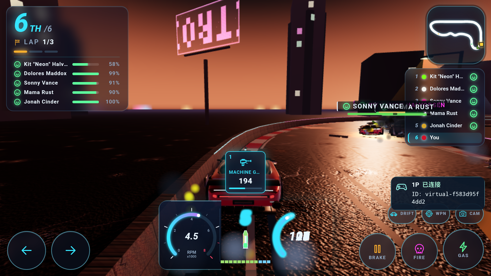
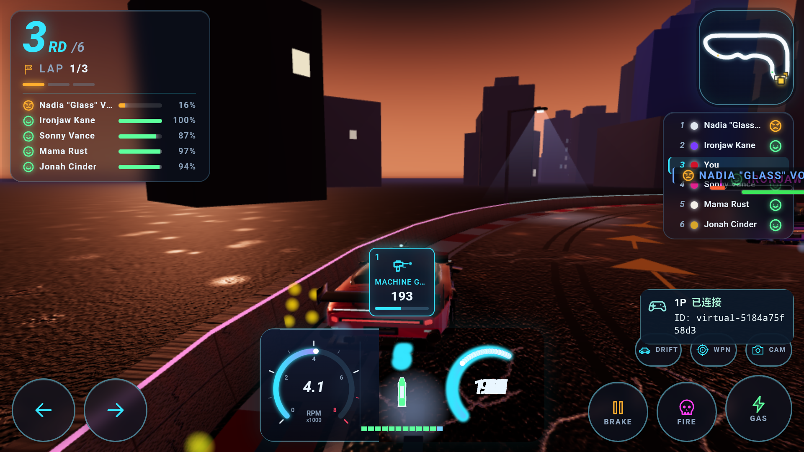

# Last Track · Android TV 0.1.0

[固定证书签名 APK](../../last-track-0.1.0.apk) · [版本清单](../../android-release.json) · [原包证书、资产及来源审计](../android-original-package-audit-44606071748/report.json)

[原生验收 44683165544](https://github.com/ecojust/pureTV/actions/runs/44683165544) 使用 Android TV API 36、1080p x86_64 模拟器和 Mesa 软件图形后端。两次从清空的应用数据启动，用原版 SDK 发出真实 TCP 按键，并在游戏设置中选择 Low。正常端口 63485 和占用回退端口 34605 各完成 57 项检查，接纳的 938 / 906 条 SDK 消息均收到唯一对应 ACK。

两次游玩均可看到车手排名、赛道、小地图和赛车，真实加速后的速度读数分别为 31.69 / 34.38。三个 HTML 菜单画面显示可选择的赛道、赛前设置和发车按钮。九键、暂停稳定性、第二手柄被拒、失焦、断线和手动恢复均有原始观察。该次 Android 验收覆盖首圈驾驶；完整赛事、生涯通关、重启后存档恢复以及实体电视／手柄未实测。

| 默认端口赛中画面 | 端口占用回退赛中画面 |
| --- | --- |
|  |  |

逐一核对两模式共 20 张原生截图与两份录像的 SHA256。两段约三分钟的录屏抽样显示标题、画质菜单和选车；实际驾驶留在后续截图与逐步状态报告中。右侧手柄卡与原游戏触控 HUD 同时显示，主要赛道与暂停操作仍可读。原 APK 的 148 个 dist 文件与当前游戏目录逐字节一致。

[默认端口报告](https://github.com/ecojust/pureTV/blob/a0b9c9301cdb33fe98fab328aad1f4f4b90de3ae/evidence/joystick-android-runtime-last-track/last-track-normal/report.json) · [占用回退报告](https://github.com/ecojust/pureTV/blob/a0b9c9301cdb33fe98fab328aad1f4f4b90de3ae/evidence/joystick-android-runtime-last-track/last-track-occupied/report.json) · [默认端口录屏](https://github.com/ecojust/pureTV/blob/a0b9c9301cdb33fe98fab328aad1f4f4b90de3ae/evidence/joystick-android-runtime-last-track/last-track-normal/controller-gameplay.mp4) · [占用回退录屏](https://github.com/ecojust/pureTV/blob/a0b9c9301cdb33fe98fab328aad1f4f4b90de3ae/evidence/joystick-android-runtime-last-track/last-track-occupied/controller-gameplay.mp4) · [核验清单](verification.json)
