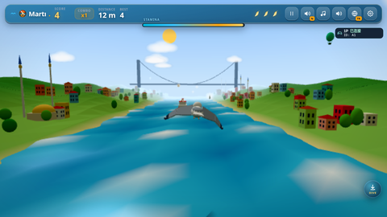

# 马尔蒂 · 博斯普鲁斯海鸥

在伊斯坦布尔的海峡上空扮演一只海鸥。贴近渡轮取走芝麻面包，俯冲抓鱼，带着面包飞到屋顶喂雏鸟。躲过船桅、风筝和桥梁，连续得分可以提高倍率。游戏包含无尽飞行、每日挑战和本地最高分。

## 手柄

| 操作 | 游玩时 | 菜单中 |
| --- | --- | --- |
| 方向键 / 左摇杆 | 左右转向，上下改变飞行高度 | 移动焦点，左右调节滑杆 |
| A | 按住俯冲，松开恢复高度 | 确认当前选项 |
| B | 暂停 | 返回，有上一级菜单时生效 |
| X / Y | 切换音乐 / 静音 | |
| START | 暂停或继续 | 开始飞行或确认主操作 |

支持 pureTV Wi-Fi 手柄、房间内的手机手柄、标准 USB / 蓝牙游戏手柄和键盘。键盘方向键对应方向，Z/X/C/V 依次对应 A/B/X/Y，P 对应 START。改变语言、声音和画质可进入设置。游戏失去焦点或活动手柄断开时会暂停。在三端应用的标题菜单按 B 可请求退出。

## 本地构建

在本目录运行 `npm ci && npm run build`。将静态服务器指向 `dist/`，打开 `tv.html` 即可离线游玩，需支持 WebGL 2。运行 `npm run build:check` 会重新构建并逐文件核对已提交的发行内容。主游戏、手柄菜单和原始素材位于 `src/`；三端使用同一套 `dist/` 资源。原作提供英语和土耳其语。

原作者为 Furkiozknn。固定提交、代码许可和素材详细来源见 [NOTICE](NOTICE.md)、[CREDITS](CREDITS.md) 和[素材说明](docs/assets.md)。
