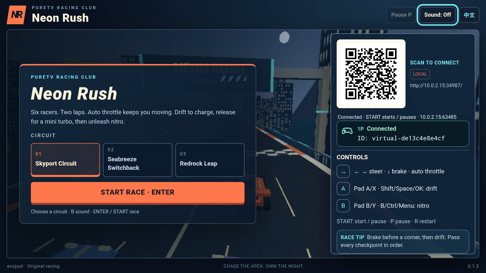
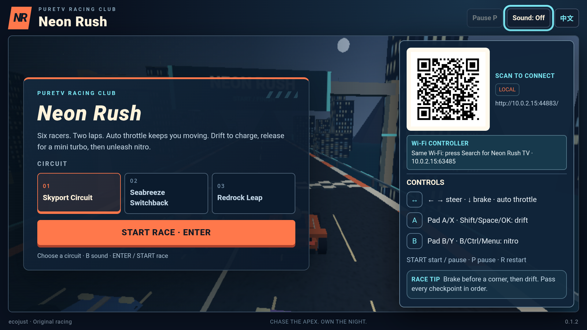

# Neon Rush TV · 霓虹飞车

<!-- apk-resource:start -->
[Android 0.1.5 APK](neon-rush-0.1.5.apk?raw=1) · [Windows x64](https://github.com/ecojust/pureTV/releases/download/gameplay-icons-2026.11.21/neon-rush-windows-x64-setup.exe) · [macOS](https://github.com/ecojust/pureTV/releases/download/gameplay-icons-2026.11.21/neon-rush-macos.dmg) · [Launcher artwork and installation checks](docs/releases/0.1.5/android-icon-receipt.json) · [Checksums](SHA256SUMS.txt) · [0.1.4 gameplay video](docs/releases/0.1.4/gameplay.mp4?raw=1)
<!-- apk-resource:end -->

## Earlier Android release 0.1.4 · Controllers and phone pairing

[Download the signed APK](neon-rush-0.1.4.apk?raw=1) · [Checksums](SHA256SUMS.txt) · [Package and source](resource.json)

Connect a keyboard, pair a pureTV Wi-Fi controller, or scan the TV room’s QR code with a phone on the same network. The connection indicator identifies each player while the game keeps its playing area at the same size. [Controller guide](../../docs/guide/README.en.md#install-a-game-and-connect-a-controller)

The signed APK upgraded Android 0.1.3 in place on an Android TV emulator. The original controller SDK completed 8 checks and received matching acknowledgements for 76 messages. [Gameplay screenshot](docs/releases/0.1.4/gameplay.png) · [Android gameplay recording](docs/releases/0.1.4/gameplay.mp4?raw=1) · [Verification and limitations](docs/releases/0.1.4/verification.json)

[中文](README.md) · [Design](docs/DESIGN.md) · [Reference](docs/REFERENCE.md) · [Licenses](NOTICE.md)

<!-- controller-client-status:start -->
## Earlier release 0.1.3 · Connected controller identity

<!-- previous-apk-resource:start -->
[Download signed APK](neon-rush-0.1.3.apk?raw=1) · [Checksums](SHA256SUMS.txt) · [Signing and source](resource.json) · [Source](src/) · [Icon](logo.svg)
<!-- previous-apk-resource:end -->

Android **0.1.3 / versionCode 4** shows a controller icon, player seat (1P/2P where supported), and the connected device's complete ID in the side area. Disconnected devices disappear. The default TCP port remains **63485**. Current controller firmware does not report RSSI, so signal strength is not displayed.

[Connected screenshot](docs/releases/0.1.3/connected.png) · [Controller-status recording](docs/releases/0.1.3/controller-status.mp4?raw=1) · [Version verification](docs/releases/0.1.3/verification.json) · [Twenty-game update record](../../docs/controller-client-status/README.md)

The APK uses the existing release certificate. This update verifies connection identity, disconnect/reconnect status and in-place installation in an Android TV emulator; the capture and video show the menu status checks. It does not repeat full gameplay acceptance. Unchanged model evidence is reused by exact hash, with previous reports retained below. Physical TVs, phones, ESP32 devices and upgrades containing existing user saves remain untested.



See the [Mac installation and controller guide](macos/README.md).
<!-- controller-client-status:end -->

Six racers, three original circuits, and a two-lap finish. Drift to charge nitro, release a clean drift for a mini turbo, and use the straights and canyon ramp to gain ground. Auto throttle keeps the car moving; you control the racing line, steering, and brakes.

Package: `com.ecojust.neonrushtv`. Requires Android 8.0/API26 or later and an Android System WebView with WebGL support. Update the system WebView if the game reports that 3D graphics cannot start. The minimum Android version is not a claim that every TV has been tested.

## Start a race

1. Choose a circuit and select Start Race or press Enter/remote OK. The car accelerates automatically after the countdown.
2. Steer left or right. Brake before a corner, then hold drift while turning. Release drift on the exit for a mini turbo.
3. When the nitro meter is full, trigger nitro on a straight. Pass the checkpoints in order and complete two laps. A race ends after three minutes of game time if you have not finished.

You race against five computer-controlled cars. The result shows your position, time, drift count, and nitro use. Finishing does not necessarily mean first place. Barrier and car contact reduce speed; riding a barrier cannot replace steering through a corner.

| Circuit | Character |
| --- | --- |
| Skyport Circuit | Elevated straights and broad turns for learning steering and nitro timing. |
| Seabreeze Switchback | Coastal turns and rolling hills that reward a clean line. |
| Redrock Leap | Canyon straights, boost pads, and a launch ramp. |

A car stalled for four seconds returns to its latest safe point. The race clock keeps running; recovery never awards a lap or checkpoint.

## Controls

| Action | Keyboard / TV remote | Phone controller |
| --- | --- | --- |
| Steer | Left / Right arrows | Move the left stick sideways |
| Brake | Down arrow | Pull the left stick down |
| Drift | Hold Shift / Space; hold remote OK during a race | Hold Drift while steering |
| Nitro | B / Ctrl | Tap Nitro |
| Start / resume | Enter / remote OK or the on-screen button | START |
| Pause / resume | P or the pause button | START during a race |
| Restart the whole race | R or Race Again after finishing | Use the TV's restart button |

You do not need to hold the accelerator. Drift charge requires a real turn and enough speed; holding drift on a straight earns no charge. Braking, losing focus, or cancelled input does not count as a successful drift release.

The installed TV app shows its QR panel on menu and pause screens. Connect the phone and TV to the same Wi-Fi, then scan the code. In the browser preview, click Phone to see the controls. The left stick steers and brakes; the two right-hand regions control drift and nitro. The race pauses when the phone disconnects. Touchscreens also have local steering, brake, drift, and nitro buttons. The QR controller requires the installed app's LAN service; the standalone static preview does not host that service.

## pureTV Wi-Fi controller

Since Android 0.1.2, the client has provided the nine-key pureTV TCP controller and mDNS service advertisement on default port **63485**. Put the TV and controller on the same network, wait for the game's connection address, and press the controller's GPIO23 Search key. Current firmware connects automatically only when it discovers exactly one target service. START starts/pauses; Left/Right steer; Down brakes; A/X drift; B/Y trigger nitro. Disconnecting or changing the control source clears input and pauses the race. Release the controls and press START again after reconnecting. Exiting the game closes the service.

The repository's original virtual controller also works: run `python3 puretv-joystick/bridge.py TV_IP --port 63485`, then open `http://127.0.0.1:8767/`. Use the advertised port if the default port was occupied. See [protocol and controls](docs/WIFI-CONTROLLER.md).

Historical version 0.1.1 completed 66 native regressions and six actual-game checks through the original virtual page/SDK; those historical counts do not claim a new run for the controller-identity update. See the [release verification](docs/releases/0.1.2/verification.json) and [historical rollout record](../../docs/readme-controller-support/README.md) for the eight completed actual-APK controller checks, verified in-place upgrade using the same certificate, and source hashes. Discovery and control on physical TVs, phones, and ESP32 devices remain untested.

## Presentation

The original cars, roads, city, coast, canyon scenery, textures, and sound are generated locally. Gameplay does not need online art or audio downloads. The HUD shows a minimap, position, laps, time, speed, and drift/nitro feedback. Sound can be toggled in the top bar or with B / remote Menu while on the race menu. The installed app initially follows the system Chinese/English language; mouse and touch users can also switch it in the top bar.

The game takes inspiration from the referenced repository's arcade drifting experience. It uses an independent name, vehicles, circuits, and implementation; no Tencent branding, official track layouts, or upstream game source code has been copied. See the [reference record](docs/REFERENCE.md).

## Development and validation

Editable modules are in [source](source/); generated APK assets are in [src/main/assets](src/main/assets/). From this directory:

```sh
npm ci
npm test
npm run build
npm run build:check
python3 tools/prepare-web.py --output /tmp/neon-rush-web
python3 -m http.server 8080 --directory /tmp/neon-rush-web
```

Open `http://127.0.0.1:8080/tv.html`. Browser results and physical TV tests are reported separately. Software-renderer speed and recording frame rate are not device performance measurements. See the [historical rollout record](../../docs/readme-controller-support/README.md) for the previous controller-input release. The Android 0.1.2 rule model is byte-identical to the corrected model delivered in macOS 0.1.3; its rule and direction evidence is reused by exact hash. See the [Mac direction and three-track checks](macos/docs/verification-0.1.3/README.md). [Android 0.1.1 verification](docs/releases/0.1.1/verification.json), its reused 0.1.0 rule checks, and its three-track videos remain historical evidence; they do not validate the steering fix introduced in Android 0.1.2. The [evidence index](docs/README.md) retains the original records. Physical TVs, phones and ESP32 devices have not been tested.

Android builds and the existing release certificate follow the [Game Kit build instructions](../../resource/game-kit/BUILD.md). Local builds are unsigned; source, payload, signature, and evidence must match before an APK is published.

<!-- controller-client-status-history:start -->
<details>
<summary>Historical 0.1.2 download and acceptance record</summary>

The following describes the previous release; its tests and media do not validate the new controller-ID UI. [Original README at the previous source](https://github.com/ecojust/pureTV/blob/9af9f197855eb7a0ce7174c0e6295c8974b3250d/resource/apps/neon-rush/README.en.md).

**Android 0.1.2 · Release-signed APK: 447,980 bytes (about 448 KB).** [Download APK](https://raw.githubusercontent.com/ecojust/pureTV/master/resource/apps/neon-rush/neon-rush-0.1.2.apk) · [Actual Android controller regression video](docs/releases/0.1.2/gameplay.mp4) · [Release verification](docs/releases/0.1.2/verification.json) · [Controller rollout record](../../docs/readme-controller-support/README.md) · [Icon](logo.svg)

That earlier update defaults the pureTV controller service to port **63485**, shows its actual connection status/address, and preserves the TCP connection while isolating input during temporary focus loss or QR-room refresh. It also brings the steering-direction fix already delivered in macOS 0.1.3 to Android.

That historical release-signed APK passed all eight controller acceptance checks in an Android TV API 36 emulator, covering start, actual gameplay input, pause/resume, disconnect/reconnect, nine-key input, and per-message ACKs. An in-place upgrade from the previous release signed with the same certificate was also verified. The menu screenshot and linked video come from the actual Android 0.1.2 APK; the video records the controller regression run. Physical TVs, phones, and ESP32 devices have not been tested.

Historical Android 0.1.1: [old English menu](https://raw.githubusercontent.com/ecojust/pureTV/bf58393ba8fa8bb3bdf731ab24f9ab09d90f5075/docs/previews/en/app-neon-rush.png) · [gameplay video](docs/releases/0.1.1/gameplay.mp4) · [verification](docs/releases/0.1.1/verification.json). These records describe the old version, not the 0.1.2 UI, steering fix, or controller validation.

**macOS 0.1.3:** [Download universal DMG](https://raw.githubusercontent.com/ecojust/pureTV/master/resource/apps/neon-rush/macos/NeonRush-0.1.3-macos-universal.dmg) · [ZIP, installation and controller guide](macos/README.md). Requires macOS 11+ and WebGL; includes Apple silicon / Intel code with keyboard and pureTV Wi-Fi controller support. The macOS 0.1.3 packages remain unchanged; their left/right steering fix is now included in Android 0.1.2 as well.



</details>
<!-- controller-client-status-history:end -->
